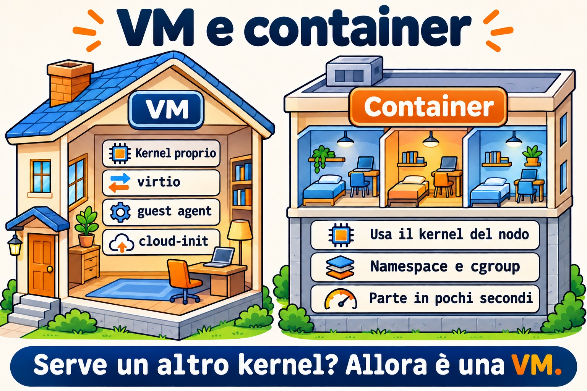
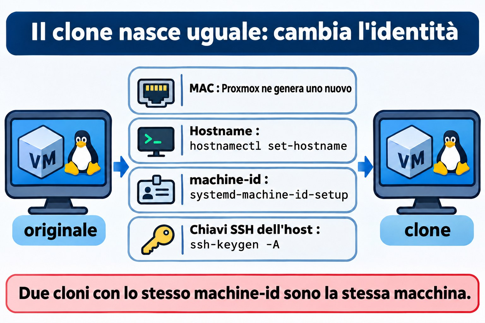

# Lezione 5.3 · Linux come guest

Nelle Lezioni 5.1 e 5.2 hai visto il kernel parlare con l'hardware. Solo che, nelle tue due VM, quell'hardware non esiste: a rispondere è QEMU, che gira sul nodo Proxmox. Oggi vedi Linux dall'interno della VM. Come fa a sapere di essere un guest, quali driver usa per andare più veloce, come parla con l'hypervisor tramite il guest agent e come viene configurato da solo al primo boot da cloud-init. Vedrai anche cosa succede quando qualcuno clona una VM e dimentica che certe cose devono essere uniche. Alla fine confronti una VM con un container, che sembra una macchina ma usa il kernel di un'altra.

> **Il cuore di questa lezione:** `systemd-detect-virt` e `hostnamectl` per sapere dove ti trovi; i dispositivi `virtio`; il `qemu-guest-agent`, da entrambi i lati (pacchetto nella VM, opzione in Proxmox); cosa fa cloud-init al primo boot; cosa deve essere unico in un clone: hostname, `/etc/machine-id` e le chiavi SSH dell'host; e la differenza tra VM e container: il kernel. Il resto è approfondimento.

| Scheda | Lezione 5.3 |
| --- | --- |
| Modulo | M5 · Hardware, kernel e virtualizzazione, lezione 3 di 3 |
| Quando | Settimana 9 |
| Alla fine sei in grado di | Dire se Linux gira in una VM, in un container o su una macchina fisica, e con quale hypervisor; riconoscere i dispositivi `virtio` e i loro moduli; installare e attivare il guest agent nella VM e in Proxmox, e usarlo con `qm agent` e `qm guest cmd`; spiegare cosa fa cloud-init e quando gira; elencare cosa deve essere unico in un clone e cambiare hostname, `machine-id` e chiavi SSH dell'host; vedere nella pratica che un container usa il kernel dell'host |
| Prerequisiti | Lezione 5.1 (`lspci -k`, `/sys`, `dmesg`); Lezione 5.2 (`lsmod`, `modinfo`); Lezione 4.2 (systemd e unit); l'SSH tra il tuo computer e le VM |
| Durata | Circa 2h30, più la Sfida del modulo |
| Snapshot | m5a3-inicio e m5a3-fim su entrambe le VM; m5-desafio prima della Sfida |

## 1 · Riscaldamento

Tre domande, a memoria. Scrivi le risposte; le soluzioni le controllano alla fine.

1. Entri via SSH su una macchina sconosciuta. Secondo te, con un solo comando si può capire se è una VM?
2. Cloni una VM Linux in Proxmox e accendi entrambe. Secondo te, avranno lo stesso `/etc/machine-id`? E conta qualcosa?
3. Un container Debian gira dentro la tua rocky-lab. Secondo te, cosa mostra `uname -r` al suo interno, il kernel di Debian o quello di Rocky?

## 2 · Perché conta

| La richiesta | La risposta sbagliata | Cosa provoca |
| --- | --- | --- |
| "Proxmox non mostra l'IP della VM, e lo spegnimento dalla GUI non funziona" | Spegnere con il pulsante Stop | Lo Stop è come staccare la spina. Quello che mancava era il guest agent: con lui, Proxmox vede l'IP, chiede uno spegnimento pulito e congela il file system durante il backup |
| "Ho clonato la VM e ora le due si contendono lo stesso IP del DHCP, e il monitoraggio ne vede una sola" | Cambiare l'hostname e considerare chiusa la questione | Il `machine-id` e le chiavi SSH restano uguali. A seconda della rete, il DHCP identifica le due come la stessa macchina; anche il journal, il monitoraggio e molti agent usano il `machine-id` |
| "SSH dice che l'identificazione del server è cambiata: `REMOTE HOST IDENTIFICATION HAS CHANGED`" | Cancellare tutto il `known_hosts`, o ignorare l'avviso | A volte è solo un clone con chiavi nuove. A volte è un attacco. Chi sa quando le chiavi sono cambiate e perché decide con calma e rimuove solo la riga giusta |
| "Facciamolo girare in un container, che è più leggero" | Trattare il container come una VM più piccola | Il container usa il kernel dell'host. Non carica moduli propri, non sceglie la versione del kernel e, se il kernel dell'host va giù, va giù anche lui |

## 3 · Modello mentale

> Pensa a un **edificio per uffici**, come nella Lezione 5.1. Una **VM** è una stanza in affitto con portineria propria: il suo kernel è tuo, con i tuoi driver, e l'hypervisor finge di essere l'hardware. I driver `virtio` sono il citofono diretto con l'amministratore: invece di fingere un hardware vecchio, il guest sa di essere in una VM e parla la lingua dell'hypervisor, che è più veloce. Il **guest agent** è il custode della stanza, che risponde all'amministratore (Proxmox) quando questi chiede l'IP o ordina di chiudere tutto. **cloud-init** è il kit del trasloco: il primo giorno monta la stanza con il nome, gli utenti e le chiavi arrivati nel pacchetto. Un **container** non è una stanza con portineria: è un tramezzo dentro un'altra stanza, che usa la stessa portineria (lo stesso kernel).

```text
  MÁQUINA FÍSICA (nó Proxmox)
  ┌───────────────────────────────────────────────────────────────┐
  │ kernel do nó (KVM)                                            │
  │  ┌────────────── QEMU ─────────────┐   ┌──── LXC ───────────┐ │
  │  │ VM rocky-lab                    │   │ contêiner           │ │
  │  │  kernel PRÓPRIO                 │   │  processos isolados │ │
  │  │  virtio_net, virtio_scsi        │   │  SEM kernel próprio │ │
  │  │  qemu-guest-agent ◄── canal ────┼─► │  usa o kernel do nó │ │
  │  │  cloud-init (1º boot)  virtio-serial │                     │ │
  │  └─────────────────────────────────┘   └─────────────────────┘ │
  └───────────────────────────────────────────────────────────────┘
```



*La VM ha un kernel proprio; il container usa il kernel del nodo.*

## 4 · L'essenziale

### Dove sono?

| Comando | Cosa mostra |
| --- | --- |
| `systemd-detect-virt` | `kvm`, `qemu`, `vmware`, `microsoft`, `oracle`... in una VM; `lxc`, `podman`, `docker`... in un container; `none` sulla macchina fisica |
| `systemd-detect-virt -c` / `-v` | Solo container / solo VM |
| `hostnamectl` | Riga `Virtualization:` e `Chassis: vm`, oltre a hostname e kernel |
| `lscpu \| grep -i hypervisor` | `Hypervisor vendor: KVM` |
| `sudo dmidecode -s system-product-name` | Il "modello" che l'hypervisor si è inventato, come `Standard PC (Q35 + ICH9, 2009)` |

### I driver virtio

L'hypervisor può imitare un hardware reale e vecchio, come la scheda di rete e1000 o un disco IDE. Funziona su qualsiasi sistema, ma è lento, perché ogni accesso viene tradotto. **virtio** è un hardware che esiste solo nelle VM: il guest lo sa e parla direttamente con l'hypervisor. In Linux, i driver virtio sono già nel kernel.

| Dispositivo in Proxmox | Driver nel guest | Come appare |
| --- | --- | --- |
| VirtIO SCSI (controller) | `virtio_scsi` | Dischi `sda`, `sdb`... |
| VirtIO Block | `virtio_blk` | Dischi `vda`, `vdb`... |
| Scheda VirtIO | `virtio_net` | `ens18` o `eth0` |
| Balloon | `virtio_balloon` | L'hypervisor può riprendersi la RAM |
| RNG VirtIO | `virtio_rng` | Fonte di casualità |
| Seriale VirtIO | `virtio_console` | Il canale del guest agent |

### Il guest agent

Il `qemu-guest-agent` è un servizio che gira **dentro** la VM e risponde a Proxmox tramite un canale seriale virtuale. Ha bisogno di due metà, e dimenticarne una è l'errore classico:

1. **In Proxmox:** l'opzione `QEMU Guest Agent` attivata (`qm set ID --agent enabled=1`). Crea il dispositivo seriale, e vale solo dopo aver spento e riacceso la VM da Proxmox.
2. **Nella VM:** il pacchetto `qemu-guest-agent` installato e il servizio in esecuzione.

Con entrambe le metà, Proxmox mostra gli IP nella GUI, fa uno spegnimento pulito, congela il file system (`fsfreeze`) durante il backup perché la copia esca coerente, e ti lascia fare domande con `qm agent` e `qm guest cmd`.

### cloud-init

cloud-init gira al **primo boot** di un'immagine cloud e configura la macchina con dati che arrivano dall'esterno: hostname, utenti, chiavi SSH autorizzate, rete e pacchetti. Questi dati arrivano da una **datasource**: un servizio di metadati su AWS o OpenStack, oppure un CD virtuale in Proxmox (la scheda Cloud-Init). cloud-init conserva un `instance-id`: finché non cambia, la macchina non si considera nuova e non rifà la configurazione del primo boot.

| Comando o file | A cosa serve |
| --- | --- |
| `cloud-init status --long` | È partito? Ha finito? Ci sono errori? |
| `/var/log/cloud-init.log` e `cloud-init-output.log` | Cosa ha fatto, passo dopo passo |
| `/etc/cloud/cloud.cfg` e `/etc/cloud/cloud.cfg.d/` | Cosa è autorizzato a modificare |
| `sudo cloud-init clean --logs` | Cancella lo stato. Al prossimo boot agisce come se fosse la prima volta. È quello che si fa prima di trasformare la VM in un template |

### Cloni e cosa deve essere unico

Un **clone completo** copia l'intero disco. Un **clone collegato** (linked clone) usa il disco del template come base e scrive solo le differenze. In entrambi i casi, il disco del clone parte uguale all'originale, con tutto ciò che contiene:

| Identificatore | Dove si trova | Chi lo cambia |
| --- | --- | --- |
| Indirizzo MAC | Configurazione della VM | Proxmox ne genera uno nuovo nel clone |
| Hostname | `/etc/hostname` e `/etc/hosts` | Tu, con `hostnamectl set-hostname`, oppure cloud-init |
| `machine-id` | `/etc/machine-id` (su Debian, anche `/var/lib/dbus/machine-id`) | Tu, con `systemd-machine-id-setup`, oppure l'immagine arriva già con il file vuoto |
| Chiavi SSH dell'host | `/etc/ssh/ssh_host_*` | Tu, con `ssh-keygen -A`, oppure cloud-init |
| IP fisso | Configurazione di rete | Tu, oppure cloud-init |

Il `machine-id` è il "codice fiscale" dell'installazione: 32 caratteri esadecimali creati durante l'installazione. Il journal conserva i log in una cartella con quel nome, `systemd-networkd` usa quell'ID per identificarsi nel DHCP, e lo fanno anche molti agent di monitoraggio o di backup. Due cloni con lo stesso `machine-id` sono, per questi strumenti, la stessa macchina.

Le **chiavi SSH dell'host** dimostrano al client che il server è lo stesso dell'ultima volta. Due cloni con le stesse chiavi sono indistinguibili per SSH: se uno dei due viene compromesso, la sua chiave privata serve per spacciarsi per l'altro.



*Il clone nasce uguale all'originale: cambia ciò che identifica la macchina.*

### VM e container a confronto

|  | VM (QEMU/KVM, `qm`) | Container (LXC con `pct`, Podman, Docker) |
| --- | --- | --- |
| Kernel | Proprio | Quello dell'host |
| Boot | GRUB, initramfs, systemd | Parte direttamente dal processo principale, a volte un systemd |
| Moduli e `sysctl` | Carica e modifica i suoi | Non carica moduli; molti `sysctl` sono in sola lettura o dell'host |
| Altro sistema operativo | Qualsiasi, anche Windows | Solo Linux, con il kernel di chi ospita |
| Isolamento | Forte: lo separa l'hypervisor | Più debole: tutto dipende dal kernel condiviso |
| Costo | Più RAM e più disco | Leggero: parte in pochi secondi |

### Rocky × Debian

| Tema | Rocky | Debian |
| --- | --- | --- |
| Guest agent | `dnf install qemu-guest-agent` | `apt install qemu-guest-agent` |
| Attivare il servizio | Il pacchetto non si attiva da solo in ogni versione: controlla con `systemctl status` e attiva con `systemctl enable --now` | Il servizio parte quando compare il dispositivo seriale; senza l'opzione attiva in Proxmox, resta fermo in attesa |
| Chiave SSH dell'host assente | `sshd-keygen@.service` genera quelle mancanti quando parte `sshd` | `ssh` non parte. Bisogna eseguire `ssh-keygen -A` o `dpkg-reconfigure openssh-server` |
| `/var/lib/dbus/machine-id` | Di solito non esiste; D-Bus legge `/etc/machine-id` | Di solito è un link a `/etc/machine-id`; controlla con `ls -l` |
| Immagini cloud | Arrivano con cloud-init | Arrivano con cloud-init |

## 5 · Lab guidato

### Passo 0 · Snapshot e cartella

Sul nodo Proxmox:

```bash
qm snapshot 201 m5a3-inicio
qm snapshot 202 m5a3-inicio
```

In ogni VM:

```bash
mkdir -p ~/lab53 && cd ~/lab53
```

### Passo 1 · Dove sono?

In entrambe le VM:

```bash
systemd-detect-virt
hostnamectl
lscpu | grep -i hypervisor
sudo dmidecode -s system-product-name
lspci | grep -i virtio
lsmod | grep virtio
```

Esegui `systemd-detect-virt` anche sul nodo Proxmox. Deve rispondere `none`: il nodo è la macchina fisica.

Annota in `~/lab53/notas.txt` cosa ha risposto `systemd-detect-virt` in ogni posto e quali moduli `virtio` carica ciascuna VM. Confronta con quello che mostra la scheda Hardware della VM in Proxmox: il controller del disco e il modello della scheda di rete.

### Passo 2 · Il guest agent, le due metà

Prima, la metà della VM. Sulla rocky-lab:

```bash
sudo dnf -y install qemu-guest-agent
sudo systemctl enable --now qemu-guest-agent
systemctl status qemu-guest-agent --no-pager
```

Sulla debian-lab:

```bash
sudo apt -y install qemu-guest-agent
systemctl status qemu-guest-agent --no-pager
```

Su Debian, il servizio può risultare fermo, in attesa del dispositivo `virtio-ports/org.qemu.guest_agent.0`. È normale finché l'altra metà non è attiva.

Ora, la metà di Proxmox. Sul nodo:

```bash
qm config 201 | grep agent
qm set 201 --agent enabled=1
qm set 202 --agent enabled=1
```

### Decidi 1

Hai attivato l'opzione dell'agent. Sulla debian-lab esegui `sudo systemctl reboot`. Quando torna su, esegui `qm agent 202 ping` sul nodo. Cosa succede?

- A) Risponde senza errori, perché la VM si è riavviata.
- B) Dà errore, perché il reboot dall'interno della VM non applica la modifica hardware.
- C) Dà errore, perché il servizio di Debian ha bisogno di un `enable` manuale.

Scegli un'opzione prima di continuare. Poi fai la prova.

| Se hai scelto | Risultato | Perché |
| --- | --- | --- |
| A | Sbagliato | Il reboot dall'interno riavvia il sistema, ma il processo QEMU resta lo stesso, con il vecchio hardware. La GUI mostra l'opzione come modifica in sospeso |
| B | Giusto | Una modifica hardware vale solo quando Proxmox spegne e riaccende la VM: `qm shutdown` e `qm start`, oppure `qm reboot`, oppure il Reboot della GUI |
| C | Sbagliato | Su Debian, il servizio parte da solo quando compare il dispositivo. Il problema è che il dispositivo non esiste ancora |

Ora applica davvero e parla con l'agent:

```bash
qm reboot 201
qm reboot 202
# espere as VMs voltarem
qm agent 201 ping && echo ok
qm agent 202 ping && echo ok
qm guest cmd 202 get-osinfo
qm guest cmd 202 network-get-interfaces | grep -E '"name"|ip-address"'
qm guest cmd 201 get-fsinfo | grep -E 'mountpoint|type'
```

Nella GUI, la pagina Summary delle due VM ora mostra gli IP.

**Da ricordare:** il guest agent funziona solo con entrambe le metà: il pacchetto dentro la VM e l'opzione in Proxmox, applicata con uno spegnimento e riaccensione fatti da Proxmox.

### Passo 3 · cloud-init, solo guardando

Le tue VM sono state installate dall'ISO, quindi cloud-init probabilmente non c'è. Controlla:

```bash
command -v cloud-init || echo "cloud-init não instalado"
```

Se è installato, guarda senza cambiare nulla:

```bash
cloud-init status --long
sudo tail -20 /var/log/cloud-init.log
ls /etc/cloud/cloud.cfg.d/
```

Sul nodo, guarda come Proxmox consegna i dati a cloud-init per una VM che usa un'immagine cloud:

```bash
man qm | grep -A2 -E '^ +--(ciuser|sshkeys|ipconfig0)'
```

Le opzioni `--ciuser`, `--sshkeys` e `--ipconfig0` finiscono in un CD virtuale che cloud-init legge al boot. Per ora non monterai nessun template. Tornerà nel modulo di automazione.

### Passo 4 · L'identità della VM

Sulla debian-lab:

```bash
hostnamectl hostname
cat /etc/machine-id
ls -l /var/lib/dbus/machine-id
ls /var/log/journal/
ls -l /etc/ssh/ssh_host_*
for k in /etc/ssh/ssh_host_*_key.pub; do ssh-keygen -lf "$k"; done
```

Sul tuo computer, confronta l'impronta con quella che il client SSH ha memorizzato:

```bash
ssh-keygen -F IP_DA_DEBIAN -l
```

Il nome della cartella in `/var/log/journal/` è il `machine-id`. Salva le tre cose in `~/lab53/identidade.txt`: hostname, `machine-id` e l'impronta della chiave `ed25519`. Ti serviranno nella Sfida.

### Decidi 2

Cloni la debian-lab senza toccare nulla e accendi il clone. Quali di queste cose ha il clone **uguali** all'originale?

- A) Solo l'hostname.
- B) Hostname, `machine-id` e chiavi SSH dell'host. Il MAC è nuovo.
- C) Tutto, compreso il MAC.

Scegli un'opzione prima di continuare. La verifica è rimandata alla Sfida del modulo.

| Se hai scelto | Risultato | Perché |
| --- | --- | --- |
| A | Sbagliato | Il disco viene copiato per intero, e con lui i file `/etc/machine-id` e `/etc/ssh/ssh_host_*` |
| B | Giusto | Il MAC sta nella configurazione della VM, e Proxmox ne genera un altro nel clone. Tutto ciò che sta sul disco arriva uguale |
| C | Sbagliato | Proxmox cambia il MAC proprio perché le due possano stare sulla stessa rete |

**Da ricordare:** il clone copia il disco. Tutto ciò che identifica la macchina e vive sul disco va cambiato a mano, con uno strumento come `virt-sysprep`, oppure con cloud-init.

### Passo 5 · Un container accanto

Sulla rocky-lab, con internet:

```bash
sudo dnf -y install podman
uname -r
podman run --rm docker.io/library/debian:12 cat /etc/os-release
podman run --rm docker.io/library/debian:12 uname -r
podman run --rm docker.io/library/debian:12 ls /boot /lib/modules
```

Il container dice di essere Debian 12, ma `uname -r` mostra il kernel di Rocky, con `el9` nel nome. E non ci sono né `/boot` né moduli: non c'è nessun kernel da caricare. È la risposta alla domanda 3 del Riscaldamento, dal vivo.

Per finire, prova a cambiare un parametro del kernel dall'interno del container:

```bash
podman run --rm docker.io/library/debian:12 sh -c 'echo 10 > /proc/sys/vm/swappiness'
```

Il kernel rifiuta, perché `/proc/sys` nel container appare in sola lettura: il kernel è dell'host, e a comandarlo è l'host.

## 6 · Rompi e ripara

In questo guasto cancelli le chiavi SSH dell'host in entrambe le VM e vedi che ogni distro reagisce in modo diverso. **Fallo dalla console di Proxmox**, non via SSH. Una sessione SSH aperta non cade quando il servizio si riavvia, ma non riesci ad aprirne un'altra.


*Ogni clone ha bisogno di una nuova identità: hostname, machine-id e chiavi SSH.*


In entrambe le VM:

```bash
sudo cp -a /etc/ssh ~/lab53/ssh-antes
sudo rm /etc/ssh/ssh_host_*
```

Sulla rocky-lab, `sudo systemctl restart sshd`. Sulla debian-lab, `sudo systemctl restart ssh`. Poi indaga senza guardare la riparazione:

```bash
systemctl status sshd --no-pager      # Rocky
systemctl status ssh --no-pager       # Debian
journalctl -b -u ssh --no-pager | tail -5
ls /etc/ssh/ssh_host_*
```

Su Rocky, `sshd` parte: `sshd-keygen@` ha generato chiavi nuove prima. Su Debian, `ssh` fallisce, con qualcosa come `no hostkeys available`. Dal tuo computer, prova a entrare in entrambe. Rocky risponde con l'avviso `REMOTE HOST IDENTIFICATION HAS CHANGED`, perché le chiavi sono cambiate. Debian rifiuta la connessione.

La riparazione su Debian:

```bash
sudo ssh-keygen -A
sudo systemctl restart ssh
systemctl status ssh --no-pager
```

Sul tuo computer, rimuovi solo la vecchia riga di ogni VM e rientra, controllando la nuova impronta con quella che mostra la console:

```bash
ssh-keygen -R IP_DA_ROCKY
ssh-keygen -R IP_DA_DEBIAN
```

La lezione: l'avviso di chiave cambiata non si ignora e non si risolve cancellando tutto il `known_hosts`. Scopri **perché** la chiave è cambiata, controlli la nuova impronta per un'altra strada (qui, la console) e solo allora togli la vecchia riga.

## 7 · Trappole

- **Attivare l'agent solo da un lato.** Il pacchetto senza l'opzione in Proxmox, o l'opzione senza il pacchetto, danno lo stesso risultato: niente.
- **Riavviare dall'interno e aspettarsi una modifica hardware.** Solo lo spegnimento e riaccensione fatti da Proxmox la applica.
- **Cancellare `/etc/machine-id`.** La strada giusta è svuotarlo, oppure rimuoverlo e ricrearlo con `systemd-machine-id-setup`, e controllare `/var/lib/dbus/machine-id` su Debian. Un sistema senza il file può non avviarsi correttamente.
- **Fare un template senza pulire.** Se trasformi una VM in template senza pulire `machine-id`, chiavi SSH e lo stato di cloud-init, tutti i cloni nascono gemelli.
- **Dimenticare `/etc/hosts`.** `hostnamectl set-hostname` cambia `/etc/hostname`, ma il vecchio nome resta in `/etc/hosts`, e `sudo` può diventare lento o lamentarsi.
- **Trattare il container come una VM.** Non ha un kernel proprio: moduli, molti `sysctl` e la versione del kernel arrivano dall'host.
- **Clone con IP fisso collegato alla rete.** Due IP uguali sulla stessa rete mettono fuori uso entrambe le macchine a poco a poco. Accendi il clone con la scheda scollegata finché non cambi l'IP.

## 8 · Quiz

1. Quale comando dice se sei in una VM, in un container o su una macchina fisica?
2. Quali sono le due metà del guest agent, e come si applica la metà di Proxmox?
3. Cosa fa cloud-init, e quando?
4. Cita tre cose che devono essere uniche in un clone e dì dove si trova ciascuna.
5. Perché un container Debian dentro Rocky mostra il kernel di Rocky?
6. *Which file holds the systemd machine ID, and which command creates a new one?*

## 9 · Promemoria

### Da sapere a memoria

| Comando o file | Fa |
| --- | --- |
| `systemd-detect-virt` / `hostnamectl` | Dove sono / hostname, chassis e virtualizzazione |
| `qm set ID --agent enabled=1` + `qm reboot ID` | Attiva l'agent in Proxmox e lo applica |
| `qm agent ID ping` / `qm guest cmd ID network-get-interfaces` | Testa l'agent / chiede gli IP |
| `hostnamectl set-hostname nome` | Cambia l'hostname (e poi `/etc/hosts`) |
| `/etc/machine-id` + `systemd-machine-id-setup` | L'ID dell'installazione e chi lo ricrea |
| `/etc/ssh/ssh_host_*` + `ssh-keygen -A` | Le chiavi dell'host e chi genera quelle mancanti |
| `ssh-keygen -R host` | Rimuove solo quell'host dal `known_hosts` |

### Da consultare

`systemd-detect-virt -c` e `-v`, `lscpu`, `dmidecode`, `virtio_scsi`, `virtio_blk`, `virtio_net`, `virtio_balloon`, `qm guest cmd ID get-osinfo`, `get-fsinfo`, `fsfreeze-status`, `cloud-init status --long`, `cloud-init clean --logs`, `/var/log/cloud-init.log`, `/etc/cloud/cloud.cfg.d/`, `qm set --ciuser --sshkeys --ipconfig0`, `qm clone --full`, `qm template`, `virt-sysprep`, `sshd-keygen@.service`, `dpkg-reconfigure openssh-server`, `ssh-keygen -lf`, `ssh-keygen -F`, `podman run --rm`, `pct list`.

### Flashcard

| Domanda | Risposta |
| --- | --- |
| `systemd-detect-virt` sulla macchina fisica risponde... | `none` |
| Il reboot dall'interno della VM applica una modifica hardware? | No; solo lo spegnimento e riaccensione di Proxmox |
| Il clone di Proxmox cambia il MAC? | Sì; quello che sta sul disco, no |
| Debian senza chiave SSH dell'host... | `ssh` non parte; Rocky genera chiavi nuove da sola |
| Il container ha un kernel proprio? | No; usa quello dell'host |

## 10 · Checklist e chiusura

- [ ] Ho scoperto dove gira ogni macchina con `systemd-detect-virt` e `hostnamectl`
- [ ] Ho riconosciuto i dispositivi e i moduli `virtio` delle due VM
- [ ] Ho attivato il guest agent da entrambi i lati e ho visto gli IP con `qm guest cmd`
- [ ] Ho spiegato cosa fa cloud-init, anche senza averlo installato
- [ ] Ho annotato hostname, `machine-id` e chiave SSH della debian-lab
- [ ] Ho visto un container Debian girare sul kernel di Rocky
- [ ] Ho cancellato le chiavi SSH dell'host, ho visto la differenza tra le distro e ho riparato

**Ultimo esercizio, senza guardare la lezione:** dall'interno di ogni VM, senza usare la GUI, dì qual è il suo IP e confermalo dal nodo con `qm guest cmd`. Poi, sulla rocky-lab, cancella l'immagine che Podman ha scaricato (`podman images`, poi `podman rmi` con il nome che compare).

**Reboot e verifica:** riavvia le due VM da Proxmox (`qm reboot`) e controlla:

```bash
systemctl status qemu-guest-agent --no-pager   # active (running)
systemctl --failed                              # vazio
ls ~/lab53
```

Sul nodo, `qm agent 201 ping` e `qm agent 202 ping` senza errori.

**Snapshot di fine**, sul nodo Proxmox:

```bash
qm snapshot 201 m5a3-fim
qm snapshot 202 m5a3-fim
```

Il guest agent resta attivo da qui in poi. Ti aiuterà con i backup e con i prossimi moduli.

## 11 · Nella vita reale

**Missione, sola lettura.** Su un server reale che amministri, esegui solo questi comandi, che non cambiano nulla:

```bash
systemd-detect-virt
hostnamectl
systemctl is-active qemu-guest-agent 2>/dev/null || echo "sem guest agent"
cat /etc/machine-id
command -v cloud-init && cloud-init status
```

Se è una VM di Proxmox, guarda anche, sul nodo, solo in lettura: `qm config ID | grep agent`.

Rispondi: le VM che amministri hanno il guest agent da entrambi i lati? Se non ce l'hanno, il loro backup sta uscendo senza congelare il file system. Due tue macchine hanno lo stesso `machine-id`? Rivela un clone fatto male. Annota quello che hai trovato. Non cambiare nulla da solo.

**Diario:** scrivi tre righe su quello che hai imparato oggi e un dubbio che ti è rimasto.

**Domani, senza guardare:**

1. Elenca, in ordine, cosa faresti su un clone appena creato prima di collegarlo alla rete.
2. Spiega perché il reboot dall'interno della VM non attiva il guest agent.
3. Dì un vantaggio e uno svantaggio del container rispetto alla VM.

## 12 · Approfondire quando vuoi

- `virt-sysprep` (pacchetto `guestfs-tools` o `libguestfs-tools`): pulisce `machine-id`, chiavi SSH, log e cronologia del disco di una VM spenta.
- Template in Proxmox con immagini cloud di Rocky e di Debian: `qm importdisk`, la scheda Cloud-Init e `qm template`.
- I file `user-data`, `meta-data` e `network-config` di cloud-init, e la datasource NoCloud.
- Clone collegato contro clone completo: spazio, prestazioni e perché non si cancella il template di un clone collegato.
- `systemd-firstboot` e `ConditionFirstBoot=`: come fa systemd a sapere che è il primo boot.
- Container LXC in Proxmox (`pct`), privilegiati e non privilegiati.
- Namespace e cgroup: i pezzi del kernel che fanno esistere un container.

In DeepTutor: `!explica guest agent do QEMU`, `!feynman diferença entre VM e contêiner`, `!quiz Linux como convidado`.

## Sfida del modulo 5

**La missione:** clonare la debian-lab e dare al clone un'identità propria: hostname, `machine-id` e chiavi SSH dell'host. Alla fine, le due VM restano accese insieme, sulla stessa rete, senza conflitti. Senza guardare la lezione; le soluzioni hanno dei suggerimenti, se ti blocchi.

**Prima di cominciare**, sul nodo Proxmox:

```bash
qm snapshot 202 m5-desafio
qm list          # escolha um VMID livre, por exemplo 902
```

**Regole:**

- Clone completo, sullo storage `vm-hdd`, con il nome `debian-clone`.
- Accendi il clone con la scheda di rete **scollegata** e fai tutto dalla console, finché l'identità non è cambiata. Se la debian-lab usa un IP fisso, cambia anche l'IP.
- La debian-lab originale non cambia in nulla.
- Tempo obiettivo: 30 minuti.

**Criteri di successo:**

| Da verificare | Come | Atteso |
| --- | --- | --- |
| Hostname | `hostnamectl hostname` sul clone | `debian-clone`, e `/etc/hosts` senza il vecchio nome |
| `machine-id` | `cat /etc/machine-id` su entrambe | Diversi; quello del clone con 32 caratteri esadecimali |
| D-Bus | `ls -l /var/lib/dbus/machine-id` sul clone | Link a `/etc/machine-id`, oppure lo stesso contenuto |
| Chiavi SSH | `ssh-keygen -lf /etc/ssh/ssh_host_ed25519_key.pub` su entrambe | Impronte diverse; confronta con `identidade.txt` |
| Rete | `ip -br a` su entrambe, con il clone già collegato | IP diversi, ed entrambe rispondono al `ping` |
| SSH | Dal tuo computer, `ssh` verso entrambe | Entrambe accettano; il clone compare come host nuovo nel `known_hosts` |
| Agent | `qm agent 902 ping` sul nodo | Senza errori |

**Rollback**, se qualcosa va storto sull'originale: `qm rollback 202 m5-desafio`.

**Pulizia**, quando hai finito e hai controllato tutto: sul nodo, `qm stop 902` e poi `qm destroy 902 --purge`. Controlla il numero due volte prima di premere Invio. Sul tuo computer, togli il clone dal `known_hosts` con `ssh-keygen -R IP_DO_CLONE`.

## Soluzioni commentate

### Riscaldamento

1. Sì. `systemd-detect-virt` risponde `kvm`, `vmware`, `lxc`... oppure `none`. Anche `hostnamectl` lo mostra, nella riga `Virtualization`.
2. Sì, avranno lo stesso, perché il file è sul disco e il disco è stato copiato. E conta: il journal, il DHCP di `systemd-networkd` e vari agent usano il `machine-id` per sapere chi è chi.
3. Quello di Rocky. Il container porta i file di Debian, ma gira sul kernel dell'host.

### Quiz

1. `systemd-detect-virt`. Va bene anche `hostnamectl`.
2. Il pacchetto `qemu-guest-agent` in esecuzione dentro la VM, e l'opzione `--agent enabled=1` in Proxmox. L'opzione crea un dispositivo seriale e vale solo dopo che Proxmox ha spento e riacceso la VM, per esempio con `qm reboot`.
3. Configura la macchina al primo boot con dati di una datasource: hostname, utenti, chiavi SSH, rete, pacchetti. Lo rifà solo se l'`instance-id` cambia o se qualcuno esegue `cloud-init clean`.
4. Hostname, in `/etc/hostname` e `/etc/hosts`; `machine-id`, in `/etc/machine-id` (e `/var/lib/dbus/machine-id`); chiavi SSH dell'host, in `/etc/ssh/ssh_host_*`. Vale anche l'IP fisso, nella configurazione di rete. Il MAC lo cambia già Proxmox.
5. Perché il container non ha un kernel proprio. È un gruppo di processi isolati che gira sul kernel dell'host.
6. *`/etc/machine-id`. Empty or remove it, then run `systemd-machine-id-setup`; on Debian, check that `/var/lib/dbus/machine-id` matches or links to it.*

### Suggerimenti per la Sfida

Prova prima da solo. Se ti blocchi, leggine una alla volta.

1. **Clone e scheda scollegata:** `qm clone 202 902 --name debian-clone --full --storage vm-hdd`. Poi, `qm config 902 | grep net0`, e ripeti la riga con `,link_down=1` in fondo: `qm set 902 --net0 virtio=MAC_DO_CLONE,bridge=vmbr0,link_down=1`. Usa il MAC che il clone ha ricevuto, per non generarne un altro. Solo allora `qm start 902` e apri la console.
2. **Hostname:** `sudo hostnamectl set-hostname debian-clone`, e cambia il vecchio nome in `/etc/hosts` con `sudoedit /etc/hosts` o con il `sed -i` della Lezione 3.4.
3. **machine-id:** `sudo rm /etc/machine-id`, poi `sudo systemd-machine-id-setup`. Controlla `/var/lib/dbus/machine-id`: se è un link, è già a posto; se è un file normale, `sudo rm /var/lib/dbus/machine-id` e `sudo ln -s /etc/machine-id /var/lib/dbus/machine-id`.
4. **Chiavi SSH:** `sudo rm /etc/ssh/ssh_host_*`, poi `sudo ssh-keygen -A` e `sudo systemctl restart ssh`. Se dimentichi `ssh-keygen -A`, sai già cosa succede: il Guasto di questa lezione.
5. **Reboot e rete:** riavvia il clone perché tutto passi a usare il nuovo `machine-id`. La nuova cartella compare in `/var/log/journal/`, e la vecchia si può cancellare. Cambia l'IP se è fisso, e solo allora ricollega: `qm set 902 --net0 virtio=MAC_DO_CLONE,bridge=vmbr0` (senza il `link_down`).
6. **Verificare:** esegui la tabella dei criteri. Se il `machine-id` del clone è ancora uguale a quello dell'originale, controlla di non aver modificato la VM sbagliata. Il prompt mostra l'hostname, ed è per questo che viene per primo.

---

<!-- navegacao -->
[← Lezione 5.2 · Moduli e parametri](5.2-modulos-e-parametros.md) · [Indice delle lezioni](../01-aulas.md) · [Lezione 6.1 · Pacchetti su Debian →](6.1-pacotes-no-debian.md)
