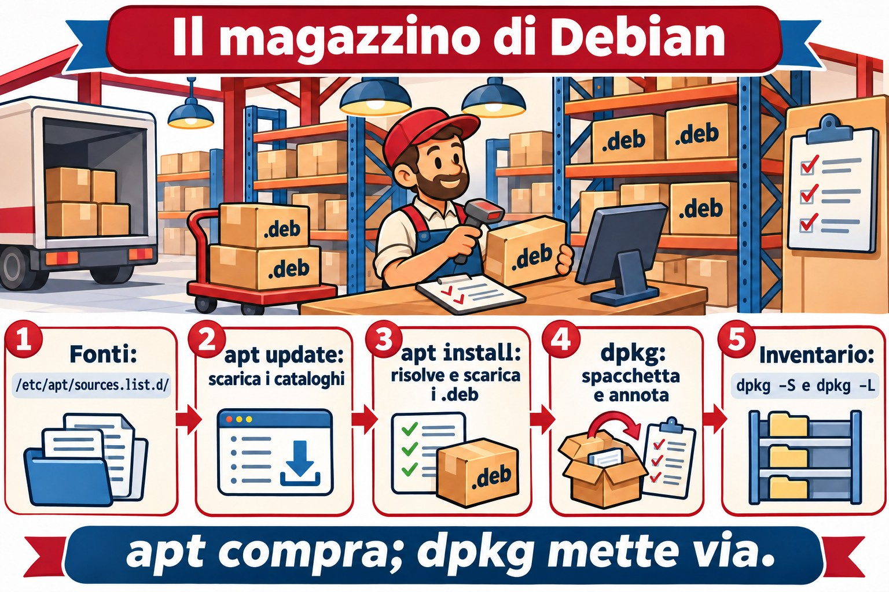
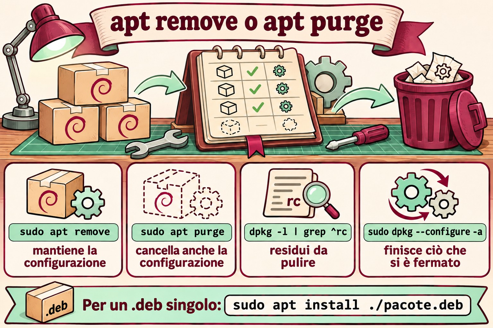

# Lezione 6.1 · Pacchetti su Debian

Finora hai installato programmi con un `apt install` qua e uno là, senza pensarci troppo. Oggi guardi dentro. Cos'è un pacchetto, chi lo spacchetta, chi lo scarica da internet e risolve le dipendenze, cosa resta sul disco quando rimuovi, e come scoprire da quale pacchetto arriva un file qualsiasi. Leggi anche le sorgenti da cui apt scarica tutto, nel formato nuovo, il deb822. Questa è la prima di cinque lezioni sul software. La prossima fa lo stesso su Rocky, e vedrai che l'idea è la stessa, solo con nomi diversi.

> **Il cuore di questa lezione:** `apt update`, `apt install`, `apt remove`, `apt purge` e `apt autoremove`; `apt search` e `apt show`; `dpkg -l`, `dpkg -L pacote` e `dpkg -S arquivo`; la differenza tra `dpkg` (installa il file `.deb`) e `apt` (cerca, risolve le dipendenze e chiama `dpkg`); e dove stanno le sorgenti: `/etc/apt/sources.list.d/`. Il resto è approfondimento.

| Scheda | Lezione 6.1 |
| --- | --- |
| Modulo | M6 · Software, lezione 1 di 5 |
| Quando | Settimana 10 |
| Alla fine sei in grado di | Spiegare cosa c'è dentro un `.deb` e chi fa cosa tra `dpkg` e `apt`; aggiornare gli indici, cercare, vedere i dettagli, installare, rimuovere e fare il purge; leggere lo stato di un pacchetto in `dpkg -l` (`ii`, `rc`, `iU`); elencare i file di un pacchetto e trovare il pacchetto di un file, installato o no; capire pacchetti manuali e automatici e `autoremove`; leggere e scrivere una sorgente nel formato deb822; installare un `.deb` isolato e riparare le dipendenze mancanti |
| Prerequisiti | Lezione 3.3 (`grep`); Lezione 4.2 (systemd); internet sulla debian-lab |
| Durata | Circa 2h30 |
| Snapshot | m6a1-inicio e m6a1-fim sulla debian-lab. La rocky-lab oggi riposa |

## 1 · Riscaldamento

Tre domande, a memoria. Scrivi le risposte; le soluzioni le controllano alla fine.

1. Esegui `apt remove` su un pacchetto. Secondo te, il suo file di configurazione, in `/etc`, se ne va insieme?
2. Qualcuno ti manda un file `programa.deb`, e tu esegui `sudo dpkg -i programa.deb`. Secondo te, se manca una libreria, `dpkg` la scarica?
3. Trovi un file strano in `/usr/bin`. Secondo te, si può sapere da quale pacchetto arriva, con un solo comando?

## 2 · Perché conta

| La richiesta | La risposta sbagliata | Cosa provoca |
| --- | --- | --- |
| "Rimuovi Apache e installa Nginx" | `apt remove apache2` e basta | La vecchia configurazione resta in `/etc/apache2`, e le dipendenze arrivate con lui restano installate. Mesi dopo, nessuno sa se sono spazzatura o se qualcosa le usa |
| "`apt` dice `unmet dependencies` e non installa più niente" | Cancellare file in `/var/lib/dpkg` o forzare con `--force-all` | Il database dei pacchetti diventa incoerente, e il prossimo aggiornamento può rompere il sistema. Quasi sempre, `apt --fix-broken install` risolve |
| "Di cosa è questo file in `/usr/local/bin`?" | Cancellarlo per vedere cosa succede | `dpkg -S` dice subito se un pacchetto è proprietario del file. Se nessuno lo è, qualcuno l'ha installato a mano, e già questa è un'informazione |
| "Aggiungi questo repository di Ubuntu che ho trovato su un blog" | Incollare la riga in `sources.list` | Pacchetti di un'altra distro, o di un'altra versione, mescolati ai tuoi. Funziona fino al prossimo aggiornamento, e poi le dipendenze litigano |

## 3 · Modello mentale

> Pensa a un **magazzino**. Un **pacchetto** `.deb` è una scatola sigillata: dentro ci sono i file, un'etichetta con nome, versione e **dipendenze** ("per funzionare, serve la scatola X"), e le istruzioni per prima e dopo l'apertura (gli script). **`dpkg`** è il magazziniere: riceve una scatola, mette ogni cosa al suo posto, annota tutto nell'inventario (`/var/lib/dpkg/`) e sa dire da quale scatola viene ogni oggetto. **Non** esce a comprare niente: se la scatola ne chiede un'altra che non è in magazzino, protesta e si ferma. **`apt`** è l'addetto agli acquisti: legge i cataloghi dei fornitori (i **repository** elencati nelle **sorgenti**), scopre tutte le scatole necessarie, le scarica e le consegna al magazziniere nell'ordine giusto. `apt update` aggiorna solo i cataloghi: non compra niente.

```text
  /etc/apt/sources.list.d/*.sources        (os fornecedores)
             │
             │  apt update: baixa os catálogos
             ▼
  /var/lib/apt/lists/                      (os catálogos: quem tem o quê, em que versão)
             │
             │  apt install X: resolve dependências e baixa
             ▼
  /var/cache/apt/archives/*.deb            (as caixas baixadas)
             │
             │  o apt chama o dpkg
             ▼
  dpkg: desempacota, roda os scripts e anota em /var/lib/dpkg/status
```



*apt compra e risolve; dpkg conserva, spacchetta e annota nell'inventario.*

## 4 · L'essenziale

### apt, l'uso di tutti i giorni

| Comando | Fa |
| --- | --- |
| `sudo apt update` | Scarica i cataloghi nuovi. Eseguilo prima di installare o aggiornare |
| `apt search palavra` / `apt show pacote` | Cerca nei cataloghi / mostra versione, dimensione, dipendenze e descrizione |
| `sudo apt install pacote` | Installa con le dipendenze |
| `sudo apt install ./arquivo.deb` | Installa un `.deb` isolato **e** cerca le dipendenze. Il `./` è obbligatorio |
| `sudo apt remove pacote` | Rimuove i file, ma mantiene la configurazione in `/etc` |
| `sudo apt purge pacote` | Rimuove tutto, configurazione compresa |
| `sudo apt autoremove` | Rimuove le dipendenze che nessuno usa più |
| `sudo apt upgrade` | Aggiorna il possibile senza rimuovere nulla |
| `sudo apt full-upgrade` | Aggiorna tutto, rimuovendo pacchetti se serve |
| `apt list --installed` / `--upgradable` | Elenca gli installati / quelli con aggiornamento in sospeso |
| `apt policy pacote` | Versione installata, versione candidata e da quale repository viene ciascuna |

`apt` è fatto per le persone, e il suo output può cambiare tra una versione e l'altra. In uno **script**, usa `apt-get` e `apt-cache`, che hanno un output stabile. Per questo `apt` avvisa `WARNING: apt does not have a stable CLI interface` quando l'output va in una pipe. Impara a conoscere entrambi.

### dpkg, l'inventario

| Comando | Fa |
| --- | --- |
| `dpkg -l` / `dpkg -l 'padrão*'` | Elenca i pacchetti e lo stato di ciascuno |
| `dpkg -L pacote` | File che un pacchetto installato ha messo sul disco |
| `dpkg -S /caminho/arquivo` | Quale pacchetto installato è proprietario del file |
| `dpkg -s pacote` | Stato e dettagli di un pacchetto installato |
| `dpkg -I arquivo.deb` / `dpkg -c arquivo.deb` | Etichetta / contenuto di un `.deb` non ancora installato |
| `sudo dpkg -i arquivo.deb` | Installa il `.deb`, ma **non** cerca le dipendenze |
| `sudo dpkg -r pacote` / `sudo dpkg -P pacote` | Rimuove / fa il purge |
| `sudo dpkg --configure -a` | Termina le installazioni interrotte |
| `sudo dpkg-reconfigure pacote` | Rifà le domande di configurazione del pacchetto |

Le prime due lettere di `dpkg -l` sono lo stato. La prima è ciò che è stato **richiesto**, e la seconda è ciò che **c'è**:

| Codice | Significa |
| --- | --- |
| `ii` | Richiesto di installare, è installato. Il caso normale |
| `rc` | È stato rimosso, ma la configurazione è rimasta. Sparisce con `purge` |
| `iU` | Spacchettato, ma non configurato: manca una dipendenza o l'installazione è stata interrotta |
| `hi` | Installato e bloccato (`hold`): non viene aggiornato |

### Configurazione e purge

I file di configurazione che il pacchetto dichiara (i **conffiles**, quasi sempre in `/etc`) hanno un trattamento speciale. Con un `remove`, restano sul disco, perché tu non perda ciò che hai regolato. In un aggiornamento, se hai modificato il file e lo ha fatto anche il pacchetto, `dpkg` ti chiede cosa fare. Puoi tenere il tuo, accettare il nuovo o vedere la differenza. L'elenco dei conffiles di un pacchetto si ottiene con `dpkg-query -W -f='${Conffiles}\n' pacote`.

### Manuale e automatico

apt ricorda **perché** ogni pacchetto è installato. Se l'hai chiesto tu, è **manuale**. Se è arrivato come dipendenza, è **automatico**. Quando nessun pacchetto manuale ha più bisogno di uno automatico, `apt autoremove` se lo porta via.

| Comando | Fa |
| --- | --- |
| `apt-mark showmanual` / `showauto` | Elenca i manuali / gli automatici |
| `sudo apt-mark manual pacote` | Segna come manuale: `autoremove` non lo porta più via |
| `sudo apt-mark hold pacote` / `unhold` | Blocca / sblocca la versione |
| `apt-cache depends pacote` / `rdepends pacote` | Da cosa dipende / chi dipende da lui |

### Trovare il pacchetto di un file

`dpkg -S` conosce solo i pacchetti **installati**. Per cercare in tutti i pacchetti del repository, usa `apt-file`, che ha un catalogo suo: `sudo apt install apt-file`, `sudo apt-file update` e `apt-file search bin/dig`.

### Le sorgenti, nel formato deb822

Le sorgenti dicono ad apt da dove scaricare. Ci sono due formati, e li incontrerai entrambi:

```text
# Formato antigo, uma linha por fonte (/etc/apt/sources.list)
deb http://deb.debian.org/debian bookworm main contrib non-free-firmware

# Formato deb822 (/etc/apt/sources.list.d/debian.sources)
Types: deb
URIs: http://deb.debian.org/debian
Suites: bookworm bookworm-updates
Components: main contrib non-free-firmware
Signed-By: /usr/share/keyrings/debian-archive-keyring.gpg
```

| Campo | Cos'è |
| --- | --- |
| `Types` | `deb` per i pacchetti pronti; `deb-src` per il codice sorgente |
| `URIs` | L'indirizzo del mirror |
| `Suites` | La versione tramite il nome in codice: `bookworm` è Debian 12 e `trixie` è la 13. Più gli aggiornamenti, come `bookworm-updates` e `bookworm-security` |
| `Components` | `main` (libero), `contrib`, `non-free` e `non-free-firmware` |
| `Signed-By` | La chiave GPG che firma quel repository, e solo quello |

Ogni sorgente in un file `.sources` in `/etc/apt/sources.list.d/`, con la sua chiave nel `Signed-By`, è il modo moderno. Il vecchio `apt-key` è obsoleto, perché si fidava di qualsiasi chiave per qualsiasi repository. Il formato dipende dalla versione e da come è stata installata la macchina. Una Debian 12 di solito arriva con il `sources.list` di una riga. Su Debian 13, `apt modernize-sources` converte in deb822.

### Rocky × Debian

La prossima lezione è su Rocky, ma conviene vedere subito la mappa:

| Compito | Debian | Rocky |
| --- | --- | --- |
| Magazziniere (file locale) | `dpkg` | `rpm` |
| Addetto agli acquisti (repository e dipendenze) | `apt` | `dnf` |
| File di un pacchetto | `dpkg -L` | `rpm -ql` |
| Proprietario di un file | `dpkg -S` | `rpm -qf` |
| Pacchetto di un file non installato | `apt-file search` | `dnf provides` |
| Rimuovere anche la configurazione | `purge` | Non esiste; `rpm` conserva copie `.rpmsave` |
| Sorgenti | `/etc/apt/sources.list.d/*.sources` | `/etc/yum.repos.d/*.repo` |

## 5 · Lab guidato

Tutto sulla **debian-lab (202)**. La rocky-lab oggi riposa. Ti servirà internet nella VM.

**Passo 0 · Snapshot e cartella.** In Proxmox:

```bash
qm snapshot 202 m6a1-inicio
```

Nella VM:

```bash
mkdir -p ~/lab61 && cd ~/lab61
```

**Passo 1 · Da dove arrivano i pacchetti.**

```bash
ls -l /etc/apt/sources.list /etc/apt/sources.list.d/
cat /etc/apt/sources.list.d/*.sources
```

Risultato atteso: su Debian 13 vedi un `debian.sources` nel formato deb822 (Types / URIs / Suites / Components / Signed-By). Il `sources.list` può non esistere, o essere vuoto. Annota quali *Suites* compaiono (per esempio `trixie`, `trixie-updates`, `trixie-security`).

**Passo 2 · Aggiornare il catalogo.**

```bash
sudo apt update
ls /var/lib/apt/lists/ | head
apt list --upgradable
```

`apt update` non installa niente. Scarica solo i cataloghi in `/var/lib/apt/lists/`. A aggiornare i pacchetti è `apt upgrade`; oggi non eseguire quello.

**Passo 3 · Cercare prima di installare.**

```bash
apt search --names-only '^tree$'
apt show tree
apt policy tree
```

`apt policy` mostra la versione installata, la candidata e da quale repository verrebbe. È il comando che risponde a "perché vuole installare questa versione?".

**Passo 4 · Installare e indagare.**

```bash
sudo apt install -y tree
dpkg -l tree
dpkg -L tree
dpkg -S $(command -v tree)
dpkg -s tree | grep -E '^(Status|Version)'
```

Risultato atteso: `ii` in `dpkg -l`, l'elenco dei file con `-L`, e `tree: /usr/bin/tree` con `-S`.

**Passo 5 · Un pacchetto con configurazione: nginx.**

```bash
sudo apt install -y nginx
dpkg -S /etc/nginx/nginx.conf
dpkg -l 'nginx*'
systemctl is-active nginx
```

Nota: `nginx.conf` appartiene a **nginx-common**, non a `nginx`. I pacchetti grandi di solito si dividono così (il binario da una parte, la configurazione e i file comuni dall'altra).

**Passo 6 · remove × purge, dal vivo.**

```bash
sudo apt remove -y nginx nginx-common
dpkg -l 'nginx*' | grep -E '^(ii|rc)'
ls /etc/nginx/
```

Risultato atteso: `nginx-common` compare come `rc` (rimosso, configurazione rimasta), e `/etc/nginx/` è ancora lì. Ora:

```bash
sudo apt purge -y nginx-common
ls /etc/nginx/ 2>&1
sudo apt autoremove -y
```

Dopo il purge, `/etc/nginx/` sparisce e l'`rc` scompare dall'elenco. `autoremove` porta via le dipendenze che erano lì solo per colpa di nginx, se ce n'è qualcuna.

**Passo 7 · Un .deb a mano, senza dipendenze.**

```bash
apt download nginx
ls -l *.deb
dpkg -I nginx_*.deb | grep -E '^ (Package|Version|Depends)'
dpkg -c nginx_*.deb | head
sudo dpkg -i nginx_*.deb
```

Risultato atteso: `dpkg -i` si lamenta che manca `nginx-common` (gli hai fatto il purge al passo 6). Il pacchetto resta installato a metà:

```bash
dpkg -l nginx | tail -1
sudo apt install -y tree
```

`dpkg -l` mostra `iU` (unpacked, non configurato). E `apt` si rifiuta di fare qualsiasi altra cosa e ti manda a eseguire `--fix-broken`. È quello che fai:

```bash
sudo apt --fix-broken install -y
dpkg -l nginx nginx-common | tail -2
```

Ora entrambi sono `ii`. **Morale:** un `.deb` isolato si installa con `sudo apt install ./arquivo.deb` (con il `./`), che risolve già le dipendenze. `dpkg -i` non cerca niente.

**Passo 8 · Manuale, automatico e hold.**

```bash
apt-mark showmanual | grep -E '^(tree|nginx)'
apt-mark showauto | grep nginx
sudo apt-mark hold nginx
apt-mark showhold
sudo apt-mark unhold nginx
```

`nginx-common` compare come **auto**: è entrato come dipendenza. Se un giorno `nginx` se ne va, `autoremove` si porta via anche `nginx-common`.

**Passo 9 · La cronologia.**

```bash
grep -E ' (install|remove|purge) ' /var/log/dpkg.log | tail
tail -n 30 /var/log/apt/history.log
```

`history.log` dice **chi** ha chiesto cosa (la riga `Commandline:` e il `Requested-By:`). `dpkg.log` dice cosa è cambiato davvero, pacchetto per pacchetto. In una richiesta del tipo "chi ha toccato questo server ieri?", parti da qui.

**Passo 10 · (facoltativo) apt-file.**

```bash
sudo apt install -y apt-file && sudo apt-file update
apt-file search bin/dig
```

`dpkg -S` cerca solo ciò che è già installato. `apt-file` cerca in tutto il repository: "quale pacchetto mi dà il comando `dig`?" (risposta: `bind9-dnsutils`).

**Pulizia:**

```bash
sudo apt purge -y nginx nginx-common tree
sudo apt autoremove -y
cd ~ && rm -r ~/lab61
```

### Decidi 1 · Il nginx.conf è tutto sbagliato

Qualcuno ha modificato `/etc/nginx/nginx.conf` fino a non lasciare nulla di utilizzabile. Vuoi il file originale del pacchetto. Scegli un'opzione prima di continuare.

- **A)** `sudo apt remove nginx nginx-common && sudo apt install nginx`
- **B)** `sudo apt purge nginx nginx-common && sudo apt install nginx`
- **C)** `sudo apt install --reinstall nginx-common`

| Se hai scelto | Risultato | Perché |
| --- | --- | --- |
| A | Il file rotto è ancora lì | Il remove lascia i conffiles. Nella reinstallazione, dpkg vede che il file è stato modificato da te e non lo sovrascrive |
| **B** | **File originale ripristinato** | Il purge cancella i conffiles. La nuova installazione trova il posto vuoto e ci mette l'originale |
| C | Il file rotto è ancora lì | dpkg rispetta un conffile modificato, anche in una reinstallazione |

**Da ricordare:** dpkg protegge la tua configurazione di proposito. Per riavere l'originale, o fai il purge, oppure cancelli il file e reinstalli forzando (vedi la sezione 6). Prima di entrambe, fai una copia: `sudo cp -a /etc/nginx /root/nginx.bak`.

### Decidi 2 · Il fornitore ha mandato un .deb

Hai ricevuto `agente_2.1_amd64.deb`. `sudo dpkg -i` è fallito con `dependency problems`. Scegli un'opzione prima di continuare.

- **A)** `sudo dpkg -i --force-depends agente_2.1_amd64.deb`
- **B)** `sudo apt --fix-broken install`
- **C)** Modificare `/var/lib/dpkg/status` e togliere la riga `Depends:` del pacchetto

| Se hai scelto | Risultato | Perché |
| --- | --- | --- |
| A | Si installa, ma rotto | Il pacchetto resta senza la libreria di cui ha bisogno. Fallirà dopo, lontano da te, e apt continuerà a lamentarsi |
| **B** | **Dipendenze installate, pacchetto configurato** | apt cerca nel repository quello che manca e completa la configurazione che dpkg aveva lasciato a metà |
| C | Database di dpkg corrotto | Quel file è il database del sistema. Modificarlo a mano è la strada più breve per un server che nessuno riesce ad aggiornare |

**Da ricordare:** la prossima volta, `sudo apt install ./agente_2.1_amd64.deb` fin dall'inizio. Se la dipendenza non esiste in nessuno dei tuoi repository, il problema è del fornitore, non del tuo server.

## 6 · Rompi e ripara

**Guasto 1 · "Could not get lock".** Apri due sessioni SSH sulla debian-lab.


*Vuoi ricominciare da zero? Usa purge. Vuoi solo rimuovere? Usa remove. dpkg -i senza dipendenze blocca apt.*


Nella sessione 1:

```bash
sudo apt install nginx
```

Fermati al `Do you want to continue? [Y/n]`. Non rispondere. Nella sessione 2:

```bash
sudo apt install tree
```

**Sintomo:** `Could not get lock /var/lib/dpkg/lock-frontend. It is held by process NNNN (apt)`.

**Diagnosi:** l'errore stesso dice il PID. Controlla chi è:

```bash
ps -fp NNNN
```

**Riparazione:** torna alla sessione 1 e rispondi `n` (oppure termina l'installazione). La sessione 2 torna a funzionare.

**Nella vita reale:** quasi sempre è `unattended-upgrades` in esecuzione, o un altro admin. **Mai** cancellare il file di lock: lasci due processi a lavorare sullo stesso database. Aspetta, oppure scopri il processo e parla con chi l'ha lanciato.

**Guasto 2 · Conffile cancellato.** Installa nginx e cancella il file principale:

```bash
sudo apt install -y nginx
sudo rm /etc/nginx/nginx.conf
sudo nginx -t
```

**Sintomo:** `nginx -t` fallisce, perché non trova la configurazione.

Prova la riparazione ovvia:

```bash
sudo apt install --reinstall -y nginx-common
ls -l /etc/nginx/nginx.conf
```

Il file **non torna**. dpkg capisce che l'hai cancellato di proposito e lo rispetta.

**Riparazione:**

```bash
sudo apt install --reinstall -y -o Dpkg::Options::=--force-confmiss nginx-common
sudo nginx -t
```

Ora il file torna e il test passa. `--force-confmiss` dice "conffile scomparso, rimettilo a posto".

**Guasto 3 · "dpkg was interrupted".** Questo non devi provocarlo, ma lo vedrai nella vita reale: un calo di corrente o un SSH caduto nel mezzo di un `apt upgrade`. apt ferma tutto con:

`E: dpkg was interrupted, you must manually run 'sudo dpkg --configure -a' to correct the problem.`

**Riparazione, in quest'ordine:**

```bash
sudo dpkg --configure -a
sudo apt --fix-broken install
sudo apt update && sudo apt upgrade
```

Per questo un aggiornamento lungo su un server si esegue dentro `tmux` (Lezione 3.x): se l'SSH cade, il processo continua.

**Pulizia:** `sudo apt purge -y nginx nginx-common && sudo apt autoremove -y`

## 7 · Trappole

| Trappola | Cosa succede | Come evitarla |
| --- | --- | --- |
| `apt remove` credendo di aver pulito tutto | La vecchia configurazione torna alla prossima installazione e non capisci il comportamento | Per ricominciare da zero, `purge`. Per trovare i resti: `dpkg -l \| grep ^rc` |
| `dpkg -i` su un `.deb` con dipendenze | Pacchetto `iU` e apt bloccato | `apt install ./arquivo.deb` |
| `apt` in uno script o in cron | Avviso di "interfaccia instabile" e output che cambia tra le versioni | `apt-get` e `apt-cache` negli script |
| `apt upgrade` senza `apt update` prima | Non si aggiorna niente: il catalogo è quello di ieri | Sempre `update` prima |
| `autoremove` in automatico | Rimuove un pacchetto che usavi, ma che era entrato come dipendenza | Guarda l'elenco prima del `y`. Quello che usi davvero, `apt-mark manual` |
| Repository di Ubuntu o di un'altra versione su Debian | Mescolanza di librerie, dipendenze impossibili (il famoso FrankenDebian) | Solo repository della tua versione. Terzi solo con `Signed-By` e da fonte ufficiale |
| Cancellare `/var/lib/dpkg/lock*` | Due processi che scrivono sul database nello stesso momento | Scoprire chi tiene il lock e aspettare |
| `apt-key add` copiato da un vecchio tutorial | Comando obsoleto; la chiave vale per tutti i repository | Chiave in `/etc/apt/keyrings/` e `Signed-By:` nel `.sources` |
| `hold` dimenticato | Quel pacchetto resta anni senza correzioni di sicurezza | `apt-mark showhold` nella tua checklist mensile |

## 8 · Quiz

Rispondi senza guardare. Le soluzioni sono alla fine della lezione.

1. In `dpkg -l`, qual è la differenza tra un pacchetto `ii` e uno `rc`? Quale comando fa sparire l'`rc`?
2. Hai trovato `/usr/sbin/nginx` sul server. Quale comando dice da quale pacchetto arriva? E se il file **non** è installato, come scopri quale pacchetto lo fornisce?
3. Qual è la differenza pratica tra `sudo dpkg -i agente.deb` e `sudo apt install ./agente.deb`?
4. Stai per scrivere uno script che gira in cron e installa pacchetti. Perché non usare `apt` e cosa usare al suo posto?
5. `apt autoremove` vuole rimuovere `curl`, che i tuoi script usano. Perché succede, e quale comando lo impedisce?
6. *Which command lists the files installed by an already-installed Debian package? a) `dpkg -c` b) `dpkg -L` c) `dpkg -S` d) `apt-cache show`*

## 9 · Promemoria

**Da sapere a memoria:**

| Voglio... | Comando |
| --- | --- |
| Aggiornare il catalogo | `sudo apt update` |
| Installare / rimuovere / rimuovere con la config | `sudo apt install X` / `remove X` / `purge X` |
| Pulire le dipendenze orfane | `sudo apt autoremove` |
| Cercare e leggere info su un pacchetto | `apt search X` / `apt show X` |
| Installare un .deb isolato | `sudo apt install ./arquivo.deb` |
| Riparare un'installazione a metà | `sudo dpkg --configure -a` e `sudo apt --fix-broken install` |
| È installato? | `dpkg -l X` |
| Quali file ha installato il pacchetto | `dpkg -L X` |
| Di quale pacchetto è questo file | `dpkg -S /caminho` |

**Da consultare:**

| Voglio... | Comando |
| --- | --- |
| Da dove verrebbe la versione | `apt policy X` |
| Cosa c'è dentro un .deb | `dpkg -I arquivo.deb` / `dpkg -c arquivo.deb` |
| Pacchetto che fornisce un file non installato | `apt-file search caminho` |
| Congelare la versione | `sudo apt-mark hold X` / `unhold X` / `apt-mark showhold` |
| Manuale × automatico | `apt-mark showmanual` / `sudo apt-mark manual X` |
| Resti di configurazione | `dpkg -l \| grep ^rc` |
| Reinstallare rimettendo a posto un conffile cancellato | `sudo apt install --reinstall -o Dpkg::Options::=--force-confmiss X` |
| Riconfigurare con le domande del pacchetto | `sudo dpkg-reconfigure X` |
| Cronologia | `/var/log/apt/history.log` e `/var/log/dpkg.log` |
| Sorgenti | `/etc/apt/sources.list.d/*.sources` (deb822) |
| Chiavi dei repository | `/etc/apt/keyrings/` + `Signed-By:` |

**Flashcard:**

- `apt` è l'addetto agli acquisti, `dpkg` è il magazziniere → chi risolve le dipendenze? *apt.*
- `remove` × `purge` → *purge cancella anche i conffiles in /etc.*
- `iU` in dpkg -l → *spacchettato, non configurato: esegui `apt --fix-broken install`.*
- `-L` × `-S` × `-c` → *-L: file di un pacchetto installato; -S: proprietario di un file; -c: contenuto di un .deb.*
- "Could not get lock" → *un altro apt è in esecuzione; scopri chi, non cancellare mai il lock.*

## 10 · Checklist e chiusura

- [ ] So dove stanno le sorgenti e leggo un `.sources` deb822
- [ ] Installo, rimuovo e faccio il purge, e so cosa resta in ogni caso
- [ ] Scopro il proprietario di un file e i file di un pacchetto
- [ ] Installo un .deb isolato senza rompere le dipendenze
- [ ] Riparo un `iU` e un "dpkg was interrupted"
- [ ] So perché `apt` non va negli script
- [ ] Trovo nel log chi ha installato cosa

**Ultimo esercizio, senza guardare la lezione:** sulla debian-lab, installa `htop`, scopri da quale pacchetto viene `/usr/bin/htop`, elenca i file che ha installato, rimuovi con il purge e dimostra con `dpkg -l` che non è rimasto nessun `rc`. Poi trova le due righe nel `history.log`.

**Reboot e verifica:**

```bash
sudo reboot
# depois de voltar:
dpkg -l | grep -vE '^(ii|rc)' | tail -n +6
sudo apt update && apt list --upgradable
```

La prima riga non deve mostrare nessun pacchetto (niente a metà). La seconda deve girare senza errori di repository.

**Snapshot di fine** (in Proxmox):

```bash
qm snapshot 202 m6a1-fim
```

## 11 · Nella vita reale

**Missione, sola lettura.** Su un server Debian o Ubuntu che già amministri, esegui **solo** questi comandi. Niente `apt update`, `install` o `upgrade`: l'`update` modifica già il catalogo.

```bash
cat /etc/os-release | head -3
ls /etc/apt/sources.list.d/; cat /etc/apt/sources.list 2>/dev/null | grep -v '^#'
apt-mark showhold
dpkg -l | grep -vE '^(ii|rc)' | tail -n +6
dpkg -l | grep -c ^rc
tail -n 40 /var/log/apt/history.log
```

Domande a cui rispondere:

1. C'è qualche repository di terze parti? Usa `Signed-By` o una vecchia chiave globale?
2. C'è qualche pacchetto in hold? Qualcuno sa perché?
3. C'è qualcosa a metà (fuori da `ii`/`rc`)?
4. Quanti resti `rc`? (È normale averne alcuni; a dozzine raccontano una storia.)
5. Quando è stata l'ultima volta che qualcuno ha installato o aggiornato qualcosa, e cosa?

**Diario:** annota nel tuo quaderno dei server le sorgenti di ogni macchina e gli hold con il motivo. Tra sei mesi varrà oro.

**Domani, senza guardare:** scrivi su un foglio i 5 comandi dpkg che hai usato di più oggi e cosa risponde ciascuno.

## 12 · Approfondire quando vuoi

Niente di tutto questo è obbligatorio adesso. Torna qui quando il lavoro di tutti i giorni lo richiederà.

- **unattended-upgrades:** aggiornamenti di sicurezza automatici su Debian. Lo configurerai davvero nel modulo di manutenzione.
- **Pinning** (`/etc/apt/preferences.d/`): portare un pacchetto da `backports` senza tirarsi dietro il resto.
- **debconf:** le domande che alcuni pacchetti fanno durante l'installazione; `debconf-show X` e `debconf-set-selections` per installare senza domande.
- **dpkg-divert:** far installare a dpkg il file di un pacchetto in un altro percorso, per proteggere il tuo.
- **equivs:** creare un pacchetto vuoto che "soddisfa" una dipendenza.
- **Cache locale:** `apt-cacher-ng` perché molte macchine Debian scarichino una volta sola.

**DeepTutor** (http://10.1.0.149:3782, KB "Curso Linux Sysadmin"):

- `!explica conffiles e por que o dpkg não sobrescreve um arquivo que eu editei`
- `!feynman a diferença entre apt e dpkg`
- `!quiz Aula 6.1, 5 perguntas sobre remove, purge, dpkg -L e -S`

## Soluzioni commentate

### Riscaldamento

1. **No.** `apt remove` toglie i binari, ma lascia i conffiles in `/etc`, e il pacchetto resta `rc`. A cancellare la configurazione è il `purge`.
2. **No.** `dpkg -i` installa solo quel file. Se manca una dipendenza, si ferma e lascia il pacchetto `iU`. A cercare le dipendenze è apt (`apt install ./arquivo.deb`).
3. **Sì:** `dpkg -S /usr/bin/arquivo`. Se non compare nessun proprietario, il file non viene da un pacchetto: qualcuno l'ha copiato a mano (cosa normale in `/usr/local/bin`, e sospetta in `/usr/bin`).

### Quiz

1. `ii` = installato e configurato. `rc` = rimosso, ma i file di configurazione sono rimasti. `sudo apt purge X` (o `sudo dpkg -P X`) fa sparire l'`rc`.
2. `dpkg -S /usr/sbin/nginx` risponde `nginx: /usr/sbin/nginx`. Se il file non è installato, dpkg non lo sa; usa `apt-file search /usr/sbin/nginx` (dopo `apt-file update`).
3. `dpkg -i` non risolve le dipendenze: se manca qualcosa, fallisce e lascia il pacchetto a metà. `apt install ./agente.deb` legge le dipendenze del .deb e scarica dai repository quello che manca. Il `./` è ciò che dice ad apt che è un file, e non il nome di un pacchetto.
4. L'output di `apt` è fatto per gli umani e può cambiare tra le versioni (lo dice lui stesso: *does not have a stable CLI interface*). Negli script, usa `apt-get` e `apt-cache`, preferibilmente con `-y` e `DEBIAN_FRONTEND=noninteractive`.
5. `curl` è entrato come dipendenza di un altro pacchetto (segnato **auto**). Quando quell'altro se n'è andato, `curl` è diventato orfano. `sudo apt-mark manual curl` dice ad apt "questo lo voglio", e autoremove non lo tocca più.
6. **b) `dpkg -L`.** `-c` elenca il contenuto di un file `.deb` (non installato), `-S` fa il percorso inverso (file → pacchetto) e `apt-cache show` mostra la descrizione del pacchetto, non i file.

---

<!-- navegacao -->
[← Lezione 5.3 · Linux come guest](5.3-linux-como-convidado.md) · [Indice delle lezioni](../01-aulas.md) · [Lezione 6.2 · Pacchetti su Rocky →](6.2-pacotes-na-rocky.md)
