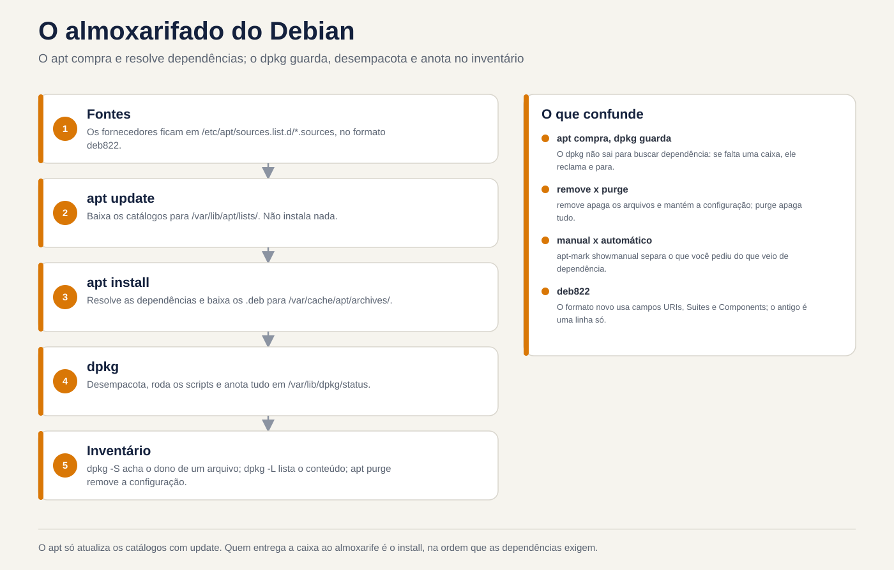
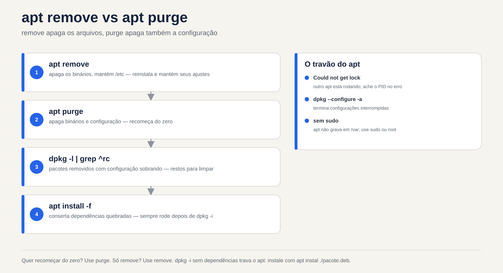

# Lezione 6.1 · Pacchetti in Debian

Finora hai installato programmi con un `apt install` qua e un altro là, senza pensarci troppo. Oggi ti guardi dentro. Cos'è un pacchetto, chi lo decomprime, chi cerca in Internet e risolve le dipendenze, cosa rimane sul disco quando lo rimuovi e come scoprire da quale pacchetto proviene un determinato file. Leggi anche i sorgenti da dove apt scarica tutto, nel nuovo formato, deb822. Questa è la prima di cinque lezioni sul software. Il prossimo fa lo stesso in Rocky, e vedrai che l'idea è la stessa, solo con nomi diversi.

> **Nucleo di questa lezione:** `apt update`, `apt install`, `apt remove`, `apt purge` e `apt autoremove`; `apt search` e `apt show`; `dpkg -l`, `dpkg -L pacote` e `dpkg -S arquivo`; la differenza tra `dpkg` (installa il file `.deb`) e `apt` (cerca, risolve dipendenze e richiama `dpkg`); e dove sono le fonti: `/etc/apt/sources.list.d/`. Il resto è approfondito.

| File | lezione 6.1 |
| --- | --- |
| Modulo | M6 · Software, lezione 1 di 5 |
| Quando | Settimana 10 |
| Alla fine puoi | Spiegare cosa c'è dentro un `.deb` e chi fa cosa tra `dpkg` e `apt`; aggiornare indici, cercare, visualizzare dettagli, installare, rimuovere ed eliminare; leggere lo stato di un pacchetto in `dpkg -l` (`ii`, `rc`, `iU`); elencare i file in un pacchetto e trovare il pacchetto in un file, installato o meno; comprendere i pacchetti manuali e automatici e il `autoremove`; leggere e scrivere un sorgente in formato deb822; installare un `.deb` sciolto e correggere le dipendenze mancanti |
| Articoli di prova | LPIC-1 102.4 (gestione dei pacchetti Debian) |
| Prerequisiti | lezione 3.3 (`grep`); lezione 4.2 (systemd); internet su debian-lab |
| Meteo | Intorno alle 2:30 |
| Istantanee | m6a1-start e m6a1-end in Debian-Lab. Oggi Rocky-lab riposa |

## 1 · Riscaldamento

Tre domande, a colpo d'occhio. Scrivi le risposte; la chiave di risposta viene visualizzata alla fine.

1. Esegui `apt remove` in un pacchetto. Indovina: il suo file di configurazione, in `/etc`, scomparirà?
2. Qualcuno ti invia un file `programa.deb` e tu esegui `sudo dpkg -i programa.deb`. Indovina: se manca una libreria, `dpkg` la scaricherà?
3. Trovi uno strano file in `/usr/bin`. Indovina: puoi sapere da quale pacchetto proviene, con un solo comando?

## 2 · Perché è importante

| Il cosiddetto | La risposta sbagliata | Cosa provoca |
| --- | --- | --- |
| "Rimuovi Apache e installa Nginx" | `apt remove apache2` e basta | La vecchia configurazione è in `/etc/apache2` e le dipendenze che ne derivavano sono ancora installate. Mesi dopo, nessuno sa se è spazzatura o se qualcosa usa |
| "`apt` dice `unmet dependencies` e non installa nient'altro" | Cancellare i file in `/var/lib/dpkg` oppure forzare con `--force-all` | La banca dei pacchetti diventa incoerente e il prossimo aggiornamento potrebbe danneggiare il sistema. Quasi sempre, `apt --fix-broken install` risolve |
| "Da cosa proviene questo file in `/usr/local/bin`?" | Elimina per vedere cosa succede | `dpkg -S` ti dice subito se qualche pacchetto possiede il file. Se non lo è, qualcuno l'ha installato manualmente e questa è un'informazione |
| "Aggiungi questo repository Ubuntu che ho trovato su un blog" | Incollare la riga in `sources.list` | Pacchetti di un'altra distribuzione o di un'altra versione mescolati con i tuoi. Funziona fino al prossimo aggiornamento, poi le dipendenze combattono |

## 3 · Modello mentale

> Pensa a un **magazzino**. Un **pacchetto** `.deb` è una scatola sigillata: all'interno ci sono i file, un'etichetta con nome, versione e **dipendenze** ("per funzionare ha bisogno della scatola X"), e le istruzioni prima e dopo l'apertura (gli script). **`dpkg`** è il magazziniere: riceve una scatola, mette tutto al suo posto, annota tutto nell'inventario (`/var/lib/dpkg/`) e sa da quale scatola proviene ogni oggetto. Lui **non** esce a comprare nulla: se il cassiere chiede qualcos'altro che non è in magazzino si lamenta e si ferma. **`apt`** è l'acquirente: legge i cataloghi dei fornitori (i **repository** elencati nelle **fonti**), scopre tutte le scatole necessarie, le scarica e le consegna al magazzino nell'ordine giusto. `apt update` aggiorna solo i cataloghi: non compra nulla.

```text
  /etc/apt/sources.list.d/*.sources        (os fornecedores)
             │
             │  apt update: baixa os catálogos
             ▼
  /var/lib/apt/lists/                      (os catálogos: quem tem o quê, em que versão)
             │
             │  apt install X: resolve dependências e baixa
             ▼
  /var/cache/apt/archives/*.deb            (as caixas baixadas)
             │
             │  o apt chama o dpkg
             ▼
  dpkg: desempacota, roda os scripts e anota em /var/lib/dpkg/status
```



*apt acquista e risolve; dpkg lo memorizza, lo disimballa e lo annota nell'inventario.*

## 4 · Gli elementi essenziali

### apt, vita quotidiana

| Comando | Fare |
| --- | --- |
| `sudo apt update` | Scarica i nuovi cataloghi. Esegui prima di installare o aggiornare |
| `apt search palavra` / `apt show pacote` | Cerca cataloghi / mostra versione, dimensione, dipendenze e descrizione |
| `sudo apt install pacote` | Si installa con dipendenze |
| `sudo apt install ./arquivo.deb` | Installa un `.deb` sciolto **e** recupera le dipendenze. `./` è obbligatorio |
| `sudo apt remove pacote` | Rimuove i file ma mantiene la configurazione in `/etc` |
| `sudo apt purge pacote` | Rimuove tutto, incluso |
| collocamento. `sudo apt autoremove` | Rimuovere le dipendenze che nessun altro utilizza |
| `sudo apt upgrade` | Aggiorna tutto ciò che puoi senza rimuovere nulla |
| `sudo apt full-upgrade` | Aggiorna tutto, rimuovendo i pacchetti se necessario |
| `apt list --installed` / `--upgradable` | Elenco aggiornamenti installati/in sospeso |
| `apt policy pacote` | Versione installata, versione candidata e da quale repository proviene |

`apt` è stato creato per le persone e il suo output può cambiare tra le versioni. In **script**, utilizzare `apt-get` e `apt-cache`, che hanno un output stabile. Ecco perché `apt` avvisa `WARNING: apt does not have a stable CLI interface` quando l'uscita va in una tubazione. Il test addebita entrambi.

### dpkg, l'inventario

| Comando | Fare |
| --- | --- |
| `dpkg -l` / `dpkg -l 'padrão*'` | Elenca i pacchetti e il relativo stato |
| `dpkg -L pacote` | File che un pacchetto installato ha posizionato sul disco |
| `dpkg -S /caminho/arquivo` | Quale pacchetto installato possiede il file |
| `dpkg -s pacote` | Stato e dettagli di un pacchetto installato |
| `dpkg -I arquivo.deb` / `dpkg -c arquivo.deb` | Etichetta / contenuto di un `.deb` non ancora installato |
| `sudo dpkg -i arquivo.deb` | Installa `.deb`, ma **non** cerca le dipendenze |
| `sudo dpkg -r pacote` / `sudo dpkg -P pacote` | Rimuovere/eliminare |
| `sudo dpkg --configure -a` | Termina le installazioni interrotte |
| `sudo dpkg-reconfigure pacote` | Rifare le domande sulla configurazione del pacchetto |

Le prime due lettere di `dpkg -l` rappresentano lo stato. Il primo è ciò che è stato **richiesto**, il secondo è ciò che **è**:

| Codice | Voglio dire |
| --- | --- |
| `ii` | Richiesto di installare, viene installato. Il normale |
| `rc` | È stato rimosso, ma la configurazione è rimasta. Aggiungere con `purge` |
| `iU` | Decompresso ma non configurato: dipendenza mancante o installazione interrotta |
| `hi` | Installato e bloccato (`hold`): non aggiornato |

### Configurazione ed eliminazione

I file di configurazione dichiarati dal pacchetto (i **conffiles**, quasi sempre in `/etc`) hanno un trattamento speciale. In un `remove` rimangono sul disco, quindi non si perde ciò che è stato modificato. In un aggiornamento, se hai modificato anche il file e il pacchetto, `dpkg` chiede cosa fare. Puoi mantenere il tuo, accettare quello nuovo o vedere la differenza. L'elenco dei file di configurazione per un pacchetto viene visualizzato con `dpkg-query -W -f='${Conffiles}\n' pacote`.

### Manuale e automatico

apt ricorda il **perché** ciascun pacchetto è installato. Se lo hai richiesto, è **manuale**. Se è arrivato come dipendenza, è **automatico**. Quando nessun pacchetto manuale avrà più bisogno di uno automatico, `apt autoremove` glielo toglierà.

| Comando | Fare |
| --- | --- |
| `apt-mark showmanual` / `showauto` | Elenco manuale/automatico |
| `sudo apt-mark manual pacote` | Contrassegnare come manuale: `autoremove` non accetta più |
| `sudo apt-mark hold pacote` / `unhold` | Blocca/sblocca versione |
| `apt-cache depends pacote` / `rdepends pacote` | Da cosa dipende / chi dipende da esso |

### Trova il pacchetto da un file

`dpkg -S` conosce solo i pacchetti **installati**. Per cercare tutti i pacchetti nel repository, utilizzare `apt-file`, che ha un proprio catalogo: `sudo apt install apt-file`, `sudo apt-file update` e `apt-file search bin/dig`.

### I sorgenti, nel formato deb822

I sorgenti indicano a apt da dove scaricare. Esistono due formati e li troverai entrambi:

```text
# Formato antigo, uma linha por fonte (/etc/apt/sources.list)
deb http://deb.debian.org/debian bookworm main contrib non-free-firmware

# Formato deb822 (/etc/apt/sources.list.d/debian.sources)
Types: deb
URIs: http://deb.debian.org/debian
Suites: bookworm bookworm-updates
Components: main contrib non-free-firmware
Signed-By: /usr/share/keyrings/debian-archive-keyring.gpg
```

| Campo | Cos'è |
| --- | --- |
| `Types` | `deb` per le confezioni già pronte; `deb-src` per il codice sorgente |
| `URIs` | L'indirizzo mirror |
| `Suites` | La versione con nome in codice: `bookworm` è Debian 12 e `trixie` è 13. Inoltre aggiornamenti, come `bookworm-updates` e `bookworm-security` |
| `Components` | `main` (gratuito), `contrib`, `non-free` e `non-free-firmware` |
| `Signed-By` | La chiave GPG che firma questo repository, e solo quella |

Ogni carattere in un file `.sources` in `/etc/apt/sources.list.d/`, con la propria chiave in `Signed-By`, è il modo moderno. Il vecchio `apt-key` è obsoleto perché considera affidabile qualsiasi chiave per qualsiasi repository. Il formato dipende dalla versione e da come è stata installata la macchina. Debian 12 di solito viene fornito con un `sources.list` di una riga. In Debian 13, `apt modernize-sources` viene convertito in deb822.

### Rocky × Debian

La lezione successiva è Rocky, ma vale la pena vedere la mappa adesso:

| Compito | Debian | Rocky |
| --- | --- | --- |
| Magazzino (file locale) | `dpkg` | `rpm` |
| Acquirente (repository e dipendenze) | `apt` | `dnf` |
| File da un pacchetto | `dpkg -L` | `rpm -ql` |
| Proprietario di un file | `dpkg -S` | `rpm -qf` |
| Pacchetto a un file non installato | `apt-file search` | `dnf provides` |
| Rimuovi anche la configurazione | `purge` | Non esiste; `rpm` conserva copie `.rpmsave` |
| Fonti | `/etc/apt/sources.list.d/*.sources` | `/etc/yum.repos.d/*.repo` |

**Ciò che rientra nel test.** LPIC-1 102.4 addebita i `dpkg` (`-i`, `-r`, `-P`, `-l`, `-L`, `-S`, `-s`, `--configure`), `dpkg-reconfigure`, il `apt-get` (`update`, `install`, `remove`, `purge`, `upgrade`, `dist-upgrade`), `apt-cache` (`search`, `show`, `depends`) e `/etc/apt/sources.list`. C'è molta differenza tra `remove` e `purge` e tra `dpkg -L` e `dpkg -S`. `apt-file` e `apt` appaiono come strumenti che è necessario conoscere.

## 5 · Laboratorio guidato

Tutto in **debian-lab (202)**. Oggi il Rocky-lab riposa. Avrai bisogno di Internet sulla VM.

**Passaggio 0 · Istantanea e cartella.** In Proxmox:

```bash
qm snapshot 202 m6a1-inicio
```

Nella VM:

```bash
mkdir -p ~/lab61 && cd ~/lab61
```

**Passaggio 1 · Da dove provengono i pacchetti.**

```bash
ls -l /etc/apt/sources.list /etc/apt/sources.list.d/
cat /etc/apt/sources.list.d/*.sources
```

Risultato previsto: in Debian 13 vedi un `debian.sources` nel formato deb822 (Tipi / URI / Suite / Componenti / Firmato da). `sources.list` può anche non esistere o essere vuoto. Nota quali *Suite* appaiono (ad esempio `trixie`, `trixie-updates`, `trixie-security`).

**Passaggio 2 · Aggiorna il catalogo.**

```bash
sudo apt update
ls /var/lib/apt/lists/ | head
apt list --upgradable
```

`apt update` non installa nulla. Scarica solo i cataloghi per `/var/lib/apt/lists/`. La persona che aggiorna i pacchetti è `apt upgrade`; Non eseguire questa operazione oggi.

**Passaggio 3 · Cerca prima dell'installazione.**

```bash
apt search --names-only '^tree$'
apt show tree
apt policy tree
```

`apt policy` mostra la versione installata, la candidata e da quale repository proverrebbe. È il comando che risponde "perché vuole installare questa versione?".

**Passaggio 4 · Installa e analizza.**

```bash
sudo apt install -y tree
dpkg -l tree
dpkg -L tree
dpkg -S $(command -v tree)
dpkg -s tree | grep -E '^(Status|Version)'
```

Risultato previsto: `ii` in `dpkg -l`, l'elenco dei file in `-L` e `tree: /usr/bin/tree` in `-S`.

**Passaggio 5 · Un pacchetto con configurazione: nginx.**

```bash
sudo apt install -y nginx
dpkg -S /etc/nginx/nginx.conf
dpkg -l 'nginx*'
systemctl is-active nginx
```

Nota: `nginx.conf` appartiene a **nginx-common**, non `nginx`. I pacchetti di grandi dimensioni sono solitamente divisi in questo modo (binari da un lato, configurazione e file comuni dall'altro).

**Passaggio 6 · rimuovi × elimina, live.**

```bash
sudo apt remove -y nginx nginx-common
dpkg -l 'nginx*' | grep -E '^(ii|rc)'
ls /etc/nginx/
```

Risultato previsto: `nginx-common` appare come `rc` (rimosso, la configurazione è rimasta) e `/etc/nginx/` rimane lì. Ora:

```bash
sudo apt purge -y nginx-common
ls /etc/nginx/ 2>&1
sudo apt autoremove -y
```

Dopo lo spurgo, `/etc/nginx/` scompare e `rc` scompare dall'elenco. `autoremove` prende le dipendenze che erano presenti solo a causa di nginx, se ce ne sono.

**Passaggio 7 · Un .deb in mano, senza dipendenze.**

```bash
apt download nginx
ls -l *.deb
dpkg -I nginx_*.deb | grep -E '^ (Package|Version|Depends)'
dpkg -c nginx_*.deb | head
sudo dpkg -i nginx_*.deb
```

Risultato previsto: `dpkg -i` lamenta la mancanza di `nginx-common` (l'hai eliminato nel passaggio 6). Il pacchetto è installato a metà:

```bash
dpkg -l nginx | tail -1
sudo apt install -y tree
```

`dpkg -l` mostra `iU` (non imballato, non configurato). E `apt` inizia a rifiutarsi di fare qualsiasi altra cosa e ordina a `--fix-broken` di correre. Ecco cosa fare:

```bash
sudo apt --fix-broken install -y
dpkg -l nginx nginx-common | tail -2
```

Ora sono entrambi `ii`. **Morale:** con `sudo apt install ./arquivo.deb` (con `./`) viene installato un `.deb` sciolto che risolve già le dipendenze. `dpkg -i` non cerca nulla.

**Passaggio 8 · Manuale, automatico e attesa.**

```bash
apt-mark showmanual | grep -E '^(tree|nginx)'
apt-mark showauto | grep nginx
sudo apt-mark hold nginx
apt-mark showhold
sudo apt-mark unhold nginx
```

`nginx-common` appare come **auto**: inserito come dipendenza. Se un giorno `nginx` se ne va, `autoremove` porta con sé `nginx-common`.

**Passaggio 9 · La cronologia.**

```bash
grep -E ' (install|remove|purge) ' /var/log/dpkg.log | tail
tail -n 30 /var/log/apt/history.log
```

`history.log` dice **chi** ha chiesto cosa (riga `Commandline:` e `Requested-By:`). `dpkg.log` dice cosa è effettivamente cambiato, pacchetto per pacchetto. In una chiamata "chi ha spostato questo server ieri?", si inizia da qui.

**Passaggio 10 · (facoltativo) apt-file.**

```bash
sudo apt install -y apt-file && sudo apt-file update
apt-file search bin/dig
```

`dpkg -S` cerca solo ciò che è già installato. `apt-file` cerca nell'intero repository: "quale pacchetto mi dà il comando `dig`?" (risposta: `bind9-dnsutils`).

**Pulizia:**

```bash
sudo apt purge -y nginx nginx-common tree
sudo apt autoremove -y
cd ~ && rm -r ~/lab61
```

### Decidi 1 · nginx.conf è tutto sbagliato

Qualcuno ha modificato `/etc/nginx/nginx.conf` finché non è rimasto più nulla di utilizzabile. Vuoi ripristinare il file del pacchetto originale. Selezionare prima un'opzione.

- **A)** `sudo apt remove nginx nginx-common && sudo apt install nginx`
- **B)** `sudo apt purge nginx nginx-common && sudo apt install nginx`
- **C)** `sudo apt install --reinstall nginx-common`

| Se hai selezionato | Risultato | Perché |
| --- | --- | --- |
| A | Il file danneggiato è ancora lì | La rimozione lascia i file di configurazione. Dopo la reinstallazione, dpkg vede che il file è stato modificato da te e non sovrascrive |
| **B** | **File originale sul retro** | L'eliminazione elimina i file di configurazione. La nuova installazione trova il posto vuoto e posiziona l'originale |
| C| Il file danneggiato è ancora lì | dpkg rispetta il file di configurazione modificato, anche durante la reinstallazione |

**Per risolvere:** dpkg protegge la configurazione di proposito. Per ripristinare l'originale, eliminarlo oppure eliminare il file e reinstallarlo forzatamente (vedere la sezione 6). Prima di entrambi, fai una copia: `sudo cp -a /etc/nginx /root/nginx.bak`.

### Decidi 2 · Il fornitore ha inviato un .deb

Hai ricevuto `agente_2.1_amd64.deb`. `sudo dpkg -i` fallito con `dependency problems`. Selezionare prima un'opzione.

- **A)** `sudo dpkg -i --force-depends agente_2.1_amd64.deb`
- **B)** `sudo apt --fix-broken install`
- **C)** Modifica `/var/lib/dpkg/status` e rimuovi la riga `Depends:` dal pacchetto

| Se hai selezionato | Risultato | Perché |
| --- | --- | --- |
| A | Installa ma rotto | Il pacchetto viene lasciato senza la libreria di cui ha bisogno. Fallisce più tardi, lontano da te, e l'apt continua a lamentarsi |
| **B** | **Dipendenze installate, pacchetto configurato** | apt cerca ciò che manca nel repository e termina la configurazione che dpkg ha lasciato a metà |
| C| Database dpkg danneggiato | Questo file è il database di sistema. La modifica manuale è la strada più breve per raggiungere un server che nessuno può aggiornare |

**Per correggere:** la prossima volta, `sudo apt install ./agente_2.1_amd64.deb` dall'inizio. Se la dipendenza non esiste in nessuno dei tuoi repository, il problema è con il fornitore, non con il tuo server.

## 6 · Interrompi e correggi

**Interruzione 1 · "Impossibile ottenere il blocco".** Apri due sessioni SSH in debian-lab.


*Vuoi ricominciare da capo? Usa lo spurgo. Basta rimuovere? Usa rimuovi. dpkg -i senza dipendenze si blocca apt.*


Nella sessione 1:

```bash
sudo apt install nginx
```

Interrompi a `Do you want to continue? [Y/n]`. Non rispondere. Nella sessione 2:

```bash
sudo apt install tree
```

**Sintomo:** `Could not get lock /var/lib/dpkg/lock-frontend. It is held by process NNNN (apt)`.

**Diagnosi:** l'errore stesso indica il PID. Controlla chi è:

```bash
ps -fp NNNN
```

**Fix:** torna alla sessione 1 e rispondi `n` (o termina l'installazione). La sessione 2 inizia a funzionare.

**Nella vita reale:** è quasi sempre in esecuzione `unattended-upgrades` o un altro amministratore. **Non** eliminare mai il file di blocco: lasci due processi che interferiscono con la stessa banca. Attendi o scopri il processo e parla con chi lo ha eseguito.

**Interruzione 2 · Conffile eliminato.** Installa nginx ed elimina il file principale:

```bash
sudo apt install -y nginx
sudo rm /etc/nginx/nginx.conf
sudo nginx -t
```

**Sintomo:** `nginx -t` fallisce, perché non trova la configurazione.

Prova la soluzione ovvia:

```bash
sudo apt install --reinstall -y nginx-common
ls -l /etc/nginx/nginx.conf
```

Il file **non ritorna**. dpkg capisce che l'hai eliminato di proposito e lo rispetta.

**Correzione:**

```bash
sudo apt install --reinstall -y -o Dpkg::Options::=--force-confmiss nginx-common
sudo nginx -t
```

Ora il file ritorna e il test viene superato. `--force-confmiss` dice "conffile scomparso, rimettilo a posto".

**Interruzione 3 · "dpkg è stato interrotto".** Non è necessario provocarlo, ma lo vedrai nella vita reale: un'interruzione di corrente o un SSH che si è bloccato nel mezzo di un `apt upgrade`. Adatto a tutto con:

`E: dpkg was interrupted, you must manually run 'sudo dpkg --configure -a' to correct the problem.`

**Fix, in questo ordine:**

```bash
sudo dpkg --configure -a
sudo apt --fix-broken install
sudo apt update && sudo apt upgrade
```

Pertanto, l'aggiornamento lungo sul server viene eseguito all'interno di `tmux` (lezione 3.x): se SSH non funziona, il processo continua.

**Pulizia:** `sudo apt purge -y nginx nginx-common && sudo apt autoremove -y`

## 7 · Traps

| Trappola | Cosa succede | Come evitare |
| --- | --- | --- |
| `apt remove` pensando di aver ripulito tutto | La vecchia configurazione ritorna nella prossima installazione e non capisci il comportamento | Per ricominciare da capo, `purge`. Per trovare i resti: `dpkg -l \| grep ^rc` |
| `dpkg -i` in `.deb` con dipendenze | Pacchetto `iU` e apt bloccato | `apt install ./arquivo.deb` |
| `apt` nello script o cron | Avviso "Interfaccia instabile" e output che cambia tra le versioni | `apt-get` e `apt-cache` nelle scritture |
| `apt upgrade` senza `apt update` prima | Niente aggiornamenti: il catalogo è quello di ieri | Sempre prima `update` |
| `autoremove` in automatico | Rimuovi un pacchetto che hai utilizzato, ma che era incluso come dipendenza | Consulta l'elenco prima del `y`. Cosa usi effettivamente, `apt-mark manual` |
| Repository di Ubuntu o di altre versioni su Debian | Miscelazione di librerie, dipendenze impossibili (il famoso FrankenDebian) | Solo repository della tua versione. Terze parti solo con `Signed-By` e fonte ufficiale |
| Cancella `/var/lib/dpkg/lock*` | Due processi che scrivono alla banca contemporaneamente | Scopri chi detiene la serratura e aspetta |
| `apt-key add` copiato da un vecchio tutorial | Comando obsoleto; la chiave diventa valida per tutti i repository | Digitare `/etc/apt/keyrings/` e `Signed-By:` in `.sources` |
| `hold` dimenticato | Quel pacchetto resiste per anni senza correzioni di sicurezza | `apt-mark showhold` nella tua lista di controllo mensile |

## 8 · Quiz

Rispondi senza guardare. Il foglio delle risposte si trova alla fine della lezione.

1. In `dpkg -l` qual è la differenza tra un pacchetto `ii` e un pacchetto `rc`? Quale comando va abbinato a `rc`?
2. Hai trovato `/usr/sbin/nginx` sul server. Quale comando dice da quale pacchetto proviene? E se il file **non** è installato, come si fa a sapere quale pacchetto lo fornisce?
3. Qual è la differenza pratica tra `sudo dpkg -i agente.deb` e `sudo apt install ./agente.deb`?
4. Scriverai uno script che viene eseguito in cron e installa i pacchetti. Perché non utilizzare `apt` e cosa utilizzare invece?
5. `apt autoremove` vuole rimuovere `curl`, utilizzato dai suoi script. Perché ciò accade e quale comando lo impedisce?
6. *Quale comando elenca i file installati da un pacchetto Debian già installato? a) `dpkg -c` b) `dpkg -L` c) `dpkg -S` d) `apt-cache show`*

## 9 · Cola

**Da saperlo a memoria:**

| Voglio... | Comando |
| --- | --- |
| Aggiorna il catalogo | `sudo apt update` |
| Installa/rimuovi/rimuovi con config | `sudo apt install X` / `remove X` / `purge X` |
| Pulisci le dipendenze orfane | `sudo apt autoremove` |
| Cerca e leggi informazioni su un pacchetto | `apt search X` / `apt show X` |
| Installa un file .deb | `sudo apt install ./arquivo.deb` |
| Correggi l'installazione a metà | `sudo dpkg --configure -a` e `sudo apt --fix-broken install` |
| È installato? | `dpkg -l X` |
| Quali file ha installato il pacchetto | `dpkg -L X` |
| Da quale pacchetto proviene questo file | `dpkg -S /caminho` |

**Da consultare:**

| Voglio... | Comando |
| --- | --- |
| Da dove verrebbe la versione | `apt policy X` |
| Cosa c'è dentro un file .deb | `dpkg -I arquivo.deb` / `dpkg -c arquivo.deb` |
| Pacchetto che fornisce un file non installato | `apt-file search caminho` |
| Versione bloccata | `sudo apt-mark hold X` / `unhold X` / `apt-mark showhold` |
| Manuale × automatico | `apt-mark showmanual` / `sudo apt-mark manual X` |
| La configurazione rimane | `dpkg -l \| grep ^rc` |
| Reinstallare sostituendo il conffile eliminato | `sudo apt install --reinstall -o Dpkg::Options::=--force-confmiss X` |
| Riconfigurare per pacchetto domande | `sudo dpkg-reconfigure X` |
| Storia | `/var/log/apt/history.log` e `/var/log/dpkg.log` |
| Fonti | `/etc/apt/sources.list.d/*.sources` (deb822) |
| Chiavi del repository | `/etc/apt/keyrings/` + `Signed-By:` |

**Flashcard:**

- `apt` è l'acquirente, `dpkg` è il negoziante → chi risolve le dipendenze? *Apt.*
- `remove` × `purge` → *purge elimina anche i file di configurazione in /etc.*
- `iU` in dpkg -l → *unpacked, non configurato: esegui `apt --fix-broken install`.*
- `-L` × `-S` × `-c` → *-L: file da un pacchetto installato; -S: proprietario di un file; -c: contenuto di un .deb.*
- "Impossibile ottenere il blocco" → *un altro apt in esecuzione; scoprire chi, non eliminare mai il blocco.*

## 10 · Checklist e chiusura

- [ ] So dove sono i sorgenti e leggo un `.sources` deb822
- [ ] Installo, rimuovo ed elimino e so cosa rimane in ogni caso
- [ ] Scopro il proprietario di un file e i file in un pacchetto
- [ ] Installo un pacchetto sciolto .deb senza interrompere le dipendenze
- [ ] Correggo un `iU` e un "dpkg è stato interrotto"
- [ ] So perché `apt` non entra nello script
- [ ] Trovo nel log chi ha installato cosa

**Ultimo esercizio, senza guardare la lezione:** in debian-lab, installa `htop`, scopri da quale pacchetto proviene `/usr/bin/htop`, elenca i file installato, eliminalo e prova con `dpkg -l` che non è rimasto alcun `rc`. Quindi trovare le due righe in `history.log`.

**Reboot and conference:**

```bash
sudo reboot
# depois de voltar:
dpkg -l | grep -vE '^(ii|rc)' | tail -n +6
sudo apt update && apt list --upgradable
```

La prima riga non può mostrare alcun pacchetto (niente a metà). Il secondo dovrebbe essere eseguito senza errori del repository.

**Termina snapshot** (su Proxmox):

```bash
qm snapshot 202 m6a1-fim
```

## 11 · Nella vita reale

**Missione, sola lettura.** Su un server Debian o Ubuntu che già amministri, esegui **solo** questi comandi. No `apt update`, `install` o `upgrade`: `update` cambia già il catalogo.

```bash
cat /etc/os-release | head -3
ls /etc/apt/sources.list.d/; cat /etc/apt/sources.list 2>/dev/null | grep -v '^#'
apt-mark showhold
dpkg -l | grep -vE '^(ii|rc)' | tail -n +6
dpkg -l | grep -c ^rc
tail -n 40 /var/log/apt/history.log
```

Domande a cui rispondere:

1. Hai un repository di terze parti? Utilizza `Signed-By` o la vecchia chiave globale?
2. Hai un pacco in attesa? Qualcuno sa perché?
3. C'è qualcosa che è stato fatto a metà (al di fuori di `ii`/`rc`)?
4. Quanti restano `rc`? (Va bene averne alcuni; dozzine raccontano una storia.)
5. Quando è stata l'ultima volta che qualcuno ha installato o aggiornato qualcosa e cosa?

**Diario:** annota sul tuo taccuino del server le origini di ciascuna macchina e le prenotazioni con il motivo. Tra sei mesi questo varrà oro a peso.

**Domani, senza guardare:** scrivi su un pezzo di carta i 5 comandi dpkg che hai utilizzato di più oggi e a cosa risponde ciascuno.

## 12 · Scava più a fondo quando vuoi

Niente di tutto questo è obbligatorio ora. Torna qui quando la giornata lo richiede.

- **aggiornamenti non presidiati:** aggiornamenti automatici di sicurezza in Debian. Lo configurerai effettivamente nel modulo di manutenzione.
- **Pinning** (`/etc/apt/preferences.d/`): porta un pacchetto da `backports` senza estrarre il resto.
- **debconf:** le domande che alcuni pacchetti fanno durante l'installazione; `debconf-show X` e `debconf-set-selections` da installare senza domande.
- **dpkg-divert:** fai in modo che dpkg installi un file di pacchetto in un altro percorso, per proteggere il tuo.
- **equivs:** crea un pacchetto vuoto che "soddisfa" una dipendenza.
- **Cache locale:** `apt-cacher-ng` per molte macchine Debian da scaricare una sola volta.

**DeepTutor** (http://10.1.0.149:3782, KB "Linux Sysadmin Course"):

- `!explica conffiles e por que o dpkg não sobrescreve um arquivo que eu editei`
- `!feynman a diferença entre apt e dpkg`
- `!quiz Aula 6.1, 5 perguntas sobre remove, purge, dpkg -L e -S`

## Risposta commentata

### Riscaldamento

1. **No.** `apt remove` rimuove i file binari, ma lascia i file di configurazione in `/etc` e il pacchetto rimane in `rc`. La persona che cancella la configurazione è `purge`.
2. **No.** `dpkg -i` installa solo quel file. Se manca la dipendenza, si ferma e lascia il pacchetto `iU`. Quello che cerca le dipendenze è apt (`apt install ./arquivo.deb`).
3. **Sì:** `dpkg -S /usr/bin/arquivo`. Se non appare alcun proprietario, il file non proviene da un pacchetto: qualcuno lo ha copiato a mano (cosa normale in `/usr/local/bin` e sospetta in `/usr/bin`).

### Quiz

1. `ii` = installato e configurato. `rc` = rimosso, ma i file di configurazione sono rimasti. `sudo apt purge X` (o `sudo dpkg -P X`) scompare con `rc`.
2. `dpkg -S /usr/sbin/nginx` risponde a `nginx: /usr/sbin/nginx`. Se il file non è installato, dpkg non lo sa; utilizzare `apt-file search /usr/sbin/nginx` (dopo `apt-file update`).
3. `dpkg -i` non risolve le dipendenze: manca qualcosa, fallisce e lascia il pacchetto a metà. `apt install ./agente.deb` legge le dipendenze .deb e scarica ciò che manca dai repository. `./` è ciò che dice ad apt che si tratta di un file, non del nome di un pacchetto.
4. L'output di `apt` è pensato per gli esseri umani e può cambiare tra le versioni (si avverte: *non ha un'interfaccia CLI stabile*). Nella scrittura, utilizzare `apt-get` e `apt-cache`, preferibilmente con `-y` e `DEBIAN_FRONTEND=noninteractive`.
5. `curl` inserito come dipendenza di un altro pacchetto (contrassegnato **auto**). Quando quest'altro se ne andò, `curl` rimase orfano. `sudo apt-mark manual curl` dice ad apt "Voglio questo" e autoremove non lo tocca più.
6. **b) `dpkg -L`.** `-c` elenca il contenuto di un file `.deb` (non installato), `-S` fa il contrario (file → pacchetto) e `apt-cache show` mostra la descrizione del pacchetto, non i file.

---

<!-- navegacao -->
[← lezione 5.3 · Linux come ospite](5.3-linux-como-convidado.md) · [Indice lezioni](../01-aulas.md) · [lezione 6.2 · Pacchetti Rocky →](6.2-pacotes-na-rocky.md)
