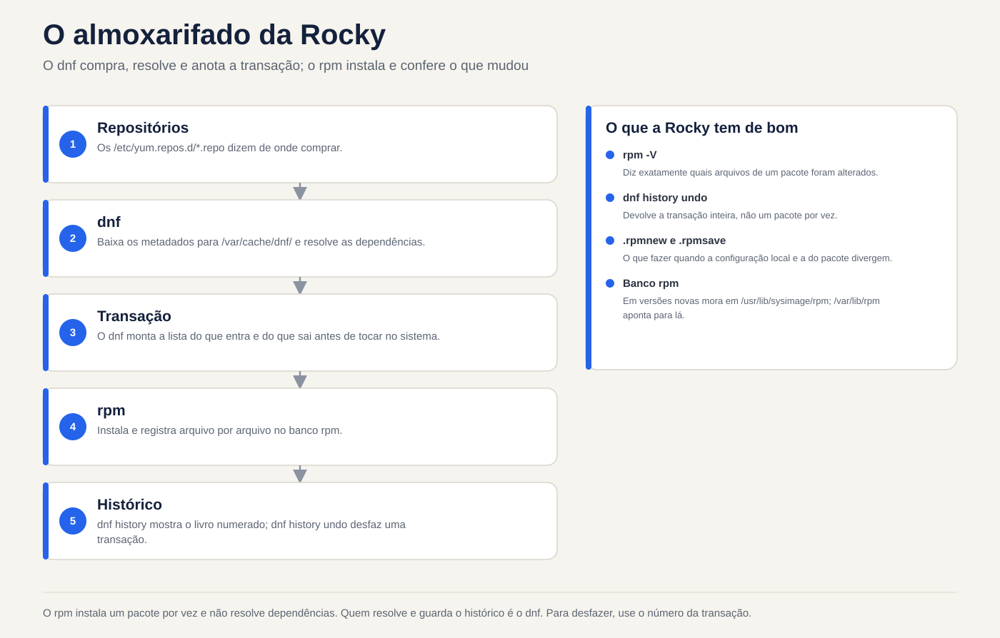
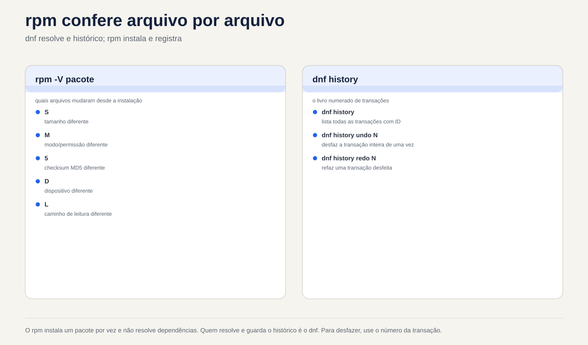

# Lezione 6.2 · Pacchetti presso Rocky

Nell'ultima lezione hai imparato il mondo Debian: apt buy, dpkg save. Oggi è lo stesso magazzino con nomi diversi: acquisti **dnf**, negozi **rpm**. La logica è la stessa, quindi questa lezione si muove più velocemente. Ciò che è diverso e molto buono in Rocky è la **cronologia con annullamento** (`dnf history undo`) e il **controllo di integrità** (`rpm -V`). Entrambi salvano il server in produzione.

> **Nucleo di questa lezione:** `dnf install/remove/upgrade/search/info/provides`, `dnf install ./arquivo.rpm`, `rpm -qa/-qi/-ql/-qc/-qf`, `rpm -V`, `dnf history` e `dnf history undo`, `.rpmnew` e `.rpmsave`. Il resto è approfondito.

| File |  |
| --- | --- |
| **Modulo** | M6 · Software, lezione 2 di 5 |
| **Quando** | Settimana 10 |
| **Alla fine ce la puoi fare** | Installa, rimuovi e aggiorna i pacchetti con dnf; scoprire proprietario e contenuto dei pacchetti con rpm; controlla se qualcuno ha modificato i file in un pacchetto; annullare una transazione attraverso la cronologia |
| **Articoli di prova** | LPIC-1 102.5 (RPM e YUM/DNF, con nozione zypper) · RHCSA: installazione e aggiornamento dei pacchetti dal repository e dall'archivio locale |
| **Prerequisiti** | lezione 6.1 · rock-lab con internet |
| **Ora** | \~2h30 |
| **Istantanee** | `m6a2-inicio` e `m6a2-fim`, solo presso rock-lab (201). debian-lab riposa |

## 1 · Riscaldamento

Rispondere prima di leggere. Il foglio delle risposte si trova alla fine della lezione.

1. `rpm -i pacote.rpm` cerca le dipendenze mancanti?
2. Ieri hai installato un pacchetto e si è interrotto un servizio. In Rocky, puoi annullare l'intera installazione, dipendenze incluse, con un singolo comando?
3. Sospetti che qualcuno abbia modificato `/etc/ssh/sshd_config` e il binario di `sshd`. Esiste un modo per chiedere al sistema "cosa è cambiato da quando il pacchetto è stato installato?"

## 2 · Perché è importante

| Il cosiddetto | La risposta sbagliata | Cosa provoca |
| --- | --- | --- |
| "Installa l'agente di backup sul server" | Scarica un `.rpm` da qualsiasi sito Web ed esegui `rpm -ivh --nodeps` | Pacchetto senza le librerie di cui ha bisogno, che falliscono in seguito, e un database RPM di cui dnf inizia a lamentarsi |
| "Hanno aggiornato ieri e il servizio si è interrotto" | Reinstallare i pacchetti all'istante, o `rpm -e --nodeps` qualunque sembri colpevole | Ore di tentativi ed errori. `dnf history` mostrerebbe la transazione esatta e `undo` la annullerebbe |
| "SSHD è strano, qualcuno lo ha cambiato?" | Apri i file e guarda “negli occhi” | Non vedi un binario scambiato o un'autorizzazione modificata. `rpm -V openssh-server` viene visualizzato in secondi |
| "Il comando `semanage` non esiste qui" | Cerca su Google e installa il primo pacchetto suggerito | Pacchetto sbagliato o un'altra versione. `dnf provides` risponde con il pacchetto giusto dal tuo repository |

## 3 · Modello mentale

> È lo stesso magazzino della lezione 6.1. **rpm** è il magazziniere: installa un pacchetto alla volta, tiene traccia di tutto e controlla che nulla sia stato cambiato. **dnf** è l'acquirente: legge i cataloghi dei repository, calcola le dipendenze, scarica tutto e lo consegna a rpm. La differenza è che questo acquirente annota ogni acquisto in un libro numerato. E qualsiasi acquisto del libro può essere restituito.

```
/etc/yum.repos.d/*.repo        (de onde comprar)
          |
          v
   dnf  --- baixa metadados ---> /var/cache/dnf/        (catálogos e .rpm baixados)
    |
    |  resolve dependências, monta a transação
    v
   rpm  --- instala ---> banco rpm (/var/lib/rpm)       (o que está instalado, arquivo por arquivo)
    |
    v
/var/lib/dnf/history.sqlite    (o livro: transação 1, 2, 3... com undo)
/var/log/dnf.log, /var/log/dnf.rpm.log
```

Nelle versioni più recenti della famiglia RHEL, la banca RPM risiede lì nei punti `/usr/lib/sysimage/rpm` e `/var/lib/rpm`. Per te non importa: chi parla con la banca è sempre `rpm`.



*Il dnf acquista, risolve e registra la transazione; rpm lo installa e controlla cosa è cambiato.*

## 4 · Gli elementi essenziali

### dnf: vita quotidiana

| Comando | Che cosa significa |
| --- | --- |
| `dnf check-update` | Elenca cosa è stato aggiornato (non installa nulla) |
| `sudo dnf upgrade` | Aggiorna tutto (`dnf update` è lo stesso comando, vecchio nome) |
| `sudo dnf upgrade X` | Aggiorna solo il pacchetto X |
| `dnf search termo` | Cerca nome e riepilogo |
| `dnf info X` | Versione, repository, dimensione, descrizione |
| `dnf provides /caminho` o `dnf provides '*/semanage'` | Quale pacchetto fornisce questo file (installato o meno) |
| `sudo dnf install X` | Si installa con dipendenze |
| `sudo dnf install ./arquivo.rpm` | Installa un file .rpm locale che risolve le dipendenze |
| `sudo dnf remove X` | Rimuove X e le dipendenze che utilizzava solo |
| `sudo dnf reinstall X` | Reinstallare la stessa versione |
| `sudo dnf downgrade X` | Torna a una versione precedente se il repository ha |
| `sudo dnf autoremove` | Rimuovere le dipendenze orfane |
| `dnf list installed` / `dnf list available` | Installato / disponibile |
| `dnf repolist` | Repository attivi |
| `sudo dnf clean all` / `sudo dnf makecache` | Svuota cache/scarica nuovamente i metadati |

Differenza importante per Debian: **dnf non ha un passaggio `update` separato**. Controlla i metadati da solo quando sono vecchi. E `dnf remove` accetta già le dipendenze orfane di quel pacchetto, senza attendere un `autoremove`.

**Gruppi** (rientra in RHCSA): `dnf group list` mostra i set già pronti e `sudo dnf group install "Development Tools"` installa un set intero.

**Sicurezza:** `dnf updateinfo list --security` elenca gli avvisi di sicurezza in sospeso e `sudo dnf upgrade --security` applica solo questi.

### rpm: domande al storekeeper

Tutto ciò che inizia con `-q` (query) è di sola lettura e non richiede sudo.

| Comando | Domanda che risponde |
| --- | --- |
| `rpm -qa` | Tutto ciò che è installato (con `\| grep`, è il tuo `dpkg -l`) |
| `rpm -q X` | X è installato? Quale versione? |
| `rpm -qi X` | File del pacchetto: versione, data di installazione, origine |
| `rpm -ql X` | File installati da X (`dpkg -L`) |
| `rpm -qc X` | Solo i file di configurazione X |
| `rpm -qd X` | Solo la documentazione |
| `rpm -qf /caminho` | Da quale pacchetto proviene questo file (`dpkg -S`) |
| `rpm -qR X` | Da cosa dipende X |
| `rpm -q --changelog X \| head` | Cronologia delle modifiche al pacchetto (ottimo per trovare CVE corretti) |
| `rpm -q --scripts X` | Script eseguiti durante l'installazione e la rimozione |
| `rpm -qpi arq.rpm` / `rpm -qpl arq.rpm` | File e file di un file .rpm **non installato** (`p` proviene dal file del pacchetto) |

E le operazioni che dovresti conoscere per il test, ma che difficilmente utilizzi quotidianamente:

| Comando | Che cosa significa |
| --- | --- |
| `rpm -ivh arq.rpm` | Installa (i), dettagliata (v), con barra di avanzamento (h). Non risolve le dipendenze |
| `rpm -Uvh arq.rpm` | Aggiorna o installa se non esiste |
| `rpm -Fvh arq.rpm` | Aggiorna solo se esiste già (aggiornare) |
| `rpm -e X` | Rimuovere (cancellare) |
| `--nodeps`, `--force` | Ignorano le protezioni. Su un server si tratta quasi sempre di un errore |
| `rpm --import chave.asc` | Importa una chiave GPG del repository (più nella lezione 6.3) |
| `rpm -K arq.rpm` | Controlla la firma e l'integrità di un .rpm |

### rpm -V: "cosa è cambiato?"

RPM memorizza la dimensione, l'hash, i permessi, il proprietario e la data di ciascun file installato. `rpm -V X` confronta tutto questo con il disco e mostra solo ciò che è cambiato. Nessuna via d'uscita = non è cambiato nulla.

```
S.5....T.  c /etc/ssh/sshd_config
```

| Testi | Cosa è cambiato |
| --- | --- |
| `S` | Taglia |
| `M` | Modalità (autorizzazioni o tipo) |
| `5` | Contenuto (hash) |
| `D` | Dispositivo |
| `L` | Destinazione del collegamento simbolico |
| `U` / `G` | Proprietario/gruppo |
| `T` | Data di modifica |
| `c` prima del percorso | È un file di configurazione: cambiare è normale |
| `missing` | Il file è scomparso |

Admin leggendo: `5` in un file `c` è qualcuno che ha modificato la configurazione, normale. `5` in binario in `/usr/sbin` è allarme. `rpm -Va` controlla l'intero sistema (ci vuole tempo e mostra molte configurazioni modificate; filtra ciò che non hai `c`).

### .rpmnew e .rpmsave

Debian chiede cosa fare quando hai modificato una configurazione e il pacchetto ne porta una nuova. rpm **non chiede**: decide la regola del pacchetto e lascia un file accanto ad essa.

| Situazione | Cosa fa RPM |
| --- | --- |
| Aggiornamento, hai modificato la configurazione, pacchetto contrassegnato `noreplace` (il più comune) | Tieni il tuo. Il nuovo va a `arquivo.rpmnew` |
| Aggiornamento, hai modificato, pacchetto **non** contrassegnato `noreplace` | Installa quello nuovo. Il tuo va a `arquivo.rpmsave` |
| Rimozione di un pacchetto di cui hai modificato la configurazione | Elimina il pacchetto e la tua configurazione sarà come `arquivo.rpmsave` |

Attività di manutenzione dopo ogni aggiornamento importante:

```bash
sudo find /etc -name '*.rpmnew' -o -name '*.rpmsave'
```

Ogni `.rpmnew` è una nuova configurazione che nessuno ha paragonato alla tua (`diff` tra i due).

### Cronologia dnf: il libro degli acquisti

| Comando | Che cosa significa |
| --- | --- |
| `sudo dnf history` | Elenca transazioni: ID, comando, data, azione, quantità |
| `sudo dnf history info N` | Dettaglio transazione N: chi, quando, ciascun pacco |
| `sudo dnf history list X` | Solo le transazioni che hanno interessato il pacchetto X |
| `sudo dnf history undo N` | Annulla transazione N (cosa hai installato, rimuovi; cosa hai rimosso, reinstallalo) |
| `sudo dnf history rollback N` | Riporta il sistema allo stato immediatamente successivo alla transazione N, annullando tutte le successive |
| `sudo dnf history redo N` | Ripeti transazione N |
| `dnf repoquery --userinstalled` | Ciò che è stato richiesto da qualcuno, non estratto come dipendenza (il limite `apt-mark showmanual`) |

`undo`: per reinstallare la vecchia versione, deve ancora esistere nel repository. Per annullare un'**installazione**, funziona ogni volta.

### Blocca versione

L'equivalente di `apt-mark hold`:

```bash
sudo dnf install -y python3-dnf-plugin-versionlock
sudo dnf versionlock add X
dnf versionlock list
sudo dnf versionlock delete X
```

Alternativa grezza: `exclude=X*` in `/etc/dnf/dnf.conf`, che nasconde il pacchetto da tutte le operazioni.

### Rocky × Debian

| Compito | Roccioso | Debian |
| --- | --- | --- |
| Aggiornamento catalogo | automatico (o `dnf makecache`) | `apt update` |
| Pacchetti di aggiornamento | `dnf upgrade` | `apt upgrade` |
| Installa/Rimuovi | `dnf install` / `dnf remove` | `apt install` / `apt remove` |
| Dipendenze di risoluzione dei file locali | `dnf install ./x.rpm` | `apt install ./x.deb` |
| Strumento di basso livello | `rpm` | `dpkg` |
| Elenco installato | `rpm -qa` | `dpkg -l` |
| File del pacchetto | `rpm -ql` | `dpkg -L` |
| Proprietario file | `rpm -qf` | `dpkg -S` |
| Chi fornisce il file disinstallato | `dnf provides` | `apt-file search` |
| Configurazione conservata | `.rpmnew` / `.rpmsave` | domanda interattiva e `rc` |
| Verifica integrità | `rpm -V` | `debsums` (pacchetto extra) |
| Cronologia con annullamento | `dnf history undo` | non esiste (solo registro) |
| Congelare | `dnf versionlock` | `apt-mark hold` |
| Repository | `/etc/yum.repos.d/*.repo` | `/etc/apt/sources.list.d/` |

### Che dire di zypper?

Zypper è il gestore di openSUSE e SLES. LPIC addebita le nozioni di base e non otterrai una VM da esso. Basta riconoscere: `zypper refresh` (catalogo), `zypper install X`, `zypper remove X`, `zypper search X`, `zypper update`, `zypper repos`. Sotto c'è lo stesso numero di giri.

**Cosa c'è nel test.** LPIC-1 102.5: opzioni rpm (`-i -U -F -e -q -V`, con `-qa -qi -ql -qf -qc -qp`), `rpm2cpio` (estrae un .rpm senza installazione), dnf e yum (`yum` oggi è un soprannome per dnf), `/etc/yum.repos.d/` e riconosce zypper. RHCSA: installa e aggiorna repository e pacchetti di archivio locale, gruppi e rileva il pacchetto che fornisce un comando. Alla RHCSA non c'è internet: tutto proviene dal repository che configuri, oggetto della lezione 6.3.

## 5 · Laboratorio guidato

Tutto in **rocky-lab (201)**. debian-lab riposa oggi. Avrai bisogno di Internet sulla VM.

**Passaggio 0 · Istantanea e cartella.** In Proxmox:

```bash
qm snapshot 201 m6a2-inicio
```

Nella VM:

```bash
mkdir -p ~/lab62 && cd ~/lab62
```

**Passaggio 1 · Da dove provengono i pacchetti.**

```bash
dnf repolist
ls /etc/yum.repos.d/
grep -E '^(name|enabled|gpgcheck)=' /etc/yum.repos.d/*.repo | head -20
```

Risultato previsto: i repository **BaseOS**, **AppStream** e **extra** attivi (`enabled=1`), tutti con `gpgcheck=1`. BaseOS è il cuore del sistema; AppStream, le applicazioni. Aprirai effettivamente questi file nella lezione 6.3.

**Passaggio 2 · Cerca prima dell'installazione.**

```bash
dnf check-update | head
dnf search tree | head
dnf info tree
dnf provides '*/semanage'
```

`dnf provides` risponde in modo simile a `policycoreutils-python-utils`. Ecco come trovare il pacchetto di un comando che non esiste sulla macchina.

**Passaggio 3 · Installa e chiedi RPM.**

```bash
sudo dnf install -y tree httpd
rpm -q tree httpd
rpm -qi tree | head -12
rpm -ql tree
rpm -qf /usr/sbin/httpd
rpm -qf /etc/httpd/conf/httpd.conf
```

Notare le ultime due righe: in Rocky, il binario e la configurazione di Apache sono in un pacchetto **httpd-core**, e `httpd` è quasi solo un "ombrello". È la stessa idea di nginx-common in Debian. Memorizza il nome reale in una variabile:

```bash
PKG=$(rpm -qf --qf '%{NAME}' /etc/httpd/conf/httpd.conf)
echo $PKG
rpm -qc $PKG
```

**Passaggio 4 · rpm -V live.**

```bash
rpm -V $PKG
```

Nessun output: non è cambiato nulla dall'installazione. Ora cambia la configurazione e vedi:

```bash
echo '# teste lab62' | sudo tee -a /etc/httpd/conf/httpd.conf
rpm -V $PKG
```

Risultato previsto: `S.5....T.  c /etc/httpd/conf/httpd.conf`. Dimensioni, contenuto e data sono cambiati e `c` dice che è config. Questo è normale: ogni amministratore modifica config.

**Passaggio 5 · Prenota e annulla.**

```bash
sudo dnf history | head
sudo dnf history info last
```

Prendi nota dell'**ID** della transazione del passaggio 3 (quello con `install -y tree httpd`). Ora annulla:

```bash
sudo dnf history undo ID -y
rpm -q tree httpd
ls /etc/httpd/conf/
```

Risultato previsto: `tree` e `httpd` non sono più installati e anche le dipendenze che ne derivavano sono scomparse. In `/etc/httpd/conf/` c'è un **`httpd.conf.rpmsave`** rimasto: l'rpm non cancella una configurazione che hai modificato, la mantiene accanto ad essa.

**Passaggio 6 · Un .rpm in mano.**

```bash
dnf download httpd
ls -l *.rpm
rpm -qpi httpd-2*.rpm | head -8
rpm -qpR httpd-2*.rpm | head
rpm -K httpd-2*.rpm
sudo rpm -ivh httpd-2*.rpm
```

Risultato atteso: `rpm -K` dice `digests signatures OK` (il pacco è arrivato firmato ed è integro). `rpm -ivh` fallisce con `Failed dependencies`. Nota la differenza per Debian: **rpm non si installa a metà**. Rifiuta tutto e la banca rimane pulita. Adesso nel modo giusto:

```bash
sudo dnf install -y ./httpd-2*.rpm
rpm -q httpd
```

Se `dnf download` non esiste, manca `dnf-plugins-core`: `sudo dnf install -y dnf-plugins-core`.

**Passaggio 7 · Aprire un .rpm senza installarlo.**

```bash
dnf download tree
mkdir extraido && cd extraido
rpm2cpio ../tree-*.rpm | cpio -idmv
find . -type f | head
cd ..
```

Il `rpm2cpio` trasforma il .rpm in un file cpio e `cpio -idmv` lo estrae nella cartella corrente. Utilizzato per ottenere un file dall'interno del pacchetto senza installare nulla. (Se manca `cpio`: `sudo dnf install -y cpio`.)

**Passaggio 8 · Cosa è stato richiesto, cos'è la dipendenza e la sicurezza.**

```bash
dnf repoquery --userinstalled | grep -E '^(httpd|tree)'
dnf updateinfo list --security | head
rpm -qa --last | head
```

`rpm -qa --last` ordina i pacchetti in base alla data di installazione: prima il più recente. È la risposta rapida a "cosa è cambiato su questa macchina?".

**Passaggio 9 · I registri.**

```bash
sudo dnf history list httpd
sudo tail -n 20 /var/log/dnf.rpm.log
```

**Pulizia:**

```bash
sudo dnf remove -y httpd
sudo rm -f /etc/httpd/conf/httpd.conf.rpmsave
cd ~ && rm -r ~/lab62
```

### Decidi 1 · È apparso un .rpmnew

Dopo un `dnf upgrade`, trovi `/etc/httpd/conf/httpd.conf.rpmnew` accanto al `httpd.conf` che hai modificato. Seleziona prima un'opzione.

- **A)** L'aggiornamento non è riuscito a metà. Reinstallare il pacchetto.
- **B)** La configurazione è stata mantenuta e la nuova configurazione predefinita è accanto ad essa. Confronta i due e fai emergere ciò che conta.
- **C)** L'rpm ha cambiato la sua configurazione con quella nuova e quella vecchia è in `.rpmnew`.

| Se hai selezionato | Risultato | Perché |
| --- | --- | --- |
| A | Lavoro per niente | Niente è fallito. `.rpmnew` è il comportamento normale di un `%config(noreplace)` |
| **B** | **Corretto** | rpm ha protetto la tua modifica e ha lasciato la nuova versione affinché tu potessi confrontarla con `diff -u httpd.conf httpd.conf.rpmnew` |
| C| Confondi i suffissi | Quando il tuo esce fuori posto, diventa `.rpmsave`. **nuovo** = cosa è arrivato; **save** = cosa è stato salvato |

**Per salvare:** `.rpmnew` = accanto c'era quello nuovo; `.rpmsave` = il tuo è stato conservato nella porta accanto. Dopo il confronto, elimina ciò che resta, altrimenti tra un anno nessuno saprà quale è quale.

### Decidi 2 · L'aggiornamento di ieri ha interrotto il servizio

In `dnf history`, la transazione di ieri **42** ha installato il pacchetto `agente` e ha **aggiornato** tre librerie. Dopo di lei, 43 e 44 hanno installato cose di cui ha bisogno un altro amministratore. Il servizio è stato interrotto dal 42. Selezionare prima un'opzione.

- **A)** `sudo dnf remove agente`
- **B)** `sudo dnf history undo 42`
- **C)** `sudo dnf history rollback 41`

| Se hai selezionato | Risultato | Perché |
| --- | --- | --- |
| A | A metà | `agente` è uscito, ma le tre librerie rimangono nella nuova versione, che potrebbe essere la colpa |
| **B** | **Annulla esattamente 42** | Rimuovi `agente` e riporta le tre librerie alla versione precedente (se è ancora nel repository). 43 e 44 sono |
| C| Rovina il lavoro del collega | `rollback` riporta il sistema allo stato successivo a 41, annullando 42, 43 e 44 |

**Per correggere:** `undo N` annulla **una** transazione; `rollback N` annulla **tutto dopo** N. Prima di chiunque altro, `sudo dnf history info 42` per vedere cosa ha effettivamente fatto.

## 6 · Interrompi e correggi

**Interruzione 1 · Autorizzazione binaria modificata.**


*RPM installa un pacchetto alla volta e non risolve le dipendenze. Il dnf è colui che lo risolve. Per annullare, utilizzare il numero di transazione.*


```bash
sudo dnf install -y tree
sudo chmod 0644 /usr/bin/tree
tree /etc/yum.repos.d
```

**Sintomo:** `Permission denied`, anche se il file esiste ed è presente nel sistema.

**Diagnosi:**

```bash
ls -l /usr/bin/tree
rpm -V tree
```

Risultato previsto: `.M.......    /usr/bin/tree`. `M` dice che la **modalità** è cambiata, e senza `c`: è un binario, non una configurazione. Questo non è normale.

**Correzione:**

```bash
sudo rpm --restore tree
rpm -V tree && tree -L 1 /etc/yum.repos.d
```

`rpm --restore` restituisce il proprietario, il gruppo e le autorizzazioni per ciò che il pacchetto ha registrato, senza reinstallarlo. Se il **contenuto** fosse cambiato (`5`), allora `sudo dnf reinstall tree`.

**Nella vita reale:** un `5` in binario di `/usr/bin` o `/usr/sbin` senza alcun aggiornamento che lo spieghi è un segno di invasione. Non abbiate fretta di reinstallare: questo cancella le prove. Isolare la macchina e chiamare la sicurezza.

**Interruzione 2 · Installazione forzata.**

```bash
mkdir -p ~/lab62q && cd ~/lab62q
dnf download httpd
sudo rpm -ivh --nodeps httpd-2*.rpm
rpm -q httpd
sudo dnf check
```

**Sintomo:** `rpm -q` dice che httpd è installato, ma `dnf check` elenca le dipendenze mancanti. Un `systemctl start httpd` fallirebbe. E ogni operazione dnf da ora in poi ricorderà il problema.

**Correzione:** lascia che il dnf completi ciò che manca.

```bash
sudo dnf install -y httpd
sudo dnf check
```

Il vicolo cieco `dnf check` significa che la banca è di nuovo coerente. (Se dnf non risolve il problema, `sudo rpm -e --nodeps httpd` e installare di nuovo tramite dnf.)

**Pulizia:** `sudo dnf remove -y httpd tree && cd ~ && rm -r ~/lab62q`

**Interruzione 3 · Banco RPM danneggiato.** Non causare questo. Appare dopo un disco pieno o uno spegnimento improvviso: `rpm -qa` dà un errore, dnf si ferma con `error: rpmdb open failed`. Correzione:

```bash
sudo cp -a /var/lib/rpm /root/rpm-backup-$(date +%F)
sudo rpmdb --rebuilddb
rpm -qa | wc -l
```

Prima la copia, poi la ricostruzione. Sempre.

## 7 · Insidie

| Trappola | Cosa succede | Come evitare |
| --- | --- | --- |
| `rpm -ivh` invece di `dnf install ./` | Errore di dipendenza e il passaggio successivo diventa `--nodeps` | Per installare, sempre dnf. Il numero di giri è per le domande |
| `--nodeps` e `--force` "solo per passare" | Banca incoerente, servizio che non aumenta, futuri upgrade in panne | Se è necessario forzarlo, il pacchetto non è corretto per questo sistema |
| `rollback` quando volevo `undo` | Annulla il lavoro di altre persone | `history info` prima e `undo` per una singola operazione |
| Ignorare `.rpmnew` | Vecchia configurazione che perde nuove opzioni o parametro che ha cambiato nome | `find /etc -name '*.rpmnew'` dopo ogni aggiornamento importante |
| Confondere `.rpmnew` e `.rpmsave` | Elimina la tua configurazione pensando che fosse quella predefinita | nuovo = arrivato; salva = salvato |
| `rpm -qf` a comando, non sul percorso | `rpm -qf tree` risponde "il file non esiste" | `rpm -qf $(command -v tree)` |
| `rpm -Va` sul server caricato | Molti dischi e molti output di configurazione modificati | Controlla i pacchetti che contano: `rpm -V openssh-server sudo` |
| `dnf upgrade` senza guardare cosa accadrà | Nuovo kernel, servizio riavviato nel momento sbagliato | `dnf check-update` prima e finestra di manutenzione |
| `exclude=` dimenticato in `dnf.conf` | Pacchetto che non riceve mai più una correzione di sicurezza | `versionlock` (che contiene `list`) e revisione mensile |

## 8 · Quiz

Rispondi senza guardare. Il foglio delle risposte si trova alla fine della lezione.

1. Qual è la differenza tra `rpm -ql httpd` e `rpm -qpl httpd-2.4.rpm`?
2. `rpm -V sudo` mostra `..5....T.    /usr/bin/sudo`. Cosa significa e qual è il primo passo?
3. Hai modificato `/etc/httpd/conf/httpd.conf`. Cosa succede quando **rimuovi** il pacco? E quando si **aggiorna**, il pacchetto contrassegna la configurazione come `noreplace`?
4. Qual è la differenza tra `dnf history undo 42` e `dnf history rollback 42`?
5. Su un Rocky senza `dig` installato, come si fa a sapere quale pacchetto installare?
6. *Quale opzione di query RPM funziona su un file di pacchetto che non è installato? a) `-qa` b) `-qf` c) `-qp` d) `-V`*

## 9 · Colla

**Da sapere a memoria:**

| Voglio... | Comando |
| --- | --- |
| Controlla aggiornamenti/aggiorna | `dnf check-update` / `sudo dnf upgrade` |
| Installa/Rimuovi | `sudo dnf install X` / `sudo dnf remove X` |
| Installa il file .rpm locale | `sudo dnf install ./arquivo.rpm` |
| Cerca/leggi informazioni su | `dnf search X` / `dnf info X` |
| Chi fornisce questo file/comando | `dnf provides '*/comando'` |
| È installato? | `rpm -q X` |
| File/configurazioni del pacchetto | `rpm -ql X` / `rpm -qc X` |
| Chi possiede questo file | `rpm -qf /caminho` |
| Cosa è cambiato nel pacchetto | `rpm -V X` |
| Cronologia/Annulla | `sudo dnf history` / `sudo dnf history undo N` |

**Per consultare:**

| Voglio... | Comando |
| --- | --- |
| Dettaglio di una transazione | `sudo dnf history info N` |
| Torna tutto a un punto | `sudo dnf history rollback N` |
| File/file di un .rpm | disinstallato `rpm -qpi arq.rpm` / `rpm -qpl arq.rpm` |
| Dipendenze | `rpm -qR X` |
| Log delle modifiche (CVE corretto?) | `rpm -q --changelog X \| head` |
| Installato per data | `rpm -qa --last \| head` |
| Richiesto da qualcuno | `dnf repoquery --userinstalled` |
| Controlla la firma .rpm | `rpm -K arq.rpm` |
| Estrai senza installare | `rpm2cpio arq.rpm \| cpio -idmv` |
| Ripristina autorizzazioni | `sudo rpm --restore X` |
| Banca coerente? | `sudo dnf check` |
| Solo aggiornamenti di sicurezza | `sudo dnf upgrade --security` |
| Versione bloccata | `sudo dnf versionlock add X` |
| Gruppi | `dnf group list` / `sudo dnf group install "Nome"` |
| Impostazioni in sospeso | `sudo find /etc -name '*.rpmnew' -o -name '*.rpmsave'` |
| Registri | `/var/log/dnf.log`, `/var/log/dnf.rpm.log` |

**Schede flash:**

- `rpm -i` con dipendenza mancante → *rifiuta tutto, non si installa a metà (a differenza di dpkg).*
- Lettere da `rpm -V` → *Dimensione S, modalità M, contenuto 5, collegamento L, proprietario U, gruppo G, dati T; `c` = config.*
- `.rpmnew` × `.rpmsave` → *nuovo: è arrivato quello nuovo della porta accanto; salva: il tuo è stato salvato nella porta accanto.*
- `undo` × `rollback` → *annulla una transazione; il rollback annulla tutto dopo N.*
- `-qf` × `-qp` → *-qf: proprietario di un file; -qp: richiede un .rpm disinstallato.*

## 10 · Checklist e chiusura

- [ ] Installo, rimuovo e aggiorno con dnf, compreso il .rpm locale
- [ ] Trovo il pacchetto di un comando che non esiste (`dnf provides`)
- [ ] Rispondo "di chi è questo file?" e "che file ha questo pacchetto?"
- [ ] Leggo l'output di `rpm -V` e so quando è allarme
- [ ] So cosa sono `.rpmnew` e `.rpmsave` e dove cercarli
- [ ] Annullo una transazione con `dnf history undo`
- [ ] So perché `--nodeps` è quasi sempre errore

**Ultimo esercizio, senza guardare il class:** in rocky-lab, installa `htop` (se non riesci a trovarlo, cerca con `dnf search`; potrebbe essere in EPEL, oggetto della lezione 6.3, quindi usa invece `tmux`). Scopri da quale pacchetto proviene il binario, modifica i suoi permessi, dimostra la modifica con `rpm -V`, correggilo con `rpm --restore` e, alla fine, annulla l'installazione con `dnf history`.

**Riavvia e conferenza:**

```bash
sudo reboot
# depois de voltar:
sudo dnf check
sudo dnf history | head -5
rpm -V openssh-server sudo
```

`dnf check` non può mostrare nulla. `rpm -V` può mostrare solo le configurazioni (`c`) modificate nelle lezioni precedenti.

**Fine istantanea** (in Proxmox):

```bash
qm snapshot 201 m6a2-fim
```

## 11 · Nella vita reale

**Mission, sola lettura.** Su un server Rocky, Alma o RHEL che già gestisci, esegui **solo** questi comandi. No `install`, `upgrade`, `remove` o `undo`.

```bash
cat /etc/os-release | head -3
dnf repolist
sudo dnf history | head -15
rpm -qa --last | head -15
rpm -V openssh-server sudo
sudo find /etc -name '*.rpmnew' -o -name '*.rpmsave'
grep -i exclude /etc/dnf/dnf.conf
```

Domande a cui rispondere:

1. Quali repository sono attivi? Eventuali prodotti non standard (EPEL, fornitore)?
2. Qual è stata l'ultima transazione, quando e chi l'ha eseguita?
3. `rpm -V` ha mostrato qualcosa senza `c`? (Se mostra `5` in formato binario, fermati e informa chi si occupa della sicurezza.)
4. Hai dimenticato `.rpmnew` o `.rpmsave`? Da quando?
5. C'è `exclude=` in `dnf.conf`? Qualcuno sa perché?

**Diario:** annota per ogni server tipo RHEL i repository extra e i pacchetti congelati, con il motivo.

**Domani, senza guardare:** scrivi su un pezzo di carta le lettere di `rpm -V` e il significato di ciascuna.

## 12 · Scava più a fondo quando vuoi

- **dnf-automatic:** aggiornamenti automatici nella famiglia RHEL (la coppia del `unattended-upgrades`). È disponibile nel modulo di manutenzione.
- **`dnf needs-restarting -r`:** indica se il server deve essere riavviato dopo gli aggiornamenti (kernel, glibc, systemd).
- **Moduli AppStream** (`dnf module list`): versioni alternative di PHP, Node, PostgreSQL in Rocky 8 e 9. Nella famiglia RHEL 10 questa forma è stata abbandonata a favore dei pacchetti con la versione nel nome.
- **dnf5:** la nuova generazione di dnf, già standard in Fedora. I comandi giornalieri sono gli stessi.
- **file .rpmbuild e .spec:** come viene creato un file .rpm. Utile per creare pacchetti di script e distribuirli con dnf.
- **`rpm --querytags` e `--qf`:** output RPM formattato, ottimo per i report (`rpm -qa --qf '%{NAME} %{INSTALLTIME:date}\n'`).

**DeepTutor** (http://10.1.0.149:3782, KB "Linux Sysadmin Course"):

- `!explica a saída do rpm -V e quando ela indica invasão`
- `!feynman a diferença entre .rpmnew e .rpmsave`
- `!quiz Aula 6.2, 5 perguntas comparando dnf/rpm com apt/dpkg`

## Foglio risposte commentate

### Riscaldamento

1. **No.** `rpm -i` installa solo quel file. Se manca una dipendenza, si ferma con `Failed dependencies` e **non installa nulla** (dpkg, al contrario, lascia il pacchetto a metà). La persona che risolve le dipendenze è `dnf install ./arquivo.rpm`.
2. **Sì.** `sudo dnf history` mostra la transazione e `sudo dnf history undo N` annulla tutto ciò che ha fatto, dipendenze incluse. Per annullare un **aggiornamento**, la vecchia versione deve essere ancora nel repository.
3. **Sì:** `rpm -V openssh-server`. Confronta la dimensione, l'hash, i permessi, il proprietario e la data di ciascun file con quanto registrato al momento dell'installazione. La configurazione modificata appare con `c`; il binario modificato viene visualizzato senza.

### Quiz

1. `rpm -ql httpd` chiede alla **banca** informazioni su un pacchetto **installato**. `rpm -qpl arquivo.rpm` richiede il file **.rpm**, se installato o meno. `p` proviene dal file del pacchetto.
2. Il contenuto (`5`) e la data (`T`) del binario `/usr/bin/sudo` sono cambiati e non è configurato (non ha `c`). Primo passo: `sudo dnf history list sudo` e `rpm -qi sudo` per vedere se c'era un aggiornamento legittimo incompleto. Se non c'è alcuna spiegazione, trattala come una possibile intrusione: isola la macchina e **non** reinstallarla prima di aver conservato le prove.
3. Dopo la **rimozione**, il pacchetto esce e la sua configurazione modificata rimane `httpd.conf.rpmsave`. Quando si **aggiorna** con `noreplace`, la configurazione rimane invariata e quella nuova arriva come `httpd.conf.rpmnew`.
4. `undo 42` annulla **solo** la transazione 42. `rollback 42` riporta il sistema allo stato immediatamente successivo alla 42, annullando **tutte** quelle successive (43, 44...).
5. `dnf provides '*/bin/dig'` (o `dnf provides dig`). La risposta è il pacchetto `bind-utils`. L'equivalente Debian sarebbe `apt-file search bin/dig`.
6. **c) `-qp`.** `-qa` elenca quelli installati, `-qf` trova il proprietario di un file installato e `-V` controlla i pacchetti installati. Solo `p` pone la domanda a un file .rpm.

---

<!-- navegacao -->
[← lezione 6.1 · Pacchetti in Debian](6.1-pacotes-no-debian.md) · [Indice lezioni](../01-aulas.md) · [lezione 6.3 · Repository →](6.3-repositorios.md)
