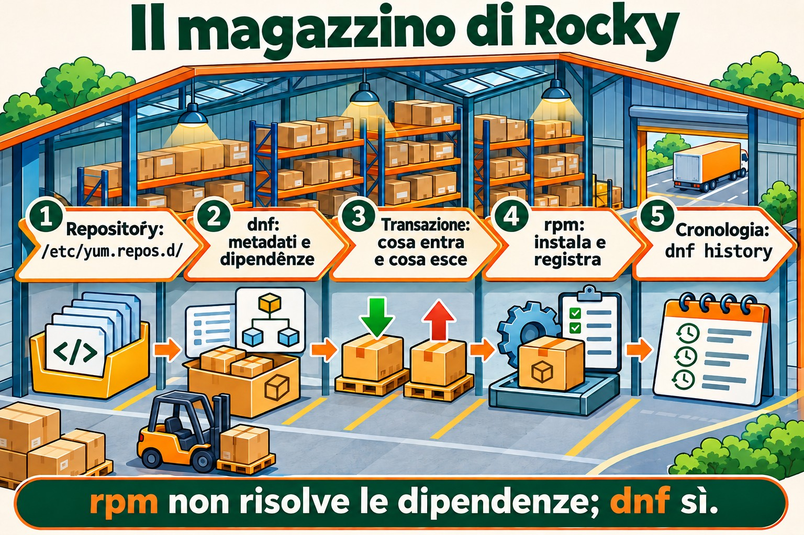
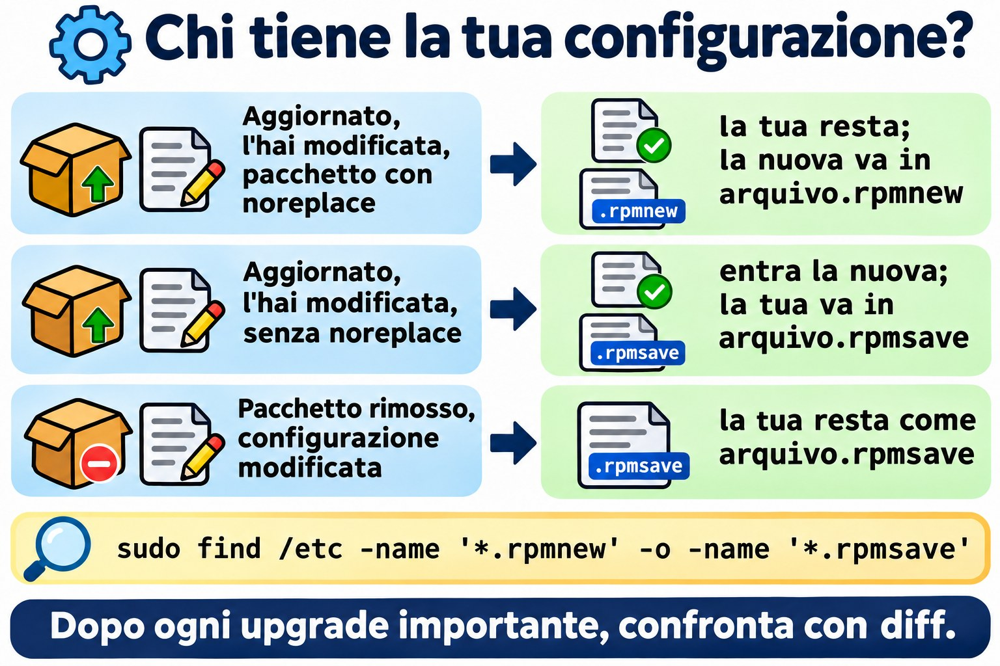
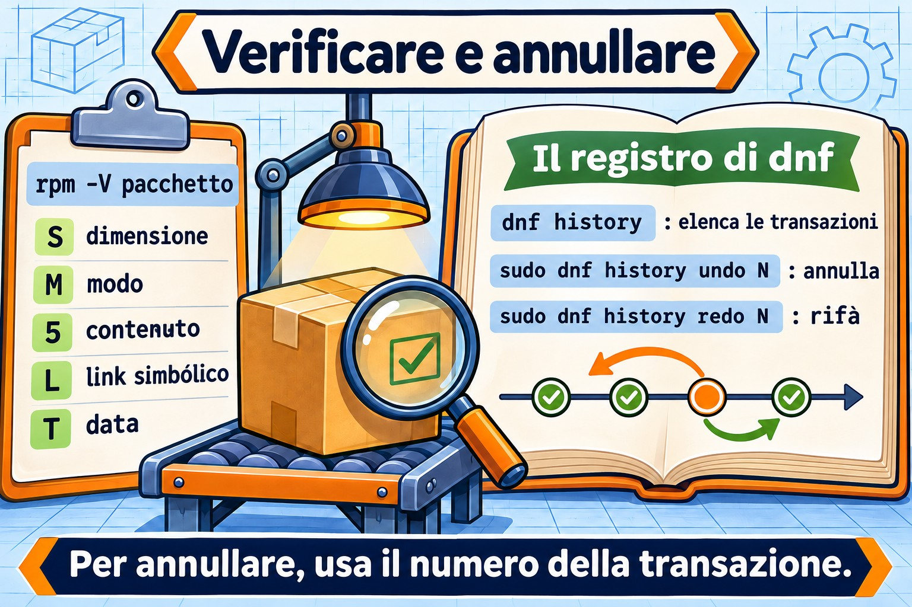

# Lezione 6.2 · Pacchetti su Rocky

Nella lezione scorsa hai imparato il mondo Debian: apt compra, dpkg conserva. Oggi è lo stesso magazzino con nomi diversi: **dnf** compra, **rpm** conserva. La logica è identica, quindi questa lezione va più veloce. Quello che Rocky ha di diverso, e di molto buono, è la **cronologia con annullamento** (`dnf history undo`) e la **verifica di integrità** (`rpm -V`). Entrambe salvano server in produzione.

> **Il cuore di questa lezione:** `dnf install/remove/upgrade/search/info/provides`, `dnf install ./arquivo.rpm`, `rpm -qa/-qi/-ql/-qc/-qf`, `rpm -V`, `dnf history` e `dnf history undo`, `.rpmnew` e `.rpmsave`. Il resto è approfondimento.

| Scheda |  |
| --- | --- |
| **Modulo** | M6 · Software, lezione 2 di 5 |
| **Quando** | Settimana 10 |
| **Alla fine sei in grado di** | Installare, rimuovere e aggiornare pacchetti con dnf; scoprire proprietario e contenuto dei pacchetti con rpm; verificare se qualcuno ha modificato i file di un pacchetto; annullare una transazione tramite la cronologia |
| **Prerequisiti** | Lezione 6.1 · rocky-lab con internet |
| **Durata** | \~2h30 |
| **Snapshot** | `m6a2-inicio` e `m6a2-fim`, solo sulla rocky-lab (201). La debian-lab riposa |

## 1 · Riscaldamento

Rispondi prima di leggere. Le soluzioni sono alla fine della lezione.

1. `rpm -i pacote.rpm` cerca le dipendenze mancanti?
2. Hai installato un pacchetto ieri e ha rotto un servizio. Su Rocky, si può annullare quell'intera installazione, dipendenze incluse, con un solo comando?
3. Sospetti che qualcuno abbia modificato `/etc/ssh/sshd_config` e il binario di `sshd`. Esiste un modo per chiedere al sistema "cosa è cambiato da quando il pacchetto è stato installato?"

## 2 · Perché conta

| La richiesta | La risposta sbagliata | Cosa provoca |
| --- | --- | --- |
| "Installa l'agente di backup sul server" | Scaricare un `.rpm` da un sito qualsiasi ed eseguire `rpm -ivh --nodeps` | Pacchetto senza le librerie di cui ha bisogno, che poi fallisce, e un database rpm di cui dnf d'ora in poi si lamenta |
| "Hanno aggiornato ieri e il servizio si è fermato" | Reinstallare pacchetti a caso, oppure `rpm -e --nodeps` su quello che sembra colpevole | Ore di tentativi. `dnf history` mostrerebbe la transazione esatta, e `undo` la annullerebbe |
| "sshd è strano, qualcuno ci ha messo mano?" | Aprire i file e guardare "a occhio" | Non vedi un binario sostituito né un permesso cambiato. `rpm -V openssh-server` lo mostra in pochi secondi |
| "Il comando `semanage` non esiste qui" | Cercare su Google e installare il primo pacchetto suggerito | Pacchetto sbagliato, o di un'altra versione. `dnf provides` risponde con il pacchetto giusto del tuo repository |

## 3 · Modello mentale

> È lo stesso magazzino della lezione 6.1. **rpm** è il magazziniere: installa un pacchetto alla volta, conserva il registro di tutto e controlla che niente sia stato toccato. **dnf** è l'addetto agli acquisti: legge i cataloghi dei repository, calcola le dipendenze, scarica tutto e consegna a rpm. La differenza è che questo addetto annota ogni acquisto in un libro numerato. E qualsiasi acquisto del libro può essere restituito.

```
/etc/yum.repos.d/*.repo        (de onde comprar)
          |
          v
   dnf  --- baixa metadados ---> /var/cache/dnf/        (catálogos e .rpm baixados)
    |
    |  resolve dependências, monta a transação
    v
   rpm  --- instala ---> banco rpm (/var/lib/rpm)       (o que está instalado, arquivo por arquivo)
    |
    v
/var/lib/dnf/history.sqlite    (o livro: transação 1, 2, 3... com undo)
/var/log/dnf.log, /var/log/dnf.rpm.log
```

Nelle versioni più recenti della famiglia RHEL, il database rpm sta in `/usr/lib/sysimage/rpm` e `/var/lib/rpm` punta lì. Per te, è indifferente: a parlare con il database è sempre `rpm`.



*dnf compra, risolve e annota la transazione; rpm installa e controlla cosa è cambiato.*

## 4 · L'essenziale

### dnf: l'uso di tutti i giorni

| Comando | Cosa fa |
| --- | --- |
| `dnf check-update` | Elenca cosa ha un aggiornamento (non installa niente) |
| `sudo dnf upgrade` | Aggiorna tutto (`dnf update` è lo stesso comando, nome vecchio) |
| `sudo dnf upgrade X` | Aggiorna solo il pacchetto X |
| `dnf search termo` | Cerca nel nome e nel riassunto |
| `dnf info X` | Versione, repository, dimensione, descrizione |
| `dnf provides /caminho` o `dnf provides '*/semanage'` | Quale pacchetto fornisce quel file (installato o no) |
| `sudo dnf install X` | Installa con le dipendenze |
| `sudo dnf install ./arquivo.rpm` | Installa un .rpm locale risolvendo le dipendenze |
| `sudo dnf remove X` | Rimuove X e le dipendenze che usava solo lui |
| `sudo dnf reinstall X` | Reinstalla la stessa versione |
| `sudo dnf downgrade X` | Torna a una versione precedente, se il repository ce l'ha |
| `sudo dnf autoremove` | Rimuove le dipendenze orfane |
| `dnf list installed` / `dnf list available` | Installati / disponibili |
| `dnf repolist` | Repository attivi |
| `sudo dnf clean all` / `sudo dnf makecache` | Pulisce la cache / riscarica i metadati |

Differenza importante rispetto a Debian: **dnf non ha un passo `update` separato**. Controlla i metadati da solo quando sono vecchi. E `dnf remove` si porta già via le dipendenze orfane di quel pacchetto, senza aspettare un `autoremove`.

**Gruppi**: `dnf group list` mostra insiemi già pronti, e `sudo dnf group install "Development Tools"` installa un insieme intero.

**Sicurezza:** `dnf updateinfo list --security` elenca gli avvisi di sicurezza in sospeso, e `sudo dnf upgrade --security` applica solo quelli.

### rpm: le domande al magazziniere

Tutto ciò che comincia con `-q` (query) è sola lettura e non ha bisogno di sudo.

| Comando | Domanda a cui risponde |
| --- | --- |
| `rpm -qa` | Tutto ciò che è installato (con `\| grep`, è il tuo `dpkg -l`) |
| `rpm -q X` | X è installato? Quale versione? |
| `rpm -qi X` | Scheda del pacchetto: versione, data di installazione, origine |
| `rpm -ql X` | File che X ha installato (il `dpkg -L`) |
| `rpm -qc X` | Solo i file di configurazione di X |
| `rpm -qd X` | Solo la documentazione |
| `rpm -qf /caminho` | Di quale pacchetto è questo file (il `dpkg -S`) |
| `rpm -qR X` | Da cosa dipende X |
| `rpm -q --changelog X \| head` | Cronologia delle modifiche del pacchetto (ottima per trovare una CVE corretta) |
| `rpm -q --scripts X` | Script che girano all'installazione e alla rimozione |
| `rpm -qpi arq.rpm` / `rpm -qpl arq.rpm` | Scheda e file di un .rpm **non installato** (la `p` sta per package file) |

E le operazioni, che devi conoscere ma quasi non usare nel lavoro di tutti i giorni:

| Comando | Cosa fa |
| --- | --- |
| `rpm -ivh arq.rpm` | Installa (i), verboso (v), con barra di avanzamento (h). Non risolve le dipendenze |
| `rpm -Uvh arq.rpm` | Aggiorna, oppure installa se non esiste |
| `rpm -Fvh arq.rpm` | Aggiorna solo se esiste già (freshen) |
| `rpm -e X` | Rimuove (erase) |
| `--nodeps`, `--force` | Ignorano le protezioni. Su un server, quasi sempre sono un errore |
| `rpm --import chave.asc` | Importa una chiave GPG di repository (altro nella lezione 6.3) |
| `rpm -K arq.rpm` | Controlla la firma e l'integrità di un .rpm |

### rpm -V: "cosa è cambiato?"

rpm conserva dimensione, hash, permessi, proprietario e data di ogni file installato. `rpm -V X` confronta tutto questo con il disco e mostra solo ciò che è cambiato. Nessun output = non è cambiato niente.

```
S.5....T.  c /etc/ssh/sshd_config
```

| Lettera | Cosa è cambiato |
| --- | --- |
| `S` | Dimensione |
| `M` | Modo (permessi o tipo) |
| `5` | Contenuto (hash) |
| `D` | Dispositivo |
| `L` | Destinazione del link simbolico |
| `U` / `G` | Proprietario / gruppo |
| `T` | Data di modifica |
| `c` prima del percorso | È un file di configurazione: cambiarlo è normale |
| `missing` | Il file è sparito |

Lettura da admin: `5` su un file `c` è qualcuno che ha modificato la config, normale. `5` su un binario in `/usr/sbin` è un allarme. `rpm -Va` verifica l'intero sistema (ci mette un po', e mostra molte config modificate; filtra ciò che non ha `c`).

### .rpmnew e .rpmsave

Debian chiede cosa fare quando hai modificato una config e il pacchetto ne porta una nuova. rpm **non chiede**: decide in base alla regola del pacchetto e lascia un file accanto.

| Situazione | Cosa fa rpm |
| --- | --- |
| Aggiornamento, hai modificato la config, il pacchetto ha segnato `noreplace` (il caso più comune) | Mantiene la tua. La nuova va in `arquivo.rpmnew` |
| Aggiornamento, hai modificato, il pacchetto **non** ha segnato `noreplace` | Installa la nuova. La tua va in `arquivo.rpmsave` |
| Rimozione di un pacchetto la cui config hai modificato | Cancella il pacchetto, e la tua config resta come `arquivo.rpmsave` |

Compito di manutenzione dopo ogni upgrade importante:

```bash
sudo find /etc -name '*.rpmnew' -o -name '*.rpmsave'
```

Ogni `.rpmnew` è una config nuova che nessuno ha confrontato con la tua (`diff` tra le due).



*rpm non chiede: decide in base alla regola del pacchetto e lascia un file accanto.*

### dnf history: il libro degli acquisti

| Comando | Cosa fa |
| --- | --- |
| `sudo dnf history` | Elenca le transazioni: ID, comando, data, azione, quantità |
| `sudo dnf history info N` | Dettaglio della transazione N: chi, quando, ogni pacchetto |
| `sudo dnf history list X` | Solo le transazioni che hanno toccato il pacchetto X |
| `sudo dnf history undo N` | Annulla la transazione N (ciò che ha installato, rimuove; ciò che ha rimosso, reinstalla) |
| `sudo dnf history rollback N` | Riporta il sistema allo stato subito dopo la transazione N, annullando tutte le successive |
| `sudo dnf history redo N` | Ripete la transazione N |
| `dnf repoquery --userinstalled` | Ciò che è stato richiesto da qualcuno, non tirato dentro come dipendenza (l'`apt-mark showmanual`) |

Limite di `undo`: per reinstallare la versione vecchia, questa deve esistere ancora nel repository. Per annullare un'**installazione**, funziona sempre.

### Congelare la versione

L'equivalente di `apt-mark hold`:

```bash
sudo dnf install -y python3-dnf-plugin-versionlock
sudo dnf versionlock add X
dnf versionlock list
sudo dnf versionlock delete X
```

Alternativa grossolana: `exclude=X*` in `/etc/dnf/dnf.conf`, che nasconde il pacchetto da tutte le operazioni.

### Rocky × Debian

| Compito | Rocky | Debian |
| --- | --- | --- |
| Aggiornare il catalogo | automatico (o `dnf makecache`) | `apt update` |
| Aggiornare i pacchetti | `dnf upgrade` | `apt upgrade` |
| Installare / rimuovere | `dnf install` / `dnf remove` | `apt install` / `apt remove` |
| File locale risolvendo le dipendenze | `dnf install ./x.rpm` | `apt install ./x.deb` |
| Strumento di basso livello | `rpm` | `dpkg` |
| Elencare gli installati | `rpm -qa` | `dpkg -l` |
| File del pacchetto | `rpm -ql` | `dpkg -L` |
| Proprietario del file | `rpm -qf` | `dpkg -S` |
| Chi fornisce un file non installato | `dnf provides` | `apt-file search` |
| Config preservata | `.rpmnew` / `.rpmsave` | domanda interattiva e `rc` |
| Verificare l'integrità | `rpm -V` | `debsums` (pacchetto extra) |
| Cronologia con annullamento | `dnf history undo` | non c'è (solo log) |
| Congelare | `dnf versionlock` | `apt-mark hold` |
| Repository | `/etc/yum.repos.d/*.repo` | `/etc/apt/sources.list.d/` |

### E zypper?

zypper è il gestore di openSUSE e di SLES. Non avrai una VM con lui. Basta riconoscerlo: `zypper refresh` (catalogo), `zypper install X`, `zypper remove X`, `zypper search X`, `zypper update`, `zypper repos`. Sotto il cofano, è rpm come gli altri.

## 5 · Lab guidato

Tutto sulla **rocky-lab (201)**. La debian-lab oggi riposa. Ti servirà internet nella VM.

**Passo 0 · Snapshot e cartella.** In Proxmox:

```bash
qm snapshot 201 m6a2-inicio
```

Nella VM:

```bash
mkdir -p ~/lab62 && cd ~/lab62
```

**Passo 1 · Da dove arrivano i pacchetti.**

```bash
dnf repolist
ls /etc/yum.repos.d/
grep -E '^(name|enabled|gpgcheck)=' /etc/yum.repos.d/*.repo | head -20
```

Risultato atteso: i repository **BaseOS**, **AppStream** ed **extras** attivi (`enabled=1`), tutti con `gpgcheck=1`. BaseOS è il nucleo del sistema; AppStream, le applicazioni. Aprirai davvero questi file nella lezione 6.3.

**Passo 2 · Cercare prima di installare.**

```bash
dnf check-update | head
dnf search tree | head
dnf info tree
dnf provides '*/semanage'
```

`dnf provides` risponde qualcosa come `policycoreutils-python-utils`. È così che trovi il pacchetto di un comando che non esiste sulla macchina.

**Passo 3 · Installare e fare domande a rpm.**

```bash
sudo dnf install -y tree httpd
rpm -q tree httpd
rpm -qi tree | head -12
rpm -ql tree
rpm -qf /usr/sbin/httpd
rpm -qf /etc/httpd/conf/httpd.conf
```

Nota le ultime due righe: su Rocky, il binario e la config di Apache stanno in un pacchetto **httpd-core**, e `httpd` è quasi solo un "ombrello". È la stessa idea di nginx-common su Debian. Salva il nome vero in una variabile:

```bash
PKG=$(rpm -qf --qf '%{NAME}' /etc/httpd/conf/httpd.conf)
echo $PKG
rpm -qc $PKG
```

**Passo 4 · rpm -V dal vivo.**

```bash
rpm -V $PKG
```

Nessun output: non è cambiato niente dall'installazione. Ora modifica la config e guarda:

```bash
echo '# teste lab62' | sudo tee -a /etc/httpd/conf/httpd.conf
rpm -V $PKG
```

Risultato atteso: `S.5....T.  c /etc/httpd/conf/httpd.conf`. Dimensione, contenuto e data sono cambiati, e la `c` dice che è una config. È normale: ogni admin modifica le config.

**Passo 5 · Il libro e l'annullamento.**

```bash
sudo dnf history | head
sudo dnf history info last
```

Annota l'**ID** della transazione del passo 3 (quella con `install -y tree httpd`). Ora annulla:

```bash
sudo dnf history undo ID -y
rpm -q tree httpd
ls /etc/httpd/conf/
```

Risultato atteso: `tree` e `httpd` non sono più installati, e sono uscite anche le dipendenze arrivate con loro. In `/etc/httpd/conf/` è rimasto un **`httpd.conf.rpmsave`**: rpm non cancella una config che hai modificato, la conserva accanto.

**Passo 6 · Un .rpm a mano.**

```bash
dnf download httpd
ls -l *.rpm
rpm -qpi httpd-2*.rpm | head -8
rpm -qpR httpd-2*.rpm | head
rpm -K httpd-2*.rpm
sudo rpm -ivh httpd-2*.rpm
```

Risultato atteso: `rpm -K` dice `digests signatures OK` (il pacchetto è arrivato firmato ed è integro). `rpm -ivh` fallisce con `Failed dependencies`. Nota la differenza con Debian: **rpm non installa a metà**. Rifiuta tutto, e il database resta pulito. Ora nel modo giusto:

```bash
sudo dnf install -y ./httpd-2*.rpm
rpm -q httpd
```

Se `dnf download` non esiste, manca `dnf-plugins-core`: `sudo dnf install -y dnf-plugins-core`.

**Passo 7 · Aprire un .rpm senza installarlo.**

```bash
dnf download tree
mkdir extraido && cd extraido
rpm2cpio ../tree-*.rpm | cpio -idmv
find . -type f | head
cd ..
```

`rpm2cpio` trasforma il .rpm in un archivio cpio, e `cpio -idmv` estrae nella cartella corrente. Serve per prendere un file da dentro il pacchetto senza installare niente. (Se manca `cpio`: `sudo dnf install -y cpio`.)

**Passo 8 · Cosa è stato richiesto, cosa è dipendenza, e sicurezza.**

```bash
dnf repoquery --userinstalled | grep -E '^(httpd|tree)'
dnf updateinfo list --security | head
rpm -qa --last | head
```

`rpm -qa --last` ordina i pacchetti per data di installazione: il più recente per primo. È la risposta rapida a "cosa è cambiato su questa macchina?".

**Passo 9 · I log.**

```bash
sudo dnf history list httpd
sudo tail -n 20 /var/log/dnf.rpm.log
```

**Pulizia:**

```bash
sudo dnf remove -y httpd
sudo rm -f /etc/httpd/conf/httpd.conf.rpmsave
cd ~ && rm -r ~/lab62
```

### Decidi 1 · È comparso un .rpmnew

Dopo un `dnf upgrade`, trovi `/etc/httpd/conf/httpd.conf.rpmnew` accanto al `httpd.conf` che avevi modificato. Scegli un'opzione prima di continuare.

- **A)** L'aggiornamento è fallito a metà. Reinstalla il pacchetto.
- **B)** La tua config è stata mantenuta, e la nuova config predefinita è lì accanto. Confronta le due e porta dentro ciò che serve.
- **C)** rpm ha sostituito la tua config con quella nuova, e la tua vecchia è nel `.rpmnew`.

| Se hai scelto | Risultato | Perché |
| --- | --- | --- |
| A | Lavoro inutile | Non è fallito niente. Il `.rpmnew` è il comportamento normale di un `%config(noreplace)` |
| **B** | **Giusto** | rpm ha protetto la tua modifica e ha lasciato la versione nuova perché tu la confronti con `diff -u httpd.conf httpd.conf.rpmnew` |
| C | Confondi i suffissi | Quando è la tua a essere spostata, diventa `.rpmsave`. **new** = ciò che è arrivato; **save** = ciò che è stato conservato |

**Da ricordare:** `.rpmnew` = la nuova è rimasta accanto; `.rpmsave` = la tua è stata conservata accanto. Dopo il confronto, cancella quello che resta, altrimenti tra un anno nessuno sa quale sia quale.

### Decidi 2 · L'aggiornamento di ieri ha rotto il servizio

In `dnf history`, la transazione **42** di ieri ha installato il pacchetto `agente` e **aggiornato** tre librerie. Dopo di lei, la 43 e la 44 hanno installato cose che serve a un altro admin. Il servizio è fermo dalla 42. Scegli un'opzione prima di continuare.

- **A)** `sudo dnf remove agente`
- **B)** `sudo dnf history undo 42`
- **C)** `sudo dnf history rollback 41`

| Se hai scelto | Risultato | Perché |
| --- | --- | --- |
| A | A metà | `agente` se ne va, ma le tre librerie restano nella versione nuova, che potrebbe essere la colpevole |
| **B** | **Annulla esattamente la 42** | Rimuove `agente` e riporta le tre librerie alla versione precedente (se è ancora nel repository). La 43 e la 44 restano |
| C | Rovina il lavoro del collega | `rollback` riporta il sistema allo stato dopo la 41, annullando la 42, la 43 e la 44 |

**Da ricordare:** `undo N` annulla **una** transazione; `rollback N` annulla **tutto ciò che viene dopo** N. Prima di entrambi, `sudo dnf history info 42` per vedere cosa ha fatto davvero.

## 6 · Rompi e ripara

**Guasto 1 · Permesso di un binario alterato.**


*rpm installa un pacchetto alla volta e non risolve le dipendenze. A risolverle è dnf. Per annullare, usa il numero della transazione.*


```bash
sudo dnf install -y tree
sudo chmod 0644 /usr/bin/tree
tree /etc/yum.repos.d
```

**Sintomo:** `Permission denied`, anche se il file esiste ed è il tuo sistema.

**Diagnosi:**

```bash
ls -l /usr/bin/tree
rpm -V tree
```

Risultato atteso: `.M.......    /usr/bin/tree`. La `M` dice che il **modo** è cambiato, e senza `c`: è un binario, non una config. Questo non è normale.

**Riparazione:**

```bash
sudo rpm --restore tree
rpm -V tree && tree -L 1 /etc/yum.repos.d
```

`rpm --restore` restituisce proprietario, gruppo e permessi a ciò che il pacchetto ha registrato, senza reinstallare. Se fosse cambiato il **contenuto** (`5`), allora sì, `sudo dnf reinstall tree`.

**Nella vita reale:** un `5` su un binario di `/usr/bin` o `/usr/sbin` senza nessun aggiornamento che lo spieghi è segno di intrusione. Non reinstallare di corsa: cancelleresti le prove. Isola la macchina e chiama chi si occupa di sicurezza.

**Guasto 2 · Installazione forzata.**

```bash
mkdir -p ~/lab62q && cd ~/lab62q
dnf download httpd
sudo rpm -ivh --nodeps httpd-2*.rpm
rpm -q httpd
sudo dnf check
```

**Sintomo:** `rpm -q` dice che httpd è installato, ma `dnf check` elenca dipendenze mancanti. Un `systemctl start httpd` fallirebbe. E ogni operazione di dnf da adesso in poi ricorderà il problema.

**Riparazione:** lascia che sia dnf a completare ciò che manca.

```bash
sudo dnf install -y httpd
sudo dnf check
```

`dnf check` senza output significa che il database è di nuovo coerente. (Se dnf non risolve, `sudo rpm -e --nodeps httpd` e reinstalla tramite dnf.)

**Pulizia:** `sudo dnf remove -y httpd tree && cd ~ && rm -r ~/lab62q`

**Guasto 3 · Database rpm corrotto.** Non provocare questo. Compare dopo un disco pieno o uno spegnimento brusco: `rpm -qa` dà errore, dnf si ferma con `error: rpmdb open failed`. Riparazione:

```bash
sudo cp -a /var/lib/rpm /root/rpm-backup-$(date +%F)
sudo rpmdb --rebuilddb
rpm -qa | wc -l
```

Prima la copia, poi la ricostruzione. Sempre.

## 7 · Trappole

| Trappola | Cosa succede | Come evitarla |
| --- | --- | --- |
| `rpm -ivh` invece di `dnf install ./` | Fallisce per una dipendenza, e il passo dopo diventa `--nodeps` | Per installare, sempre dnf. rpm serve per le domande |
| `--nodeps` e `--force` "solo per farlo passare" | Database incoerente, servizio che non parte, futuri upgrade che si rompono | Se devi forzare, il pacchetto è sbagliato per quel sistema |
| `rollback` quando volevi `undo` | Annulla il lavoro di altre persone | `history info` prima, e `undo` per una sola transazione |
| Ignorare `.rpmnew` | Config vecchia che perde le opzioni nuove, o parametro che ha cambiato nome | `find /etc -name '*.rpmnew'` dopo ogni upgrade importante |
| Confondere `.rpmnew` e `.rpmsave` | Cancellare la tua config credendo fosse quella predefinita | new = arrivato; save = conservato |
| `rpm -qf` su un comando, non su un percorso | `rpm -qf tree` risponde "il file non esiste" | `rpm -qf $(command -v tree)` |
| `rpm -Va` su un server carico | Tanto disco e tanto output di config modificate | Verifica i pacchetti che contano: `rpm -V openssh-server sudo` |
| `dnf upgrade` senza guardare cosa arriva | Kernel nuovo, servizio riavviato all'ora sbagliata | `dnf check-update` prima, e finestra di manutenzione |
| `exclude=` dimenticato in `dnf.conf` | Pacchetto che non riceve mai più correzioni di sicurezza | `versionlock` (che ha `list`) e revisione mensile |

## 8 · Quiz

Rispondi senza guardare. Le soluzioni sono alla fine della lezione.

1. Qual è la differenza tra `rpm -ql httpd` e `rpm -qpl httpd-2.4.rpm`?
2. `rpm -V sudo` mostra `..5....T.    /usr/bin/sudo`. Cosa significa, e qual è il tuo primo passo?
3. Hai modificato `/etc/httpd/conf/httpd.conf`. Cosa succede quando **rimuovi** il pacchetto? E quando **aggiorni**, se il pacchetto segna la config come `noreplace`?
4. Qual è la differenza tra `dnf history undo 42` e `dnf history rollback 42`?
5. Su una Rocky senza `dig` installato, come scopri quale pacchetto installare?
6. *Which rpm query option works on a package file that is not installed? a) `-qa` b) `-qf` c) `-qp` d) `-V`*

## 9 · Promemoria

**Da sapere a memoria:**

| Voglio... | Comando |
| --- | --- |
| Vedere se ci sono aggiornamenti / aggiornare | `dnf check-update` / `sudo dnf upgrade` |
| Installare / rimuovere | `sudo dnf install X` / `sudo dnf remove X` |
| Installare un .rpm locale | `sudo dnf install ./arquivo.rpm` |
| Cercare / leggere info | `dnf search X` / `dnf info X` |
| Chi fornisce questo file/comando | `dnf provides '*/comando'` |
| È installato? | `rpm -q X` |
| File / config del pacchetto | `rpm -ql X` / `rpm -qc X` |
| Di chi è questo file | `rpm -qf /caminho` |
| Cosa è cambiato nel pacchetto | `rpm -V X` |
| Cronologia / annullare | `sudo dnf history` / `sudo dnf history undo N` |

**Da consultare:**

| Voglio... | Comando |
| --- | --- |
| Dettaglio di una transazione | `sudo dnf history info N` |
| Tornare indietro fino a un punto | `sudo dnf history rollback N` |
| Scheda / file di un .rpm non installato | `rpm -qpi arq.rpm` / `rpm -qpl arq.rpm` |
| Dipendenze | `rpm -qR X` |
| Changelog (CVE corretta?) | `rpm -q --changelog X \| head` |
| Installati per data | `rpm -qa --last \| head` |
| Richiesti da qualcuno | `dnf repoquery --userinstalled` |
| Controllare la firma di un .rpm | `rpm -K arq.rpm` |
| Estrarre senza installare | `rpm2cpio arq.rpm \| cpio -idmv` |
| Ripristinare i permessi | `sudo rpm --restore X` |
| Database coerente? | `sudo dnf check` |
| Solo aggiornamenti di sicurezza | `sudo dnf upgrade --security` |
| Congelare la versione | `sudo dnf versionlock add X` |
| Gruppi | `dnf group list` / `sudo dnf group install "Nome"` |
| Config in sospeso | `sudo find /etc -name '*.rpmnew' -o -name '*.rpmsave'` |
| Log | `/var/log/dnf.log`, `/var/log/dnf.rpm.log` |

**Flashcard:**

- `rpm -i` con dipendenza mancante → *rifiuta tutto, non installa a metà (diverso da dpkg).*
- Lettere di `rpm -V` → *S dimensione, M modo, 5 contenuto, L link, U proprietario, G gruppo, T data; `c` = config.*
- `.rpmnew` × `.rpmsave` → *new: la nuova è arrivata accanto; save: la tua è stata conservata accanto.*
- `undo` × `rollback` → *undo annulla una transazione; rollback annulla tutto ciò che viene dopo N.*
- `-qf` × `-qp` → *-qf: proprietario di un file; -qp: fare la domanda a un .rpm non installato.*

## 10 · Checklist e chiusura

- [ ] Installo, rimuovo e aggiorno con dnf, anche un .rpm locale
- [ ] Trovo il pacchetto di un comando che non esiste (`dnf provides`)
- [ ] Rispondo a "di chi è questo file?" e "quali file ha questo pacchetto?"
- [ ] Leggo l'output di `rpm -V` e so quando è un allarme
- [ ] So cosa sono `.rpmnew` e `.rpmsave` e dove cercarli
- [ ] Annullo una transazione con `dnf history undo`
- [ ] So perché `--nodeps` è quasi sempre un errore

**Ultimo esercizio, senza guardare la lezione:** sulla rocky-lab, installa `htop` (se non lo trovi, cerca con `dnf search`; potrebbe stare in EPEL, argomento della lezione 6.3, quindi usa `tmux` al suo posto). Scopri da quale pacchetto viene il binario, cambiane il permesso, dimostra la modifica con `rpm -V`, ripara con `rpm --restore` e, alla fine, annulla l'installazione tramite `dnf history`.

**Reboot e verifica:**

```bash
sudo reboot
# dopo il riavvio:
sudo dnf check
sudo dnf history | head -5
rpm -V openssh-server sudo
```

`dnf check` non deve mostrare niente. `rpm -V` può mostrare solo le config (`c`) che hai modificato nelle lezioni precedenti.

**Snapshot di fine** (in Proxmox):

```bash
qm snapshot 201 m6a2-fim
```

## 11 · Nella vita reale

**Missione, sola lettura.** Su un server Rocky, Alma o RHEL che già amministri, esegui **solo** questi comandi. Niente `install`, `upgrade`, `remove` o `undo`.

```bash
cat /etc/os-release | head -3
dnf repolist
sudo dnf history | head -15
rpm -qa --last | head -15
rpm -V openssh-server sudo
sudo find /etc -name '*.rpmnew' -o -name '*.rpmsave'
grep -i exclude /etc/dnf/dnf.conf
```

Domande a cui rispondere:

1. Quali repository sono attivi? Ce n'è qualcuno fuori standard (EPEL, di un fornitore)?
2. Qual è stata l'ultima transazione, quando e chi l'ha fatta?
3. `rpm -V` ha mostrato qualcosa senza `c`? (Se ha mostrato `5` su un binario, fermati e avvisa chi si occupa di sicurezza.)
4. C'è un `.rpmnew` o `.rpmsave` dimenticato? Di quando?
5. C'è `exclude=` in `dnf.conf`? Qualcuno sa perché?

**Diario:** annota per ogni server RHEL-like i repository extra e i pacchetti congelati, con il motivo.

**Domani, senza guardare:** scrivi su un foglio le lettere di `rpm -V` e cosa significa ciascuna.

## 12 · Approfondire quando vuoi

- **dnf-automatic:** aggiornamenti automatici nella famiglia RHEL (il corrispettivo di `unattended-upgrades`). Arriva nel modulo di manutenzione.
- **`dnf needs-restarting -r`:** dice se il server ha bisogno di un reboot dopo gli aggiornamenti (kernel, glibc, systemd).
- **Moduli di AppStream** (`dnf module list`): versioni alternative di PHP, Node, PostgreSQL su Rocky 8 e 9. Nella famiglia RHEL 10 questa forma è stata abbandonata a favore di pacchetti con la versione nel nome.
- **dnf5:** la nuova generazione di dnf, già predefinita su Fedora. I comandi di tutti i giorni sono gli stessi.
- **rpmbuild e file .spec:** come si costruisce un .rpm. Utile per impacchettare i tuoi script e distribuirli con dnf.
- **`rpm --querytags` e `--qf`:** output formattato di rpm, ottimo per i report (`rpm -qa --qf '%{NAME} %{INSTALLTIME:date}\n'`).

**DeepTutor** (http://10.1.0.149:3782, KB "Curso Linux Sysadmin"):

- `!explica a saída do rpm -V e quando ela indica invasão`
- `!feynman a diferença entre .rpmnew e .rpmsave`
- `!quiz Aula 6.2, 5 perguntas comparando dnf/rpm com apt/dpkg`

## Soluzioni commentate

### Riscaldamento

1. **No.** `rpm -i` installa solo quel file. Se manca una dipendenza, si ferma con `Failed dependencies` e **non installa niente** (dpkg, al contrario, lascia il pacchetto a metà). A risolvere le dipendenze è `dnf install ./arquivo.rpm`.
2. **Sì.** `sudo dnf history` mostra la transazione, e `sudo dnf history undo N` annulla tutto ciò che ha fatto, dipendenze incluse. Per annullare un **aggiornamento**, la versione vecchia deve essere ancora nel repository.
3. **Sì:** `rpm -V openssh-server`. Confronta dimensione, hash, permessi, proprietario e data di ogni file con quanto registrato all'installazione. Una config modificata compare con `c`; un binario alterato compare senza.

### Quiz

1. `rpm -ql httpd` fa la domanda al **database** su un pacchetto **installato**. `rpm -qpl arquivo.rpm` la fa al **file** .rpm, installato o no. La `p` sta per package file.
2. Il contenuto (`5`) e la data (`T`) del binario `/usr/bin/sudo` sono cambiati, e non è una config (non ha `c`). Primo passo: `sudo dnf history list sudo` e `rpm -qi sudo` per vedere se c'è stato un aggiornamento legittimo incompleto. Se non c'è nessuna spiegazione, trattalo come una possibile intrusione: isola la macchina e **non** reinstallare prima di aver preservato le prove.
3. Alla **rimozione**, il pacchetto se ne va e la tua config modificata resta come `httpd.conf.rpmsave`. All'**aggiornamento** con `noreplace`, la tua config resta al suo posto e la nuova arriva come `httpd.conf.rpmnew`.
4. `undo 42` annulla **solo** la transazione 42. `rollback 42` riporta il sistema allo stato subito dopo la 42, annullando **tutte** le successive (43, 44...).
5. `dnf provides '*/bin/dig'` (o `dnf provides dig`). La risposta è il pacchetto `bind-utils`. L'equivalente su Debian sarebbe `apt-file search bin/dig`.
6. **c) `-qp`.** `-qa` elenca gli installati, `-qf` trova il proprietario di un file installato, e `-V` verifica pacchetti installati. Solo `p` fa la domanda a un file .rpm.

---

<!-- navegacao -->
[← Lezione 6.1 · Pacchetti su Debian](6.1-pacotes-no-debian.md) · [Indice delle lezioni](../01-aulas.md) · [Lezione 6.3 · Repository →](6.3-repositorios.md)
