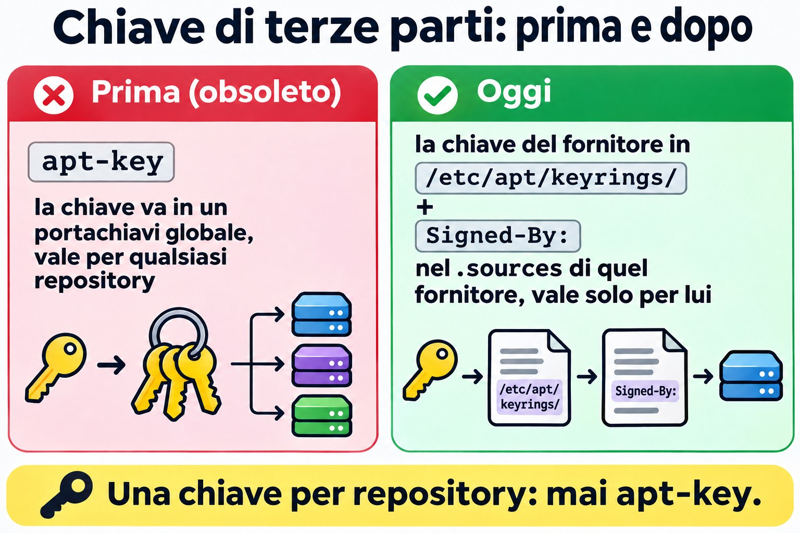
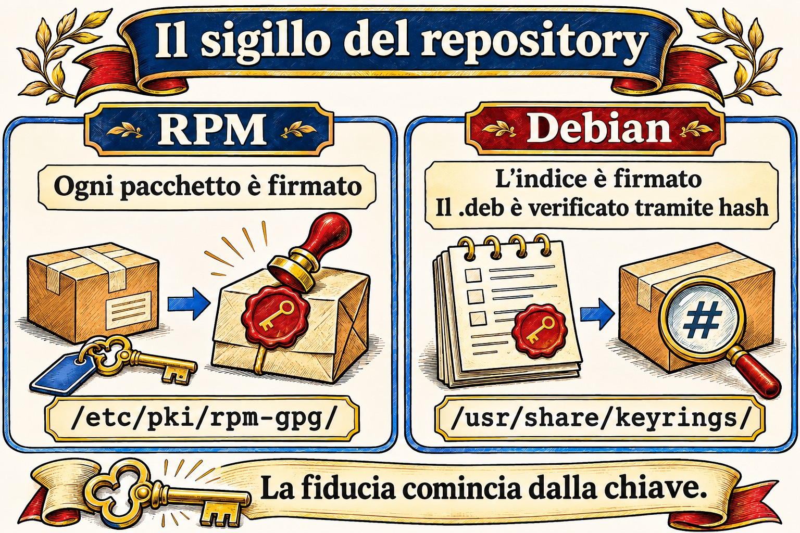

# Lezione 6.3 · Repository

Nelle due lezioni precedenti hai usato apt e dnf come se i pacchetti cadessero dal cielo. Arrivano da qualche parte: un indirizzo scritto in un file di configurazione, un indice firmato e una chiave di cui il sistema ha deciso di fidarsi. Oggi impari a leggere, aggiungere, disattivare e riparare questa catena, e a creare un repository a partire dalla ISO per installare senza internet.

> **Il cuore di questa lezione:** leggere e scrivere un `.repo` (Rocky) e un `.sources` (Debian), attivare e disattivare un repository al volo e in modo permanente, abilitare EPEL nel modo corretto, capire dove sta la firma e creare un repository locale con la ISO. Il resto è approfondimento.

| Scheda |  |
| --- | --- |
| **Modulo** | M6 · Software, lezione 3 di 5 |
| **Quando** | Settimana 10 |
| **Alla fine** | Sai da dove viene ogni pacchetto, di chi si fida il sistema e come installare senza internet |
| **Prerequisiti** | Lezioni 6.1 e 6.2 |
| **Durata** | circa 2h30 |
| **Snapshot** | `m6a3-inicio` e `m6a3-fim`, su entrambe le VM |

## 1 · Riscaldamento

Rispondi prima di leggere. Sbagliare qui fa parte del metodo.

1. Scarichi un pacchetto da un mirror che nessuno conosce, dall'altra parte del mondo. Chi garantisce che sia l'originale?
2. Si possono installare pacchetti su un server senza alcun accesso a internet?
3. Un server Rocky ha cinque repository e uno è andato offline. Il `dnf install` degli altri quattro continua a funzionare?

## 2 · Perché conta

| La richiesta | La risposta sbagliata | Cosa provoca |
| --- | --- | --- |
| "dnf ha smesso di funzionare, dà un errore di metadata" | Cancellare il `.repo` che dà errore senza guardare quale fosse | Sparisce il repository di un fornitore e i suoi aggiornamenti si fermano in silenzio |
| "Il tutorial dice di incollare un `curl ... \| apt-key add`" | Incollare | La chiave diventa valida per **tutti** i repository, non solo per quello del fornitore |
| "Mi serve htop su Rocky, non lo trovo" | Scaricare il .rpm da un sito qualsiasi | Pacchetto senza una firma nota e senza aggiornamenti futuri |
| "Il cliente non fa uscire il server su internet" | "Allora non si può installare niente" | Si può: repository locale con la ISO o un mirror interno |
| "Errore di chiave GPG" | `gpgcheck=0` e via | Spegni proprio la protezione contro i pacchetti manomessi |

## 3 · Modello mentale

> Un repository è un **negozio con catalogo**. Il client (apt o dnf) conserva un elenco di indirizzi di negozi e un portachiavi con i **sigilli** che accetta. Prima di comprare, scarica il catalogo, controlla il sigillo e solo allora prende il pacchetto. Senza un sigillo noto, non compra.

```
   ROCKY (dnf)                              DEBIAN (apt)

 /etc/yum.repos.d/*.repo              /etc/apt/sources.list(.d/*.sources)
   baseurl / mirrorlist / metalink       URIs + Suites + Components
          │                                      │
          ▼                                      ▼
 repodata/repomd.xml  (catálogo)       dists/<suite>/InRelease  (catálogo ASSINADO)
          │                                      │ hashes
          ▼                                      ▼
 pacote.rpm  (cada pacote ASSINADO)    Packages ──► pacote.deb (confere o hash)
          │                                      │
 gpgcheck=1 + gpgkey=                  Signed-By: chave em
 /etc/pki/rpm-gpg/                     /usr/share/keyrings ou /etc/apt/keyrings
```

La differenza che esce più spesso: nel mondo RPM **ogni pacchetto** è firmato. In Debian a essere firmato è l'**indice** (`InRelease`/`Release`), e i `.deb` vengono verificati con l'hash contenuto in quell'indice. Il risultato è simile, ma un `.deb` scaricato a mano non porta con sé una firma propria.


*Il client scarica il catalogo, controlla il sigillo e solo allora prende il pacchetto.*

## 4 · L'essenziale

### Rocky: il file .repo

Ogni file `/etc/yum.repos.d/*.repo` viene letto (deve finire in `.repo`). Ogni blocco `[id]` è un repository:

```ini
[iso-baseos]
name=Rocky ISO - BaseOS
baseurl=file:///mnt/iso/BaseOS
enabled=1
gpgcheck=1
gpgkey=file:///etc/pki/rpm-gpg/RPM-GPG-KEY-Rocky-9
```

| Campo | Cosa fa |
| --- | --- |
| `[id]` | Nome breve, unico in tutto il sistema. È quello che usi con `--enablerepo` |
| `name` | Descrizione per umani |
| `baseurl` | Indirizzo diretto del repository (`http://`, `https://`, `file://`). Lì dentro deve esistere `repodata/` |
| `mirrorlist` / `metalink` | Indirizzo di un elenco di mirror. dnf ne sceglie uno. Il `metalink` porta anche gli hash del catalogo |
| `enabled` | 1 attivo, 0 disattivato |
| `gpgcheck` | 1 controlla la firma di ogni pacchetto. **Lascia 1** |
| `gpgkey` | Dove si trova la chiave pubblica. Alla prima installazione dnf mostra l'impronta digitale e chiede conferma |
| `skip_if_unavailable` | Se il repository cade, dnf prosegue con gli altri (su Rocky il valore predefinito è `False`) |
| `priority` | Vince il numero più basso quando lo stesso pacchetto esiste in due repository (predefinito 99) |

Variabili che compaiono nei file: `$releasever` (9, 10), `$basearch` (x86\_64). Vedi il valore con `rpm -E %rhel` e `uname -m`.

| Voglio... | Comando |
| --- | --- |
| Vedere tutti, anche quelli disattivati | `dnf repolist all` |
| Dettagli di uno | `dnf repoinfo baseos` |
| Attivarlo solo in questa esecuzione | `dnf --enablerepo=crb install X` |
| Usare **solo** alcuni | `dnf --disablerepo='*' --enablerepo='iso-*' install X` |
| Attivare / disattivare in modo permanente | `sudo dnf config-manager --set-enabled crb` / `--set-disabled crb` |
| Aggiungere tramite URL | `sudo dnf config-manager --add-repo URL` |
| Rifare la cache dei metadati | `sudo dnf makecache` / `sudo dnf clean all` |
| Chiavi di cui si fida rpm | `rpm -qa 'gpg-pubkey*'` |
| Importare una chiave a mano | `sudo rpm --import /caminho/ou/URL` |

Il `config-manager` arriva con `dnf-plugins-core`. Se manca, `sudo dnf install dnf-plugins-core`. Modifica solo l'`enabled=` del file, niente di magico.

### Rocky: EPEL e CRB

**EPEL** (Extra Packages for Enterprise Linux) è il repository della comunità Fedora con migliaia di pacchetti che Red Hat non distribuisce: htop, ncdu, fail2ban... Molti dipendono da librerie di sviluppo che stanno nel **CRB** (CodeReady Builder), che è disattivato di default. Per questo l'ordine è:

```bash
sudo dnf config-manager --set-enabled crb
sudo dnf install epel-release
```

Il pacchetto `epel-release` installa il `.repo` e la chiave. Niente `.rpm` da siti a caso.

### Debian: sources.list e il formato deb822

Due modi, stesso effetto:

```
# Uma linha (sources.list clássico, Debian 12 e anteriores)
deb [signed-by=/usr/share/keyrings/debian-archive-keyring.gpg] http://deb.debian.org/debian bookworm main contrib
```

```
# deb822 (/etc/apt/sources.list.d/*.sources, padrão no Debian 13)
Types: deb
URIs: http://deb.debian.org/debian
Suites: trixie trixie-updates
Components: main contrib non-free-firmware
Signed-By: /usr/share/keyrings/debian-archive-keyring.gpg
```

| Campo | Cos'è |
| --- | --- |
| `Types` | `deb` (binari) e/o `deb-src` (sorgenti) |
| `URIs` | Indirizzo del mirror |
| `Suites` | Versione: `trixie`, `trixie-updates`, `trixie-security`, `trixie-backports` (oppure `stable`, che cambia versione da solo: evitalo sui server) |
| `Components` | `main` (libero), `contrib`, `non-free`, `non-free-firmware` |
| `Signed-By` | Quale chiave può firmare **questo** repository |
| `Enabled: no` | Disattiva senza cancellare (solo in deb822) |

Con apt 3.0 (Debian 13), `sudo apt modernize-sources` converte il vecchio formato in deb822.

**Chiavi di terze parti, nel modo giusto:** la chiave del fornitore va in `/etc/apt/keyrings/` (cartella tua) e il `Signed-By:` punta a quella, solo nel `.sources` di quel fornitore. `apt-key` è obsoleto ed è stato rimosso nelle versioni nuove: metteva la chiave in un portachiavi globale, valido per qualsiasi repository.



*apt-key apriva la porta a qualsiasi repository; Signed-By dà una chiave a ciascuno.*

**Backports:** versioni più recenti di alcuni pacchetti, compilate per il tuo Debian stable. Entrano con priorità 100, quindi **non vengono mai scelti da soli**. Sei tu a chiederli: `sudo apt install -t trixie-backports pacote`.

### Repository locale con la ISO

La ISO DVD di Rocky è già un repository: dentro ci sono `BaseOS/` e `AppStream/`, ciascuno con il proprio `repodata/`. La ISO minimale ne contiene solo una parte. Monti, punti il `baseurl` a `file:///...` e hai finito. È così che si installa in una rete isolata, ed è la base della Sfida dell'M6.

In Debian, anche la ISO ha l'indice firmato. La strada classica è `apt-cdrom add` con il disco montato, che aggiunge la voce da solo.

### Rocky × Debian

| Argomento | Rocky (dnf) | Debian (apt) |
| --- | --- | --- |
| Dove si configura | `/etc/yum.repos.d/*.repo` | `/etc/apt/sources.list` e `/etc/apt/sources.list.d/*.sources` oppure `*.list` |
| Cosa è firmato | Ogni `.rpm` | L'indice `InRelease`/`Release` |
| Dove stanno le chiavi | `/etc/pki/rpm-gpg/` e il database di rpm (`gpg-pubkey`) | `/usr/share/keyrings/` (pacchetti) e `/etc/apt/keyrings/` (tue) |
| Attivare solo adesso | `--enablerepo=` / `--disablerepo=` | `-t suite` (sceglie l'origine) |
| Disattivare in modo permanente | `enabled=0` | `Enabled: no` oppure commentare la riga |
| Aggiornare il catalogo | automatico, oppure `dnf makecache` | `apt update`, sempre |
| Pacchetti extra | EPEL (+ CRB) | `contrib`, `non-free`, backports |
| Senza internet | `.repo` con `baseurl=file:///` | `apt-cdrom add` oppure `URIs: file:/` |
| Chi ha la precedenza | `priority=` | `apt_preferences` (pinning) |

Su SUSE: `zypper lr` elenca e `zypper ar URL nome` aggiunge.

## 5 · Lab guidato

**Passo 0 · Snapshot e cartella.** Su Proxmox:

```bash
qm snapshot 201 m6a3-inicio
qm snapshot 202 m6a3-inicio
```

Su entrambe le VM: `mkdir -p ~/lab63 && cd ~/lab63`.

### Parte A · rocky-lab

**Passo 1 · Anatomia.** Guarda cosa esiste già prima di toccare qualcosa:

```bash
dnf repolist all
ls /etc/yum.repos.d/
grep -v '^#' /etc/yum.repos.d/rocky.repo | grep -A8 '^\[baseos\]'
dnf repoinfo baseos | head -20
ls /etc/pki/rpm-gpg/
rpm -qa 'gpg-pubkey*'
```

Nota: `baseos` usa `mirrorlist`, non `baseurl`. `crb` compare come `disabled`. Ogni `gpg-pubkey-...` è una chiave che rpm accetta già. Guarda di chi è una: `rpm -qi $(rpm -qa 'gpg-pubkey*' | head -1) | grep -i summary`.

**Passo 2 · Attivare e disattivare.** Prima solo per un comando, poi in modo permanente:

```bash
dnf --disablerepo='*' --enablerepo=baseos list --available | wc -l
dnf list --available | wc -l
sudo dnf config-manager --set-disabled appstream
grep -A6 '^\[appstream\]' /etc/yum.repos.d/rocky.repo | grep enabled
dnf repolist
sudo dnf config-manager --set-enabled appstream
```

Il primo numero è più piccolo: ha risposto solo BaseOS. Il `config-manager` ha semplicemente cambiato `enabled=1` in `enabled=0` nel file. Avresti potuto farlo con un editor.

**Passo 3 · CRB ed EPEL.** Nel modo corretto, facendo attenzione alla chiave:

```bash
sudo dnf config-manager --set-enabled crb
sudo dnf install -y epel-release
cat /etc/yum.repos.d/epel.repo | grep -E '^\[|gpgkey|gpgcheck'
rpm -qa 'gpg-pubkey*' | wc -l
sudo dnf install htop
```

Nell'ultimo comando **non** usare `-y`. dnf mostrerà `Importing GPG key` con il nome e l'impronta digitale (fingerprint) della chiave di EPEL e ti chiederà conferma. Leggi prima di rispondere `y`. Poi:

```bash
rpm -qa 'gpg-pubkey*' | wc -l
dnf info htop | grep -i repo
```

Una chiave in più, e htop è arrivato da `epel`.

**Passo 4 · Repository locale con la ISO.** Su Proxmox, trova la ISO di Rocky e mettila nel CD-ROM della VM:

```bash
pvesm status --content iso
pvesm list <storage-de-iso> --content iso | grep -i rocky
qm set 201 --ide2 <storage-de-iso>:iso/<arquivo-da-rocky>.iso,media=cdrom
```

Su rocky-lab:

```bash
lsblk | grep rom
sudo mkdir -p /mnt/iso
sudo mount -o ro /dev/sr0 /mnt/iso
ls /mnt/iso
ls /mnt/iso/BaseOS
```

Devono comparire `BaseOS/` e `AppStream/`, ciascuno con `repodata/`. Ora il `.repo`:

```bash
V=$(rpm -E %rhel)
sudo tee /etc/yum.repos.d/iso.repo >/dev/null <<EOF
[iso-baseos]
name=Rocky ISO - BaseOS
baseurl=file:///mnt/iso/BaseOS
enabled=1
gpgcheck=1
gpgkey=file:///etc/pki/rpm-gpg/RPM-GPG-KEY-Rocky-$V

[iso-appstream]
name=Rocky ISO - AppStream
baseurl=file:///mnt/iso/AppStream
enabled=1
gpgcheck=1
gpgkey=file:///etc/pki/rpm-gpg/RPM-GPG-KEY-Rocky-$V
EOF
cat /etc/yum.repos.d/iso.repo
dnf repolist
```

Prova usando **solo** la ISO, come se internet non esistesse:

```bash
dnf --disablerepo='*' --enablerepo='iso-*' list --available | head
sudo dnf --disablerepo='*' --enablerepo='iso-*' install -y tmux
dnf info tmux | grep -i repo
```

Se la tua ISO è quella minimale e `tmux` non c'è, scegli un altro pacchetto dall'elenco del primo comando. `From repo` deve dire `iso-baseos` o `iso-appstream`.

### Parte B · debian-lab

**Passo 5 · Anatomia.**

```bash
. /etc/os-release; echo $VERSION_CODENAME
cat /etc/apt/sources.list 2>/dev/null | grep -v '^#'
ls /etc/apt/sources.list.d/
cat /etc/apt/sources.list.d/*.sources 2>/dev/null
ls /usr/share/keyrings/ /etc/apt/keyrings/ 2>/dev/null
apt-cache policy | head -20
```

In `apt-cache policy`, ogni origine compare con un numero di priorità (500 per quelle normali) e la riga `release` mostra la suite (`n=trixie`) e il componente.

**Passo 6 · Backports in deb822.**

```bash
. /etc/os-release
sudo tee /etc/apt/sources.list.d/backports.sources >/dev/null <<EOF
Types: deb
URIs: http://deb.debian.org/debian
Suites: ${VERSION_CODENAME}-backports
Components: main
Signed-By: /usr/share/keyrings/debian-archive-keyring.gpg
EOF
sudo apt update
apt-cache policy | grep -B1 backports
```

Nota il **100**: i backports vengono consultati, ma non vincono mai da soli. Per vederlo all'opera, cerca un pacchetto che abbia lì una versione più nuova e confronta:

```bash
apt list -a 2>/dev/null | grep -- "-backports" | head -5
apt-cache policy <um-pacote-da-lista>
```

`Candidate:` resta la versione normale. Per installare quella dei backports servirebbe `-t ${VERSION_CODENAME}-backports`. **Non installare.**

**Passo 7 · Disattivare senza cancellare.** Aggiungi `Enabled: no` al blocco e controlla:

```bash
echo 'Enabled: no' | sudo tee -a /etc/apt/sources.list.d/backports.sources
sudo apt update
apt-cache policy | grep -c backports
```

Il contatore va a zero.

### Pulizia

Rocky: tieni EPEL e CRB (ti serviranno). Smonta la ISO e disattiva il suo repository, così non rompe dnf al prossimo boot:

```bash
sudo dnf config-manager --set-disabled iso-baseos iso-appstream
sudo umount /mnt/iso
```

Debian: il `backports.sources` resta, disattivato. Ti sarà utile più avanti.

### Decidi 1

Ti serve `ncdu` su un server Rocky di produzione. Esiste solo in EPEL. L'installazione di `epel-release` ha dato un errore di chiave GPG a causa di un proxy che corrompe i download. Cosa fai?

A) Installa con `gpgcheck=0` solo questa volta, poi torna a 1. B) Risolve il proxy, installa `epel-release` normalmente e lascia `gpgcheck=1`. C) Scarica `ncdu.rpm` da un sito di pacchetti e installa con `rpm -i`.

Scegli un'opzione prima di continuare.

| Se hai scelto | Risultato | Perché |
| --- | --- | --- |
| A | Funziona, e hai installato qualcosa di cui non sai se è l'originale | L'errore di chiave è proprio l'avviso che il file è arrivato diverso. Disattivare il controllo significa ignorare l'allarme |
| B | Giusto | Il problema è il proxy. Una volta risolto, la firma torna e ottieni anche i futuri aggiornamenti di EPEL |
| C | Funziona oggi, marcisce domani | Senza repository non ci sono aggiornamenti di sicurezza, e l'origine è sconosciuta |

**Da ricordare:** un errore di firma è un sintomo. Ripara la causa, mai l'allarme.

### Decidi 2

Il tutorial di un fornitore ti dice di eseguire, su Debian:

```
curl -fsSL https://fornecedor.example/key.gpg | sudo apt-key add -
echo "deb https://fornecedor.example/apt stable main" | sudo tee /etc/apt/sources.list.d/fornecedor.list
```

A) Lo esegue così com'è, il tutorial è del fornitore stesso. B) Salva la chiave in `/etc/apt/keyrings/fornecedor.gpg` e usa `Signed-By:` con quella, solo nel `.sources` del fornitore. C) Salta la chiave e mette `[trusted=yes]` nella riga.

Scegli un'opzione prima di continuare.

| Se hai scelto | Risultato | Perché |
| --- | --- | --- |
| A | Potrebbe non partire nemmeno (`apt-key` è sparito dalle versioni nuove), e dove funziona apre una porta | La chiave diventa affidabile per **qualsiasi** repository. Chi ha quella chiave può firmare un falso "pacchetto Debian" |
| B | Giusto | La chiave vale solo per quel repository. È quello che raccomanda oggi la documentazione stessa di Debian |
| C | La peggiore di tutte | `trusted=yes` spegne la verifica di quel repository. Chiunque sul percorso può sostituire i pacchetti |

**Da ricordare:** una chiave, un repository. Se la chiave arriva in formato testo (ASCII armored), convertila con `gpg --dearmor` oppure salvala come `.asc`.

## 6 · Rompi e ripara

### Guasto 1 · Un repository mette fuori uso tutto dnf (rocky-lab)

Crea un repository con un indirizzo sbagliato:


*In RPM ogni pacchetto è firmato; in Debian è firmato l'indice. Senza un sigillo noto, il client non compra.*


```bash
sudo tee /etc/yum.repos.d/quebrado.repo >/dev/null <<'EOF'
[quebrado]
name=Repo com URL errada
baseurl=https://repo.invalido.example/el9/
enabled=1
gpgcheck=1
EOF
sudo dnf makecache
```

**Sintomo:** `Failed to download metadata for repo 'quebrado'` e dnf si ferma, anche per i pacchetti degli altri repository.

**Diagnosi:** il messaggio riporta l'`id`. Trova il file con `grep -l '^\[quebrado\]' /etc/yum.repos.d/*.repo` e testa l'indirizzo con `curl -I <baseurl>/repodata/repomd.xml`.

**Riparazione, dalla più rapida alla definitiva:**

1. Per lavorare subito: `sudo dnf --disablerepo=quebrado install X`.
2. Se il repository ogni tanto cade e non è essenziale: `skip_if_unavailable=True` in quel blocco.
3. Se l'URL è sbagliato: correggi il `baseurl`. Se il repository non esiste più: `enabled=0` oppure rimuovi il file, dopo aver capito di chi era.

Nel lab, rimuovilo: `sudo rm /etc/yum.repos.d/quebrado.repo`.

**Nella vita reale:** è la richiesta classica dopo che un fornitore cambia indirizzo. Prima di cancellare, annota cosa forniva quel repository (`dnf list --installed | grep @quebrado`).

### Guasto 2 · Chiave sbagliata in Signed-By (debian-lab)

Riattiva i backports e punta `Signed-By` a un file che non esiste:

```bash
sudo sed -i '/^Enabled:/d; s|^Signed-By:.*|Signed-By: /etc/apt/keyrings/nao-existe.gpg|' /etc/apt/sources.list.d/backports.sources
sudo apt update
```

**Sintomo:** `apt update` si lamenta di non essere riuscito a verificare la firma di quel repository (errore GPG, `NO_PUBKEY` o impossibilità di aprire la chiave) e ignora il suo indice.

**Diagnosi:** il messaggio cita l'URL e la suite. `grep -r Signed-By /etc/apt/sources.list.d/` e `ls -l` sul file indicato.

**Riparazione:** rimetti il `Signed-By` a `/usr/share/keyrings/debian-archive-keyring.gpg` ed esegui `sudo apt update`. Poi disattiva di nuovo con `Enabled: no`.

**Nella vita reale:** succede quando la chiave di un fornitore scade o viene sostituita. La riparazione è scaricare la chiave nuova dal canale ufficiale del fornitore, mai `trusted=yes`.

### Guasto 3 · La ISO è sparita dopo il reboot (narrativa)

Hai lasciato attivo `iso.repo`, hai montato la ISO a mano e hai riavviato. Il `mount` non sopravvive al boot, quindi dnf cerca `/mnt/iso/BaseOS/repodata` e non lo trova: `Failed to download metadata for repo 'iso-baseos'` (a volte con `Curl error (37)`).

**Riparazione:** o il repository è temporaneo (lascia `enabled=0` e usa `--enablerepo` quando monti), oppure è permanente e il montaggio va in `/etc/fstab`. La seconda opzione fa parte della Sfida dell'M6.

## 7 · Trappole

| Trappola | Cosa succede | Come evitarla |
| --- | --- | --- |
| `gpgcheck=0` "solo per provare" | Resta per sempre, nessuno se ne ricorda | Se proprio serve, aggiungi un commento con data e motivo |
| `baseurl` che punta alla radice della ISO | `Cannot download repomd.xml`: la radice non ha `repodata/` | Punta a `BaseOS/` e `AppStream/`, un blocco ciascuno |
| File in `yum.repos.d` senza `.repo` alla fine | dnf lo ignora in silenzio | `ls /etc/yum.repos.d/` e `dnf repolist` dopo averlo creato |
| Due blocchi con lo stesso `[id]` | Uno sovrascrive l'altro, oppure compare un avviso | `id` unico e descrittivo |
| EPEL senza CRB | Il pacchetto EPEL fallisce per una dipendenza che "non esiste" | Attiva prima `crb` |
| `.repo` della versione 8 copiato sulla 9 | Pacchetti di un'altra versione, dipendenze rotte | Controlla `$releasever` e il percorso dell'URL |
| `apt-key add` o `trusted=yes` | Fiducia globale o nessuna | `/etc/apt/keyrings/` + `Signed-By` |
| Mescolare `testing` o `sid` in stable | "FrankenDebian": un upgrade trascina mezzo sistema nuovo | Per una versione nuova di un pacchetto, usa i backports |
| Lo stesso repository in due file con `Signed-By` diversi | `Conflicting values set for option Signed-By` e `apt update` si ferma | Una voce per repository; `grep -r` sull'URL prima di aggiungere |
| Usare `stable` invece del nome in codice | Al rilascio di una nuova versione, `apt upgrade` diventa un upgrade di versione | Usa il nome in codice (`trixie`) |

## 8 · Quiz

Rispondi senza guardare. Le soluzioni sono alla fine della lezione.

1. Qual è la differenza tra `baseurl` e `mirrorlist`?
2. `dnf install` si ferma con `Failed to download metadata for repo 'fornecedor-x'`. Cosa fai per installare adesso, e quali sono le opzioni definitive?
3. Perché, su Rocky 9, l'installazione di EPEL chiede di attivare prima il CRB?
4. In Debian, cosa è firmato: ogni `.deb` o l'indice? Che conseguenza ha questo per un `.deb` scaricato a mano?
5. Cosa fa `Signed-By:` che `apt-key add` non faceva?
6. *A file in /etc/yum.repos.d/ is read by dnf only if its name ends with: a) .conf b) .repo c) .list d) .sources*

## 9 · Promemoria

**Da sapere a memoria:**

| Voglio... | Comando |
| --- | --- |
| Elencare i repository (Rocky) | `dnf repolist all` |
| Usarne solo alcuni adesso | `dnf --disablerepo='*' --enablerepo=ID install X` |
| Attivare / disattivare in modo permanente | `sudo dnf config-manager --set-enabled ID` / `--set-disabled ID` |
| EPEL | `sudo dnf config-manager --set-enabled crb` e `sudo dnf install epel-release` |
| Campi minimi di un `.repo` | `[id]`, `name`, `baseurl`, `enabled`, `gpgcheck`, `gpgkey` |
| Origini e priorità (Debian) | `apt-cache policy` |
| Campi di un `.sources` | `Types`, `URIs`, `Suites`, `Components`, `Signed-By` |
| Chiave di terze parti (Debian) | `/etc/apt/keyrings/nome.gpg` + `Signed-By` |

**Da consultare:**

| Voglio... | Comando |
| --- | --- |
| Dettagli di un repository | `dnf repoinfo ID` |
| Aggiungere tramite URL | `sudo dnf config-manager --add-repo URL` |
| Rifare la cache | `sudo dnf clean all && sudo dnf makecache` |
| Chiavi accettate da rpm | `rpm -qa 'gpg-pubkey*'` |
| Importare una chiave | `sudo rpm --import ARQUIVO_OU_URL` |
| Montare la ISO | `sudo mount -o ro /dev/sr0 /mnt/iso` |
| Cambiare la ISO della VM (Proxmox) | `qm set VMID --ide2 STORAGE:iso/ARQ.iso,media=cdrom` |
| Installare dai backports | `sudo apt install -t CODINOME-backports X` |
| Disattivare una fonte (deb822) | `Enabled: no` |
| Convertire in deb822 | `sudo apt modernize-sources` (apt 3.0+) |
| Convertire una chiave di testo | `gpg --dearmor < key.asc > key.gpg` |
| CD/ISO su Debian | `sudo apt-cdrom add` |
| SUSE | `zypper lr`, `zypper ar URL nome` |

**Flashcard:**

- Dove sta la firma? → *RPM: in ogni pacchetto. APT: nell'indice (InRelease).*
- `--enablerepo` × `config-manager --set-enabled` → *un solo comando × scrive nel file.*
- I backports si installano da soli? → *No. Priorità 100, solo con `-t`.*
- Errore GPG → *sintomo; ripara la causa, non spegnere mai il controllo.*
- Repository della ISO → *un blocco per cartella (`BaseOS`, `AppStream`), `baseurl=file:///...`.*

## 10 · Checklist e chiusura

- [ ] Leggo un `.repo` e un `.sources` e dico da dove viene ogni pacchetto
- [ ] Attivo e disattivo un repository solo per un comando e in modo permanente
- [ ] Abilito EPEL con CRB e riconosco la domanda sull'importazione della chiave
- [ ] Scrivo da zero un `.repo` per la ISO e installo usando solo quello
- [ ] So perché `apt-key` e `trusted=yes` sono una cattiva idea
- [ ] Riparo un repository rotto senza cancellare alla cieca

**Ultimo esercizio, senza guardare la lezione:** su rocky-lab, monta di nuovo la ISO, scrivi un nuovo `.repo` chiamato `meu-iso.repo` solo con AppStream e l'id `meu-appstream`, e installa un pacchetto usando **soltanto** quello. Poi disattiva quel repository e smonta la ISO.

**Reboot e verifica:**

```bash
# rocky-lab
sudo reboot
dnf repolist          # nenhum iso-* ligado, epel e crb ligados
sudo dnf makecache    # sem erro
# debian-lab
sudo apt update       # sem erro e sem aviso de GPG
```

**Snapshot di fine** (su Proxmox):

```bash
qm snapshot 201 m6a3-fim
qm snapshot 202 m6a3-fim
```

## 11 · Nella vita reale

**Missione, sola lettura.** Su un server Rocky/RHEL e su un Debian/Ubuntu che già amministri, esegui **solo** questo. Niente aggiunte, né attivazioni o disattivazioni di repository.

```bash
# RHEL-like
dnf repolist all
grep -H -E 'gpgcheck|skip_if_unavailable' /etc/yum.repos.d/*.repo
rpm -qa 'gpg-pubkey*' --qf '%{NAME}-%{VERSION} %{SUMMARY}\n'
# Debian-like
grep -rhv '^#' /etc/apt/sources.list /etc/apt/sources.list.d/ 2>/dev/null | grep .
grep -rn 'trusted=yes' /etc/apt/ 2>/dev/null
ls -l /etc/apt/keyrings/ /etc/apt/trusted.gpg.d/ 2>/dev/null
apt-cache policy | grep -E '^ *[0-9]+ ' | sort -u
```

Domande a cui rispondere:

1. Quanti repository di terze parti ci sono? Sai a cosa serve ciascuno?
2. Qualcuno con `gpgcheck=0` o `trusted=yes`? Da quando e perché?
3. C'è una chiave in `/etc/apt/trusted.gpg.d/` (fiducia globale, stile vecchio)?
4. Qualche Debian punta a `stable`, `testing` o `sid` invece del nome in codice?
5. Qualche repository di una versione vecchia (el8 su una macchina 9, bullseye su un bookworm)?

**Diario:** costruisci una tabella per server: repository, a cosa serve, chi l'ha chiesto, chiave usata. È il tipo di documento che salva una migrazione.

**Domani, senza guardare:** scrivi a memoria un `.repo` di sei righe e un `.sources` di cinque.

## 12 · Approfondire quando vuoi

- **`createrepo_c`:** trasforma una cartella di `.rpm` in un repository (genera il `repodata/`). Insieme a `dnf download --resolve` o `reposync`, è così che si costruisce un repository proprio o un mirror per una rete isolata.
- **Servire via HTTP:** la stessa cartella, pubblicata con nginx o Apache, diventa il repository di tutte le VM della rete (`baseurl=http://...`).
- **Mirror e cache aziendali:** `apt-cacher-ng` e `aptly` nel mondo Debian. Pulp, Foreman/Katello e Red Hat Satellite nel mondo RHEL.
- **Pinning (`/etc/apt/preferences.d/`):** controllare chi vince tra i repository con `Pin-Priority`. Potente e facile da sbagliare.
- **`repo_gpgcheck=1`:** oltre ai pacchetti, controlla la firma del catalogo stesso su Rocky.
- **ISO di Debian come repository:** `apt-cdrom add` oppure `URIs: file:/mnt/iso` nel `.sources`.

**DeepTutor** (http://10.1.0.149:3782, KB "Curso Linux Sysadmin"):

- `!explica por que o Debian assina o índice e o RHEL assina cada pacote`
- `!feynman o que o Signed-By resolve que o apt-key não resolvia`
- `!quiz Aula 6.3, 5 perguntas sobre .repo, .sources e repositório local`

## Soluzioni commentate

### Riscaldamento

1. **La firma.** Il mirror consegna solo file. Chi controlla è il tuo sistema, con la chiave pubblica della distribuzione che ha già. Su Rocky ogni `.rpm` è firmato. In Debian l'indice è firmato e contiene l'hash di ogni `.deb`. Un mirror malevolo non può firmare senza la chiave privata.
2. **Sì.** Con un repository locale: la ISO montata (`baseurl=file:///...` su Rocky, `apt-cdrom` su Debian) oppure un mirror interno nella rete.
3. **No, di default.** Su Rocky `skip_if_unavailable` è `False`: un repository offline fa fermare dnf. Usa `--disablerepo=ID` al momento, oppure `skip_if_unavailable=True` in quel blocco se è opzionale.

### Quiz

1. Il `baseurl` è l'indirizzo diretto di **un** repository. Il `mirrorlist` (o `metalink`) è l'indirizzo di un **elenco di mirror**, e dnf ne sceglie uno. Il `metalink` porta anche gli hash del catalogo, un controllo in più.
2. Adesso: `sudo dnf --disablerepo=fornecedor-x install X`. Poi: scoprire perché è caduto (`curl -I` sull'URL). Se ha cambiato indirizzo, correggere il `baseurl`. Se è opzionale e instabile, `skip_if_unavailable=True`. Se è morto, `enabled=0`, dopo aver capito chi dipendeva da lui.
3. Perché diversi pacchetti di EPEL dipendono da librerie e strumenti che Rocky distribuisce solo nel CRB, che è disattivato di default. Senza, l'installazione fallisce per una dipendenza "inesistente".
4. L'**indice** (`InRelease`/`Release`). I `.deb` vengono verificati con l'hash contenuto nell'indice firmato. Un `.deb` scaricato fuori da apt non ha questa catena: `dpkg -i` lo installa senza sapere se è l'originale.
5. Lega la chiave a **un** repository. Con `apt-key add`, la chiave finiva nel portachiavi globale e valeva per qualsiasi origine, anche per firmare un falso pacchetto Debian.
6. **b) .repo.** `.conf` è `/etc/dnf/dnf.conf`. `.list` e `.sources` sono di apt.

---

<!-- navegacao -->
[← Lezione 6.2 · Pacchetti su Rocky](6.2-pacotes-na-rocky.md) · [Indice delle lezioni](../01-aulas.md) · [Lezione 6.4 · Flatpak →](6.4-flatpak.md)
