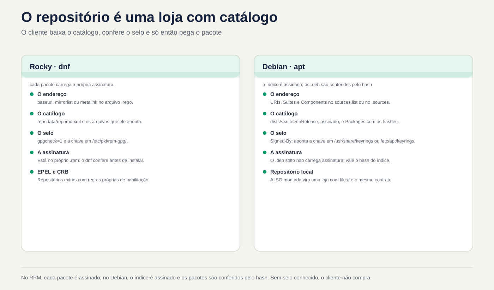
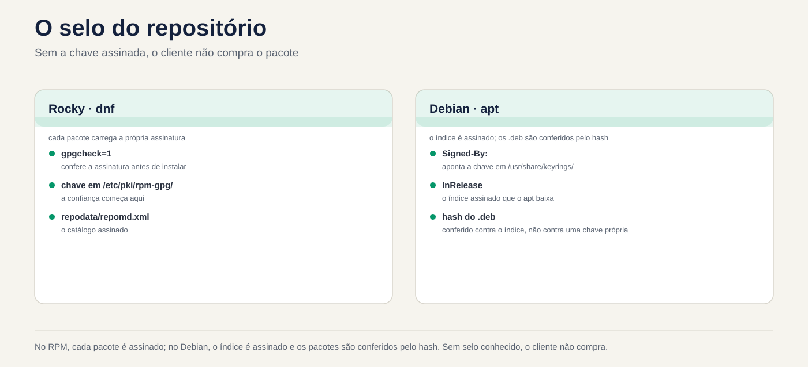

# Lezione 6.3 · Repositories

Nelle due lezioni precedenti hai utilizzato apt e dnf come se i pacchetti cadessero dal cielo. Provengono da qualche parte: un indirizzo scritto in un file di configurazione, un indice firmato e una chiave di cui il sistema ha deciso di fidarsi. Oggi imparerai come leggere, aggiungere, disattivare e sistemare questa catena, e come impostare un repository dall'ISO da installare senza internet.

> **Chiave di questa lezione:** leggere e scrivere un `.repo` (Rocky) e un `.sources` (Debian), accendere e spegnere subito il repository, attivare EPEL nel modo giusto, capire dove si trova la firma e creare un repository locale con l'ISO. Il resto è approfondito.

| File |  |
| --- | --- |
| **Modulo** | M6 · Software, lezione 3 di 5 |
| **Quando** | Settimana 10 |
| **Alla fine** | Sai da dove proviene ciascun pacchetto, di chi si fida il sistema e come installarlo con Internet disattivato |
| **Articoli di prova** | LPIC-1 102.4 e 102.5 (configurazione del repository). RHCSA: configurare l'accesso ai repository RPM |
| **Prerequisiti** | lezioni 6.1 e 6.2 |
| **Ora** | intorno alle 2:30 |
| **Istantanee** | `m6a3-inicio` e `m6a3-fim`, su entrambi i VM |

## 1 · Riscaldamento

Rispondere prima di leggere. Commettere errori qui fa parte del metodo.

1. Scarichi un pacchetto da un mirror di cui nessuno è a conoscenza, dall'altra parte del mondo. Chi garantisce che sia l'originale?
2. È possibile installare pacchetti su un server senza accesso a Internet?
3. Un server Rocky ha cinque repository e uno di questi è andato offline. Il `dnf install` degli altri quattro funziona ancora?

## 2 · Perché è importante

| Il cosiddetto | La risposta sbagliata | Cosa provoca |
| --- | --- | --- |
| "dnf ha smesso di funzionare, restituisce un errore nei metadati" | Cancellare il `.repo` che dava errore senza vedere di cosa si trattava | Aggiungi un repository del fornitore e i suoi aggiornamenti si interromperanno silenziosamente |
| "Il tutorial ha ordinato di incollare un `curl ... \| apt-key add`" | Collana | La chiave è ora valida per **tutti** i repository, non solo per |
| del fornitore "Ho bisogno di un colpo su Rocky, non credo" | Scarica il file .rpm da qualsiasi sito web | Pacchetto senza abbonamento noto e senza aggiornamento futuro |
| "Il client non consente al server di accedere a Internet" | "Quindi non puoi installare nulla" | Fornisce: repository locale con ISO o un mirror interno |
| "Errore chiave GPG" | `gpgcheck=0` e basta | Disattiva esattamente la protezione contro i pacchetti manomessi |

## 3 · Modello mentale

> Un repository è un **negozio con un catalogo**. Il cliente (apt o dnf) conserva un elenco di indirizzi di negozi e un portachiavi con i **timbri** che accetta. Prima di acquistare scarica il catalogo, controlla il sigillo e solo dopo ritira il pacco. Senza un sigillo conosciuto, non acquistare.

```
   ROCKY (dnf)                              DEBIAN (apt)

 /etc/yum.repos.d/*.repo              /etc/apt/sources.list(.d/*.sources)
   baseurl / mirrorlist / metalink       URIs + Suites + Components
          │                                      │
          ▼                                      ▼
 repodata/repomd.xml  (catálogo)       dists/<suite>/InRelease  (catálogo ASSINADO)
          │                                      │ hashes
          ▼                                      ▼
 pacote.rpm  (cada pacote ASSINADO)    Packages ──► pacote.deb (confere o hash)
          │                                      │
 gpgcheck=1 + gpgkey=                  Signed-By: chave em
 /etc/pki/rpm-gpg/                     /usr/share/keyrings ou /etc/apt/keyrings
```

La differenza più grande: nel mondo RPM, **ogni confezione** è firmata. In Debian, ciò che viene firmato è l'**indice** (`InRelease`/`Release`), mentre i `.deb` vengono controllati dall'hash che si trova in quell'indice. Il risultato è simile, ma un `.deb` sciolto scaricato non porta la propria firma.



*Il cliente scarica il catalogo, controlla il sigillo e solo dopo riceve il pacchetto.*

## 4 · Gli elementi essenziali

### Rocky: il file .repo

Ogni file `/etc/yum.repos.d/*.repo` è leggere (deve terminare con `.repo`). Ogni blocco `[id]` è un repository:

```ini
[iso-baseos]
name=Rocky ISO - BaseOS
baseurl=file:///mnt/iso/BaseOS
enabled=1
gpgcheck=1
gpgkey=file:///etc/pki/rpm-gpg/RPM-GPG-KEY-Rocky-9
```

| Campo | Che cosa significa |
| --- | --- |
| `[id]` | Nome breve, unico nell'intero sistema. È quello che usi in `--enablerepo` |
| `name` | Descrizione per l'uomo |
| `baseurl` | Indirizzo del repository diretto (`http://`, `https://`, `file://`). È necessario che ci sia `repodata/` |
| `mirrorlist` / `metalink` | Indirizzo di un elenco di mirror. dnf ne sceglie uno. `metalink` ha anche hash dal catalogo |
| `enabled` | 1 acceso, 0 spento |
| `gpgcheck` | 1 controlla la firma di ciascun pacco. **Lascia 1** |
| `gpgkey` | Dov'è la chiave pubblica. Alla prima installazione, dnf mostra l'impronta digitale e chiede |
| `skip_if_unavailable` | Se il repository va giù, il dnf segue con gli altri (in Rocky il default è `False`) |
| `priority` | Il numero più basso prevale quando lo stesso pacchetto esiste in due repository (default 99) |

Variabili che appaiono nei file: `$releasever` (9, 10), `$basearch` (x86\_64). Vedere il valore con `rpm -E %rhel` e `uname -m`.

| Voglio... | Comando |
| --- | --- |
| Vedi tutto, anche offline | `dnf repolist all` |
| Dettagli di un | `dnf repoinfo baseos` |
| Connetti solo in questa esecuzione | `dnf --enablerepo=crb install X` |
| Usa **solo** alcuni | `dnf --disablerepo='*' --enablerepo='iso-*' install X` |
| Accendi / spegni definitivamente | `sudo dnf config-manager --set-enabled crb` / `--set-disabled crb` |
| Aggiungi tramite URL | `sudo dnf config-manager --add-repo URL` |
| Ripristina la cache dei metadati | `sudo dnf makecache` / `sudo dnf clean all` |
| Chiavi ritenute attendibili da RPM | `rpm -qa 'gpg-pubkey*'` |
| Importazione chiavi in ​​mano | `sudo rpm --import /caminho/ou/URL` |

`config-manager` rientra in `dnf-plugins-core`. Se mancante, `sudo dnf install dnf-plugins-core`. Modifica solo `enabled=` del file, niente di magico.

### Rocky: EPEL e CRB

**EPEL** (Extra Packages for Enterprise Linux) è il repository della comunità Fedora con migliaia di pacchetti che Red Hat non distribuisce: htop, ncdu, fail2ban... Molti dipendono dalle librerie di sviluppo che si trovano in **CRB** (CodeReady Builder), che è disattivato. Quindi l'ordine è:

```bash
sudo dnf config-manager --set-enabled crb
sudo dnf install epel-release
```

Pacchetto `epel-release` installa `.repo` e la chiave. Nessun sito web a caso `.rpm`.

### Debian: source.list e il formato deb822

Due modi, stesso effetto:

```
# Uma linha (sources.list clássico, Debian 12 e anteriores)
deb [signed-by=/usr/share/keyrings/debian-archive-keyring.gpg] http://deb.debian.org/debian bookworm main contrib
```

```
# deb822 (/etc/apt/sources.list.d/*.sources, padrão no Debian 13)
Types: deb
URIs: http://deb.debian.org/debian
Suites: trixie trixie-updates
Components: main contrib non-free-firmware
Signed-By: /usr/share/keyrings/debian-archive-keyring.gpg
```

| Campo | Cos'è |
| --- | --- |
| `Types` | `deb` (binari) e/o `deb-src` (fonti) |
| `URIs` | Indirizzo mirror |
| `Suites` | Versione: `trixie`, `trixie-updates`, `trixie-security`, `trixie-backports` (o `stable`, che cambia versione da solo: evitare sui server) |
| `Components` | `main` (gratuito), `contrib`, `non-free`, `non-free-firmware` |
| `Signed-By` | Quale chiave può firmare **questo** repository |
| `Enabled: no` | Si spegne senza cancellare (solo in deb822) |

In apt 3.0 (Debian 13), `sudo apt modernize-sources` converte il vecchio formato in deb822.

**Chiavi di terze parti, nel modo giusto:** la chiave del fornitore va a `/etc/apt/keyrings/` (la tua cartella) e `Signed-By:` punta ad essa, solo in `.sources` di quel fornitore. `apt-key` è obsoleto ed è stato rimosso nelle nuove versioni: collocava la chiave in un portachiavi globale, valido per qualsiasi repository.

**Backport:** versioni più recenti di alcuni pacchetti, compilate per la tua Debian stabile. Entrano con priorità 100, quindi **non vengono mai scelti da soli**. Tu chiedi: `sudo apt install -t trixie-backports pacote`.

### Repository locale con ISO

Il DVD ISO di Rocky è già un repository: al suo interno ci sono `BaseOS/` e `AppStream/`, ciascuno con il suo `repodata/`. L'ISO minimo ne porta solo una parte. Assemblato, appuntito da `baseurl` a `file:///...`, pronto. Ecco come installarlo su una rete isolata, ed è la base dell'M6 ​​Challenge.

In Debian, l'ISO ha anche l'indice firmato. Il percorso classico è `apt-cdrom add` con il disco montato, che aggiunge la voce stessa.

### Rocky × Debian

| Oggetto | Rocky (dnf) | Debian (adatto) |
| --- | --- | --- |
| Dove configurare | `/etc/yum.repos.d/*.repo` | `/etc/apt/sources.list` e `/etc/apt/sources.list.d/*.sources` oppure `*.list` |
| Cosa è firmato | Ogni `.rpm` | L'indice `InRelease`/`Release` |
| Dove sono le chiavi | `/etc/pki/rpm-gpg/` e il banco giri (`gpg-pubkey`) | `/usr/share/keyrings/` (pacchetti) e `/etc/apt/keyrings/` (vostro) |
| Chiama solo adesso | `--enablerepo=` / `--disablerepo=` | `-t suite` (scegliere l'origine) |
| Spegni definitivamente | `enabled=0` | `Enabled: no` o commentare la riga |
| Aggiornamento catalogo | automatico oppure `dnf makecache` | `apt update`, sempre |
| Pacchetti extra | EPEL (+ CRB) | `contrib`, `non-free`, backport |
| Niente internet | `.repo` con `baseurl=file:///` | `apt-cdrom add` o `URIs: file:/` |
| Chi ha la priorità | `priority=` | `apt_preferences` (blocco) |

In SUSE: `zypper lr` elenca e `zypper ar URL nome` aggiunge.

**Cosa c'è nel test.** In RHCSA, ricevono un URL e chiedono al sistema di utilizzare quel repository: scrivi `.repo` a mano, con `[id]`, `name`, `baseurl`, `enabled` e `gpgcheck`/`gpgkey` che la dichiarazione indica, e verifica con `dnf repolist`. In LPIC-1, è necessario conoscere il formato della riga `deb`, a cosa servono `/etc/apt/sources.list.d/` e `/etc/yum.repos.d/`, cos'è `main`/`contrib`/`non-free` e il comando `dnf config-manager` (ex `yum-config-manager`).

## 5 · Laboratorio guidato

**Passaggio 0 · Istantanea e cartella.** In Proxmox:

```bash
qm snapshot 201 m6a3-inicio
qm snapshot 202 m6a3-inicio
```

In entrambe le VM: `mkdir -p ~/lab63 && cd ~/lab63`.

### Parte A · rocky-lab

**Passaggio 1 · Anatomia.** Guarda cosa esiste già prima di spostare:

```bash
dnf repolist all
ls /etc/yum.repos.d/
grep -v '^#' /etc/yum.repos.d/rocky.repo | grep -A8 '^\[baseos\]'
dnf repoinfo baseos | head -20
ls /etc/pki/rpm-gpg/
rpm -qa 'gpg-pubkey*'
```

Nota: `baseos` utilizza `mirrorlist`, non `baseurl`. `crb` appare come `disabled`. Ogni `gpg-pubkey-...` è una chiave che RPM già accetta. Guarda chi è: `rpm -qi $(rpm -qa 'gpg-pubkey*' | head -1) | grep -i summary`.

**Passaggio 2 · Accendi e spegni.** Prima solo per un comando, poi ancora:

```bash
dnf --disablerepo='*' --enablerepo=baseos list --available | wc -l
dnf list --available | wc -l
sudo dnf config-manager --set-disabled appstream
grep -A6 '^\[appstream\]' /etc/yum.repos.d/rocky.repo | grep enabled
dnf repolist
sudo dnf config-manager --set-enabled appstream
```

Il primo numero è più piccolo: ha risposto solo BaseOS. `config-manager` ha appena sostituito `enabled=1` con `enabled=0` nel file. Avresti potuto farlo con un editor.

**Passaggio 3 · CRB ed EPEL.** Nel modo giusto e prestando attenzione alla chiave:

```bash
sudo dnf config-manager --set-enabled crb
sudo dnf install -y epel-release
cat /etc/yum.repos.d/epel.repo | grep -E '^\[|gpgkey|gpgcheck'
rpm -qa 'gpg-pubkey*' | wc -l
sudo dnf install htop
```

Nell'ultimo comando **non** usare `-y`. Il dnf mostrerà `Importing GPG key` con il nome e l'impronta digitale della chiave EPEL e chiederà. Leggere prima di rispondere `y`. Quindi:

```bash
rpm -qa 'gpg-pubkey*' | wc -l
dnf info htop | grep -i repo
```

Un'altra chiave e l'htop proviene da `epel`.

**Passaggio 4 · Repository locale con l'ISO.** In Proxmox, trova l'ISO di Rocky e posizionalo sul CD-ROM della VM:

```bash
pvesm status --content iso
pvesm list <storage-de-iso> --content iso | grep -i rocky
qm set 201 --ide2 <storage-de-iso>:iso/<arquivo-da-rocky>.iso,media=cdrom
```

In rocky-lab:

```bash
lsblk | grep rom
sudo mkdir -p /mnt/iso
sudo mount -o ro /dev/sr0 /mnt/iso
ls /mnt/iso
ls /mnt/iso/BaseOS
```

`BaseOS/` e `AppStream/` devono apparire, ciascuno con `repodata/`. Ora `.repo`:

```bash
V=$(rpm -E %rhel)
sudo tee /etc/yum.repos.d/iso.repo >/dev/null <<EOF
[iso-baseos]
name=Rocky ISO - BaseOS
baseurl=file:///mnt/iso/BaseOS
enabled=1
gpgcheck=1
gpgkey=file:///etc/pki/rpm-gpg/RPM-GPG-KEY-Rocky-$V

[iso-appstream]
name=Rocky ISO - AppStream
baseurl=file:///mnt/iso/AppStream
enabled=1
gpgcheck=1
gpgkey=file:///etc/pki/rpm-gpg/RPM-GPG-KEY-Rocky-$V
EOF
cat /etc/yum.repos.d/iso.repo
dnf repolist
```

Prova utilizzando **solo** l'ISO, come se Internet non esistesse:

```bash
dnf --disablerepo='*' --enablerepo='iso-*' list --available | head
sudo dnf --disablerepo='*' --enablerepo='iso-*' install -y tmux
dnf info tmux | grep -i repo
```

Se la tua ISO è la minima e `tmux` non è presente, scegli un altro pacchetto dall'elenco nel primo comando. `From repo` deve dire `iso-baseos` o `iso-appstream`.

### Parte B · debian-lab

**Passo 5 · Anatomia.**

```bash
. /etc/os-release; echo $VERSION_CODENAME
cat /etc/apt/sources.list 2>/dev/null | grep -v '^#'
ls /etc/apt/sources.list.d/
cat /etc/apt/sources.list.d/*.sources 2>/dev/null
ls /usr/share/keyrings/ /etc/apt/keyrings/ 2>/dev/null
apt-cache policy | head -20
```

In `apt-cache policy`, ciascuna fonte appare con un numero di priorità (500 per quelle normali) e la riga `release` mostra la suite (`n=trixie`) e il componente.

**Passo 6 · Backport in deb822.**

```bash
. /etc/os-release
sudo tee /etc/apt/sources.list.d/backports.sources >/dev/null <<EOF
Types: deb
URIs: http://deb.debian.org/debian
Suites: ${VERSION_CODENAME}-backports
Components: main
Signed-By: /usr/share/keyrings/debian-archive-keyring.gpg
EOF
sudo apt update
apt-cache policy | grep -B1 backports
```

Notice **100**: i backport vengono consultati, ma non scadono mai da soli. Per vederlo nella pratica, cerca un pacchetto che abbia una nuova versione e confronta:

```bash
apt list -a 2>/dev/null | grep -- "-backports" | head -5
apt-cache policy <um-pacote-da-lista>
```

`Candidate:` continua ad essere la versione normale. L'installazione dei backport richiederebbe `-t ${VERSION_CODENAME}-backports`. **Non installare.**

**Passaggio 7 · Spegnere senza cancellare.** Aggiungere `Enabled: no` al blocco e controllare:

```bash
echo 'Enabled: no' | sudo tee -a /etc/apt/sources.list.d/backports.sources
sudo apt update
apt-cache policy | grep -c backports
```

Il contatore va a zero.

### Pulizia

Rocky: tieni EPEL e CRB (lo userai). Smontare l'ISO e disattivare il suo repository, in modo da non interrompere il dnf al prossimo avvio:

```bash
sudo dnf config-manager --set-disabled iso-baseos iso-appstream
sudo umount /mnt/iso
```

Debian: `backports.sources` è disattivato. Sarà utile in seguito.

### Decidi 1

È necessario `ncdu` su un server Rocky di produzione. Esiste solo in EPEL. L'installazione di `epel-release` ha dato un errore di chiave GPG a causa di un proxy che corrompe i download. Cosa fai?

A) Installa con `gpgcheck=0` solo per questa volta, poi torna a 1. B) Risolvi il proxy, installa `epel-release` normalmente e lascia `gpgcheck=1`. C) Scarica `ncdu.rpm` da un sito di pacchetti e installa con `rpm -i`.

Seleziona prima un'opzione.

| Se hai selezionato | Risultato | Perché |
| --- | --- | --- |
| A | Funziona e hai installato qualcosa che non sai se è l'originale | L'errore chiave è proprio l'avviso che il file è arrivato diversamente. Disattivare il controllo significa ignorare l'allarme |
| B | Giusto | Il problema è la procura. Risolto questo problema, l'abbonamento verrà verificato e riceverai anche i futuri aggiornamenti EPEL |
| C| Funziona oggi, marcisce domani | Senza repository non è disponibile alcun aggiornamento di sicurezza e l'origine è sconosciuta |

**Per risolvere:** l'errore di firma è un sintomo. Risolvere la causa, mai l'allarme.

### Decidere 2

Viene eseguito un tutorial del fornitore, in Debian:

```
curl -fsSL https://fornecedor.example/key.gpg | sudo apt-key add -
echo "deb https://fornecedor.example/apt stable main" | sudo tee /etc/apt/sources.list.d/fornecedor.list
```

A) Eseguito così com'è, il tutorial è del fornitore stesso. B) Salvare la chiave in `/etc/apt/keyrings/fornecedor.gpg` e utilizzare con essa `Signed-By:` solo nel `.sources` del fornitore. C) Salta la chiave e metti `[trusted=yes]` sulla riga.

Seleziona un'opzione prima.

| Se hai selezionato | Risultato | Perché |
| --- | --- | --- |
| A | Potrebbe anche non funzionare (`apt-key` è scomparso dalle nuove versioni), e dove corre apre una porta | La chiave diventa affidabile per **qualsiasi** repository. Chiunque abbia questa chiave può firmare un falso "pacchetto Debian" |
| B | Giusto | La chiave è valida solo per quel repository. Questo è ciò che raccomanda oggi la stessa documentazione di Debian |
| C| Peggio ancora | `trusted=yes` disattiva il controllo di quel repository. Chiunque lungo il percorso può modificare i pacchetti |

**Per correggere:** una chiave, un repository. Se la chiave arriva in formato testo (ASCII armato), convertila con `gpg --dearmor` o salva come `.asc`.

## 6 · Interrompi e correggi

### Interruzione 1 · Un repository rilascia l'intero dnf (rocky-lab)

Crea un repository con l'indirizzo sbagliato:


*In RPM, ogni pacchetto è firmato; in Debian l'indice è firmato. Senza un sigillo conosciuto, il cliente non acquista.*


```bash
sudo tee /etc/yum.repos.d/quebrado.repo >/dev/null <<'EOF'
[quebrado]
name=Repo com URL errada
baseurl=https://repo.invalido.example/el9/
enabled=1
gpgcheck=1
EOF
sudo dnf makecache
```

**Sintomo:** `Failed to download metadata for repo 'quebrado'` e il dnf si interrompe, anche per pacchetti provenienti da altri repository.

**Diagnosi:** il messaggio dice `id`. Trovare il file con `grep -l '^\[quebrado\]' /etc/yum.repos.d/*.repo` e testare l'indirizzo con `curl -I <baseurl>/repodata/repomd.xml`.

**Fix, dal più rapido al definitivo:**

1. Per lavorare adesso: `sudo dnf --disablerepo=quebrado install X`.
2. Se il repository si blocca di tanto in tanto e non è essenziale: `skip_if_unavailable=True` in quel blocco.
3. Se l'URL è sbagliato: correggere `baseurl`. Se il repository non esiste più: `enabled=0` oppure rimuovi il file, dopo aver saputo a chi apparteneva.

In laboratorio rimuovi: `sudo rm /etc/yum.repos.d/quebrado.repo`.

**Nella vita reale:** è la classica chiamata dopo che un fornitore cambia indirizzo. Prima di eliminare, annotare ciò che il repository ha consegnato (`dnf list --installed | grep @quebrado`).

### Interruzione 2 · Chiave errata in Signed-By (debian-lab)

Riattivare i backport e puntare `Signed-By` su un file che non esiste:

```bash
sudo sed -i '/^Enabled:/d; s|^Signed-By:.*|Signed-By: /etc/apt/keyrings/nao-existe.gpg|' /etc/apt/sources.list.d/backports.sources
sudo apt update
```

**Sintomo:** `apt update` lamenta di non essere riuscito a verificare la firma di quel repository (errore GPG, `NO_PUBKEY` o di non essere riuscito a aprire la chiave) e ne ignora l'indice.

**Diagnosi:** il messaggio menziona l'URL e la suite. `grep -r Signed-By /etc/apt/sources.list.d/` e `ls -l` nel file puntato.

**Correzione:** ritorna `Signed-By` in `/usr/share/keyrings/debian-archive-keyring.gpg` ed esegui `sudo apt update`. Poi spegnilo di nuovo con `Enabled: no`.

**Nella vita reale:** succede quando la chiave di un fornitore scade o viene cambiata. La soluzione è scaricare la nuova chiave attraverso il suo canale ufficiale, mai `trusted=yes`.

### Pausa 3 · L'ISO è scomparsa dopo il riavvio (narrativa)

Hai lasciato acceso `iso.repo`, hai montato manualmente l'ISO e hai riavviato. `mount` non sopravvive all'avvio, quindi dnf cerca `/mnt/iso/BaseOS/repodata` e non trova: `Failed to download metadata for repo 'iso-baseos'` (a volte con `Curl error (37)`).

**Correzione:** o il repository è temporaneo (lasciare `enabled=0` e utilizzare `--enablerepo` durante il montaggio), oppure è permanente e il montaggio va a `/etc/fstab`. La seconda opzione fa parte della M6 ​​Challenge.

## 7 · Insidie

| Trappola | Cosa succede | Come evitare |
| --- | --- | --- |
| `gpgcheck=0` "solo per testare" | Resta per sempre, nessuno si ricorda | Se ne hai proprio bisogno lascia un commento con data e motivo |
| `baseurl` punta alla radice dell'ISO | `Cannot download repomd.xml`: la radice non ha `repodata/` | Puntare su `BaseOS/` e `AppStream/`, un blocco ciascuno |
| File in `yum.repos.d` senza `.repo` alla fine | dnf ignora silenziosamente | `ls /etc/yum.repos.d/` e `dnf repolist` dopo aver creato |
| Due blocchi con lo stesso `[id]` | Uno sovrascrive l'altro o dà un avviso | `id` unico e descrittivo |
| EPEL senza CRB | Il pacchetto EPEL fallisce a causa di una dipendenza che "non esiste" | Attivare `crb` prima di |
| `.repo` dalla versione 8 copiato nella 9 | Pacchetti di un'altra versione, dipendenze interrotte | Controllare `$releasever` e il percorso URL |
| `apt-key add` o `trusted=yes` | Fiducia globale o nessuna | `/etc/apt/keyrings/` + `Signed-By` |
| Miscelare `testing` o `sid` su stabile | "FrankenDebian": un aggiornamento porta un mezzo nuovo sistema | Per una nuova versione di un pacchetto, utilizzare backports |
| Stesso repository in due file con diversi `Signed-By` | `Conflicting values set for option Signed-By` e `apt update` per | Una voce per repository; `grep -r` l'URL prima di aggiungere |
| Utilizzare `stable` invece del nome in codice | Quando viene rilasciata una nuova versione, `apt upgrade` diventa un aggiornamento della versione | Utilizza il nome in codice (`trixie`) |

## 8 · Quiz

Rispondi senza guardare. Il foglio delle risposte si trova alla fine della lezione.

1. Qual è la differenza tra `baseurl` e `mirrorlist`?
2. `dnf install` termina con `Failed to download metadata for repo 'fornecedor-x'`. Cosa fare per installare adesso e quali sono le opzioni definitive?
3. Perché, in Rocky 9, l'installazione EPEL chiede di accendere prima il CRB?
4. In Debian, cosa viene firmato: ogni `.deb` o l'indice? Che conseguenze ha questo per un `.deb` sciolto?
5. Cosa fa il `Signed-By:` che il `apt-key add` non ha fatto?
6. *Un file in /etc/yum.repos.d/ viene letto da dnf solo se il suo nome termina con: a) .conf b) .repo c) .list d) .sources*

## 9 · Cola

**Da saperlo a memoria:**

| Voglio... | Comando |
| --- | --- |
| Elenco repository (Rocky) | `dnf repolist all` |
| Usane solo alcuni adesso | `dnf --disablerepo='*' --enablerepo=ID install X` |
| Accendi / spegni definitivamente | `sudo dnf config-manager --set-enabled ID` / `--set-disabled ID` |
| EPEL | `sudo dnf config-manager --set-enabled crb` e `sudo dnf install epel-release` |
| Campi minimi di un `.repo` | `[id]`, `name`, `baseurl`, `enabled`, `gpgcheck`, `gpgkey` |
| Origini e priorità (Debian) | `apt-cache policy` |
| Campi di un `.sources` | `Types`, `URIs`, `Suites`, `Components`, `Signed-By` |
| Chiave di terze parti (Debian) | `/etc/apt/keyrings/nome.gpg` + `Signed-By` |

**Da consultare:**

| Voglio... | Comando |
| --- | --- |
| Dettagli di un repository | `dnf repoinfo ID` |
| Aggiungi tramite URL | `sudo dnf config-manager --add-repo URL` |
| Ripristina cache | `sudo dnf clean all && sudo dnf makecache` |
| Chiavi accettate da giri/min | `rpm -qa 'gpg-pubkey*'` |
| Chiave di importazione | `sudo rpm --import ARQUIVO_OU_URL` |
| Montare l'ISO | `sudo mount -o ro /dev/sr0 /mnt/iso` |
| Modificare l'ISO della VM (Proxmox) | `qm set VMID --ide2 STORAGE:iso/ARQ.iso,media=cdrom` |
| Installa dai backport | `sudo apt install -t CODINOME-backports X` |
| Disattiva sorgente (deb822) | `Enabled: no` |
| Converti in deb822 | `sudo apt modernize-sources` (apt 3.0+) |
| Converti chiave di testo | `gpg --dearmor < key.asc > key.gpg` |
| CD/ISO su Debian | `sudo apt-cdrom add` |
| SUSE | `zypper lr`, `zypper ar URL nome` |

**Flashcard:**

- Dov'è la firma? → *RPM: in ogni confezione. APT: nell'indice (InRelease).*
- `--enablerepo` × `config-manager --set-enabled` → *un singolo comando × scrive nel file.*
- I backport si installano da soli? → *No. Priorità 100, solo con `-t`.*
- Errore GPG → *sintomo; correggere la causa, non disattivare mai il controllo.*
- Repository ISO → *un blocco per cartella (`BaseOS`, `AppStream`), `baseurl=file:///...`.*

## 10 · Checklist e chiusura

- [ ] Leggo un `.repo` e un `.sources` e dico da dove provengono pacchetto
- [ ] Accendo e spengo il repository solo per un comando e una volta alla ora
- [ ] Attivo EPEL con CRB e riconosco la domanda per importare la chiave
- [ ] Scrivo un `.repo` da zero per l'ISO e lo installo usando solo esso
- [ ] So perché `apt-key` e `trusted=yes` sono una cattiva idea
- [ ] Riparo un repository danneggiato senza eliminare ciecamente

**Ultimo esercizio, senza guardare la lezione:** in rocky-lab, monto di nuovo l'ISO, scrivo un nuovo `.repo` chiamato `meu-iso.repo` solo con AppStream e l'id `meu-appstream` e installa un pacchetto utilizzando **solo** esso. Quindi disattiva questo repository e smonta l'ISO.

**Riavvia e conferenza:**

```bash
# rocky-lab
sudo reboot
dnf repolist          # nessun limite iso-*, limite epel e crb
sudo dnf makecache    # nessun errore
# debian-lab
sudo apt update       # nessun errore e nessun avviso GPG
```

**Fine istantanea** (su Proxmox):

```bash
qm snapshot 201 m6a3-fim
qm snapshot 202 m6a3-fim
```

## 11 · Nella vita reale

**Missione, sola lettura.** Su un server Rocky/RHEL e un server Debian/Ubuntu che già amministri, esegui **solo** questo. Nessuna aggiunta, connessione o disconnessione del repository.

```bash
# RHEL-like
dnf repolist all
grep -H -E 'gpgcheck|skip_if_unavailable' /etc/yum.repos.d/*.repo
rpm -qa 'gpg-pubkey*' --qf '%{NAME}-%{VERSION} %{SUMMARY}\n'
# Debian-like
grep -rhv '^#' /etc/apt/sources.list /etc/apt/sources.list.d/ 2>/dev/null | grep .
grep -rn 'trusted=yes' /etc/apt/ 2>/dev/null
ls -l /etc/apt/keyrings/ /etc/apt/trusted.gpg.d/ 2>/dev/null
apt-cache policy | grep -E '^ *[0-9]+ ' | sort -u
```

Domande a cui rispondere:

1. Quanti repository di terze parti ci sono? Sai a cosa serve ciascuno?
2. Qualcuno con `gpgcheck=0` o `trusted=yes`? Da quando e perché?
3. Hai una chiave in `/etc/apt/trusted.gpg.d/` (global trust, vecchio stile)?
4. Qualche Debian che punta a `stable`, `testing` o `sid` invece del nome in codice?
5. Qualche repository di vecchia versione (el8 su una macchina 9, bullseye su un topo di biblioteca)?

**Diario:** imposta una tabella per server: repository, a cosa serve, chi lo ha richiesto, chiave utilizzata. È il tipo di documento che salva una migrazione.

**Domani, senza guardare:** scrivi dalla memoria un `.repo` con sei righe e un `.sources` con cinque.

## 12 · Scava più a fondo quando vuoi

- **`createrepo_c`:** trasforma una cartella `.rpm` in un repository (genera `repodata/`). Insieme a `dnf download --resolve` o `reposync`, così si configura il proprio repository o un mirror per una rete isolata.
- **Servire via HTTP:** la stessa cartella, pubblicata con nginx o Apache, diventa il repository per tutte le VM della rete (`baseurl=http://...`).
- **Mirror e cache aziendali:** `apt-cacher-ng` e `aptly` nel mondo Debian. Pulp, Foreman/Katello e Red Hat Satellite nel mondo RHEL.
- **Pinning (`/etc/apt/preferences.d/`):** controlla chi vince tra i repository con `Pin-Priority`. Potente ed è facile commettere errori.
- **`repo_gpgcheck=1`:** oltre ai pacchetti, controlla la firma del catalogo stesso in Rocky.
- **ISO Debian come repository:** `apt-cdrom add` o `URIs: file:/mnt/iso` in `.sources`.

**DeepTutor** (http://10.1.0.149:3782, KB "Linux Sysadmin Course"):

- `!explica por que o Debian assina o índice e o RHEL assina cada pacote`
- `!feynman o que o Signed-By resolve que o apt-key não resolvia`
- `!quiz Aula 6.3, 5 perguntas sobre .repo, .sources e repositório local`

## Foglio risposte commentato

### Riscaldamento

1. **La firma.** Il mirror consegna solo file. È il tuo sistema che controlla, con la chiave pubblica della distribuzione che già possiede. A Rocky, ogni `.rpm` è firmato. In Debian, l'indice è firmato e ha l'hash di ogni `.deb`. Un mirror dannoso non può firmare senza la chiave privata.
2. **Sì.** Con un repository locale: l'ISO montato (`baseurl=file:///...` su Rocky, `apt-cdrom` su Debian) o un mirror interno sulla rete.
3. **No, per impostazione predefinita.** In Rocky, `skip_if_unavailable` è `False`: un repository inattivo provoca l'arresto del dnf. Utilizza subito `--disablerepo=ID` o `skip_if_unavailable=True` in quel blocco se è facoltativo.

### Quiz

1. `baseurl` è l'indirizzo diretto di **un** repository. `mirrorlist` (o `metalink`) è l'indirizzo di una **lista di mirror**, e dnf ne sceglie uno. `metalink` dispone anche di hash di catalogo, un controllo aggiuntivo.
2. Ora: `sudo dnf --disablerepo=fornecedor-x install X`. Dopo: scopri perché si è bloccato (`curl -I` nell'URL). Se avete cambiato indirizzo, correggete `baseurl`. Se è facoltativo e instabile, `skip_if_unavailable=True`. Se moriva, `enabled=0`, dopo aver saputo chi dipendeva da lui.
3. Perché diversi pacchetti EPEL dipendono da librerie e strumenti che Rocky distribuisce solo nel CRB, che è disconnesso. Senza di esso, l'installazione fallisce a causa di una dipendenza "inesistente".
4. L'**indice** (`InRelease`/`Release`). I `.deb` vengono controllati dall'hash nell'indice firmato. Un `.deb` sciolto, scaricato all'esterno di apt, non ha questa catena: `dpkg -i` si installa senza sapere se è originale.
5. Associa la chiave a **un** repository. Con `apt-key add` la chiave è entrata nel portachiavi globale ed è diventata valida per qualsiasi origine, anche quando si firma un pacchetto Debian falso.
6. **b) .repo.** `.conf` è `/etc/dnf/dnf.conf`. `.list` e `.sources` provengono da apt.

---

<!-- navegacao -->
[← lezione 6.2 · Pacchetti Rocky](6.2-pacotes-na-rocky.md) · [Indice lezione](../01-aulas.md) · [lezione 6.4 · Flatpak →](6.4-flatpak.md)
