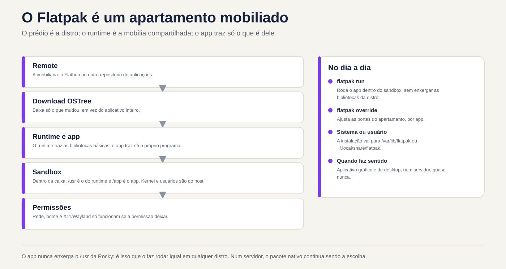
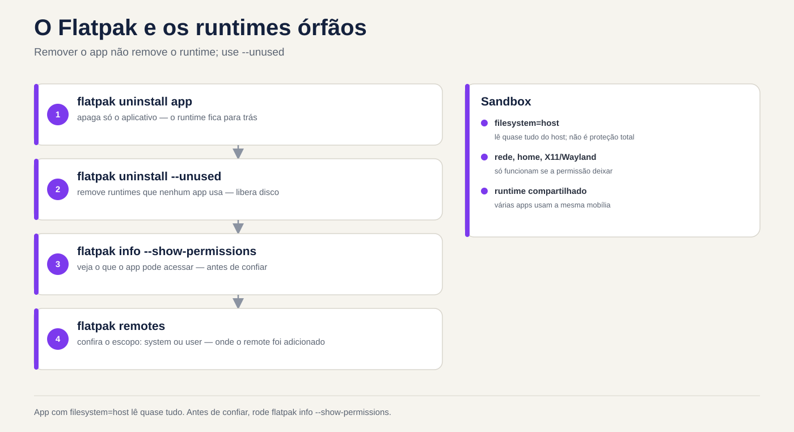

# Lezione 6.4 · Flatpak

Finora, ogni pacchetto che hai installato è stato creato **per quella distribuzione**: `.rpm` di Rocky non funziona su Debian e viceversa. Flatpak fa il contrario: la stessa applicazione funziona su qualsiasi distribuzione, portando con sé le librerie di cui ha bisogno e girando in un box isolato. È un prodotto desktop, ma è entrato in RHCSA, quindi devi sapere come utilizzarlo. Lezione breve.

> **Centro di questa lezione:** sapere cosa sono remote, app e runtime; aggiungi Flathub; cercare, installare, aggiornare e rimuovere; comprendere la differenza tra installazione di sistema e installazione utente; e visualizzare e limitare le autorizzazioni di un'app. Il resto è approfondito.

| File |  |
| --- | --- |
| **Modulo** | M6 · Software, lezione 4 di 5 |
| **Quando** | Settimana 11 |
| **Alla fine** | Puoi utilizzare Flatpak dalla riga di comando e sapere quando è (e quando non è) lo strumento giusto |
| **Articoli di prova** | RHCSA, nelle versioni recenti degli obiettivi: configurare i repository Flatpak e gestire le applicazioni Flatpak. LPIC-1 non addebita |
| **Prerequisiti** | lezione 6.3 |
| **Ora** | intorno all'1:30 |
| **Istantanee** | `m6a4-inicio` e `m6a4-fim` in rocky-lab (la parte Debian è opzionale) |

## 1 · Riscaldamento

Rispondi prima di leggere.

1. Un'app Flatpak utilizza `glibc` dal tuo Rocky o ne prende uno proprio?
2. È necessario essere root per installare Flatpak?
3. Su un server senza interfaccia grafica, Flatpak ha senso?

## 2 · Perché è importante

| Il cosiddetto | La risposta sbagliata | Cosa provoca |
| --- | --- | --- |
| "Ho bisogno della nuova versione dell'app X sulla stazione RHEL, dnf ha solo quella vecchia" | Aggiungi il repository Fedora su RHEL | Mix di versioni e un `dnf upgrade` che rompe il sistema |
| "Ho disinstallato l'app e il disco non si è liberato" | "Flatpak è così" | Runtime orfani che occupano giga |
| "L'utente ha installato un'app e non la vedo nell'elenco" | Penso che non sia installato | Lo ha installato con `--user`, nella sua cartella |
| "L'app può leggere tutta la mia casa?" | "È sandbox, non legge nulla" | Dipende dalle autorizzazioni richieste dall'app stessa. Devi verificarlo |

## 3 · Modello mentale

> Flatpak è un **appartamento ammobiliato all'interno dell'edificio**. L'edificio è la tua distribuzione (kernel, rete, utenti). Il **runtime** è l'arredamento standard (biblioteche di base), condiviso da più appartamenti. L'**app** è il residente, che porta solo ciò che è suo. Il **remoto** è l'agenzia immobiliare. I **permessi** dicono da quali porte può uscire il residente.

```
            remote (ex.: flathub)
                   │  baixa (OSTree, só o que mudou)
                   ▼
  /var/lib/flatpak  (sistema)     ~/.local/share/flatpak  (--user)
        │
        ├── runtime  org.gnome.Platform//47     ← bibliotecas, compartilhado
        └── app      org.gnome.Calculator         ← o programa
                   │
                   ▼  flatpak run
        ┌───── sandbox ───────────────────────────┐
        │ /usr = runtime   /app = o app        │
        │ rede, home, X11/Wayland... só se     │
        │ a permissão deixar                   │
        └──────────────────────────────────────┘
              kernel e usuários: os do host
```

La risposta alla prima domanda è nel disegno: all'interno della scatola, `/usr` è quella del runtime. L'app non vede mai le librerie di Rocky.



*L'app non vede mai le /usr della distribuzione; il runtime porta mobili condivisi.*

## 4 · Gli elementi essenziali

### Vocabolario

| Termine | Cos'è |
| --- | --- |
| **Telecomando** | Archivio Flatpak. Il più comune è Flathub. In RHEL arriva il telecomando `rhel`, da Red Hat |
| **ID app** | Nome DNS invertito: `org.gnome.Calculator`, `org.mozilla.firefox` |
| **Durata** | Insieme di librerie di base (`org.freedesktop.Platform`, `org.gnome.Platform`, `org.kde.Platform`), con versione. Diverse app utilizzano lo stesso |
| **Rif** | Indirizzo completo: `app/org.gnome.Calculator/x86_64/stable` |
| **Installazione del sistema** | `/var/lib/flatpak`, per tutti gli utenti, richiede root (o polkit) |
| **Installazione utente** | `--user`, in `~/.local/share/flatpak`, solo per te, senza root |
| **Dati dell'app** | `~/.var/app/<App ID>/`: configurazione e cache per ogni utente |

### Comandi

| Voglio... | Comando |
| --- | --- |
| Installa Flatpak | `sudo dnf install flatpak` / `sudo apt install flatpak` |
| Aggiungi FlatHub | `sudo flatpak remote-add --if-not-exists flathub https://dl.flathub.org/repo/flathub.flatpakrepo` |
| Visualizza telecomandi | `flatpak remotes` |
| Cerca | `flatpak search calculadora` (la ricerca in inglese funziona meglio) |
| Elenca cosa ha un telecomando | `flatpak remote-ls flathub --app` |
| Installa | `sudo flatpak install flathub org.gnome.Calculator` |
| Elenco installato | `flatpak list --app` / `flatpak list --runtime` |
| Dettagli | `flatpak info org.gnome.Calculator` |
| Corri | `flatpak run org.gnome.Calculator` |
| Aggiorna tutto | `sudo flatpak update` |
| Rimuovi | `sudo flatpak uninstall org.gnome.Calculator` |
| Rimuovere i runtime orfani | `sudo flatpak uninstall --unused` |
| Storia | `flatpak history` |
| Visualizza autorizzazioni | `flatpak info --show-permissions APP` |
| Limitare l'autorizzazione | `flatpak override --user --nofilesystem=home APP` |
| Disconnettere un telecomando | `sudo flatpak remote-modify --disable flathub` |

Senza `--user` e senza `--system` il valore predefinito è **sistema**. Per utilizzare `--user`, il telecomando deve esistere anche nell'ambito dell'utente (`flatpak remote-add --user ...`).

### Autorizzazioni (la "sandbox")

L'app dichiara ciò che vuole: rete (`network`), schermo (`x11`, `wayland`), suono (`pulseaudio`), file (`filesystem=home`, `filesystem=host`), dispositivi (`devices=all`). Flatpak garantisce quanto dichiarato. La sandbox protegge solo quanto questo elenco. Un'app con `filesystem=host` legge quasi tutto quello che leggi.

`flatpak override` cambia questo aspetto in base all'app, per te (`--user`) o per tutti (`sudo flatpak override`). `flatpak override --show APP` mostra cosa è stato modificato e `--reset` lo annulla. Nell'interfaccia grafica, l'app **Flatseal** fa lo stesso.

### Flatpak, Snap e AppImage

|  | Confezione piatta | Scatta | AppImage |
| --- | --- | --- | --- |
| Chi spinge | Comunità, Red Hat, GNOME, KDE | Canonico (Ubuntu) | Nessuno in particolare |
| Negozio | Diversi telecomandi (Flathub il più grande) | Solo uno, da Canonical | Nessuno, è un file |
| Installazione | `flatpak install` | `snap install` | In basso, `chmod +x`, eseguire |
| Isolamento | Sì, con le autorizzazioni | Sì, AppArmor | No |
| Aggiorna | `flatpak update` | Automatico | Manuale |
| Messa a fuoco | Scrivania | Desktop e server | Desktop |

### Rocky × Debian

Flatpak è lo stesso in entrambi: stessi comandi, stessi percorsi, stesso Flathub. Tutto ciò che cambia è l'installazione di `flatpak` stesso (dnf o apt) e il telecomando già pronto: nessuno su Rocky e Debian, `rhel` su RHEL. In Ubuntu, quello già pronto è Snap.

**Ciò che supera il test.** In RHCSA: configurare un telecomando Flatpak (`flatpak remote-add`, di solito con il file `.flatpakrepo` come indicato nella dichiarazione), installare e rimuovere un'app ed elencare cosa è installato. Allenarsi senza guardare: `remotes`, `remote-add`, `search`, `install`, `list`, `uninstall`.

## 5 · Laboratorio guidato

**Step 0 · Istantanea e cartella.** In Proxmox: `qm snapshot 201 m6a4-inicio`. In rocky-lab: `mkdir -p ~/lab64 && cd ~/lab64`.

**Passaggio 1 · Installa Flatpak e verifica che non sia presente alcun telecomando.**

```bash
sudo dnf install -y flatpak
flatpak --version
flatpak remotes
```

L'elenco è vuoto (o solo con telecomandi del fornitore). Senza telecomando non c'è nessun posto dove installarlo.

**Passaggio 2 · Aggiungi Flathub e guarda il catalogo.**

```bash
sudo flatpak remote-add --if-not-exists flathub https://dl.flathub.org/repo/flathub.flatpakrepo
flatpak remotes -d
flatpak remote-ls flathub --app | wc -l
flatpak search calculator | head
```

`.flatpakrepo` è un piccolo file con l'URL del telecomando e la chiave GPG. È l'equivalente di `epel-release` dell'ultima lezione.

**Passaggio 3 · Installa e visualizza il runtime in arrivo.**

```bash
sudo flatpak install -y flathub org.gnome.Calculator
flatpak list --app
flatpak list --runtime
flatpak info org.gnome.Calculator
```

Notare che sono arrivati ​​due o più elementi: l'app e il runtime (ed estensioni, come le traduzioni). La prima volta che il runtime costituisce la parte principale del download. La prossima app che utilizza lo stesso runtime è leggera. Nella riga `Runtime:` di `flatpak info` è indicato quale utilizza.

**Passaggio 4 · Entra nella casella.** Rocky-lab non ha uno schermo, quindi il normale `flatpak run` fallirebbe a causa della mancanza di display. Apri invece una shell **all'interno** della sandbox dell'app:

```bash
flatpak run --command=sh org.gnome.Calculator
```

Già all'interno:

```bash
cat /etc/os-release | head -3
ls /app/bin
ls /usr/lib64 2>/dev/null | head -3; ls /usr/lib | head -3
id
ls ~
exit
```

`os-release` non è di Rocky: è di runtime. `/app` è l'app. `id` mostra il tuo utente reale (la sandbox non è un'altra macchina, il kernel e gli utenti sono l'host). `ls ~` mostra solo ciò che l'autorizzazione ti consente di vedere.

**Passaggio 5 · Autorizzazioni e override.**

```bash
flatpak info --show-permissions org.gnome.Calculator
flatpak override --user --unshare=network org.gnome.Calculator
flatpak override --user --show org.gnome.Calculator
ls ~/.local/share/flatpak/overrides/
flatpak override --user --reset org.gnome.Calculator
```

L'override è semplicemente un file di testo nella tua cartella. `--reset` cancella le modifiche.

**Passaggio 6 · Installazione utente, senza root.**

```bash
flatpak remote-add --user --if-not-exists flathub https://dl.flathub.org/repo/flathub.flatpakrepo
flatpak remotes
flatpak install --user -y flathub org.gnome.Calculator
flatpak list --app
ls ~/.local/share/flatpak/app/
```

Ora la colonna `Installation` mostra la stessa app due volte: `system` e `user`. Sono copie indipendenti.

**Passaggio 7 · Cronologia, aggiornamento e rimozione pulita.**

```bash
flatpak history | tail
sudo flatpak update -y
flatpak uninstall --user -y org.gnome.Calculator
sudo flatpak uninstall -y org.gnome.Calculator
flatpak list --runtime
sudo flatpak uninstall --unused -y
flatpak uninstall --user --unused -y
flatpak list --runtime
ls ~/.var/app/ 2>/dev/null
```

Dopo aver rimosso l'app, il runtime **rimane** lì fino al `--unused`. E i dati dell'utente sono conservati anche in `~/.var/app/` (per questo c'è `--delete-data`).

**Passaggio 8 (opzionale) · debian-lab.** Eseguire `sudo apt install -y flatpak`, poi lo stesso `remote-add` dal Passo 2 e `flatpak remote-ls flathub --app | wc -l`. Il numero è lo stesso: il catalogo non dipende dalla distribuzione.

### Cleaning

Flathub può essere configurato in entrambi gli ambiti. Rimuovere solo il telecomando utente, che non viene più utilizzato: `flatpak remote-delete --user flathub`.

### Decidere 1

Un collega vuole `jq` su un server Rocky di produzione, senza interfaccia grafica, e propone di installarlo tramite Flatpak "perché è isolato". Cosa fai?

A) Flatpak, è più sicuro. B) `dnf install jq`, che si trova nel repository Rocky. C) Scarica il file binario da GitHub e inseriscilo in `/usr/local/bin`.

Seleziona un'opzione prima.

| Se hai selezionato | Risultato | Perché |
| --- | --- | --- |
| A | Potrebbe anche non esistere così e, se esiste, porta con sé un intero runtime | Flatpak è realizzato per le app desktop. Su un server, ottieni un secondo sistema di pacchetti da mantenere e controllare |
| B | Giusto | Pacchetto di distribuzione, firmato, aggiornato con il resto da `dnf upgrade` |
| C| Funziona, nessun aggiornamento | Nessuno si ricorda di aggiornare il codice binario sciolto quando esce una correzione |

**Per correggere:** sul server, prima il pacchetto di distribuzione. Flatpak è per un'app grafica su una workstation.

### Decidi 2

Su una workstation RHEL condivisa, un utente senza sudo necessita di un editor di immagini che esiste solo su Flathub. Nessun altro lo utilizzerà. Cosa fai?

A) Installa con `sudo flatpak install` per tutti. B) Lasciaglielo installare con `--user`, nella sua cartella. C) Fornire sudo in modo che possa essere installato.

Verificare prima un'opzione.

| Se hai selezionato | Risultato | Perché |
| --- | --- | --- |
| A | Funziona e tu diventi responsabile dell'aggiornamento | L'app appare a tutti, senza bisogno |
| B | Giusto | Ecco a cosa serve l'installazione utente: senza root e senza toccare il sistema. L'utente remoto deve essere aggiunto prima di |
| C| Peggio ancora | Root intero per installare un'app |

**Da risolvere:** `--user` è il modo per dare autonomia senza dare sudo.

## 6 · Interrompi e correggi

### Interruzione 1 · "Non riesco a trovare l'app" nell'ambito utente

In Rocky-Lab, senza telecomando utente (l'hai rimosso durante la pulizia):


*L'app con filesystem=host legge quasi tutto. Prima di fidarsi, esegui flatpak info --show-permissions.*


```bash
flatpak install --user flathub org.gnome.Calculator
```

**Sintomo:** errore che indica che il `flathub` remoto non esiste o che non esiste nulla che corrisponda al nome, anche se `sudo flatpak install` funziona.

**Diagnosi:** `flatpak remotes` mostra la colonna dell'ambito: `flathub` è solo in `system`.

**Ripara:** `flatpak remote-add --user --if-not-exists flathub <url>` o installa sul sistema. Dopo il test, rimuovilo di nuovo.

**Nella vita reale:** è la domanda numero uno per chi inizia con `--user`. I due ambiti sono mondi separati: telecomandi, app e runtime.

### Interruzione 2 · Disco che non si rilascia

Installa e rimuovi un'app senza `--unused`:

```bash
sudo flatpak install -y flathub org.gnome.Calculator
sudo flatpak uninstall -y org.gnome.Calculator
du -sh /var/lib/flatpak
```

**Sintomo:** l'app è scomparsa, ma la cartella è ancora grande.

**Diagnosi:** `flatpak list --runtime` mostra i runtime che nessuno utilizza più.

**Correzione:** `sudo flatpak uninstall --unused` e verificare di nuovo con `du -sh`.

**Nella vita reale:** sulle vecchie stazioni, i vecchi runtime (versioni precedenti di GNOME o KDE) ammontano a molti giga. `flatpak update` solitamente avvisa quando un runtime sta per esaurirsi.

### Intervallo 3 · Spegnimento remoto (narrativa)

Qualcuno ha eseguito `flatpak remote-modify --disable flathub` durante la manutenzione e se ne è dimenticato. Settimane dopo, `flatpak update` dice che non c'è nulla da aggiornare e `install` non trova nulla.

**Diagnosi:** `flatpak remotes -d` mostra il telecomando con l'opzione `disabled`.

**Correzione:** `sudo flatpak remote-modify --enable flathub`. È lo stesso schema di `enabled=0` della lezione 6.3: spento non dà errore, resta semplicemente silenzioso.

## 7 · Trappole

| Trappola | Cosa succede | Come evitare |
| --- | --- | --- |
| Pensare che la sandbox sia una protezione totale | L'app con `filesystem=host` legge quasi tutto | `flatpak info --show-permissions` prima di confidare |
| Rimuovi l'app e dimentica il runtime | Disco pieno di runtime orfano | `flatpak uninstall --unused` |
| Miscelare `--user` e sistema | L'app "scompare", "duplica" o non si aggiorna | Vedi colonna `Installation` in `flatpak list` |
| `flatpak update` solo come utente | Aggiorna l'ambito utente e non quello di sistema (o viceversa) | `sudo flatpak update` per il sistema, `flatpak update --user` per il vostro |
| `dnf upgrade` non aggiorna Flatpak | App obsolete per mesi | Flatpak ha il suo aggiornamento. Includere nella procedura di manutenzione |
| Flatpak sul server | Secondo sistema di pacchetti da mantenere | Pacchetto di distribuzione o contenitore |
| Sbaglia l'ID dell'app | `install` non pensa né chiede quale | Copia l'ID da `flatpak search` |

## 8 · Quiz

Rispondi senza guardare. Il foglio delle risposte si trova alla fine della lezione.

1. Cos'è un runtime e perché non scompare quando si rimuove l'app?
2. Dove viene installata un'app con `--user`? E con `sudo`?
3. Hai rimosso un'app con `flatpak uninstall`. Dov'erano le impostazioni utente e come sarebbero state eliminate?
4. Come fai a sapere se un'app può accedere alla rete e alla tua casa?
5. Perché `dnf upgrade` non è sufficiente su una stazione con app Flatpak?
6. *Which command adds the Flathub remote system-wide? a) `flatpak add flathub URL` b) `flatpak remote-add flathub URL` c) `dnf config-manager --add-repo URL` d) `flatpak install flathub`*

## 9 · Colla

**Da sapere a memoria:**

| Voglio... | Comando |
| --- | --- |
| Visualizza telecomandi | `flatpak remotes` |
| Aggiungi telecomando | `sudo flatpak remote-add --if-not-exists NOME URL.flatpakrepo` |
| Cerca | `flatpak search TERMO` |
| Installa/Rimuovi | `sudo flatpak install REMOTE APPID` / `sudo flatpak uninstall APPID` |
| Elenco | `flatpak list --app` |
| Aggiorna | `sudo flatpak update` |
| Ripulire gli orfani | `sudo flatpak uninstall --unused` |

**Per consultare:**

| Voglio... | Comando |
| --- | --- |
| Catalogo remoto | `flatpak remote-ls REMOTE --app` |
| Dettagli e durata | `flatpak info APPID` |
| Autorizzazioni | `flatpak info --show-permissions APPID` |
| Limita/visualizza/annulla | `flatpak override --user --nofilesystem=home APPID` / `--show` / `--reset` |
| Conchiglia all'interno della sandbox | `flatpak run --command=sh APPID` |
| Storia | `flatpak history` |
| Attiva/disattiva il telecomando | `sudo flatpak remote-modify --enable` / `--disable REMOTE` |
| Rimuovi telecomando | `sudo flatpak remote-delete REMOTE` |
| Rimuovi con dati | `flatpak uninstall --delete-data APPID` |
| Correggi l'installazione | `sudo flatpak repair` |
| Percorsi | `/var/lib/flatpak`, `~/.local/share/flatpak`, `~/.var/app/` |

**Schede flash:**

- Remoto, app, runtime → *immobili, residenti, mobili condivisi.*
- Ambito standard → *sistema. `--user` necessita dell'utente remoto.*
- Sandbox protegge tutto? → *Solo ciò che le autorizzazioni non consentono.*
- Rimossa l'app, il disco non si è rilasciato → *`flatpak uninstall --unused`.*
- Server senza schermo → *pacchetto di distribuzione, non Flatpak.*

## 10 · Lista di controllo e chiusura

- [ ] Spiego telecomando, app, runtime e rif
- [ ] Aggiungo Flathub e installo, elenco, aggiorno e rimuovo un'app
- [ ] Distinguo installazione di sistema e installazione utente
- [ ] Visualizza e limita le autorizzazioni con `info --show-permissions` e `override`
- [ ] Pulisci i runtime orfani
- [ ] So quando **non** usare Flatpak

**Ultimo esercizio, senza guardare la lezione:** in rocky-lab, installa come utente (senza sudo) una qualsiasi piccola app da Flathub, mostra quale runtime utilizza, apri una shell al suo interno e indica da quale distribuzione `/usr` proviene. Quindi rimuovere l'app, il runtime orfano e l'utente remoto.

**Riavvio e conferenza:**

```bash
sudo reboot
flatpak remotes
flatpak list
sudo flatpak update
sudo dnf check
```

Il `flatpak list` dovrebbe essere vuoto o contenere solo ciò che hai deciso di conservare. `dnf check` rimane pulito: Flatpak non modifica il database RPM.

**Termina snapshot** (su Proxmox):

```bash
qm snapshot 201 m6a4-fim
```

## 11 · Nella vita reale

**Mission, sola lettura.** Su una stazione Linux (tua o qualcuno da te autorizzato) che utilizza Flatpak, esegui **solo**:

```bash
flatpak remotes -d
flatpak list --columns=application,version,installation,origin
flatpak list --runtime --columns=application,branch
flatpak history | tail -20
du -sh /var/lib/flatpak ~/.local/share/flatpak 2>/dev/null
```

Domande per rispondere:

1. Quali telecomandi esistono e in quale ambito?
2. Quante app di sistema e quante app utente?
3. Qualche runtime con una vecchia versione (ramo) che forse non dispone più di un'app in uso?
4. Quando è stato l'ultimo aggiornamento del `history`?
5. Scegli un'app ed esegui `flatpak info --show-permissions` su di essa. Chiede `filesystem=host`?

**Diario:** annota se la stazione ha una procedura che aggiorna il Flatpak, oppure se gira solo `dnf`/`apt`.

**Domani, senza guardare:** scrivi i sei comandi di test: `remotes`, `remote-add`, `search`, `install`, `list`, `uninstall`.

## 12 · Approfondisci il tuo leisure

- **OSTree:** il "git for binaries" sotto Flatpak. Spiega perché viene scaricato solo ciò che è cambiato e perché due app con lo stesso runtime non duplicano il disco. Lo stesso OSTree è in Fedora Silverblue e RHEL per Edge.
- **Telecomandi privati:** un'azienda può pubblicare le proprie app su un telecomando interno o utilizzare il telecomando `rhel` di Red Hat con registrazione.
- **`flatpak-builder` e manifest:** come è confezionata un'app Flatpak.
- **Portali (xdg-desktop-portal):** come l'app richiede l'apertura un file senza avere accesso all'intera home.
- **Approfondimento:** `snap list`, `snap refresh --hold`, le pile `squashfs` che appaiono in `lsblk` di Ubuntu.
- **Aggiornamento automatico:** GNOME Software e KDE Discover aggiornano solo Flatpak. Nella flotta, un timer di sistema con `flatpak update -y`.

**DeepTutor** (http://10.1.0.149:3782, KB "Linux Sysadmin Course"):

- `!explica a diferença entre runtime e app no Flatpak`
- `!feynman por que o sandbox do Flatpak não é proteção total`
- `!quiz Aula 6.4, 5 perguntas sobre Flatpak para a RHCSA`

## Foglio risposte commentato

### Riscaldamento

1. **Prendi il tuo.** All'interno della sandbox, `/usr` è quella del runtime, con il suo `glibc`. Ecco perché la stessa app funziona su qualsiasi distribuzione. Il kernel, questo è l'host.
2. **Non necessariamente.** L'installazione del sistema richiede root (o autorizzazione tramite polkit in una sessione grafica). Con `--user` ogni utente lo installa nella propria cartella.
3. **Quasi mai.** Flatpak è stato creato per le app grafiche. Sul server utilizzare il pacchetto di distribuzione o il contenitore. L'eccezione è la formazione per il test, come in questa lezione.

### Quiz

1. Il runtime è l'insieme delle librerie di base che l'app utilizza (ad esempio `org.gnome.Platform`). È condiviso: un'altra app potrebbe dipendere da esso. Ecco perché la rimozione dell'app non cancella il runtime e `flatpak uninstall --unused`.
2. Con `--user`: `~/.local/share/flatpak/`. Con `sudo` (ambito di sistema, predefinito): `/var/lib/flatpak/`.
3. In `~/.var/app/<App ID>/`, nella cartella di ciascun utente che ha utilizzato l'app. Da cancellare insieme: `flatpak uninstall --delete-data APPID`.
4. `flatpak info --show-permissions APPID`. Cerca `network` in `shared` e `home` o `host` in `filesystems`. Le sostituzioni applicate vengono visualizzate con `flatpak override --show APPID`.
5. Perché le app Flatpak non si trovano nel database RPM o nei repository DNF. Hanno il proprio telecomando e il proprio aggiornamento: `flatpak update`.
6. **b) `flatpak remote-add flathub URL`** (con `sudo` e, in pratica, `--if-not-exists`). A) non esiste. La c) è per il repository RPM. d) si installa, ma funziona solo se il telecomando esiste già.

---

<!-- navegacao -->
[← lezione 6.3 · Repository](6.3-repositorios.md) · [Indice lezioni](../01-aulas.md) · [lezione 6.5 · Librerie condivise →](6.5-bibliotecas-compartilhadas.md)