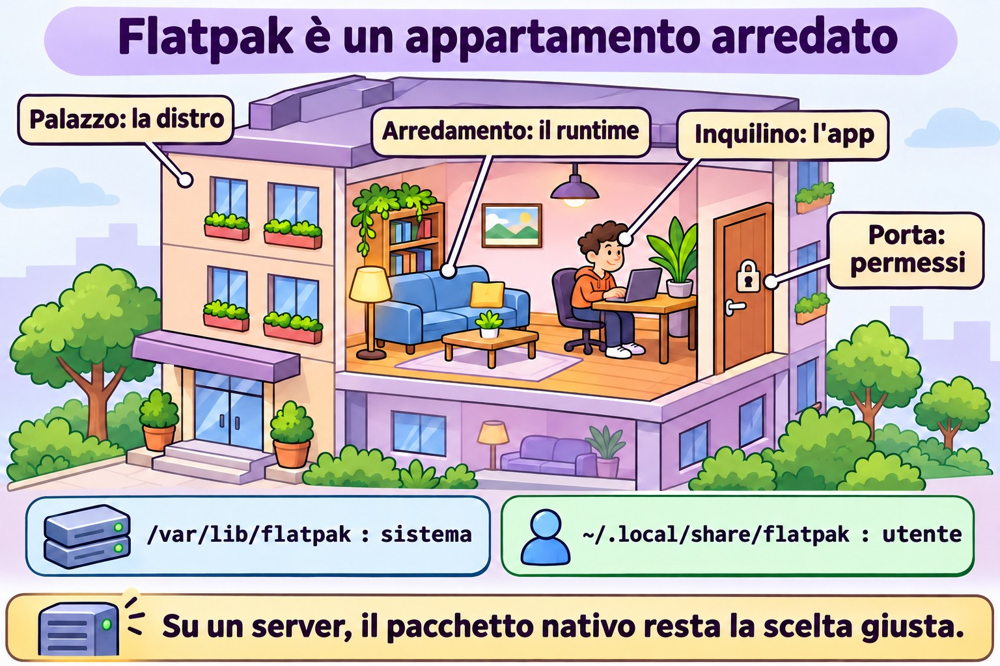
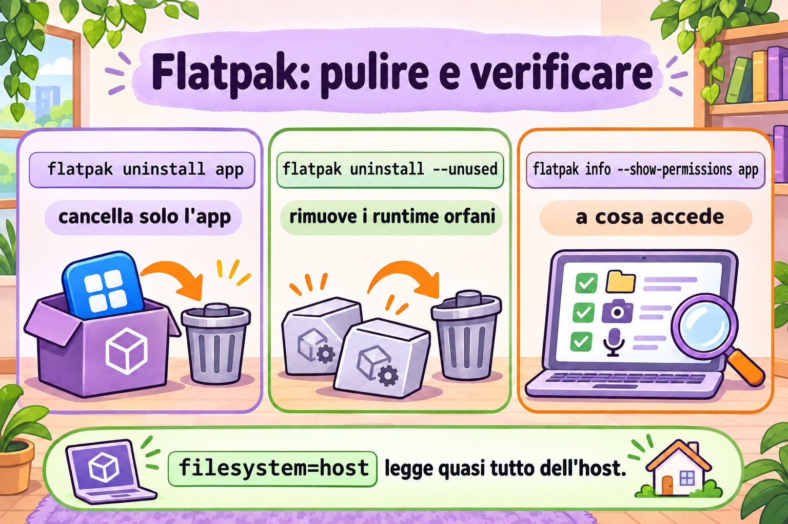

# Lezione 6.4 · Flatpak

Finora ogni pacchetto che hai installato era fatto **per quella distribuzione**: il `.rpm` di Rocky non gira su Debian e viceversa. Flatpak fa il contrario: la stessa applicazione gira su qualsiasi distribuzione, portandosi dietro le librerie di cui ha bisogno e girando in una scatola isolata. È roba da desktop, ma compare sulle postazioni di lavoro Linux dei clienti, quindi devi saperlo usare. Lezione breve.

> **Il cuore di questa lezione:** sapere cosa sono remote, app e runtime; aggiungere Flathub; cercare, installare, aggiornare e rimuovere; capire la differenza tra installazione di sistema e di utente; e vedere e limitare i permessi di un'app. Il resto è approfondimento.

| Scheda |  |
| --- | --- |
| **Modulo** | M6 · Software, lezione 4 di 5 |
| **Quando** | Settimana 11 |
| **Alla fine** | Usi Flatpak da riga di comando e sai quando è (e quando non è) lo strumento giusto |
| **Prerequisiti** | Lezione 6.3 |
| **Durata** | circa 1h30 |
| **Snapshot** | `m6a4-inicio` e `m6a4-fim` su rocky-lab (la parte Debian è facoltativa) |

## 1 · Riscaldamento

Rispondi prima di leggere.

1. Un'app Flatpak usa la `glibc` della tua Rocky o si porta la propria?
2. Bisogna essere root per installare un Flatpak?
3. Su un server senza interfaccia grafica, Flatpak ha senso?

## 2 · Perché conta

| La richiesta | La risposta sbagliata | Cosa provoca |
| --- | --- | --- |
| "Mi serve la versione nuova dell'app X sulla postazione RHEL, dnf ha solo quella vecchia" | Aggiungere un repository Fedora su RHEL | Mescolanza di versioni e un `dnf upgrade` che rompe il sistema |
| "Ho disinstallato l'app e il disco non si è liberato" | "Flatpak funziona così" | Runtime orfani che occupano giga |
| "L'utente ha installato un'app e io non la vedo nell'elenco" | Pensare che non sia installata | L'ha installata con `--user`, nella sua cartella |
| "L'app riesce a leggere tutta la mia home?" | "È una sandbox, non legge niente" | Dipende dai permessi che l'app stessa richiede. Va verificato |

## 3 · Modello mentale

> Flatpak è un **appartamento ammobiliato dentro il palazzo**. Il palazzo è la tua distribuzione (kernel, rete, utenti). Il **runtime** sono i mobili standard (librerie di base), condivisi da più appartamenti. L'**app** è l'inquilino, che porta solo ciò che è suo. Il **remote** è l'agenzia immobiliare. I **permessi** dicono da quali porte l'inquilino può uscire.

```
            remote (ex.: flathub)
                   │  baixa (OSTree, só o que mudou)
                   ▼
  /var/lib/flatpak  (sistema)     ~/.local/share/flatpak  (--user)
        │
        ├── runtime  org.gnome.Platform//47     ← bibliotecas, compartilhado
        └── app      org.gnome.Calculator         ← o programa
                   │
                   ▼  flatpak run
        ┌───── sandbox ───────────────────────────┐
        │ /usr = runtime   /app = o app        │
        │ rede, home, X11/Wayland... só se     │
        │ a permissão deixar                   │
        └──────────────────────────────────────┘
              kernel e usuários: os do host
```

La risposta alla prima domanda è nel disegno: dentro la scatola, `/usr` è quello del runtime. L'app non vede mai le librerie di Rocky.



*L'app non vede mai l'/usr della distro; il runtime porta i mobili condivisi.*

## 4 · L'essenziale

### Vocabolario

| Termine | Cos'è |
| --- | --- |
| **Remote** | Repository Flatpak. Il più comune è Flathub. Su RHEL c'è il remote `rhel`, di Red Hat |
| **App ID** | Nome in DNS invertito: `org.gnome.Calculator`, `org.mozilla.firefox` |
| **Runtime** | Insieme di librerie di base (`org.freedesktop.Platform`, `org.gnome.Platform`, `org.kde.Platform`), con versione. Molte app usano lo stesso |
| **Ref** | Indirizzo completo: `app/org.gnome.Calculator/x86_64/stable` |
| **Installazione di sistema** | `/var/lib/flatpak`, per tutti gli utenti, richiede root (o polkit) |
| **Installazione utente** | `--user`, in `~/.local/share/flatpak`, solo per te, senza root |
| **Dati dell'app** | `~/.var/app/<App ID>/`: configurazione e cache di ogni utente |

### Comandi

| Voglio... | Comando |
| --- | --- |
| Installare Flatpak | `sudo dnf install flatpak` / `sudo apt install flatpak` |
| Aggiungere Flathub | `sudo flatpak remote-add --if-not-exists flathub https://dl.flathub.org/repo/flathub.flatpakrepo` |
| Vedere i remote | `flatpak remotes` |
| Cercare | `flatpak search calculadora` (la ricerca in inglese funziona meglio) |
| Elencare cosa offre un remote | `flatpak remote-ls flathub --app` |
| Installare | `sudo flatpak install flathub org.gnome.Calculator` |
| Elencare gli installati | `flatpak list --app` / `flatpak list --runtime` |
| Dettagli | `flatpak info org.gnome.Calculator` |
| Eseguire | `flatpak run org.gnome.Calculator` |
| Aggiornare tutto | `sudo flatpak update` |
| Rimuovere | `sudo flatpak uninstall org.gnome.Calculator` |
| Rimuovere i runtime orfani | `sudo flatpak uninstall --unused` |
| Cronologia | `flatpak history` |
| Vedere i permessi | `flatpak info --show-permissions APP` |
| Limitare un permesso | `flatpak override --user --nofilesystem=home APP` |
| Disattivare un remote | `sudo flatpak remote-modify --disable flathub` |

Senza `--user` e senza `--system`, il valore predefinito è **sistema**. Per usare `--user`, anche il remote deve esistere nell'ambito dell'utente (`flatpak remote-add --user ...`).

### Permessi (la "sandbox")

L'app dichiara ciò che vuole: rete (`network`), schermo (`x11`, `wayland`), audio (`pulseaudio`), file (`filesystem=home`, `filesystem=host`), dispositivi (`devices=all`). Flatpak concede ciò che è dichiarato. La sandbox protegge solo quanto lo permette quell'elenco. Un'app con `filesystem=host` legge quasi tutto ciò che leggi tu.

`flatpak override` modifica questo per singola app, per te (`--user`) o per tutti (`sudo flatpak override`). `flatpak override --show APP` mostra cosa è stato cambiato, e `--reset` annulla. Nell'interfaccia grafica, l'app **Flatseal** fa la stessa cosa.

### Flatpak, Snap e AppImage

|  | Flatpak | Snap | AppImage |
| --- | --- | --- | --- |
| Chi lo spinge | Comunità, Red Hat, GNOME, KDE | Canonical (Ubuntu) | Nessuno in particolare |
| Store | Più remote (Flathub il più grande) | Uno solo, di Canonical | Nessuno, è un file |
| Installazione | `flatpak install` | `snap install` | Scarichi, `chmod +x`, esegui |
| Isolamento | Sì, tramite permessi | Sì, AppArmor | No |
| Aggiornamento | `flatpak update` | Automatico | Manuale |
| Focus | Desktop | Desktop e server | Desktop |

### Rocky × Debian

Flatpak è identico su entrambe: stessi comandi, stessi percorsi, stesso Flathub. Cambia solo l'installazione di `flatpak` stesso (dnf o apt) e il remote già pronto: nessuno su Rocky e su Debian, `rhel` su RHEL. Su Ubuntu, quello già pronto è Snap.

## 5 · Lab guidato

**Passo 0 · Snapshot e cartella.** Su Proxmox: `qm snapshot 201 m6a4-inicio`. Su rocky-lab: `mkdir -p ~/lab64 && cd ~/lab64`.

**Passo 1 · Installare Flatpak e vedere che non c'è nessun remote.**

```bash
sudo dnf install -y flatpak
flatpak --version
flatpak remotes
```

L'elenco è vuoto (o contiene solo remote del fornitore). Senza remote, non c'è da dove installare.

**Passo 2 · Aggiungere Flathub e guardare il catalogo.**

```bash
sudo flatpak remote-add --if-not-exists flathub https://dl.flathub.org/repo/flathub.flatpakrepo
flatpak remotes -d
flatpak remote-ls flathub --app | wc -l
flatpak search calculator | head
```

Il `.flatpakrepo` è un piccolo file con l'URL e la chiave GPG del remote. È l'equivalente di `epel-release` della lezione scorsa.

**Passo 3 · Installare e vedere arrivare il runtime.**

```bash
sudo flatpak install -y flathub org.gnome.Calculator
flatpak list --app
flatpak list --runtime
flatpak info org.gnome.Calculator
```

Nota che sono arrivati due o più elementi: l'app e il runtime (e le estensioni, come le traduzioni). La prima volta il runtime è la parte grossa del download. La prossima app che usa lo stesso runtime arriva leggera. Nella riga `Runtime:` di `flatpak info` c'è quello che usa.

**Passo 4 · Entrare nella scatola.** rocky-lab non ha uno schermo, quindi il normale `flatpak run` fallirebbe per mancanza di display. Invece, apri una shell **dentro** la sandbox dell'app:

```bash
flatpak run --command=sh org.gnome.Calculator
```

Una volta dentro:

```bash
cat /etc/os-release | head -3
ls /app/bin
ls /usr/lib64 2>/dev/null | head -3; ls /usr/lib | head -3
id
ls ~
exit
```

L'`os-release` non è quello di Rocky: è quello del runtime. `/app` è l'app. `id` mostra il tuo vero utente (la sandbox non è un'altra macchina, kernel e utenti sono quelli dell'host). `ls ~` mostra solo ciò che il permesso lascia vedere.

**Passo 5 · Permessi e override.**

```bash
flatpak info --show-permissions org.gnome.Calculator
flatpak override --user --unshare=network org.gnome.Calculator
flatpak override --user --show org.gnome.Calculator
ls ~/.local/share/flatpak/overrides/
flatpak override --user --reset org.gnome.Calculator
```

L'override è solo un file di testo nella tua cartella. `--reset` cancella le modifiche.

**Passo 6 · Installazione utente, senza root.**

```bash
flatpak remote-add --user --if-not-exists flathub https://dl.flathub.org/repo/flathub.flatpakrepo
flatpak remotes
flatpak install --user -y flathub org.gnome.Calculator
flatpak list --app
ls ~/.local/share/flatpak/app/
```

Ora la colonna `Installation` mostra la stessa app due volte: `system` e `user`. Sono copie indipendenti.

**Passo 7 · Cronologia, aggiornamento e rimozione pulita.**

```bash
flatpak history | tail
sudo flatpak update -y
flatpak uninstall --user -y org.gnome.Calculator
sudo flatpak uninstall -y org.gnome.Calculator
flatpak list --runtime
sudo flatpak uninstall --unused -y
flatpak uninstall --user --unused -y
flatpak list --runtime
ls ~/.var/app/ 2>/dev/null
```

Dopo aver rimosso l'app, il runtime **resta** lì finché non usi `--unused`. E restano anche i dati dell'utente in `~/.var/app/` (per quello esiste `--delete-data`).

**Passo 8 (facoltativo) · debian-lab.** Esegui `sudo apt install -y flatpak`, poi lo stesso `remote-add` del Passo 2 e `flatpak remote-ls flathub --app | wc -l`. Il numero è lo stesso: il catalogo non dipende dalla distribuzione.

### Pulizia

Flathub può restare configurato in entrambi gli ambiti. Rimuovi solo il remote utente, che non serve più: `flatpak remote-delete --user flathub`.

### Decidi 1

Un collega vuole `jq` su un server Rocky di produzione, senza interfaccia grafica, e propone di installarlo via Flatpak "perché è isolato". Cosa fai?

A) Flatpak, è più sicuro. B) `dnf install jq`, che è nel repository di Rocky. C) Scarica il binario da GitHub e lo mette in `/usr/local/bin`.

Scegli un'opzione prima di continuare.

| Se hai scelto | Risultato | Perché |
| --- | --- | --- |
| A | Potrebbe nemmeno esistere così, e se esiste porta con sé un runtime intero | Flatpak è fatto per le app desktop. Su un server ottieni un secondo sistema di pacchetti da mantenere e verificare |
| B | Giusto | Pacchetto della distribuzione, firmato, aggiornato insieme al resto con `dnf upgrade` |
| C | Funziona, senza aggiornamenti | Nessuno si ricorda di aggiornare il binario isolato quando esce una correzione |

**Da ricordare:** su un server, prima il pacchetto della distribuzione. Flatpak è per le app grafiche su una postazione di lavoro.

### Decidi 2

Su una postazione RHEL condivisa, un'utente senza sudo ha bisogno di un editor di immagini che esiste solo su Flathub. Nessun altro lo userà. Cosa fai?

A) Installa con `sudo flatpak install` per tutti. B) Le lascia installare con `--user`, nella sua cartella. C) Le dà sudo così può installare.

Scegli un'opzione prima di continuare.

| Se hai scelto | Risultato | Perché |
| --- | --- | --- |
| A | Funziona, e diventi tu il responsabile degli aggiornamenti | L'app compare per tutti, senza necessità |
| B | Giusto | È per questo che esiste l'installazione utente: senza root e senza toccare il sistema. Il remote utente va aggiunto prima |
| C | La peggiore di tutte | Root completo per installare un'app |

**Da ricordare:** `--user` è il modo di dare autonomia senza dare sudo.

## 6 · Rompi e ripara

### Guasto 1 · "Non trovo l'app" nell'ambito utente

Su rocky-lab, senza remote utente (l'hai rimosso nella Pulizia):


*Un'app con filesystem=host legge quasi tutto. Prima di fidarti, esegui flatpak info --show-permissions.*


```bash
flatpak install --user flathub org.gnome.Calculator
```

**Sintomo:** errore che dice che il remote `flathub` non esiste o che nulla corrisponde al nome, anche se `sudo flatpak install` funziona.

**Diagnosi:** `flatpak remotes` mostra la colonna dell'ambito: `flathub` è solo in `system`.

**Riparazione:** `flatpak remote-add --user --if-not-exists flathub <url>`, oppure installare nel sistema. Dopo il test, rimuovi di nuovo.

**Nella vita reale:** è il dubbio numero uno di chi inizia con `--user`. I due ambiti sono mondi separati: remote, app e runtime.

### Guasto 2 · Disco che non si libera

Installa e rimuovi un'app senza `--unused`:

```bash
sudo flatpak install -y flathub org.gnome.Calculator
sudo flatpak uninstall -y org.gnome.Calculator
du -sh /var/lib/flatpak
```

**Sintomo:** l'app è sparita, ma la cartella resta grande.

**Diagnosi:** `flatpak list --runtime` mostra i runtime che nessuno usa più.

**Riparazione:** `sudo flatpak uninstall --unused`, e ricontrolla con `du -sh`.

**Nella vita reale:** sulle postazioni vecchie, i runtime datati (versioni precedenti di GNOME o KDE) sommano molti giga. `flatpak update` di solito avvisa quando un runtime arriva a fine vita.

### Guasto 3 · Remote disattivato (narrativa)

Qualcuno ha eseguito `flatpak remote-modify --disable flathub` durante una manutenzione e se n'è dimenticato. Settimane dopo, `flatpak update` dice che non c'è nulla da aggiornare e `install` non trova niente.

**Diagnosi:** `flatpak remotes -d` mostra il remote con l'opzione `disabled`.

**Riparazione:** `sudo flatpak remote-modify --enable flathub`. È lo stesso schema di `enabled=0` della lezione 6.3: disattivato non dà errore, sta solo zitto.

## 7 · Trappole

| Trappola | Cosa succede | Come evitarla |
| --- | --- | --- |
| Pensare che la sandbox sia una protezione totale | Un'app con `filesystem=host` legge quasi tutto | `flatpak info --show-permissions` prima di fidarti |
| Rimuovere l'app e dimenticare il runtime | Disco pieno di runtime orfani | `flatpak uninstall --unused` |
| Mescolare `--user` e sistema | L'app "sparisce", "si duplica" o non si aggiorna | Guarda la colonna `Installation` in `flatpak list` |
| `flatpak update` solo come utente | Aggiorna l'ambito utente e non quello di sistema (o il contrario) | `sudo flatpak update` per il sistema, `flatpak update --user` per il tuo |
| `dnf upgrade` non aggiorna Flatpak | App obsolete per mesi | Flatpak ha un aggiornamento proprio. Includilo nella procedura di manutenzione |
| Flatpak su un server | Secondo sistema di pacchetti da mantenere | Pacchetto della distribuzione o container |
| Sbagliare l'App ID | `install` non trova niente o chiede quale | Copia l'ID da `flatpak search` |

## 8 · Quiz

Rispondi senza guardare. Le soluzioni sono alla fine della lezione.

1. Cos'è un runtime e perché non sparisce quando rimuovi l'app?
2. Dove si trova un'app installata con `--user`? E con `sudo`?
3. Hai rimosso un'app con `flatpak uninstall`. Dove sono rimaste le impostazioni dell'utente, e come le avresti cancellate insieme?
4. Come scopri se un'app può accedere alla rete e alla tua home?
5. Perché `dnf upgrade` non basta su una postazione con app Flatpak?
6. *Which command adds the Flathub remote system-wide? a) `flatpak add flathub URL` b) `flatpak remote-add flathub URL` c) `dnf config-manager --add-repo URL` d) `flatpak install flathub`*

## 9 · Promemoria

**Da sapere a memoria:**

| Voglio... | Comando |
| --- | --- |
| Vedere i remote | `flatpak remotes` |
| Aggiungere un remote | `sudo flatpak remote-add --if-not-exists NOME URL.flatpakrepo` |
| Cercare | `flatpak search TERMO` |
| Installare / rimuovere | `sudo flatpak install REMOTE APPID` / `sudo flatpak uninstall APPID` |
| Elencare | `flatpak list --app` |
| Aggiornare | `sudo flatpak update` |
| Pulire gli orfani | `sudo flatpak uninstall --unused` |

**Da consultare:**

| Voglio... | Comando |
| --- | --- |
| Catalogo del remote | `flatpak remote-ls REMOTE --app` |
| Dettagli e runtime | `flatpak info APPID` |
| Permessi | `flatpak info --show-permissions APPID` |
| Limitare / vedere / annullare | `flatpak override --user --nofilesystem=home APPID` / `--show` / `--reset` |
| Shell dentro la sandbox | `flatpak run --command=sh APPID` |
| Cronologia | `flatpak history` |
| Attivare / disattivare un remote | `sudo flatpak remote-modify --enable` / `--disable REMOTE` |
| Rimuovere un remote | `sudo flatpak remote-delete REMOTE` |
| Rimuovere con i dati | `flatpak uninstall --delete-data APPID` |
| Riparare l'installazione | `sudo flatpak repair` |
| Percorsi | `/var/lib/flatpak`, `~/.local/share/flatpak`, `~/.var/app/` |

**Flashcard:**

- Remote, app, runtime → *agenzia immobiliare, inquilino, mobili condivisi.*
- Ambito predefinito → *sistema. `--user` richiede un remote utente.*
- La sandbox protegge tutto? → *Solo ciò che i permessi non liberano.*
- Hai rimosso l'app, il disco non si è liberato → *`flatpak uninstall --unused`.*
- Server senza schermo → *pacchetto della distribuzione, non Flatpak.*

## 10 · Checklist e chiusura

- [ ] Spiego remote, app, runtime e ref
- [ ] Aggiungo Flathub e installo, elenco, aggiorno e rimuovo un'app
- [ ] Distinguo l'installazione di sistema da quella utente
- [ ] Vedo e limito i permessi con `info --show-permissions` e `override`
- [ ] Pulisco i runtime orfani
- [ ] So quando **non** usare Flatpak

**Ultimo esercizio, senza guardare la lezione:** su rocky-lab, installa come utente (senza sudo) una qualsiasi piccola app di Flathub, mostra quale runtime usa, apri una shell al suo interno e di' di quale distribuzione è `/usr`. Poi rimuovi l'app, il runtime orfano e il remote utente.

**Reboot e verifica:**

```bash
sudo reboot
flatpak remotes
flatpak list
sudo flatpak update
sudo dnf check
```

`flatpak list` deve risultare vuoto o contenere solo ciò che hai deciso di tenere. `dnf check` resta pulito: Flatpak non tocca il database di rpm.

**Snapshot di fine** (su Proxmox):

```bash
qm snapshot 201 m6a4-fim
```

## 11 · Nella vita reale

**Missione, sola lettura.** Su una postazione Linux (tua o di qualcuno che lo autorizza) che usa Flatpak, esegui **solo**:

```bash
flatpak remotes -d
flatpak list --columns=application,version,installation,origin
flatpak list --runtime --columns=application,branch
flatpak history | tail -20
du -sh /var/lib/flatpak ~/.local/share/flatpak 2>/dev/null
```

Domande a cui rispondere:

1. Quali remote esistono e in quale ambito?
2. Quante app di sistema e quante utente?
3. Qualche runtime con una versione (branch) vecchia che forse non ha più app che lo usano?
4. Quando è stato l'ultimo aggiornamento nella `history`?
5. Scegli un'app ed esegui `flatpak info --show-permissions`. Chiede `filesystem=host`?

**Diario:** annota se la postazione ha una procedura che aggiorna Flatpak, o se gira solo `dnf`/`apt`.

**Domani, senza guardare:** scrivi i sei comandi essenziali: `remotes`, `remote-add`, `search`, `install`, `list`, `uninstall`.

## 12 · Approfondire quando vuoi

- **OSTree:** il "git per i binari" sotto Flatpak. Spiega perché si scarica solo ciò che è cambiato e perché due app con lo stesso runtime non duplicano lo spazio su disco. Lo stesso OSTree c'è in Fedora Silverblue e in RHEL for Edge.
- **Remote privati:** un'azienda può pubblicare le proprie app su un remote interno, oppure usare il remote `rhel` di Red Hat con la registrazione.
- **`flatpak-builder` e manifest:** come si impacchetta un'app Flatpak.
- **Portali (xdg-desktop-portal):** come l'app chiede di aprire un file senza avere accesso a tutta la home.
- **Snap a fondo:** `snap list`, `snap refresh --hold`, i mount `squashfs` che compaiono in `lsblk` su Ubuntu.
- **Aggiornamento automatico:** GNOME Software e KDE Discover aggiornano Flatpak da soli. In una flotta, un timer di systemd con `flatpak update -y`.

**DeepTutor** (http://10.1.0.149:3782, KB "Curso Linux Sysadmin"):

- `!explica a diferença entre runtime e app no Flatpak`
- `!feynman por que o sandbox do Flatpak não é proteção total`
- `!quiz Aula 6.4, 5 perguntas sobre Flatpak`

## Soluzioni commentate

### Riscaldamento

1. **Si porta la propria.** Dentro la sandbox, `/usr` è quello del runtime, con la sua `glibc`. Per questo la stessa app gira su qualsiasi distribuzione. Il kernel, quello sì, è dell'host.
2. **Non necessariamente.** L'installazione di sistema richiede root (o l'autorizzazione tramite polkit in una sessione grafica). Con `--user`, qualsiasi utente installa nella propria cartella.
3. **Quasi mai.** Flatpak è fatto per le app grafiche. Su un server, usa il pacchetto della distribuzione o un container. L'eccezione è una postazione di lavoro, come in questa lezione.

### Quiz

1. Il runtime è l'insieme di librerie di base che l'app usa (per esempio `org.gnome.Platform`). È condiviso: un'altra app può dipenderne. Per questo la rimozione dell'app non porta via il runtime, e a pulire ci pensa `flatpak uninstall --unused`.
2. Con `--user`: `~/.local/share/flatpak/`. Con `sudo` (ambito di sistema, quello predefinito): `/var/lib/flatpak/`.
3. In `~/.var/app/<App ID>/`, nella cartella di ogni utente che ha usato l'app. Per cancellarle insieme: `flatpak uninstall --delete-data APPID`.
4. `flatpak info --show-permissions APPID`. Cerca `network` in `shared` e `home` o `host` in `filesystems`. Gli override applicati si vedono con `flatpak override --show APPID`.
5. Perché le app Flatpak non sono nel database di rpm né nei repository di dnf. Hanno un remote proprio e un aggiornamento proprio: `flatpak update`.
6. **b) `flatpak remote-add flathub URL`** (con `sudo` e, in pratica, `--if-not-exists`). La a) non esiste. La c) è per i repository RPM. La d) installa, ma funziona solo se il remote esiste già.

---

<!-- navegacao -->
[← Lezione 6.3 · Repository](6.3-repositorios.md) · [Indice delle lezioni](../01-aulas.md) · [Lezione 6.5 · Librerie condivise →](6.5-bibliotecas-compartilhadas.md)
