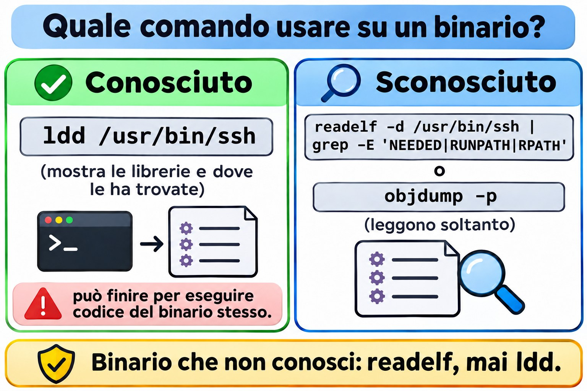

# Lezione 6.5 · Librerie condivise

Quasi nessun programma Linux funziona da solo. `ls`, `sshd` e `dnf` caricano, nel momento in cui girano, librerie che stanno in altri file: la `libc`, la `libssl`, la `libz`. Quando una di queste manca, è nella cartella sbagliata o è la versione sbagliata, compare il messaggio che ogni sysadmin ha già visto: `error while loading shared libraries`. Questa lezione ti insegna a leggere quel messaggio e a risolverlo nel modo giusto. Alla fine arriva la Sfida dell'M6.

> **Il cuore di questa lezione:** capire i tre nomi di una libreria (real name, soname, linker name); vedere le dipendenze di un programma con `ldd` e `readelf`; sapere dove cerca il loader; registrare una nuova cartella con `/etc/ld.so.conf.d` e `ldconfig`; e sapere perché `LD_LIBRARY_PATH` e i symlink improvvisati sono rattoppi. Il resto è approfondimento.

| Scheda |  |
| --- | --- |
| **Modulo** | M6 · Software, lezione 5 di 5, con la Sfida del modulo |
| **Quando** | Settimana 11. La Sfida può slittare a fine settimana o alla 12 |
| **Alla fine** | Diagnostichi e risolvi una libreria che non si carica, senza arrangiarti con trucchi |
| **Prerequisiti** | Lezioni 6.1 a 6.3 |
| **Durata** | circa 2h, più 2h-3h per la Sfida |
| **Snapshot** | `m6a5-inicio` e `m6a5-fim` su rocky-lab. debian-lab si limita a essere letta |

## 1 · Riscaldamento

Rispondi prima di leggere.

1. Se qualcuno cancella `libc.so.6`, cosa succede a `ls`? E a `rm`, che useresti per riparare?
2. Perché la stessa libreria compare con tre nomi, come `libz.so`, `libz.so.1` e `libz.so.1.2.13`?
3. Hai copiato una libreria in `/opt/app/lib` e il programma continua a dire che non la trova. Perché?

## 2 · Perché conta

| La richiesta | La risposta sbagliata | Cosa provoca |
| --- | --- | --- |
| "L'app del fornitore chiede `libssl.so.1.1` e Rocky 9 ha solo la 3" | `ln -s libssl.so.3 libssl.so.1.1` | L'app parte e poi crolla, oppure corrompe i dati. L'interfaccia è cambiata |
| "Ho installato la lib e il programma non la trova" | `export LD_LIBRARY_PATH=...` in `/etc/profile` | Vale per tutti, tranne che per i servizi di systemd. E può sostituire la lib di altri programmi |
| "Sul mio terminale funziona e come servizio no" | Riavviare finché funziona | La tua shell ha una variabile che il servizio non ha |
| "Ho aggiornato OpenSSL per una falla di sicurezza" | Pensare che sia finita | I servizi già in esecuzione continuano con la versione vecchia in memoria fino al riavvio |

## 3 · Modello mentale

> Il programma è una **lista di invitati**: nel binario c'è scritto "mi serve `libz.so.1` e `libc.so.6`", solo il nome, senza indirizzo. A cercare ciascuno è il **loader** (`ld-linux`), e lo fa in un ordine fisso. La sua rubrica è `/etc/ld.so.cache`, che `ldconfig` costruisce a partire dall'elenco di cartelle in `/etc/ld.so.conf.d`. Se la cartella non è nell'elenco e nessuno ha aggiornato la rubrica, il loader non trova la libreria, anche se il file è lì.

```
./programa
   │  o kernel lê o ELF: "interpretador: /lib64/ld-linux-x86-64.so.2"
   ▼
ld-linux (o loader)
   │  para cada NEEDED gravado no binário (ex.: libz.so.1):
   ├─ 1. RUNPATH/RPATH gravado no próprio binário
   ├─ 2. LD_LIBRARY_PATH (variável de ambiente)
   ├─ 3. /etc/ld.so.cache  ← o ldconfig gera a partir de /etc/ld.so.conf(.d)
   └─ 4. pastas padrão: /lib64 e /usr/lib64 (Rocky)
                        /lib/x86_64-linux-gnu e /usr/lib/x86_64-linux-gnu (Debian)
   ▼
não achou → "error while loading shared libraries: libz.so.1:
            cannot open shared object file: No such file or directory"
```

Il dettaglio sottile: il vecchio RPATH viene prima di `LD_LIBRARY_PATH` e il moderno RUNPATH viene dopo. Per l'uso quotidiano basta l'ordine del disegno.


*Se la cartella non è nell'elenco e nessuno ha eseguito ldconfig, il loader non trova la libreria.*

## 4 · L'essenziale

### I tre nomi

| Nome | Esempio | Cos'è | Chi lo crea |
| --- | --- | --- | --- |
| **Real name** | `libz.so.1.2.13` | Il file vero, con la versione completa | Il pacchetto (`zlib` / `zlib1g`) |
| **Soname** | `libz.so.1` | Symlink al real name. È il nome registrato nei programmi. Cambia solo quando l'interfaccia si rompe | `ldconfig` (e il pacchetto) |
| **Linker name** | `libz.so` | Symlink usato solo per **compilare** (`-lz`) | Il pacchetto di sviluppo (`zlib-devel` / `zlib1g-dev`) |

La regola che spiega tutto: **stesso soname, interfaccia compatibile**. `libz.so.1.2.13` e `libz.so.1.3.1` hanno lo stesso soname `libz.so.1`, quindi qualsiasi programma fatto per una usa anche l'altra. Una `libz.so.2` sarebbe un'altra interfaccia, e i programmi vecchi continuerebbero a chiedere `.so.1`.

### Comandi

| Voglio... | Comando |
| --- | --- |
| Vedere di quali librerie ha bisogno un programma e dove sono state trovate | `ldd /usr/bin/ssh` |
| Vedere solo ciò che è registrato nel binario, senza eseguire nulla | `readelf -d /usr/bin/ssh \| grep -E 'NEEDED\|RUNPATH\|RPATH'` |
| Vedere la rubrica del loader | `ldconfig -p \| grep libz` |
| Aggiornare la rubrica e i symlink dei soname | `sudo ldconfig` |
| Vedere le cartelle extra | `cat /etc/ld.so.conf` e `ls /etc/ld.so.conf.d/` |
| Registrare una nuova cartella | `echo /opt/app/lib \| sudo tee /etc/ld.so.conf.d/app.conf` e `sudo ldconfig` |
| Provare con una cartella valida solo per questo comando | `LD_LIBRARY_PATH=/opt/app/lib ./programa` |
| Vedere il loader che cerca, passo per passo | `LD_DEBUG=libs ./programa` |
| Scoprire il pacchetto proprietario di una lib | `rpm -qf /usr/lib64/libz.so.1` / `dpkg -S libz.so.1` |
| Scoprire quale pacchetto fornisce una lib mancante | `dnf provides 'libz.so.1()(64bit)'` / `apt-file search libz.so.1` |
| Vedere i servizi che usano una lib vecchia dopo un aggiornamento | `sudo dnf needs-restarting -s` / `sudo needrestart` (Debian, pacchetto `needrestart`) |

**Attenzione a `ldd`:** su un binario sconosciuto può finire per eseguire codice del binario stesso. Per un programma che non conosci, usa `readelf -d` o `objdump -p`, che si limitano a leggere.



*Programma sconosciuto: leggilo con readelf o objdump, che leggono soltanto; ldd può eseguire il binario.*

### Rocky × Debian

|  | Rocky | Debian |
| --- | --- | --- |
| Cartelle predefinite (64 bit) | `/lib64`, `/usr/lib64` | `/lib/x86_64-linux-gnu`, `/usr/lib/x86_64-linux-gnu` (multiarch) |
| Nome del pacchetto della lib | `zlib`, `openssl-libs` | `zlib1g`, `libssl3` (il soname finisce nel nome) |
| Pacchetto per compilare | `-devel` (`zlib-devel`) | `-dev` (`zlib1g-dev`) |
| Chi esegue `ldconfig` all'installazione | rpm stesso (trigger di file) | Trigger di dpkg |
| Trovare chi la fornisce | `dnf provides 'libX.so.N()(64bit)'` | `apt-file search libX.so.N` |
| Servizi con lib vecchia | `dnf needs-restarting -s` | `needrestart` |

Su Rocky, `/lib64` è un symlink a `/usr/lib64`. Su Debian moderno, `/lib` è un symlink a `/usr/lib`. In entrambi, la cartella "vera" è quella sotto `/usr`.

## 5 · Lab guidato

Creerai una libreria giocattolo, `libola`, e la romperai e riparerai in vari modi.

**Passo 0 · Snapshot, cartella e compilatore.** Su Proxmox: `qm snapshot 201 m6a5-inicio`. Su rocky-lab:

```bash
sudo dnf install -y gcc
mkdir -p ~/lab65 && cd ~/lab65
```

**Passo 1 · Guardare un programma vero.**

```bash
ldd /usr/bin/ls
readelf -d /usr/bin/ls | grep NEEDED
ls -l /usr/lib64/libz.so*
rpm -qf /usr/lib64/libz.so.1
ldconfig -p | grep libz
cat /etc/ld.so.conf
ls /etc/ld.so.conf.d/
```

`readelf` mostra solo i nomi (soname). `ldd` mostra anche dove ciascuno è stato trovato. In `ls -l`, nota la catena di symlink: `libz.so.1` punta al real name. `libz.so` (linker name) esiste solo se `zlib-devel` è installato.

**Passo 2 · Creare la libreria e un programma che la usa.**

```bash
cat > ola.c <<'EOF'
#include <stdio.h>
void ola(void) { puts("ola da biblioteca v1"); }
EOF

cat > main.c <<'EOF'
void ola(void);
int main(void) { ola(); return 0; }
EOF

gcc -fPIC -shared -Wl,-soname,libola.so.1 -o libola.so.1.0 ola.c
ln -s libola.so.1.0 libola.so
gcc -o app main.c -L. -lola
./app
```

`-Wl,-soname,libola.so.1` scrive il soname dentro la lib. `ln -s` crea il linker name, che `gcc -lola` usa per compilare. E `./app` fallisce: `error while loading shared libraries: libola.so.1: cannot open shared object file`.

**Passo 3 · Diagnosticare e provare senza installare.**

```bash
ldd ./app | grep ola
readelf -d app | grep NEEDED
ls -l
LD_LIBRARY_PATH=. ./app
ldconfig -n .
ls -l
LD_LIBRARY_PATH=. ./app
```

`ldd` mostra `libola.so.1 => not found`. Il binario chiede `libola.so.1` (il soname), non `libola.so.1.0` né `libola.so`. Per questo il primo `LD_LIBRARY_PATH=.` **fallisce ancora**: nella cartella non esiste un file con quel nome. `ldconfig -n .` crea il symlink del soname solo in questa cartella, senza toccare la rubrica di sistema. Ora la prova funziona. Ma vale solo per quel comando.

**Passo 4 · Installare nel modo giusto.**

```bash
sudo mkdir -p /opt/ola/lib
sudo cp libola.so.1.0 /opt/ola/lib/
./app
echo /opt/ola/lib | sudo tee /etc/ld.so.conf.d/ola.conf
sudo ldconfig
ls -l /opt/ola/lib
ldconfig -p | grep ola
ldd ./app | grep ola
./app
```

Il primo `./app` continua a fallire: il file è lì, ma la cartella non è nella rubrica. Dopo `ldconfig`, sono cambiate due cose: la rubrica conosce la cartella, e `ldconfig` ha creato da solo il symlink `libola.so.1 -> libola.so.1.0`.

**Passo 5 · Versioni: compatibile e incompatibile.**

```bash
sed 's/v1/v1.1/' ola.c > ola11.c
gcc -fPIC -shared -Wl,-soname,libola.so.1 -o libola.so.1.1 ola11.c
sudo cp libola.so.1.1 /opt/ola/lib/
sudo ldconfig
ls -l /opt/ola/lib
./app
```

Stesso soname, versione maggiore: `ldconfig` ha spostato il symlink `libola.so.1` sulla `1.1`, e `app` usa la nuova **senza ricompilare**. È così che una correzione di sicurezza in `openssl-libs` arriva a tutti i programmi in un colpo solo.

```bash
sed 's/v1/v2/' ola.c > ola2.c
gcc -fPIC -shared -Wl,-soname,libola.so.2 -o libola.so.2.0 ola2.c
sudo cp libola.so.2.0 /opt/ola/lib/
sudo ldconfig
ls -l /opt/ola/lib
ldconfig -p | grep ola
./app
```

Soname nuovo, interfaccia nuova: ora esistono `libola.so.1` e `libola.so.2` una accanto all'altra, e il vecchio `app` resta con la `1.1`. Solo un programma ricompilato, contro `.so.2`, userebbe la versione 2. Per questo Rocky 9 può avere `libssl.so.3` e, in un pacchetto di compatibilità, `libssl.so.1.1` allo stesso tempo.

**Passo 6 · RUNPATH: il binario che dice dove cercare.**

```bash
gcc -o app-local main.c -L. -lola -Wl,-rpath,'$ORIGIN'
readelf -d app-local | grep -E 'NEEDED|RUNPATH'
./app-local
./app
```

`$ORIGIN` significa "la cartella dove si trova il binario". `app-local` trova `libola.so.1` in `~/lab65` (la v1) prima di guardare la rubrica, mentre `app` usa la `1.1` di sistema. Molte app di fornitori in `/opt` arrivano così, con le proprie lib accanto.

**Passo 7 · debian-lab, sola lettura.**

```bash
ldd /usr/bin/ls
ls -l /usr/lib/x86_64-linux-gnu/libz.so*
dpkg -S libz.so.1
cat /etc/ld.so.conf.d/*.conf
```

Stessa idea, cartella multiarch diversa. Il pacchetto si chiama `zlib1g`: l'`1` è il soname.

**Non pulire ancora.** I guasti della sezione 6 usano `/opt/ola`. La pulizia viene alla fine.

### Decidi 1

Un'app di un fornitore in `/opt/vendor` non parte su Rocky 9: `libssl.so.1.1: cannot open shared object file`. Rocky 9 ha `libssl.so.3`. Cosa fai?

A) `ln -s /usr/lib64/libssl.so.3 /usr/lib64/libssl.so.1.1`. B) Installa il pacchetto di compatibilità della distribuzione (`dnf provides 'libssl.so.1.1()(64bit)'`, su Rocky 9 è `compat-openssl11`) e chiede al fornitore una versione per OpenSSL 3. C) Scarica una `libssl.so.1.1` da un sito qualsiasi e la butta in `/usr/lib64`.

Scegli un'opzione prima di continuare.

| Se hai scelto | Risultato | Perché |
| --- | --- | --- |
| A | Parte e poi crolla, o peggio, funziona in modo sbagliato | Un soname diverso significa un'interfaccia diversa. Il symlink inganna il loader, non il codice |
| B | Giusto | Lib con il soname giusto, firmata, aggiornata da `dnf`, e il vero problema (app vecchia) resta registrato |
| C | La peggiore di tutte | Libreria di crittografia di origine sconosciuta, fuori da qualsiasi aggiornamento |

**Da ricordare:** quando manca un soname, cerca **chi fornisce quel soname**. Non puntare mai un soname a un altro.

### Decidi 2

L'app in `/opt/app` porta in `/opt/app/lib` copie proprie di varie lib, tra cui una `libcrypto.so.3` più vecchia di quella di sistema. Un collega ha risolto con `export LD_LIBRARY_PATH=/opt/app/lib` in `/etc/profile`. L'app gira come servizio di systemd. Cosa fai?

A) Lascia com'è, ha funzionato. B) Sostituisce con `/etc/ld.so.conf.d/app.conf` contenente `/opt/app/lib` ed esegue `ldconfig`. C) Rimuove da `/etc/profile` e mette la variabile solo nel servizio: `Environment=LD_LIBRARY_PATH=/opt/app/lib` nella unit (o uno script che esporta e chiama l'app).

Scegli un'opzione prima di continuare.

| Se hai scelto | Risultato | Perché |
| --- | --- | --- |
| A | Sbagliato due volte | `/etc/profile` vale per i login, non per il servizio. E ogni programma che apri nella shell passa a usare la vecchia `libcrypto` dell'app |
| B | Pericoloso qui | Le cartelle di `ld.so.conf.d` entrano nella rubrica **prima** delle cartelle predefinite. L'intero sistema, compresi `sshd` e `dnf`, passerebbe a usare la vecchia `libcrypto` |
| C | Giusto | Solo l'app vede le sue lib |

**Da ricordare:** `ld.so.conf.d` serve per cartelle con lib che esistono solo lì. Una cartella con copie di lib di sistema resta limitata all'app che ne ha bisogno.

## 6 · Rompi e ripara

### Guasto 1 · Rubrica non aggiornata


*Il programma conserva il soname; il link con quel nome punta al file vero.*

```bash
sudo rm /opt/ola/lib/libola.so.1
./app
ldconfig -p | grep ola
```

**Sintomo:** `cannot open shared object file`, anche se `libola.so.1.1` è lì.

**Diagnosi:** la rubrica dice ancora che `libola.so.1` è in `/opt/ola/lib`, ma `ls -l /opt/ola/lib` mostra che il symlink del soname è sparito. Il loader cerca per soname, non per il file con la versione.

**Riparazione:** `sudo ldconfig`. Ricrea il symlink e la rubrica. Controlla con `ls -l` e `./app`.

**Nella vita reale:** succede quando qualcuno copia una lib a mano, o uno script di installazione cancella e ricopia dei file. Ogni volta che tocchi una lib fuori dal gestore di pacchetti: `sudo ldconfig`.

### Guasto 2 · La libreria impostora

```bash
mkdir -p ~/lab65/falsa
sed 's/v1/IMPOSTORA/' ~/lab65/ola.c > ~/lab65/falsa.c
gcc -fPIC -shared -Wl,-soname,libola.so.1 -o ~/lab65/falsa/libola.so.1 ~/lab65/falsa.c
export LD_LIBRARY_PATH=~/lab65/falsa
./app
ldd ./app | grep ola
sudo ./app
unset LD_LIBRARY_PATH
./app
```

**Sintomo:** `app` stampa `IMPOSTORA`. Con `sudo`, torna normale.

**Diagnosi:** `echo $LD_LIBRARY_PATH` e `ldd ./app` mostrano la lib che arriva da `~/lab65/falsa`. La variabile passa davanti alla rubrica.

**Riparazione:** `unset LD_LIBRARY_PATH`, e cercare dove è stata definita (`~/.bashrc`, `/etc/profile.d/`, `/etc/environment`).

**Nella vita reale:** è per questo che `sudo` pulisce l'ambiente, e che i programmi setuid ignorano `LD_LIBRARY_PATH`. Se valesse per root, qualsiasi utente sostituirebbe la `libc` di `passwd` con una sua.

### Guasto 3 · Hanno rimosso una lib di sistema (narrativa)

Qualcuno ha eseguito `rpm -e --nodeps openssl-libs` per "reinstallare pulito". All'istante, `ssh`, `curl` e `dnf` si bloccano con `libcrypto.so.3: cannot open shared object file`. `dnf` non riesce a reinstallare perché ha bisogno lui stesso della lib.

**Diagnosi:** `ldd /usr/bin/curl | grep 'not found'` e `rpm -V openssl-libs`.

**Riparazione:** se `rpm` gira ancora, `rpm -ivh` del pacchetto estratto dalla ISO (è a questo che serve il repository della ISO della lezione 6.3). Se nemmeno lui gira, boot dalla ISO in modalità rescue e `rpm --root=/mnt/sysroot -ivh ...`.

**Da ricordare:** `--nodeps` spegne proprio la protezione che impedisce questo. Quasi mai è la risposta.

### Pulizia

```bash
unset LD_LIBRARY_PATH
sudo rm /etc/ld.so.conf.d/ola.conf
sudo rm -r /opt/ola
sudo ldconfig
ldconfig -p | grep ola
```

L'ultimo comando non deve mostrare nulla. La cartella `~/lab65` può restare.

## 7 · Trappole

| Trappola | Cosa succede | Come evitarla |
| --- | --- | --- |
| Symlink da un soname a un altro (`.so.1.1` → `.so.3`) | Fallisce subito, o peggio, più tardi e in silenzio | Cerca chi fornisce il soname giusto (`dnf provides`, `apt-file`) |
| `LD_LIBRARY_PATH` globale in `/etc/profile` | Cambia la lib di ogni programma nella shell e non vale per i servizi | Mettila solo nel servizio (`Environment=`) o in uno script wrapper |
| Cartella con copie di lib di sistema in `ld.so.conf.d` | L'intero sistema passa a usare le copie | Usa `ld.so.conf.d` solo per lib che esistono solo lì |
| Copiare la lib e dimenticare `ldconfig` | Resta senza symlink del soname e con la rubrica vecchia | Sempre `sudo ldconfig` dopo aver toccato una lib fuori dal gestore |
| `ldd` su un binario sconosciuto | Il binario può eseguire codice | Usa `readelf -d` o `objdump -p` |
| Aggiornare una lib e non riavviare niente | I servizi continuano con la versione vulnerabile in memoria | `dnf needs-restarting -s` / `needrestart`, e riavvia |
| `rpm -e --nodeps` su una lib | Butta giù tutto ciò che ne dipende, a volte persino `dnf` | Non usare mai `--nodeps` su una lib. Usa `dnf reinstall` o `dnf swap` |
| Pensare che il loader cerchi nella cartella corrente | `./app` non trova la lib che ha accanto | Succede solo con RUNPATH `$ORIGIN` o `LD_LIBRARY_PATH` |
| Modificare `/etc/ld.so.cache` | È binario, corrompi il file | Modifica `ld.so.conf.d` ed esegui `ldconfig` |

## 8 · Quiz

Rispondi senza guardare. Le soluzioni sono alla fine della lezione.

1. Qual è la differenza tra real name, soname e linker name? Chi crea ciascuno?
2. Hai installato una lib in `/opt/x/lib` e il programma non la trova. Indica un modo temporaneo e due permanenti per risolvere.
3. Perché non eseguire `ldd` su un binario arrivato da fuori? Cosa usare al suo posto?
4. Un'app vecchia chiede `libfoo.so.1` e il sistema ha `libfoo.so.2`. Perché il symlink è una cattiva idea?
5. Il programma funziona sul tuo terminale e fallisce quando gira come servizio di systemd. Qual è il sospettato numero uno?
6. *Which file lists additional directories that ldconfig scans for shared libraries? a) /etc/ld.so.cache b) /etc/ld.so.conf c) /etc/ldconfig.conf d) /etc/ld.so.preload*

## 9 · Promemoria

**Da sapere a memoria:**

| Voglio... | Comando |
| --- | --- |
| Dipendenze di un programma | `ldd PROGRAMA` |
| Cosa è registrato nel binario | `readelf -d PROGRAMA \| grep -E 'NEEDED\|RUNPATH'` |
| Rubrica del loader | `ldconfig -p \| grep NOME` |
| Rigenerare rubrica e symlink | `sudo ldconfig` |
| Registrare una cartella | `echo /opt/x/lib \| sudo tee /etc/ld.so.conf.d/x.conf` e `sudo ldconfig` |
| Prova puntuale | `LD_LIBRARY_PATH=/opt/x/lib ./programa` |

**Da consultare:**

| Voglio... | Comando |
| --- | --- |
| Loader passo per passo | `LD_DEBUG=libs ./programa` |
| Pacchetto proprietario della lib | `rpm -qf ARQUIVO` / `dpkg -S ARQUIVO` |
| Chi fornisce il soname | `dnf provides 'libX.so.N()(64bit)'` / `apt-file search libX.so.N` |
| Servizi con lib vecchia | `sudo dnf needs-restarting -s` / `sudo needrestart` |
| Processi con lib cancellata | `sudo lsof -n 2>/dev/null \| grep 'DEL.*\.so'` |
| Symlink solo in una cartella | `ldconfig -n PASTA` |
| Leggere l'ELF senza eseguirlo | `objdump -p PROGRAMA` |
| Lib precaricate a forza | `cat /etc/ld.so.preload` (di solito non esiste) |
| File di configurazione | `/etc/ld.so.conf`, `/etc/ld.so.conf.d/*.conf`, `/etc/ld.so.cache` |

**Flashcard:**

- Soname → *il nome registrato nel programma. Cambia solo quando l'interfaccia si rompe.*
- Ordine del loader → *RUNPATH/RPATH, LD\_LIBRARY\_PATH, cache, cartelle predefinite.*
- Hai toccato una lib a mano → *`sudo ldconfig`.*
- Manca `libX.so.N` → *chi fornisce quel soname? Mai un symlink a un altro.*
- Hai aggiornato la lib → *riavvia i servizi che la usano.*

## 10 · Checklist e chiusura

- [ ] Spiego real name, soname e linker name
- [ ] Leggo un output di `ldd` e trovo il `not found`
- [ ] Registro una cartella con `ld.so.conf.d` e `ldconfig`
- [ ] So perché `LD_LIBRARY_PATH` serve per i test e non per il sistema
- [ ] Spiego perché la stessa lib con lo stesso soname aggiorna tutti senza ricompilare
- [ ] So trovare chi fornisce un soname mancante, su entrambe le distro
- [ ] So scoprire i servizi che usano ancora una lib vecchia

**Ultimo esercizio, senza guardare la lezione:** in `~/lab65/final`, crea una `libtchau.so.1.0` con soname `libtchau.so.1` e un programma che la usi. Fai girare il programma **senza** `LD_LIBRARY_PATH` e **senza** `ld.so.conf.d`. Suggerimento: il Passo 6. Poi spiega perché ha funzionato.

**Reboot e verifica:**

```bash
sudo reboot
ldconfig -p | grep -c ola
ls /etc/ld.so.conf.d/
echo "[$LD_LIBRARY_PATH]"
sudo dnf check
```

Atteso: `0`, nessun `ola.conf` e la variabile vuota (`[]`).

**Snapshot di fine** (su Proxmox):

```bash
qm snapshot 201 m6a5-fim
```

## 11 · Nella vita reale

**Missione, sola lettura.** Su un server Linux che amministri (o con autorizzazione), esegui **solo**:

```bash
cat /etc/ld.so.conf
cat /etc/ld.so.conf.d/*.conf
/usr/sbin/ldconfig -p | wc -l
ls -l /etc/ld.so.preload 2>/dev/null
grep -rs LD_LIBRARY_PATH /etc/profile /etc/profile.d/ /etc/environment /etc/systemd/system/
sudo dnf needs-restarting -s 2>/dev/null || sudo needrestart -b 2>/dev/null
```

Domande a cui rispondere:

1. Quali cartelle extra sono registrate, e da quale pacchetto o app arriva ciascuna?
2. Qualcuna contiene copie di lib di sistema (`libssl`, `libcrypto`, `libz`)? Controlla con `ls`.
3. Esiste `/etc/ld.so.preload`? Su un server normale non dovrebbe esistere. Se esiste e non sai da dove viene, va investigato: è un posto classico per i rootkit.
4. Qualcuno usa `LD_LIBRARY_PATH` globalmente o in una unit?
5. Ci sono servizi da riavviare dopo l'ultimo aggiornamento?

**Diario:** annota la risposta alla 5. Se ci sono servizi in sospeso, diventa un'attività di manutenzione pianificata. Non riavviare nulla adesso.

**Domani, senza guardare:** scrivi l'ordine di ricerca del loader e i due comandi per registrare una nuova cartella.

## 12 · Approfondire quando vuoi

- **`man ld.so` e `man ldconfig`:** l'ordine di ricerca esatto, RPATH × RUNPATH e la modalità sicura dei programmi setuid.
- **`LD_PRELOAD` e `/etc/ld.so.preload`:** caricare una lib prima di tutte le altre. Si usa per il debug e anche nei malware.
- **Versionamento dei simboli:** l'errore ``version `GLIBC_2.34' not found`` compare quando porti un binario da un sistema nuovo a uno vecchio.
- **Statico × dinamico:** perché Go genera binari quasi statici e perché la distribuzione preferisce il dinamico (una correzione vale per tutti).
- **`patchelf`:** cambiare il RUNPATH di un binario già pronto.
- **`lddtree`** (pacchetto `pax-utils`): l'intero albero delle dipendenze, senza eseguire il binario.

**DeepTutor** (http://10.1.0.149:3782, KB "Curso Linux Sysadmin"):

- `!explica a ordem em que o ld-linux procura bibliotecas`
- `!feynman o que é um soname e por que ele existe`
- `!quiz Aula 6.5, 5 perguntas sobre ldd e ldconfig`

## Sfida dell'M6 · Installazione offline

> **La missione:** rocky-lab installa pacchetti **senza internet**, usando solo la ISO come repository, e continua così anche dopo il reboot.

Nella lezione 6.3 hai montato la ISO a mano e creato un repository temporaneo. Ora il risultato deve essere permanente, e a verificarlo è il reboot. Non c'è un passo-passo. I suggerimenti sono nelle Soluzioni, ma prova prima senza.

**Prima di iniziare:**

- Controlla che la ISO collegata alla VM sia la **DVD** (`Rocky-9.x-x86_64-dvd.iso`), non la minimal. La minimal ha pochi pacchetti. Prova: `dnf --repo=iso-appstream list --available | wc -l`.
- Esegui `qm snapshot 201 m6-desafio-inicio`.

**Requisiti:**

1. La ISO si monta da sola in `/mnt/iso` al boot, tramite `/etc/fstab`, in sola lettura. Se la ISO non è collegata, il boot **non** deve bloccarsi.
2. Un file `/etc/yum.repos.d/local-iso.repo` con i repository BaseOS e AppStream della ISO, con `gpgcheck=1` e la chiave giusta.
3. **Tutti** i repository di rete disattivati in modo permanente: baseos, appstream, extras, crb, epel e qualsiasi altro che compaia. Non vale `--disablerepo` sulla riga di comando.
4. Senza internet vero durante la prova: `sudo ip route del default` (torna al reboot).
5. Installare un pacchetto di BaseOS (per esempio `zsh`) e uno di AppStream (per esempio `git`) che non siano ancora installati.
6. `sudo dnf check-update` e `sudo dnf makecache` finiscono in fretta e senza errori, senza provare a usare internet.

**Criteri di accettazione** (dopo un `sudo reboot`):

```bash
findmnt /mnt/iso
dnf repolist
sudo ip route del default
sudo dnf makecache
sudo dnf install -y zsh git
rpm -q zsh git
sudo dnf check-update; echo "saida=$?"
```

- [ ] `findmnt` mostra la ISO in `/mnt/iso`, con `ro`
- [ ] `dnf repolist` mostra **solo** i due repository della ISO
- [ ] Ha installato i due pacchetti con la rotta predefinita rimossa
- [ ] `check-update` finisce in pochi secondi (output `0` o `100`, senza errori di rete)
- [ ] Con la ISO scollegata (`qm set 201 --ide2 none,media=cdrom`), la VM fa comunque il boot

**Bonus (facoltativo):**

- **Repository proprio:** raccogli alcuni `.rpm` in `/srv/repo-local`, genera i metadati con `createrepo_c` (installa il pacchetto prima di staccare la rete) e crea un `.repo` per quella cartella. Hai appena costruito un mini mirror.
- **Debian:** su debian-lab, fai l'equivalente con la ISO DVD 1 di Debian e `apt-cdrom add`, oppure con una riga `.sources` che punta a `file:/mnt/iso`.

**Alla fine:** `qm snapshot 201 m6-desafio-fim`. I prossimi moduli hanno bisogno di internet. Torna allo stato normale con `qm rollback 201 m6a5-fim`. Lo snapshot della Sfida resta conservato come prova.

**Hai chiuso l'M6.** Ora installi, consulti, verifichi e rimuovi pacchetti in entrambe le famiglie, metti mano ai repository, usi Flatpak e risolvi una libreria che non si carica. Il prossimo modulo è nella scheda Piano.

## Soluzioni commentate

### Riscaldamento

1. **Quasi tutto si ferma.** `ls`, `rm`, `bash` e `dnf` dipendono da `libc.so.6`. Qualsiasi nuovo comando fallisce al caricamento. Continuano solo i builtin della shell già aperta (`echo`, `cd`). La strada è boot dalla ISO in modalità rescue e reinstallare `glibc` con `rpm --root`. È l'esempio più estremo del Guasto 3.
2. **Ogni nome ha una funzione.** `libz.so.1.2.13` è il file (real name). `libz.so.1` è il soname, quello che i programmi chiedono. `libz.so` è il linker name, che usa solo il compilatore.
3. **La cartella non è nella rubrica del loader.** Non scansiona il disco, consulta `/etc/ld.so.cache` e le cartelle predefinite. O registri la cartella (`ld.so.conf.d` + `ldconfig`), o il binario porta il RUNPATH, o usi `LD_LIBRARY_PATH` solo per quel programma. E controlla che lì esista il file con il nome del soname.

### Quiz

1. Il **real name** (`libfoo.so.1.4.2`) è il file, e a crearlo è il pacchetto. Il **soname** (`libfoo.so.1`) è il symlink con il nome registrato nei programmi; a crearlo è `ldconfig` (e il pacchetto). Il **linker name** (`libfoo.so`) serve per compilare con `-lfoo`, e arriva nel pacchetto `-devel` o `-dev`.
2. Temporaneo: `LD_LIBRARY_PATH=/opt/x/lib ./programa`. Permanenti: un file in `/etc/ld.so.conf.d/` più `sudo ldconfig`, oppure il binario compilato con RUNPATH (`-Wl,-rpath,...`, o `patchelf` su un binario già pronto). In un servizio vale anche `Environment=LD_LIBRARY_PATH=` nella unit.
3. Perché `ldd` può finire per eseguire il binario per scoprirne le dipendenze, e un binario malevolo ne approfitta. Usa `readelf -d` o `objdump -p`, che leggono soltanto il file.
4. Perché un soname diverso significa un'interfaccia diversa: funzioni che hanno cambiato firma o sono sparite. Il loader accetta il symlink, ma il programma chiama cose che non esistono più o che funzionano in un altro modo. La cosa giusta è installare la lib con il soname `.so.1` (pacchetto di compatibilità) o aggiornare l'app.
5. `LD_LIBRARY_PATH` (o un'altra variabile) definita nel tuo `~/.bashrc` o in `/etc/profile`. systemd non legge quei file. Controlla con `systemctl show SERVICO -p Environment` e con `journalctl -u SERVICO`.
6. **b) `/etc/ld.so.conf`** (che su Rocky e su Debian include solo `/etc/ld.so.conf.d/*.conf`). La a) è la rubrica binaria generata da `ldconfig`. La c) non esiste. La d) è l'elenco delle lib precaricate.

### Suggerimenti per la Sfida

Leggine una alla volta, solo quando sei bloccato.

1. **fstab:** il formato è `dispositivo ponto tipo opções dump pass`. Per la ISO nel lettore CD della VM: `/dev/sr0 /mnt/iso iso9660 ro,nofail 0 0`. È `nofail` a impedire che il boot si blocchi senza la ISO.
2. **Prima di riavviare:** `sudo umount /mnt/iso`, poi `sudo mount -a` e `findmnt --verify`. Se `mount -a` si lamenta, si lamenterà anche il reboot.
3. **Il `.repo`:** è lo stesso della lezione 6.3, con `baseurl=file:///mnt/iso/BaseOS` e `file:///mnt/iso/AppStream`, `enabled=1`, `gpgcheck=1` e `gpgkey=file:///etc/pki/rpm-gpg/RPM-GPG-KEY-Rocky-9`.
4. **Disattivare quelli di rete:** prima guardali tutti con `dnf repolist --all`. EPEL di solito porta più di un repository. Poi `sudo dnf config-manager --set-disabled baseos appstream extras crb epel ...` e ricontrolla con `dnf repolist`.
5. **Cache vecchia:** se `dnf` prova ancora la rete, esegui `sudo dnf clean all` e `sudo dnf makecache`.
6. **`git` non compare:** conferma che sia la ISO DVD (`ls /mnt/iso/AppStream/Packages | wc -l` deve dare alcune migliaia).
7. **`createrepo_c` (bonus):** installalo prima di staccare la rete. Poi `sudo createrepo_c /srv/repo-local` e un `.repo` con `baseurl=file:///srv/repo-local`. Poiché i pacchetti erano firmati, `gpgcheck=1` continua a valere.

---

<!-- navegacao -->
[← Lezione 6.4 · Flatpak](6.4-flatpak.md) · [Indice delle lezioni](../01-aulas.md) · [Lezione 7.1 · Processi e segnali →](7.1-processos-e-sinais.md)
