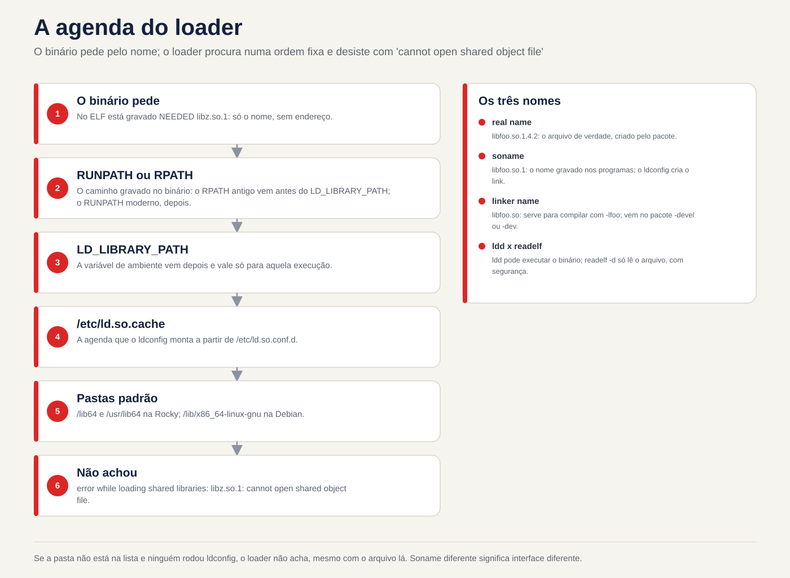
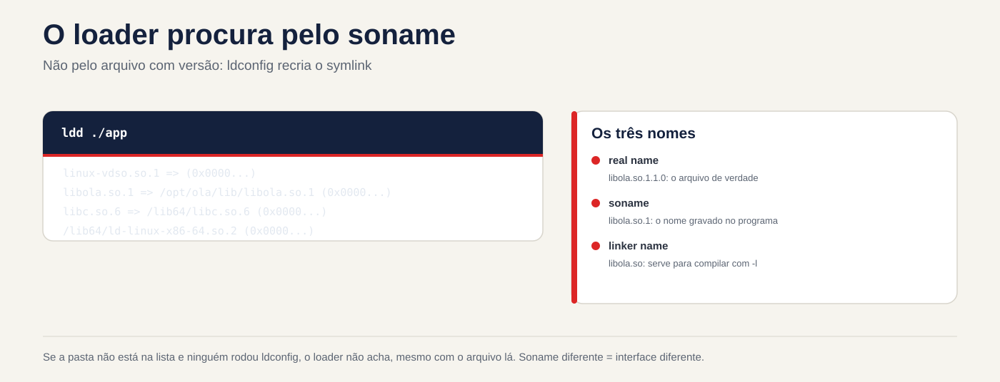

# Lezione 6.5 · Librerie condivise

Quasi nessun programma Linux funziona da solo. `ls`, `sshd` e `dnf` caricano, quando vengono eseguiti, le librerie che si trovano in altri file: `libc`, `libssl`, `libz`. Quando uno di essi manca, è nella cartella sbagliata o ha la versione sbagliata, appare il messaggio che ogni amministratore di sistema ha visto: `error while loading shared libraries`. Questa lezione ti insegna come leggere questo messaggio e risolverlo nel modo giusto. Alla fine arriva la M6 Challenge.

> **Centro di questa lezione:** comprendere i tre nomi di una libreria (nome reale, soname, nome del linker); visualizzare le dipendenze di un programma con `ldd` e `readelf`; sapere dove sta guardando il caricatore; registrare una nuova cartella con `/etc/ld.so.conf.d` e `ldconfig`; e sapere perché `LD_LIBRARY_PATH` e il collegamento simbolico improvvisato sono patch. Il resto è approfondito.

| File |  |
| --- | --- |
| **Modulo** | M6 · Software, lezione 5 di 5, con il modulo Challenge |
| **Quando** | Settimana 11. La sfida può svolgersi alla fine della settimana o nella settimana 12 |
| **Alla fine** | Diagnostichi e risolvi la libreria che non si carica, senza soluzioni alternative |
| **Articoli di prova** | LPIC-1 102.3 (gestione librerie condivise): `ldd`, `ldconfig`, `/etc/ld.so.conf`, `LD_LIBRARY_PATH`. Alla RHCSA non è un obiettivo diretto, ma appare quando qualcosa non va |
| **Prerequisiti** | lezioni da 6.1 a 6.3 |
| **Ora** | circa 2 ore, più 2-3 ore per la sfida |
| **Istantanee** | `m6a5-inicio` e `m6a5-fim` presso Rocky-Lab. debian-lab viene letto solo |

## 1 · Riscaldamento

Rispondere prima di leggere.

1. Se qualcuno cancella il `libc.so.6`, cosa succede al `ls`? E con `rm` cosa utilizzeresti per risolverlo?
2. Perché la stessa libreria appare con tre nomi, ad esempio `libz.so`, `libz.so.1` e `libz.so.1.2.13`?
3. Hai copiato una libreria in `/opt/app/lib` e il programma continua a dire che non riesce a trovarla. Perché?

## 2 · Perché è importante

| Il cosiddetto | La risposta sbagliata | Cosa provoca |
| --- | --- | --- |
| "L'app del fornitore richiede `libssl.so.1.1` e Rocky 9 ne ha solo 3" | `ln -s libssl.so.3 libssl.so.1.1` | L'app si avvia e poi si arresta in modo anomalo o corrompe i dati. L'interfaccia è cambiata |
| "Ho installato la libreria e il programma non riesce a trovarla" | `export LD_LIBRARY_PATH=...` in `/etc/profile` | Si applica a tutti, tranne ai servizi systemd. Ed è possibile modificare la libreria di altri programmi |
| "Funziona sul mio terminale e non funziona come servizio" | Riavvia finché non funziona | La tua shell ha una variabile che il servizio non ha |
| "Ho aggiornato OpenSSL a causa di una falla di sicurezza" | Pensare che sia finita | I servizi già in esecuzione continuano con la vecchia versione in memoria fino al riavvio |

## 3 · Modello mentale

> Il programma è una **lista degli ospiti**: nel binario dice "Ho bisogno di `libz.so.1` e `libc.so.6`", solo il nome, nessun indirizzo. La persona che li cerca è il **loader** (`ld-linux`), e cerca in un ordine fisso. La sua agenda è `/etc/ld.so.cache`, che `ldconfig` raccoglie dall'elenco delle cartelle in `/etc/ld.so.conf.d`. Se la cartella non è nell'elenco e nessuno ha aggiornato il calendario, il caricatore non la trova, anche con il file lì.

```
./programa
   │  o kernel lê o ELF: "interpretador: /lib64/ld-linux-x86-64.so.2"
   ▼
ld-linux (o loader)
   │  para cada NEEDED gravado no binário (ex.: libz.so.1):
   ├─ 1. RUNPATH/RPATH gravado no próprio binário
   ├─ 2. LD_LIBRARY_PATH (variável de ambiente)
   ├─ 3. /etc/ld.so.cache  ← o ldconfig gera a partir de /etc/ld.so.conf(.d)
   └─ 4. pastas padrão: /lib64 e /usr/lib64 (Rocky)
                        /lib/x86_64-linux-gnu e /usr/lib/x86_64-linux-gnu (Debian)
   ▼
não achou → "error while loading shared libraries: libz.so.1:
            cannot open shared object file: No such file or directory"
```

Il dettaglio preciso: il vecchio RPATH viene prima di `LD_LIBRARY_PATH` e il moderno RUNPATH viene dopo. Per l'uso quotidiano, l'ordine di disegno è sufficiente.



*Se la cartella non è nell'elenco e nessuno ha eseguito ldconfig, il caricatore non riesce a trovarla.*

## 4 · Gli elementi essenziali

### I tre nomi

| Nome | Esempio | Cos'è | Chi crea |
| --- | --- | --- | --- |
| **Nome vero** | `libz.so.1.2.13` | Il file vero e proprio, con la versione completa | Il pacchetto (`zlib` / `zlib1g`) |
| **Sonome** | `libz.so.1` | Collegamento simbolico al nome reale. È il nome che viene registrato nei programmi. Cambia solo quando l'interfaccia si interrompe | `ldconfig` (e il pacchetto) |
| **Nome del link** | `libz.so` | Link simbolico utilizzato solo per la **compilazione** (`-lz`) | Il pacchetto di sviluppo (`zlib-devel` / `zlib1g-dev`) |

La regola che spiega tutto: **stesso soname, interfaccia compatibile**. `libz.so.1.2.13` e `libz.so.1.3.1` hanno lo stesso soname `libz.so.1`, quindi qualsiasi programma scritto per l'uno usa l'altro. Un `libz.so.2` sarebbe un'altra interfaccia, mentre i vecchi programmi chiederebbero ancora `.so.1`.

### Comandi

| Voglio... | Comando |
| --- | --- |
| Scopri di quali librerie ha bisogno un programma e dove si trovano | `ldd /usr/bin/ssh` |
| Vedi solo ciò che è registrato nel binario, senza eseguire nulla | `readelf -d /usr/bin/ssh \| grep -E 'NEEDED\|RUNPATH\|RPATH'` |
| Visualizza la pianificazione del caricatore | `ldconfig -p \| grep libz` |
| Aggiorna il calendario e i collegamenti simbolici di soname | `sudo ldconfig` |
| Visualizza cartelle aggiuntive | `cat /etc/ld.so.conf` e `ls /etc/ld.so.conf.d/` |
| Registra una nuova cartella | `echo /opt/app/lib \| sudo tee /etc/ld.so.conf.d/app.conf` e `sudo ldconfig` |
| Prova con una cartella solo per questo comando | `LD_LIBRARY_PATH=/opt/app/lib ./programa` |
| Guarda la ricerca del caricatore, passo dopo passo | `LD_DEBUG=libs ./programa` |
| Scopri il pacchetto che possiede una lib | `rpm -qf /usr/lib64/libz.so.1` / `dpkg -S libz.so.1` |
| Scopri quale pacchetto fornisce una lib | mancante `dnf provides 'libz.so.1()(64bit)'` / `apt-file search libz.so.1` |
| Visualizza i servizi utilizzando la vecchia lib dopo un aggiornamento | `sudo dnf needs-restarting -s` / `sudo needrestart` (Debian, pacchetto `needrestart`) |

**Fai attenzione a `ldd`:** in un binario sconosciuto, potrebbe finire per eseguire codice dal binario stesso. Per i programmi che non conosci, usa `readelf -d` o `objdump -p`, che leggono solo.

### Rocky × Debian

|  | Roccioso | Debian |
| --- | --- | --- |
| Cartelle standard (64 bit) | `/lib64`, `/usr/lib64` | `/lib/x86_64-linux-gnu`, `/usr/lib/x86_64-linux-gnu` (multiarcata) |
| Nome del pacchetto Lib | `zlib`, `openssl-libs` | `zlib1g`, `libssl3` (il soname va nel nome) |
| Pacchetto da compilare | `-devel` (`zlib-devel`) | `-dev` (`zlib1g-dev`) |
| Chi esegue `ldconfig` durante l'installazione | L'rpm (trigger del file) stesso | trigger dpkg |
| Trova chi fornisce | `dnf provides 'libX.so.N()(64bit)'` | `apt-file search libX.so.N` |
| Servizi con la vecchia lib | `dnf needs-restarting -s` | `needrestart` |

In Rocky, `/lib64` è un collegamento simbolico a `/usr/lib64`. Nella Debian moderna, `/lib` è un collegamento simbolico a `/usr/lib`. In entrambi, la cartella "reale" è quella in `/usr`.

**Che rientra nel test.** In LPIC-1: a cosa servono `ldd` e `ldconfig`, cosa c'è in `/etc/ld.so.conf` e `/etc/ld.so.conf.d/`, che `/etc/ld.so.cache` è binario (non viene modificato, viene rigenerato) e cosa fa `LD_LIBRARY_PATH`. Imparare a leggere l'output di `ldd` con `not found`.

## 5 · Laboratorio guidato

Creerai una libreria di giocattoli, `libola`, e ne interromperai e correggerai il caricamento in diversi modi.

**Passaggio 0 · Istantanea, cartella e compilatore.** In Proxmox: `qm snapshot 201 m6a5-inicio`. Su Rocky-Lab:

```bash
sudo dnf install -y gcc
mkdir -p ~/lab65 && cd ~/lab65
```

**Passaggio 1 · Guarda un programma reale.**

```bash
ldd /usr/bin/ls
readelf -d /usr/bin/ls | grep NEEDED
ls -l /usr/lib64/libz.so*
rpm -qf /usr/lib64/libz.so.1
ldconfig -p | grep libz
cat /etc/ld.so.conf
ls /etc/ld.so.conf.d/
```

`readelf` mostra solo i nomi (sonames). `ldd` mostra anche dove è stato ritrovato ciascuno. In `ls -l` notare la catena di collegamenti simbolici: `libz.so.1` punta al nome reale. `libz.so` (nome del linker) esiste solo se è installato `zlib-devel`.

**Passaggio 2 · Creare la libreria e un programma che la utilizzi.**

```bash
cat > ola.c <<'EOF'
#include <stdio.h>
void ola(void) { puts("ola da biblioteca v1"); }
EOF

cat > main.c <<'EOF'
void ola(void);
int main(void) { ola(); return 0; }
EOF

gcc -fPIC -shared -Wl,-soname,libola.so.1 -o libola.so.1.0 ola.c
ln -s libola.so.1.0 libola.so
gcc -o app main.c -L. -lola
./app
```

`-Wl,-soname,libola.so.1` scrive il soname all'interno della lib. `ln -s` crea il nome del linker, che `gcc -lola` usa per compilare. E `./app` fallisce: `error while loading shared libraries: libola.so.1: cannot open shared object file`.

**Passaggio 3 · Diagnosi e test senza installazione.**

```bash
ldd ./app | grep ola
readelf -d app | grep NEEDED
ls -l
LD_LIBRARY_PATH=. ./app
ldconfig -n .
ls -l
LD_LIBRARY_PATH=. ./app
```

`ldd` mostra `libola.so.1 => not found`. Il binario richiede `libola.so.1` (il soname), non `libola.so.1.0` né `libola.so`. Ecco perché il primo `LD_LIBRARY_PATH=.` **ancora fallisce**: non c'è nessun file con quel nome nella cartella. `ldconfig -n .` crea il collegamento simbolico soname solo in questa cartella, senza modificare il calendario di sistema. Ora il test funziona. Ma si applica solo a questo comando.

**Passaggio 4 · Installare nel modo giusto.**

```bash
sudo mkdir -p /opt/ola/lib
sudo cp libola.so.1.0 /opt/ola/lib/
./app
echo /opt/ola/lib | sudo tee /etc/ld.so.conf.d/ola.conf
sudo ldconfig
ls -l /opt/ola/lib
ldconfig -p | grep ola
ldd ./app | grep ola
./app
```

Il primo `./app` continua a fallire: il file è lì, ma la cartella non è nella directory. Dopo `ldconfig` sono cambiate due cose: l'agenda conosce la cartella e `ldconfig` ha creato da solo il collegamento simbolico `libola.so.1 -> libola.so.1.0`.

**Passaggio 5 · Versioni: compatibili e incompatibili.**

```bash
sed 's/v1/v1.1/' ola.c > ola11.c
gcc -fPIC -shared -Wl,-soname,libola.so.1 -o libola.so.1.1 ola11.c
sudo cp libola.so.1.1 /opt/ola/lib/
sudo ldconfig
ls -l /opt/ola/lib
./app
```

Stesso nome, versione superiore: `ldconfig` ha passato il collegamento simbolico `libola.so.1` a `1.1` e `app` usa quello nuovo **senza ricompilare**. Così una correzione di sicurezza nel `openssl-libs` raggiunge tutti i programmi contemporaneamente.

```bash
sed 's/v1/v2/' ola.c > ola2.c
gcc -fPIC -shared -Wl,-soname,libola.so.2 -o libola.so.2.0 ola2.c
sudo cp libola.so.2.0 /opt/ola/lib/
sudo ldconfig
ls -l /opt/ola/lib
ldconfig -p | grep ola
./app
```

Nuovo Soname, nuova interfaccia: ora ci sono `libola.so.1` e `libola.so.2` fianco a fianco, e il vecchio `app` continua con `1.1`. Solo un programma appena compilato, rispetto a `.so.2`, utilizzerebbe la versione 2. Ecco perché Rocky 9 può avere `libssl.so.3` e, in un pacchetto di compatibilità, `libssl.so.1.1` contemporaneamente.

**Passo 6 · RUNPATH: il binario che indica dove cercare.**

```bash
gcc -o app-local main.c -L. -lola -Wl,-rpath,'$ORIGIN'
readelf -d app-local | grep -E 'NEEDED|RUNPATH'
./app-local
./app
```

Il `$ORIGIN` significa "la cartella in cui si trova il binario". `app-local` trova il `libola.so.1` del `~/lab65` (v1) prima di consultare l'ordine del giorno, mentre il `app` utilizza il `1.1` del sistema. Molte app dei fornitori in `/opt` sono così, con le proprie librerie a fianco.

**Passaggio 7 · debian-lab, sola lettura.**

```bash
ldd /usr/bin/ls
ls -l /usr/lib/x86_64-linux-gnu/libz.so*
dpkg -S libz.so.1
cat /etc/ld.so.conf.d/*.conf
```

Stessa idea, cartella multiarch diversa. Il pacchetto si chiama `zlib1g`: `1` è il soname.

**Non cancellare ancora.** La sezione 6 interrompe l'uso di `/opt/ola`. La pulizia arriva alla fine.

### Decidi 1

Un'app del fornitore in `/opt/vendor` non va su in Rocky 9: `libssl.so.1.1: cannot open shared object file`. Rocky 9 ha `libssl.so.3`. Cosa fai?

A) `ln -s /usr/lib64/libssl.so.3 /usr/lib64/libssl.so.1.1`. B) Installa il pacchetto di compatibilità della distribuzione (`dnf provides 'libssl.so.1.1()(64bit)'`, in Rocky 9 è `compat-openssl11`) e addebita al fornitore una versione per OpenSSL 3. C) Scarica un `libssl.so.1.1` da qualsiasi sito Web e gioca in `/usr/lib64`.

Verifica prima un'opzione.

| Se hai selezionato | Risultato | Perché |
| --- | --- | --- |
| A | Sale e poi cade, o peggio, funziona male | Soname diverso significa interfaccia diversa. Il collegamento simbolico inganna il caricatore, non il codice |
| B | Giusto | Lib con il soname giusto, firmato, aggiornato da `dnf`, e il vero problema (vecchia app) è registrato |
| C| Peggio ancora | Libreria di crittografia di origine sconosciuta, attualmente non aggiornata |

**Per risolvere:** quando manca un soname, cercare **chi fornisce quel soname**. Non puntare mai un soname a un altro.

### Decidi 2

L'app in `/opt/app` porta in `/opt/app/lib` le proprie copie di diverse librerie, inclusa una `libcrypto.so.3` più vecchia di quella di sistema. Un collega lo ha risolto con `export LD_LIBRARY_PATH=/opt/app/lib` in `/etc/profile`. L'app viene eseguita come servizio systemd. Cosa fai?

A) Lascialo così com'è, ha funzionato. B) Scambiare `/etc/ld.so.conf.d/app.conf` con `/opt/app/lib` e ruotare `ldconfig`. C) Rimuovilo da `/etc/profile` e posiziona la variabile solo nel servizio: `Environment=LD_LIBRARY_PATH=/opt/app/lib` nell'unità (o uno script che esporta e chiama l'app).

Verifica prima un'opzione.

| Se hai selezionato | Risultato | Perché |
| --- | --- | --- |
| A | Sbagliato due volte | `/etc/profile` si applica ai login, non al servizio. E ogni programma che apri nella shell inizia con il vecchio `libcrypto` dell'app |
| B | Pericoloso qui | Le cartelle `ld.so.conf.d` entrano nell'agenda **prima** delle cartelle standard. L'intero sistema, compresi `sshd` e `dnf`, passerebbe al vecchio `libcrypto` |
| C| Giusto | Solo l'app vede le sue librerie |

**Per risolvere:** `ld.so.conf.d` è per la cartella con librerie che esistono solo lì. La cartella con le copie delle librerie di sistema è limitata all'app che ne ha bisogno.

## 6 · Interruzione e correzione

### Interruzione 1 · Pianificazione non aggiornata

```bash


*Se a pasta não está na lista e ninguém rodou ldconfig, o loader não acha, mesmo com o arquivo lá.*

sudo rm /opt/ola/lib/libola.so.1
./app
ldconfig -p | grep ola
```

**Sintomo:** `cannot open shared object file`, sebbene `libola.so.1.1` sia presente.

**Diagnosi:** la pianificazione dice ancora che `libola.so.1` è in `/opt/ola/lib`, ma `ls -l /opt/ola/lib` mostra che il collegamento simbolico soname è andato. Il caricatore cerca il soname, non il file con versione.

**Correzione:** `sudo ldconfig`. Ricrea il collegamento simbolico e il calendario. Verificare con `ls -l` e `./app`.

**Nella vita reale:** accade quando qualcuno copia una lib a mano o uno script di installazione elimina e ricopia i file. Ogni volta che si modifica la lib all'esterno del gestore pacchetti: `sudo ldconfig`.

### Interruzione 2 · La libreria impostore

```bash
mkdir -p ~/lab65/falsa
sed 's/v1/IMPOSTORA/' ~/lab65/ola.c > ~/lab65/falsa.c
gcc -fPIC -shared -Wl,-soname,libola.so.1 -o ~/lab65/falsa/libola.so.1 ~/lab65/falsa.c
export LD_LIBRARY_PATH=~/lab65/falsa
./app
ldd ./app | grep ola
sudo ./app
unset LD_LIBRARY_PATH
./app
```

**Sintomo:** `app` stampa `IMPOSTORA`. Con `sudo` si torna alla normalità.

**Diagnosi:** `echo $LD_LIBRARY_PATH` e `ldd ./app` mostrano la lib proveniente da `~/lab65/falsa`. La variabile va davanti alla pianificazione.

**Fix:** `unset LD_LIBRARY_PATH` e cerca dove è stata definita (`~/.bashrc`, `/etc/profile.d/`, `/etc/environment`).

**Nella vita reale:** ecco perché `sudo` cancella l'ambiente e perché i programmi setuid ignorano `LD_LIBRARY_PATH`. Se fosse valido per root, qualsiasi utente scambierebbe `libc` di `passwd` con uno dei suoi.

### Pausa 3 · Hanno rimosso una lib dal sistema (narrativa)

Qualcuno ha eseguito `rpm -e --nodeps openssl-libs` per una "reinstallazione pulita". Al momento giusto, `ssh`, `curl` e `dnf` si fermano con `libcrypto.so.3: cannot open shared object file`. `dnf` non può essere reinstallato perché necessita della lib.

**Diagnosi:** `ldd /usr/bin/curl | grep 'not found'` e `rpm -V openssl-libs`.

**Fix:** se `rpm` funziona ancora, `rpm -ivh` dal pacchetto preso dall'ISO (a questo serve il repository ISO della lezione 6.3). Se non funziona nemmeno, avvia dall'ISO in modalità salvataggio e `rpm --root=/mnt/sysroot -ivh ...`.

**Per risolvere:** `--nodeps` disattiva esattamente la protezione che impedisce ciò. Non è quasi mai la risposta.

### Cleanup

```bash
unset LD_LIBRARY_PATH
sudo rm /etc/ld.so.conf.d/ola.conf
sudo rm -r /opt/ola
sudo ldconfig
ldconfig -p | grep ola
```

L'ultimo comando non dovrebbe mostrare nulla. La cartella `~/lab65` può rimanere.

## 7 · Insidie

| Trappola | Cosa succede | Come evitare |
| --- | --- | --- |
| Collegamento simbolico da un nome all'altro (`.so.1.1` → `.so.3`) | Fallisce subito, o peggio, più tardi e silenziosamente | Cerca chi fornisce il soname corretto (`dnf provides`, `apt-file`) |
| `LD_LIBRARY_PATH` globale in `/etc/profile` | Cambia la libreria di ogni programma nella shell e non si applica ai servizi | Basta inserirlo nel servizio (`Environment=`) o in uno script wrapper |
| Cartella con copie delle librerie di sistema in `ld.so.conf.d` | L'intero sistema ora utilizza le copie | Utilizzare `ld.so.conf.d` solo per le librerie che esistono solo lì |
| Copia la lib e dimentica `ldconfig` | Nessun collegamento simbolico soname e vecchio diario | Sempre `sudo ldconfig` dopo aver modificato la lib all'esterno del manager |
| `ldd` in binario sconosciuto | Il binario può eseguire il codice | Utilizzare `readelf -d` o `objdump -p` |
| Aggiorna una libreria e non riavviare nulla | I servizi continuano con la versione vulnerabile in memoria | `dnf needs-restarting -s` / `needrestart` e riavviare |
| `rpm -e --nodeps` in una lib | Fa crollare tutto ciò che dipende da esso, a volte anche `dnf` | Non usare mai `--nodeps` nella lib. Utilizzare `dnf reinstall` o `dnf swap` |
| Scopri che il caricatore cerca nella cartella corrente | `./app` non trova la lib accanto | Ciò accade solo con RUNPATH `$ORIGIN` o `LD_LIBRARY_PATH` |
| Modifica `/etc/ld.so.cache` | È binario, hai corrotto il file | Modifica `ld.so.conf.d` ed esegui `ldconfig` |

## 8 · Quiz

Rispondi senza guardare. Il foglio delle risposte si trova alla fine della lezione.

1. Qual è la differenza tra nome reale, soname e nome del linker? Chi li crea?
2. Hai installato una lib in `/opt/x/lib` e il programma non riesce a trovarla. Nomina un modo temporaneo e due permanenti per risolverlo.
3. Perché non eseguire `ldd` su un binario proveniente dall'esterno? Cosa usare invece?
4. Una vecchia app richiede `libfoo.so.1` e il sistema ha `libfoo.so.2`. Perché il collegamento simbolico è una cattiva idea?
5. Il programma funziona nel tuo terminale e fallisce se eseguito come servizio systemd. Chi è il sospettato numero uno?
6. *Quale file elenca le directory aggiuntive che ldconfig scansiona per le librerie condivise? a) /etc/ld.so.cache b) /etc/ld.so.conf c) /etc/ldconfig.conf d) /etc/ld.so.preload*

## 9 · Cola

**Da sapere a memoria:**

| Voglio... | Comando |
| --- | --- |
| Dipendenze di un programma | `ldd PROGRAMA` |
| Cosa viene registrato nel binario | `readelf -d PROGRAMA \| grep -E 'NEEDED\|RUNPATH'` |
| Programma di caricamento | `ldconfig -p \| grep NOME` |
| Rigenera calendario e collegamenti simbolici | `sudo ldconfig` |
| Cartella Registra | `echo /opt/x/lib \| sudo tee /etc/ld.so.conf.d/x.conf` e `sudo ldconfig` |
| Prova puntuale | `LD_LIBRARY_PATH=/opt/x/lib ./programa` |

**Da consultare:**

| Voglio... | Comando |
| --- | --- |
| Caricatore passo dopo passo | `LD_DEBUG=libs ./programa` |
| Pacchetto proprietario Lib | `rpm -qf ARQUIVO` / `dpkg -S ARQUIVO` |
| Chi fornisce il soname | `dnf provides 'libX.so.N()(64bit)'` / `apt-file search libX.so.N` |
| Servizi con la vecchia lib | `sudo dnf needs-restarting -s` / `sudo needrestart` |
| Processi con lib eliminati | `sudo lsof -n 2>/dev/null \| grep 'DEL.*\.so'` |
| Collegamenti simbolici solo in una cartella | `ldconfig -n PASTA` |
| Leggi ELF senza eseguire | `objdump -p PROGRAMA` |
| Forza le librerie precaricate | `cat /etc/ld.so.preload` (normalmente non esiste) |
| File di configurazione | `/etc/ld.so.conf`, `/etc/ld.so.conf.d/*.conf`, `/etc/ld.so.cache` |

**Flashcard:**

- Soname → *il nome registrato nel programma. Cambia solo quando l'interfaccia si rompe.*
- Ordine del caricatore → *RUNPATH/RPATH, LD\_LIBRARY\_PATH, cache, cartelle predefinite.*
- Modificata manualmente la lib → *`sudo ldconfig`.*
- Manca `libX.so.N` → *chi fornisce questo soname? Non creare mai collegamenti simbolici a un altro.*
- Aggiornata la lib → *riavvia i servizi che la utilizzano.*

## 10 · Checklist e chiusura

- [ ] Spiego nome reale, soname e nome del linker
- [ ] Leggo un output da `ldd` e trovo `not found`
- [ ] Registro una cartella con `ld.so.conf.d` e `ldconfig`
- [ ] So perché `LD_LIBRARY_PATH` è per testing e non per il sistema
- [ ] Spiego perché la stessa lib con lo stesso soname aggiorna tutti senza ricompilare
- [ ] So come trovare chi fornisce un soname mancante, in entrambe le distribuzioni
- [ ] So come trovare i servizi che usano ancora una lib vecchia

**Ultimo esercizio, senza guardare nella lezione:** in `~/lab65/final`, creare un `libtchau.so.1.0` con soname `libtchau.so.1` e un programma che lo utilizzi. Far eseguire il programma **senza** `LD_LIBRARY_PATH` e **senza** `ld.so.conf.d`. Suggerimento: Passaggio 6. Quindi spiegare perché ha funzionato.

**Riavvio e conferenza:**

```bash
sudo reboot
ldconfig -p | grep -c ola
ls /etc/ld.so.conf.d/
echo "[$LD_LIBRARY_PATH]"
sudo dnf check
```

Previsto: `0`, no `ola.conf` e la variabile vuota (`[]`).

**Fine istantanea** (in Proxmox):

```bash
qm snapshot 201 m6a5-fim
```

## 11 · Nella vita reale

**Missione, sola lettura.** Su un server Linux amministrato da te (o con autorizzazione), esegui **solo**:

```bash
cat /etc/ld.so.conf
cat /etc/ld.so.conf.d/*.conf
ldconfig -p | wc -l
ls -l /etc/ld.so.preload 2>/dev/null
grep -rs LD_LIBRARY_PATH /etc/profile /etc/profile.d/ /etc/environment /etc/systemd/system/
sudo dnf needs-restarting -s 2>/dev/null || sudo needrestart -b 2>/dev/null
```

Questions per rispondere:

1. Quali cartelle aggiuntive sono registrate e da quale pacchetto o app proviene ciascuna?
2. Qualcuno di loro ha copie delle librerie di sistema (`libssl`, `libcrypto`, `libz`)? Verificare con `ls`.
3. C'è `/etc/ld.so.preload`? Su un server comune non dovrebbe esistere. Se esiste e non sai da dove viene, dovresti indagare: è un classico posto per rootkit.
4. Qualcuno usa `LD_LIBRARY_PATH` a livello globale o in un'unità?
5. Ci sono servizi che devono essere riavviati dopo l'ultimo aggiornamento?

**Journal:** annota la risposta di 5. Se sono presenti servizi in sospeso, questa diventa un'attività di manutenzione pianificata. Non riavviare nulla adesso.

**Domani, senza guardare:** scrivi l'ordine di ricerca del caricatore e i due comandi per registrare una nuova cartella.

## 12 · Scava più a fondo quando vuoi

- **`man ld.so` e `man ldconfig`:** l'ordine esatto di ricerca, RPATH × RUNPATH e la modalità sicura dei programmi setuid.
- **`LD_PRELOAD` e `/etc/ld.so.preload`:** caricare prima una lib. Viene utilizzato per il debug e anche dai malware.
- **Versione dei simboli:** l'errore ``version `GLIBC_2.34' not found`` appare quando si trasferisce un binario da un nuovo sistema a uno vecchio.
- **Statico × dinamico:** perché Go genera binari quasi statici e perché la distribuzione preferisce quelli dinamici (una correzione vale per tutti).
- **`patchelf`:** cambia il RUNPATH di un binario pronto.
- **`lddtree`** (pacchetto `pax-utils`): l'intero albero delle dipendenze, senza eseguire il binario.

**DeepTutor** (http://10.1.0.149:3782, KB "Linux Sysadmin Course"):

- `!explica a ordem em que o ld-linux procura bibliotecas`
- `!feynman o que é um soname e por que ele existe`
- `!quiz Aula 6.5, 5 perguntas sobre ldd e ldconfig para a LPIC-1`

## M6 Challenge · Offline installazione

> **La missione:** Rocky-Lab installa i pacchetti **senza internet**, utilizzando solo l'ISO come repository, e continua così dopo il riavvio.

Nella lezione 6.3 hai assemblato manualmente l'ISO e creato un repository temporaneo. Ora il risultato deve essere permanente e il riavvio è ciò che lo controlla. Non esiste un passo dopo l'altro. I suggerimenti sono nella chiave di risposta, ma prova prima senza.

**Prima di iniziare:**

- Controlla che l'ISO allegato alla VM sia **DVD** (`Rocky-9.x-x86_64-dvd.iso`), non quello minimo. Minimal ha pochi pacchetti. Test: `dnf --repo=iso-appstream list --available | wc -l`.
- Sostenere `qm snapshot 201 m6-desafio-inicio`.

**Requisiti:**

1. L'ISO si monta da solo in `/mnt/iso` all'avvio, fino a `/etc/fstab`, in sola lettura. Se l'ISO non è collegato, l'avvio **non può** bloccarsi.
2. Un file `/etc/yum.repos.d/local-iso.repo` con i repository BaseOS e AppStream dell'ISO, con `gpgcheck=1` e la chiave destra.
3. **Tutti** i repository di rete permanentemente disattivati: baseos, appstream, extras, crb, epel e tutti gli altri visualizzati. `--disablerepo` non è valido sulla riga di comando.
4. Nessuna connessione Internet reale durante il test: `sudo ip route del default` (ritorna al riavvio).
5. Installare un pacchetto BaseOS (ad esempio `zsh`) e un pacchetto AppStream (ad esempio `git`) che non siano già installati.
6. `sudo dnf check-update` e `sudo dnf makecache` terminano rapidamente e senza errori, senza tentare Internet.

**Criteri di accettazione** (dopo un `sudo reboot`):

```bash
findmnt /mnt/iso
dnf repolist
sudo ip route del default
sudo dnf makecache
sudo dnf install -y zsh git
rpm -q zsh git
sudo dnf check-update; echo "saida=$?"
```

- [ ] `findmnt` mostra l'ISO in `/mnt/iso`, con `ro`
- [ ] `dnf repolist` mostra **solo** i due repository da ISO
- [ ] Installati entrambi i pacchetti con il percorso predefinito rimosso
- [ ] `check-update` termina in pochi secondi (output `0` o `100`, senza errore di rete)
- [ ] Con l'ISO scollegato (`qm set 201 --ide2 none,media=cdrom`), la VM si avvia ancora

**Bonus (opzionale):**

- **Proprio repository:** unisci alcuni `.rpm` in `/srv/repo-local`, genera i metadati con `createrepo_c` (installa il pacchetto prima di tagliare la rete) e crea un `.repo` per esso. Hai appena creato un mini mirror.
- **Debian:** in debian-lab, fai l'equivalente con Debian ISO DVD 1 e `apt-cdrom add`, o con una linea `.sources` che punta a `file:/mnt/iso`.

**Una volta terminato:** `qm snapshot 201 m6-desafio-fim`. I moduli successivi richiedono Internet. Ritorno allo stato normale con `qm rollback 201 m6a5-fim`. L'istantanea della sfida viene salvata come prova.

**Hai chiuso M6.** Ora installi, consulti, verifichi e rimuovi pacchetti in entrambe le famiglie, sposti repository, usi Flatpak e risolvi le librerie che non si caricano. Il modulo successivo si trova nella scheda Piano.

## Foglio di risposte commentate

### Riscaldamento

1. **Quasi tutto si ferma.** `ls`, `rm`, `bash` e `dnf` dipendono da `libc.so.6`. Qualsiasi nuovo comando non viene caricato. Continuano solo i built-in della shell già aperta (`echo`, `cd`). Il modo è avviare dall'ISO in modalità ripristino e reinstallare `glibc` con `rpm --root`. È l'esempio più estremo di Break 3.
2. **Ogni nome ha una funzione.** `libz.so.1.2.13` è il file (nome reale). `libz.so.1` è il nome del soname richiesto dai programmi. `libz.so` è il nome del linker, utilizzato solo dal compilatore.
3. **La cartella non è nell'agenda del caricatore.** Non esegue la scansione del disco, consulta `/etc/ld.so.cache` e le cartelle predefinite. O registri la cartella (`ld.so.conf.d` + `ldconfig`), oppure il binario ha RUNPATH, oppure usi `LD_LIBRARY_PATH` solo per quel programma. E controlla se il file con il nome soname esiste lì.

### Quiz

1. Il **vero nome** (`libfoo.so.1.4.2`) è il file e il pacchetto viene creato. Il **soname** (`libfoo.so.1`) è il collegamento simbolico con il nome che viene registrato nei programmi; `ldconfig` (e il pacchetto) lo crea. Il **nome del linker** (`libfoo.so`) viene utilizzato per compilare con `-lfoo` ed è disponibile nel pacchetto `-devel` o `-dev`.
2. Temporaneo: `LD_LIBRARY_PATH=/opt/x/lib ./programa`. Permanente: un file in `/etc/ld.so.conf.d/` più `sudo ldconfig`, oppure il binario compilato con RUNPATH (`-Wl,-rpath,...`, o `patchelf` in un binario pronto). In un servizio, `Environment=LD_LIBRARY_PATH=` si applica anche all'unità.
3. Perché `ldd` potrebbe finire per eseguire il binario per scoprire le dipendenze e un binario dannoso ne trae vantaggio. Utilizzare `readelf -d` o `objdump -p`, che leggono solo il file.
4. Perché un soname diverso significa un'interfaccia diversa: funzioni che hanno cambiato firma o sono scomparse. Il caricatore accetta il collegamento simbolico, ma il programma richiama cose che non esistono più o che funzionano in un altro modo. La cosa giusta da fare è installare la lib con soname `.so.1` (pacchetto di compatibilità) o aggiornare l'app.
5. Il `LD_LIBRARY_PATH` (o altra variabile) definita nel tuo `~/.bashrc` o `/etc/profile`. systemd non legge questi file. Verificare con `systemctl show SERVICO -p Environment` e `journalctl -u SERVICO`.
6. **b) `/etc/ld.so.conf`** (che in Rocky e Debian include solo `/etc/ld.so.conf.d/*.conf`). a) è l'agenda binaria che genera `ldconfig`. c) non esiste. d) è l'elenco delle librerie precaricate.

### Suggerimenti per la sfida

Leggi una alla volta, solo quando si blocca.

1. **fstab:** il formato è `dispositivo ponto tipo opções dump pass`. Per l'ISO sull'unità CD della VM: `/dev/sr0 /mnt/iso iso9660 ro,nofail 0 0`. `nofail` è ciò che impedisce l'arresto anomalo dell'avvio senza ISO.
2. **Prima del riavvio:** `sudo umount /mnt/iso`, poi `sudo mount -a` e `findmnt --verify`. Se `mount -a` si lamenta, si lamenterà anche il riavvio.
3. **`.repo`:** è lo stesso della lezione 6.3, con `baseurl=file:///mnt/iso/BaseOS` e `file:///mnt/iso/AppStream`, `enabled=1`, `gpgcheck=1` e `gpgkey=file:///etc/pki/rpm-gpg/RPM-GPG-KEY-Rocky-9`.
4. **Disattiva quelli di rete:** prima vedili tutti con `dnf repolist --all`. EPEL solitamente ha più di un repository. Poi `sudo dnf config-manager --set-disabled baseos appstream extras crb epel ...` e verificare nuovamente con `dnf repolist`.
5. **Vecchia cache:** se `dnf` tenta ancora di accedere alla rete, eseguire `sudo dnf clean all` e `sudo dnf makecache`.
6. **`git` non appare:** conferma che è l'ISO del DVD (`ls /mnt/iso/AppStream/Packages | wc -l` dovrebbe fornire qualche migliaio).
7. **`createrepo_c` (bonus):** installa prima di tagliare la rete. Poi, `sudo createrepo_c /srv/repo-local` e un `.repo` con `baseurl=file:///srv/repo-local`. Poiché i pacchetti sono stati firmati, `gpgcheck=1` rimane valido.

---

<!-- navegacao -->
[← lezione 6.4 · Flatpak](6.4-flatpak.md) · [Indice lezioni](../01-aulas.md) · [Piano del corso: da M7 in poi →](../00-plano-do-curso.md)
