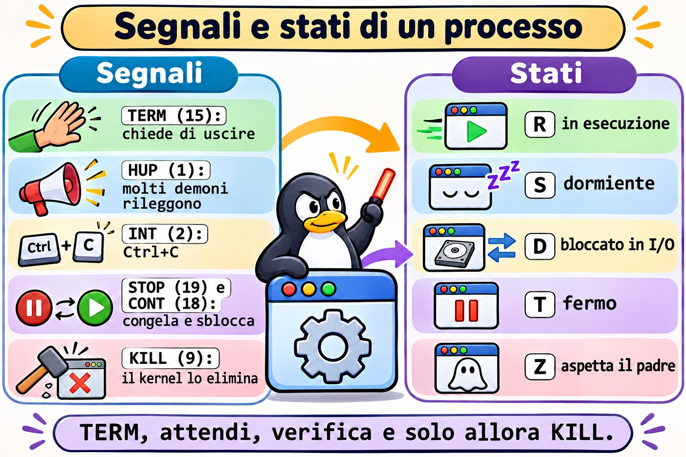
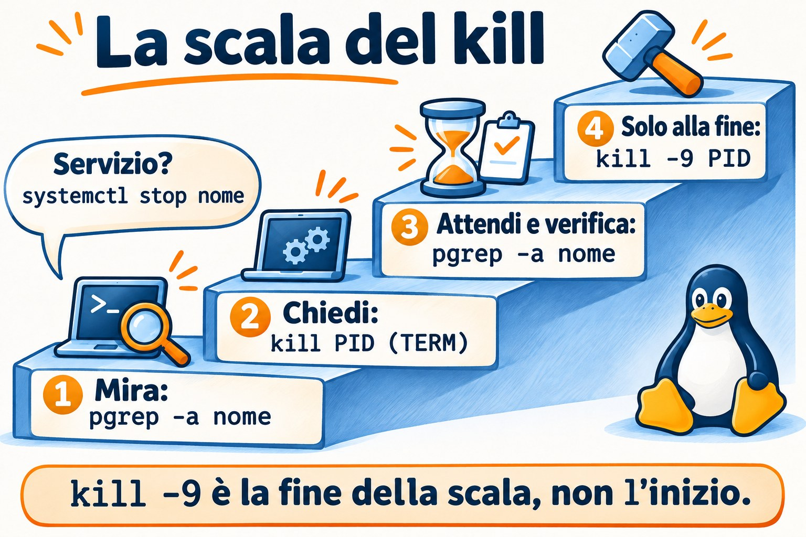
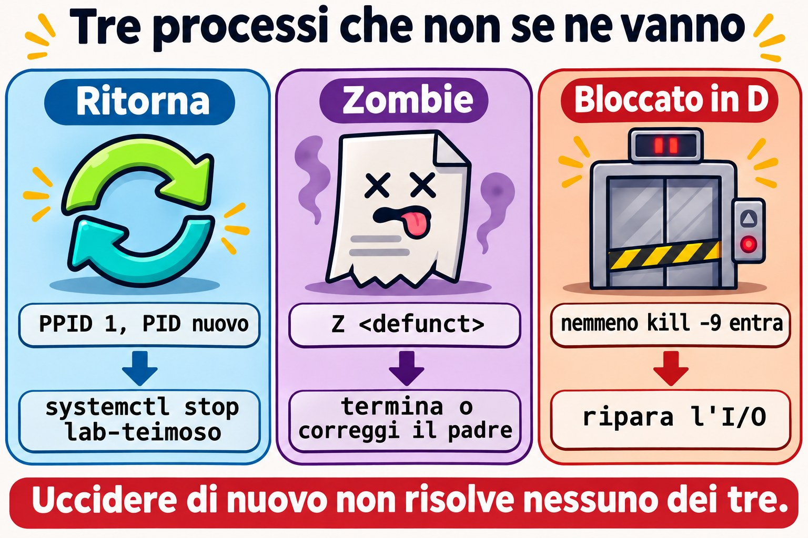

# Lezione 7.1 · Processi e segnali

Nella lezione 2.3 hai imparato a elencare un processo e a terminarlo. Ora arriva ciò che separa chi risolve da chi riavvia: leggere lo stato di ogni processo, scegliere il segnale giusto e capire perché alcuni processi non muoiono, o tornano subito dopo essere stati uccisi.

> **Il cuore di questa lezione:** leggere `ps` e `top` senza farsi ingannare; spiegare gli stati R, S, D, T e Z; usare TERM, HUP, STOP, CONT e KILL nell'ordine giusto; colpire con precisione usando `pgrep` e `pkill`; scoprire da quale servizio arriva un PID. Il resto è approfondimento.

| Scheda |  |
| --- | --- |
| **Modulo** | M7 · Processi e prestazioni, lezione 1 di 3 |
| **Quando** | Settimana 11 |
| **Alla fine** | Termini il processo giusto nel modo giusto e spieghi perché un processo non muore |
| **Prerequisiti** | Lezioni 2.3 e 4.2 |
| **Durata** | circa 2h |
| **Snapshot** | `m7a1-inicio` e `m7a1-fim` su rocky-lab e debian-lab |

## 1 · Riscaldamento

Rispondi prima di leggere.

1. Qual è la differenza tra `kill PID` e `kill -9 PID`? Quale dei due il programma riesce a sentire?
2. Per lo stesso processo, `ps` mostra il 75% di CPU e `top` mostra lo 0%. Possono avere ragione entrambi?
3. Un processo compare con stato `Z`. `kill -9` risolve?

## 2 · Perché conta

| La richiesta | La risposta sbagliata | Cosa provoca |
| --- | --- | --- |
| "Il database è lento, uccidi il processo" | `kill -9` subito | Il database non scrive ciò che aveva in memoria e il prossimo avvio passa il tempo a recuperare i dati |
| "Ho ucciso il processo ed è tornato" | Ucciderlo di nuovo, in loop | A rilanciarlo è systemd. La cosa giusta è fermare il servizio |
| "Ci sono 40 zombie sul server" | `kill -9` su tutti | Lo zombie è già morto. Chi ha bisogno di attenzione è il padre |
| "Il carico è a 40 e la CPU è ferma" | Riavviare il server | I processi sono bloccati sul disco o su NFS. La causa resta lì anche dopo il boot |
| "Volevo solo ricaricare la configurazione" | `systemctl restart` nell'ora di punta | Fa cadere le connessioni, quando bastava un `reload` (HUP) |

## 3 · Modello mentale

> Un processo è un **dipendente**, e un segnale è un **biglietto** che gli viene consegnato. TERM dice "chiudi quello che stai facendo e vai via", e lui può mettere in ordine la scrivania prima. HUP dice "rileggi le istruzioni". STOP e KILL non sono biglietti: a intervenire è il **kernel**, che congela o porta via il dipendente senza chiedere. Uno zombie è la **scheda di chi è già uscito**, ferma sulla scrivania del capo finché lui non la firma. Chi è in D è **nell'ascensore bloccato**: nessun biglietto arriva fin lì finché la porta non si apre.

```
         kill -TERM ──► o programa decide: limpa, grava e sai   (saída 143 se não tratar)
         kill -HUP  ──► muitos daemons: relê a configuração
         kill -INT  ──► o mesmo que Ctrl+C                      (saída 130)
         kill -STOP ──► o kernel congela (estado T)  ◄── kill -CONT descongela
         kill -KILL ──► o kernel elimina, sem aviso             (saída 137)

  R rodando   S dormindo, acorda com sinal   D preso em E/S, nem KILL entra
  T parado    Z terminou, espera o pai ler a saída     I thread ociosa do kernel
```



*STOP e KILL sono gli unici segnali che il programma non può gestire né ignorare.*

### Ponte Windows

| In Windows | In Linux | Dove il paragone inganna |
| --- | --- | --- |
| Gestione attività, `Get-Process` | `top`, `ps` | `ps` è una foto. La sua colonna `%CPU` è la media di tutta la vita del processo |
| `taskkill /PID n` | `kill n` (TERM) | `kill` non serve solo a uccidere: consegna qualsiasi segnale |
| `taskkill /F`, `Stop-Process -Force` | `kill -9` | Equivalenti nella brutalità: nessuno dà la possibilità di ripulire |
| Albero dei processi di Process Explorer | `ps -ef --forest`, `pstree -p` | In Linux ogni processo ha un padre che ne raccoglie l'uscita. Da qui nasce lo zombie |
| Servizio con ripristino "Riavvia il servizio" | `Restart=` nella unit | È lo stesso motivo del "l'ho ucciso ed è tornato" |

## 4 · L'essenziale

### Leggere senza farsi ingannare

| Voglio... | Comando |
| --- | --- |
| Vedere tutti, con la famiglia | `ps -ef --forest` |
| Scegliere le colonne e ordinare | `ps -eo pid,ppid,stat,ni,pcpu,pmem,etime,comm --sort=-pcpu \| head` |
| Vedere la famiglia di un PID fino al PID 1 | `pstree -ps PID` |
| Vedere la CPU di adesso | `top` e, per gli script, `top -b -n2 -d2 -p PID` |
| Vedere carico e tempo di accensione | `uptime` |
| Vedere la memoria | `free -h` |
| Ripetere un comando ogni 2 secondi | `watch -n 2 'ps -eo stat \| sort \| uniq -c'` |
| Scoprire il servizio di un PID | `systemctl status PID` |
| Vedere lo stato dettagliato | `grep -E 'State\|PPid\|VmRSS' /proc/PID/status` |
| Vedere l'eseguibile e la cartella | `ls -l /proc/PID/exe /proc/PID/cwd` |
| Vedere cosa ha aperto | `ls -l /proc/PID/fd` |

Tasti di `top`: `P` ordina per CPU, `M` per memoria, `c` mostra il comando intero, `1` apre per core, `H` mostra i thread, `k` manda un segnale, `q` esce.

**Il carico** di `uptime` conta i processi che vogliono la CPU e quelli che sono in D, come media su 1, 5 e 15 minuti. Confrontalo con `nproc`. Carico alto con CPU inattiva indica l'I/O, non la mancanza di CPU.

### I segnali che usi

| Segnale | Numero | A cosa serve | Si può gestire? |
| --- | --- | --- | --- |
| HUP | 1 | Nei daemon, rileggere la configurazione. Avvisa anche che il terminale è caduto | Sì |
| INT | 2 | Ctrl+C | Sì |
| KILL | 9 | Eliminare, come ultima risorsa | **No** |
| TERM | 15 | Normale richiesta di uscita. È il predefinito di `kill` | Sì |
| CONT | 18 | Scongelare | Sì, e il processo si sveglia comunque |
| STOP | 19 | Congelare | **No** |

L'ordine di sempre: **TERM, aspetti qualche secondo, controlli, e solo dopo KILL**. Su un servizio, preferisci `systemctl stop` o `systemctl reload`, perché systemd sa come quel servizio deve fermarsi.



*Mira, chiedi, controlla. Il KILL resta per la fine.*

### La colonna STAT

La prima lettera è lo stato. Le successive sono dettagli: `s` leader di sessione, `+` in primo piano, `l` con più thread, `<` priorità alta, `N` priorità bassa.

### Colpire con precisione

| Voglio... | Comando |
| --- | --- |
| Controllare prima di sparare | `pgrep -a nome` |
| Cercare nell'intera riga di comando | `pgrep -af 'texto'` |
| Nome esatto | `pgrep -x sleep` |
| Di un utente | `pgrep -u student -a` |
| Figli di un PID | `pgrep -P PID` |
| Inviare il segnale con lo stesso criterio | `pkill`, con le stesse opzioni |
| Per nome esatto, con `psmisc` | `killall -e nome` |

Regola: **ogni `pkill` nasce come `pgrep -a`**. Guarda l'elenco, poi cambia la parola.

### Rocky × Debian

|  | Rocky | Debian |
| --- | --- | --- |
| `pstree`, `killall`, `fuser` | Pacchetto `psmisc` | Pacchetto `psmisc` |
| `ps`, `top`, `free`, `pgrep` | Pacchetto `procps-ng` | Pacchetto `procps` |
| Nome del servizio SSH | `sshd` | `ssh` |

## 5 · Lab guidato

**Passo 0 · Snapshot e preparazione.** In Proxmox: `qm snapshot 201 m7a1-inicio` e `qm snapshot 202 m7a1-inicio`. Su rocky-lab:

```bash
sudo dnf install -y psmisc
mkdir -p ~/lab71 && cd ~/lab71
```

**Passo 1 · Leggere cosa sta girando.**

```bash
ps -ef --forest | head -n 25
ps -eo pid,ppid,stat,ni,pcpu,pmem,etime,comm --sort=-pcpu | head
pstree -ps $$
uptime
nproc
free -h
```

`pstree -ps $$` mostra la tua linea di discendenza: `systemd`, `sshd`, `bash`. In `free -h`, guarda la colonna `available`, che è ciò che i programmi possono ancora usare.

**Passo 2 · La bugia del `%CPU`.** Il processo qui sotto consuma CPU per 10 secondi e poi dorme.

```bash
bash -c 'fim=$((SECONDS+10)); while [ $SECONDS -lt $fim ]; do :; done; sleep 300; true' &
GASTOU=$!
sleep 13
ps -o pid,pcpu,etime,comm -p $GASTOU
top -b -n2 -d2 -p $GASTOU | awk 'NF' | tail -n 1
pkill -P $GASTOU
```

`ps` mostra qualcosa vicino al 75%: è la media da quando il processo è nato. `top` mostra 0, perché confronta due campioni. Per sapere chi consuma CPU **adesso**, usa `top`. Il `-n2` esiste perché anche il primo campione di `top` è una media.

`pkill -P` termina lo `sleep` figlio, e subito dopo `bash` finisce. Un `kill $GASTOU` ucciderebbe solo `bash` e lascerebbe lo `sleep` orfano, vivo per cinque minuti.

**Passo 3 · Un servizio giocattolo.** Crea uno script che risponde ai segnali.

```bash
cat > ~/lab71/servico.sh <<'EOF'
#!/bin/bash
trap 'echo "$(date +%T) HUP: relendo a configuracao"' HUP
trap 'echo "$(date +%T) TERM: salvando e saindo"; exit 0' TERM
while true; do
  echo "$(date +%T) trabalhando"
  sleep 2
done
EOF
chmod +x ~/lab71/servico.sh
./servico.sh > servico.log &
S=$!
```

**Passo 4 · Guardare dentro, in `/proc`.**

```bash
grep -E 'State|PPid|VmRSS|Threads' /proc/$S/status
ls -l /proc/$S/exe /proc/$S/cwd
tr '\0' ' ' < /proc/$S/cmdline; echo
ls -l /proc/$S/fd
```

`exe` punta a `/usr/bin/bash`, perché è bash a eseguire lo script. In `fd`, il descrittore 1 punta a `servico.log`: è così che scopri dove sta scrivendo un processo, anche senza sapere come è stato avviato.


*ps scatta una foto, top gira un film e /proc mostra il processo da dentro.*

**Passo 5 · Mandare segnali.**

```bash
kill -HUP $S; sleep 3; tail -n 3 servico.log
kill -STOP $S; ps -o pid,stat,comm -p $S
date +%T; sleep 6; tail -n 1 servico.log
kill -CONT $S; sleep 3; tail -n 1 servico.log
kill -TERM $S; sleep 3; tail -n 2 servico.log
wait $S; echo "saida=$?"
```

L'HUP compare nel log e il programma continua. Durante lo STOP lo stato diventa `T`, e l'orario nel log si ferma. Con il TERM, lo script scrive `salvando e saindo` e termina con `saida=0`. Ora il contrasto:

```bash
./servico.sh > servico.log &
S=$!
sleep 3
kill -9 $S
wait $S; echo "saida=$?"
tail -n 2 servico.log
```

Senza `salvando e saindo` e con `saida=137`, che è 128 + 9. Quando uno script o systemd mostra 137 o 143, sai che il processo è morto per KILL o per TERM.

**Passo 6 · Mirare prima di sparare.**

```bash
sleep 5001 &
sleep 5002 &
pgrep -a sleep
pgrep -af 'sleep 5001'
pkill -f 'sleep 5001'
pgrep -a sleep
pkill -x sleep
pgrep -a sleep
```

Solo dopo aver visto l'elenco, sostituisci `pgrep` con `pkill`. Il `-f` cerca nell'intera riga e il `-x` pretende il nome esatto.

**Passo 7 · Da quale servizio arriva questo PID?**

```bash
P=$(systemctl show -p MainPID --value sshd)
ps -o pid,ppid,etime,cmd -p $P
systemctl status $P --no-pager | head -n 4
cat /proc/$P/cgroup
```

`systemctl status` accetta un PID e risponde a quale unit appartiene. Tienilo a mente: è il primo comando davanti a un processo sconosciuto.

**Passo 8 · debian-lab.** Installa `psmisc` e ripeti i passi 1 e 7, sostituendo `sshd` con `ssh`. I comandi e i segnali sono gli stessi.

### Decidi 1

Il processo del database è al 100% di CPU e il gestionale ha smesso di rispondere. Il responsabile ha fretta. Cosa fai per prima cosa?

A) `kill -9` sul processo, per liberare subito. B) Riavvii il server. C) Annoti cosa sta succedendo con `top` e `ps`, provi `systemctl stop` e lasci che il servizio finisca. Usi KILL solo se non si ferma entro il tempo concordato.

Scegli un'opzione prima di continuare.

| Se hai scelto | Risultato | Perché |
| --- | --- | --- |
| A | Rischio di perdere dati | Il database non finisce ciò che aveva in memoria e il prossimo avvio fa il recupero |
| B | Lo stesso rischio, per tutti i servizi | Cancelli le prove e butti giù ciò che funzionava |
| C | Giusto | systemd manda TERM e, scaduto il timeout, KILL. Ti restano comunque le prove per trovare la causa |

**Da ricordare:** `kill -9` è la fine della scala, non l'inizio.

### Decidi 2

Carico a 40, su un server da 8 core. `top` mostra la CPU quasi tutta inattiva. Cosa guardi?

A) Chi è in cima a `top` per CPU. B) `ps -eo pid,stat,wchan:20,comm | awk '$2 ~ /^D/'`. C) Aumenti la memoria della VM.

Scegli un'opzione prima di continuare.

| Se hai scelto | Risultato | Perché |
| --- | --- | --- |
| A | Non trovi nulla | Chi è in D non usa CPU, ma conta nel carico |
| B | Giusto | Mostra chi è bloccato e, in `wchan`, in quale funzione del kernel. Di solito è disco o NFS |
| C | Spesa inutile | Il collo di bottiglia non è la memoria |

**Da ricordare:** carico alto con CPU ferma è segno di processi in attesa di I/O.

## 6 · Rompi e ripara



*In tutti e tre i casi, uccidere di nuovo non risolve. Trova chi tiene in piedi il processo.*

### Guasto 1 · L'ho ucciso ed è tornato

```bash
sudo systemd-run --unit=lab-teimoso -p Restart=always -p RestartSec=2 sleep 5000
sleep 1
sudo kill -9 "$(pgrep -f 'sleep 5000')"
sleep 4
pgrep -af 'sleep 5000'
```

**Sintomo:** il processo è di nuovo lì, con un altro PID.

**Diagnosi:**

```bash
P=$(pgrep -f 'sleep 5000')
ps -o pid,ppid,etime,cmd -p $P
systemctl status $P --no-pager | head -n 3
```

Il PPID è 1 e l'`etime` è di pochi secondi. Lo status mostra il nome della unit.

**Riparazione:** `sudo systemctl stop lab-teimoso`. Controlla con `pgrep -af 'sleep 5000'`, che non deve mostrare nulla.

**Nella vita reale:** prima di uccidere per la seconda volta, chiediti chi ha rimesso su il processo. Può essere systemd, cron, un container o uno script di supervisione.

### Guasto 2 · Lo zombie immortale

```bash
(sleep 1 & exec sleep 300) &
PAI=$!
sleep 2
ps -o pid,ppid,stat,comm --ppid $PAI
Z=$(ps -o pid= --ppid $PAI)
kill -9 $Z
sleep 1
ps -o pid,ppid,stat,comm -p $Z
```

**Sintomo:** stato `Z`, con `<defunct>`, e `kill -9` non cambia nulla.

**Diagnosi:** il processo è già terminato. È rimasta solo la voce nella tabella, in attesa che il padre legga il codice di uscita. Qui il padre è uno `sleep`, che non lo fa mai.

**Riparazione:**

```bash
kill $PAI
sleep 1
ps -o pid,ppid,stat,comm -p $Z
```

Il figlio viene adottato da un processo che raccoglie l'uscita, e la voce sparisce.

**Nella vita reale:** uno zombie non consuma CPU né memoria, solo una voce nella tabella. Pochi e stabili sono innocui. Tanti e in aumento indicano un padre difettoso, e la riparazione è riavviare o correggere quel padre.

### Guasto 3 · Bloccato in D (racconto)

Il server NFS è caduto. Un `ls /mnt/nfs` non torna indietro, Ctrl+C non funziona, `kill -9` non funziona e il carico sale senza sosta.

**Diagnosi:** `ps -eo pid,stat,wchan:20,comm | awk '$2 ~ /^D/'` e `journalctl -k -n 50`, che di solito mostra `nfs: server ... not responding`.

**Riparazione:** far tornare il server NFS. Il segnale resta in coda e viene consegnato quando l'operazione termina. Come ultima risorsa, `umount -f` o `umount -l`, sapendo che le scritture in sospeso possono andare perse. Se a guastarsi è il disco locale, l'uscita può essere il reboot.

**Da ricordare:** nessun segnale raggiunge un processo in D. Cerca la causa nell'I/O.

### Pulizia

```bash
sudo systemctl stop lab-teimoso 2>/dev/null
pkill -f servico.sh
pkill -x sleep
pgrep -af 'servico|sleep 5'
```

L'ultimo comando non deve mostrare nulla.

## 7 · Trappole

| Trappola | Cosa succede | Come evitarla |
| --- | --- | --- |
| Fidarsi del `%CPU` di `ps` | È la media della vita del processo | Usa `top`, con due campioni |
| `kill -9` come prima scelta | Il programma non ripulisce né scrive | TERM, aspetti, controlli, KILL |
| `pkill -f` con un testo corto | Colpisce ciò che non volevi. `pkill -f student` butta giù la tua stessa sessione SSH | Esegui `pgrep -af` prima e usa un testo lungo |
| `pgrep nome` con un nome lungo | Il nome del processo ha al massimo 15 caratteri | Usa `-f` |
| `ps aux \| grep nome` | Lo stesso `grep` compare nell'elenco | Usa `pgrep -a` |
| Uccidere uno zombie | Non cambia nulla | Guarda il PPID e occupati del padre |
| Uccidere il processo di un servizio | Ritorna, se la unit ha `Restart=` | `systemctl status PID`, poi `systemctl stop` |
| Credere che HUP ricarichi sempre | Un programma che non gestisce HUP muore | Controlla nel `man` o usa `systemctl reload` |
| Copiare il numero di un segnale da un altro sistema | Su altre architetture alcuni numeri cambiano | Usa i nomi: `-TERM`, `-HUP`, `-KILL` |

## 8 · Quiz

Rispondi senza guardare. Le soluzioni sono alla fine della lezione.

1. Quali due segnali il programma non riesce a gestire?
2. Uno script termina con codice 143. Cos'è successo?
3. Cosa si sta aspettando in un processo nello stato Z? E nello stato D?
4. Come scoprire, con un solo comando, da quale unit arriva un PID?
5. Perché `ps` e `top` possono non concordare sulla CPU?
6. Prima di un `pkill -f 'backup'`, quale comando esegui?

## 9 · Promemoria

**Da sapere a memoria:**

| Voglio... | Comando |
| --- | --- |
| Chi consuma CPU adesso | `top`, tasto `P` |
| Chi consuma memoria | `top`, tasto `M` |
| Elencare con criterio | `pgrep -af 'texto'` |
| Chiedere di uscire | `kill PID` |
| Forzare, come ultima risorsa | `kill -9 PID` |
| Unit di un PID | `systemctl status PID` |
| Bloccati sull'I/O | `ps -eo pid,stat,wchan:20,comm \| awk '$2 ~ /^D/'` |
| Zombie | `ps -eo pid,ppid,stat,comm \| awk '$3 ~ /^Z/'` |

**Da consultare:**

| Voglio... | Comando |
| --- | --- |
| Elenco dei segnali | `kill -l` |
| Verificare se il PID esiste | `kill -0 PID; echo $?` |
| Albero | `ps -ef --forest`, `pstree -ps PID` |
| Segnale a un servizio | `sudo systemctl kill -s HUP UNIT` |
| Eseguibile e cartella | `ls -l /proc/PID/exe /proc/PID/cwd` |
| File aperti | `ls -l /proc/PID/fd` |
| Variabili del processo | `sudo tr '\0' '\n' < /proc/PID/environ` |
| Contare per stato | `ps -eo stat= \| cut -c1 \| sort \| uniq -c` |

**Flashcard:**

- TERM → *richiesta; il programma può ripulire. È il predefinito.*
- KILL e STOP → *agisce il kernel; il programma non può gestirli.*
- 137 e 143 → *128 + 9 e 128 + 15.*
- Z → *è già morto; occupati del padre.*
- D → *bloccato sull'I/O; nessun segnale entra.*
- Ucciso e tornato → *`systemctl status PID`.*

## 10 · Checklist e chiusura

- [ ] Spiego gli stati R, S, D, T e Z
- [ ] So perché `ps` e `top` non concordano sulla CPU
- [ ] Uso la sequenza TERM, aspetto, controllo, KILL
- [ ] Eseguo `pgrep -a` prima di ogni `pkill`
- [ ] Scopro da quale servizio arriva un PID
- [ ] So cosa fare con gli zombie e con i processi in D
- [ ] Leggo 137 e 143 come segnali

**Ultimo esercizio, senza guardare la lezione:** su debian-lab, scrivi uno script che scriva `tchau` in un file quando riceve TERM. Eseguilo in background, manda TERM e dimostralo con il file. Ripeti con KILL e spiega la differenza.

**Snapshot di fine** (in Proxmox):

```bash
qm snapshot 201 m7a1-fim
qm snapshot 202 m7a1-fim
```

## 11 · Nella vita reale

**Missione, sola lettura.** Su un server Linux che amministri (o con autorizzazione), esegui **solo**:

```bash
uptime
nproc
free -h
ps -eo stat= | cut -c1 | sort | uniq -c
ps -eo pid,ppid,stat,comm | awk '$3 ~ /^Z/'
ps -eo pid,stat,wchan:20,comm | awk '$2 ~ /^D/'
ps -eo pid,ppid,pmem,etime,comm --sort=-pmem | head
```

Domande a cui rispondere:

1. Il carico a 15 minuti è maggiore del numero di core?
2. Quanti processi ci sono in ciascuno stato? Ne esiste qualcuno in D o Z?
3. Se ci sono zombie, chi è il padre di ciascuno?
4. Quali sono i tre maggiori per memoria, e da quale unit arriva ciascuno? Verifica con `systemctl status PID`.

**Diario:** annota la risposta alla 4. Non inviare nessun segnale.

**Domani, senza guardare:** scrivi i cinque segnali della lezione, con il numero, e dì quali il programma non può gestire.

## 12 · Approfondire quando vuoi

- **`man 7 signal`:** l'elenco completo e il comportamento predefinito di ogni segnale.
- **`strace -p PID`:** vedere su quale chiamata di sistema è fermo un processo.
- **`lsof -p PID` e `fuser -v ARQUIVO`:** chi sta tenendo un file o una porta.
- **`KillMode=` e `TimeoutStopSec=`:** come systemd ferma un servizio e quanto aspetta prima del KILL.
- **`pidstat`** (pacchetto `sysstat`): consumo per processo nel tempo.

**DeepTutor** (http://10.1.0.149:3782, KB "Curso Linux Sysadmin"):

- `!explica a diferença entre os estados S e D de um processo`
- `!feynman o que é um processo zumbi e por que kill não resolve`
- `!quiz Aula 7.1, 5 perguntas sobre sinais e estados`

## Soluzioni commentate

### Riscaldamento

1. `kill PID` manda TERM, che il programma può gestire per uscire con calma. `kill -9` manda KILL, che non arriva nemmeno al programma: lo elimina il kernel.
2. Sì. Il `%CPU` di `ps` è la media dall'inizio del processo. `top` misura l'intervallo tra due campioni. Un processo che ha lavorato molto e ora dorme mostra esattamente questo.
3. No. Il processo è già terminato, e il segnale non ha nessuno che lo riceva. Serve che il padre legga l'uscita o termini.

### Quiz

1. KILL (9) e STOP (19).
2. Il processo è morto per TERM: 128 + 15.
3. Nello Z si aspetta che il padre legga il codice di uscita (`wait`). Nel D, il processo aspetta che finisca un'operazione di I/O nel kernel.
4. `systemctl status PID`.
5. Perché `ps` calcola la media di tutta la vita del processo, e `top` confronta due campioni ravvicinati.
6. `pgrep -af 'backup'`, per vedere esattamente cosa verrà colpito.

---

<!-- navegacao -->
[← Lezione 6.5 · Librerie condivise](6.5-bibliotecas-compartilhadas.md) · [Indice delle lezioni](../01-aulas.md) · [Lezione 7.2 · Job e sessioni →](7.2-jobs-e-sessoes.md)
