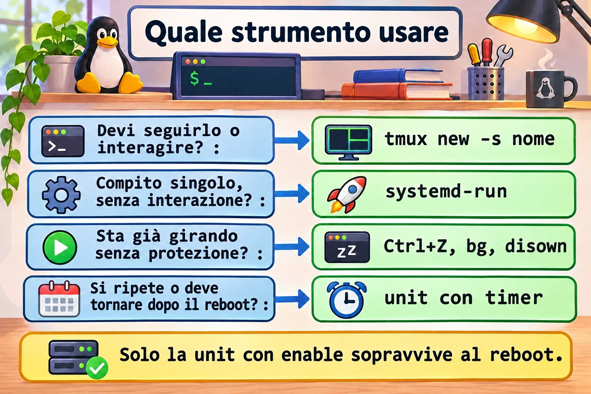
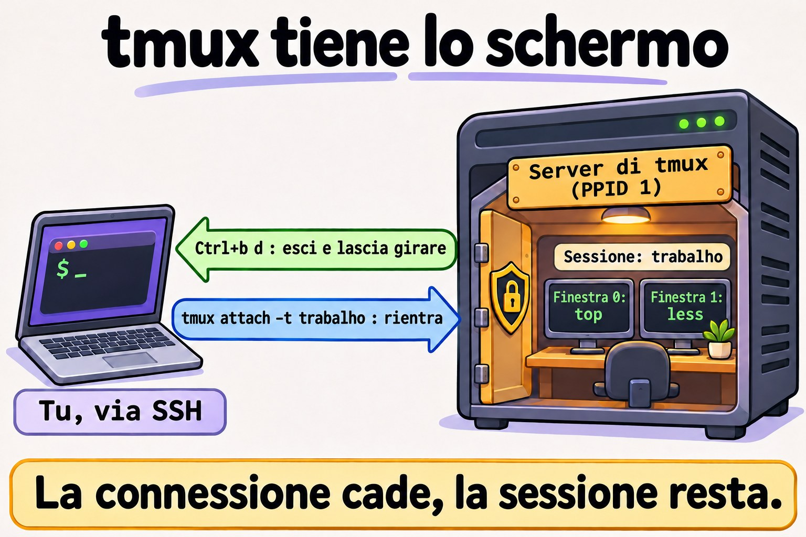
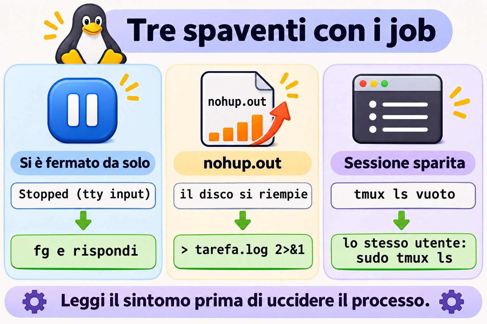

# Lezione 7.2 · Job e sessioni

L'aggiornamento era all'80% quando è caduta la VPN. Chi l'ha vissuto sa quanto è grave il problema. In questa lezione capisci perché un comando muore insieme alla connessione e scegli lo strumento giusto per ogni attività lunga: job, `nohup`, `disown`, `tmux` o `systemd-run`.

> **Il cuore di questa lezione:** controllare i job con `&`, Ctrl+Z, `jobs`, `fg` e `bg`; capire cosa fa SIGHUP quando il terminale sparisce; usare `nohup` senza riempire il disco; lavorare in `tmux` e tornare alla sessione dopo la caduta; e sapere quando l'attività merita di diventare un servizio. Il resto è approfondimento.

| Scheda |  |
| --- | --- |
| **Modulo** | M7 · Processi e prestazioni, lezione 2 di 3 |
| **Quando** | Settimana 11 |
| **Alla fine** | La tua attività lunga sopravvive alla caduta di SSH, e ci torni da dove sei |
| **Prerequisiti** | Lezioni 0.2, 2.3 e 7.1 |
| **Durata** | circa 2h |
| **Snapshot** | `m7a2-inicio` e `m7a2-fim` su rocky-lab e debian-lab |

## 1 · Riscaldamento

Rispondi prima di leggere.

1. Quale segnale invia Ctrl+C? E quale sarebbe il codice di uscita?
2. Un comando è stato avviato con `&` e hai chiuso la finestra SSH. Continua a girare?
3. Se esci con `exit` invece di chiudere la finestra, la risposta cambia?

## 2 · Perché conta

| La richiesta | La risposta sbagliata | Cosa provoca |
| --- | --- | --- |
| "Il `dnf upgrade` si è fermato a metà quando è caduta la connessione" | Rilanciarlo direttamente su SSH | La prossima caduta può lasciare il sistema a metà |
| "Il disco si è riempito e nessuno sa perché" | Cercare solo nei log | Un `nohup.out` gigante, dimenticato nella cartella di qualcuno |
| "Lo script si è fermato da solo, senza errori" | Rilanciarlo | È in background e aspetta una risposta che nessuno vede |
| "L'avevo lasciato in `tmux` ed è sparito" | Pensare che `tmux` abbia fallito | È stato aperto come root, oppure il server si è riavviato |
| "Ogni giorno apro `tmux` per lanciare questo backup" | Continuare così | Un'attività ripetuta merita un servizio e una pianificazione |

## 3 · Modello mentale

> La connessione SSH è un **filo del telefono** tra te e la shell. Quando il filo viene tagliato, la shell riceve l'avviso (SIGHUP) e lo gira ai suoi job. `nohup` e `disown` sono modi per **tappare l'orecchio** di un processo a quell'avviso. `tmux` fa un'altra cosa: **installa un interno dentro il server**. Il tuo programma parla con l'interno, il tuo SSH si limita a guardarlo, e quando il filo cade l'interno continua a rispondere.

```
ssh ── sshd ── bash (líder da sessão) ── pts/0
                 ├─ vim         primeiro plano
                 └─ backup.sh   segundo plano

conexão cai → o pts some → SIGHUP no bash → o bash repassa SIGHUP aos jobs → backup morre


ssh ── sshd ── bash ── cliente tmux  ┄┄ olha para ┄┄  servidor tmux  (pai = PID 1)
                                                        └─ bash ── backup.sh

conexão cai → morre só o cliente → o servidor e o backup continuam → tmux attach
```


*`tmux` non protegge il processo dal segnale: toglie il processo dalla traiettoria del segnale.*

### Ponte Windows

| In Windows | In Linux | Dove il paragone inganna |
| --- | --- | --- |
| Disconnettersi da RDP, con i programmi aperti | `Ctrl+b d` in `tmux` | Senza `tmux`, la caduta di SSH non equivale a disconnettersi da RDP: i processi ricevono SIGHUP |
| Fare logoff da RDP | `tmux kill-session` | Termina tutto ciò che era nella sessione |
| `Start-Job` in PowerShell | `comando &` | Il job di PowerShell dipende dalla sessione, come quello di bash |
| Attività pianificata da eseguire una volta | `systemd-run` | `systemd-run` esegue subito e registra l'output nel journal |
| Riavvio di Windows | Reboot | Anche la sessione di `tmux` non sopravvive |

## 4 · L'essenziale

### Tasti e comandi dei job

| Voglio... | Come |
| --- | --- |
| Eseguire in background | `comando &` |
| Interrompere (SIGINT) | Ctrl+C |
| Mettere in pausa (SIGTSTP) | Ctrl+Z |
| Vedere i job, con il PID | `jobs -l` |
| Portare in primo piano | `fg %1` |
| Continuare in background | `bg %1` |
| Terminare un job | `kill %1` |
| Aspettare che i job finiscano | `wait` |
| Toglierlo dall'elenco della shell | `disown %1` |

### Quale strumento

| Strumento | Sopravvive alla caduta di SSH | Sopravvive al reboot | Si può tornare a vederlo | Dove finisce l'output |
| --- | --- | --- | --- | --- |
| `comando &` | No | No | Solo nella stessa shell | Nel terminale |
| `nohup comando &` | Sì | No | No | `nohup.out`, se l'output era il terminale |
| `disown` | Sì | No | No | Nel terminale che è sparito |
| `tmux` o `screen` | Sì | No | **Sì** | Sullo schermo della sessione |
| `systemd-run` | Sì | No | Dal journal | `journalctl -u NOME` |
| Unit con `enable` e timer | Sì | **Sì** | Dal journal | `journalctl -u NOME` |

**Come scegliere:** il lavoro interattivo, o qualcosa che va seguito, va in `tmux`. L'attività puntuale senza interazione va in `systemd-run`. Se ti sei dimenticato di usare tutto questo e il comando sta già girando, `Ctrl+Z`, `bg` e `disown` ti salvano. L'attività che si ripete diventa una unit con timer.



*Rispondi alla domanda a sinistra e prendi lo strumento a destra.*

### tmux

| Voglio... | Come |
| --- | --- |
| Creare una sessione con nome | `tmux new -s nome` |
| Uscire lasciando tutto in esecuzione | `Ctrl+b` e poi `d` |
| Elencare le sessioni | `tmux ls` |
| Tornare | `tmux attach -t nome` |
| Nuova finestra | `Ctrl+b` e `c` |
| Finestra successiva | `Ctrl+b` e `n` |
| Dividere affiancando | `Ctrl+b` e `%` |
| Dividere sopra e sotto | `Ctrl+b` e `"` |
| Cambiare riquadro | `Ctrl+b` e `o` |
| Scorrere lo schermo | `Ctrl+b` e `[`, con `q` per uscire |
| Terminare la sessione | `tmux kill-session -t nome` |

`screen` fa lo stesso con altri comandi: `screen -S nome`, `Ctrl+a` e `d`, `screen -ls`, `screen -r nome`. Lo troverai sui server vecchi.

### Rocky × Debian

|  | Rocky 9 | Debian 13 |
| --- | --- | --- |
| `tmux` | `dnf install tmux` | `apt install tmux` |
| `screen` | Pacchetto di EPEL | `apt install screen` |
| Comportamento di job e SIGHUP | Lo stesso, è di bash | Lo stesso, è di bash |

## 5 · Lab guidato

Ti serviranno **due finestre SSH** verso rocky-lab: la **A**, che verrà fatta cadere, e la **B**, che osserva.

**Passo 0 · Snapshot e preparazione.** In Proxmox: `qm snapshot 201 m7a2-inicio` e `qm snapshot 202 m7a2-inicio`. Nella finestra A:

```bash
sudo dnf install -y tmux
mkdir -p ~/lab72 && cd ~/lab72
cat > conta.sh <<'EOF'
#!/bin/bash
while true; do
  date +%T >> "$1"
  sleep 1
done
EOF
chmod +x conta.sh
```

**Passo 1 · Controllare i job.**

```bash
sleep 301 &
sleep 302
```

Il secondo comando blocca il terminale. Premi **Ctrl+Z**, e continua:

```bash
jobs -l
bg %2
jobs -l
fg %1
```

Premi **Ctrl+C** per terminare lo `sleep 301`. Poi:

```bash
jobs
kill %2
jobs
```

Fai caso allo stato: `Running`, poi `Stopped` con Ctrl+Z, e di nuovo `Running` con `bg`.

**Passo 2 · Il test della caduta.** Nella finestra A, avvia quattro contatori, ciascuno protetto in un modo diverso:

```bash
cd ~/lab72
./conta.sh a-sem-nada.log &
nohup ./conta.sh b-nohup.log > /dev/null 2>&1 &
./conta.sh c-disown.log &
disown
jobs -l
tmux new -d -s lab './conta.sh d-tmux.log'
```

Ora **chiudi la finestra A con la X**, senza digitare `exit`. Nella finestra B, dopo qualche secondo:

```bash
cd ~/lab72
for f in *.log; do echo "$f $(tail -n 1 "$f")"; done; date +%T
```

| File | Atteso | Perché |
| --- | --- | --- |
| `a-sem-nada.log` | Si è fermato al momento della caduta | bash ha girato il SIGHUP al job |
| `b-nohup.log` | Continua ad aggiornarsi | `nohup` fa ignorare il SIGHUP al processo |
| `c-disown.log` | Continua ad aggiornarsi | `disown` ha tolto il job dall'elenco di chi riceve l'inoltro |
| `d-tmux.log` | Continua ad aggiornarsi | Il processo vive nel server di `tmux` |

Termina ciò che è rimasto, nella finestra B:

```bash
pkill -f 'conta.sh b-nohup'
pkill -f 'conta.sh c-disown'
tmux kill-session -t lab
```

**Passo 3 · La sorpresa di `exit`.** Apri un'altra finestra A:

```bash
cd ~/lab72
./conta.sh e-exit.log &
shopt huponexit
exit
```

Nella finestra B, ripeti il `for` del Passo 2. `e-exit.log` **continua ad aggiornarsi**. Con `huponexit` su `off`, che è il predefinito, bash non avvisa i job quando esci con `exit`. Il SIGHUP del Passo 2 è arrivato dalla caduta del terminale. Per questo c'è chi giura che "ieri funzionava": ieri è uscito con `exit`, oggi è caduta la connessione.

Se la finestra SSH si blocca all'uscita, premi Invio, poi `~` e `.`, che terminano il client SSH. Pulisci:

```bash
pkill -f 'conta.sh e-exit'
```

**Passo 4 · Lavorare in `tmux`.** In una finestra nuova:

```bash
tmux new -s trabalho
```

Al suo interno: esegui `top`; premi `Ctrl+b` e `c`, ed esegui `ls -l /etc | less`; premi `Ctrl+b` e `n` per tornare indietro e `Ctrl+b` e `%` per dividere lo schermo; passa da un riquadro all'altro con `Ctrl+b` e `o`. Esci con `Ctrl+b` e `d`. Poi:

```bash
tmux ls
ps -o pid,ppid,cmd -p "$(tmux display-message -p '#{pid}')"
tmux attach -t trabalho
```

`top` è ancora lì, come l'hai lasciato. Il PPID del server normalmente è 1: non dipende dalla tua connessione. Quando hai finito, `Ctrl+b` e `d`, e `tmux kill-session -t trabalho`.



*La connessione cade, la sessione di tmux resta sul server.*

**Passo 5 · Ho già iniziato senza protezione.** In una finestra nuova:

```bash
~/lab72/conta.sh ~/lab72/f-resgate.log
```

Premi **Ctrl+Z**, e continua:

```bash
bg
disown
```

Chiudi la finestra con la X. Nella finestra B, verifica che `f-resgate.log` continui ad aggiornarsi e termina con `pkill -f 'conta.sh .*f-resgate'`. È il salvataggio per quando te ne accorgi troppo tardi.

**Passo 6 · Un'attività che diventa unit.**

```bash
sudo systemd-run --unit=lab-tarefa bash -c 'for i in 1 2 3 4 5 6; do echo "passo $i"; sleep 5; done'
systemctl status lab-tarefa --no-pager | head -n 6
sudo journalctl -u lab-tarefa -f
```

Esci da `journalctl` con Ctrl+C, dopo che sono comparsi tutti e sei i passi. L'attività non è dipesa dal tuo terminale, e la registrazione resta nel journal anche dopo che è finita. Guarda con `sudo journalctl -u lab-tarefa --no-pager | tail -n 8`.

**Passo 7 · debian-lab.** Installa `tmux` e ripeti il Passo 2. Il risultato è lo stesso, perché il comportamento viene da bash e dal kernel.

### Decidi 1

Devi eseguire `dnf upgrade` via SSH su un server remoto, attraverso una VPN instabile. Come fai?

A) Direttamente su SSH, perché di solito è veloce. B) `nohup dnf -y upgrade &`. C) Dentro `tmux`, seguendo.

Scegli un'opzione prima di continuare.

| Se hai scelto | Risultato | Perché |
| --- | --- | --- |
| A | Rischio reale | Una caduta nel mezzo può interrompere la transazione |
| B | Sopravvive, ma alla cieca | Non vedi domande né errori sul momento, e `-y` accetta tutto |
| C | Giusto | Sopravvive alla caduta, e torni sulla stessa schermata e vedi com'è finita |

**Da ricordare:** il lavoro che devi seguire va in `tmux`, sempre.

### Decidi 2

Ogni notte qualcuno entra nel server, apre `tmux` e lancia uno script di copia. Cosa proponi?

A) Continuare, perché funziona. B) Un `nohup` nel `.bashrc`. C) Una unit con timer di systemd, con l'output nel journal.

Scegli un'opzione prima di continuare.

| Se hai scelto | Risultato | Perché |
| --- | --- | --- |
| A | Dipende da una persona | In ferie o nei festivi, la copia non parte |
| B | Peggio | Parte a ogni login, senza controllo e senza registro |
| C | Giusto | Parte da solo, torna dopo il reboot e lascia lo storico. Lo farai nel dettaglio più avanti nel corso |

**Da ricordare:** `tmux` serve per il lavoro umano. La routine è un servizio.

## 6 · Rompi e ripara



*Tre sintomi che sembrano un difetto e hanno una spiegazione semplice.*

### Guasto 1 · Lo script si è fermato da solo

```bash
cat > ~/lab72/pergunta.sh <<'EOF'
#!/bin/bash
read -p "Continuar? " resposta
echo "$(date +%T) resposta: $resposta" >> ~/lab72/resposta.log
EOF
chmod +x ~/lab72/pergunta.sh
~/lab72/pergunta.sh &
sleep 1
jobs -l
```

**Sintomo:** `Stopped (tty input)`, oppure `Fermato (input da terminale)` su una VM in italiano, e `resposta.log` non compare.

**Diagnosi:** un processo in background ha provato a leggere dal terminale e il kernel lo ha fermato. In `ps`, lo stato è `T`.

**Riparazione:** `fg`, e rispondi. In uno script automatizzato, fornisci la risposta in input, come in `echo s | ~/lab72/pergunta.sh &`.

**Nella vita reale:** è il motivo per cui `sudo comando &` resta fermo ad aspettare la password. Esegui `sudo -v` prima, oppure fai l'attività dentro `tmux`.

### Guasto 2 · Il `nohup.out` nascosto

```bash
cd ~/lab72
nohup bash -c 'for i in {1..20000}; do echo "linha $i"; done' &
sleep 2
ls -lh nohup.out
```

**Sintomo:** è comparso un file che nessuno ha chiesto. In un processo che gira per settimane, riempie il disco.

**Diagnosi:** cerca dove si trovano e chi ci sta scrivendo: `sudo find / -xdev -name nohup.out -size +10M 2>/dev/null` e `sudo fuser -v nohup.out`.

**Riparazione:** esegui con l'output definito, come in `nohup comando > /var/log/tarefa.log 2>&1 &`. Con il processo vivo, svuota con `: > nohup.out`. Se cancelli il file, lo spazio torna solo quando il processo termina.

### Guasto 3 · La sessione sparita

```bash
sudo tmux new -d -s raiz 'sleep 600'
tmux ls
sudo tmux ls
```

**Sintomo:** come `student`, `tmux ls` risponde `no server running`, `error connecting to /tmp/tmux-UID/default` oppure non mostra la sessione `raiz`. Con `sudo`, compare.

**Diagnosi:** ogni utente ha il proprio server, con un socket in `/tmp/tmux-UID/`.

**Riparazione:** torna come lo stesso utente che ha creato la sessione: `sudo tmux attach -t raiz`. Per terminarla, `sudo tmux kill-session -t raiz`.

**Nella vita reale:** l'altra causa comune è il reboot. Controlla con `uptime`. `tmux` non lo sopravvive.

### Pulizia

```bash
pkill -f conta.sh
pkill -KILL -f pergunta.sh
tmux kill-server 2>/dev/null
sudo tmux kill-server 2>/dev/null
pgrep -af 'conta.sh|pergunta.sh'
```

L'ultimo comando non deve mostrare nulla. Il `-KILL` è lì perché un processo fermo gestisce `SIGTERM` solo quando torna a girare. La cartella `~/lab72` può restare.

## 7 · Trappole

| Trappola | Cosa succede | Come evitarla |
| --- | --- | --- |
| Fidarsi di `comando &` su una rete instabile | Il job muore con la caduta | Usa `tmux` |
| Testare con `exit` e concludere di essere protetti | La caduta reale si comporta in un altro modo | Prova chiudendo la finestra |
| `nohup` senza reindirizzare | `nohup.out` cresce fino a riempire il disco | Sempre `> arquivo 2>&1` |
| Cancellare un file ancora aperto | Lo spazio non torna | Svuota con `: > arquivo` |
| `sudo comando &` | Resta fermo a chiedere la password | `sudo -v` prima, oppure `tmux` |
| Aprire `tmux` come root e cercarlo come utente | "È sparito" | Lo stesso utente in entrambi i casi |
| Credere che `tmux` sopravviva al reboot | La sessione non esiste più | L'attività che deve tornare diventa una unit |
| `tmux` dentro `tmux` | `Ctrl+b` va a quello esterno | Esci da quello interno oppure premi `Ctrl+b` due volte |
| Una policy che termina i processi all'uscita | Può morire anche `tmux` | Controlla `KillUserProcesses` in `/etc/systemd/logind.conf` |

## 8 · Quiz

Rispondi senza guardare. Le soluzioni sono alla fine della lezione.

1. Qual è la differenza tra Ctrl+C e Ctrl+Z?
2. Un comando sta già girando senza protezione. Quali tre passi lo salvano dalla caduta di SSH?
3. Perché un job avviato con `&` può sopravvivere a `exit` e morire con la caduta della connessione?
4. Cosa succede all'output di `nohup comando &` quando l'output è il terminale?
5. Perché `tmux` continua dopo che SSH cade?
6. Come scegliere tra `tmux`, `systemd-run` e una unit con timer?

## 9 · Promemoria

**Da sapere a memoria:**

| Voglio... | Comando |
| --- | --- |
| Background | `comando &` |
| Mettere in pausa e continuare dietro | Ctrl+Z, poi `bg` |
| Portare in primo piano | `fg %N` |
| Salvare dalla caduta | Ctrl+Z, `bg`, `disown` |
| Sessione nuova | `tmux new -s nome` |
| Uscire lasciando in esecuzione | `Ctrl+b` e `d` |
| Tornare | `tmux attach -t nome` |
| Elencare le sessioni | `tmux ls` |

**Da consultare:**

| Voglio... | Comando |
| --- | --- |
| Nohup con output definito | `nohup comando > arquivo 2>&1 &` |
| Attività come unit temporanea | `sudo systemd-run --unit=NOME comando` |
| Output della unit temporanea | `journalctl -u NOME` |
| Vedere il testo di `tmux` senza entrare | `tmux capture-pane -pt nome` |
| Vedere se la shell avvisa i job | `shopt huponexit` |
| Terminare il client SSH bloccato | Invio, `~`, `.` |
| Screen | `screen -S nome`, `Ctrl+a` e `d`, `screen -r nome` |
| Sessioni di login | `loginctl list-sessions` |

**Flashcard:**

- Filo tagliato → *SIGHUP alla shell, che lo gira ai job.*
- `nohup` → *ignora il SIGHUP; l'output va in `nohup.out`.*
- `disown` → *toglie il job dall'elenco dell'inoltro.*
- `tmux` → *il processo vive in un server che non dipende da SSH.*
- Routine → *unit con timer, non `tmux`.*

## 10 · Checklist e chiusura

- [ ] Uso `&`, Ctrl+Z, `jobs`, `fg` e `bg` senza pensarci
- [ ] Spiego cosa fa SIGHUP quando la connessione cade
- [ ] Conosco la differenza tra `exit` e caduta del terminale
- [ ] Uso `nohup` sempre con l'output definito
- [ ] Creo, lascio e torno a una sessione di `tmux`
- [ ] Salvo un comando che è già partito senza protezione
- [ ] So quando l'attività deve diventare un servizio

**Ultimo esercizio, senza guardare la lezione:** su debian-lab, crea una sessione `tmux` con due finestre. Esegui un contatore in una delle due, chiudi la connessione con la X, riconnettiti e torna alla stessa schermata. Termina la sessione alla fine.

**Snapshot di fine** (in Proxmox):

```bash
qm snapshot 201 m7a2-fim
qm snapshot 202 m7a2-fim
```

## 11 · Nella vita reale

**Missione, sola lettura.** Su un server Linux che amministri (o con autorizzazione), esegui **solo**:

```bash
who
loginctl list-sessions --no-pager
tmux ls 2>/dev/null
command -v tmux screen
grep -i KillUserProcesses /etc/systemd/logind.conf
sudo find / -xdev -name nohup.out -size +10M 2>/dev/null
```

Domande a cui rispondere:

1. Chi è connesso adesso, e da quando?
2. `tmux` o `screen` è installato?
3. Esiste qualche `nohup.out` grande dimenticato?
4. `KillUserProcesses` è commentato o impostato su `no`?

**Diario:** annota se il server ha uno strumento pronto per la tua prossima attività lunga. Se non ce l'ha, includi l'installazione in una finestra di manutenzione.

**Domani, senza guardare:** scrivi la sequenza per creare, lasciare e riprendere una sessione di `tmux`.

## 12 · Approfondire quando vuoi

- **`~/.tmux.conf`:** cambiare il tasto del prefisso, attivare il mouse e aumentare la cronologia.
- **`tmux-resurrect`:** salvare il layout delle sessioni. I processi, di per sé, non tornano.
- **`loginctl enable-linger`:** mantenere i servizi dell'utente dopo il logout.
- **`setsid`:** avviare un processo in una sessione nuova, senza terminale di controllo.
- **`mosh`:** client remoto che tollera il cambio di rete e di IP.

**DeepTutor** (http://10.1.0.149:3782, KB "Curso Linux Sysadmin"):

- `!explica o que acontece com um job quando a sessão SSH cai`
- `!feynman a diferença entre nohup, disown e tmux`
- `!quiz Aula 7.2, 5 perguntas sobre jobs e tmux`

## Soluzioni commentate

### Riscaldamento

1. SIGINT, e il codice di uscita di solito è 130 (128 + 2).
2. Normalmente no. Quando il terminale sparisce, bash riceve SIGHUP e lo gira ai job.
3. Cambia. Con `exit`, con `huponexit` su `off`, bash non avvisa i job, e questi continuano.

### Quiz

1. Ctrl+C manda SIGINT, di solito terminando il programma. Ctrl+Z manda SIGTSTP, che mette in pausa il programma e restituisce la shell.
2. Ctrl+Z, `bg` e `disown`.
3. Perché chi manda l'avviso è diverso. Nella caduta del terminale, bash riceve SIGHUP e lo gira. Con `exit`, con l'opzione predefinita, semplicemente esce.
4. Va in `nohup.out`, nella cartella corrente. Se non si può crearlo lì, va in `~/nohup.out`.
5. Perché il programma gira come figlio del server di `tmux`, che non dipende dalla connessione. La caduta elimina soltanto il client.
6. `tmux` per il lavoro che una persona segue. `systemd-run` per l'attività puntuale senza interazione, con registro nel journal. Unit con timer per ciò che si ripete o deve tornare dopo il reboot.

---

<!-- navegacao -->
[← Lezione 7.1 · Processi e segnali](7.1-processos-e-sinais.md) · [Indice delle lezioni](../01-aulas.md) · [Lezione 7.3 · Priorità e profili →](7.3-prioridade-e-perfis.md)
