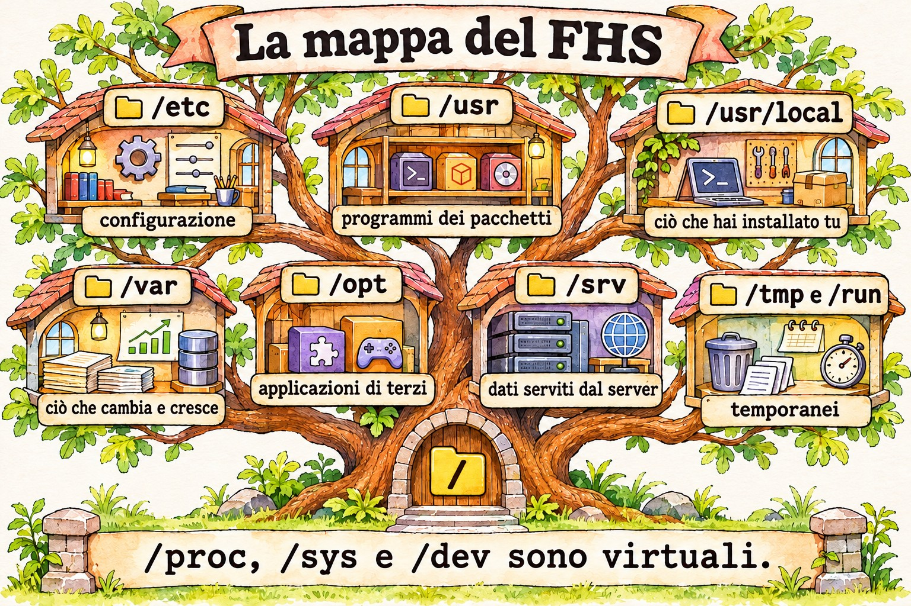
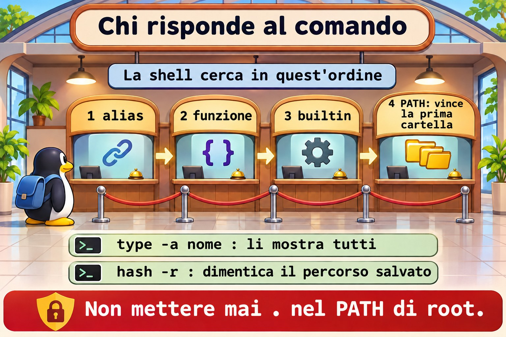

# Lezione 8.1 · FHS e dove vive ogni cosa

Su un server che non hai mai visto, il tempo che ci metti ad arrivare alla prima risposta dipende da quanto sai dove guardare. Linux ha una mappa, l'FHS, e chi la conosce trova configurazione, log e dati senza cercare alla cieca. In questa lezione impari quella mappa e scopri quale programma gira davvero quando digiti un comando.

> **Il cuore di questa lezione:** conoscere il ruolo di `/etc`, `/var`, `/usr`, `/opt`, `/srv`, `/tmp` e `/run`; distinguere ciò che sta su disco da ciò che è virtuale; decidere dove mettere ogni cosa; scoprire il proprietario di un file; usare `type`, `which`, `whereis` e `locate` sapendo che cosa vede ciascuno. Il resto è approfondimento.

| Scheda |  |
| --- | --- |
| **Modulo** | M8 · File a fondo, lezione 1 di 5 |
| **Quando** | Settimana 12 |
| **Alla fine** | Arrivi su un server sconosciuto e trovi configurazione, log, dati e il proprietario di ogni file |
| **Prerequisiti** | Lezioni 1.3, 6.1 e 6.2 |
| **Durata** | circa 1h30 |
| **Snapshot** | `m8a1-inicio` e `m8a1-fim` su rocky-lab e debian-lab |

## 1 · Riscaldamento

Rispondi prima di leggere.

1. In quale cartella sta la configurazione della macchina? E i dati che cambiano?
2. Un file salvato in `/tmp` sopravvive al reboot?
3. Se `which` non mostra un comando, vuol dire che non esiste?

## 2 · Perché conta

| La richiesta | La risposta sbagliata | Cosa provoca |
| --- | --- | --- |
| "Il disco si è riempito" | Cancellare ciò che sembra grosso in `/usr` | Rompe i programmi. La crescita normale sta in `/var` |
| "Ho aggiornato e la mia configurazione è sparita" | Dare la colpa al pacchetto | Qualcuno ha modificato in `/usr/lib`, che appartiene al pacchetto. La modifica doveva stare in `/etc` |
| "Il report è sparito dopo il reboot" | Cercare nei backup | Era salvato in `/tmp`, che può essere memoria |
| "Ho lanciato il comando e ha fatto un'altra cosa" | Reinstallare il pacchetto | Un alias o un altro programma, prima nel PATH, ha risposto al suo posto |
| "`/etc/pve` non compare nel backup del disco" | Pensare che il disco si sia guastato | È un file system speciale di Proxmox, non una cartella normale |

## 3 · Modello mentale

> Il server è un **palazzo con piani dalla funzione fissa**. `/etc` è la **sala delle norme**: pochi fogli, tutti importanti. `/usr` è il **magazzino del produttore**, che tu non riordini. `/var` è l'**archivio di tutti i giorni**, che cresce senza sosta. `/tmp` è il **tavolo delle brutte copie**, ripulito ogni tanto. `/opt` è la **stanza affittata** a terzi. `/srv` è il **deposito di ciò che il palazzo consegna** a chi viene da fuori. `/proc` e `/sys` sono i **pannelli di controllo**: non conservano nulla, mostrano solo lo stato adesso.

```
/                  raiz; um único tronco, sem letras de unidade
├─ etc             configuração da máquina, em texto
├─ usr             programas e bibliotecas do sistema; gerenciado por pacotes
│  ├─ bin, sbin, lib   /bin e /sbin hoje são links para cá
│  └─ local        o que você instalou à mão
├─ var             o que muda: log, spool, cache, lib (bancos, estado)
├─ home, root      pastas dos usuários e do root
├─ opt             aplicações de terceiros, cada uma na sua pasta
├─ srv             dados servidos: site, FTP, repositório
├─ tmp, var/tmp    temporários; var/tmp dura mais
├─ run             estado desde o boot, em memória
├─ boot            kernel, initramfs e GRUB
├─ mnt, media      pontos de montagem manuais e removíveis
└─ dev, proc, sys  virtuais: dispositivos, processos, kernel
```



*Prima di scegliere una cartella, chiediti: è configurazione, programma, dato che cambia o brutta copia?*

### Ponte Windows

| In Windows | In Linux | Dove il paragone inganna |
| --- | --- | --- |
| `C:\`, `D:\` | Un unico albero, con i dischi montati in cartelle | Non ci sono lettere: un intero disco può essere `/var` |
| `C:\Windows\System32` | `/usr/bin`, `/usr/lib` | A modificarli sono i pacchetti, non tu |
| Registro, HKLM | `/etc` | In testo: si può versionare, confrontare e copiare |
| `C:\Program Files` | `/usr`, `/opt`, `/usr/local` | Il pacchetto distribuisce i file per funzione, non in una cartella per programma |
| `C:\ProgramData` | `/var/lib`, `/etc` | Configurazione e stato restano separati |
| Visualizzatore eventi | `/var/log`, journal | Molti log sono semplice testo |
| `%TEMP%` | `/tmp`, `/var/tmp` | Condiviso da tutti, con lo sticky bit |
| Indice di Windows Search | `locate` | Si aggiorna solo quando gira `updatedb` |

## 4 · L'essenziale

### Dove mettere le cose

| Che cos'è | Dove va |
| --- | --- |
| Configurazione della macchina | `/etc` |
| Programma installato a mano, semplice | `/usr/local` |
| Applicazione di terzi, in un'unica cartella | `/opt/NOME` |
| Dati che un servizio consegna | `/srv/NOME` o il percorso standard del servizio, come `/var/www` |
| Stato e database | `/var/lib/NOME` |
| Log | `/var/log/NOME` |
| Temporaneo che può sparire | `/tmp` |
| Temporaneo che deve reggere al reboot | `/var/tmp` |

### Chi è questo comando

| Voglio... | Comando | Cosa vede |
| --- | --- | --- |
| Sapere cosa eseguirà la shell | `type -a nome` | Alias, funzione, builtin e PATH |
| Solo il percorso, per uno script | `command -v nome` | Anche alias e builtin |
| Cercare nel PATH | `which nome` | Solo i programmi nel PATH |
| Binario, sorgente e manuale | `whereis nome` | Cartelle standard, senza guardare il PATH |
| Cercare per nome sul disco | `locate texto` | Il database dell'ultimo `updatedb` |

### Di chi è questo file

| Voglio... | Rocky | Debian |
| --- | --- | --- |
| Pacchetto proprietario del file | `rpm -qf ARQUIVO` | `dpkg -S ARQUIVO` |
| Cosa è cambiato dall'installazione | `rpm -V PACOTE` | `dpkg -V PACOTE` |

Se nessun pacchetto è proprietario, qualcuno ha messo il file lì: un installer, uno script o una persona.

### Temporanei

`systemd-tmpfiles` pulisce `/tmp` e `/var/tmp` in base all'età, in genere 10 e 30 giorni. Controlla con `systemd-tmpfiles --cat-config | grep -E ' /(var/)?tmp '`. In `/run`, tutto sparisce allo spegnimento.

### Rocky × Debian

|  | Rocky | Debian |
| --- | --- | --- |
| `/tmp` in un'installazione nuova | Su disco | In memoria (tmpfs), a partire da Debian 13 |
| Impostazioni dei servizi | `/etc/sysconfig` | `/etc/default` |
| Log generale in testo | `/var/log/messages` | Solo journal, se rsyslog non è installato |
| Autenticazione in testo | `/var/log/secure` | `/var/log/auth.log`, con rsyslog |
| Apache | `/etc/httpd` | `/etc/apache2` |
| `locate` | Pacchetto `mlocate` | Pacchetto `plocate` |

**Parti sempre da** `findmnt /tmp`, invece di dare per scontato.

## 5 · Lab guidato

**Passo 0 · Snapshot e preparazione.** Su Proxmox: `qm snapshot 201 m8a1-inicio` e `qm snapshot 202 m8a1-inicio`. Su rocky-lab:

```bash
sudo dnf install -y mlocate which
mkdir -p ~/lab81 && cd ~/lab81
```

**Passo 1 · Girare per la mappa.**

```bash
ls /
ls -ld /bin /sbin /lib
findmnt -no SOURCE,FSTYPE /
findmnt /tmp
findmnt -t proc,sysfs,tmpfs
```

`/bin` è un link a `usr/bin`. I sistemi attuali hanno unito queste cartelle. `findmnt` separa ciò che è disco da ciò che è virtuale.

**Passo 2 · Chi è il proprietario e chi cresce.**

```bash
rpm -qf /etc/ssh/sshd_config /usr/sbin/sshd
rpm -qf ~/.bashrc
sudo rpm -V openssh-server
sudo du -xh --max-depth=1 /var | sort -h
```

`~/.bashrc` non ha proprietario: è stato copiato alla creazione dell'utente. L'opzione `-x` di `du` non attraversa altri file system, e questo fa sì che il totale valga per quel disco.

**Passo 3 · Chi comanda sulla configurazione.**

```bash
systemctl cat sshd | head -n 3
ls /etc/systemd/system | head
ls /usr/lib/systemd/system | wc -l
```

Il pacchetto consegna in `/usr/lib`. La tua modifica va in `/etc`, che ha la precedenza. A un aggiornamento, il pacchetto sostituisce ciò che è suo, non ciò che è tuo.



*La shell cerca in quest'ordine, e vince il primo che trova.*

**Passo 4 · Chi risponde a un comando.**

```bash
type -a ls
type cd
which ls
which cd
whereis ls
command -v ls
```

`type -a ls` mostra l'alias e poi il programma. `type cd` risponde `builtin`. `which cd` fallisce o punta a qualcosa che non è ciò che usa la shell. Per sapere cosa verrà eseguito, lo strumento giusto è `type`.

**Passo 5 · Cercare con un indice.**

```bash
touch ~/lab81/agulha-no-palheiro.txt
locate agulha-no-palheiro
sudo updatedb
locate agulha-no-palheiro
rm ~/lab81/agulha-no-palheiro.txt
locate agulha-no-palheiro
locate -e agulha-no-palheiro
```

Se il primo `locate` si lamenta di non trovare il database (`mlocate.db` o `plocate.db`), è solo perché `updatedb` non è ancora girato su questa macchina. Il file nuovo compare solo dopo `updatedb`. Dopo essere stato cancellato, resta nella lista fino al prossimo `updatedb`, e `-e` verifica se esiste ancora.

**Passo 6 · Il virtuale.**

```bash
cat /proc/uptime
cat /proc/sys/vm/swappiness
ls -l /proc/self
df -h /run /dev/shm
```

Niente di tutto questo occupa disco. `/proc/self` punta al processo stesso che lo legge.

**Passo 7 · debian-lab.**

```bash
sudo apt install -y plocate
findmnt /tmp
ls -ld /etc/default /etc/sysconfig
ls /var/log | head -n 20
dpkg -S /usr/sbin/sshd
systemctl cat ssh | head -n 3
```

### Decidi 1

Un fornitore consegna un `.tar.gz` con programma, librerie e tutto il resto in una cartella. Dove installare?

A) In `/usr/bin`, così finisce subito nel PATH. B) In `/opt/fornecedor`, con un link in `/usr/local/bin` verso l'eseguibile. C) In `/root`.

Scegli un'opzione prima di continuare.

| Se hai scelto | Risultato | Perché |
| --- | --- | --- |
| A | Rischio | Mescola file senza proprietario nell'area dei pacchetti |
| B | Giusto | Resta isolato, facile da rimuovere, e il comando rimane nel PATH |
| C | Sbagliato | Altri utenti e servizi non vi accedono, e il backup non sempre lo include |

**Da ricordare:** `/usr` è dei pacchetti. Ciò che porti tu va in `/opt` o `/usr/local`.

### Decidi 2

Uno script genera un file intermedio da 5 GB, e il lavoro deve sopravvivere a un reboot. La VM è Debian 13, con 2 GB di RAM. Dove scrivere?

A) `/tmp`. B) `/var/tmp`. C) `/dev/shm`.

Scegli un'opzione prima di continuare.

| Se hai scelto | Risultato | Perché |
| --- | --- | --- |
| A | Fallisce | Qui `/tmp` è memoria: non ci sta e sparisce al reboot |
| B | Giusto | Sta su disco e dura di più |
| C | Peggio | È sempre memoria |

**Da ricordare:** controlla con `findmnt` cosa c'è dietro la cartella.

## 6 · Rompi e ripara

### Guasto 1 · Il comando impostore

```bash
mkdir -p ~/lab81/bin
printf '#!/bin/bash\necho "eu nao sou o ls"\n' > ~/lab81/bin/ls
chmod +x ~/lab81/bin/ls
PATH=$HOME/lab81/bin:$PATH
hash -r
ls /etc
```

**Sintomo:** `ls` risponde un'altra cosa.

**Diagnosi:** `type -a ls` mostra tutti i candidati, in ordine. Vince il primo nel PATH.

**Riparazione:**

```bash
PATH=${PATH#$HOME/lab81/bin:}
hash -r
type -a ls
```

**Nella vita reale:** per questo non si mette mai `.` nel PATH di root. `hash -r` cancella la memoria della shell su dove si trovava ogni comando.


*Una cartella alla volta, dal disco fino al file.*

### Guasto 2 · Il disco che si è riempito

```bash
sudo dd if=/dev/zero of=/var/log/lab81-grande.log bs=1M count=200 status=none
df -h /var
```

**Sintomo:** l'uso è salito e nessuno sa dire perché.

**Diagnosi:** scendi, una cartella alla volta.

```bash
sudo du -xh --max-depth=1 /var | sort -h | tail -n 4
sudo du -xh --max-depth=1 /var/log | sort -h | tail -n 4
```

**Riparazione:** `sudo rm /var/log/lab81-grande.log`. In produzione, verifica prima di chi è il file e se c'è un processo che ci scrive, come visto nella lezione 1.4.

### Guasto 3 · Il file sparito (debian-lab)

```bash
findmnt /tmp
echo importante > /tmp/lab81.txt
sudo reboot
```

Riconnettiti e lancia `cat /tmp/lab81.txt`.

**Sintomo:** `No such file or directory`.

**Diagnosi:** se `findmnt /tmp` ha mostrato `tmpfs`, il contenuto era in memoria.

**Riparazione:** ciò che deve durare va in `/var/tmp` o in una cartella di dati. Ripeti su rocky-lab e confronta il risultato.

### Pulizia

```bash
rm -r ~/lab81
```

## 7 · Trappole

| Trappola | Cosa succede | Come evitarla |
| --- | --- | --- |
| Modificare un file in `/usr/lib` | Il prossimo aggiornamento lo annulla | Usa `/etc` e `systemctl edit` |
| Cancellare ciò che sta in `/var/lib` per guadagnare spazio | Distrugge database e stato | Pulisci `/var/log` e `/var/cache` con criterio |
| Fidarsi di `which` | Non vede alias né builtin | Usa `type -a` |
| Aspettarsi un file nuovo in `locate` | Non compare fino a `updatedb` | `sudo updatedb` o `find` |
| Fare il backup di `/proc` e `/sys` | Errori e dimensioni senza senso | Escludi i virtuali o usa `-xdev` |
| Dare per scontato che `/tmp` sia disco | Riempie la memoria o perde dati | `findmnt /tmp` |
| `du` senza `-x` | Somma anche gli altri dischi montati | `du -x` |
| Backup solo di `/home` | Mancano `/etc` e `/var/lib` | Elenca cosa è configurazione e cosa è dato |

## 8 · Quiz

Rispondi senza guardare. Le soluzioni sono alla fine della lezione.

1. Qual è la differenza tra `/usr/local` e `/opt`?
2. Dove cresce ciò che di solito riempie il disco?
3. Come scoprire il pacchetto proprietario di `/usr/sbin/sshd` in ciascuna famiglia?
4. Perché `type` è meglio di `which` per sapere cosa verrà eseguito?
5. Perché `/proc` non occupa spazio?
6. Perché `/var/tmp` può essere meglio di `/tmp`?

## 9 · Promemoria

**Da sapere a memoria:**

| Voglio... | Comando |
| --- | --- |
| Vedere cosa è montato in una cartella | `findmnt /tmp` |
| Sapere chi risponde | `type -a nome` |
| Proprietario su Rocky | `rpm -qf ARQUIVO` |
| Proprietario su Debian | `dpkg -S ARQUIVO` |
| Chi occupa spazio | `sudo du -xh --max-depth=1 /var \| sort -h` |
| Aggiornare l'indice | `sudo updatedb` |

**Da consultare:**

| Voglio... | Comando |
| --- | --- |
| Manuale della mappa | `man hier`, `man file-hierarchy` |
| Cercare nell'indice | `locate texto`, `locate -e texto` |
| Verificare le modifiche a un pacchetto | `rpm -V PACOTE`, `dpkg -V PACOTE` |
| Regole di pulizia | `systemd-tmpfiles --cat-config` |
| Binario e manuale | `whereis nome` |

**Flashcard:**

- `/etc` → *configurazione.*
- `/var` → *ciò che cambia e cresce.*
- `/usr` → *dei pacchetti.*
- `/opt` → *terzi, una cartella per applicazione.*
- `/run` → *stato in memoria, dal boot.*
- Chi viene eseguito? → *`type -a`.*

## 10 · Checklist e chiusura

- [ ] So dire il ruolo di ogni cartella principale
- [ ] Distinguo disco da memoria e da file system virtuale
- [ ] Decido dove installare e dove scrivere
- [ ] Trovo il pacchetto proprietario di un file in entrambe le famiglie
- [ ] Uso `type`, `which`, `whereis` e `locate` sapendo cosa vede ciascuno
- [ ] Scendo con `du` fino a trovare ciò che ha riempito il disco

**Ultimo esercizio, senza guardare la lezione:** su debian-lab, scopri il file di configurazione principale di SSH, il pacchetto proprietario, l'eseguibile del servizio e dove stanno i log di accesso.

**Snapshot di fine** (su Proxmox):

```bash
qm snapshot 201 m8a1-fim
qm snapshot 202 m8a1-fim
```

## 11 · Nella vita reale

**Missione, sola lettura.** Su un server Linux che amministri (o con autorizzazione), lancia **solo**:

```bash
findmnt -t xfs,ext4,zfs,nfs,nfs4
findmnt /tmp
df -h
sudo du -xh --max-depth=1 /var | sort -h | tail -n 5
ls /opt /srv /usr/local/bin
```

Domande a cui rispondere:

1. Cosa è disco separato e cosa condivide la radice?
2. Quale cartella occupa di più in `/var`?
3. Cosa c'è in `/opt` e in `/usr/local/bin`? Ha un proprietario tra i pacchetti?
4. Su un Proxmox, cosa mostra `findmnt /etc/pve`?

**Diario:** annota cosa metteresti in un backup di quella macchina, oltre a `/home`.

**Domani, senza guardare:** disegna l'albero della radice, con una frase per ogni cartella.

## 12 · Approfondire quando vuoi

- **`man hier` e `man file-hierarchy`:** la mappa nella descrizione ufficiale.
- **`/etc/updatedb.conf`:** cosa ignora l'indice.
- **`etckeeper`:** versionare `/etc` con git.
- **`tmpfiles.d`:** creare le tue regole di pulizia.
- **`/etc/pve`:** il file system in cluster di Proxmox, che vedrai nell'M17.

**DeepTutor** (http://10.1.0.149:3782, KB "Curso Linux Sysadmin"):

- `!explica a diferença entre /usr/local, /opt e /srv`
- `!feynman por que /proc não ocupa espaço em disco`
- `!quiz Aula 8.1, 5 perguntas sobre o FHS`

## Soluzioni commentate

### Riscaldamento

1. In `/etc` la configurazione, e in `/var` i dati che cambiano.
2. Dipende. Su disco, può sopravvivere fino alla pulizia per età. In tmpfs, sparisce.
3. No. Può essere un builtin, un alias o una funzione, oppure stare fuori dal PATH.

### Quiz

1. `/usr/local` segue la struttura del sistema (`bin`, `lib`) e accoglie cose piccole installate a mano. `/opt` tiene ogni applicazione nella sua cartella.
2. In `/var`, soprattutto `/var/log`, `/var/lib` e `/var/cache`.
3. `rpm -qf /usr/sbin/sshd` e `dpkg -S /usr/sbin/sshd`.
4. Perché `type` fa parte della shell e vede alias, funzioni e builtin, che vengono considerati prima del PATH.
5. Perché è generato al momento dal kernel e non esiste su disco.
6. Perché di solito sta su disco, non viene svuotato al reboot e ha una scadenza più lunga.

---

<!-- navegacao -->
[← Lezione 7.3 · Priorità e profili](7.3-prioridade-e-perfis.md) · [Indice delle lezioni](../01-aulas.md) · [Lezione 8.2 · find a fondo →](8.2-find-a-fundo.md)
