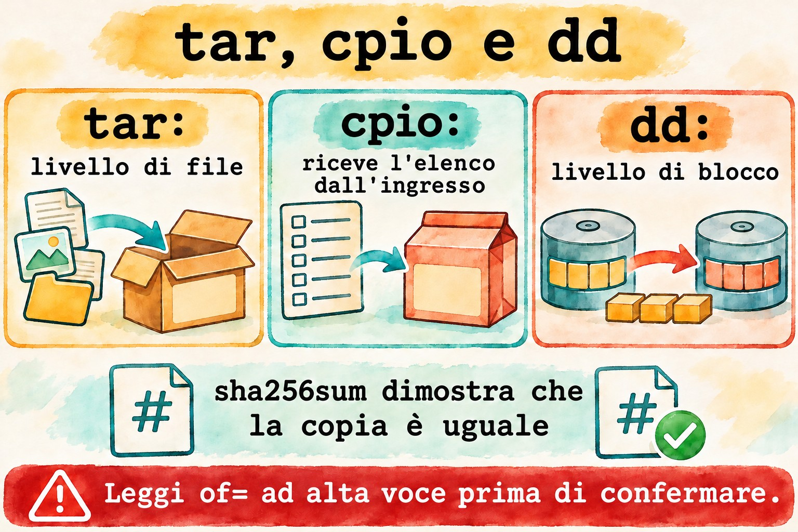
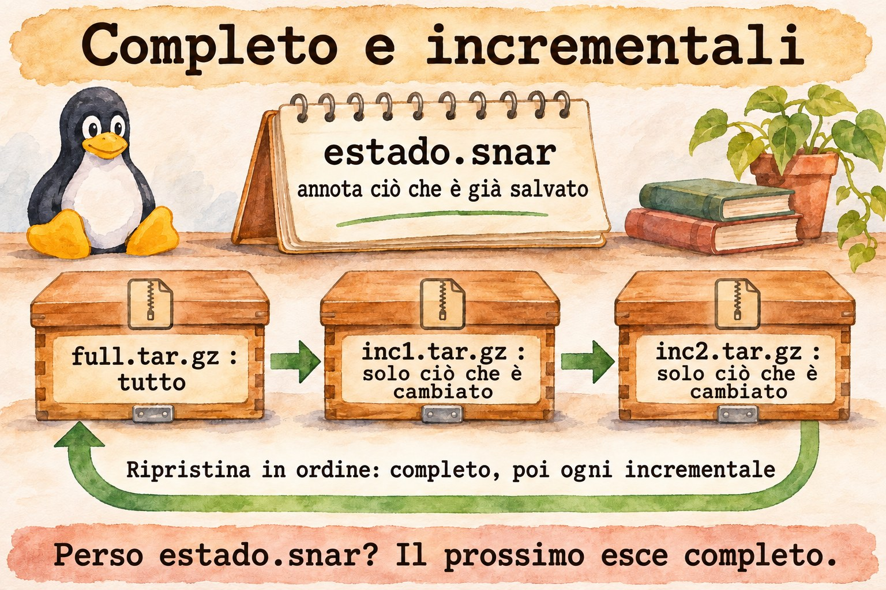
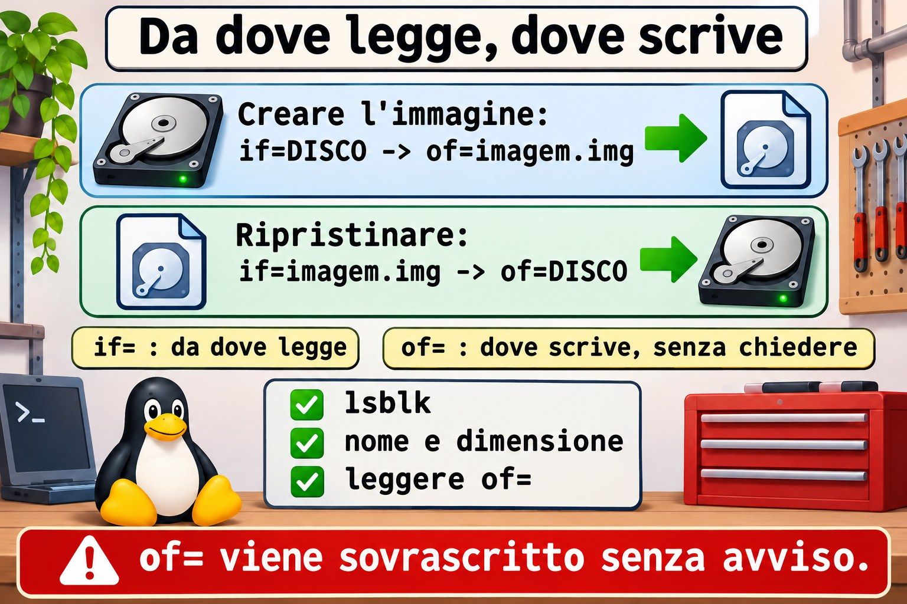

# Lezione 8.3 · Archiviazione avanzata

Nella lezione 1.7 hai imparato a creare un `tar` e a estrarlo. Ora la domanda cambia: cosa entra, cosa resta fuori, cosa preserva i permessi e come dimostrare che la copia è integra. In questa lezione usi anche `dd`, che copia un intero disco e che, con una lettera sbagliata, cancella un intero disco.

> **Il cuore di questa lezione:** selezionare con `--exclude` e `-T`; estrarre dove vuoi con `-C` e `--strip-components`; confrontare con `tar -d`; riconoscere `cpio`; creare un'immagine di disco con `dd`; dimostrare l'integrità con `sha256sum`. Il resto è approfondimento.

| Scheda |  |
| --- | --- |
| **Modulo** | M8 · File a fondo, lezione 3 di 5 |
| **Quando** | Settimana 12 |
| **Alla fine** | Scegli cosa copiare, preservi ciò che conta e dimostri che la copia è integra |
| **Prerequisiti** | Lezioni 1.7 e 8.2 |
| **Durata** | circa 2h |
| **Snapshot** | `m8a3-inicio` e `m8a3-fim` su rocky-lab e debian-lab |

## 1 · Riscaldamento

Rispondi prima di leggere.

1. Cosa significano `if` e `of` in `dd`? Cosa succede se li scambi?
2. Un `tar.gz` è stato estratto senza errori. Questo garantisce che sia uguale all'originale?
3. `tar`, per impostazione predefinita, registra ACL e contesto SELinux?

## 2 · Perché conta

| La richiesta | La risposta sbagliata | Cosa provoca |
| --- | --- | --- |
| "Il backup del sito ha 40 GB di cache" | Comprare più disco | Bastava escludere `cache/` |
| "Ho ripristinato e il servizio non parte" | Reinstallare | Mancavano ACL e contesti: il `tar` predefinito non li registra |
| "Ho clonato il disco con la VM accesa e non fa il boot" | Clonare di nuovo | L'immagine di un disco montato esce inconsistente |
| "Ho lanciato `dd` e il disco è sparito" | Riprovare | `if` e `of` invertiti. Solo il backup risolve |
| "La copia è arrivata, ma è strana" | Fidarsi della dimensione | Solo il checksum dimostra l'uguaglianza |

## 3 · Modello mentale

> `tar` è uno **scatolone da trasloco**: scegli cosa entra ed etichetti ogni oggetto con proprietario e permessi. `cpio` è lo **stesso scatolone, in cui la lista te la consegna un'altra persona**: legge i nomi dallo standard input. `dd` è una **fotocopiatrice di fogli**: non sa cosa sia un file, copia blocco per blocco, da un'origine a una destinazione. `sha256sum` è il **sigillo**: se cambia un solo bit, il sigillo non corrisponde.

```
tar   nível de arquivo   entende nomes, donos, datas     escolhe o que entra
cpio  nível de arquivo   recebe a lista pela entrada     find | cpio -o
dd    nível de bloco     não entende nada, copia tudo    disco inteiro

                     dd if=ORIGEM of=DESTINO bs=4M
                         in file  out file
                         ↑        ↑
                  só leitura   será SOBRESCRITO
```



*Prima di premere Invio su un `dd`, leggi `of=` ad alta voce.*

### Ponte Windows

| In Windows | In Linux | Dove il paragone inganna |
| --- | --- | --- |
| 7-Zip, `Compress-Archive` | `tar` con compressione | `tar` conserva proprietario, permessi e link |
| `robocopy /XD /XF` | `tar --exclude` | In `tar`, la posizione dell'opzione conta |
| `robocopy /COPYALL` | `tar --acls --xattrs --selinux` | Senza le opzioni, i permessi estesi si perdono |
| Backup di immagine, Clonezilla | `dd` | `dd` non sa cosa sia lo spazio libero: copia tutto |
| `Get-FileHash`, `certutil -hashfile` | `sha256sum` | Uguale, ma con `-c` verifica una lista |

## 4 · L'essenziale

### tar: selezione e destinazione

| Voglio... | Forma |
| --- | --- |
| Escludere | `tar -czf x.tar.gz --exclude='cache' --exclude='*.log' pasta` |
| Lista di file | `tar -czf x.tar.gz -T lista.txt` |
| Lista con nomi sicuri | `find ... -print0 \| tar -czf x.tar.gz --null -T -` |
| Entrare in una cartella prima | `tar -czf x.tar.gz -C /etc ssh` |
| Estrarre altrove | `tar -xzf x.tar.gz -C destino` |
| Togliere il primo livello | `tar -xzf x.tar.gz --strip-components=1` |
| Estrarre solo un elemento | `tar -xzf x.tar.gz caminho/arquivo` |
| Confrontare con il disco | `tar -dzf x.tar.gz` |
| Incrementale | `tar -czf inc.tar.gz -g estado.snar pasta` |

### Cosa preservare

| Voglio... | Opzione |
| --- | --- |
| Permessi in estrazione | `-p` (predefinito per root) |
| ACL | `--acls` |
| Attributi estesi | `--xattrs` |
| Contesto SELinux | `--selinux` |
| Proprietario numerico | `--numeric-owner` |

Su Rocky, dopo aver ripristinato in `/etc`, lancia `sudo restorecon -Rv /etc/CAMINHO`.

### cpio

| Voglio... | Comando |
| --- | --- |
| Creare | `find pasta -print0 \| cpio -o0 -H newc > x.cpio` |
| Elencare | `cpio -tv < x.cpio` |
| Estrarre | `cpio -idmv < x.cpio` |

Lo trovi in due posti: nell'initramfs e dentro i pacchetti RPM.

### dd

| Voglio... | Comando |
| --- | --- |
| Immagine | `sudo dd if=DISCO of=imagem.img bs=4M status=progress conv=fsync` |
| Ripristinare | `sudo dd if=imagem.img of=DISCO bs=4M status=progress conv=fsync` |
| Con compressione | `sudo dd if=DISCO bs=4M \| gzip > imagem.img.gz` |
| Sostituire un pezzo di un file | `dd ... conv=notrunc` |

### Sigillo

| Voglio... | Comando |
| --- | --- |
| Calcolare | `sha256sum arquivo > arquivo.sha256` |
| Verificare | `sha256sum -c arquivo.sha256` |

### Rocky × Debian

|  | Rocky | Debian |
| --- | --- | --- |
| `tar` e `dd` | Uguali | Uguali |
| `cpio` | `dnf install cpio` | `apt install cpio` |
| Vedere l'initramfs | `lsinitrd` | `lsinitramfs` |

## 5 · Lab guidato

**Passo 0 · Snapshot e preparazione.** Su Proxmox: `qm snapshot 201 m8a3-inicio` e `qm snapshot 202 m8a3-inicio`. Su rocky-lab:

```bash
sudo dnf install -y tar cpio
mkdir -p ~/lab83/site/{html,cache,logs} && cd ~/lab83
echo pagina > site/html/index.html
echo lixo > site/cache/x.tmp
echo acesso > site/logs/acesso.log
```

**Passo 1 · Selezionare.**

```bash
tar -czf sem-cache.tar.gz --exclude='site/cache' --exclude='*.log' site
tar -tzf sem-cache.tar.gz
find site -type f -name '*.html' -print0 > lista.bin
tar -czf so-html.tar.gz --null -T lista.bin
tar -tzf so-html.tar.gz
```

**Passo 2 · Estrarre dove vuoi.**

```bash
mkdir destino
tar -xzf sem-cache.tar.gz -C destino --strip-components=1
find destino
```

`--strip-components=1` ha tolto `site/` dal percorso.

**Passo 3 · Confrontare con il disco.**

```bash
tar -dzf sem-cache.tar.gz; echo "saida=$?"
echo mudou >> site/html/index.html
tar -dzf sem-cache.tar.gz; echo "saida=$?"
```

La seconda volta compaiono `Mod time differs` e `Size differs`, con uscita 1. Serve a rispondere a "cosa è cambiato dal backup".

**Passo 4 · Incrementale.**

```bash
tar -czf full.tar.gz -g estado.snar site
echo nova > site/html/nova.html
tar -czf inc1.tar.gz -g estado.snar site
tar -tzf inc1.tar.gz
mkdir restaura
tar -xzf full.tar.gz -g /dev/null -C restaura
tar -xzf inc1.tar.gz -g /dev/null -C restaura
find restaura -name '*.html'
```

L'incrementale conserva solo ciò che è cambiato. Si ripristina in quest'ordine: il completo, poi ogni incrementale. `estado.snar` viene modificato a ogni esecuzione: se si perde, il successivo torna a essere completo.



*Il completo conserva tutto; ogni incrementale conserva solo ciò che è cambiato rispetto al precedente.*

**Passo 5 · cpio e initramfs.**

```bash
find site -print0 | cpio -o0 -H newc > site.cpio
cpio -tv < site.cpio | head -n 5
mkdir viacpio && cd viacpio
cpio -idmv < ../site.cpio
cd ..
sudo lsinitrd /boot/initramfs-$(uname -r).img | head -n 25
```

Il file che il kernel usa al boot è un `cpio` compresso.

**Passo 6 · Un disco di laboratorio.** Un file fa la parte del disco, così nulla di reale corre rischi.

```bash
truncate -s 64M disco.img
L=$(sudo losetup --find --show disco.img)
echo $L
sudo mkfs.ext4 -q $L
sudo mkdir -p /mnt/lab83
sudo mount $L /mnt/lab83
echo 'dado importante' | sudo tee /mnt/lab83/nota.txt
sudo umount /mnt/lab83
```

**Passo 7 · Immagine e sigillo.** Con il disco smontato:

```bash
sudo dd if=$L of=imagem.img bs=1M status=progress conv=fsync
sudo chown $USER: imagem.img
sudo sha256sum $L imagem.img
sha256sum imagem.img > imagem.sha256
sha256sum -c imagem.sha256
```

I due hash sono uguali.

**Passo 8 · Disastro e ritorno.** Solo sul disco del lab, verifica che `$L` sia `/dev/loop`.

```bash
echo $L
sudo dd if=/dev/zero of=$L bs=1M count=8 conv=fsync status=none
sudo mount $L /mnt/lab83
sudo dd if=imagem.img of=$L bs=1M status=progress conv=fsync
sudo mount $L /mnt/lab83
cat /mnt/lab83/nota.txt
sudo umount /mnt/lab83
```

Il primo `mount` fallisce, perché l'inizio del file system è stato azzerato. Dopo il ripristino, la nota torna.

**Passo 9 · debian-lab.** Installa `cpio` e ripeti i passi 1, 2 e 5, sostituendo l'ultimo comando con `lsinitramfs /boot/initrd.img-$(uname -r) | head -n 25`.

### Decidi 1

Mi serve una copia del disco di un server di database in produzione. Come?

A) `dd` con tutto acceso. B) Backup tramite il meccanismo dell'hypervisor o del database, oppure `dd` da un sistema in cui il disco non sia montato. C) `cp -r /`.

Scegli un'opzione prima di continuare.

| Se hai scelto | Risultato | Perché |
| --- | --- | --- |
| A | Immagine inconsistente | I blocchi cambiano mentre `dd` copia |
| B | Giusto | Su un Proxmox, `vzdump` e PBS lo fanno. Su bare metal, avvia da un supporto di ripristino |
| C | Sbagliato | Entra in `/proc` e `/sys`, e perde link e metadati |

**Da ricordare:** `dd` solo con il disco fermo.

### Decidi 2

Backup di `/etc/ssh` su Rocky, da ripristinare poi sulla stessa macchina. Quale comando?

A) `tar -czf x.tar.gz /etc/ssh`. B) `sudo tar --acls --xattrs --selinux -czpf x.tar.gz -C / etc/ssh`. C) `cp -r /etc/ssh ~/`.

Scegli un'opzione prima di continuare.

| Se hai scelto | Risultato | Perché |
| --- | --- | --- |
| A | Incompleto | Senza root non legge nemmeno le chiavi, e non conserva SELinux |
| B | Giusto | Preserva tutto, con percorso relativo. Poi, `restorecon` |
| C | Pessimo | Perde proprietario, permessi e contesto |

**Da ricordare:** sappi cosa il tuo backup non conserva.

## 6 · Rompi e ripara

### Guasto 1 · L'exclude che non ha escluso

```bash
cd ~/lab83
tar -czf errado.tar.gz site --exclude='*.log'
tar -tzf errado.tar.gz | grep log
```

**Sintomo:** `acesso.log` è dentro, e `tar` avvisa di opzioni usate dopo i nomi.

**Diagnosi:** `--exclude` vale per ciò che viene dopo.

**Riparazione:** mettilo prima del percorso, come nel Passo 1. Controlla sempre con `tar -t`.

### Guasto 2 · Il dd che ha accorciato il file

```bash
cp imagem.img copia.img
ls -l copia.img
dd if=/dev/zero of=copia.img bs=1 count=1 seek=1000
ls -l copia.img
sha256sum imagem.img copia.img
```

**Sintomo:** il file è rimasto con 1001 byte.

**Diagnosi:** per impostazione predefinita, `dd` tronca la destinazione quando è un file.

**Riparazione:** ripristina la copia e usa `conv=notrunc`:

```bash
cp imagem.img copia.img
printf 'X' | dd of=copia.img bs=1 seek=1000 conv=notrunc status=none
ls -l copia.img
sha256sum imagem.img copia.img
```

La dimensione resta invariata, e l'hash è cambiato per un solo byte.



*if= è da dove dd legge; of= è dove scrive, senza chiedere.*

### Guasto 3 · if e of scambiati (racconto)

Una notte, per salvare il disco, qualcuno digita `dd if=/backup/imagem.img of=/dev/sda`, convinto di stare creando l'immagine.

**Sintomo:** il sistema comincia a dare errori, e non parte più nulla.

**Diagnosi:** origine e destinazione erano invertite, e `/dev/sda` è stato sovrascritto.

**Riparazione:** non esiste un comando che lo annulli. Solo il ripristino di un backup o di uno snapshot. Prima di lanciare: `lsblk`, controllare nome e dimensione, e leggere `of=`.

### Pulizia

```bash
cd ~
sudo losetup -j ~/lab83/disco.img
sudo losetup -d "$(sudo losetup -j ~/lab83/disco.img | cut -d: -f1)"
sudo rmdir /mnt/lab83
rm -r ~/lab83
```

## 7 · Trappole

| Trappola | Cosa succede | Come evitarla |
| --- | --- | --- |
| `--exclude` dopo il percorso | Non esclude | Prima del percorso |
| Percorso assoluto in `tar` | `tar` toglie la `/`, ed estrae in relativo | Usa `-C /` in creazione |
| Backup senza `--acls` e `--selinux` | Ripristina senza metadati | Includi le opzioni |
| Perdere il `.snar` | L'incrementale diventa completo | Conservalo insieme al backup |
| `dd` su disco montato | Immagine inconsistente | Smonta o usa uno snapshot |
| Confondere `/dev/sda` e `/dev/sdb` | Cancella il disco sbagliato | `lsblk` prima |
| `dd` su file senza `notrunc` | Tronca il file | `conv=notrunc` |
| `bs` piccolo su disco grande | Lentissimo | `bs=4M` |
| Fidarsi della dimensione | Non dimostra nulla | `sha256sum -c` |

## 8 · Quiz

Rispondi senza guardare. Le soluzioni sono alla fine della lezione.

1. Perché `--exclude` dopo il percorso non funziona?
2. Cosa fa `--strip-components=1`?
3. In che ordine si ripristina un backup incrementale di `tar`?
4. Come elencare un `cpio`?
5. Perché non usare `dd` su un disco montato?
6. Come dimostrare che l'immagine è uguale all'origine?

## 9 · Promemoria

**Da sapere a memoria:**

| Voglio... | Comando |
| --- | --- |
| Escludere | `tar -czf x.tar.gz --exclude='PADRAO' pasta` |
| Elencare | `tar -tzf x.tar.gz` |
| Estrarre altrove | `tar -xzf x.tar.gz -C destino` |
| Confrontare | `tar -dzf x.tar.gz` |
| Immagine | `sudo dd if=ORIGEM of=imagem.img bs=4M status=progress conv=fsync` |
| Sigillo | `sha256sum -c arquivo.sha256` |

**Da consultare:**

| Voglio... | Comando |
| --- | --- |
| Preservare tutto | `--acls --xattrs --selinux -p` |
| Incrementale | `-g estado.snar` |
| Lista sicura | `find ... -print0 \| tar --null -T - -czf x.tar.gz` |
| cpio | `cpio -o0 -H newc`, `cpio -tv`, `cpio -idmv` |
| Initramfs | `lsinitrd`, `lsinitramfs` |
| Dispositivo da file | `losetup --find --show`, `losetup -d` |

**Flashcard:**

- `of=` → *la destinazione, sovrascritta senza chiedere.*
- `tar`, `cpio`, `dd` → *file, lista e blocco.*
- `conv=notrunc` → *non tronca la destinazione.*
- Backup senza `--selinux` → *contesti persi.*
- Prova di uguaglianza → *hash.*

## 10 · Checklist e chiusura

- [ ] Escludo da `tar` e confermo con `-t`
- [ ] Estraggo nella destinazione e tolgo i livelli
- [ ] Faccio backup completo e incrementale
- [ ] So cosa `tar` non registra per impostazione predefinita
- [ ] Elenco ed estraggo un `cpio`
- [ ] Faccio un'immagine e ripristino con `dd` su un disco di lab
- [ ] Dimostro l'uguaglianza con l'hash

**Ultimo esercizio, senza guardare la lezione:** su debian-lab, genera un `tar.gz` di `/etc/ssh` senza le chiavi private (`ssh_host_*_key`), elenca il contenuto per dimostrarlo e crea il file `.sha256` corrispondente.

**Snapshot di fine** (su Proxmox):

```bash
qm snapshot 201 m8a3-fim
qm snapshot 202 m8a3-fim
```

## 11 · Nella vita reale

**Missione, sola lettura.** Su un server Linux che amministri (o con autorizzazione), lancia **solo**:

```bash
lsblk -o NAME,SIZE,TYPE,MOUNTPOINTS
sudo find / -xdev -type f \( -name '*.tar.gz' -o -name '*.tgz' -o -name '*.img' \) -size +100M -ls
```

Su un file `tar` trovato, elenca senza estrarre:

```bash
tar -tzf ARQUIVO | head -n 20
tar -tzvf ARQUIVO | tail -n 3
```

Domande a cui rispondere:

1. Qual è il disco di sistema? Quale sarebbe l'`of=` sbagliato?
2. Esiste un'immagine o un backup senza documentazione?
3. Quel file è mai stato testato?

**Diario:** annota chi è il responsabile di quel backup e quando è stato testato.

**Domani, senza guardare:** scrivi il comando `dd` per creare un'immagine di `/dev/sdb`, e di' cosa devi controllare prima.

## 12 · Approfondire quando vuoi

- **`rpm2cpio pacote.rpm | cpio -idmv`:** estrarre i file di un pacchetto senza installarlo.
- **`ddrescue`:** copiare un disco difettoso, tollerando gli errori.
- **`fsarchiver`, `partclone`:** copiano solo i blocchi in uso.
- **`restic` e `borg`:** deduplicazione e cifratura; NS8 usa `restic` nei backup.
- **`zstd` in `tar`:** `tar --zstd -cf`, opzione veloce e molto compatta.

**DeepTutor** (http://10.1.0.149:3782, KB "Curso Linux Sysadmin"):

- `!explica a diferença entre tar, cpio e dd`
- `!feynman por que dd em disco montado gera imagem inconsistente`
- `!quiz Aula 8.3, 5 perguntas sobre arquivamento`

## Soluzioni commentate

### Riscaldamento

1. `if` è l'origine e `of` è la destinazione. Se li scambi, `dd` sovrascrive l'origine, senza chiedere.
2. No. Solo un hash confrontato con l'originale dimostra l'uguaglianza.
3. No. Bisogna chiederlo con `--acls` e `--selinux`, e in molti casi con `--xattrs`.

### Quiz

1. Perché, in creazione, quelle opzioni valgono per i nomi che vengono dopo di esse.
2. Rimuove il primo livello dei percorsi in estrazione.
3. Prima il completo, poi ogni incrementale, nell'ordine in cui sono stati creati.
4. `cpio -tv < arquivo.cpio`.
5. Perché i blocchi cambiano durante la copia, e l'immagine risulta in uno stato che non è mai esistito.
6. Con l'`sha256sum` dell'origine e dell'immagine, con il disco senza scritture.

---

<!-- navegacao -->
[← Lezione 8.2 · find a fondo](8.2-find-a-fundo.md) · [Indice delle lezioni](../01-aulas.md) · [Lezione 8.4 · Link →](8.4-links.md)
