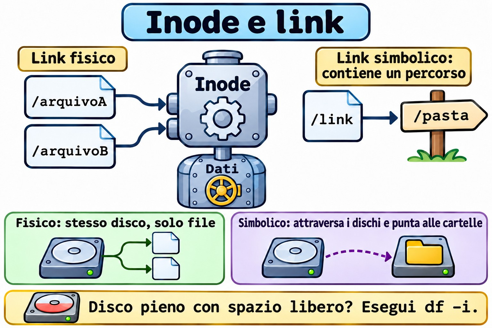
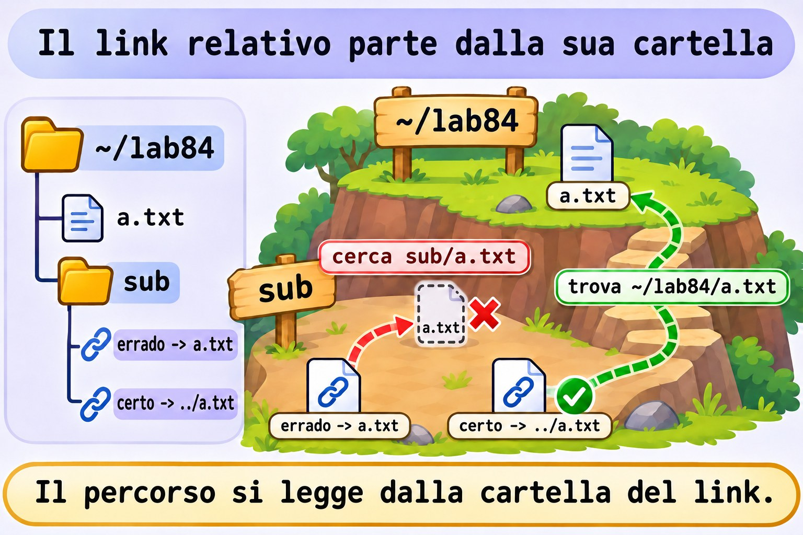
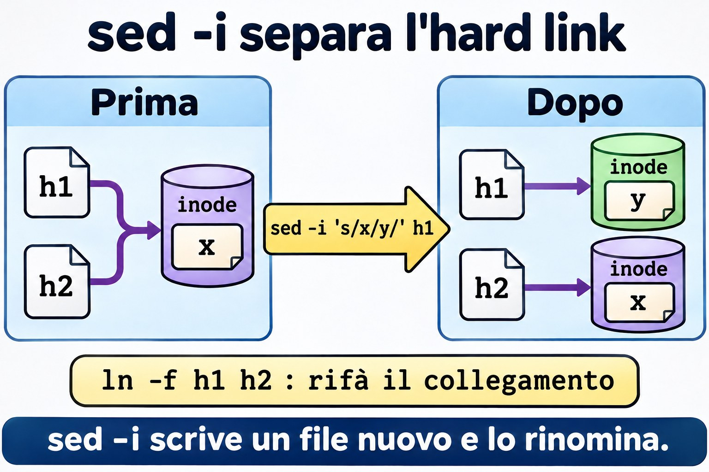

# Lezione 8.4 · Link

Il nome di un file non è il file. Sembra filosofia, ma spiega perché un link si rompe, perché un "disco pieno" può avere molto spazio libero e perché `sed -i` a volte taglia un collegamento senza avvisare. In questa lezione vedi l'inode e impari a prevedere cosa succede quando l'originale sparisce.

> **Il cuore di questa lezione:** capire l'inode; creare link fisici e simbolici; prevedere cosa succede quando l'originale sparisce; scrivere link relativi corretti; trovare i link rotti; e diagnosticare la mancanza di inode. Il resto è approfondimento.

| Scheda |  |
| --- | --- |
| **Modulo** | M8 · File a fondo, lezione 4 di 5 |
| **Quando** | Settimana 13 |
| **Alla fine** | Scegli il tipo giusto di link e ripari quelli che si sono rotti |
| **Prerequisiti** | Lezioni 1.3, 2.8 e 8.2 |
| **Durata** | circa 1h30 |
| **Snapshot** | `m8a4-inicio` e `m8a4-fim` su rocky-lab e debian-lab |

## 1 · Riscaldamento

Rispondi prima di leggere.

1. Dove viene memorizzato il nome di un file: nel file stesso o nella cartella?
2. Hai cancellato l'originale. Il link fisico funziona ancora? E quello simbolico?
3. `df -h` mostra il 40% di utilizzo e il sistema dice `No space left on device`. Com'è possibile?

## 2 · Perché conta

| La richiesta | La risposta sbagliata | Cosa provoca |
| --- | --- | --- |
| "Il servizio non trova la cartella dopo l'aggiornamento" | Reinstallare | Un link simbolico punta a una versione che non esiste più |
| "Il disco è pieno, ma c'è spazio" | Cancellare i file grandi | Sono finiti gli inode. Sono tanti file piccoli |
| "Ho cancellato il file e lo spazio non è tornato" | Riavviare il server | C'è un altro link fisico, oppure il file è ancora aperto |
| "Ho provato il link ed è uscito `Invalid cross-device link`" | Copiare senza pensare | Il link fisico non attraversa i dischi |
| "Ho modificato uno e l'altro non è cambiato" | Modificarli entrambi | Lo strumento ha creato un file nuovo e ha tagliato il collegamento |

## 3 · Modello mentale

> Il file è una **persona**, l'inode è la **sua scheda nelle risorse umane**, e il nome è un **badge**. La scheda contiene tutto, tranne il nome. Un **link fisico** è un secondo badge per la stessa persona: lei lascia l'azienda solo quando viene restituito l'ultimo badge. Un **link simbolico** è un **biglietto** che dice "cerca il tale nella tale stanza": se il tale ha cambiato stanza, il biglietto resta sulla scrivania e punta al nulla.

```
 PASTA (nomes)              INODES (fichas)            DADOS
 ┌───────────┬───────┐      ┌──────────────────┐
 │ a.txt     │ 1234 ─┼───┬─►│ 1234  links: 2   ├────► conteúdo
 │ b.txt     │ 1234 ─┼───┘  │ dono, modo, data │
 │ s.txt     │ 1250 ─┼─────►│ 1250  links: 1   │
 └───────────┴───────┘      │ conteúdo: "a.txt"│ ──► resolve pelo NOME
                            └──────────────────┘

 rm só apaga o nome. Quando os links chegam a 0 e ninguém o mantém aberto, os dados são liberados.
```



*Il fisico punta all'inode. Il simbolico punta a un percorso.*

### Ponte Windows

| In Windows | In Linux | Dove il paragone inganna |
| --- | --- | --- |
| Collegamento `.lnk` | Link simbolico | Il collegamento è roba di Explorer. Il simbolico vale per qualsiasi programma |
| `mklink` | `ln -s` | Stessa idea, con l'ordine degli argomenti invertito: in Linux prima la destinazione, poi il nome |
| `mklink /H` | `ln` | Stesse regole: solo sullo stesso volume e solo per i file |
| `mklink /J` (junction) | `ln -s` per una cartella | |
| Record nella MFT | Inode | |
| Cartella WinSxS, con link fisici | Link fisici in `/usr` | La dimensione mostrata inganna in entrambi i casi |

## 4 · L'essenziale

| Voglio... | Comando |
| --- | --- |
| Vedere il numero dell'inode | `ls -li` |
| Vedere inode e conteggio | `stat -c '%n inode=%i links=%h' ARQUIVO` |
| Link fisico | `ln ORIGINAL NOME` |
| Link simbolico | `ln -s ALVO NOME` |
| Sostituire un link | `ln -sfn ALVO NOME` |
| Vedere dove punta | `readlink NOME` |
| Vedere la destinazione finale | `readlink -f NOME` |
| Tutti i nomi di un file | `find /caminho -xdev -samefile ARQUIVO` |
| Cercare per inode | `find /caminho -xdev -inum N` |
| Trovare i link rotti | `find /caminho -xtype l` |
| Vedere l'uso degli inode | `df -i` |

### Confronto

|  | Fisico | Simbolico |
| --- | --- | --- |
| Punta a | L'inode | Un percorso |
| Inode proprio | No | Sì |
| Attraversa i dischi | No | Sì |
| Punta a una cartella | No | Sì |
| Se l'originale viene cancellato | Continua a funzionare | Si rompe |
| Permessi | Quelli del file | Sempre `lrwxrwxrwx`; valgono quelli della destinazione |

**Link relativo:** il percorso viene risolto **a partire dalla cartella in cui si trova il link**, e non da dove hai lanciato il comando.

**`/etc/alternatives`:** è la catena di link che permette di scegliere tra le versioni di un programma, come `editor` e `java`.

### Rocky × Debian

I comandi sono gli stessi. Su Debian, `/etc/alternatives` compare più spesso nel lavoro quotidiano. Su Rocky, `alternatives` fa la stessa cosa. La protezione `fs.protected_hardlinks`, attiva su entrambe, impedisce a un utente di creare un link fisico verso un file che non è suo e che non può né leggere né scrivere.

## 5 · Lab guidato

**Passo 0 · Snapshot e preparazione.** In Proxmox: `qm snapshot 201 m8a4-inicio` e `qm snapshot 202 m8a4-inicio`. Su rocky-lab:

```bash
mkdir -p ~/lab84/sub && cd ~/lab84
echo original > a.txt
```

**Passo 1 · Creare e osservare.**

```bash
ln a.txt b.txt
ln -s a.txt s.txt
ls -li a.txt b.txt s.txt
stat -c '%n inode=%i links=%h' a.txt b.txt s.txt
```

`a.txt` e `b.txt` hanno lo stesso inode e conteggio 2. `s.txt` ha un inode suo.

**Passo 2 · Un file, due nomi.**

```bash
echo mais >> b.txt
cat a.txt
```

**Passo 3 · L'originale sparisce.**

```bash
rm a.txt
cat b.txt
cat s.txt
ls -l s.txt
stat -c '%n links=%h' b.txt
```

`b.txt` resta intatto, e non esiste un "originale": i nomi sono equivalenti. `s.txt` risponde `No such file or directory`.

**Passo 4 · Il nome ritorna.**

```bash
echo outro > a.txt
cat s.txt
cat b.txt
stat -c '%n inode=%i' a.txt b.txt
```

Il simbolico funziona di nuovo, perché memorizza solo il nome. Ma `a.txt` ora è **un altro file**, diverso da `b.txt`.

**Passo 5 · Relativo a partire da dove?**

```bash
ln -s a.txt sub/errado
cat sub/errado
readlink sub/errado
ln -s ../a.txt sub/certo
cat sub/certo
readlink -f sub/certo
```

`sub/errado` cerca `sub/a.txt`.



*Il link relativo viene risolto a partire dalla cartella in cui si trova.*

**Passo 6 · I limiti.**

```bash
ln a.txt /dev/shm/x
ln sub sub2
ln -s ~/lab84/sub ~/lab84/atalho
ls atalho
```

Il primo risponde `Invalid cross-device link`, il secondo `hard link not allowed for directory`, e il simbolico funziona in entrambi i casi.

**Passo 7 · Trovare.**

```bash
find . -samefile b.txt
find . -xtype l
find /usr/bin -type f -links +1 | head
ls -l /etc/alternatives | head
```

**Passo 8 · debian-lab.** Ripeti i passi 1, 3 e 5.

### Decidi 1

Fai il deploy in `/opt/app/releases/2026-11-09` e vuoi che il servizio usi sempre la versione corrente. Come fai?

A) Copiare ogni versione sopra `/opt/app/current`. B) Un simbolico `current`, con `ln -sfn releases/2026-11-09 current`. C) Un link fisico.

Scegli un'opzione prima di continuare.

| Se hai scelto | Risultato | Perché |
| --- | --- | --- |
| A | Nessun ritorno rapido | Durante la copia ci sono file mescolati |
| B | Giusto | Il cambio è rapido, e tornare indietro significa puntare a quella precedente |
| C | Impossibile | Il link fisico non punta a una cartella |

**Da ricordare:** il simbolico è l'interruttore delle versioni.

### Decidi 2

Uno script deve conservare più giorni di copie da 100 GB, in cui quasi nulla cambia da un giorno all'altro. Come risparmiare?

A) Copiare 100 GB al giorno. B) Usare `rsync --link-dest`, con link fisici per ciò che non è cambiato. C) Link simbolici.

Scegli un'opzione prima di continuare.

| Se hai scelto | Risultato | Perché |
| --- | --- | --- |
| A | Spreco | Duplica ciò che non è cambiato |
| B | Giusto | Ogni giorno sembra completo, e solo i file modificati occupano spazio |
| C | Fragile | Una volta cancellato il giorno originale, le copie si rompono |

**Da ricordare:** il link fisico è ciò che rende possibile lo snapshot economico.

## 6 · Rompi e ripara

### Guasto 1 · La versione sparita

```bash
cd ~/lab84
mkdir -p app/releases/v1
echo v1 > app/releases/v1/versao
ln -sfn releases/v1 app/current
cat app/current/versao
mv app/releases/v1 app/releases/v1-antiga
cat app/current/versao
```

**Sintomo:** `No such file or directory`.

**Diagnosi:** `readlink app/current`, `find app -xtype l` e `ls app/releases`.

**Riparazione:** `ln -sfn releases/v1-antiga app/current`. Senza `-n`, creerebbe il link dentro la cartella puntata, invece di sostituirlo.



*sed -i scrive un file nuovo, e il link fisico resta sul vecchio inode.*

### Guasto 2 · Il sed che ha tagliato il collegamento

```bash
echo x > h1
ln h1 h2
stat -c '%n %i %h' h1 h2
sed -i 's/x/y/' h1
stat -c '%n %i %h' h1 h2
cat h2
```

**Sintomo:** `h1` contiene `y`, `h2` contiene `x`, e gli inode sono diversi.

**Diagnosi:** `sed -i` scrive un file nuovo e lo rinomina. Molti editor fanno lo stesso.

**Riparazione:** `ln -f h1 h2` ricrea il collegamento.

**Nella vita reale:** vale per le configurazioni in hard link e per gli script che scrivono attraverso un simbolico.

### Guasto 3 · Disco pieno con spazio libero

```bash
truncate -s 16M i.img
sudo mkfs.ext4 -q -N 128 i.img
sudo mkdir -p /mnt/lab84
sudo mount -o loop i.img /mnt/lab84
sudo chown $USER: /mnt/lab84
for i in $(seq 1 1000); do touch /mnt/lab84/f$i || break; done
df -h /mnt/lab84
df -i /mnt/lab84
```

**Sintomo:** `No space left on device`, con `df -h` che mostra spazio disponibile.

**Diagnosi:** `df -i` mostra `IUse%` al 100%.

**Riparazione:** cancella molti file, non quelli grandi:

```bash
sudo find /mnt/lab84 -name 'f*' -delete
df -i /mnt/lab84
sudo umount /mnt/lab84
```

**Nella vita reale:** sessioni PHP, code di posta e cache. Per trovare la cartella con più file: `sudo du --inodes -x --max-depth=2 /var | sort -n | tail`. Ext4 definisce il numero di inode alla creazione; XFS alloca gli inode secondo necessità.

### Pulizia

```bash
cd ~
sudo rmdir /mnt/lab84
rm -r ~/lab84
```

## 7 · Trappole

| Trappola | Cosa succede | Come evitarla |
| --- | --- | --- |
| Invertire gli argomenti di `ln` | Crea il link nel posto sbagliato | Prima la destinazione, poi il nome |
| Simbolico relativo scritto a partire dalla cartella corrente | Resta rotto | Ragiona a partire dalla cartella del link |
| `ln -sf` su un link a una cartella, senza `-n` | Crea dentro la cartella | Usa `-sfn` |
| `rm atalho/` con la barra finale | Può agire sulla destinazione | `rm atalho`, senza barra |
| `chmod` su un simbolico | Cambia la destinazione | Controlla con `ls -l` sulla destinazione |
| Backup che segue i link | Copia la destinazione, o finisce in loop | Conosci `-h` di `tar` e `-L` di `rsync` |
| Cancellare un nome e aspettarsi spazio | Ci sono altri nomi | `stat`, `find -samefile` |
| Guardare solo `df -h` | Gli inode passano inosservati | Lancia anche `df -i` |

## 8 · Quiz

Rispondi senza guardare. Le soluzioni sono alla fine della lezione.

1. Cosa memorizza l'inode, e cosa non memorizza?
2. In quali due casi serve solo il simbolico?
3. Qual è l'effetto di `rm` su un file con tre link fisici?
4. Da dove viene risolto un simbolico relativo?
5. Come trovare i link rotti in `/etc`?
6. Cosa fa `-n` in `ln -sfn`?

## 9 · Promemoria

**Da sapere a memoria:**

| Voglio... | Comando |
| --- | --- |
| Fisico | `ln ALVO NOME` |
| Simbolico | `ln -s ALVO NOME` |
| Sostituire | `ln -sfn ALVO NOME` |
| Inode | `ls -li` |
| Destinazione finale | `readlink -f NOME` |
| Inode in uso | `df -i` |

**Da consultare:**

| Voglio... | Comando |
| --- | --- |
| Tutti i nomi | `find / -xdev -samefile ARQ` |
| Per inode | `find / -xdev -inum N` |
| Rotti | `find CAMINHO -xtype l` |
| Cartelle con molti file | `sudo du --inodes -x --max-depth=2 /var \| sort -n` |
| Link multipli | `find CAMINHO -type f -links +1` |

**Flashcard:**

- Fisico → *un altro nome per lo stesso inode.*
- Simbolico → *file che contiene un percorso.*
- `rm` → *toglie un nome.*
- `Invalid cross-device link` → *il fisico non attraversa il disco.*
- Pieno con spazio libero → *`df -i`.*

## 10 · Checklist e chiusura

- [ ] Spiego inode, nome e conteggio dei link
- [ ] Creo i due tipi e prevedo l'effetto di `rm`
- [ ] Scrivo simbolici relativi corretti
- [ ] Trovo i link rotti
- [ ] Cambio versione con `ln -sfn`
- [ ] Diagnostico la mancanza di inode

**Ultimo esercizio, senza guardare la lezione:** su debian-lab, crea `~/rel/v1`, `~/rel/v2` e un link `~/rel/atual` che all'inizio punti a `v1`. Passa a `v2` e dimostra di averlo fatto senza che `atual` smetta mai di esistere per un tuo errore.

**Snapshot di fine** (in Proxmox):

```bash
qm snapshot 201 m8a4-fim
qm snapshot 202 m8a4-fim
```

## 11 · Nella vita reale

**Missione, sola lettura.** Su un server Linux che amministri (o con autorizzazione), lancia **solo**:

```bash
df -i
sudo find /etc -xtype l -ls
sudo du --inodes -x --max-depth=2 /var | sort -n | tail -n 5
ls -l /etc/alternatives | head -n 10
```

Domande a cui rispondere:

1. Qualche file system supera il 70% di utilizzo degli inode?
2. Ci sono link rotti in `/etc`? Avanzi di cosa?
3. Quale cartella contiene più file in `/var`?

**Diario:** annota la risposta alla 3 e cosa indica.

**Domani, senza guardare:** disegna cartella, inode e dati, con un link fisico e uno simbolico.

## 12 · Approfondire quando vuoi

- **`rsync -a --delete --link-dest=../ontem`:** copie giornaliere con link fisici.
- **`alternatives` e `update-alternatives`:** controllare le versioni predefinite.
- **`debugfs`:** leggere direttamente l'inode su ext4.
- **`/proc/sys/fs/protected_symlinks`:** protezione contro gli attacchi in `/tmp`.

**DeepTutor** (http://10.1.0.149:3782, KB "Curso Linux Sysadmin"):

- `!explica a diferença entre link físico e simbólico`
- `!feynman o que é um inode`
- `!quiz Aula 8.4, 5 perguntas sobre links`

## Soluzioni commentate

### Riscaldamento

1. Il nome sta nella cartella. Il file è l'inode con i dati.
2. Il fisico funziona, perché è un nome per lo stesso inode. Il simbolico resta rotto.
3. Potrebbero essere finiti gli inode. Controlla con `df -i`.

### Quiz

1. Memorizza proprietario, permessi, date, dimensione, conteggio dei link e dove si trovano i dati. Non memorizza il nome.
2. Per attraversare i file system e per puntare a una cartella.
3. Riduce il conteggio da 3 a 2. I dati restano.
4. Dalla cartella in cui si trova il link stesso.
5. `sudo find /etc -xtype l`.
6. Tratta il link di destinazione come un file normale, invece di seguirlo nella cartella.

---

<!-- navegacao -->
[← Lezione 8.3 · Archiviazione avanzata](8.3-arquivamento-avancado.md) · [Indice delle lezioni](../01-aulas.md) · [Lezione 8.5 · Permessi avanzati →](8.5-permissoes-avancadas.md)
