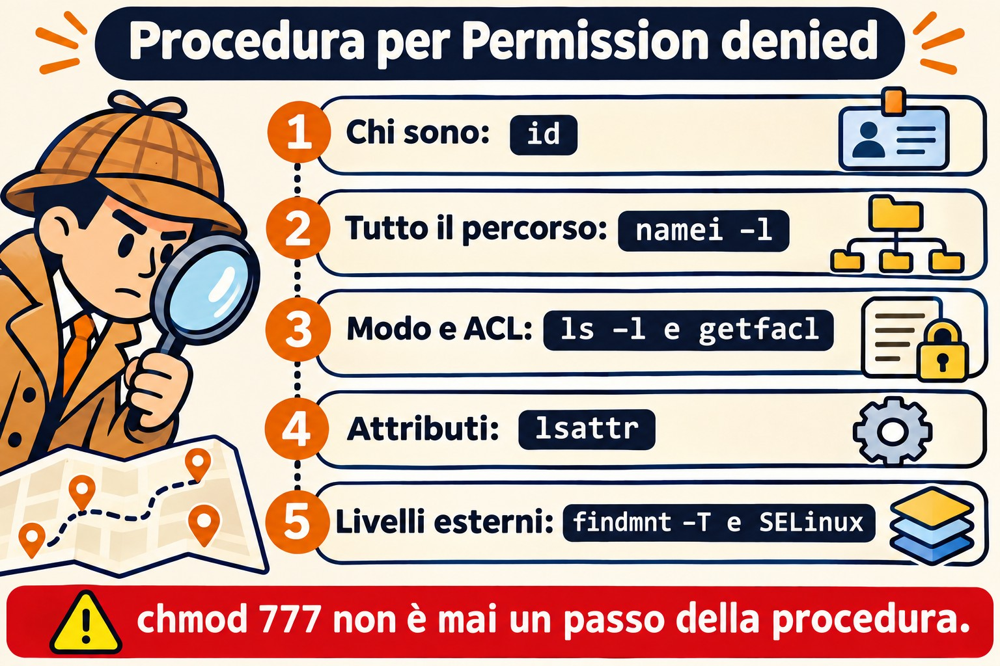
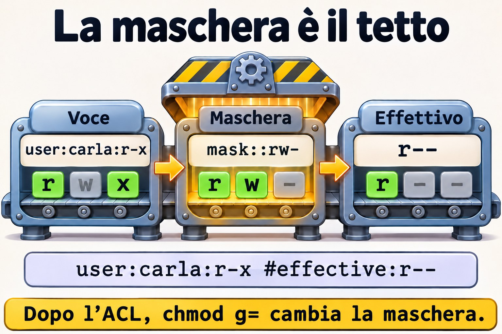

# Lezione 8.5 · Permessi avanzati

Chi viene da Windows si aspetta ereditarietà e permessi effettivi in una scheda delle proprietà. In Linux le stesse risposte sono sparse tra bit speciali, ACL, attributi e opzioni di mount. In questa lezione monti una vera cartella condivisa e impari un metodo per risolvere qualsiasi "Permission denied". Alla fine arriva la Sfida dell'M8.

> **Il cuore di questa lezione:** usare SGID e sticky nelle cartelle condivise; dare accesso con ACL e ACL predefinita; capire la maschera; fare l'audit dei SUID; e seguire il percorso di diagnosi: `id`, `namei -l`, `getfacl`, `lsattr`, `findmnt -T` e SELinux. Il resto è approfondimento.

| Scheda |  |
| --- | --- |
| **Modulo** | M8 · File a fondo, lezione 5 di 5, con la Sfida del modulo |
| **Quando** | Settimana 13 |
| **Alla fine** | Configuri un accesso condiviso con precisione e trovi la causa di qualsiasi "Permission denied" |
| **Prerequisiti** | Lezioni 2.6, 2.7, 2.8 e 8.2 |
| **Durata** | circa 2h30, più 1h per la Sfida |
| **Snapshot** | `m8a5-inicio` e `m8a5-fim` su rocky-lab e debian-lab |

## 1 · Riscaldamento

Rispondi prima di leggere.

1. Un file ha permessi `644`, ma l'utente non riesce a leggerlo. Quali cause ti vengono in mente?
2. Cosa fa SGID su una cartella?
3. Cosa significa il `+` alla fine dei permessi in `ls -l`?

## 2 · Perché conta

| La richiesta | La risposta sbagliata | Cosa provoca |
| --- | --- | --- |
| "Non riesco ad accedere alla cartella" | `chmod -R 777` | Apre tutto a tutti, e cancella l'informazione su chi dovrebbe avere accesso |
| "Il collega non apre il file che ho creato io" | Correggere a mano ogni giorno | Mancava SGID, oppure l'ACL predefinita |
| "Ho aggiunto l'utente al gruppo e non funziona" | Aggiungerlo di nuovo | La vecchia sessione non conosce il gruppo |
| "Nemmeno root riesce a cancellare quel file" | Riavviare | È l'attributo immutabile |
| "Lo script ha `x` e dà Permission denied" | Rifare `chmod +x` | Il disco è stato montato con `noexec` |

## 3 · Modello mentale

> Arrivare a un file significa **attraversare un edificio**. Ti serve il permesso per **ogni porta del percorso**, e non solo per l'ultima stanza. La `x` sulla cartella è il diritto di passare dalla porta. Poi vengono i **badge**, valutati in quest'ordine: proprietario, persone citate nelle ACL, gruppi e tutti gli altri. E ci sono livelli all'esterno dell'edificio: il **lucchetto della stanza** (`chattr +i`), il **regolamento del terreno** (opzioni di mount) e la **sicurezza esterna** (SELinux). Ognuno di loro può dire no.

```
Permission denied ou Operation not permitted — siga na ordem:

1. Quem sou?          id                       grupo novo exige login novo
2. O caminho todo     namei -l /a/b/c.txt      falta x em alguma pasta?
3. Modo e dono        ls -ld, ls -l
4. ACL                getfacl                  máscara, entrada específica
5. Atributos          lsattr                   i (imutável), a (só adicionar)
6. Montagem           findmnt -T ARQUIVO       ro, noexec, nosuid
7. Controle externo   getenforce, ausearch     SELinux; AppArmor no Debian
```



*Vai dall'alto verso il basso. `chmod 777` non è mai un passo.*

### Ponte Windows

| In Windows | In Linux | Dove il paragone inganna |
| --- | --- | --- |
| Scheda "Accesso effettivo" | `namei -l` e `getfacl` | In Linux sei tu a mettere insieme i pezzi |
| ACE ereditata | ACL predefinita (`-d`) | Vale solo per ciò che viene creato dopo, e nulla viene "propagato" |
| Gruppo creatore, nell'ereditarietà | SGID su cartella | |
| Condivisione + NTFS | Samba + permessi | Due livelli, come in Windows |
| ACE "Nega" | Voce `u:nome:---` | Non esiste un "nega" esplicito: funziona con l'ordine di valutazione |
| Attributo sola lettura | `chattr +i` | Il `+i` blocca anche root |
| Logoff per aggiornare il token | Nuovo login | È esattamente lo stesso problema |

## 4 · L'essenziale

### Bit speciali

| Bit | Su un file | Su una cartella | Esempio |
| --- | --- | --- | --- |
| SUID (4000) | Gira come il proprietario | Nessun effetto | `/usr/bin/passwd` |
| SGID (2000) | Gira come il gruppo | **Eredita il gruppo** per ciò che viene creato | Cartella di team |
| Sticky (1000) | Nessun effetto | Solo il proprietario cancella ciò che è suo | `/tmp` |

Negli script, Linux ignora SUID. La `s` minuscola significa che esiste anche la `x`, e la `S` maiuscola significa che manca la `x`.

### umask

La umask toglie bit dal valore predefinito: 666 per i file e 777 per le cartelle. Con `022` ottieni `644` e `755`. Con `027`, `640` e `750`. Si imposta per utente in `~/.bashrc`, e per servizio con `UMask=` nella unit.

### ACL

| Voglio... | Comando |
| --- | --- |
| Vedere | `getfacl CAMINHO` |
| Dare accesso a un utente | `setfacl -m u:NOME:rx CAMINHO` |
| A un gruppo | `setfacl -m g:NOME:rx CAMINHO` |
| Valere per ciò che verrà creato | `setfacl -d -m u:NOME:rx PASTA` |
| Su tutto ciò che esiste già | `setfacl -R -m u:NOME:rX PASTA` |
| Togliere una voce | `setfacl -x u:NOME CAMINHO` |
| Cancellare tutta l'ACL | `setfacl -b CAMINHO` |
| Copiare l'ACL | `getfacl A \| setfacl --set-file=- B` |

**La maschera** è il tetto delle voci degli utenti citati e dei gruppi. Quando la riga di `getfacl` mostra `#effective:`, l'accesso reale è minore di quello scritto. Dopo un'ACL, `chmod g=` sul file cambia la maschera, e non il gruppo.

La `X` maiuscola dà `x` solo alle cartelle e ai file già eseguibili. È la scelta giusta per `-R`.



*La voce dice r-x, la maschera permette rw-, e vale ciò che passa da entrambe: r--.*

### Attributi

| Voglio... | Comando |
| --- | --- |
| Vedere | `lsattr ARQUIVO` |
| Bloccare | `sudo chattr +i ARQUIVO` |
| Solo aggiungere in coda | `sudo chattr +a ARQUIVO` |
| Sbloccare | `sudo chattr -i ARQUIVO` |

### Rocky × Debian

|  | Rocky | Debian |
| --- | --- | --- |
| `acl` | `dnf install acl` | `apt install acl` |
| Controllo esterno | SELinux: `getenforce`, `ausearch` | AppArmor: `sudo aa-status` |

Se su Rocky hai un "Permission denied" con tutto a posto, guarda SELinux, tema dell'M12: `sudo ausearch -m avc -ts recent`.

## 5 · Lab guidato

**Passo 0 · Snapshot e utenti.** In Proxmox: `qm snapshot 201 m8a5-inicio` e `qm snapshot 202 m8a5-inicio`. Su rocky-lab:

```bash
sudo dnf install -y acl
sudo groupadd financas
sudo useradd -m -G financas ana
sudo useradd -m -G financas beto
sudo useradd -m carla
sudo mkdir -p /srv/lab85/financas
sudo chown root:financas /srv/lab85/financas
sudo chmod 770 /srv/lab85/financas
```

Gli utenti non hanno bisogno di password: agirai come loro con `sudo -u`.

**Passo 1 · Senza SGID, con SGID.**

```bash
sudo -u ana touch /srv/lab85/financas/sem-sgid.txt
sudo ls -l /srv/lab85/financas
sudo chmod 2770 /srv/lab85/financas
sudo -u ana touch /srv/lab85/financas/com-sgid.txt
sudo ls -ld /srv/lab85/financas
sudo ls -l /srv/lab85/financas
```

Il primo ha il gruppo `ana`, e il secondo `financas`. La cartella mostra `drwxrws---`.

**Passo 2 · Sticky.**

```bash
sudo -u beto rm -f /srv/lab85/financas/com-sgid.txt
sudo -u ana touch /srv/lab85/financas/da-ana.txt
sudo chmod 3770 /srv/lab85/financas
sudo -u beto rm -f /srv/lab85/financas/da-ana.txt
sudo ls -l /srv/lab85/financas
```

Prima dello sticky, Beto cancella il file di Ana, perché ha `w` sulla cartella. Dopo, riceve `Operation not permitted`.

**Passo 3 · ACL per chi non è del gruppo.**

```bash
sudo -u carla ls /srv/lab85/financas
sudo setfacl -m u:carla:rx /srv/lab85/financas
sudo -u carla ls /srv/lab85/financas
sudo getfacl /srv/lab85/financas
ls -ld /srv/lab85/financas
```

Il primo fallisce e il secondo funziona. Ora `ls` mostra un `+`.

**Passo 4 · ACL predefinita.**

```bash
sudo setfacl -d -m u:carla:rx /srv/lab85/financas
sudo -u ana bash -c 'echo saldo > /srv/lab85/financas/novo.txt'
sudo getfacl /srv/lab85/financas/novo.txt
sudo -u carla cat /srv/lab85/financas/novo.txt
sudo -u carla bash -c 'echo x >> /srv/lab85/financas/novo.txt'
```

Carla legge e non scrive. Il file ha ereditato la sua voce, e `user:carla:r-x #effective:r--` mostra che la maschera ha tagliato la `x`.

**Passo 5 · La maschera.**

```bash
sudo setfacl -m m::--- /srv/lab85/financas/novo.txt
sudo getfacl /srv/lab85/financas/novo.txt
sudo -u carla cat /srv/lab85/financas/novo.txt
sudo setfacl -m m::rw /srv/lab85/financas/novo.txt
sudo -u carla cat /srv/lab85/financas/novo.txt
```

La sua voce resta scritta, ma l'effettivo è diventato `---`, e l'accesso cade.

**Passo 6 · Audit dei SUID.**

```bash
ls -l /usr/bin/passwd
sudo find / -xdev -type f -perm -4000 -ls
```

**Passo 7 · Il percorso di diagnosi.**

```bash
sudo -u carla id
sudo namei -l /srv/lab85/financas/novo.txt
sudo getfacl /srv/lab85/financas/novo.txt
sudo lsattr /srv/lab85/financas/novo.txt
sudo findmnt -T /srv/lab85/financas/novo.txt
getenforce
```

**Passo 8 · debian-lab.** Installa `acl` e ripeti i passi 0, 1, 3 e 4. Al posto di `getenforce`, usa `sudo aa-status | head`.

### Decidi 1

Una nuova analista deve leggere la cartella dei contratti, ma non può entrare nel gruppo che ha anche accesso in scrittura. Cosa fai?

A) `chmod o+rx`, così può entrare. B) Metterla nel gruppo. C) `setfacl -R -m u:NOME:rX PASTA` e `setfacl -d -m u:NOME:rX PASTA`.

Scegli un'opzione prima di continuare.

| Se hai scelto | Risultato | Perché |
| --- | --- | --- |
| A | Apre a tutti | Ogni utente della macchina può leggere |
| B | Va oltre la richiesta | Ottiene la scrittura |
| C | Giusto | Vale per l'esistente e per il futuro, solo per lei |

**Da ricordare:** l'ACL dà un'eccezione precisa, senza toccare il modello principale.

### Decidi 2

Uno script ha `755` e risponde `Permission denied` in una cartella con tutto a posto. Prossimo passo?

A) `chmod 777`. B) `findmnt -T script`, per vedere opzioni come `noexec`. C) Copiarlo a root.

Scegli un'opzione prima di continuare.

| Se hai scelto | Risultato | Perché |
| --- | --- | --- |
| A | Non cambia nulla | Il problema non è nel modo |
| B | Giusto | È il punto successivo del percorso |
| C | Aggira senza capire | Scavalca una regola messa di proposito |

**Da ricordare:** quando il modo è giusto, guarda gli altri livelli.

## 6 · Rompi e ripara

### Guasto 1 · Nemmeno root ci riesce

```bash
sudo touch /srv/lab85/imutavel.conf
sudo chattr +i /srv/lab85/imutavel.conf
sudo rm /srv/lab85/imutavel.conf
```

**Sintomo:** `Operation not permitted`, anche come root.

**Diagnosi:** `lsattr /srv/lab85/imutavel.conf` mostra `i`.

**Riparazione:** `sudo chattr -i /srv/lab85/imutavel.conf` e `sudo rm /srv/lab85/imutavel.conf`.

**Nella vita reale:** non sempre è una protezione dell'amministratore. Su un server compromesso, gli attaccanti usano `chattr +i` per bloccare i file.

### Guasto 2 · Il gruppo che non ha preso

```bash
sudo usermod -aG financas $USER
id
ls /srv/lab85/financas
```

**Sintomo:** `Permission denied`, con l'utente già nel gruppo.

**Diagnosi:** `id` non mostra `financas`, ma `id $USER` sì. Il processo attuale è stato creato prima della modifica.

**Riparazione:** esci e rientra, oppure usa `sg financas -c 'ls /srv/lab85/financas'`. Poi ripristina: `sudo gpasswd -d $USER financas`.


*SGID e ACL predefinita valgono per ciò che nasce nella cartella; mv sullo stesso disco mantiene il vecchio gruppo.*

### Guasto 3 · Il file arrivato con un altro gruppo

```bash
sudo -u ana bash -c 'echo a > /home/ana/mov.txt; chmod 640 /home/ana/mov.txt'
sudo -u ana mv /home/ana/mov.txt /srv/lab85/financas/
sudo -u beto cat /srv/lab85/financas/mov.txt
sudo ls -l /srv/lab85/financas/mov.txt
```

**Sintomo:** `Permission denied`, in una cartella con SGID.

**Diagnosi:** il gruppo è `ana`. SGID e ACL predefinita valgono solo per ciò che viene **creato** lì. `mv` sullo stesso file system conserva i dati del file originale.

**Riparazione:** `sudo chgrp financas /srv/lab85/financas/mov.txt`. Nella pratica, crea il file nella cartella, oppure preferisci `cp`.

### Pulizia

```bash
sudo rm -r /srv/lab85
sudo userdel -r beto
sudo userdel -r carla
sudo groupdel financas
```

L'utente `ana` resta per la Sfida.

## 7 · Trappole

| Trappola | Cosa succede | Come evitarla |
| --- | --- | --- |
| `chmod -R 777` | Distrugge il modello, e senza storico | Segui il percorso di diagnosi |
| `chmod -R` con `x` sui file | Tutto diventa eseguibile | Usa `X` |
| `usermod -G` senza `-a` | Rimuove dagli altri gruppi | `usermod -aG` |
| `chmod` su un file con ACL | Cambia la maschera | Controlla con `getfacl` |
| Dimenticare la `x` in una cartella intermedia | Nega nonostante il file sia aperto | `namei -l` |
| ACL predefinita da cui ti aspetti effetto sull'esistente | Vale solo per il nuovo | Usa anche `-R` |
| Confondere `Permission denied` e `Operation not permitted` | Cerchi nel posto sbagliato | Il secondo fa pensare ad attributo, sticky o capability |
| SUID su uno script | Viene ignorato | Usa `sudo` con una regola |
| `cp` e `tar` senza preservare | Perdono le ACL | `cp -a`, `tar --acls` |

## 8 · Quiz

Rispondi senza guardare. Le soluzioni sono alla fine della lezione.

1. Qual è l'ordine di valutazione tra proprietario, utenti citati, gruppi e altri?
2. Cosa indica `#effective:`?
3. Qual è la differenza tra `-m` e `-d -m` in `setfacl`?
4. Perché un `mv` non eredita il gruppo della cartella con SGID?
5. Qual è il comando che mostra i permessi a ogni gradino di un percorso?
6. Perché un utente appena aggiunto a un gruppo continua a non avere accesso?

## 9 · Promemoria

**Da sapere a memoria:**

| Voglio... | Comando |
| --- | --- |
| Percorso intero | `namei -l CAMINHO` |
| ACL | `getfacl CAMINHO` |
| Dare accesso | `setfacl -m u:NOME:rx CAMINHO` |
| Per ciò che verrà | `setfacl -d -m u:NOME:rx PASTA` |
| Cartella di team | `chmod 2770 PASTA` |
| Attributi | `lsattr ARQUIVO` |
| Mount | `findmnt -T ARQUIVO` |

**Da consultare:**

| Voglio... | Comando |
| --- | --- |
| Togliere l'ACL | `setfacl -x u:NOME C`, `setfacl -b C` |
| Maschera | `setfacl -m m::rx C` |
| Gruppo nuovo senza rifare il login | `sg GRUPO -c 'comando'` |
| SUID | `sudo find / -xdev -type f -perm -4000 -ls` |
| SELinux | `getenforce`, `sudo ausearch -m avc -ts recent` |
| AppArmor | `sudo aa-status` |

**Flashcard:**

- SGID sulla cartella → *eredita il gruppo.*
- Sticky → *solo il proprietario cancella.*
- `+` in `ls` → *c'è un'ACL.*
- `#effective` → *la maschera ha tagliato.*
- Script `755` negato → *`noexec`.*
- Gruppo nuovo → *nuovo login.*

## 10 · Checklist e chiusura

- [ ] Configuro una cartella di team con SGID e sticky
- [ ] Do un accesso preciso con le ACL, anche per il futuro
- [ ] Leggo la maschera
- [ ] Seguo a memoria il percorso di diagnosi
- [ ] So cosa provocano `chattr`, `noexec` e SELinux
- [ ] Faccio l'audit dei SUID

**Ultimo esercizio, senza guardare la lezione:** su debian-lab, crea un gruppo e una cartella in cui i membri scrivono, ciascuno cancella solo ciò che è suo, e un utente esterno può solo leggere, compresi i file futuri. Dimostralo con `sudo -u`. Poi ripulisci.

**Snapshot di fine** (in Proxmox):

```bash
qm snapshot 201 m8a5-fim
qm snapshot 202 m8a5-fim
```

## 11 · Nella vita reale

**Missione, sola lettura.** Su un server Linux che amministri (o con autorizzazione), lancia **solo**:

```bash
sudo find / -xdev -type f -perm -4000 -ls
sudo find / -xdev -type d -perm -o+w ! -perm -1000 -ls | head -n 20
findmnt -no TARGET,OPTIONS -t xfs,ext4,tmpfs | head -n 20
getenforce 2>/dev/null
sudo aa-status 2>/dev/null | head -n 5
```

Domande a cui rispondere:

1. Qualche SUID fuori dal comune?
2. Ci sono cartelle scrivibili da tutti senza sticky?
3. Quali mount hanno `noexec` o `nosuid`?
4. Qual è il controllo esterno attivo?

**Diario:** annota gli elementi che meritano attenzione. Non modificare nulla.

**Domani, senza guardare:** scrivi le sette tappe del percorso di diagnosi.

## 12 · Approfondire quando vuoi

- **`capabilities`, `getcap`, `setcap`:** privilegi senza SUID.
- **`/etc/fstab` con `noexec,nosuid,nodev`:** hardening.
- **Samba e permessi:** tornano nella parte sui servizi di rete.
- **SELinux in profondità:** M12.
- **`auditd`:** chi ha modificato quel file.

**DeepTutor** (http://10.1.0.149:3782, KB "Curso Linux Sysadmin"):

- `!explica a máscara das ACLs POSIX`
- `!feynman por que precisamos de x em uma pasta`
- `!quiz Aula 8.5, 5 perguntas sobre ACL e bits especiais`

## Sfida dell'M8 · Tre porte chiuse

> **La missione:** l'utente `ana` riceve `Permission denied` in tre situazioni diverse, ciascuna con la sua causa. Trova e correggi ognuna con il minimo permesso possibile.

Non c'è un passo a passo. I suggerimenti sono nelle Soluzioni, ma prova prima senza.

**Prima di cominciare:** `qm snapshot 201 m8-desafio-inicio`. Poi prepara lo scenario su rocky-lab, senza cercare di capirlo:

```bash
mkdir -p ~/labm8
id ana || sudo useradd -m ana
sudo mkdir -p /srv/labm8/projetos/2026 /srv/labm8/compartilhado /srv/labm8/scripts
echo relatorio | sudo tee /srv/labm8/projetos/2026/relatorio.txt > /dev/null
sudo chmod 644 /srv/labm8/projetos/2026/relatorio.txt
sudo chmod 700 /srv/labm8/projetos
echo dados | sudo tee /srv/labm8/compartilhado/dados.txt > /dev/null
sudo chmod 644 /srv/labm8/compartilhado/dados.txt
sudo setfacl -m u:ana:--- /srv/labm8/compartilhado/dados.txt
sudo mount -t tmpfs -o noexec,mode=755 tmpfs /srv/labm8/scripts
printf '#!/bin/bash\necho ok\n' | sudo tee /srv/labm8/scripts/rodar.sh > /dev/null
sudo chmod 755 /srv/labm8/scripts/rodar.sh
```

**I tre problemi:**

```bash
sudo -u ana cat /srv/labm8/projetos/2026/relatorio.txt
sudo -u ana cat /srv/labm8/compartilhado/dados.txt
sudo -u ana /srv/labm8/scripts/rodar.sh
```

**Requisiti:**

1. Per ciascuno, scrivi in `~/labm8/relatorio.txt`: la causa, il comando che l'ha rivelata e la correzione.
2. Niente `chmod 777`. Gli altri utenti della macchina non devono ottenere accesso al report né ai dati.
3. La correzione non può essere copiare i file altrove.

**Criteri di accettazione:**

- [ ] I tre comandi qui sopra funzionano come `ana`
- [ ] `sudo find /srv/labm8 -perm -o+w ! -type l` non mostra nulla
- [ ] `sudo -u nobody cat /srv/labm8/projetos/2026/relatorio.txt` resta negato
- [ ] Il report ha tre cause diverse, ciascuna con la prova

**Alla fine:** ripulisci e fai lo snapshot:

```bash
sudo umount /srv/labm8/scripts
sudo rm -r /srv/labm8
sudo userdel -r ana
```

In Proxmox: `qm snapshot 201 m8-desafio-fim`.

**Hai chiuso l'M8.** Ora sai dove vive ogni cosa, trovi qualsiasi file, copi con prova e risolvi un "Permission denied" seguendo il percorso di diagnosi. Il prossimo modulo è nel [piano del corso](../00-plano-do-curso.md).

## Soluzioni commentate

### Riscaldamento

1. Mancanza di `x` in una cartella del percorso, ACL specifica, attributo, opzione di mount, SELinux o AppArmor.
2. Ciò che viene creato al suo interno eredita il gruppo della cartella.
3. Che esiste un'ACL oltre al modo di base.

### Quiz

1. Proprietario; poi utenti citati; poi i gruppi, tramite il gruppo proprietario e le voci di gruppo; infine gli altri. Vale la prima categoria che si applica.
2. Che la maschera ha ridotto l'accesso scritto nella voce.
3. `-m` modifica l'ACL di accesso di ciò che esiste già. `-d -m` definisce l'ACL predefinita, ereditata da ciò che verrà creato.
4. Perché `mv` sullo stesso disco non crea un file: cambia solo il nome di posto, e l'inode mantiene il gruppo.
5. `namei -l`.
6. Perché i gruppi vengono definiti al login, e i processi già aperti mantengono la lista precedente.

### Suggerimenti per la Sfida

Leggine una alla volta, solo quando sei bloccato.

1. **Primo:** `namei -l` sul percorso del report. Quale cartella non lascia passare `ana`?
2. **Correzione minima:** `sudo setfacl -m u:ana:x /srv/labm8/projetos`. Anche `chmod o+x` aprirebbe il passaggio a tutti, e `nobody` resta negato solo con l'ACL.
3. **Secondo:** `ls -l` mostra `+`. Lancia `getfacl`. Togli la voce con `sudo setfacl -x u:ana /srv/labm8/compartilhado/dados.txt`.
4. **Terzo:** `findmnt -T /srv/labm8/scripts/rodar.sh` mostra `noexec`. Rimonta con `sudo mount -o remount,exec /srv/labm8/scripts`.

---

<!-- navegacao -->
[← Lezione 8.4 · Link](8.4-links.md) · [Indice delle lezioni](../01-aulas.md) · [Lezione 9.1 · Dischi e layout →](9.1-discos-e-layout.md)
