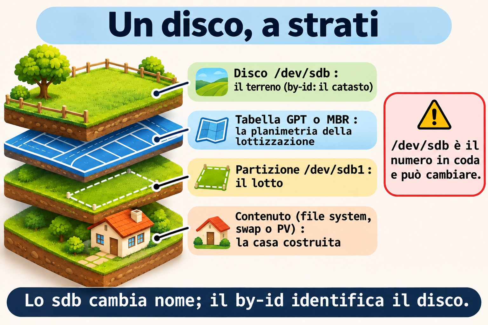
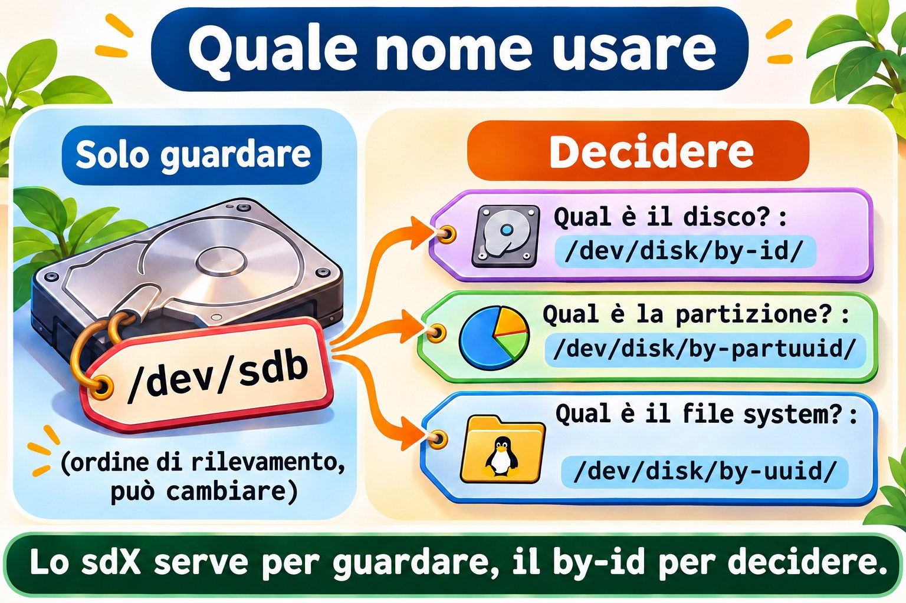
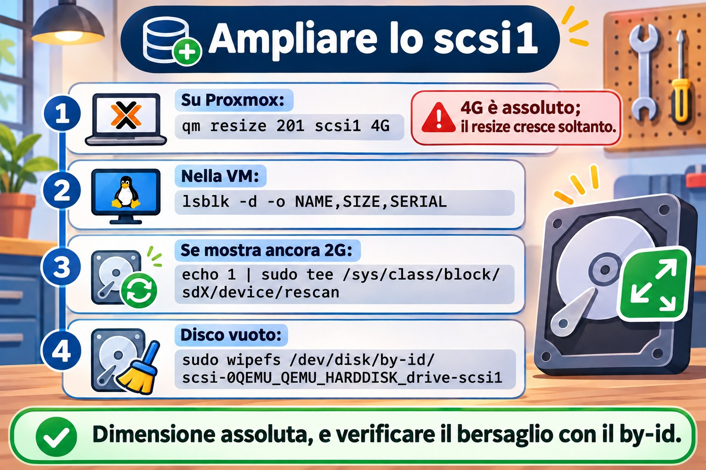

# Lezione 9.1 · Dischi e layout

In Windows apri Gestione disco, vedi "Disco 1" e una lettera di unità, e il resto sembra naturale. In Linux lo stesso disco ha più nomi, e scegliere il nome sbagliato prima di un `mkfs` cancella il disco sbagliato. In questa lezione fai il backup che il modulo richiede, ampli il disco `scsi1` che la lezione 2.2 ha lasciato su entrambe le VM, impari a leggere il layout del disco di sistema e a identificare il disco di laboratorio senza errori. Non si scrive nulla su di esso.

> **Il cuore di questa lezione:** conoscere la differenza tra MBR e GPT; conoscere i nomi di un disco (`sdX`, `by-id`, `by-uuid`, `by-path`, `by-partuuid`); leggere un layout con `lsblk -f`, `blkid`, `fdisk -l` e `parted -l`; e identificare il bersaglio tramite `by-id` prima di qualsiasi comando distruttivo. Il resto è approfondimento.

| Scheda |  |
| --- | --- |
| **Modulo** | M9 · Storage, lezione 1 di 7 |
| **Quando** | Settimana 13 |
| **Alla fine** | Leggi il layout di qualsiasi disco, identifichi `scsi1` (ora da 4 GiB) in sicurezza e lasci scritto il piano delle partizioni |
| **Prerequisiti** | Lezioni 0.1, 0.2, 2.2 e 8.1 |
| **Durata** | circa 2h |
| **Snapshot** | `m9a1-inicio` e `m9a1-fim` su rocky-lab e debian-lab |

## 1 · Riscaldamento

Rispondi prima di leggere.

1. Un disco compare come `/dev/sdb`. Puoi fidarti che, dopo un reboot, sia ancora `sdb`?
2. Qual è il limite di dimensione di un disco con tabella delle partizioni MBR?
3. Cosa mostra `lsblk` che `df -h` non mostra?

## 2 · Perché conta

| La richiesta | La risposta sbagliata | Cosa provoca |
| --- | --- | --- |
| "Ho aggiunto un disco alla VM, formattalo per me" | `mkfs` su `/dev/sdb`, senza controllare | Su un'altra macchina, `sdb` era un disco con dei dati |
| "Lo script di backup non trova più il disco" | Sostituire `sdb` con `sdc` nello script | Al prossimo cambio d'ordine si rompe di nuovo |
| "Il disco da 4 TB ne mostra solo 2 TB" | Comprare un altro disco | La tabella era MBR; doveva essere GPT |
| "La VM non parte dopo aver toccato il disco" | Reinstallare | Mancava la partizione EFI oppure fstab puntava a un nome che è cambiato |

## 3 · Modello mentale

> Un disco è un **terreno**, e la tabella delle partizioni è la **planimetria della lottizzazione**: dice dove inizia e finisce ogni lotto. Il file system è la **casa costruita** su ogni lotto (lezione 9.3). Il nome `/dev/sdb` è il **numero del terreno nella fila di consegna**: può cambiare da una visita all'altra. Il `by-id` è la **visura catastale**: identifica il terreno per tutta la vita.

```
disco inteiro        /dev/sdb              ← by-id: scsi-0QEMU_QEMU_HARDDISK_drive-scsi1
 └─ tabela           GPT ou MBR            ← a planta do loteamento
     ├─ partição 1   /dev/sdb1             ← by-partuuid, e by-uuid depois do mkfs
     ├─ partição 2   /dev/sdb2
     └─ espaço livre                       ← sem lote, sem casa
          └─ dentro de cada partição: sistema de arquivos, swap ou PV do LVM
```



*sdb cambia nome; by-id identifica il disco.*

### Ponte Windows

| In Windows | In Linux | Dove il paragone inganna |
| --- | --- | --- |
| Gestione disco | `lsblk`, `fdisk -l`, `parted -l` | In Linux leggi dal terminale, e lo stesso comando serve sul server senza schermo |
| `diskpart`: `list disk`, `select disk 1` | `fdisk` o `parted` puntati a un dispositivo | Anche il numero del disco in `diskpart` cambia; qui il `by-id` è quello sicuro |
| `convert gpt` | `fdisk`, `gdisk`, `parted` (lezione 9.2) | Una tabella nuova cancella le vecchie partizioni, in entrambi |
| Lettera di unità (`D:`) | Punto di montaggio (`/srv/dados`) | Non esiste la lettera: il disco entra in una cartella (lezione 9.4) |

## 4 · L'essenziale

### GB × GiB, una volta sola

Proxmox e `fdisk` contano in potenze di 1024: 1 GiB sono 1.073.741.824 byte. `parted` e i produttori contano in potenze di 1000. Per questo il disco da 4 GiB compare in `parted` come `4295MB`. Scrivi `GiB` e `MiB` per essere precisi; `+1G` in `fdisk` è 1 GiB.

### MBR × GPT

| | MBR (DOS) | GPT |
| --- | --- | --- |
| Dimensione massima del disco | 2 TiB | In pratica, nessun limite |
| Partizioni | 4 primarie, oppure 3 più una estesa con logiche | 128 per impostazione predefinita |
| Copia della tabella | Nessuna | Header di riserva alla fine del disco |
| Identificatori | Solo il numero del disco | GUID del disco e di ogni partizione |
| Firmware | BIOS (e UEFI in modalità compatibilità) | UEFI, e BIOS con partizione `bios_boot` |

GPT scrive anche un "MBR di protezione" nel settore 0, perché i vecchi strumenti vedano il disco come occupato. Usa GPT sui dischi nuovi. L'MBR lo eserciti nella lezione 9.2.

Su entrambe le VM, il disco di sistema è GPT, perché il firmware è UEFI (OVMF, lezione 0.1). La prima partizione è la EFI (`vfat`, montata in `/boot/efi`): UEFI legge il boot loader solo da lì.

### I nomi di un disco

| Nome | Esempio | Stabile? | Usalo per |
| --- | --- | --- | --- |
| `/dev/sdX` | `/dev/sdb` | No: dipende dall'ordine di rilevamento | Guardare, mai decidere |
| `/dev/nvmeXnY` | `/dev/nvme0n1p2` | Quasi | Dischi NVMe (le partizioni hanno la `p`) |
| `/dev/disk/by-id/` | `scsi-0QEMU_QEMU_HARDDISK_drive-scsi1` | Sì, è il disco | Identificare il disco prima di scrivere |
| `/dev/disk/by-uuid/` | `5f2c...` | Sì, è il file system | fstab, mount |
| `/dev/disk/by-partuuid/` | `8c1e...` | Sì, è la partizione | Quando non c'è ancora un file system |

I nomi in `/dev/disk/` sono link di `udev`. Per vedere il nome reale: `readlink -f LINK`.



*sdX serve per guardare, by-id serve per decidere.*

### Comandi di lettura

Tutti questi comandi leggono soltanto.

```bash
lsblk
lsblk -f
lsblk -d -o NAME,SIZE,MODEL,SERIAL
sudo blkid
sudo fdisk -l /dev/sda
sudo parted -l
cat /proc/partitions
```

- `lsblk` elenca dischi e partizioni ad albero. `-f` aggiunge file system, etichetta, UUID e mount. `-d` mostra solo i dischi, e `-o` sceglie le colonne.
- `blkid` mostra UUID, etichetta e tipo di ciò che ha un file system riconosciuto. Un disco vuoto non compare.
- `fdisk -l DISCO` stampa la tabella delle partizioni. `-l` si limita a elencare, non scrive.
- `parted -l` fa lo stesso per tutti i dischi, in MB. Su un disco senza tabella, scrive `unrecognised disk label`: è un'informazione, non un errore.
- `/proc/partitions` è l'elenco del kernel, in blocchi da 1 KiB.

### L'abitudine prima di qualsiasi comando distruttivo

Prima di `fdisk` in scrittura, `mkfs`, `wipefs`, `pvcreate` o `dd`, fai sempre:

1. `lsblk`: verifica che il bersaglio non abbia `MOUNTPOINTS`.
2. `ls -l /dev/disk/by-id/` e trova il disco tramite il numero di Proxmox (`drive-scsiN`).
3. `readlink -f` del `by-id` per sapere il nome `sdX` di questa volta.

### Rocky × Debian

|  | Rocky 9 | Debian 13 |
| --- | --- | --- |
| Layout dell'installer | EFI, `/boot` (xfs), PV del gruppo `rl` | EFI, `/boot` (ext4), PV del gruppo `debian-lab-vg` |
| LV di sistema | `root` (XFS) e `swap` | `root` (ext4) e `swap_1` |
| Dispositivo di root | `/dev/mapper/rl-root` | `/dev/mapper/debian--lab--vg-root` |
| Verificare il pacchetto | `rpm -q gdisk parted` | `dpkg -s gdisk parted` |

Su Debian, il trattino del nome del gruppo diventa `--` nel mapper. `lsblk -f` lo mostra.

## 5 · Lab guidato

**Passo 0 · Snapshot, backup e pacchetti.** In Proxmox:

```bash
qm snapshot 201 m9a1-inicio
qm snapshot 202 m9a1-inicio
```

Ora il backup che il modulo richiede:

```bash
vzdump 201 --storage PBS-LAB --mode snapshot
vzdump 202 --storage PBS-LAB --mode snapshot
pvesm list PBS-LAB --vmid 201
pvesm list PBS-LAB --vmid 202
```

`--mode snapshot` fa il backup con la VM accesa. Ogni `vzdump` richiede qualche minuto. `pvesm list` mostra una riga per backup, con `pbs-vm` e un nome come `PBS-LAB:backup/vm/201/2026-11-...Z`. Senza una riga con la data di oggi, non procedere: ripeti il `vzdump` e leggi l'errore.

Ricorda: **lo snapshot non è un backup**. Lo snapshot vive nello stesso Ceph della VM, e il backup vive nel PBS. Nelle prossime lezioni dell'M9, questo backup è la tua rete di protezione.

Su rocky-lab:

```bash
sudo dnf install -y gdisk parted
rpm -q gdisk parted
```

Su debian-lab:

```bash
sudo apt install -y gdisk parted
dpkg -s gdisk parted | grep -E '^(Package|Status)'
```

**Passo 1 · Leggere il disco di sistema.** Su rocky-lab:

```bash
lsblk -f
sudo fdisk -l /dev/sda
sudo parted -l
cat /proc/partitions
```

Output atteso di `lsblk -f` (UUID e dimensioni variano, anche i numeri delle partizioni):

```
NAME          FSTYPE      FSVER    LABEL UUID           FSAVAIL FSUSE% MOUNTPOINTS
sda
├─sda1        vfat        FAT32          1A2B-3C4D       588.5M     2% /boot/efi
├─sda2        xfs                        0f3b...         812.4M    16% /boot
└─sda3        LVM2_member LVM2 001       Xq7p...
  ├─rl-root   xfs                        7d91...          14.3G    16% /
  └─rl-swap   swap        1              c04e...                       [SWAP]
```

`sudo fdisk -l /dev/sda` mostra `Disklabel type: gpt` e le stesse tre partizioni, con tipi `EFI System`, `Linux filesystem` e `Linux LVM`.

Leggi così: tabella GPT, tre partizioni, e la terza è un PV di LVM, con i LV `rl-root` e `rl-swap` al suo interno. Annota quale è la EFI, quale è `/boot` e quale è il PV.

**Passo 2 · Ampliare il disco `scsi1`.** La lezione 2.2 ha collegato uno `scsi1` da 2 GiB, vuoto, a entrambe le VM, e ha detto che era il materiale dell'M9. Verifica in Proxmox:

```bash
qm config 201 | grep scsi1
qm config 202 | grep scsi1
```

Output atteso, per ciascuna VM:

```
scsi1: vm-hdd:vm-201-disk-2,discard=on,iothread=1,size=2G,ssd=1
```

I numeri di `disk-N` variano. Con il disco da 2 GiB al suo posto, ampliarlo a 4 GiB:

```bash
qm resize 201 scsi1 4G
qm resize 202 scsi1 4G
qm config 201 | grep scsi1
```

`4G` è una dimensione **assoluta**: il disco passa a 4 GiB. Con `+4G` sarebbe relativa, e il disco arriverebbe a 6 GiB. `qm resize` può solo crescere: non esiste il restringimento, e lo snapshot `m9a1-inicio` non è il modo per annullare. Pensa alla dimensione prima.

Se `scsi1` non esiste (hai saltato la 2.2 o l'hai cancellato), crealo direttamente da 4 GiB:

```bash
qm set 201 --scsi1 vm-hdd:4,discard=on,iothread=1,ssd=1
qm set 202 --scsi1 vm-hdd:4,discard=on,iothread=1,ssd=1
```

**Passo 3 · Identificare e verificare il disco.** Su rocky-lab:

```bash
lsblk -d -o NAME,SIZE,MODEL,SERIAL
ls -l /dev/disk/by-id/ | grep scsi
readlink -f /dev/disk/by-id/scsi-0QEMU_QEMU_HARDDISK_drive-scsi1
```

Output atteso:

```
NAME   SIZE MODEL         SERIAL
sda     20G QEMU HARDDISK drive-scsi0
sdb      4G QEMU HARDDISK drive-scsi1

lrwxrwxrwx. 1 root root  9 ... scsi-0QEMU_QEMU_HARDDISK_drive-scsi1 -> ../../sdb

/dev/sdb
```

La colonna `SERIAL` ripete il `drive-scsiN` di Proxmox. È così che colleghi lo `scsi1` di Proxmox allo `sdb` che Linux vede. Se `SIZE` mostra ancora `2G`, il kernel non ha visto la nuova dimensione: guarda il Guasto 3. Ora conferma che il disco è vuoto:

```bash
lsblk -f /dev/sdb
sudo blkid /dev/sdb
echo $?
sudo wipefs /dev/disk/by-id/scsi-0QEMU_QEMU_HARDDISK_drive-scsi1
sudo fdisk -l /dev/sdb
sudo parted -l
```

`lsblk -f` non mostra alcun file system su `sdb`. `blkid` non stampa nulla, e `echo $?` mostra `2`: nulla di riconosciuto. `wipefs`, senza `-a`, elenca soltanto le firme: senza output, il disco è pulito. Non usare `-a`. `fdisk -l` mostra `Disk /dev/sdb: 4 GiB` e nessuna riga `Disklabel type`. `parted -l` mostra `unrecognised disk label` e `Disk /dev/sdb: 4295MB`.

**Passo 4 · I nomi stabili.** Su rocky-lab, la regola `/etc/udev/rules.d/99-lab.rules` della lezione 2.2 dà allo stesso disco il link `/dev/lab-dados`, tramite `ID_SERIAL`. È un altro nome stabile di `scsi1`, creato da te:

```bash
ls -l /dev/lab-dados
```

Poi, i link di `udev`:

```bash
ls -l /dev/disk/by-uuid/
ls -l /dev/disk/by-partuuid/
```

`by-uuid` elenca solo ciò che ha un file system o uno swap, e `sdb` non compare. `by-partuuid` elenca solo le partizioni. Confronta con `lsblk -f` e trova l'UUID di `/boot`.

**Passo 5 · Il quaderno.** Scrivi nel tuo quaderno degli errori il piano del disco nuovo, che eseguirai nella lezione 9.2:

| Voce | Valore |
| --- | --- |
| Disco | `scsi1` (quello della lezione 2.2, ampliato), 4 GiB, `/dev/disk/by-id/scsi-0QEMU_QEMU_HARDDISK_drive-scsi1` |
| Tabella | GPT |
| Partizione 1 | 1 GiB, poi ext4, etichetta `DADOS` |
| Partizione 2 | 1 GiB, poi XFS, etichetta `ARQUIVO` |
| Partizione 3 | 512 MiB, poi VFAT, etichetta `TROCA` |
| Libero | circa 1,5 GiB, riservato alla lezione 9.7 |

**Passo 6 · debian-lab.** Installa i pacchetti del Passo 0 e ripeti i passi 1, 3 e 4. La regola `/dev/lab-dados` esiste solo su rocky-lab: su debian-lab usa il `by-id`. Nel Passo 1, `lsblk -f` mostra `debian--lab--vg-root` e `debian--lab--vg-swap_1`, e `/boot` è `ext4`.

### Decidi 1

Un disco da 6 TB, vuoto, va usato per i dati. Quale tabella usare?

A) MBR, perché è la più compatibile. B) GPT. C) MBR con una partizione estesa.

Scegli un'opzione prima di continuare.

| Se hai scelto | Risultato | Perché |
| --- | --- | --- |
| A | Perdi 4 TB | L'MBR vede al massimo 2 TiB |
| B | Giusto | Nessun limite pratico, con header di riserva |
| C | Resta limitato | L'estesa non cambia il limite di dimensione |

**Da ricordare:** il disco nuovo è GPT.

### Decidi 2

Su un server fisico con due dischi da 1 TB identici, uno script eseguirà `mkfs` sul secondo. Come identifichi il bersaglio?

A) `/dev/sdb`, perché "è sempre il secondo". B) Dalla dimensione. C) Da `/dev/disk/by-id/` (modello e seriale), verificando con `lsblk`.

Scegli un'opzione prima di continuare.

| Se hai scelto | Risultato | Perché |
| --- | --- | --- |
| A | Rischio di cancellare il disco sbagliato | L'ordine cambia tra boot e macchine |
| B | Non distingue | Entrambi hanno la stessa dimensione |
| C | Giusto | Il numero di serie è del disco |

**Da ricordare:** `sdX` serve a guardare, e `by-id` serve a decidere.

## 6 · Rompi e ripara

### Guasto 1 · Il tutorial che diceva di formattare sdb

Un tutorial dice "lancia `mkfs.ext4 /dev/sdb`". Qui non si scrive nulla.

**Sintomo:** sei a un Invio di distanza dal formattare `/dev/sdb`.

**Indagine:** su rocky-lab:

```bash
lsblk -o NAME,SIZE,SERIAL,MOUNTPOINTS /dev/sdb
readlink -f /dev/disk/by-id/scsi-0QEMU_QEMU_HARDDISK_drive-scsi1
```

**Causa:** nel laboratorio, `sdb` e `scsi1` oggi coincidono. Su una macchina con due dischi, nulla lo garantisce.

**Riparazione:** fanne il tuo rituale. Se `sdb` ha `MOUNTPOINTS` o un altro `SERIAL`, fermati.

### Guasto 2 · Il nome che esiste solo su una VM

**Sintomo:** su debian-lab, `ls -l /dev/lab-dados` risponde `No such file or directory`, e uno script copiato da rocky-lab fallisce.

**Indagine:** su debian-lab:

```bash
ls /etc/udev/rules.d/
ls -l /dev/disk/by-id/ | grep scsi1
```

**Causa:** `/dev/lab-dados` è una regola di `udev` che hai creato solo su rocky-lab (lezione 2.2). Il `by-id` viene creato dal sistema su qualsiasi macchina.

**Riparazione:** usa `/dev/disk/by-id/scsi-0QEMU_QEMU_HARDDISK_drive-scsi1` su entrambe le VM.

### Guasto 3 · Il disco che non è cresciuto dentro la VM

**Sintomo:** `qm config` mostra `size=4G`, ma `lsblk` mostra ancora `sdb` con `2G`.

**Indagine:** su rocky-lab:

```bash
lsblk -d -o NAME,SIZE,SERIAL
cat /sys/class/block/sdb/size
```

Il file `size` conta settori da 512 byte: 4 GiB sono `8388608`, e 2 GiB sono `4194304`.

**Causa:** Proxmox ha ingrandito il disco virtuale, ma il kernel non ha ancora riletto la capacità. Con virtio-scsi di solito è automatico; quando non lo è, bisogna chiederlo.

**Riparazione:** conferma il nome con il `by-id` e chiedi la rilettura:

```bash
readlink -f /dev/disk/by-id/scsi-0QEMU_QEMU_HARDDISK_drive-scsi1
echo 1 | sudo tee /sys/class/block/sdb/device/rescan
lsblk -d -o NAME,SIZE
```

Sostituisci `sdb` con il nome dato da `readlink`.



*Dimensione assoluta, e controlla il bersaglio con by-id.*

### Pulizia

Non c'è nulla da cancellare: non è stato scritto nulla sul disco. Verifica che entrambe le VM abbiano `scsi1` con `size=4G`.

## 7 · Trappole

| Trappola | Cosa succede | Come evitarla |
| --- | --- | --- |
| Fidarsi di `/dev/sdX` | Bersaglio sbagliato dopo un reboot | `by-id` e `lsblk` prima di scrivere |
| `qm resize` con `+` senza pensarci | Si somma alla dimensione attuale, e il disco non si restringe | Dimensione assoluta (`4G`), decisa prima |

## 8 · Quiz

Rispondi senza guardare. Le soluzioni sono alla fine della lezione.

1. Perché lo `sdb` di oggi potrebbe non essere lo `sdb` di domani?
2. Quale nome identifica il disco, e quale identifica il file system?
3. Quante partizioni primarie permette l'MBR?
4. Cosa scrive `parted -l` per un disco senza tabella, ed è un errore?
5. Qual è il legame tra `drive-scsi1` e Proxmox?
6. Qual è la differenza tra `qm resize 201 scsi1 4G` e `qm resize 201 scsi1 +4G`, e si può annullare?

## 9 · Promemoria

**Da sapere a memoria:**

| Voglio... | Comando |
| --- | --- |
| Albero dei dischi | `lsblk -f` |
| Solo i dischi, con seriale | `lsblk -d -o NAME,SIZE,MODEL,SERIAL` |
| Nome reale di un link | `readlink -f LINK` |
| Tabella di un disco | `sudo fdisk -l /dev/sdX` |
| Identificare tramite Proxmox | `ls -l /dev/disk/by-id/ \| grep scsi` |

**Da consultare:**

| Voglio... | Comando |
| --- | --- |
| Disco in Proxmox | `qm config 201 \| grep scsi1` |
| Ampliare il disco | `qm resize 201 scsi1 4G` |
| Rileggere la dimensione | `echo 1 \| sudo tee /sys/class/block/sdX/device/rescan` |

**Flashcard:**

- `sdX` → *ordine di rilevamento, può cambiare.*
- `by-id` → *il disco, per sempre.*
- `qm resize` → *può solo crescere.*

## 10 · Checklist e chiusura

- [ ] Ho fatto il backup delle due VM nel PBS e ho verificato con `pvesm list`
- [ ] Ho ampliato lo `scsi1` della lezione 2.2 a 4 GiB su entrambe le VM
- [ ] Ho identificato lo `scsi1` tramite `by-id` e ho confermato che è vuoto
- [ ] Leggo un layout con `lsblk -f` e `fdisk -l`
- [ ] So la differenza tra MBR e GPT
- [ ] Ho scritto nel quaderno il piano del disco nuovo

**Ultimo esercizio, senza guardare la lezione:** su debian-lab, scopri quale `sdX` è il disco `scsi1`, verifica la dimensione, dimostra che è vuoto (tre comandi di lettura) ed elenca i nomi `by-id` delle partizioni del disco di sistema.

**Snapshot di fine** (in Proxmox, con `scsi1` già ampliato):

```bash
qm snapshot 201 m9a1-fim
qm snapshot 202 m9a1-fim
```

## 11 · Nella vita reale

**Missione, sola lettura.** Su un server Linux che amministri (o con autorizzazione), lancia **solo**:

```bash
lsblk -f
lsblk -d -o NAME,SIZE,MODEL,SERIAL,ROTA
sudo fdisk -l 2>/dev/null | grep -E '^(Disk /dev|Disklabel)'
```

Domande a cui rispondere:

1. Quanti dischi fisici esistono, e di che dimensione è ciascuno?
2. Ogni disco usa MBR o GPT? Qualche disco grande è in MBR?
3. C'è spazio senza partizione, o un disco inutilizzato?
4. fstab usa `UUID=`, `LABEL=` o `/dev/sdX`?

**Diario:** annota ciò che non è chiaro. Non modificare nulla.

**Domani, senza guardare:** scrivi i tre passi dell'abitudine prima di un comando distruttivo.

## 12 · Approfondire quando vuoi

- **`man lsblk`, `man fdisk`, `man parted`:** colonne disponibili e opzioni di lettura.
- **Red Hat Enterprise Linux 9, "Managing storage devices":** la visione di Red Hat su dischi e partizioni.
- **kernel.org, documentazione di `Documentation/admin-guide/devices.txt`:** l'origine dei nomi `sd`, `vd` e `nvme`.

**DeepTutor** (http://10.1.0.149:3782, KB "Curso Linux Sysadmin"):

- `!explica a diferença entre MBR e GPT`
- `!quiz Aula 9.1, 5 perguntas sobre nomes de dispositivo`

## Soluzioni commentate

### Riscaldamento

1. No. L'ordine di rilevamento può cambiare tra un boot e l'altro, e il nome cambia insieme.
2. 2 TiB.
3. La struttura di dischi e partizioni, compreso ciò che non è montato e ciò che non ha un file system. `df -h` mostra solo ciò che è montato.

### Quiz

1. Perché `sdX` viene assegnato nell'ordine in cui il kernel rileva i dischi. Hardware nuovo, un altro controller o un diverso ordine di inizializzazione scambiano i nomi.
2. Il `by-id` identifica il disco. Il `by-uuid` identifica il file system (o lo swap).
3. Quattro. Oppure tre primarie e una estesa, che contiene le partizioni logiche.
4. `unrecognised disk label`. Non è un errore: significa che non c'è ancora una tabella delle partizioni.
5. Proxmox scrive lo `scsiN` del disco come numero di serie del disco virtuale. Linux lo mostra in `SERIAL` e nel nome del `by-id`.
6. Il primo lascia il disco a 4 GiB (assoluto); il secondo somma 4 GiB alla dimensione attuale. Non si può annullare: `qm resize` può solo crescere.

---

<!-- navegacao -->
[← Lezione 8.5 · Permessi avanzati](8.5-permissoes-avancadas.md) · [Indice delle lezioni](../01-aulas.md) · [Lezione 9.2 · Partizionare →](9.2-particionar.md)
