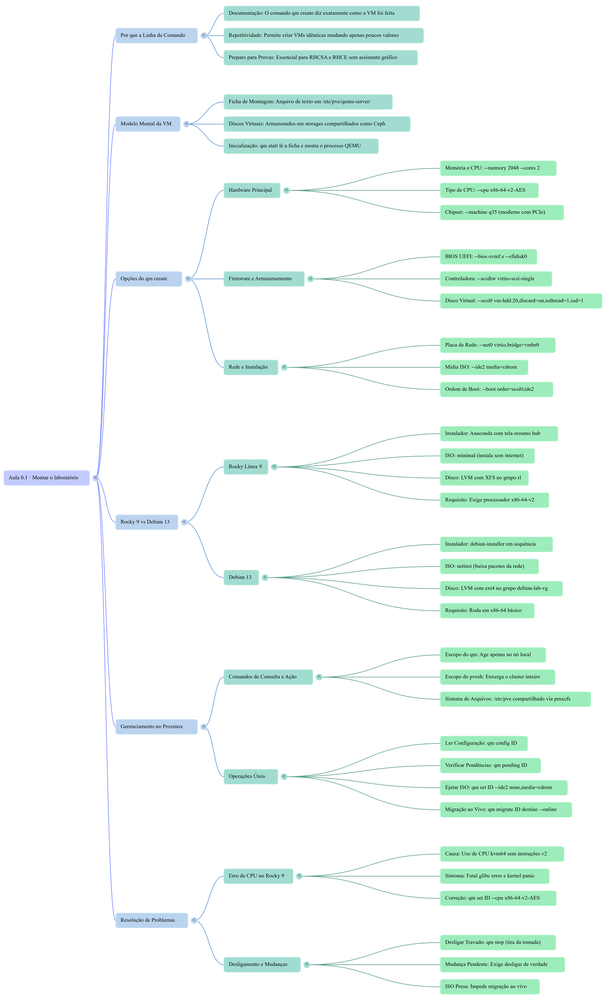
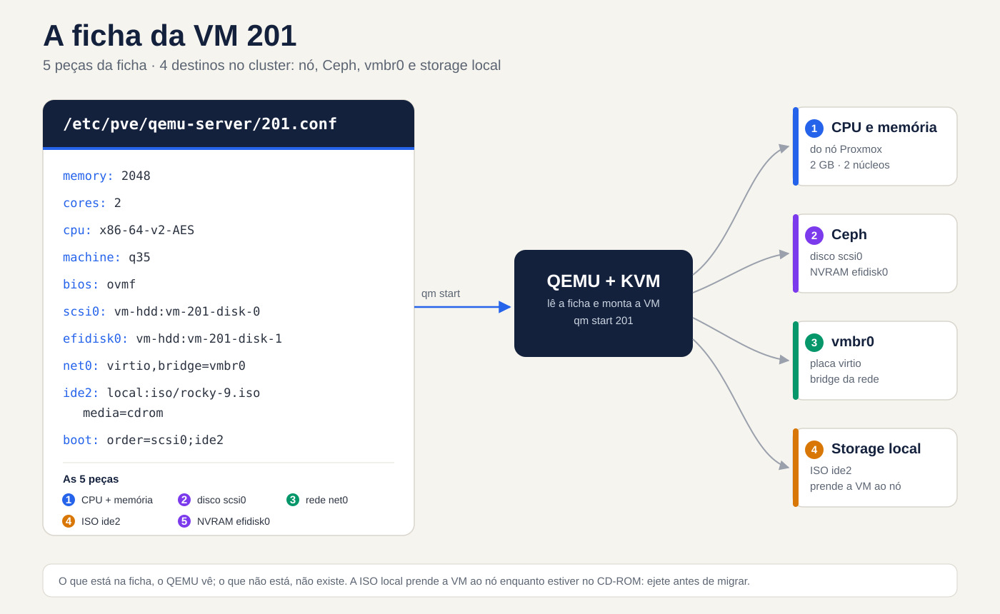
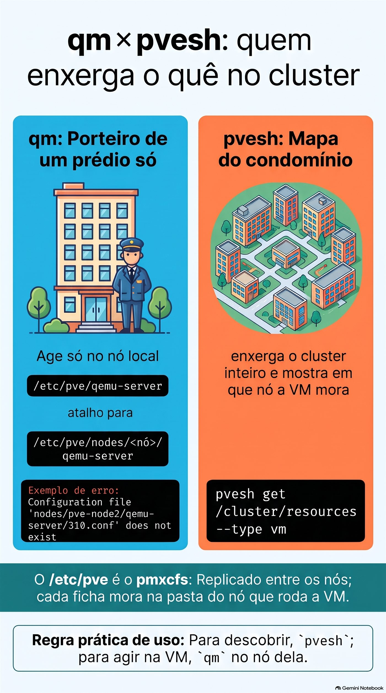
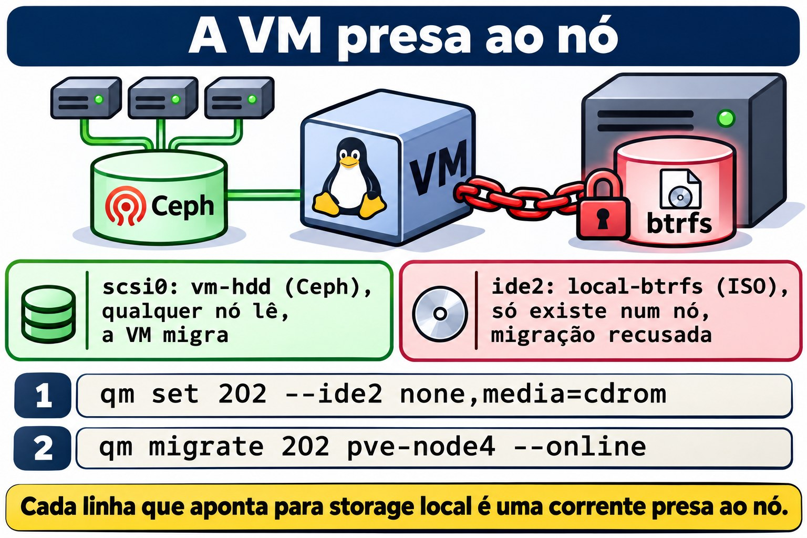
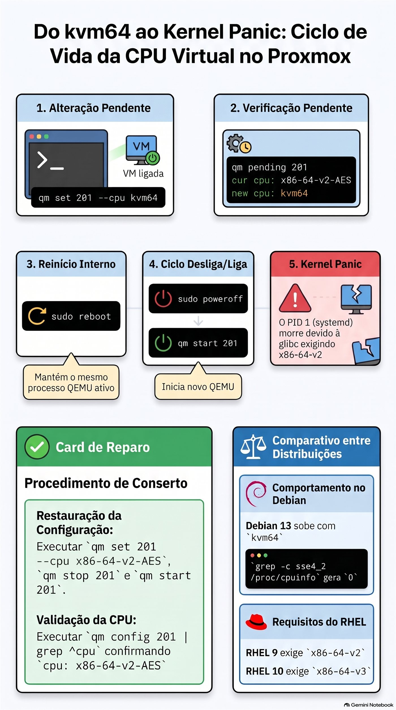

# Aula 0.1 · Montar o laboratório

Você cria as duas VMs do curso pela linha de comando do Proxmox, instala Rocky Linux 9 e Debian 13 sabendo o porquê de cada tela e termina com o primeiro snapshot, o ponto de partida de todo o curso.

| Ficha | Aula 0.1 |
| --- | --- |
| Módulo | M0 · Laboratório, aula 1 de 2 |
| Quando | Semana 1 |
| Ao final você consegue | Criar uma VM com qm create explicando cada opção; instalar Rocky 9 e Debian 13 com disco, rede e usuários escolhidos de propósito; conferir uma instalação em cinco comandos |
| Pré-requisitos | Shell de root num nó do cluster-labvol; as ISOs no local-btrfs de algum nó, ou internet para baixá-las |
| Tempo | Cerca de 2h30: 40 min de leitura, 1h20 de lab, 30 min de quiz e revisão |
| Snapshots | Nenhum no início, porque as VMs ainda não existem; no fim, m0a1-fim nas duas |

**Mapa da aula.** Antes de começar, veja o caminho inteiro: os seis ramos abaixo são as seis perguntas que esta aula responde. Volte a ele no fim, como revisão.


*Mapa mental gerado no NotebookLM a partir desta aula e revisado comando por comando.*

## 1 · Aquecimento

Responda de cabeça, antes de ler o resto. Errar aqui faz parte do método: tentar responder antes de estudar obriga o cérebro a procurar, e o que você lê depois gruda mais, mesmo quando o palpite estava errado. As respostas estão no Gabarito, no fim da aba.

1. Quando você cria uma VM pelo assistente gráfico do Proxmox, ele toma várias decisões por você. Cite cinco.
2. Por que a maioria dos servidores Linux não tem interface gráfica? Pense no Windows Server Core.
3. No Windows existe o Administrator; no Linux, o root. Qual é a diferença mais importante entre os dois?

## 2 · Por que importa

Até o Proxmox VE 7, o assistente gráfico criava VMs com o tipo de CPU `kvm64`, um processador virtual genérico, sem as instruções que as distribuições novas exigem. O Proxmox 8 passou a sugerir `x86-64-v2-AES`, mas quem herda um template antigo, ou cria a VM por um script que não declara a CPU, pode acabar com `kvm64`. O Rocky 9, como o RHEL 9, exige um processador do nível x86-64-v2. A VM simplesmente não sobe, e o console mostra:

```text
Fatal glibc error: CPU does not support x86-64-v2
```

Quem clicou sem saber o que cada campo faz não tem por onde começar. Quem escolheu cada opção sabe onde olhar. Por isso, nesta aula, você cria as VMs pela linha de comando:

- **O comando é a documentação.** Uma linha de `qm create` diz exatamente como a VM foi feita. Uma sequência de telas não deixa rastro.
- **O comando se repete.** No módulo 13 você cria a VM 203 trocando três valores, e ela sai igual.
- **O trabalho é no terminal.** Num servidor remoto, numa emergência ou num script, você resolve tudo com comandos e arquivos de configuração; não existe assistente para escolher por você.

## 3 · Modelo mental

> **Uma VM é uma ficha de montagem mais os discos.**

Pense num PC montado sob encomenda. A loja recebe uma ficha: tal placa-mãe, tanta memória, tal disco, tal placa de rede. No Proxmox, essa ficha é um arquivo de texto de poucas linhas, `/etc/pve/qemu-server/201.conf`. A cada `qm start`, o Proxmox lê a ficha, monta o comando do QEMU (o programa que, junto com o KVM do kernel, faz a VM rodar) e inicia o processo. Os discos são outra coisa: volumes guardados num storage, aqui o Ceph, que a ficha só cita pelo nome.

**Ponte Windows:** no Hyper-V é igual. A VM é um arquivo de configuração `.vmcx` mais os discos `.vhdx`. Copiar só o `.vhdx` não leva a VM junto, e apagar a VM no Hyper-V Manager deixa os discos para trás. Atenção ao contraste: no Proxmox, `qm destroy` apaga a ficha e os discos juntos.


*Da ficha ao processo QEMU: CPU e memória vêm do nó, os discos vão para o Ceph, a rede entra na `vmbr0` e a ISO fica no storage local.*

Leia o desenho da esquerda para a direita. Os discos vão para o Ceph, que todos os nós enxergam. A ISO fica no disco de um nó só e prende a VM a ele enquanto estiver no CD-ROM. A placa de rede entra na bridge `vmbr0`. O resto vira argumentos do comando do QEMU.

## 4 · Conceito em camadas

### Essencial

Cada opção do `qm create` que você vai digitar no lab, e o motivo da escolha:

| Opção do qm create | O que é | Por que escolhemos assim |
| --- | --- | --- |
| `--memory 2048 --cores 2` | RAM em MB e núcleos de CPU | Sobra para um servidor sem interface gráfica |
| `--cpu x86-64-v2-AES` | O processador que a VM enxerga | É o mínimo do Rocky 9 e roda em qualquer nó; o AES acelera a criptografia |
| `--machine q35` | O chipset virtual | Moderno, com PCIe; o i440fx imita um chipset de 1996 |
| `--bios ovmf` e `--efidisk0` | Firmware UEFI e o disquinho onde ele guarda as entradas de boot | É o padrão dos servidores atuais; sem o efidisk, a VM esquece as entradas de boot a cada desligada |
| `--scsihw virtio-scsi-single` e `iothread=1` | Controladora de disco paravirtualizada, uma por disco, com uma thread de I/O própria | O melhor desempenho de disco no Proxmox |
| `--net0 virtio,bridge=vmbr0` | Placa de rede paravirtualizada ligada à bridge | Rápida, e o Linux já traz o driver |
| `--ide2 ...,media=cdrom` | Um CD-ROM com a ISO | Para instalar; depois você ejeta |
| `--boot 'order=scsi0;ide2'` | A ordem de boot | Disco primeiro: vazio, ele falha e o boot cai no CD; depois da instalação, o disco vence |
| `--ostype l26` | Avisa que o convidado é Linux com kernel 2.6 ou mais novo | O Proxmox ajusta alguns padrões para Linux |
| `--agent enabled=1` | Abre o canal do QEMU Guest Agent | O pacote, dentro da VM, chega na Aula 0.2 |
| `--tags curso` | Uma etiqueta na interface | Para achar as VMs do curso de relance |

Dois fatos do cluster evitam a maior parte das confusões:

- **O `/etc/pve` é compartilhado.** É o pmxcfs, um sistema de arquivos que o Proxmox replica entre os nós. O caminho `/etc/pve/qemu-server` é um atalho para a pasta do nó em que você está; no pve-node3, por exemplo, ele aponta para `/etc/pve/nodes/pve-node3/qemu-server`. Cada ficha mora na pasta do nó que roda a VM.
- **O `qm` age só no nó local; o `pvesh` enxerga o cluster inteiro.** Num nó que não hospeda a 201, `qm config 201` responde que o arquivo não existe. Regra prática: para descobrir, `pvesh`; para agir na VM, `qm` no nó dela.

### Aprofundamento

**UEFI e o efidisk.** O UEFI guarda as entradas de boot numa memória chamada NVRAM, e numa VM essa NVRAM é o `efidisk0`. Sem ele, o Proxmox liga a VM com uma NVRAM temporária, zerada a cada start, e o boot passa a depender de existir um carregador no caminho de reserva `\EFI\BOOT\BOOTX64.EFI`. Os parâmetros: `efitype=4m` é o formato atual, de 4 MB; `pre-enrolled-keys=0` deixa o Secure Boot desligado, o que simplifica o laboratório; e o `1` em `vm-hdd:1` é só sintaxe, porque o Proxmox ignora o tamanho e copia para lá o modelo da NVRAM.

**VirtIO.** Os dispositivos virtio não imitam um hardware real: são interfaces feitas para máquinas virtuais, por isso mais rápidas. O Linux traz os drivers no kernel. O Windows não traz, e é por isso que, ao instalar Windows numa VM, você monta a ISO virtio-win e carrega o driver do disco.

**Tipos de CPU.** Três que importam:

- `host` repassa a CPU real do nó. Dá o máximo desempenho, mas a migração ao vivo só é segura entre nós com CPUs iguais.
- `x86-64-v2-AES` garante um conjunto mínimo de instruções (SSE4.2, POPCNT e outras), mais o AES, e migra entre quaisquer nós modernos. É o padrão do curso.
- `kvm64` é o mínimo do mínimo, sem SSE4.2. Hoje só serve para quebrar coisas, como você vai fazer na seção 7.

O Rocky 10 sobe a régua para x86-64-v3, que inclui o AVX2. Você confere o que a VM enxerga com `grep -c avx2 /proc/cpuinfo`: 0 quer dizer que não tem. Isso volta no módulo 16, quando a VM 205 receber o Rocky 10.

**Storage compartilhado e local.** O `vm-hdd` é Ceph RBD: os blocos do disco ficam espalhados pelos três nós, e qualquer nó lê. Por isso a migração ao vivo copia só a memória. O `local-btrfs` é o disco de um nó só. Uma VM com qualquer coisa no `local-btrfs`, até uma ISO no CD-ROM, fica presa àquele nó até você soltar.

**sda, não vda.** Com a controladora virtio-scsi, o disco aparece como `/dev/sda`, como um disco SCSI. Com virtio-blk, apareceria como `/dev/vda`. Tutoriais da internet misturam os dois; olhe o seu `lsblk` antes de copiar um comando.

**Mudança pendente.** Algumas mudanças de hardware, como o tipo de CPU, não se aplicam com a VM ligada. O Proxmox guarda a mudança como pendente, e `qm pending 201` mostra o que espera. Um reboot de dentro da VM não basta, porque o processo QEMU continua o mesmo. A mudança vale quando a VM desliga de verdade e o Proxmox a liga de novo.

## 5 · Rocky × Debian

As duas instalações chegam ao mesmo lugar, um Linux de servidor sem interface gráfica, por caminhos diferentes. Repare nas diferenças agora, porque cada uma volta mais tarde:

|  | Rocky 9 | Debian 13 |
| --- | --- | --- |
| Instalador | Anaconda: uma tela-resumo (o hub) em que você resolve os itens em qualquer ordem | debian-installer: perguntas em sequência, uma por tela |
| ISO usada | minimal: tudo dentro, instala sem internet | netinst: pequena, baixa os pacotes da internet durante a instalação |
| Disco | LVM com XFS, grupo de volumes `rl` | LVM com ext4, grupo de volumes `debian-lab-vg` |
| Administrador | O usuário criado entra no grupo `wheel` e já usa sudo | Com senha de root definida, o sudo nem é instalado; você resolve na Aula 0.2 |
| Kernel | 5.14, com correções e recursos trazidos de versões novas (os backports da Aula 1.1) | 6.12, uma versão de suporte longo |
| Firewall | firewalld ativo | Nenhum ativo |
| CPU mínima | x86-64-v2 | x86-64 básico |


*Mesmo destino, dois caminhos: o Anaconda mostra um resumo; o instalador do Debian pergunta uma coisa por vez.*

## 6 · Lab guiado

> **Onde rodar:** os comandos `qm`, `pvesm` e `pvesh` rodam como root num nó do cluster, pelo Shell do nó na interface ou por SSH. Os comandos de dentro das VMs vêm indicados no texto.

**O hábito do curso.** Quando aparecer **Preveja**, escreva a sua resposta, mesmo que seja um chute, antes de rodar o comando. Depois compare. A distância entre o previsto e o real é exatamente o que você ainda não sabia.

**E quando aparecer Decida**, é um caso de trabalho com quatro saídas possíveis. Escolha a letra antes de olhar a tabela. Cada alternativa tem o seu porquê, a certa e as erradas: errar aqui, com a explicação ao lado, é o jeito mais barato de errar.

### Passo 1 · Ache as ISOs

As ISOs ficam no `local-btrfs`, que é separado por nó. De um nó só, descubra onde está cada uma:

```bash
for n in pve-node2 pve-node3 pve-node4; do
  echo "== $n"
  pvesh get /nodes/$n/storage/local-btrfs/content --content iso | grep -Ei 'rocky|debian'
done
```

**Preveja:** cada ISO aparece em quantos nós?

Anote o nó de cada uma: **cada VM é criada no nó onde está a ISO dela.**

Se a ISO não existir em nenhum nó, baixe pela interface: no `local-btrfs` de um nó, abra ISO Images → Download from URL, cole o link, clique em Query URL e depois em Download. Os arquivos estão nas pastas oficiais abaixo; abra a pasta no navegador e copie o link da ISO mais recente.

- Rocky 9 minimal: https://download.rockylinux.org/pub/rocky/9/isos/x86\_64/ (o arquivo CHECKSUM traz os hashes)
- Debian 13 netinst: https://cdimage.debian.org/debian-cd/current/amd64/iso-cd/ (o arquivo SHA256SUMS traz os hashes)

No mesmo diálogo, escolha SHA-256 em Hash algorithm e cole o hash da ISO: o Proxmox confere o download sozinho.

### Passo 2 · Confira os IDs

```bash
pvesh get /cluster/nextid --vmid 201
pvesh get /cluster/nextid --vmid 202
```

Saída esperada: o próprio número, `201` e depois `202`. Se aparecer `VM 201 already exists`, o ID está em uso; escolha outro e troque em todos os comandos da aula. As VMs 100 a 103 e o container 108 não são do curso: não mexa neles.

### Passo 3 · Crie a VM 201

No nó onde está a ISO do Rocky, guarde o nome da ISO numa variável:

```bash
ISO=$(pvesm list local-btrfs --content iso | awk '/Rocky-9.*minimal/ {print $1; exit}')
echo "$ISO"
```

Saída esperada: algo como `local-btrfs:iso/Rocky-9.6-x86_64-minimal.iso`. Linha vazia quer dizer que você está no nó errado.

```bash
qm create 201 --name rocky-lab --memory 2048 --cores 2 --cpu x86-64-v2-AES \
  --machine q35 --bios ovmf --efidisk0 vm-hdd:1,efitype=4m,pre-enrolled-keys=0 \
  --scsihw virtio-scsi-single --scsi0 vm-hdd:20,discard=on,iothread=1,ssd=1 \
  --net0 virtio,bridge=vmbr0 --ide2 "$ISO",media=cdrom \
  --boot 'order=scsi0;ide2' --ostype l26 --agent enabled=1 --tags curso
```

Três detalhes que a tabela da seção 4 não cobre:

- `discard=on` repassa ao Ceph o aviso de blocos apagados, e o espaço volta ao pool.
- `ssd=1` apresenta o disco ao sistema como SSD, isto é, não rotativo.
- As aspas em `'order=scsi0;ide2'` impedem o bash de tratar o `;` como fim de comando.

Saída esperada: linhas `transferred ... (100.00%)`. É o Proxmox copiando o modelo da NVRAM para o efidisk.

### Passo 4 · Leia a ficha

```bash
qm config 201
cat /etc/pve/qemu-server/201.conf
```

**Preveja:** as duas saídas são iguais?

Hoje, sim. A diferença aparece em dois casos: com uma mudança pendente, o `qm config` já mostra o valor novo, enquanto o arquivo guarda o atual e uma seção `[PENDING]`; com snapshots, o arquivo ganha uma seção por snapshot. Agora procure três linhas que você não digitou:

- `smbios1: uuid=...` é o número de série da placa-mãe virtual.
- `vmgenid: ...` avisa o sistema da VM quando ela é clonada ou volta de um snapshot.
- Em `net0`, `virtio=BC:24:11:...` é o MAC que o Proxmox sorteou; o prefixo BC:24:11 é registrado em nome da Proxmox.

Para ver a ficha virando comando, rode `qm showcmd 201 --pretty`: é o comando completo do QEMU que o `qm start` executaria. São dezenas de linhas; procure `-cpu`, `-machine` e o `-drive` do disco.

**Decida 1 · A VM que ninguém acha.** Cenário: num cluster de cliente, você entra no pve-node2 e roda `qm config 310`. A resposta é `Configuration file 'nodes/pve-node2/qemu-server/310.conf' does not exist`, mas a VM 310 aparece ligada na interface. O que você faz?

- **A)** Recria a VM 310 no pve-node2, porque a ficha foi apagada.
- **B)** Roda `pvesh get /cluster/resources --type vm`, acha o nó da 310 e roda o `qm` nesse nó.
- **C)** Copia a ficha da 310 de outro nó para o `/etc/pve/qemu-server/` do pve-node2.
- **D)** Reinicia o pve-node2 para o cluster sincronizar.

Escolha a letra antes de olhar a tabela.

| Se você marcou | Resultado | Por quê |
| --- | --- | --- |
| A | ❌ Errada | A ficha existe, só que em outro nó. E o ID é único no cluster: o Proxmox recusaria criar outra 310. |
| B | ✅ Certa | O `qm` só enxerga o nó onde você está, porque o `/etc/pve/qemu-server` é um atalho para a pasta desse nó. O `pvesh` pergunta ao cluster inteiro e mostra onde a VM mora. |
| C | ❌ Errada | Ficaria uma ficha da mesma VM em dois nós. Mover ficha à mão entre nós é procedimento de emergência, para salvar as VMs de um nó morto, e nunca com a VM ligada. |
| D | ❌ Errada | Não há nada fora de sincronia. Reiniciar o nó derruba todas as VMs dele por algo que um comando resolve. |

**Para fixar:** o `qm` é o porteiro de um prédio só. O `pvesh get /cluster/resources` é o mapa do condomínio.



*Para descobrir onde a VM mora, pvesh; para agir nela, qm no nó dela.*

### Passo 5 · Crie a VM 202

No nó onde está a ISO do Debian, que pode ser outro:

```bash
ISO=$(pvesm list local-btrfs --content iso | awk '/debian-13.*netinst/ {print $1; exit}')
echo "$ISO"
qm create 202 --name debian-lab --memory 2048 --cores 2 --cpu x86-64-v2-AES \
  --machine q35 --bios ovmf --efidisk0 vm-hdd:1,efitype=4m,pre-enrolled-keys=0 \
  --scsihw virtio-scsi-single --scsi0 vm-hdd:20,discard=on,iothread=1,ssd=1 \
  --net0 virtio,bridge=vmbr0 --ide2 "$ISO",media=cdrom \
  --boot 'order=scsi0;ide2' --ostype l26 --agent enabled=1 --tags curso
```

Mudaram só o ID, o nome e a ISO. É isso que "o comando se repete" quer dizer.

### Passo 6 · Ligue a 201 e abra o console

```bash
qm start 201
```

Na interface, abra a VM 201 → Console. Aparece o menu da ISO do Rocky.

### Passo 7 · Instale o Rocky 9

1. No menu, a opção marcada é a que testa a mídia antes de instalar. Suba com a seta para **Install Rocky Linux 9** e tecle Enter.
2. Idioma: English (United States). Mensagens em inglês são as que você vai encontrar nos fóruns, nos logs e na documentação.
3. Keyboard: adicione o layout do seu teclado, por exemplo Italian, e deixe-o em primeiro. Time & Date: Europe/Rome, com Network Time ligado.
4. Software Selection: **Minimal Install**, sem extras.
5. Installation Destination: confira que o disco de 20 GiB está marcado, deixe Automatic e clique em Done.
6. KDUMP: desligue. Ele reserva memória para capturar travamentos do kernel, o que não compensa numa VM de laboratório com 2 GB.
7. Network & Host Name: ligue a Ethernet (ela mostra o IP recebido do DHCP), escreva `rocky-lab` em Host Name e clique em Apply.
8. Root Password: defina uma senha e deixe o root habilitado, com **Lock root account** desmarcado. Deixe desmarcado também **Allow root SSH login with password**.
9. User Creation: usuário `rodrigo` (troque se usar outro nome), com **Make this user administrator** marcado. Isso põe o usuário no grupo `wheel`.
10. Begin Installation. No fim, Reboot System.

### Passo 8 · Instale o Debian 13

No nó da 202:

```bash
qm start 202
```

1. No menu, escolha **Install**, o instalador em modo texto, mais leve no console.
2. Language: English. Location: other → Europe → Italy. Locale: `en_US.UTF-8`. Keyboard: o seu.
3. Hostname: `debian-lab`. Domain name: em branco.
4. Root password: defina uma senha. É por causa dela que o Debian não instala o sudo, e a Aula 0.2 usa isso de propósito.
5. Usuário: login `rodrigo` (troque se usar outro nome), com senha.
6. Partitioning: Guided - use entire disk and set up LVM → o disco de 20 GB → All files in one partition. Confirme as gravações com Yes e aceite o tamanho máximo do grupo de volumes.
7. Package manager: Scan extra installation media, No; país Italy, espelho `deb.debian.org`, proxy em branco. Popularity contest: No.
8. Software selection: desmarque **Debian desktop environment** e **GNOME**, que vêm marcados; marque **SSH server** e mantenha **standard system utilities**. A barra de espaço marca e desmarca.
9. Continue até o fim. O GRUB vai para a partição EFI e a VM reinicia sozinha.

### Passo 9 · Ejete as ISOs

**Preveja:** é preciso desligar a VM para tirar o CD?

No nó de cada VM:

```bash
qm set 201 --ide2 none,media=cdrom
qm set 202 --ide2 none,media=cdrom
```

Não precisa: trocar o disco do CD-ROM funciona com a VM ligada, como abrir a gaveta.

Bônus, se o Ceph estiver saudável: migre a 202 ao vivo para outro nó. Rode no nó onde ela está e troque `pve-node4` pelo nó de destino:

```bash
qm migrate 202 pve-node4 --online
```

Com a ISO ainda no CD, o Proxmox recusaria a migração: o CD apontava para um arquivo que só existe num nó.

**Decida 2 · A migração recusada.** Cenário: numa sexta à tarde, você precisa esvaziar um nó de cliente para trocar um disco. A migração ao vivo de uma VM falha com uma mensagem que fala do CD-ROM e de um storage local. O que você faz?

- **A)** Desliga a VM e migra desligada, porque migração ao vivo é instável.
- **B)** Lê a ficha com `qm config`, acha a ISO na linha `ide2`, ejeta com `qm set` e migra de novo.
- **C)** Copia a ISO para o storage local do nó de destino e tenta de novo.
- **D)** Apaga a ISO do storage local, para o CD ficar vazio.

Escolha a letra antes de olhar a tabela.

| Se você marcou | Resultado | Por quê |
| --- | --- | --- |
| A | ❌ Errada | Com o disco no Ceph, migrar ao vivo é rotina. O problema é uma referência a um storage local, e desligar a VM derruba o serviço do cliente sem tirar a causa. |
| B | ✅ Certa | Tudo o que a ficha aponta para um storage local prende a VM ao nó. Ejetar o CD é uma linha e funciona com a VM ligada, como você viu neste passo. |
| C | ❌ Errada | O Proxmox não confere se o arquivo existe do outro lado: recusa porque o storage é local. Você só ganha uma cópia da ISO ocupando espaço. |
| D | ❌ Errada | A ficha continua apontando para o arquivo, e quem decide é a ficha. Além disso, você perde a ISO que ia usar na próxima instalação. |

**Para fixar:** antes de migrar, leia a ficha. Cada linha que aponta para um storage local é uma corrente presa ao nó.



*O disco no Ceph migra com qualquer nó; o CD com ISO em storage local prende a VM até ser ejetado.*

### Passo 10 · Confira a instalação em cinco comandos

Entre no console de cada VM com o seu usuário e rode:

```bash
cat /etc/os-release
uname -r
lsblk
ip -br a
systemctl is-system-running
```

| Comando | rocky-lab | debian-lab |
| --- | --- | --- |
| `cat /etc/os-release` | `NAME="Rocky Linux"` e `VERSION_ID="9.x"` | `NAME="Debian GNU/Linux"` e `VERSION_ID="13"` |
| `uname -r` | `5.14.0-...el9_x.x86_64` | `6.12.x+deb13-amd64` |
| `lsblk` | `sda1` em `/boot/efi`, `sda2` em `/boot`, `rl-root` em `/`, `rl-swap` em `[SWAP]` | `sda1` em `/boot/efi`, `sda2` em `/boot`, `debian--lab--vg-root` em `/`, `debian--lab--vg-swap_1` em `[SWAP]` |
| `ip -br a` | `lo` e uma placa, provavelmente `enp6s18`, UP com um IP 10.1.0.x | O mesmo |
| `systemctl is-system-running` | `running` | `running` |

Se vier `degraded`, `systemctl --failed` mostra o que falhou; anote e siga. Os hífens dobrados no lsblk do Debian não são erro: o device mapper dobra os hífens do nome do grupo de volumes.

Bônus: `lsblk -d -o NAME,ROTA` mostra ROTA 0 no `sda`. É o `ssd=1` em ação.

Anote o IP de cada VM, porque a Aula 0.2 começa por ele. Não atualize os sistemas ainda: o snapshot do fim da aula deve guardar a instalação limpa.

## 7 · Quebre e conserte

Agora você provoca, de propósito, o erro da seção 2. A VM 201 ainda não tem snapshot, mas o estrago é uma linha da ficha: consertar é trocar a linha de volta.

**Quebre.** No nó da 201, com a VM ligada:

```bash
qm set 201 --cpu kvm64
qm pending 201
```

Saída esperada: no meio da lista, `cur cpu: x86-64-v2-AES` e logo abaixo `new cpu: kvm64`. A troca ficou pendente porque a VM está ligada.

**Preveja:** se você reiniciar a VM por dentro, ela volta quebrada?

No console da 201:

```bash
sudo reboot
```

Ela volta normal. O reboot reinicia o sistema da VM, mas o processo QEMU no nó continua o mesmo, com a CPU antiga. A ficha nova só vale quando o processo nasce de novo. Então desligue de verdade, ainda no console:

```bash
sudo poweroff
```

E ligue pelo Proxmox, no nó:

```bash
qm start 201
```

No console aparece:

```text
Fatal glibc error: CPU does not support x86-64-v2
Kernel panic - not syncing: Attempted to kill init!
```

Leia de cima para baixo, como uma história. O kernel subiu, porque ele não depende das instruções v2. O primeiro programa que ele roda, o systemd (o PID 1, ainda dentro do initramfs), usa a glibc do Rocky 9, que se recusa a funcionar sem o nível v2. O PID 1 morreu, e sem ele o kernel não tem o que fazer: pânico.

**Decida 3 · O pânico depois da manutenção.** Cenário: depois de uma manutenção no cluster de um cliente, uma VM com Rocky 9 não sobe mais. O console mostra `Fatal glibc error: CPU does not support x86-64-v2` e, logo depois, `Kernel panic`. Uma VM Debian no mesmo nó sobe normal. O que você faz primeiro?

- **A)** Reinstala o Rocky, porque a glibc corrompeu.
- **B)** Roda `qm config` da VM e confere a linha `cpu`.
- **C)** Migra a VM para um nó mais novo, porque o processador deste é antigo demais.
- **D)** Restaura o backup da noite anterior.

Escolha a letra antes de olhar a tabela.

| Se você marcou | Resultado | Por quê |
| --- | --- | --- |
| A | ❌ Errada | A glibc está inteira: ela está recusando o processador que recebeu. Reinstalar sobre o mesmo processador virtual dá o mesmo erro, já no instalador. |
| B | ✅ Certa | A mensagem diz o que falta, e quem decide o processador que a VM enxerga é a linha `cpu` da ficha. Alguém trocou o tipo, ou a VM ficou sem a linha e caiu no `kvm64`. Um `qm set` resolve. |
| C | ❌ Errada | Qualquer processador de servidor dos últimos quinze anos tem o nível v2. O que mudou foi o processador virtual, e ele vai junto com a ficha para qualquer nó. |
| D | ❌ Errada | Pode até funcionar, porque o backup traz a ficha antiga junto. Mas você joga fora um dia de dados por causa de uma linha, e não descobre o que mudou. |

**Para fixar:** o erro diz o que falta. A ficha diz o que foi entregue.

**Conserte.** No nó:

```bash
qm set 201 --cpu x86-64-v2-AES
qm stop 201
qm start 201
```

Por que `qm stop` e não `qm shutdown`? Um kernel em pânico não responde a pedido de desligamento. O `qm stop` desliga a VM como quem tira da tomada, o que aqui não faz mal nenhum: o sistema já tinha morrido.

**Decida 4 · Pedir ou tirar da tomada.** Cenário: uma VM de cliente está em kernel panic, como a sua 201 há pouco, e você precisa desligá-la para consertar a ficha. Qual comando?

- **A)** `qm shutdown`, e esperar.
- **B)** `qm stop`.
- **C)** `qm reboot`.
- **D)** `qm destroy`.

Escolha a letra antes de olhar a tabela.

| Se você marcou | Resultado | Por quê |
| --- | --- | --- |
| A | ❌ Errada | O `shutdown` pede ao sistema da VM que desligue. Um kernel em pânico não ouve ninguém: o comando espera até o tempo limite e falha. |
| B | ✅ Certa | O `stop` mata o processo QEMU no nó, como tirar da tomada. Com o sistema já morto, não há nada a perder. Numa VM saudável, peça primeiro com `shutdown`: o `stop` interrompe o que estava sendo gravado. |
| C | ❌ Errada | O `qm reboot` é um `shutdown` seguido de um `start`. Trava no mesmo ponto da alternativa A. |
| D | ❌ Errada | O `destroy` apaga a VM: a ficha e os discos. Não existe lixeira. Guarde este nome como o `rm -rf` do Proxmox. |

**Para fixar:** `shutdown` é pedir, `stop` é tirar da tomada. Peça primeiro, a não ser que ninguém esteja ouvindo.

**Verifique.**

```bash
qm config 201 | grep ^cpu
```

Saída esperada: `cpu: x86-64-v2-AES`. O console volta a mostrar o login.

**Bônus no Debian.** O Debian 13 exige só o x86-64 básico. Repita a quebra na 202:

```bash
qm set 202 --cpu kvm64
```

Desligue por dentro (no console, entre como root e rode `poweroff`) e ligue com `qm start 202`. A VM sobe normal. Dentro dela:

```bash
grep -c sse4_2 /proc/cpuinfo
```

Saída esperada: `0`. A CPU virtual não tem SSE4.2, e o Debian não se importa. Volte ao padrão do curso com `qm set 202 --cpu x86-64-v2-AES`, desligue por dentro de novo e ligue com `qm start 202`: o mesmo `grep` mostra `2`, uma linha por vCPU.

A lição: o mesmo hardware virtual serve a um sistema e derruba outro. Quem decide é o que cada sistema exige, e isso está escrito na documentação dele: o RHEL 9 exige x86-64-v2; o RHEL 10, x86-64-v3.


*Reboot por dentro não aplica a CPU nova; só um processo QEMU novo aplica.*

## 8 · Armadilhas

| Sintoma | Causa | Saída |
| --- | --- | --- |
| `echo "$ISO"` mostra uma linha vazia | Você está num nó que não tem a ISO | Rode o laço do passo 1 e vá para o nó certo |
| `qm config 201` responde `Configuration file 'nodes/pve-node3/qemu-server/201.conf' does not exist` | A VM mora em outro nó | `pvesh get /cluster/resources --type vm` mostra o nó de cada VM |
| `qm shutdown` ou `qm reboot` fica esperando e termina em timeout | O agente está ligado na ficha, mas o pacote só entra na VM na Aula 0.2 | Até lá, desligue por dentro (`sudo poweroff` no Rocky; `poweroff` como root no Debian) e ligue com `qm start` |
| Reiniciou por dentro e a mudança não apareceu | Mudança pendente: o processo QEMU é o mesmo | `qm pending` mostra; desligue de verdade e ligue pelo Proxmox |
| O IP mudou depois de um `qm set --net0` | Você reescreveu a placa sem informar o MAC; o Proxmox sorteou outro, e o DHCP deu outro IP | Repita o MAC antigo, que está no `qm config`: `virtio=BC:24:11:...,bridge=vmbr0` |
| A migração ao vivo é recusada | A ISO ainda está no CD-ROM, num storage local | `qm set` com `--ide2 none,media=cdrom` e tente de novo |
| O instalador do Rocky passou minutos em Checking | A opção padrão do menu testa a mídia antes de instalar | Esc interrompe o teste; da próxima vez, escolha Install no menu |
| Root bloqueado no Rocky | Lock root account ficou marcado | Hoje não muda nada, mas no dia em que o boot cair no modo de emergência você vai ler `Cannot open access to console, the root account is locked.` e ficar sem shell. Defina já: `sudo passwd root` |
| `sudo: command not found` no Debian | Com senha de root, o instalador não instala o sudo | É de propósito; a Aula 0.2 resolve |
| O Debian abriu uma tela gráfica | GNOME ficou marcado no Software selection | Reinstale com os itens desmarcados; 2 GB de RAM não comportam bem um desktop |
| Teclas trocadas no console | O layout escolhido no instalador difere do seu teclado | Ajuste o layout; até o SSH da Aula 0.2, prefira senhas só com letras e números |
| `Fatal glibc error: CPU does not support x86-64-v2` | Tipo de CPU sem o nível v2, como o `kvm64` | `qm set 201 --cpu x86-64-v2-AES`, `qm stop 201`, `qm start 201` |

## 9 · Quiz

Responda tudo antes de abrir o Gabarito. As perguntas misturam o que você leu com o que viu no lab.

1. Onde fica a ficha da VM 201, e por que qualquer nó do cluster consegue lê-la?
2. Você rodou `qm config 201` e recebeu "Configuration file ... does not exist", mas a VM aparece na interface. O que aconteceu, e qual comando mostra onde ela está?
3. Com a CPU `kvm64`, o Rocky 9 não sobe e o Debian 13 sobe. Por quê?
4. Para que serve o `efidisk0`, e o que acontece com uma VM UEFI sem ele?
5. A migração ao vivo da 202 foi recusada logo depois da instalação. Qual é a causa mais provável, e como resolver?
6. Um tutorial manda formatar `/dev/vda1`, mas na sua VM o disco é `/dev/sda`. De onde vem a diferença?
7. Você trocou a CPU da 201 com a VM ligada, reiniciou por dentro e nada mudou. Explique, e diga como aplicar a troca.
8. No Debian, `sudo` responde "command not found". É defeito ou consequência de uma escolha sua? Qual escolha?
9. Em inglês, como nos fóruns e na documentação: Which statement best describes a virtual machine?
   - A. A program that translates Windows commands into Linux commands
   - B. A software-defined computer that runs its own operating system on top of a hypervisor
   - C. A process that shares the host kernel with other processes
   - D. A backup copy of a physical server

## 10 · Flashcards e cola

Os cartões abaixo também saem no DeepTutor com `!cartoes 0.1`. Leia a frente, responda em voz alta e só então leia o verso.

| Frente | Verso |
| --- | --- |
| Onde fica a ficha da VM 201? | `/etc/pve/qemu-server/201.conf`, no pmxcfs, replicado entre os nós |
| Como achar o nó de uma VM? | `pvesh get /cluster/resources --type vm`; o `qm` só enxerga o nó local |
| O que o efidisk0 guarda? | A NVRAM do UEFI: as entradas e a ordem de boot |
| Por que q35 e não i440fx? | O q35 é um chipset moderno, com PCIe; o i440fx imita um de 1996 |
| CPU mínima do Rocky 9? E do Rocky 10? | x86-64-v2; x86-64-v3 |
| Erro do Rocky 9 numa CPU fraca demais | `Fatal glibc error: CPU does not support x86-64-v2` |
| Por que o disco aparece como sda? | Controladora virtio-scsi; com virtio-blk seria vda |
| Como aplicar uma mudança pendente? | Desligar de verdade e ligar pelo Proxmox; reboot por dentro não basta |
| Como ejetar a ISO com a VM ligada? | `qm set 201 --ide2 none,media=cdrom` |
| Por que ejetar a ISO antes de migrar? | Ela está num storage local e prende a VM ao nó |
| Prefixo de MAC do Proxmox | BC:24:11 |
| Debian com senha de root: e o sudo? | Não é instalado |

**Para saber de cor.** Os comandos que você vai usar toda semana. Escreva de memória até sair sem pensar:

```bash
pvesh get /cluster/resources --type vm
qm config 201
qm pending 201
qm start 201
qm stop 201
qm set 201 --ide2 none,media=cdrom
qm listsnapshot 201
qm rollback 201 m0a1-fim
```

**Para consultar.** O resto, para ter à mão. Ninguém decora a linha inteira do `qm create`: copie da aula ou leia no `man qm`.

```bash
# descobrir (qualquer nó)
pvesm list local-btrfs --content iso      # ISOs deste nó
pvesh get /cluster/nextid --vmid 201      # o ID está livre?
pvesh get /cluster/resources --type vm    # em que nó está cada VM

# ler (no nó da VM)
qm config 201                             # a ficha, com pendências aplicadas
qm pending 201                            # o que espera desligar e ligar
qm showcmd 201 --pretty                   # a ficha virando comando do QEMU

# agir (no nó da VM)
qm start 201
qm stop 201                               # tira da tomada
qm set 201 --ide2 none,media=cdrom        # ejeta a ISO
qm migrate 202 pve-node4 --online         # troque pelo nó de destino
# shutdown e reboot pelo Proxmox só depois do agente, Aula 0.2

# snapshots
qm snapshot 201 m0a1-fim --description "Aula 0.1: Rocky 9 recém-instalado"
qm listsnapshot 201
qm rollback 201 m0a1-fim                  # a VM volta desligada: depois, qm start 201
```

## 11 · Checklist de saída

- [ ] As VMs 201 e 202 existem, com a tag curso, e sei em que nó está cada uma
- [ ] Sei explicar cada opção do `qm create` sem olhar a tabela
- [ ] Li a ficha e reconheci `smbios1`, `vmgenid` e o MAC BC:24:11
- [ ] Rocky 9 e Debian 13 instalados, com hostname, usuário e senha de root definidos
- [ ] As duas ISOs foram ejetadas
- [ ] Os cinco comandos de conferência deram o esperado nas duas VMs, e anotei os IPs
- [ ] Quebrei a 201 com `kvm64`, li o erro e consertei
- [ ] Respondi o quiz antes de abrir o Gabarito

**Snapshot de fim.** O snapshot congela o disco e a ficha deste momento: o que der errado nas próximas aulas volta para cá em segundos. Desligue as duas VMs por dentro (`sudo poweroff` no Rocky; `poweroff` como root no Debian) e, no nó de cada uma:

```bash
qm snapshot 201 m0a1-fim --description "Aula 0.1: Rocky 9 recém-instalado"
qm listsnapshot 201
```

```bash
qm snapshot 202 m0a1-fim --description "Aula 0.1: Debian 13 recém-instalado"
qm listsnapshot 202
```

Saída esperada: o `m0a1-fim` com a data e a descrição e, abaixo dele, `current` com `You are here!`, o estado atual. As VMs ficam desligadas até a Aula 0.2, que começa com outro snapshot.

## 12 · Na vida real

Comando digitado uma vez, sem um problema de verdade atrás, some em um dia. Esta seção existe para isso não acontecer: uma missão no seu trabalho e um desafio amanhã, sem olhar a aula.

**Missão no trabalho (até amanhã, só leitura).** Num cluster Proxmox real que você administra, entre como root num nó e rode dois comandos que só leem:

```bash
pvesh get /cluster/resources --type vm
grep -H -E '^(ide2|cpu):' /etc/pve/nodes/*/qemu-server/*.conf
```

O primeiro mostra cada VM e o nó onde ela mora. O segundo lê de uma vez as fichas de todas as VMs do cluster e mostra duas linhas de cada uma: o CD-ROM e o tipo de CPU. Como ler:

- `ide2: none,media=cdrom` é CD vazio. `ide2: local:iso/...` é uma ISO presa, e essa VM não migra ao vivo.
- `cpu: kvm64`, ou nenhuma linha `cpu:` para aquela VM, quer dizer o processador virtual genérico antigo. Se alguém atualizar o sistema dela para um RHEL 9 ou derivado, ela não sobe.
- Uma VM da primeira lista que não aparece na segunda não tem CD no `ide2` nem linha `cpu:`: também roda com `kvm64`.
- VMs com snapshot aparecem com linhas repetidas, porque cada snapshot guarda uma cópia da ficha. Vale a primeira linha de cada arquivo.

Anote no seu diário de admin quantas VMs têm ISO presa, quais estão com `kvm64` e se alguma estava num nó diferente do que você imaginava. Não conserte nada agora. Leve a lista ao responsável e programe cada troca para uma janela de manutenção, com a VM desligada e um snapshot antes.

**Amanhã, sem olhar.** Reserve de 10 a 15 minutos no nó do curso. Sem abrir esta aula, só com o `man qm`:

1. Mostre em que nó está cada VM do cluster.
2. Sem ligar a 201, descubra o tipo de CPU, a controladora de disco e o MAC dela.
3. Escreva, sem rodar, o comando que ejeta a ISO da 202.
4. Liste os snapshots da 201 e diga em que estado ela fica depois de um rollback.

Dica: dentro do `man qm`, busque com `/cdrom` e `/rollback`, e aperte `n` para a próxima ocorrência. A Aula 1.2 ensina o manual a fundo; aqui, basta a busca.

## 13 · Com o DeepTutor

Abra o DeepTutor e diga que terminou a Aula 0.1. Ele começa com três perguntas de revisão; depois, use:

- `!quiz 0.1` para perguntas novas sobre a aula, uma de cada vez, com correção.
- `!explica efidisk0` se a NVRAM ainda estiver nebulosa.
- `!feynman tipos de CPU no Proxmox` para explicar com as suas palavras; ele dá nota de 0 a 10 e aponta os buracos.
- `!cartoes 0.1` para os flashcards em modo de revisão.
- `!erro` para colar um erro do seu lab; ele ajuda a ler a mensagem antes de buscar a solução.
- `!revisao 0.1` em D+1, D+3, D+7 e D+21. Marque as quatro datas na agenda agora.

## Gabarito

**Aquecimento**

1. Quaisquer cinco destas: o tipo de CPU, o chipset, o firmware (BIOS ou UEFI), a controladora de disco, o storage e o tamanho do disco, o modelo da placa de rede e a bridge, a ordem de boot, o tipo de sistema operacional. Cada uma virou uma opção do `qm create` na seção 4.
2. A interface gráfica consome memória e CPU, aumenta a lista de pacotes a atualizar e abre mais portas para ataques, e um servidor é administrado de longe, por SSH. É a mesma lógica do Windows Server Core.
3. O root, o usuário de UID 0, passa por cima das permissões comuns de arquivo: o kernel nem faz a checagem. Só camadas extras, como o SELinux, o contêm. No Windows, o Administrator pode ser barrado por uma ACL (e precisa tomar posse do arquivo para passar) e trabalha com um token filtrado pelo UAC até pedir elevação.

**Quiz**

1. Em `/etc/pve/qemu-server/201.conf`, atalho para a pasta do nó que roda a VM, como `/etc/pve/nodes/pve-node3/qemu-server`. O `/etc/pve` é o pmxcfs, que o Proxmox replica entre os nós.
2. A VM mora em outro nó, e o `qm` só enxerga o nó local. `pvesh get /cluster/resources --type vm` mostra o nó de cada VM.
3. A glibc do Rocky 9 foi compilada para o nível x86-64-v2 e se recusa a rodar sem ele; o PID 1 morre e o kernel entra em pânico. O Debian 13 roda no x86-64 básico.
4. Ele guarda a NVRAM do UEFI, com as entradas e a ordem de boot. Sem ele, o Proxmox usa uma NVRAM temporária, zerada a cada start, e o boot depende de haver um carregador em `\EFI\BOOT\BOOTX64.EFI`.
5. A ISO ainda estava no CD-ROM, num storage local que só existe naquele nó. Ejete com `qm set 202 --ide2 none,media=cdrom` e migre de novo.
6. Da controladora: com virtio-scsi o disco é `sda`; com virtio-blk, `vda`. Confira com `lsblk` antes de copiar comandos.
7. A troca de CPU ficou pendente porque a VM estava ligada, e o reboot por dentro não recria o processo QEMU. Aplique desligando de verdade e ligando pelo Proxmox; `qm pending` mostra o que está esperando.
8. Consequência: com senha de root definida, o instalador do Debian não instala o sudo. Com a senha em branco, o root ficaria bloqueado e o seu usuário ganharia o sudo.
9. B. A não descreve virtualização; C descreve um container, que compartilha o kernel do host; D é um backup.

**Amanhã, sem olhar**

1. `pvesh get /cluster/resources --type vm`. O `qm list` mostraria só as VMs do nó onde você está.
2. `qm config 201`, no nó dela. A CPU está na linha `cpu`, a controladora na `scsihw` e o MAC na `net0`, depois de `virtio=`.
3. `qm set 202 --ide2 none,media=cdrom`, no nó da 202.
4. `qm listsnapshot 201`. Depois de um `qm rollback`, a VM fica desligada: ligue com `qm start 201`.

---

<!-- navegacao -->
[← Plano do curso](../00-plano-do-curso.md) · [Índice de aulas](../01-aulas.md) · [Aula 0.2 · Acesso e proteção →](0.2-acesso-e-protecao.md)
