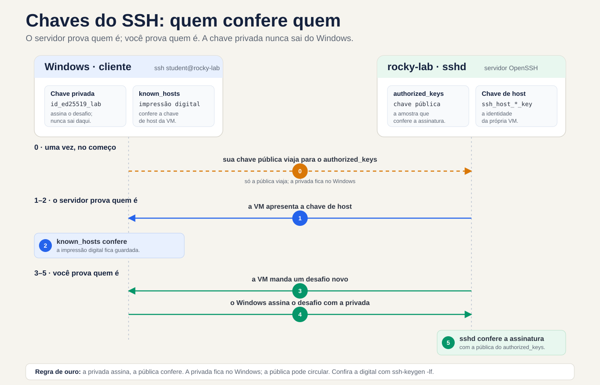
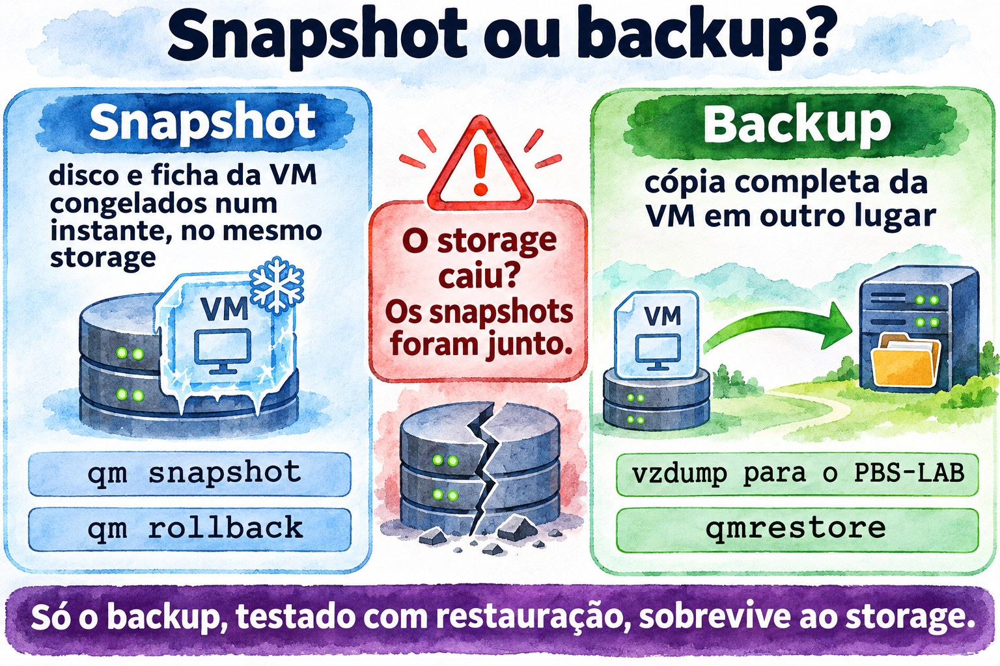
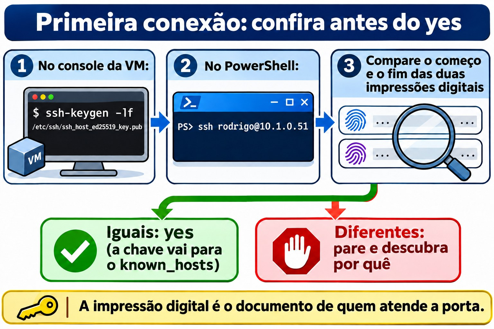
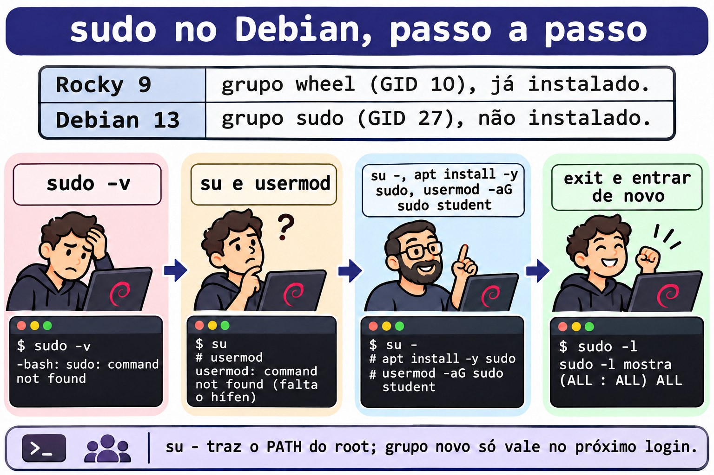
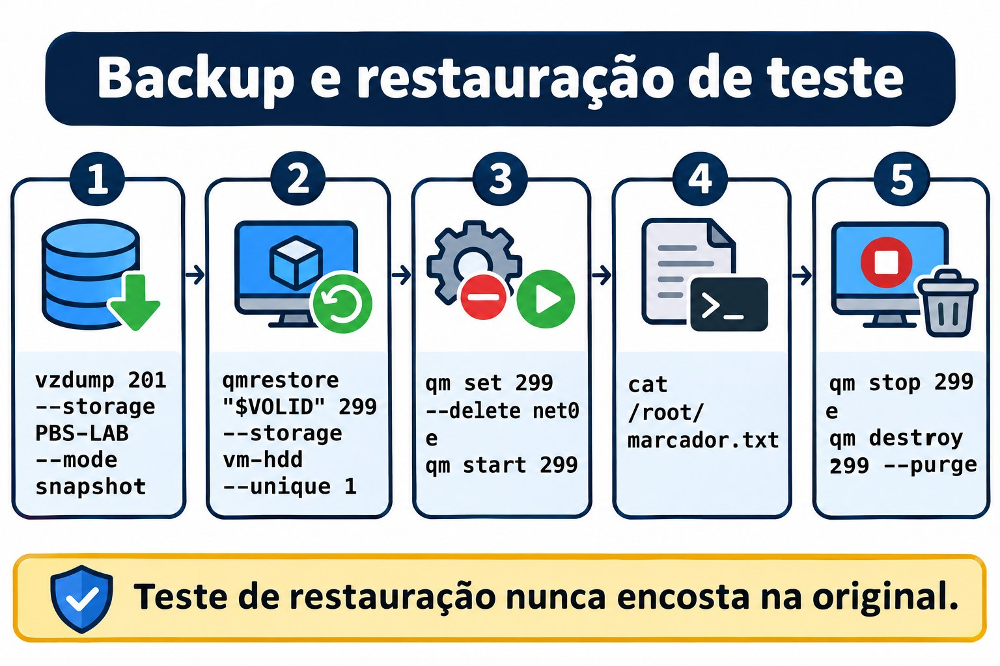
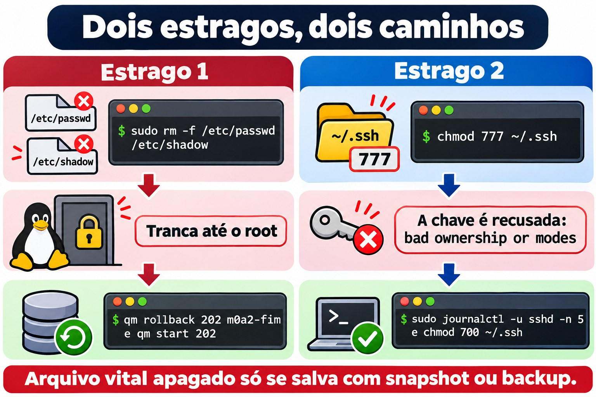
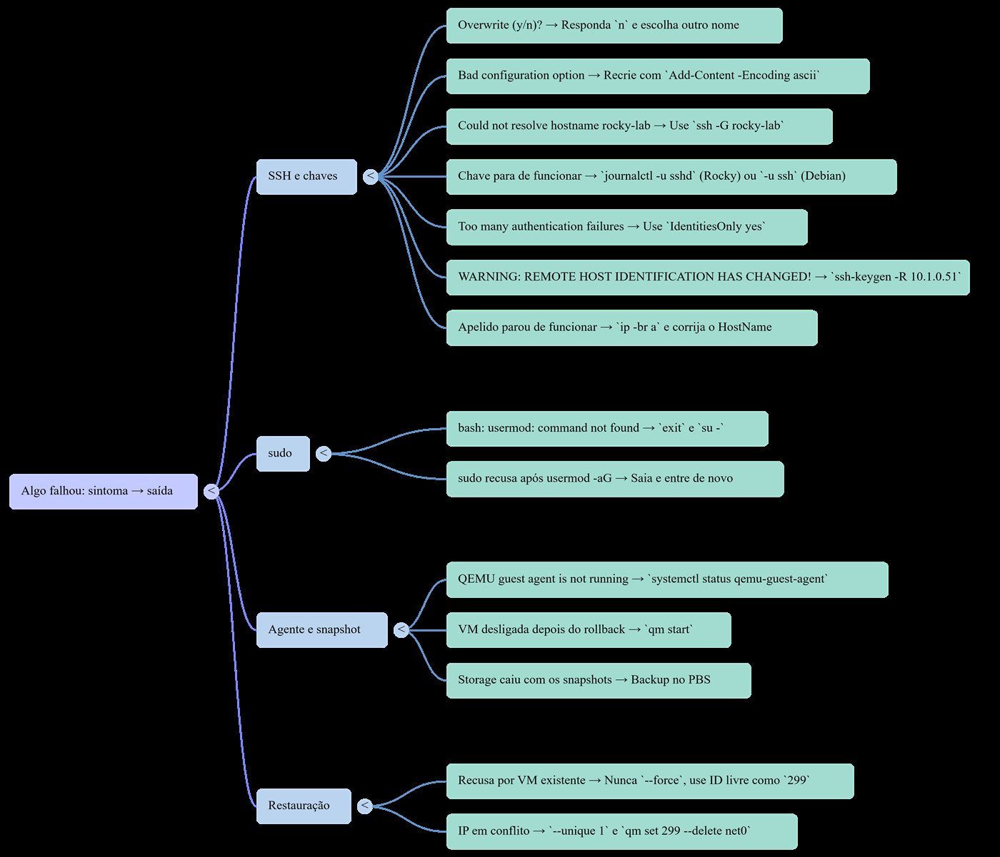

# Aula 0.2 · Acesso e proteção

Você passa a entrar nas VMs pelo terminal do Windows com uma chave SSH, ganha sudo nas duas distros e monta a rede de segurança do curso: snapshot para desfazer um erro em segundos e backup no PBS para sobreviver à perda do storage.

| Ficha | Aula 0.2 |
| --- | --- |
| Módulo | M0 · Laboratório, aula 2 de 2, que fecha o módulo |
| Quando | Semana 1 |
| Ao final você consegue | Entrar nas VMs com ssh rocky-lab usando uma chave Ed25519 só do lab; usar sudo nas duas distros e explicar por que o Debian não tinha; falar com as VMs pelo guest agent; tirar, voltar e limpar snapshots; fazer e testar um backup no PBS |
| Pré-requisitos | Aula 0.1; Windows 10 ou 11, que já trazem o cliente OpenSSH |
| Tempo | Cerca de 2h30 |
| Snapshots | m0a2-inicio no começo; m0a2-fim no meio do lab, porque é ele que salva você no desafio; no fim, a limpeza do módulo deixa só o m0a2-fim |

## 1 · Aquecimento

Três perguntas antes de começar. Responda de cabeça, por escrito ou em voz alta, sem pesquisar: o palpite errado também ensina, porque a aula vai mostrar onde ele falhou. As respostas estão no Gabarito, no fim da aula.

1. Você administra servidores Windows pelo RDP. O que muda quando o acesso remoto é só texto, como no SSH? Pense em banda, em automação e no registro do que foi feito.
2. O storage `vm-hdd` do cluster é perdido de vez. O snapshot `m0a1-fim` da VM 201 salva você? Por quê?
3. No Debian, você vira root com `su`, digita `usermod -aG sudo rodrigo` e recebe `bash: usermod: command not found`. Você é root, e o programa existe em `/usr/sbin/usermod`. O que aconteceu?

## 2 · Por que importa

Um servidor SSH exposto na internet começa a receber tentativas de login automáticas pouco depois de ligado. Robôs varrem endereços o dia inteiro e testam, na porta 22, combinações de usuário e senha comuns. Contra uma senha, é questão de tentativa e paciência. Contra uma chave, não há o que adivinhar: sem o arquivo da chave privada, a conta não abre. Nesta aula a senha continua ligada, como rede de proteção enquanto você aprende; desligá-la é um passo posterior do curso.

A segunda metade da aula monta a rede de segurança do curso inteiro:

- **Snapshot desfaz.** É o Ctrl+Z do servidor: volta um erro em segundos, mas mora no mesmo storage do disco.
- **Backup sobrevive.** É a cópia em outro lugar, no PBS: demora mais para voltar, mas resiste à perda do disco, do nó ou do cluster.
- **Backup nunca restaurado é esperança.** Por isso o lab termina com uma restauração de verdade, conferida por dentro da VM.

No trabalho com clientes, a regra "snapshot antes de mexer, backup testado antes de confiar" é o que separa um susto de um desastre. E configurar o login por chave e o acesso de superusuário é das primeiras coisas que você faz em qualquer servidor novo, no terminal, conferindo depois de um reboot.

## 3 · Modelo mental

> A chave privada é o seu carimbo; a chave pública é a amostra que fica no cartório.

Pense num cartório que reconhece documentos carimbados. Você deixa lá, uma única vez, uma amostra do seu carimbo: é a chave pública, gravada no arquivo `authorized_keys` da VM. A cada visita, o cartório põe na mesa um documento novo, que nunca foi carimbado, e pede o seu carimbo nele. Você carimba ali mesmo e devolve; o cartório compara com a amostra e libera a entrada. O carimbo não sai do seu bolso: é a chave privada, que fica no Windows.

Onde a analogia falha, ela falha a favor da segurança. Com um carimbo de borracha, quem tem a amostra pode mandar fazer uma cópia. Com chaves, não: a pública só serve para conferir, e nenhum cálculo viável tira a privada de dentro dela. Por isso a pública pode circular à vontade, e a privada não sai do lugar.

Falta a outra metade: o cartório é mesmo o cartório? Na primeira visita, o ssh mostra a impressão digital da chave de host da VM, uma espécie de selo oficial, e pergunta se você confia. Você confere por um caminho que não passa pela rede, no lab o console do Proxmox, e só então responde `yes`. O ssh anota o selo no seu `known_hosts` e, nas visitas seguintes, compara sozinho. Se o selo mudar, ele interrompe a conexão com um aviso em letras maiúsculas.


*As setas 1–2 autenticam a VM; as setas 3–5 autenticam você. A chave privada nunca sai do Windows.*

Leia o diagrama pelas setas numeradas. As setas 1 e 2 respondem quem é o servidor: a VM apresenta a chave de host, e o seu `known_hosts` confere. As setas 3 e 4 respondem quem é você: a VM manda um desafio, o seu Windows devolve o desafio assinado com a chave privada, e a VM confere a assinatura com a amostra guardada no `authorized_keys`. A seta tracejada é a única viagem da chave pública, feita uma vez, no passo 5 do lab.

**Ponte Windows:** você já usa essa ideia. O Windows Hello for Business cria um par de chaves no computador, protege a privada no TPM e registra só a pública no Active Directory ou no Entra ID. E o aviso do RDP de que não consegue verificar a identidade do computador remoto é o mesmo problema que o `known_hosts` resolve: saber se do outro lado está mesmo o servidor que você pensa.

## 4 · Conceito em camadas

### Essencial

| Termo | O que é | Onde aparece |
| --- | --- | --- |
| SSH | Protocolo de acesso remoto cifrado, na porta 22. O cliente é o `ssh`; o servidor, o serviço `sshd` | Cliente no Windows 10 e 11; servidor nas VMs |
| Par de chaves | Duas metades ligadas pela matemática: a privada assina, a pública confere | `id_ed25519_lab` e `id_ed25519_lab.pub`, no Windows |
| Ed25519 | O tipo de chave moderno: curto, rápido e seguro | `-t ed25519` no `ssh-keygen` |
| Frase-senha | A senha que cifra o arquivo da chave privada no disco | Pedida pelo `ssh-keygen` e, uma vez, pelo `ssh-add` |
| ssh-agent | Serviço que guarda a chave destravada e assina por você | Serviço do Windows, ligado no passo 4 |
| known\_hosts | As chaves de host que você já conferiu | `%USERPROFILE%\.ssh\known_hosts`, no Windows |
| authorized\_keys | As chaves públicas aceitas para um usuário | `~/.ssh/authorized_keys`, na VM |
| sudo | Roda um comando como root, pedindo a sua senha, e registra no log | Regras em `/etc/sudoers`, para os grupos `wheel` e `sudo` |
| Snapshot | O disco e a ficha da VM congelados num instante, no mesmo storage | `qm snapshot`; volta com `qm rollback` |
| Backup | Cópia completa da VM em outro lugar | `vzdump` para o `PBS-LAB`; volta com `qmrestore` |

**Ponte Windows:** o `sudo` é primo do UAC. Nos dois, você trabalha sem privilégio e eleva só o que precisa. As diferenças: o `sudo` pede a sua própria senha, enquanto o UAC pede um clique de consentimento, ou a senha de um administrador se você for usuário comum; o `sudo` registra cada comando no log; e as regras do `sudo` podem limitar quais comandos cada pessoa pode rodar.

### Aprofundamento

**Uma chave só para o lab.** A `id_ed25519_lab` serve só às VMs do curso. Se um dia vazar, você a remove de duas VMs, sem tocar nos servidores de clientes. Separar chaves por ambiente segue a lógica de não repetir a senha do e-mail no banco. O comentário `lab-curso`, no fim da chave pública, identifica a linha dentro de um `authorized_keys` que pode ter várias.

**IdentitiesOnly.** Sem essa linha no `config`, o ssh oferece ao servidor todas as chaves que o agente guarda, uma por vez. O servidor conta cada recusa como uma tentativa, e o limite padrão do `sshd` é seis: com muitas chaves no agente, a conexão cai com `Too many authentication failures` antes de chegar à certa. Com `IdentitiesOnly yes`, o ssh oferece só a chave indicada no bloco.

**Frase-senha e agente.** O arquivo da chave privada fica cifrado pela frase-senha: quem copiar o arquivo sem a frase não consegue usá-lo. O agente guarda a chave destravada e assina em nome do ssh. No Windows, o agente é um serviço que guarda as chaves adicionadas protegidas pela sua conta do Windows, e elas continuam lá depois de reiniciar. Na prática, você digita a frase-senha uma vez, no `ssh-add`, e a proteção do dia a dia passa a ser a sua senha do Windows.

**Rigor sobre o desafio.** No SSH 2, o servidor não sorteia um desafio separado. As duas pontas combinam, na troca de chaves, um identificador de sessão que nunca se repete, e é ele que o seu Windows assina. O efeito é o do desafio: uma assinatura capturada numa conexão não serve para nenhuma outra.

**StrictModes.** Antes de aceitar uma chave, o `sshd` confere o dono e as permissões da pasta pessoal, de `~/.ssh` e do `authorized_keys`. Se outro usuário pudesse gravar ali, poderia plantar uma chave própria; então o `sshd` recusa e registra `Authentication refused: bad ownership or modes`. O padrão seguro é `~/.ssh` com 700 e `authorized_keys` com 600, ambos do próprio usuário. No Rocky há uma segunda trava, o SELinux: os arquivos precisam do rótulo `ssh_home_t`, e `restorecon -Rv ~/.ssh` devolve os rótulos certos, listando o que mudou.

**su e su -.** O `su` sem hífen troca de usuário e mantém quase todo o seu ambiente: a pasta atual e, no Debian, o PATH do usuário comum, que não passa por `/usr/sbin`. Você vira root com o mapa de um usuário comum. O `su -` abre um shell de login, com o ambiente do root, o PATH completo e a pasta `/root`. Regra prática: sempre `su -`.

**Grupos valem no próximo login.** O `usermod -aG sudo rodrigo` grava o grupo novo em `/etc/group`, mas a sua sessão aberta carrega a lista de grupos de quando você entrou, e todo programa que ela abre herda essa lista. O `id` mostra a sessão; o `id rodrigo` lê os arquivos e já mostra o grupo novo. Cuidado com o `-a`: sem ele, `usermod -G sudo rodrigo` troca todos os grupos extras do usuário por um só.

**fs-freeze e fs-thaw.** Num backup com a VM ligada, o Proxmox copia o disco enquanto o sistema continua gravando. Sem o agente, a cópia equivale a puxar a tomada: o journal do sistema de arquivos conserta a estrutura, mas o que ainda estava só na memória fica de fora. Com o agente, o Proxmox pede um `fs-freeze`: o sistema descarrega os caches e segura as gravações por um instante, a cópia parte daquele ponto, e um `fs-thaw` libera tudo. O backup sai com os sistemas de arquivos consistentes.

**Por que o segundo backup é rápido.** O PBS guarda os dados em pedaços e só grava os pedaços que ainda não tem. E, enquanto o processo QEMU da VM for o mesmo (o reboot por dentro não o troca, como você viu na Aula 0.1), o Proxmox anota quais blocos mudaram desde o último backup, num mapa chamado dirty bitmap, e lê só esses.



*O snapshot mora no mesmo storage do disco; só o backup em outro lugar sobrevive à perda dele.*

## 5 · Rocky × Debian

| Tema | Rocky 9 | Debian 13 |
| --- | --- | --- |
| Grupo que dá sudo | `wheel`, GID 10 | `sudo`, GID 27 |
| Linha no `/etc/sudoers` | `%wheel ALL=(ALL) ALL` | `%sudo ALL=(ALL:ALL) ALL` |
| sudo depois da instalação | Instalado; o usuário marcado como administrador já está no `wheel` | Só vem quando a senha de root fica em branco |
| `su` sem hífen | O PATH do usuário já inclui `/usr/sbin`: o tropeço não aparece | O PATH do usuário não tem `/usr/sbin`: o `usermod` some |
| Atualizar o sistema | `sudo dnf upgrade` | `sudo apt update` e `sudo apt upgrade` |
| Serviço SSH | `sshd` | `ssh` |
| Trava extra de acesso | SELinux, por rótulos: `restorecon` acerta o `~/.ssh` | AppArmor, por caminhos: nada a fazer no `~/.ssh` |
| Onde ver o sshd e o sudo | Journal e `/var/log/secure` | Só o journal |
| `qm guest exec` do Proxmox | Bloqueado por padrão | Liberado |

## 6 · Lab guiado

Você vai alternar entre três lugares: o PowerShell do Windows, o shell do nó do Proxmox e o terminal das VMs, primeiro pelo console e, a partir do passo 5, por SSH. Antes de cada bloco, o texto diz onde ele roda.

Em oito pontos do lab você para num bloco **Decida**: uma situação que acontece de verdade no trabalho, quatro saídas e uma tabela que comenta cada uma. Escolha a letra antes de ler a tabela, e depois leia as quatro linhas, não só a da sua escolha. As alternativas erradas são os erros mais comuns da profissão, e entender por que cada uma falha é o que você ainda vai lembrar amanhã. Os blocos marcados como **cenário** descrevem algo que não acontece sozinho no lab; os outros você vê na sua tela.

### Passo 1 · Snapshot de início

As VMs estão desligadas desde o fim da Aula 0.1. Tire o snapshot antes de ligá-las: com a VM desligada, ele guarda um disco parado, sem nada pela metade. No nó da 201:

```bash
qm snapshot 201 m0a2-inicio --description "Aula 0.2: início"
qm start 201
```

No nó da 202:

```bash
qm snapshot 202 m0a2-inicio --description "Aula 0.2: início"
qm start 202
```

Não lembra em que nó está cada uma? `pvesh get /cluster/resources --type vm`, em qualquer nó.

### Passo 2 · Confirme os IPs

Os IPs vêm do DHCP e podem ter mudado desde a Aula 0.1. No console de cada VM, depois do login como rodrigo:

```bash
ip -br a
```

Saída esperada: a placa, provavelmente `enp6s18`, com `UP` e o endereço IPv4. Os exemplos desta aula usam 10.1.0.51 para a rocky-lab e 10.1.0.52 para a debian-lab: use os seus. No PowerShell do Windows, confira se a porta 22 responde:

```powershell
Test-NetConnection 10.1.0.51 -Port 22
Test-NetConnection 10.1.0.52 -Port 22
```

Saída esperada: `TcpTestSucceeded : True` nos dois.

### Passo 3 · Gere a chave do lab

No PowerShell do Windows, como usuário comum:

```powershell
New-Item -ItemType Directory -Force "$env:USERPROFILE\.ssh" | Out-Null
ssh-keygen -t ed25519 -f "$env:USERPROFILE\.ssh\id_ed25519_lab" -C "lab-curso"
```

O `ssh-keygen` pede a frase-senha duas vezes. Escolha uma que você lembre: ela protege o arquivo se alguém o copiar.

**Preveja:** quantos arquivos o comando criou, e qual deles você pode mostrar a qualquer pessoa?

```powershell
Get-ChildItem "$env:USERPROFILE\.ssh"
Get-Content "$env:USERPROFILE\.ssh\id_ed25519_lab.pub"
```

Saída esperada: os arquivos `id_ed25519_lab` e `id_ed25519_lab.pub`, e uma única linha que começa com `ssh-ed25519 AAAAC3NzaC1lZDI1NTE5` e termina em `lab-curso`. Esse começo é igual em toda chave Ed25519: é o nome do tipo de chave, codificado em base64. O arquivo sem `.pub` é a chave privada: não abra, não copie, não cole em lugar nenhum.

**Decida 1 · O ssh-keygen quer sobrescrever.** Rode de novo exatamente o mesmo `ssh-keygen` deste passo. Ele não gera nada: avisa que o `id_ed25519_lab` `already exists` e para em `Overwrite (y/n)?`. Não digite nada ainda. O que você responde?

- **A)** `y`. É o mesmo nome, então é a mesma chave; tanto faz.
- **B)** `n`, e descubro de onde veio esse arquivo antes de decidir qualquer coisa.
- **C)** `y`, e depois copio a chave pública nova para todo lugar onde a antiga estava.
- **D)** Ctrl+C, apago a pasta `.ssh` e recomeço do zero.

Escolha a letra antes de olhar a tabela.

| Se você marcou | Resultado | Por quê |
| --- | --- | --- |
| A | ❌ Errada | Mesmo nome não quer dizer mesma chave. O `y` apaga a chave privada antiga para sempre e cria outra no lugar. Se a antiga estava no `authorized_keys` de algum servidor, você perde esse acesso e só descobre no dia em que precisar dele. |
| B | ✅ Certa | O `n` sai sem mexer em nada. Um arquivo que já existe é evidência: leia o comentário no fim da chave pública, com o comando logo abaixo, e ele diz para que a chave foi criada. Se não souber de onde ela veio, gere a nova com outro nome. |
| C | ❌ Errada | Daria para fazer se você soubesse onde a antiga estava, e você não sabe. É o erro da A com mais trabalho e com o risco de esquecer um servidor. |
| D | ❌ Errada | A pasta guarda também o `known_hosts`, o `config` e as suas outras chaves. Você destrói tudo para resolver o que um `n` resolve. |

**Para fixar:** a chave privada é a única cópia da chave de uma casa. Antes de jogar fora, descubra que porta ela abre.

Responda `n` e confira a chave que você já tem:

```powershell
Get-Content "$env:USERPROFILE\.ssh\id_ed25519_lab.pub"
```

Saída esperada: uma linha que começa com `ssh-ed25519` e termina em `lab-curso`, o comentário que você passou no `-C`. No trabalho, ponha no comentário para que e quando a chave foi criada, como `notebook-rodrigo-2026`. Daqui a dois anos, é essa etiqueta que vai dizer o que cada linha de um `authorized_keys` abre.

### Passo 4 · Ligue o agente

O serviço `ssh-agent` vem desativado no Windows. Abra um PowerShell como administrador e rode:

```powershell
Get-Service ssh-agent | Set-Service -StartupType Automatic
Start-Service ssh-agent
```

Feche essa janela e volte ao PowerShell comum, porque a chave é da sua conta:

```powershell
ssh-add "$env:USERPROFILE\.ssh\id_ed25519_lab"
ssh-add -l
```

O `ssh-add` pede a frase-senha uma vez. Saída esperada do `ssh-add -l`: uma linha com `256 SHA256:`, a impressão digital da chave e `lab-curso (ED25519)` no fim.

### Passo 5 · Confira a VM e entregue a amostra

Primeiro, a impressão digital da VM, por um caminho que não passa pela rede. No console da 201, logado como rodrigo:

```bash
ssh-keygen -lf /etc/ssh/ssh_host_ed25519_key.pub
```

Saída esperada: uma linha que começa com `256 SHA256:`, seguida da impressão digital, e termina em `(ED25519)`. Deixe o console aberto. Agora, no PowerShell comum, mande a sua chave pública para a VM:

```powershell
Get-Content "$env:USERPROFILE\.ssh\id_ed25519_lab.pub" | ssh rodrigo@10.1.0.51 "mkdir -p ~/.ssh && chmod 700 ~/.ssh && cat >> ~/.ssh/authorized_keys && chmod 600 ~/.ssh/authorized_keys"
```

A primeira conexão pergunta, com pequenas variações conforme a versão do Windows:

```text
The authenticity of host '10.1.0.51 (10.1.0.51)' can't be established.
ED25519 key fingerprint is SHA256:...
This key is not known by any other names.
Are you sure you want to continue connecting (yes/no/[fingerprint])?
```

Compare a impressão digital com a do console, no começo e no fim. Iguais: digite `yes`. Diferentes: pare e descubra por quê antes de seguir. Depois do `yes`, o ssh avisa que gravou a chave no `known_hosts` e pede a senha da conta do rodrigo, pela última vez. Se nenhum erro aparecer, a cópia deu certo. Teste o login por chave:

```powershell
ssh -i "$env:USERPROFILE\.ssh\id_ed25519_lab" rodrigo@10.1.0.51
```

Saída esperada: o prompt `[rodrigo@rocky-lab ~]$`, sem pedir senha nenhuma, porque a frase-senha já está com o agente. Ainda dentro da VM, confira o que a cópia criou:

```bash
ls -ld ~/.ssh ~/.ssh/authorized_keys
restorecon -Rv ~/.ssh
```

Saída esperada: `drwx------` na pasta e `-rw-------` no arquivo, os dois do rodrigo. Se o `restorecon` não imprimir nada, os rótulos do SELinux já estavam certos. Saia com `exit`.

Repita o passo para a 202: impressão digital no console da debian-lab, cópia para `rodrigo@10.1.0.52` e teste com `ssh -i`. O prompt do Debian é `rodrigo@debian-lab:~$`, e lá não existe `restorecon`: o AppArmor não rotula arquivos.



*Confira a impressão digital por um caminho que não passa pela rede, e só então digite yes.*

**Decida 2 · A impressão digital não bate.** Cenário: na primeira conexão com a 202, a impressão digital que o PowerShell mostra começa e termina diferente da que o console da debian-lab mostrou. A pergunta `Are you sure you want to continue connecting (yes/no/[fingerprint])?` está na tela. O que você faz?

- **A)** `yes`. É a minha rede, só pode ser a VM.
- **B)** `no`, e confiro no console da debian-lab se o IP dela é mesmo o 10.1.0.52.
- **C)** `no`, apago o `known_hosts` e tento de novo.
- **D)** Conecto com `-o StrictHostKeyChecking=no`, para a pergunta sumir.

Escolha a letra antes de olhar a tabela.

| Se você marcou | Resultado | Por quê |
| --- | --- | --- |
| A | ❌ Errada | O `yes` grava a chave desconhecida no `known_hosts`, e daí em diante o ssh confia nela sem perguntar. Logo em seguida ele pede a senha do rodrigo, e você a entregaria para a máquina errada. |
| B | ✅ Certa | Impressão diferente quer dizer outra máquina respondendo nesse IP. No lab, a causa mais comum é o DHCP ter dado o 10.1.0.52 para outra VM, e o `ip -br a` no console da debian-lab mostra o IP real dela. Se o IP bate e a impressão não, há alguém no meio do caminho: pare e investigue a rede antes de digitar qualquer senha. |
| C | ❌ Errada | É a primeira conexão, então o `known_hosts` nem tem esse IP: apagar não muda a pergunta. E leva junto a conferência de todos os servidores que você já validou. |
| D | ❌ Errada | Desliga o alarme em vez de procurar o fogo. Com essa opção, o ssh grava qualquer chave nova sem avisar, hoje e toda vez que você repetir o comando. |

**Para fixar:** a impressão digital é o documento de quem atende a porta. Se ele não bate com o cadastro, você não entrega a encomenda, por mais que a pessoa jure que é ela.

**Para saber:** no Linux existe o `ssh-copy-id`, que faz essa cópia num comando só. O cliente do Windows não o traz, daí a linha com `Get-Content`. Você vai usá-lo quando as VMs passarem a conversar entre si.

### Passo 6 · Apelidos no config

Digitar `ssh -i ... rodrigo@10.1.0.51` toda vez cansa e convida ao erro. O arquivo `config` guarda apelidos. No PowerShell comum, trocando os IPs pelos seus:

```powershell
Add-Content -Encoding ascii -Path "$env:USERPROFILE\.ssh\config" -Value @'
Host rocky-lab
    HostName 10.1.0.51
    User rodrigo
    IdentityFile ~/.ssh/id_ed25519_lab
    IdentitiesOnly yes

Host debian-lab
    HostName 10.1.0.52
    User rodrigo
    IdentityFile ~/.ssh/id_ed25519_lab
    IdentitiesOnly yes
'@
```

O `'@` final precisa ficar no começo da linha, sem espaço antes. E nunca crie esse arquivo com `>` ou `Out-File`: no Windows PowerShell, eles gravam em UTF-16, que o ssh não lê. Teste:

```powershell
ssh rocky-lab hostname
ssh debian-lab hostname
```

Saída esperada: `rocky-lab` e `debian-lab`. O ssh entrou, rodou um único comando e saiu. Esse é o tijolo de toda automação que vem pela frente, inclusive do Ansible.

### Passo 7 · sudo nas duas distros

No Rocky, o instalador já pôs o rodrigo no grupo `wheel`. Entre com `ssh rocky-lab` e confira:

```bash
id
sudo -l
```

Saída esperada: `10(wheel)` entre os grupos do `id` e, no fim do `sudo -l`, depois da sua senha, a linha `(ALL) ALL`. Saia com `exit`.

No Debian, o caminho tem uma pegadinha de propósito. Entre com `ssh debian-lab` e tente:

```bash
sudo -v
```

Saída esperada: `-bash: sudo: command not found`. O pacote não existe. Vire root e tente dar o grupo:

```bash
su
usermod -aG sudo rodrigo
```

Saída esperada: `bash: usermod: command not found`, mesmo como root. É a pergunta 3 do Aquecimento, ao vivo.

**Decida 3 · Root, e mesmo assim o comando não existe.** Antes de seguir, escolha a explicação:

- **A)** O pacote do `usermod` não está instalado; falta um `apt install`.
- **B)** O `su` sem hífen manteve o PATH do rodrigo, e esse PATH não tem `/usr/sbin`.
- **C)** No Debian, nem o root mexe em grupos enquanto o `sudo` não estiver instalado.
- **D)** O nome está errado; o comando certo é `useradd`.

Escolha a letra antes de olhar a tabela.

| Se você marcou | Resultado | Por quê |
| --- | --- | --- |
| A | ❌ Errada | O programa está instalado: `ls -l /usr/sbin/usermod` mostra o arquivo. O shell só não procura nessa pasta, e instalar de novo não muda isso. |
| B | ✅ Certa | O `su` sem hífen troca o usuário e mantém o ambiente, PATH incluído. No Debian, o PATH de um usuário comum não tem `/usr/sbin`, onde ficam as ferramentas de administração. O `su -` abre um login completo de root, com o PATH de root. |
| C | ❌ Errada | Root não depende do `sudo`; o `sudo` é só um jeito de virar root. Com o caminho completo, `/usr/sbin/usermod -aG sudo rodrigo` funciona agora mesmo. |
| D | ❌ Errada | O `useradd` cria usuários, e o rodrigo já existe. O nome estava certo; o shell é que não achou o programa. |

**Para fixar:** `su` sem hífen é vestir o crachá do chefe e continuar com o mapa do estagiário. Você tem a permissão, mas o mapa não mostra a sala das ferramentas.

Prove a causa: rode `echo $PATH`. A resposta, `/usr/local/bin:/usr/bin:/bin:/usr/local/games:/usr/games`, não tem nenhum `sbin`. Saia com `exit` e faça do jeito certo:

```bash
su -
apt update
apt install -y sudo
usermod -aG sudo rodrigo
exit
```

**Preveja:** de volta como rodrigo, o `sudo` já funciona?

```bash
id
id rodrigo
sudo -v
```

**Decida 4 · O grupo foi gravado, e o sudo ainda recusa.** Compare o que apareceu: o `id` não mostra o grupo `sudo`, o `id rodrigo` mostra `27(sudo)`, e o `sudo -v`, depois de pedir a senha, responde `Sorry, user rodrigo may not run sudo on debian-lab.` O que você faz?

- **A)** Edito o `/etc/sudoers` e ponho o rodrigo lá pelo nome.
- **B)** Saio com `exit` e entro de novo.
- **C)** Reinicio a VM.
- **D)** Rodo de novo, agora com `sudo usermod -aG sudo rodrigo`.

Escolha a letra antes de olhar a tabela.

| Se você marcou | Resultado | Por quê |
| --- | --- | --- |
| A | ❌ Errada | O problema não está no sudoers: a regra do grupo `sudo` já existe lá. Regra por nome, servidor por servidor, vira bagunça, e um erro de digitação no sudoers fora do `visudo` pode travar o sudo de todo mundo. |
| B | ✅ Certa | A lista de grupos é montada no login. A sessão aberta carrega a lista de quando você entrou, e todo programa que ela abre herda essa lista. Sair e entrar monta uma lista nova, já com o `sudo`. |
| C | ❌ Errada | Funciona, porque reiniciar também força um login novo, mas derruba tudo que roda na VM para resolver o que um `exit` resolve. Num servidor de cliente, seria uma janela de manutenção gasta à toa. |
| D | ❌ Errada | O `sudo` recusa pelo mesmo motivo de antes: a sua sessão ainda não está no grupo. E não há nada a gravar de novo, porque o `id rodrigo` já provou que o grupo está nos arquivos. |

**Para fixar:** o crachá novo já foi impresso no `/etc/group`, mas você ainda está com o velho no pescoço. Para trocar, saia pela portaria e entre de novo.

Saia com `exit`, entre de novo com `ssh debian-lab` e confira:

```bash
id
sudo -v
sudo -l
```

Saída esperada: `27(sudo)` no `id`; o `sudo -v` pede a sua senha e volta calado; o `sudo -l` termina com `(ALL : ALL) ALL`. Agora veja o rastro, nas duas VMs:

```bash
sudo journalctl _COMM=sudo -n 5
```

Saída esperada: linhas como `rodrigo : TTY=pts/0 ; PWD=/home/rodrigo ; USER=root ; COMMAND=/usr/bin/journalctl _COMM=sudo -n 5`, inclusive o próprio comando que você acabou de rodar. No Rocky, o mesmo rastro vai também para `/var/log/secure`: confira com `sudo tail -n 5 /var/log/secure`.


*su sem hífen dá o crachá sem o mapa; grupo novo só vale no próximo login.*

### Passo 8 · Atualize e reinicie

**Preveja:** anote o kernel atual com `uname -r` nas duas VMs. Se a atualização trouxer um kernel novo, a partir de quando ele vale?

Na rocky-lab:

```bash
sudo dnf upgrade
```

Na debian-lab:

```bash
sudo apt update
sudo apt upgrade
```

Leia a lista, responda `y` e espere terminar. Depois, nas duas:

```bash
sudo reboot
```

A conexão SSH cai, como esperado. Espere meio minuto, entre de novo e rode `uname -r`. Kernel novo só vale depois do reboot; até lá, o sistema roda o antigo, que continua instalado como reserva. O Rocky guarda até três kernels; o Debian deixa os antigos até um `apt autoremove`, que nunca remove o que está rodando.

### Passo 9 · Instale o agente

A ficha das VMs tem `agent: enabled=1` desde a Aula 0.1: o Proxmox criou o canal, mas ninguém atendia do lado de dentro. Agora instale quem atende. Na rocky-lab:

```bash
sudo dnf install -y qemu-guest-agent
sudo systemctl start qemu-guest-agent
systemctl is-active qemu-guest-agent
systemctl is-enabled qemu-guest-agent
```

Na debian-lab:

```bash
sudo apt install -y qemu-guest-agent
sudo systemctl start qemu-guest-agent
systemctl is-active qemu-guest-agent
systemctl is-enabled qemu-guest-agent
```

Saída esperada: `active` e, provavelmente, `static`. Static quer dizer que o serviço não tem chave de ligar no boot: uma regra do udev o inicia quando aparece a porta virtual do agente, que a linha `agent` da ficha cria. Se aparecer `disabled`, rode `sudo systemctl enable qemu-guest-agent`. Se o `dnf` disser que o pacote já estava instalado, siga em frente: o que importa é o `active`.

Agora pelo lado do Proxmox, no nó da 201:

```bash
qm guest cmd 201 ping
qm guest cmd 201 network-get-interfaces
```

O `ping` sem erro quer dizer que o agente respondeu; com o agente parado, a resposta seria `QEMU guest agent is not running`. O segundo comando devolve as placas da VM com os IPs, que agora aparecem também no Summary da VM, na interface web. E o teste que falhou na Aula 0.1:

```bash
qm shutdown 201
qm status 201
qm start 201
```

Saída esperada: o `qm shutdown` volta em segundos, o `qm status` diz `status: stopped`, e a VM liga de novo. Repita os comandos do Proxmox para a 202, no nó dela.

**Para saber:** o agente é uma porta de root dentro da VM. No Debian, `qm guest exec` roda qualquer comando como root lá dentro; o Rocky, como o RHEL, bloqueia esse comando por padrão. Quem administra o Proxmox administra, na prática, as VMs com agente: proteja o acesso ao Proxmox como protege o root.

**Decida 5 · O agente não responde.** Cenário: na 202, o `qm shutdown 202` fica parado e termina com erro de tempo esgotado, e o `qm guest cmd 202 ping` responde `QEMU guest agent is not running`. É exatamente o que a missão da seção 12 vai procurar nas VMs dos seus clientes. O que você faz?

- **A)** `qm stop 202`, para desligar na hora e seguir o lab.
- **B)** Entro na VM e rodo `systemctl status qemu-guest-agent`.
- **C)** Desligo a opção QEMU Guest Agent da VM, para o Proxmox parar de perguntar.
- **D)** Repito com `qm shutdown 202 --timeout 600`.

Escolha a letra antes de olhar a tabela.

| Se você marcou | Resultado | Por quê |
| --- | --- | --- |
| A | ❌ Errada | O `qm stop` é puxar o cabo da tomada. No lab passa; num servidor com banco de dados, pode estragar o que estava sendo gravado. É o último recurso depois do diagnóstico, nunca no lugar dele. |
| B | ✅ Certa | A mensagem diz onde olhar: o Proxmox chamou o agente e ninguém atendeu. O `systemctl status` separa as causas. Se o serviço não existe, faltou instalar o `qemu-guest-agent`. Se existe e está parado, confira a opção QEMU Guest Agent no Proxmox: ela só passa a valer depois de desligar e ligar a VM pelo Proxmox, e um reboot por dentro não basta. |
| C | ❌ Errada | O desligamento passa a ir pelo botão de energia virtual e pode até funcionar, mas o defeito fica escondido: o backup continua sem congelar os discos, que era o motivo deste passo. |
| D | ❌ Errada | Esperar mais não faz um serviço parado responder. Você chega ao mesmo erro, só que dez minutos depois. |

**Para fixar:** o agente é o interfone da VM. Se ninguém atende, você não arromba a porta nem arranca o interfone; vai ver por que ele está mudo.

### Passo 10 · Primeiro backup no PBS

Crie um marcador, para provar depois que o backup guarda o que você pensa. Na rocky-lab:

```bash
echo "aula 0.2: antes do backup" | sudo tee /root/marcador.txt
```

**Preveja:** com o agente instalado, que duas linhas aparecem no log do backup que não apareceriam sem ele? No nó da 201:

```bash
vzdump 201 --storage PBS-LAB --mode snapshot
```

Saída esperada, entre outras linhas:

```text
INFO: issuing guest-agent 'fs-freeze' command
INFO: issuing guest-agent 'fs-thaw' command
INFO: Backup job finished successfully
```

Liste os backups da 201:

```bash
pvesm list PBS-LAB --vmid 201
```

Saída esperada: uma linha por backup, com um nome como `PBS-LAB:backup/vm/201/2026-10-30T...Z` e o formato `pbs-vm`. Se o job semanal já rodou, os backups dele aparecem também.

### Passo 11 · Restaure de verdade

Restaure numa VM nova, com outro ID e sem placa de rede, para que nada ameace a 201. No nó da 201:

```bash
pvesh get /cluster/nextid --vmid 299
VOLID=$(pvesm list PBS-LAB --vmid 201 | awk 'NR>1 {v=$1} END {print v}')
echo "$VOLID"
qmrestore "$VOLID" 299 --storage vm-hdd --unique 1
qm set 299 --delete net0
qm start 299
```

Linha por linha: a primeira confirma que o ID 299 está livre e o devolve; se reclamar, escolha outro número e troque em todas as linhas. A segunda guarda na variável `VOLID` o nome do backup mais recente: o `awk` pula o cabeçalho e fica com a última linha. O `--unique 1` sorteia um MAC novo. E tirar a `net0` antes do primeiro boot impede que a cópia apareça na rede com a identidade da 201.

Abra o console da 299 na interface web, entre como root e rode:

```bash
cat /root/marcador.txt
```

Saída esperada: `aula 0.2: antes do backup`. O backup guarda o que você pensa. Agora apague a cópia, no nó:

```bash
qm stop 299
qm destroy 299 --purge
```

Confira o número antes do Enter: o `qm destroy` apaga a ficha e os discos juntos, como você viu na Aula 0.1.

**Para saber:** para buscar um arquivo só, sem restaurar a VM inteira, a interface web tem o File Restore: no storage `PBS-LAB`, aba Backups, escolha o backup e navegue pelas pastas dele.

**Decida 6 · Restaurar por cima?** Cenário: um colega fez o restore com o número errado, `qmrestore "$VOLID" 201`, e o Proxmox recusou porque a VM 201 já existe. Ele sugere repetir com `--force`. O que você responde?

- **A)** Pode, o `--force` existe para isso.
- **B)** Restaure num número livre, como o 299, com `--unique 1`, e sem rede no primeiro boot.
- **C)** Apague a 201 com `qm destroy 201` e restaure no lugar dela.
- **D)** Restaure com o mesmo número em outro nó do cluster.

Escolha a letra antes de olhar a tabela.

| Se você marcou | Resultado | Por quê |
| --- | --- | --- |
| A | ❌ Errada | O `--force` apaga a 201 atual, discos incluídos, e põe o backup no lugar. Tudo o que mudou desde o backup se perde. Para testar o backup, você destruiria a máquina que ele protege. |
| B | ✅ Certa | Teste de restauração não encosta na original. O número livre evita a colisão, o `--unique 1` gera um MAC novo, e o `qm set 299 --delete net0` impede a cópia de disputar a rede com a 201 quando ligar. É exatamente o passo 11. |
| C | ❌ Errada | É o `--force` feito à mão, com o mesmo resultado: a original some. E o `qm destroy` não pergunta se você tem certeza. |
| D | ❌ Errada | O número da VM vale para o cluster inteiro. O `qmrestore` recusa do mesmo jeito em qualquer nó. |

**Para fixar:** testar backup é como testar a cópia de uma chave. Você experimenta a cópia na porta sem jogar a original fora antes.



*Testar o backup é restaurar numa VM nova, sem rede, e conferir o marcador; a 201 original nunca é tocada.*

### Passo 12 · Snapshot de fim

Com o agente, o snapshot pode ser tirado com a VM ligada: o Proxmox congela os sistemas de arquivos por um instante, como no backup. No nó da 201:

```bash
qm snapshot 201 m0a2-fim --description "Fim do M0: SSH por chave, sudo, agent"
qm listsnapshot 201
```

No nó da 202:

```bash
qm snapshot 202 m0a2-fim --description "Fim do M0: SSH por chave, sudo, agent"
qm listsnapshot 202
```

Saída esperada: a árvore com `m0a1-fim`, `m0a2-inicio` e `m0a2-fim`, um embaixo do outro, e `current` no fim. É esse `m0a2-fim` que salva você no desafio da próxima seção.

## 7 · Quebre e conserte

Agora, o erro que todo administrador teme: apagar um arquivo de que o sistema inteiro depende. O `/etc/passwd` liga cada número de usuário a um nome, e o `/etc/shadow` guarda os hashes das senhas. Na vida real, isso acontece com um `rm` no terminal errado ou com um script cuja variável veio vazia. Hoje você tem o `m0a2-fim`, do passo 12: a meta é desfazer o estrago em menos de 2 minutos.

**Quebre.** Entre com `ssh debian-lab` e rode:

```bash
[ "$(hostname)" = debian-lab ] && sudo rm -f /etc/passwd /etc/shadow
```

A primeira metade é uma trava. O teste entre colchetes só dá verdadeiro na debian-lab, e o `&&` só roda o resto se o teste passar: colou na janela errada, nada acontece. Leve o hábito para o trabalho: comando destrutivo começa conferindo onde está.

**Preveja:** o que cada comando abaixo responde, nesta mesma sessão?

```bash
whoami
id
ls -l /home
sudo -v
```

Saída esperada, na ordem: `whoami: cannot find name for user ID 1000`; um `uid=1000` sem nome, mas com os grupos ainda com nome, porque o `/etc/group` continua lá; o dono da pasta `rodrigo` aparece como `1000`; e `sudo: you do not exist in the passwd database`. Os programas ainda sabem o seu número. O que se perdeu foi o nome, e o `sudo` não confia em quem não tem nome.

Agora, em outra janela do PowerShell, tente entrar:

```powershell
ssh debian-lab
```

A chave é recusada e aparece um pedido de senha que nunca vai funcionar. O `sshd` não conta a estranhos que o usuário não existe: ele finge, para que quem ataca não descubra quais contas existem. Aperte Ctrl+C. No console da 202, tente entrar como root: `Login incorrect`. O login procura o root no mesmo `/etc/passwd`. A VM está trancada por dentro, e nem o root entra.

**Decida 7 · A VM trancou por dentro.** Esta sessão continua aberta, a outra janela não entra e o console recusa até o root. Qual é o caminho mais curto de volta?

- **A)** `sudo cp /etc/passwd- /etc/passwd`, porque o Debian guarda uma cópia de reserva.
- **B)** No nó da 202: `qm rollback 202 m0a2-fim` e depois `qm start 202`.
- **C)** Reiniciar a VM, para o sistema se recuperar na volta.
- **D)** Recriar o rodrigo com `useradd`, aqui mesmo nesta sessão.

Escolha a letra antes de olhar a tabela.

| Se você marcou | Resultado | Por quê |
| --- | --- | --- |
| A | ❌ Errada | A reserva existe, mas o `sudo` precisa achar você no `/etc/passwd` antes de decidir qualquer coisa: é o `you do not exist in the passwd database` que você acabou de ver. Sem sudo, você não grava em `/etc`. Essa cópia salva o dia quando não há snapshot, pelo caminho descrito mais abaixo. |
| B | ✅ Certa | O snapshot guarda o disco inteiro de antes do estrago, e o seu é de minutos atrás. O rollback leva segundos e devolve tudo, inclusive os usuários de sistema que você nem lembraria de recriar. Depois dele a VM fica desligada, por isso o `qm start`. |
| C | ❌ Errada | Reiniciar não recria arquivo nenhum. Você só fecha a única sessão que ainda estava aberta e volta para uma VM em que ninguém entra. |
| D | ❌ Errada | O `useradd` precisa de root e grava no próprio `/etc/passwd`, então aqui ele nem roda. E, mesmo como root, recriaria só o rodrigo: o root e os usuários de sistema, como o do `sshd`, continuariam faltando. |

**Para fixar:** um snapshot recente é uma máquina do tempo. Quando ela existe, usá-la é o conserto profissional; remendar arquivo de sistema na mão fica para quando ela não existe.

**Conserte.** Comece a cronometrar. No nó da 202:

```bash
qm rollback 202 m0a2-fim
qm start 202
```

O rollback desliga a VM na hora, como o `qm stop`, e devolve o disco ao instante do `m0a2-fim`, com os dois arquivos no lugar. Ela volta desligada porque o snapshot não guardou a memória; o `qm start` liga.

**Verifique.** Espere uns 20 segundos e, no PowerShell:

```powershell
ssh debian-lab "whoami; ls -l /home"
```

Saída esperada: `rodrigo` e a pasta `rodrigo` com dono `rodrigo`. Pare o cronômetro. O snapshot continua lá, porque rollback não gasta snapshot: quer treinar de novo, pode.

Sem snapshot, o caminho seria um boot de resgate para copiar de volta o `/etc/passwd-` e o `/etc/shadow-`, as cópias de reserva com a versão anterior à última mudança, que pode não ser a certa. Funciona, mas leva bem mais que 2 minutos, e você aprende num módulo mais à frente.

**Bônus no Rocky.** O defeito mais comum do SSH por chave, ao vivo. Entre com `ssh rocky-lab` e rode:

```bash
[ "$(hostname)" = rocky-lab ] && chmod 777 ~/.ssh
exit
```

**Preveja:** a próxima entrada usa a chave? No PowerShell:

```powershell
ssh rocky-lab
```

O ssh pede a senha: a chave foi recusada.

**Decida 8 · A chave parou de funcionar.** Qual é o seu primeiro passo?

- **A)** Copio a chave pública de novo para o `authorized_keys`.
- **B)** Entro com a senha e leio o log do `sshd` na VM.
- **C)** Rodo `ssh -v rocky-lab` no Windows e procuro o motivo ali.
- **D)** Gero uma chave nova, porque esta deve ter estragado.

Escolha a letra antes de olhar a tabela.

| Se você marcou | Resultado | Por quê |
| --- | --- | --- |
| A | ❌ Errada | A chave está lá, intacta. Copiar de novo só cria uma linha duplicada, e o `sshd` continua recusando, porque o problema é a pasta e não a chave. |
| B | ✅ Certa | Quem recusou foi o servidor, então o motivo está no log do servidor. Uma linha do `journalctl` diz exatamente o que ele não aceitou. |
| C | ❌ Errada | Ajuda pela metade: o `-v` mostra que a chave foi oferecida e recusada, mas o servidor nunca conta ao cliente por quê. Você vê o "não" sem ver o motivo. |
| D | ❌ Errada | A chave nova vai para a mesma pasta, com o mesmo defeito, e é recusada do mesmo jeito. Você troca a chave e a fechadura continua emperrada. |

**Para fixar:** o cliente só sabe que levou um "não"; o porquê fica anotado do lado de quem disse "não".

Entre com a senha e leia o motivo onde ele está, no servidor:

```bash
sudo journalctl -u sshd -n 5
```

Saída esperada: uma linha com `Authentication refused: bad ownership or modes for directory /home/rodrigo/.ssh`. Com 777, qualquer usuário da VM poderia gravar na pasta e plantar uma chave própria; o `sshd` prefere recusar. Conserte:

```bash
chmod 700 ~/.ssh
exit
```

```powershell
ssh rocky-lab hostname
```

Saída esperada: `rocky-lab`, sem pedir senha.

A lição: os dois estragos cortaram o acesso, mas só um precisou do snapshot. Permissão errada se conserta por dentro, desde que exista outro caminho para entrar. Arquivo vital apagado tranca até o root, e aí só salva o que está fora da VM: snapshot ou backup. No trabalho, antes de mexer em acesso, deixe aberto um segundo caminho: o console do Proxmox, outra sessão SSH, o snapshot de antes.



*Permissão errada se conserta por dentro; arquivo vital apagado só se salva com snapshot ou backup.*

## 8 · Armadilhas

| Sintoma | Causa | Saída |
| --- | --- | --- |
| `ssh-keygen` pergunta `Overwrite (y/n)?` | Já existe uma chave com esse nome, talvez a que você usa nos clientes | Responda `n` e escolha outro nome: sobrescrever apaga a chave antiga para sempre |
| `bash: usermod: command not found`, mesmo como root | `su` sem hífen manteve o PATH do usuário comum | `exit` e `su -` |
| `sudo` recusa logo depois do `usermod -aG` | A sessão guarda os grupos de quando você entrou | Saia e entre de novo; `id` mostra a sessão, `id rodrigo` mostra os arquivos |
| `Bad configuration option` com caracteres estranhos | O `config` foi gravado em UTF-16, por `>` ou `Out-File` | Apague e recrie com `Add-Content -Encoding ascii` |
| `Could not resolve hostname rocky-lab` | O ssh não achou o apelido: arquivo salvo como `config.txt` ou nome digitado diferente | `ssh -G rocky-lab` mostra o que o ssh entendeu; `hostname rocky-lab` na saída quer dizer que o bloco não foi lido |
| A chave para de funcionar e o ssh pede senha | O `sshd` recusou a chave: dono, permissões ou rótulo do SELinux em `~/.ssh` | Entre por senha ou pelo console e leia o log: `journalctl -u sshd` no Rocky, `-u ssh` no Debian |
| `Too many authentication failures` | O agente ofereceu chaves demais antes da certa | `IdentitiesOnly yes` no bloco do host |
| `WARNING: REMOTE HOST IDENTIFICATION HAS CHANGED!` | A VM foi reinstalada, o IP agora é de outra máquina, ou há alguém no meio do caminho | Confira a impressão digital pelo console; só se a mudança for legítima, `ssh-keygen -R 10.1.0.51` e conecte de novo, conferindo |
| O apelido parou de funcionar de um dia para o outro | O DHCP deu outro IP à VM | `ip -br a` no console e corrija o `HostName`; a partir da VM 203, o curso usa IP fixo |
| `QEMU guest agent is not running` | O serviço não está rodando dentro da VM | `systemctl status qemu-guest-agent` na VM; se a opção `agent` foi ligada com a VM ligada, desligue e ligue pelo Proxmox |
| A VM ficou desligada depois do rollback | O snapshot não guardou a memória | `qm start` logo depois do `qm rollback` |
| O storage caiu e os snapshots foram junto | O snapshot mora no mesmo storage do disco | Backup no PBS, testado com restauração |
| O `qmrestore` recusa porque a VM já existe, e alguém sugere `--force` | O `--force` sobrescreve a VM existente | Nunca restaure por cima da original: use um ID livre, como o 299 |
| IP em conflito depois de uma restauração | A cópia ligou com a placa de rede da original | `--unique 1` no `qmrestore` e `qm set 299 --delete net0` antes do primeiro boot |


*Sintoma primeiro, depois a área: cada armadilha tem uma saída de um comando.*

## 9 · Quiz

Responda tudo antes de abrir o Gabarito. As perguntas misturam o que você leu com o que viu no lab.

1. Qual dos dois arquivos da chave nunca sai do seu Windows, e qual foi para a VM? Em que arquivo da VM ele está?
2. Antes do `yes`, você comparou a impressão digital com a do console. O que estava conferindo, e que ataque isso evita?
3. No Debian, você virou root com `su` e o `usermod` não existe. Explique e dê o comando certo.
4. Logo depois do `usermod -aG sudo rodrigo`, o `id` não mostrava o grupo `sudo`, mas o `id rodrigo` mostrava. Por quê, e como resolver?
5. Um colega diz que a chave dele parou de funcionar num servidor e que o ssh agora pede senha. Onde você procura o motivo, e quais são duas causas prováveis?
6. O storage `vm-hdd` sumiu. O que sobrevive: o `m0a2-fim` ou o backup do passo 10? E, para desfazer um erro de 5 minutos atrás com tudo funcionando, qual dos dois é mais rápido?
7. No teste de restauração, para que serve o `--unique 1`, e por que tirar a `net0` antes do primeiro boot?
8. Na Aula 0.1, o `qm shutdown` ficava esperando e falhava; hoje voltou em segundos. O que mudou, e onde?
9. Em inglês, como nos fóruns e na documentação: Which command lets a regular user run a single command with root privileges, asking for the user's own password?
   - A. `su`
   - B. `sudo`
   - C. `chown`
   - D. `passwd`

## 10 · Flashcards e cola

Os cartões abaixo também saem no DeepTutor com `!cartoes 0.2`. Leia a frente, responda em voz alta e só então leia o verso.

| Frente | Verso |
| --- | --- |
| Onde fica a chave privada do lab? | No Windows, em `%USERPROFILE%\.ssh\id_ed25519_lab`; nunca sai de lá |
| O que o `authorized_keys` guarda? | As chaves públicas aceitas para aquele usuário, na VM |
| O que o `known_hosts` guarda? | As chaves de host já conferidas, no seu Windows |
| Permissões que o `sshd` exige | `~/.ssh` com 700 e `authorized_keys` com 600, do próprio usuário |
| Para que serve `IdentitiesOnly yes`? | Oferecer só a chave do bloco; evita `Too many authentication failures` |
| Grupo que dá sudo no Rocky e no Debian | `wheel` (10) e `sudo` (27) |
| `su` ou `su -`? | Sempre `su -`: shell de login, com o ambiente do root |
| Grupo novo não aparece no `id` | Vale no próximo login; `id rodrigo` já mostra |
| Serviço SSH no Rocky e no Debian | `sshd` e `ssh` |
| Onde ver quem usou sudo | `journalctl _COMM=sudo`; no Rocky, também `/var/log/secure` |
| O que o agente dá ao Proxmox | Desligamento limpo, os IPs da VM e o congelamento dos sistemas de arquivos no backup |
| Qual sobrevive à perda do storage: snapshot ou backup? | O backup, no PBS |
| Por que restaurar um backup de teste? | Backup nunca restaurado é esperança |

**Para saber de cor.** Você vai usar estes em quase toda aula daqui para a frente:

```bash
ssh rocky-lab                        # Windows: entra pelo apelido
ssh debian-lab hostname              # Windows: roda um comando e sai
sudo -l                              # VM: o que eu posso com sudo?
qm snapshot 201 m1a1-inicio          # nó: o primeiro comando da Aula 1.1
qm rollback 201 m1a1-inicio          # nó: desfaz; depois, qm start 201
```

**Para consultar.** Basta saber que existem; o `--help` e o `man` dão o resto:

```bash
# Windows (PowerShell)
ssh-keygen -t ed25519 -f "$env:USERPROFILE\.ssh\id_ed25519_lab" -C "lab-curso"
ssh-add -l                           # chaves no agente
ssh -v rocky-lab                     # conta cada passo da conexão
ssh -G rocky-lab                     # o que o ssh entendeu do config
ssh-keygen -R 10.1.0.51              # esquece uma chave de host antiga

# VM
ssh-keygen -lf /etc/ssh/ssh_host_ed25519_key.pub   # impressão digital da VM
chmod 700 ~/.ssh; chmod 600 ~/.ssh/authorized_keys
restorecon -Rv ~/.ssh                # só no Rocky
sudo journalctl _COMM=sudo -n 5      # quem usou sudo

# nó
qm guest cmd 201 ping                # o agente responde?
vzdump 201 --storage PBS-LAB --mode snapshot
pvesm list PBS-LAB --vmid 201
qmrestore "$VOLID" 299 --storage vm-hdd --unique 1
qm delsnapshot 201 m0a1-fim
```

## 11 · Checklist de saída

- [ ] `ssh rocky-lab` e `ssh debian-lab` entram sem pedir senha
- [ ] Sei dizer o que ficou no Windows, o que foi para a VM e por quê
- [ ] Conferi a impressão digital de cada VM pelo console antes do `yes`
- [ ] `sudo -l` funciona nas duas VMs, e sei por que o Debian não tinha sudo
- [ ] Sei a diferença entre `su` e `su -`, e quando um grupo novo passa a valer
- [ ] `qm guest cmd` responde nas duas VMs, e `qm shutdown` funciona
- [ ] Fiz um backup no PBS, restaurei na 299, conferi o marcador e apaguei a 299
- [ ] Desfiz o desafio com `qm rollback` em menos de 2 minutos
- [ ] Respondi o quiz antes de abrir o Gabarito

**Feche o módulo.** O M0 termina aqui. Cada snapshot prende no Ceph os blocos antigos do disco, então guarde só o último. No nó de cada VM:

```bash
qm delsnapshot 201 m0a1-fim
qm delsnapshot 201 m0a2-inicio
qm listsnapshot 201
```

```bash
qm delsnapshot 202 m0a1-fim
qm delsnapshot 202 m0a2-inicio
qm listsnapshot 202
```

Saída esperada: só o `m0a2-fim` e, abaixo dele, `current` com `You are here!`. A Aula 1.1 parte daqui.

## 12 · Na vida real

Comando digitado uma vez, sem um problema de verdade atrás, some em um dia. Esta seção existe para isso não acontecer: uma missão no seu trabalho e um desafio amanhã, sem olhar a aula.

**Missão no trabalho (até amanhã, só leitura).** Num nó de um cluster de produção que você administra, descubra quais VMs ligadas estão sem guest agent. Nada aqui muda as VMs: o `ping` do agente só pergunta se ele está vivo.

```bash
for id in $(qm list | awk 'NR>1 && $3=="running" {print $1}'); do
  if qm guest cmd "$id" ping >/dev/null 2>&1; then echo "$id agente ok"; else echo "$id SEM agente"; fi
done
```

Repita em cada nó. Cada VM marcada `SEM agente` faz backup sem o `fs-freeze`: a cópia equivale a puxar a tomada no meio da gravação. Num servidor de banco de dados ou de e-mail, é aí que mora o susto. Anote a lista. Corrigir é rápido, mas é mudança em produção: instalar o agente (nas VMs Windows, ele vem no pacote virtio-win) e ligar a opção `agent` na ficha, que só vale depois de desligar e ligar a VM. Combine uma janela com o cliente.

Depois, prove um backup de cliente. Na interface web, abra o storage do PBS de produção, aba Backups, escolha o backup mais recente de uma VM Linux e clique em File Restore. Navegue até `/etc` e baixe um arquivo inofensivo, como o `hostname`. O File Restore só lê o backup: não liga a VM nem muda nada nela. Se o arquivo abrir, você acabou de provar um backup pelo qual responde. Anote a data: é evidência para o cliente e para você.

**Amanhã, sem olhar.** Sem abrir esta aula, refaça o essencial na debian-lab. Onde travar, use o `--help` ou o `man`, como num servidor sem internet. A meta é 15 minutos.

1. No nó, tire um snapshot chamado `teste` da 202.
2. No Windows, gere uma chave nova, `id_ed25519_teste`, e instale-a no rodrigo da 202.
3. Entre usando só essa chave.
4. Volte o snapshot `teste` e ligue a VM.
5. Prove que a chave de teste não entra mais. Depois, apague o snapshot `teste` e os dois arquivos da chave de teste.

Se travar no passo 3: o ssh oferece primeiro as chaves do agente, e a do lab entra antes da de teste. Qual opção da seção 4 resolve isso? A resposta está no Gabarito.

## 13 · Com o DeepTutor

Abra o DeepTutor e diga que terminou a Aula 0.2. Ele começa com três perguntas de revisão; depois, use:

- `!quiz 0.2` para perguntas novas sobre a aula, uma de cada vez, com correção.
- `!explica known_hosts` se a conferência da impressão digital ainda parecer burocracia.
- `!feynman snapshot e backup` para explicar a diferença como explicaria a um cliente; ele dá nota de 0 a 10 e aponta os buracos.
- `!quebra ssh` para receber um defeito novo de SSH e diagnosticar no lab.
- `!cartoes 0.2` para os flashcards em modo de revisão.
- `!erro` para colar um erro do lab ou da missão no trabalho; ele ajuda a ler a mensagem antes de buscar a solução.
- `!revisao 0.2` em D+1, D+3, D+7 e D+21. Marque as quatro datas na agenda agora; o D+1 é o dia do desafio sem olhar. Se hoje for o D+1 ou o D+3 da Aula 0.1, rode também `!revisao 0.1`.

## Gabarito

**Aquecimento**

1. Texto passa em qualquer link, até num 4G ruim, enquanto o RDP transmite a tela inteira. Texto vira automação: o mesmo comando roda em um servidor ou em cem, como o `ssh debian-lab hostname` do passo 6. E texto deixa rastro: histórico, logs, comandos que você cola num chamado. Além disso, os seus servidores Linux nem têm tela gráfica, por escolha sua na Aula 0.1.
2. Não. O snapshot mora no mesmo storage do disco: perdeu o `vm-hdd`, perdeu os dois. Só o backup, em outro lugar, sobrevive. Snapshot desfaz; backup sobrevive.
3. O `su` sem hífen manteve o seu PATH, que no Debian não inclui `/usr/sbin`, onde mora o `usermod`. Você era root, mas com o mapa de um usuário comum. Resolve com `su -` ou com o caminho completo, `/usr/sbin/usermod`.

**Quiz**

1. A privada, `id_ed25519_lab`, nunca sai do Windows. A pública, `id_ed25519_lab.pub`, foi para o `~/.ssh/authorized_keys` do rodrigo, na VM.
2. Que a chave de host que chegou pela rede é a mesma que a VM tem no disco. Se alguém no meio do caminho fingir ser a VM, a impressão digital não bate, e você para antes de entregar a senha. Depois do `yes`, o `known_hosts` repete essa conferência sozinho a cada conexão.
3. O `su` sem hífen manteve o PATH do rodrigo, sem `/usr/sbin`. Use `su -`, que abre um shell de login com o ambiente do root.
4. A sessão carrega a lista de grupos de quando você entrou: o `id` mostra a sessão; o `id rodrigo` lê os arquivos. Saia e entre de novo.
5. No log do servidor, entrando por senha, pelo console ou por outra sessão: `journalctl -u sshd` no Rocky, `journalctl -u ssh` no Debian. Causas prováveis: dono ou permissões errados em `~/.ssh` ou no `authorized_keys`, rótulo do SELinux errado no Rocky, ou a linha da chave quebrada ao colar.
6. Sobrevive o backup do passo 10, que está no PBS; o `m0a2-fim` estava no `vm-hdd` e foi junto. Para desfazer um erro recente, o snapshot é mais rápido: segundos, contra minutos de restauração.
7. O `--unique 1` sorteia um MAC novo, para a cópia não disputar a identidade de rede da 201. Tirar a `net0` garante que ela nem apareça na rede: mesmo com outro MAC, a cópia tem o hostname e as chaves de host da 201 e, dependendo do cliente DHCP, pode até pedir o mesmo IP.
8. Mudou dentro da VM: o `qemu-guest-agent` agora está instalado e rodando. A ficha tinha `agent: enabled=1` desde a Aula 0.1, então o Proxmox pedia o desligamento ao agente, e ninguém atendia. Hoje o agente atende e desliga o sistema direito.
9. B. O `sudo` pede a sua própria senha e roda um único comando como root. O `su` pede a senha do usuário de destino, o root, e abre um shell inteiro; o `chown` muda o dono de arquivos; o `passwd` troca senhas.

**Amanhã, sem olhar**

No passo 3: `ssh -o IdentitiesOnly=yes -i "$env:USERPROFILE\.ssh\id_ed25519_teste" rodrigo@10.1.0.52`. O `-o` passa na linha de comando qualquer opção do `config`. Para instalar a chave de teste, use o mesmo `Get-Content` com `ssh` do passo 5 da aula, trocando o nome do arquivo. No passo 5 do desafio, a linha do passo 3 deve cair no pedido de senha: a chave sumiu junto com o rollback.

---

<!-- navegacao -->
[← Aula 0.1 · Montar o laboratório](0.1-montar-o-laboratorio.md) · [Índice de aulas](../01-aulas.md) · [Aula 1.1 · O que é Linux →](1.1-o-que-e-linux.md)
