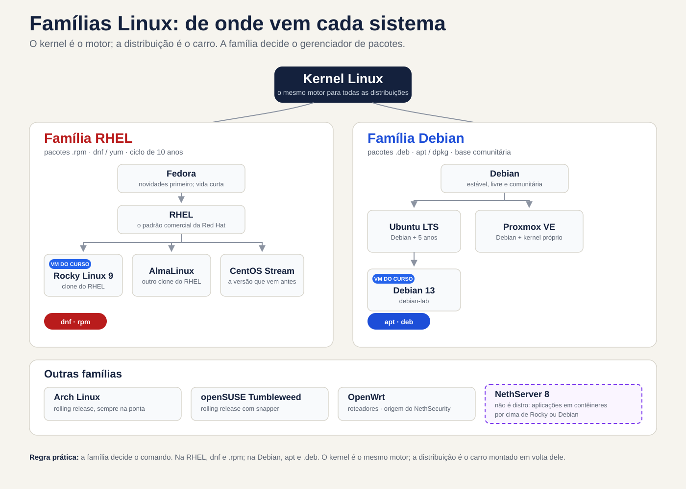
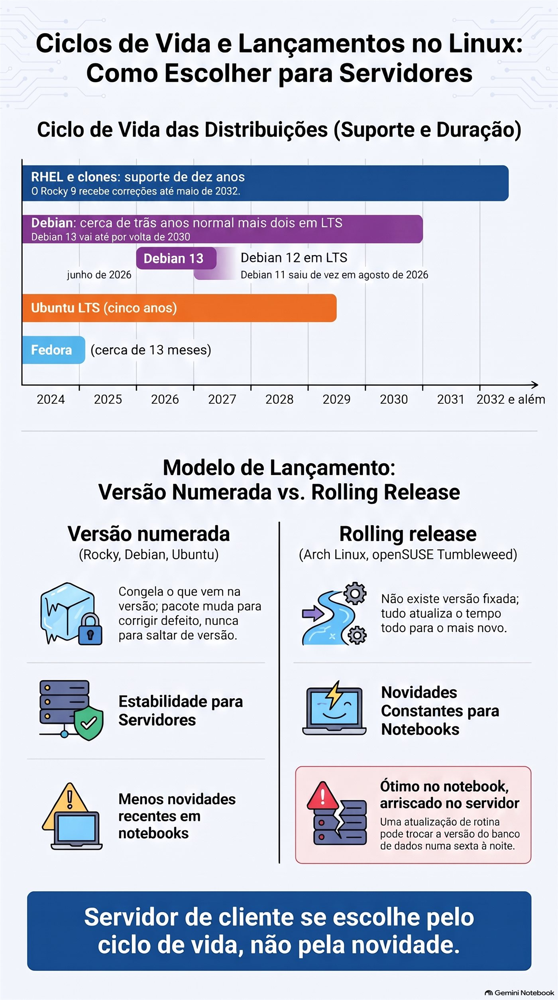
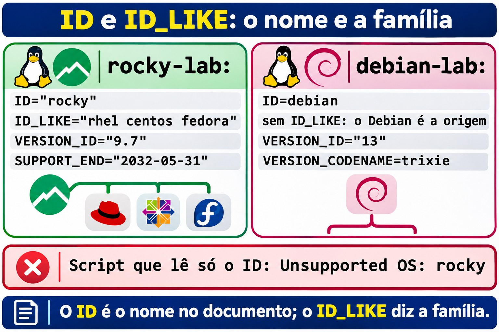
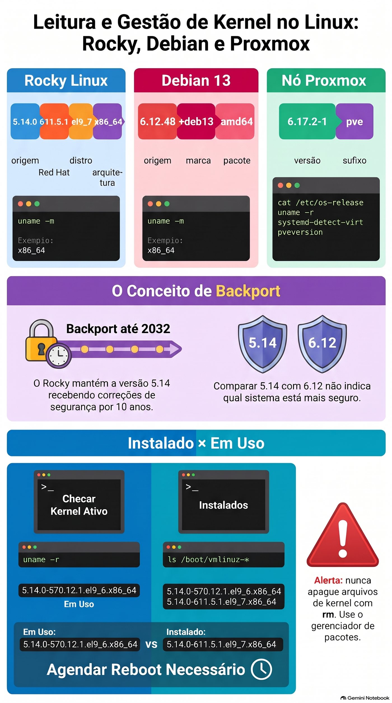
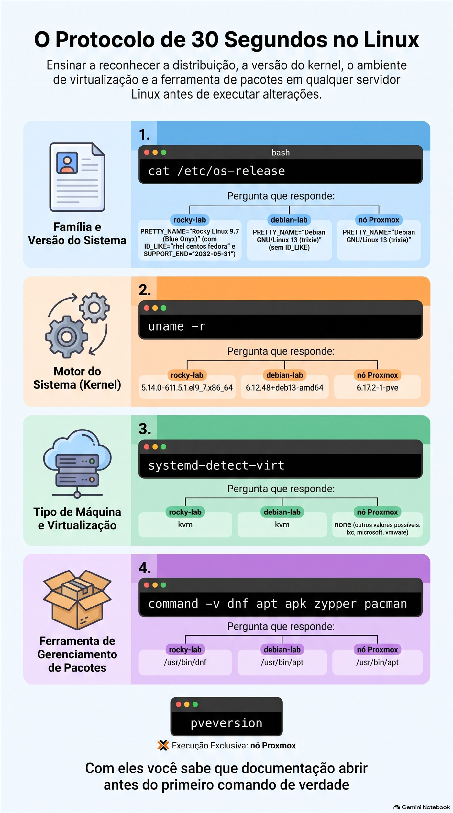

# Aula 1.1 · O que é Linux

Você separa de vez kernel, distribuição e família, identifica qualquer Linux em 30 segundos e coloca no mapa os sistemas que o curso usa: Proxmox, NethServer 8 e NethSecurity.

| Ficha | Aula 1.1 |
| --- | --- |
| Módulo | M1 · Linha de comando, aula 1 de 10 |
| Quando | Semana 1 |
| Ao final você consegue | Separar kernel, distribuição e família; dizer família, versão, kernel e ciclo de vida de qualquer Linux em 30 segundos; ler uma versão de kernel peça por peça; situar Proxmox, NethServer 8 e NethSecurity na árvore das distribuições |
| Pré-requisitos | M0 completo: ssh rocky-lab e ssh debian-lab funcionando |
| Tempo | Cerca de 2h |
| Snapshots | m1a1-inicio e m1a1-fim nas duas VMs |

## 1 · Aquecimento

Três perguntas, de cabeça, antes de ler qualquer coisa. Escreva as respostas; o Gabarito confere no fim.

1. O Windows Server 2025 e o Windows 11 24H2 têm o mesmo número de build, 26100. São o mesmo sistema?
2. Sem entrar nas VMs: que distribuição e que versão rodam na rocky-lab e na debian-lab? O kernel das duas é o mesmo?
3. O Proxmox VE é Linux? Se for, que distribuição está por baixo?

## 2 · Por que importa

Um cliente abre um chamado: o servidor de arquivos "parou de atualizar". Você entra por SSH, digita `sudo apt update` e recebe `command not found`. Pesquisa o erro, acha uma resposta escrita para Ubuntu, tenta, não funciona. Vinte minutos depois descobre que a máquina é um CentOS 7. A família é outra, o gerenciador de pacotes é outro, e o problema nem é de comando: o CentOS 7 parou de receber atualizações em junho de 2024. Não há nada a consertar no terminal. Há uma migração a propor.

Com o protocolo desta aula, a mesma história leva 30 segundos. Um comando diz a família e a versão, e com elas vem o resto: que documentação ler, que comando usar e se o caso é um ajuste ou um projeto.

Para quem atende servidores de vários clientes, isso pesa ainda mais. Cada servidor foi instalado por alguém diferente, numa época diferente. Só nos sistemas que o curso usa, Proxmox, NethServer e NethSecurity, convivem três famílias de Linux, e cada uma tem a sua data de fim de suporte.

## 3 · Modelo mental

> Linux é o motor; a distribuição é o carro.

O kernel Linux é o motor. Ele fala com o hardware, divide a CPU e a memória entre os programas, controla discos e rede. Sozinho, não leva ninguém a lugar nenhum, como um motor numa bancada. A distribuição é o carro montado em volta dele: o shell, os comandos, o instalador, o gerenciador de pacotes, as configurações de fábrica e, principalmente, a promessa de manutenção, que diz por quantos anos aquele carro recebe peças e recall.

Várias montadoras usam o mesmo motor. A Red Hat, a comunidade Debian, a Canonical e a Proxmox pegam o mesmo kernel Linux e montam carros bem diferentes. E as montadoras formam famílias: o Rocky é praticamente o mesmo carro que o RHEL, e o Ubuntu nasceu de um Debian e conserva a mecânica dele.


*O kernel é o mesmo; a família decide o gerenciador de pacotes. Os quadros em destaque são as VMs do curso.*

Leia o diagrama por linhas. Cada linha é uma família, e a família decide o que você digita: `dnf` e pacotes `.rpm` na primeira, `apt` e pacotes `.deb` na segunda. As setas mostram de onde cada sistema nasce, e os dois quadros em destaque são as VMs do curso. O NethServer 8 tem borda tracejada porque não é uma distribuição: é um conjunto de aplicações que se instala por cima de um Rocky ou de um Debian. E o NethSecurity nem está nas duas primeiras linhas: vem do OpenWrt, uma família feita para roteadores.

**Ponte Windows:** você já conhece esse modelo. O Windows Server 2025 e o Windows 11 24H2 usam o mesmo núcleo, da build 26100, e são produtos diferentes, com outras funções, outra licença e outro ciclo de suporte. A diferença é que no Windows só a Microsoft monta carros com esse motor. No Linux qualquer um pode montar, porque o código do kernel é aberto. Por isso existem centenas de distribuições, e por isso o Rocky pode existir como cópia gratuita do RHEL.

## 4 · Conceito em camadas

### Essencial

| Termo | O que é | Onde você vê |
| --- | --- | --- |
| Kernel | O núcleo: fala com o hardware e divide CPU, memória, disco e rede entre os programas | `uname -r`; o mesmo Linux roda no Proxmox, na rocky-lab e no seu celular Android |
| Userspace | Tudo o que roda fora do kernel: shell, comandos, serviços | `bash`, `sshd`, `dnf` |
| Distribuição | Kernel, programas, gerenciador de pacotes, instalador e uma política de versões e de suporte | Rocky, Debian, Ubuntu, Proxmox VE |
| Família | Distribuições que nascem da mesma origem e usam o mesmo formato de pacote | Red Hat (`dnf`, `.rpm`) e Debian (`apt`, `.deb`) |
| Ciclo de vida | Por quanto tempo a distribuição recebe correções de segurança | Rocky 9 até maio de 2032; CentOS 7 acabou em junho de 2024 |
| Backport | Correção de uma versão nova aplicada a uma versão antiga | O kernel 5.14 do Rocky, com correções de 2026 |
| Versão numerada ou rolling | Versões que congelam e só recebem correção, ou atualização contínua para o mais novo | Debian e Rocky; Arch e openSUSE Tumbleweed |
| Software livre | Código que qualquer um pode ler, mudar e redistribuir; o kernel usa a licença GPL versão 2 | É o que permite existir um Rocky gratuito ao lado do RHEL |

**Ponte Windows:** o gerenciador de pacotes é o Windows Update da distribuição, só que para tudo: sistema, serviços e programas vêm do mesmo repositório. Por isso a família importa tanto. O `dnf` não existe num Debian, e o `apt` não existe num Rocky.

### Aprofundamento

**Linux ou GNU/Linux.** Em 1991, Linus Torvalds escreveu o kernel. Os comandos básicos, o compilador e boa parte do resto vieram do projeto GNU, que já existia. Por isso o Debian se chama Debian GNU/Linux. O Android usa o kernel Linux quase sem nada do GNU, e o roteador da sua casa provavelmente também roda Linux. Na documentação, "Linux" às vezes quer dizer só o kernel; leia o contexto com isso em mente.

**A cadeia da Red Hat.** Desde 2021, o caminho é Fedora, depois CentOS Stream, depois RHEL. O Stream virou a prévia do próximo RHEL e deixou de ser a cópia gratuita. Esse papel passou para o Rocky Linux e o AlmaLinux. Em 2023 a Red Hat restringiu a publicação do código do RHEL; o Rocky continuou reconstruindo o RHEL por outros caminhos, e o AlmaLinux passou a prometer compatibilidade em vez de cópia idêntica. No dia a dia, os dois se comportam como o RHEL.

**Lendo a versão do kernel.** Um kernel do Rocky como `5.14.0-611.5.1.el9_7.x86_64` se lê em quatro pedaços; o seu terá outros números no meio. `5.14.0` é a versão de origem, lançada pela comunidade do kernel em 2021. `611.5.1` é a compilação da Red Hat, que sobe a cada correção. `el9_7` quer dizer Enterprise Linux 9, versão 9.7. `x86_64` é a arquitetura. No Debian 13, algo como `6.12.48+deb13-amd64` traz a mesma ideia em outro formato: a versão de origem, a marca do Debian 13 e a arquitetura, que o Debian chama de `amd64`.

**Por que o Rocky fica no 5.14 até 2032.** A Red Hat congela a versão de origem no começo do RHEL 9 e, durante dez anos, traz para ela as correções de segurança e muitos drivers das versões novas. É o backport. O ganho é previsibilidade: um programa homologado no RHEL 9.0 continua funcionando no 9.7. Por isso, comparar `5.14` com `6.12` não diz qual é mais seguro. O que diz é a data do último pacote de kernel instalado e se ele é o que está rodando.

**Versões numeradas e rolling release.** Rocky, Debian e Ubuntu lançam versões numeradas e congelam o que vem nelas: dentro do Debian 13, um pacote muda para corrigir defeito, nunca para saltar de versão. Numa rolling release, como o Arch Linux ou o openSUSE Tumbleweed, não existe versão: tudo atualiza o tempo todo para o mais novo. Ótimo no notebook de quem gosta de novidade; arriscado no servidor de um cliente, onde uma atualização de rotina pode trocar a versão do banco de dados numa sexta à noite.

**Ciclo de vida é o número que importa.** O RHEL e os seus clones têm dez anos: o Rocky 9 recebe correções até maio de 2032. O Debian dá cerca de três anos de suporte normal e mais dois de LTS: o Debian 13 vai até por volta de 2030, o Debian 12 está em LTS desde junho de 2026, e o Debian 11 saiu de vez em agosto de 2026. O Ubuntu LTS tem cinco anos, e a Canonical vende mais anos à parte. O Fedora vive cerca de 13 meses por versão. Servidor de cliente se escolhe pelo ciclo de vida, não pela novidade.

**Os sistemas que o curso usa.** O Proxmox VE 9 é um Debian 13 com as ferramentas da Proxmox e um kernel próprio, derivado do kernel do Ubuntu: quase tudo que você aprender na debian-lab vale no nó. O NethServer 8 não é distribuição: são aplicações em contêineres que se instalam sobre um Rocky Linux ou um Debian. O NethServer 7 era um CentOS 7 com a interface da Nethesis. O NethSecurity vem do OpenWrt, que nasceu para roteadores e tem as próprias ferramentas de pacote.


*Para servidor de cliente, conta quantos anos de correção a versão ainda tem.*

## 5 · Rocky × Debian

| O que | rocky-lab | debian-lab |
| --- | --- | --- |
| Família | Red Hat | Debian |
| `ID` no `/etc/os-release` | `rocky` | `debian` |
| `ID_LIKE` | `rhel centos fedora` | Não existe: o Debian é a origem da família |
| Arquivo extra de versão | `/etc/redhat-release` e `/etc/rocky-release` | `/etc/debian_version` |
| Kernel | `5.14.0-…el9_….x86_64`, congelado e com backports | `6.12.…+deb13-amd64` |
| Gerenciador de pacotes | `dnf`, pacotes `.rpm` | `apt`, pacotes `.deb` |
| Pacote dono do `os-release` | `rocky-release` | `base-files` |
| Verificar se o pacote foi alterado | `rpm -V rocky-release` | `dpkg --verify base-files` |
| Fim do suporte | Maio de 2032, escrito no próprio `os-release` | Por volta de 2030, contando o LTS; não vem no arquivo |

## 6 · Lab guiado

Neste lab você monta o protocolo de 30 segundos: quatro comandos que dizem família, versão, kernel e tipo de máquina de qualquer Linux que cair na sua mão. Tudo aqui é leitura, menos os snapshots. Deixe dois terminais abertos, um em cada VM.

Ao longo dos passos aparecem blocos **Decida**: uma situação, quatro alternativas e uma tabela que explica cada uma, certa ou errada. Os marcados como **cenário** descrevem coisas que não acontecem sozinhas no lab, mas acontecem no seu trabalho.

### Passo 1 · Snapshot de início

No shell do nó Proxmox onde estão as VMs, como nas aulas do M0:

```bash
qm snapshot 201 m1a1-inicio --description "Aula 1.1, antes do lab"
qm snapshot 202 m1a1-inicio --description "Aula 1.1, antes do lab"
qm listsnapshot 201
```

Saída esperada: a árvore mostra `m0a2-fim`, depois `m1a1-inicio` e, por último, `current` com "You are here!". Se o `qm` responder que a VM não existe, você está no nó errado; a interface web mostra em qual nó cada VM roda.

### Passo 2 · O documento de identidade: `/etc/os-release`

```bash
ssh rocky-lab
cat /etc/os-release
```

Saída esperada (trecho; o número depois do 9. depende de quando você instalou e atualizou):

```
NAME="Rocky Linux"
VERSION="9.7 (Blue Onyx)"
ID="rocky"
ID_LIKE="rhel centos fedora"
VERSION_ID="9.7"
PRETTY_NAME="Rocky Linux 9.7 (Blue Onyx)"
SUPPORT_END="2032-05-31"
```

**Preveja:** antes de rodar o mesmo comando na debian-lab, responda: vai existir uma linha `ID_LIKE`?

```bash
ssh debian-lab
cat /etc/os-release
```

Saída esperada (trecho):

```
PRETTY_NAME="Debian GNU/Linux 13 (trixie)"
NAME="Debian GNU/Linux"
VERSION_ID="13"
VERSION="13 (trixie)"
VERSION_CODENAME=trixie
ID=debian
```

Não existe `ID_LIKE`, nem `SUPPORT_END`. O Debian é a origem da família e não se parece com ninguém; um Ubuntu, que nasceu dele, traz `ID_LIKE=debian`. E `trixie` é o codinome do Debian 13. Os codinomes vêm dos personagens de Toy Story, e você vai encontrá-los em repositórios e fóruns tanto quanto o número.

**Para saber:** o `/etc/os-release` é um padrão do systemd que quase todas as distribuições adotaram, inclusive as que não usam systemd, como o OpenWrt. Por isso ele abre o protocolo. Quando quiser só as linhas que importam:

```bash
grep -E '^(ID|ID_LIKE|VERSION_ID)=' /etc/os-release
```

**Decida 1 · O instalador que não reconhece o Rocky.** Cenário: um fornecedor manda um script de instalação que diz suportar "RHEL 9". No servidor de um cliente, um Rocky 9, o script para com `Unsupported OS: rocky`. O que você faz?

- **A)** Edita o `/etc/os-release` e troca `ID="rocky"` por `ID="rhel"`, para o script passar.
- **B)** Lê a verificação do script e a documentação do fornecedor: muitos aceitam o `ID_LIKE` ou têm uma opção para distribuições compatíveis. Se não houver, pergunta ao fornecedor.
- **C)** Roda o script com `sudo`, porque o erro deve ser de permissão.
- **D)** Conclui que o Rocky é incompatível com o RHEL e reinstala o servidor com Ubuntu.

Escolha a letra antes de olhar a tabela.

| Se você marcou | Resultado | Por quê |
| --- | --- | --- |
| A | ❌ Errada | O arquivo pertence ao pacote `rocky-release` e volta ao original na próxima atualização. Até lá, inventários, scanners de vulnerabilidade e outros scripts enxergam um sistema que não existe. A seção 7 mostra como pegar essa mentira. |
| B | ✅ Certa | O Rocky é feito para se comportar como o RHEL, e o `ID_LIKE="rhel centos fedora"` existe para dizer isso. O defeito está num script que só lê o `ID`; a saída é usar o caminho que o fornecedor previu ou pedir que ele preveja. |
| C | ❌ Errada | A mensagem fala do sistema, não de permissão. Erro de permissão diz `Permission denied`. |
| D | ❌ Errada | O Ubuntu é de outra família, mais longe do RHEL que o Rocky. Você trocaria um problema de script por uma migração inteira. |

**Para fixar:** o `ID` é o nome no documento; o `ID_LIKE` diz de que família você é. O script que só lê o `ID` é o porteiro que barra o gêmeo porque o nome dele não está na lista.



*O ID é o nome no documento; o ID_LIKE diz de que família o sistema é.*

### Passo 3 · O motor: `uname -r`

Nas duas VMs:

```bash
uname -r
```

Saída esperada: algo como `5.14.0-611.5.1.el9_7.x86_64` na rocky-lab e `6.12.48+deb13-amd64` na debian-lab. Leia peça por peça, como na seção 4. No Rocky: versão de origem, compilação da Red Hat, `el9_7` e arquitetura. No Debian: versão de origem, a marca `deb13` e `amd64`.

**Preveja:** o `uname -m` mostra só a arquitetura. Na debian-lab, ele vai dizer `amd64` ou `x86_64`?

```bash
uname -m
```

Saída esperada: `x86_64` nas duas. O `amd64` é só o nome que o Debian dá aos pacotes dessa arquitetura; o kernel sempre se apresenta como `x86_64`.

**Decida 2 · O kernel "velho".** Na sua frente, `5.14` na rocky-lab e `6.12` na debian-lab. Um colega diz que o Rocky está com o kernel três anos atrasado e sugere instalar um mais novo, de um repositório da internet. O que você faz?

- **A)** Concorda e instala o kernel novo de um repositório de terceiros.
- **B)** Não decide pelo número: confere se o pacote do kernel está atualizado e se o kernel em uso é o último instalado.
- **C)** Migra o servidor para Debian, que tem kernel mais novo.
- **D)** Roda `sudo dnf update kernel`, que deve levar o Rocky para o 6.12.

Escolha a letra antes de olhar a tabela.

| Se você marcou | Resultado | Por quê |
| --- | --- | --- |
| A | ❌ Errada | Você sai do kernel que a Red Hat testa junto com o resto do sistema e para de receber correções pelo `dnf`. Em servidor de cliente, é trocar o motor original por um de oficina. |
| B | ✅ Certa | Pelo backport, o 5.14 do Rocky recebe correções de segurança até 2032. O que diz se o servidor está protegido é a data do pacote e se ele está em uso, e é isso que o próximo passo mostra. |
| C | ❌ Errada | Número de kernel não é critério de migração. O Debian também congela a versão dele e faz backport do mesmo jeito. |
| D | ❌ Errada | O `dnf update` traz uma compilação nova, com outro número depois do `5.14.0-`, mas a versão de origem nunca muda dentro do RHEL 9. |

**Para fixar:** o RHEL 9 é um carro com dez anos de recall. O modelo é de 2021; as peças trocadas são de hoje.

### Passo 4 · Instalado não é o mesmo que em uso

Na rocky-lab:

```bash
uname -r
ls /boot/vmlinuz-*
```

Saída esperada: o `uname -r` mostra o kernel em uso; o `ls` lista os kernels instalados. Se você atualizou a VM depois do último boot, pode haver mais de um. O arquivo com `rescue` no nome é um kernel de emergência que o instalador do Rocky cria; deixe-o fora da comparação. Faça o mesmo na debian-lab.

**Decida 3 · Dois kernels em `/boot`.** Cenário: num servidor de cliente, o `uname -r` mostra `5.14.0-570.12.1.el9_6.x86_64`, e o `ls /boot/vmlinuz-*` mostra esse e também o `5.14.0-611.5.1.el9_7.x86_64`. O que isso quer dizer?

- **A)** O servidor está rodando dois kernels ao mesmo tempo.
- **B)** O kernel novo foi instalado, mas o servidor não reiniciou, e as correções dele ainda não valem. Você agenda um reboot com o cliente.
- **C)** O `/boot` está com lixo; você apaga o kernel mais velho com `rm`.
- **D)** É normal e não há nada a fazer.

Escolha a letra antes de olhar a tabela.

| Se você marcou | Resultado | Por quê |
| --- | --- | --- |
| A | ❌ Errada | Só um kernel roda por vez: o que o `uname -r` mostra. Os outros são arquivos esperando um boot. |
| B | ✅ Certa | O kernel em uso é mais velho que o último instalado, então as correções do novo estão na caixa. É o "reinicie para concluir a atualização" do Windows, só que o Linux não insiste. |
| C | ❌ Errada | Você apagaria justamente o kernel em uso, e o próximo boot poderia falhar. Kernel antigo quem remove é o `dnf` ou o `apt`, que guardam alguns de reserva de propósito. |
| D | ❌ Errada | Ter mais de um kernel instalado é normal. Rodar o mais velho, não. |

**Para fixar:** peça nova na caixa não conserta o carro; só depois de montada. No Linux, montar o kernel novo é reiniciar.


*O número do kernel conta a origem, a compilação e a distro; reboot é o que põe o novo em uso.*

### Passo 5 · Que máquina é esta: `hostnamectl` e `systemd-detect-virt`

```bash
hostnamectl
systemd-detect-virt
```

Saída esperada do `hostnamectl` na rocky-lab (trecho):

```
 Static hostname: rocky-lab
  Virtualization: kvm
Operating System: Rocky Linux 9.7 (Blue Onyx)
          Kernel: Linux 5.14.0-611.5.1.el9_7.x86_64
    Architecture: x86-64
 Hardware Vendor: QEMU
```

O `systemd-detect-virt` responde só `kvm`. O `hostnamectl` junta num lugar o que você viu nos passos 2 e 3, mais o tipo de máquina. O `systemd-detect-virt` responde numa palavra: `kvm` numa VM do Proxmox, `lxc` num contêiner LXC como o do DeepTutor, `microsoft` numa VM do Hyper-V, `vmware` numa do VMware e `none` em máquina física.

**Decida 4 · O comando que não existe.** Cenário: você entra por SSH no NethSecurity de um cliente para ver a versão, e o `hostnamectl` responde `-ash: hostnamectl: not found`. O que está acontecendo?

- **A)** O firewall está com defeito e precisa ser reinstalado.
- **B)** O NethSecurity vem do OpenWrt, que não usa systemd, e o `hostnamectl` é uma ferramenta do systemd. Você usa o `cat /etc/os-release`, que existe ali também.
- **C)** Faltou permissão; você tenta `sudo hostnamectl`.
- **D)** Você instala o systemd com `dnf install systemd`.

Escolha a letra antes de olhar a tabela.

| Se você marcou | Resultado | Por quê |
| --- | --- | --- |
| A | ❌ Errada | `not found` quer dizer só que o comando não existe naquele sistema. Nada indica defeito. |
| B | ✅ Certa | Família diferente, ferramentas diferentes. O `ash` no erro já dá a pista: é o shell do BusyBox, usado no OpenWrt e no Alpine. O `os-release` é o que todos têm em comum. |
| C | ❌ Errada | Falta de permissão aparece como `Permission denied`. E no OpenWrt você normalmente já entra como root. |
| D | ❌ Errada | Não existe `dnf` num OpenWrt, e systemd não se instala por cima de um sistema. Pior: seria instalar pacote no firewall de produção de um cliente só para ler uma versão. |

**Para fixar:** o `os-release` é a placa do carro, todo carro tem. O `hostnamectl` é o painel digital: só vem nos modelos com systemd.

### Passo 6 · Qual gerenciador de pacotes?

```bash
command -v dnf apt apk zypper pacman
```

Saída esperada: `/usr/bin/dnf` na rocky-lab e `/usr/bin/apt` na debian-lab. O `command -v` imprime o caminho de cada nome que existe e fica calado sobre os outros. Os cinco nomes cobrem as famílias Red Hat, Debian, Alpine, SUSE e Arch. A Aula 1.2 explica por que usar `command -v` e não `which`.

**Decida 5 · O tutorial da outra família.** Na rocky-lab, você segue um tutorial e digita `sudo apt install apache2`. Resposta: `sudo: apt: command not found`. O que você faz?

- **A)** Instala o `apt` no Rocky para o tutorial funcionar.
- **B)** Procura o equivalente na família Red Hat: o gerenciador é o `dnf`, e o pacote do Apache se chama `httpd`. Melhor ainda, busca um tutorial escrito para Rocky ou RHEL.
- **C)** Baixa o pacote `.deb` do Apache e instala na mão.
- **D)** Cria um alias `apt=dnf`.

Escolha a letra antes de olhar a tabela.

| Se você marcou | Resultado | Por quê |
| --- | --- | --- |
| A | ❌ Errada | O `apt` só instala pacotes `.deb`, feitos para as bibliotecas do Debian. Num Rocky, ele não teria de onde instalar nem como conviver com o `rpm`. |
| B | ✅ Certa | A ideia do tutorial vale; os nomes mudam de família para família. O Apache é `apache2` no Debian e `httpd` no Rocky, com a configuração em outros lugares. |
| C | ❌ Errada | Um `.deb` não instala num Rocky, e mesmo convertido quebraria dependências que o `dnf` não conhece. |
| D | ❌ Errada | O alias esconde a diferença sem resolvê-la: `dnf install apache2` falha do mesmo jeito, porque o pacote tem outro nome. |

**Para fixar:** mesma estrada, outra montadora. Os pedais estão no mesmo lugar; o manual é outro.

### Passo 7 · O nó Proxmox, só leitura

No shell de um nó do cluster, como o `pve-node2`. Nada aqui muda o nó:

```bash
cat /etc/os-release
uname -r
systemd-detect-virt
pveversion
```

**Preveja:** o `os-release` do nó vai dizer Proxmox ou Debian?

Saída esperada: `PRETTY_NAME="Debian GNU/Linux 13 (trixie)"`. O kernel termina em `-pve`, como `6.17.2-1-pve`. O `systemd-detect-virt` responde `none`, porque o nó é a máquina física. E o `pveversion` mostra algo como `pve-manager/9.1.4/… (running kernel: 6.17.2-1-pve)`; os números do seu nó serão outros.

**Decida 6 · Debian ou não?** Cenário: um cliente pede ajuda num servidor que ninguém documentou. O `os-release` diz Debian 13, o `uname -r` termina em `-pve`, e o `systemd-detect-virt` responde `none`. O que é essa máquina?

- **A)** Uma VM Debian com o kernel errado.
- **B)** Um Ubuntu, porque o kernel do Proxmox vem do Ubuntu.
- **C)** Um nó Proxmox VE: o Debian por baixo, com o kernel da Proxmox. Você confirma com `pveversion` e trata a máquina com cuidado, porque as VMs do cliente dependem dela.
- **D)** Um Debian corrompido, já que o kernel não combina com o `os-release`.

Escolha a letra antes de olhar a tabela.

| Se você marcou | Resultado | Por quê |
| --- | --- | --- |
| A | ❌ Errada | O `none` diz que a máquina é física. Uma VM responderia `kvm`, `vmware` ou `microsoft`. |
| B | ❌ Errada | O kernel da Proxmox deriva do kernel do Ubuntu, mas o sistema é Debian: `apt`, repositórios e `os-release` do Debian. |
| C | ✅ Certa | O Proxmox não troca o `os-release`, porque continua sendo um Debian. O kernel `-pve` e o `pveversion` revelam o resto. E um reboot ali derruba todas as VMs de uma vez. |
| D | ❌ Errada | Nada está quebrado: o Proxmox instala o kernel dele por cima do Debian de propósito. |

**Para fixar:** carroceria de Debian, motor preparado pela Proxmox.

### Passo 8 · Quem é o dono do `os-release`

O `/etc/os-release` parece um arquivo de configuração, mas quem o instala é um pacote. Siga o link até o arquivo real e pergunte ao gerenciador de pacotes quem o instalou.

Na rocky-lab:

```bash
readlink -f /etc/os-release
rpm -qf /usr/lib/os-release
```

Saída esperada: `/usr/lib/os-release` e algo como `rocky-release-9.7-1.2.el9.noarch`.

Na debian-lab:

```bash
readlink -f /etc/os-release
dpkg -S /usr/lib/os-release
```

Saída esperada: `/usr/lib/os-release` e `base-files: /usr/lib/os-release`.

**Para saber:** o `/etc/os-release` é um link simbólico para `/usr/lib/os-release`. Como o arquivo vem de um pacote, ele muda sozinho quando você atualiza de 9.6 para 9.7, e o gerenciador de pacotes sabe dizer se alguém mexeu nele. É isso que a próxima seção usa.

### O protocolo de 30 segundos

Os quatro comandos que você leva para qualquer servidor:

```bash
cat /etc/os-release
uname -r
systemd-detect-virt
command -v dnf apt apk zypper pacman
```

Família e versão, motor, tipo de máquina e ferramenta de pacotes. Com eles você sabe que documentação abrir antes de digitar o primeiro comando de verdade.


*Quatro comandos, quatro respostas: família, motor, máquina e pacotes.*

## 7 · Quebre e conserte

O `os-release` é um arquivo de texto. Qualquer um com root pode escrever nele o que quiser, e às vezes alguém escreve, para enganar um instalador. Agora você faz isso de propósito e aprende a pegar a mentira.

**Quebre.** Na rocky-lab. A verificação do hostname impede que o comando rode em outra máquina:

```bash
[ "$(hostname)" = rocky-lab ] && sudo sed -i 's/^PRETTY_NAME=.*/PRETTY_NAME="Windows Server 2025"/' /usr/lib/os-release
grep PRETTY_NAME /etc/os-release
```

Saída esperada: `PRETTY_NAME="Windows Server 2025"`. Você editou o arquivo real em `/usr/lib`, e o link em `/etc` mostra a mudança.

**Preveja:** o que vão dizer o `hostnamectl` e o `/etc/redhat-release`?

```bash
hostnamectl | grep 'Operating System'
cat /etc/redhat-release
```

Saída esperada: o `hostnamectl` mostra `Operating System: Windows Server 2025`, porque lê o mesmo arquivo. Se ainda mostrar Rocky, espere meio minuto e repita: o serviço que responde ao `hostnamectl` guarda a última leitura por um tempo. Já o `/etc/redhat-release` continua dizendo `Rocky Linux release 9.7 (Blue Onyx)`, porque é outro arquivo. Duas fontes discordando é o primeiro sinal de que alguém mexeu.

**Descubra.** Pergunte ao gerenciador de pacotes se os arquivos do `rocky-release` ainda são os que ele instalou:

```bash
rpm -V rocky-release
```

Saída esperada: `S.5....T.    /usr/lib/os-release`. Cada posição é um teste, e o ponto quer dizer que o teste passou. `S` é o tamanho, `5` é a soma de verificação, que muda com qualquer alteração no conteúdo, e `T` é a data de modificação. Os três dizem a mesma coisa: alguém mexeu no arquivo depois da instalação.

**Decida 7 · O RHEL que não é RHEL.** Cenário: você herda o servidor de um cliente. O `os-release` diz `ID="rhel"`, mas o `rpm -qf /usr/lib/os-release` responde `rocky-release`, e o `rpm -V rocky-release` mostra a mesma linha `S.5....T.` que você acabou de ver. O que é e o que você faz?

- **A)** É um RHEL; você abre um chamado no suporte da Red Hat.
- **B)** É um Rocky com o `os-release` editado, quase certamente para enganar um instalador. Você documenta, descobre qual programa exigiu isso e só então restaura o arquivo, numa janela combinada com o cliente.
- **C)** É só cosmético; você deixa como está.
- **D)** Reinstala o servidor do zero, porque não dá mais para confiar nele.

Escolha a letra antes de olhar a tabela.

| Se você marcou | Resultado | Por quê |
| --- | --- | --- |
| A | ❌ Errada | O pacote dono do arquivo é o `rocky-release`. Não há assinatura da Red Hat ali, e o suporte não atenderia. |
| B | ✅ Certa | O pacote e a verificação dizem a verdade que o arquivo esconde. Restaurar sem entender pode quebrar o programa que dependia da mentira, por isso primeiro você descobre qual é. É a alternativa A da Decida 1, vista do outro lado. |
| C | ❌ Errada | Inventários, scanners de vulnerabilidade e ferramentas como o Ansible leem esse arquivo. Com ele errado, o servidor aparece como outro sistema, e correções podem passar despercebidas. |
| D | ❌ Errada | Exagero: um arquivo alterado se restaura com um comando. Reinstalar custa um dia de trabalho e não explica por que aconteceu. |

**Para fixar:** placa adulterada não muda o chassi. O pacote e o kernel são o número do chassi.

**Conserte.** Reinstale o pacote. O `dnf` regrava todos os arquivos dele como vieram:

```bash
sudo dnf reinstall -y rocky-release
```

**Verifique.**

```bash
rpm -V rocky-release
grep PRETTY_NAME /etc/os-release
```

Saída esperada: o `rpm -V` não imprime nada, e o `grep` volta a mostrar `PRETTY_NAME="Rocky Linux 9.7 (Blue Onyx)"`.

**Decida 8 · O silêncio.** O `rpm -V rocky-release` não imprimiu nada. O que isso quer dizer?

- **A)** O comando falhou sem mostrar o erro.
- **B)** Todos os arquivos do pacote estão iguais aos que ele instalou.
- **C)** O pacote `rocky-release` não está instalado.
- **D)** Faltou `sudo` para ver o resultado.

Escolha a letra antes de olhar a tabela.

| Se você marcou | Resultado | Por quê |
| --- | --- | --- |
| A | ❌ Errada | Quando falha, o comando diz por quê. Para conferir, `echo $?` logo depois mostra `0`, o código de sucesso. |
| B | ✅ Certa | No Linux, comando que deu certo costuma ficar calado. O `rpm -V` só fala quando encontra diferença. |
| C | ❌ Errada | Nesse caso a resposta seria `package rocky-release is not installed`. |
| D | ❌ Errada | Os arquivos desse pacote podem ser lidos por qualquer usuário, e o `rpm -V` funciona sem root. |

**Para fixar:** no Linux, silêncio é boa notícia.

**E o snapshot?** No lab, `qm rollback 201 m1a1-inicio` seguido de `qm start 201` também desfaria a quebra. No servidor de um cliente quase nunca existe um snapshot de antes da mexida, e às vezes nem se sabe quando ela aconteceu. Por isso o conserto que você leva para a vida é o do pacote: funciona em qualquer servidor, a qualquer momento, sem perder o que mudou depois.

**Bônus na Debian.** Repita na debian-lab, com as ferramentas da outra família:

```bash
[ "$(hostname)" = debian-lab ] && sudo sed -i 's/^PRETTY_NAME=.*/PRETTY_NAME="Windows Server 2025"/' /usr/lib/os-release
dpkg --verify base-files
sudo apt install -y --reinstall base-files
dpkg --verify base-files
```

Saída esperada: o primeiro `dpkg --verify` mostra `??5??????   /usr/lib/os-release`. O `dpkg` só confere a soma de verificação, por isso as outras posições ficam com `?`. Depois de reinstalar, o segundo não imprime nada.

**A lição:** o `os-release` diz o que alguém escreveu nele; o pacote e o kernel dizem o que o sistema é. Quando as fontes discordam, confie no gerenciador de pacotes, que guarda a soma de verificação de cada arquivo que instalou.

## 8 · Armadilhas

| Sintoma | Causa | Saída |
| --- | --- | --- |
| `apt: command not found` no Rocky, ou `dnf` no Debian | Comando da família errada | `cat /etc/os-release` antes de tudo; use o gerenciador da família |
| O instalador de um fornecedor recusa o Rocky e diz que só aceita RHEL | O script lê só o `ID` e ignora o `ID_LIKE` | Documentação do fornecedor ou opção para compatíveis; nunca editar o `os-release` |
| `hostnamectl: not found` | Sistema sem systemd: OpenWrt, NethSecurity, Alpine, muitos contêineres | `cat /etc/os-release`, que existe em quase todos |
| O `os-release` de um nó Proxmox diz Debian | O Proxmox é um Debian com kernel e ferramentas próprios | `uname -r` termina em `-pve`; `pveversion` confirma |
| `uname -r` mostra um kernel mais velho que o último em `/boot` | Kernel atualizado, servidor não reiniciado | Agendar o reboot com o cliente |
| Achar que o kernel 5.14 do Rocky está desatualizado | Backport: a Red Hat corrige a versão congelada | Olhar a data do pacote: `rpm -q --last kernel` |
| `/etc/redhat-release` e `/etc/os-release` discordam | Alguém editou um dos dois | `rpm -V rocky-release` e `dnf reinstall` |
| `systemd-detect-virt` responde `none` onde você esperava uma VM | Máquina física, ou o próprio hipervisor | `pveversion`; cuidado redobrado antes de reiniciar |
| `rpm -V` ou `dpkg --verify` não imprime nada e parece que falhou | Silêncio é sucesso | `echo $?` mostra `0` |

## 9 · Quiz

Responda tudo de cabeça, por escrito, antes de abrir o Gabarito.

1. Qual é a diferença entre o kernel e a distribuição? Dê um exemplo de algo que cada um faz.
2. No `/etc/os-release` da rocky-lab, o que dizem as linhas `ID` e `ID_LIKE`? Por que a debian-lab não tem `ID_LIKE`?
3. Leia peça por peça: `5.14.0-570.12.1.el9_6.x86_64`.
4. Por que o Rocky 9 fica no kernel 5.14 até 2032, e por que isso não o deixa inseguro?
5. Como você descobre se um servidor está esperando um reboot para usar o kernel novo?
6. O `os-release` de um servidor diz Debian 13. Com quais dois comandos você prova que ele é um nó Proxmox?
7. Qual é a diferença entre uma distribuição com versões numeradas e uma rolling release? Qual você escolhe para o servidor de um cliente, e o que o CentOS 7 ensina sobre isso?
8. Em inglês, como nos fóruns e na documentação: *Which of the following Linux distributions is derived from Debian?* A) Fedora · B) Ubuntu · C) Rocky Linux · D) openSUSE

## 10 · Flashcards e cola

Copie os cartões para o seu baralho ou peça ao DeepTutor com `!cartoes 1.1`. Leia a frente, responda em voz alta e só então olhe o verso.

| Frente | Verso |
| --- | --- |
| Kernel | O núcleo: fala com o hardware e divide CPU, memória, disco e rede entre os programas |
| Distribuição | Kernel, programas, gerenciador de pacotes, instalador e uma política de suporte |
| Arquivo que identifica a distribuição | `/etc/os-release`, link para `/usr/lib/os-release` |
| `ID_LIKE="rhel centos fedora"` | O sistema é da família Red Hat e se declara compatível com ela |
| Família Red Hat | Fedora, CentOS Stream, RHEL, Rocky e Alma; `dnf` e `.rpm` |
| Família Debian | Debian, Ubuntu e o Proxmox VE por cima do Debian; `apt` e `.deb` |
| `el9_7` no nome do kernel | Enterprise Linux 9, versão 9.7 |
| Backport | Correção de uma versão nova aplicada a uma antiga; por isso o RHEL 9 fica no 5.14 |
| Kernel mais novo em `/boot` que no `uname -r` | Atualizado e não reiniciado |
| `systemd-detect-virt`: `kvm`, `lxc`, `none` | VM, contêiner, máquina física ou o próprio hipervisor |
| `-pve` no fim do `uname -r` | Nó Proxmox: Debian com o kernel da Proxmox |
| NethSecurity | Firewall feito sobre o OpenWrt, sem systemd |
| NethServer 8 | Aplicações que se instalam sobre Rocky ou Debian; não é distribuição |
| Fim do suporte: Rocky 9 e CentOS 7 | Maio de 2032; junho de 2024, já acabou |
| `rpm -V` ou `dpkg --verify` sem saída | Os arquivos do pacote estão como foram instalados |

**Para saber de cor.**

```bash
cat /etc/os-release
uname -r
systemd-detect-virt
command -v dnf apt apk zypper pacman
```

**Para consultar.** Basta saber que existem; o `--help` e o `man` dão o resto:

```bash
hostnamectl
uname -m
ls /boot/vmlinuz-*
readlink -f /etc/os-release
rpm -qf /usr/lib/os-release
dpkg -S /usr/lib/os-release
rpm -V rocky-release
dpkg --verify base-files
rpm -q --last kernel
pveversion
```

## 11 · Checklist de saída

- [ ] Explico sem olhar a diferença entre kernel, distribuição e família.
- [ ] Digo família, versão, kernel e fim do suporte de um servidor em 30 segundos.
- [ ] Leio a versão de um kernel do Rocky e do Debian peça por peça.
- [ ] Sei dizer se um servidor está esperando reboot para usar o kernel novo.
- [ ] Situo Proxmox, NethServer 8 e NethSecurity na árvore das famílias.
- [ ] Descubro se o `os-release` foi alterado e o restauro pelo pacote, nas duas famílias.
- [ ] Criei os snapshots `m1a1-fim` nas duas VMs.

**Feche a aula.** No nó Proxmox, guarde o estado final e apague o snapshot de início, que não serve mais:

```bash
qm snapshot 201 m1a1-fim --description "Aula 1.1 concluída"
qm snapshot 202 m1a1-fim --description "Aula 1.1 concluída"
qm delsnapshot 201 m1a1-inicio
qm delsnapshot 202 m1a1-inicio
qm listsnapshot 201
```

Saída esperada: a árvore mostra `m0a2-fim`, depois `m1a1-fim` e, por último, `current`. A Aula 1.2 começa daqui.

## 12 · Na vida real

Comando digitado uma vez, sem um problema de verdade atrás, some em um dia. Esta seção existe para isso não acontecer: uma missão no seu trabalho e um desafio amanhã, sem olhar a aula.

**Missão no trabalho (até amanhã, só leitura).** Faça o inventário de identidade dos servidores Linux que você atende. Em cada um que você já acessa por SSH, rode só isto:

```bash
grep -E '^(PRETTY_NAME|ID_LIKE|SUPPORT_END)=' /etc/os-release; uname -r; systemd-detect-virt
```

Anote numa planilha sua, com uma linha por servidor: família, versão, kernel, VM ou física e fim do suporte. Nos nós Proxmox, acrescente o `pveversion`. No NethSecurity o `systemd-detect-virt` não existe; anote só o `os-release`. Depois pinte de vermelho tudo que já passou do fim do suporte: CentOS 7 e NethServer 7 desde junho de 2024, Debian 11 e anteriores desde agosto de 2026, Ubuntu 20.04 e anteriores, sem assinatura paga, desde maio de 2025. Cada linha vermelha é uma conversa de migração com um cliente, e a planilha é o primeiro documento dessa conversa.

A regra da missão é só ler. Nada de instalar, atualizar ou reiniciar; os comandos acima não mudam nada no servidor.

**Amanhã, sem olhar.** Sem abrir esta aula, refaça o essencial nas duas VMs. Onde travar, use o `--help` ou o `man`, como num servidor sem internet. A meta é 15 minutos.

1. Na debian-lab, diga família, versão e codinome.
2. Mostre o kernel em uso e diga o que é cada pedaço.
3. Descubra se é VM e de que tipo.
4. Descubra qual pacote instalou o arquivo de identificação da distribuição e confirme que ele está intacto.
5. Na rocky-lab, descubra até quando o Rocky 9 recebe correções, sem abrir o navegador.
6. Em uma frase: por que o `os-release` de um nó Proxmox diz Debian?

Se travar no passo 4: o arquivo real está onde o link aponta (`man readlink`). O `man dpkg` tem uma opção para perguntar quem instalou um arquivo e outra para verificar um pacote; dentro do `man`, digite `/verify` e Enter para buscar. A resposta está no Gabarito.

## 13 · Com o DeepTutor

Abra o DeepTutor e diga que terminou a Aula 1.1. Ele começa com três perguntas de revisão; depois, use:

- `!quiz 1.1` para mais questões, com o porquê de cada alternativa.
- `!explica backport`, ou qualquer termo que não tenha fechado.
- `!feynman` para explicar com suas palavras a diferença entre kernel e distribuição; ele aponta onde ficou vago.
- `!quebra 1.1` para ele inventar uma quebra nova, como um `/etc/redhat-release` adulterado, e você investigar.
- `!cartoes 1.1` para os flashcards.
- `!erro` com a mensagem colada, quando um comando responder algo que você não entendeu.
- `!revisao 1.1` em D+1, D+3, D+7 e D+21. No D+1, faça também `!revisao 0.2`; no D+3, `!revisao 0.1`.

## Gabarito

**Aquecimento**

1. Não. O núcleo é o mesmo, o da build 26100, mas os produtos são diferentes: funções, licença e ciclo de suporte. É o modelo das distribuições Linux, com uma diferença: no Windows, só a Microsoft monta produtos com aquele núcleo.
2. A rocky-lab roda Rocky Linux 9, da família Red Hat; a debian-lab, Debian 13 (trixie). Os kernels são diferentes: o Rocky usa o 5.14 com backports da Red Hat, o Debian usa o 6.12. Cada distribuição escolhe e mantém o seu.
3. Sim. O Proxmox VE 9 é um Debian 13 com as ferramentas da Proxmox e um kernel próprio, derivado do kernel do Ubuntu. Por isso o `os-release` do nó diz Debian.

**Quiz**

1. O kernel fala com o hardware e divide os recursos; por exemplo, decide qual programa usa a CPU agora. A distribuição é tudo em volta; por exemplo, o `dnf` que instala programas e a promessa de correções até 2032. O mesmo kernel aparece em distribuições diferentes.
2. `ID="rocky"` diz quem o sistema é; `ID_LIKE="rhel centos fedora"` diz com quem ele é compatível. O Debian não tem `ID_LIKE` porque é a origem da própria família; um Ubuntu traz `ID_LIKE=debian`.
3. `5.14.0` é a versão de origem; `570.12.1`, a compilação da Red Hat; `el9_6`, Enterprise Linux 9.6; `x86_64`, a arquitetura.
4. A Red Hat congela a versão de origem no começo do RHEL 9 e, por dez anos, traz para ela as correções das versões novas: é o backport. Segurança se mede pela data do pacote do kernel e por ele estar em uso, não pelo número.
5. Compare o `uname -r`, que mostra o kernel em uso, com o `ls /boot/vmlinuz-*`, que lista os instalados. Se houver um instalado mais novo que o em uso, falta o reboot.
6. `uname -r`, que termina em `-pve`, e `pveversion`, que mostra a versão do `pve-manager`.
7. Numa distribuição com versões numeradas, cada versão congela o que tem e só recebe correções durante o ciclo de vida; numa rolling release, tudo atualiza o tempo todo para o mais novo. Para servidor de cliente, versão numerada com ciclo longo, como o Rocky 9 até 2032. O CentOS 7 mostra o que acontece quando o ciclo acaba: nenhuma correção nova desde junho de 2024 e uma migração para planejar.
8. **B.** Veja o porquê de cada alternativa:

| Alternativa | Resultado | Por quê |
| --- | --- | --- |
| A) Fedora | ❌ Errada | É da família Red Hat: o laboratório de onde saem o CentOS Stream e o RHEL. Usa `dnf` e `.rpm`. |
| B) Ubuntu | ✅ Certa | Nasceu do Debian e mantém o `apt` e os pacotes `.deb`. É mantido pela Canonical. |
| C) Rocky Linux | ❌ Errada | É a reconstrução gratuita do RHEL, da família Red Hat. |
| D) openSUSE | ❌ Errada | É da família SUSE, com o `zypper`. A pegadinha: também usa pacotes `.rpm`, mas o formato do pacote sozinho não define a família. |

**Amanhã, sem olhar**

Passo 1: `cat /etc/os-release` mostra Debian GNU/Linux 13, codinome trixie. Passo 2: `uname -r`, lido como versão de origem, marca `deb13` e arquitetura. Passo 3: `systemd-detect-virt` responde `kvm`. Passo 4: `readlink -f /etc/os-release` leva a `/usr/lib/os-release`, `dpkg -S /usr/lib/os-release` responde `base-files`, e `dpkg --verify base-files` sem saída quer dizer intacto. Passo 5: `grep SUPPORT_END /etc/os-release` mostra `2032-05-31`. Passo 6: o Proxmox não troca o `os-release`, porque continua sendo um Debian, com o kernel e as ferramentas da Proxmox por cima.

---

<!-- navegacao -->
[← Aula 0.2 · Acesso e proteção](0.2-acesso-e-protecao.md) · [Índice de aulas](../01-aulas.md) · [Aula 1.2 · O shell e a ajuda →](1.2-o-shell-e-a-ajuda.md)
