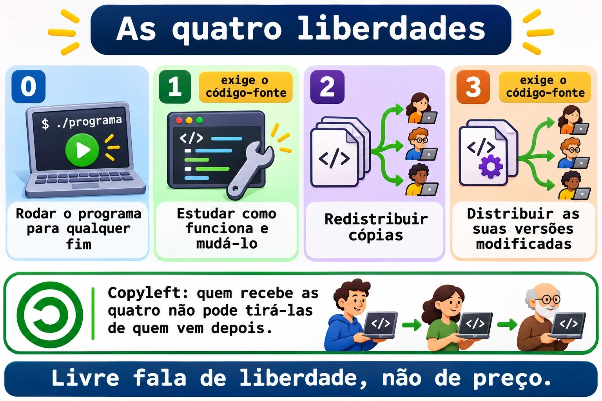
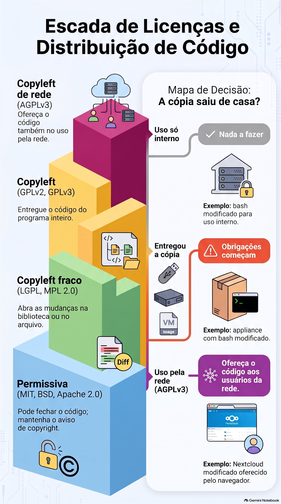
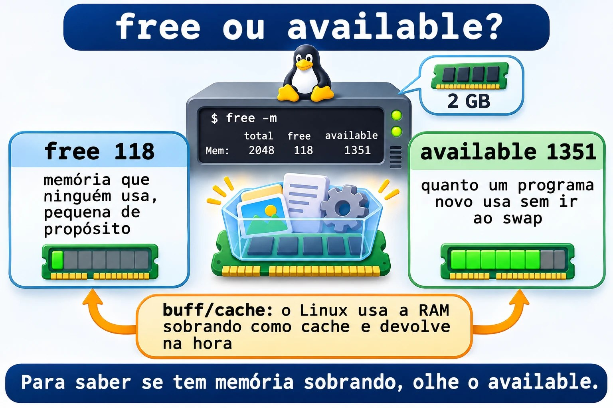
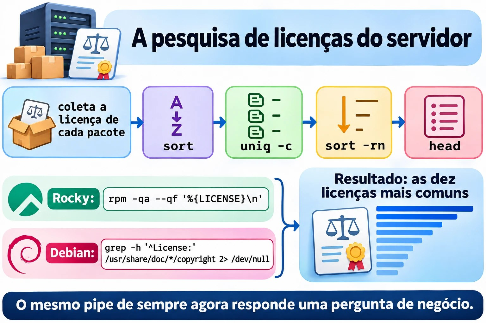
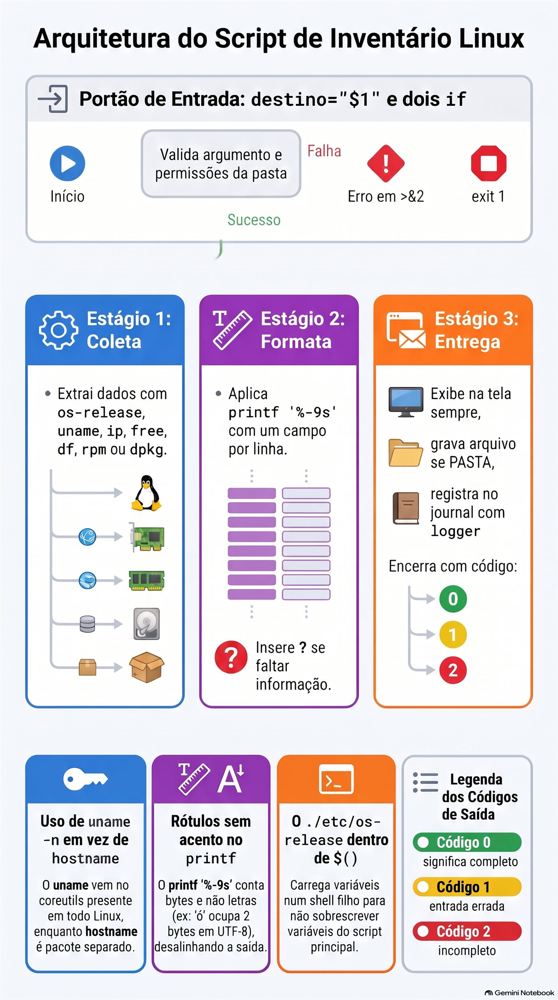
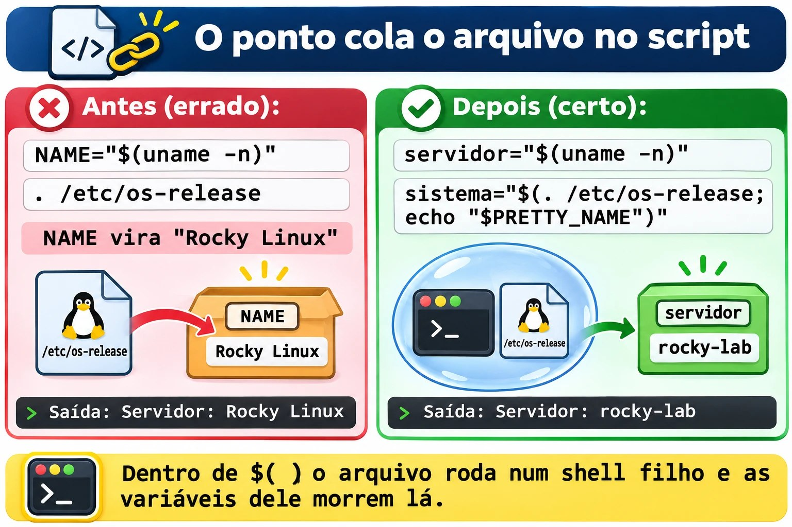

# Aula 1.10 · Software livre na prática

Última aula do Módulo 1, e ela tem duas metades que se encontram no fim. Na primeira, você aprende a responder a pergunta que todo cliente faz um dia: "o que roda neste servidor, e a gente pode usar isso de graça?". Isso é licença, e licença é assunto de sysadmin, não só de advogado. Na segunda, você junta tudo o que viu desde a Aula 1.1 num script de verdade, o `inventario.sh`: a foto de um servidor, no mesmo formato no Rocky e no Debian, pronta para colar num chamado ou guardar numa pasta.

| Ficha | Aula 1.10 |
| --- | --- |
| Módulo | M1 · Linha de comando, aula 10 de 10, desafio do módulo |
| Quando | Semana 3 |
| Ao final você consegue | Explicar as quatro liberdades e a diferença entre licença permissiva e copyleft; dizer quando uma licença obriga a entregar o código; achar a licença de um pacote no Rocky e no Debian; reconhecer os principais programas livres de desktop e de servidor; dizer se um Linux roda em máquina física, VM ou contêiner; escrever, do zero, um script que coleta, formata e grava a foto de um servidor |
| Pré-requisitos | Aulas 1.1 a 1.9; o `~/bin` no `PATH` nas duas VMs |
| Tempo | Cerca de 3h |
| Snapshots | m1a10-inicio e m1a10-fim nas duas VMs |

## 1 · Aquecimento

Três perguntas, de cabeça. Escreva as respostas; o Gabarito confere no fim.

1. Na Aula 1.9, `grep -q root /etc/passwd` terminou com código 0. E `grep -q naoexiste /etc/passwd`? Por que esse número não é um erro?
2. Na Aula 1.9, qual é a diferença entre `wc -l /etc/passwd` e `wc -l < /etc/passwd`, e por que ela importa dentro de um script?
3. Palpite: sua empresa pega um programa GPL, muda o código e usa só dentro de casa, nos próprios servidores, sem entregar para ninguém. Ela é obrigada a publicar as mudanças?

## 2 · Por que importa

Em março de 2024, o Redis, um dos bancos em memória mais usados do mundo, trocou a licença BSD por duas licenças que não são de software livre. Em poucos dias, a Linux Foundation lançou o Valkey, uma cópia do código da última versão livre. Em agosto de 2023, o Terraform fez o mesmo movimento, e nasceu o OpenTofu. Em junho de 2023, a Red Hat passou a entregar o código-fonte do RHEL só para clientes, e o Rocky Linux, que você usa nesta aula, teve de mudar o jeito de montar a distribuição.

Nas três histórias, quem cuidava dos servidores precisou responder, em dias: "isso afeta a gente? Podemos continuar usando? Temos de trocar?". Quem sabia ler uma licença respondeu em uma hora. Quem não sabia ficou esperando o jurídico.

O Proxmox, que roda as suas VMs, é outro exemplo, mais tranquilo: é AGPLv3, de graça, e a empresa que o faz vive de assinaturas de suporte. Saber disso explica a mensagem "No valid subscription" que aparece ao entrar nele, e o que ela significa (não é um problema de licença).

A segunda metade da aula resolve outro pedido de todo dia: "me manda os dados desse servidor". Quanto de RAM, quanto de disco livre, que sistema, que IP, se é VM. Você já sabe achar cada informação. Hoje você para de digitar oito comandos e passa a rodar um.

## 3 · Modelo mental

> Licença é a regra para quem **passa adiante**. Enquanto o software fica com você, quase tudo é permitido. As obrigações começam no dia em que você entrega uma cópia, ou, na AGPL, no dia em que outras pessoas usam o programa pela rede.

Quatro famílias, da mais solta para a mais exigente:

| Família | Exemplos | Se você modificar e entregar uma cópia | Se você usar só dentro de casa |
| --- | --- | --- | --- |
| Permissiva | MIT, BSD, Apache 2.0 | Pode fechar o código; mantenha o aviso de copyright | Nada a fazer |
| Copyleft fraco | LGPL, MPL 2.0 | Abra as mudanças **na biblioteca ou no arquivo**; o seu programa que só usa pode ser fechado | Nada a fazer |
| Copyleft | GPLv2, GPLv3 | Entregue o código do programa inteiro, sob a mesma licença | Nada a fazer |
| Copyleft de rede | AGPLv3 | Igual à GPL | Se outras pessoas usam a versão modificada **pela rede**, ofereça o código a elas |

E o inventário, a segunda metade:

> Um inventário é uma foto: os mesmos campos, na mesma ordem, no mesmo formato, em qualquer servidor. Se a foto do Rocky e a do Debian não puderem ser comparadas linha a linha, ela não serve.

```text
   coleta                    formata                  entrega
  ┌──────────────┐        ┌───────────────┐       ┌──────────────────┐
  │ os-release   │        │ printf '%-9s' │       │ tela   (sempre)  │
  │ uname, ip    │ ─────► │ um campo por  │ ────► │ arquivo se PASTA │
  │ free, df     │        │ linha         │       │ journal (logger) │
  │ rpm ou dpkg  │        │ "?" se faltou │       │ código 0, 1 ou 2 │
  └──────────────┘        └───────────────┘       └──────────────────┘
```

## 4 · Conceito em camadas

### Essencial

**De onde vem o software livre.** Em 1983, Richard Stallman anunciou o projeto GNU, para escrever um sistema operacional inteiro que todo mundo pudesse usar, estudar e compartilhar. Em 1985 criou a FSF, a Free Software Foundation, e depois a GPL, a licença que protege essa ideia. Em 1991, Linus Torvalds juntou ao GNU o que faltava, o kernel. Por isso parte da comunidade diz "GNU/Linux": o `bash`, o `ls` e o `grep` que você usa desde a Aula 1.1 são do GNU.

**As quatro liberdades**, numeradas a partir do zero, como bom programador:

| Liberdade | O que garante | Exige |
| --- | --- | --- |
| 0 | Rodar o programa para qualquer fim |  |
| 1 | Estudar como funciona e mudá-lo | Acesso ao código-fonte |
| 2 | Redistribuir cópias |  |
| 3 | Distribuir as suas versões modificadas | Acesso ao código-fonte |

"Livre" fala de liberdade, não de preço. A frase clássica é *free as in free speech, not as in free beer*. Um software livre pode ser vendido, e um programa grátis pode ser fechado.

**Open source.** Em 1998, um grupo criou a OSI, a Open Source Initiative, com outro discurso: menos ética, mais vantagem prática, código aberto como forma melhor de desenvolver. As licenças aprovadas pelas duas organizações são quase as mesmas. No dia a dia, você vai ver as siglas **FOSS** (Free and Open Source Software) e **FLOSS** (Free/Libre and Open Source Software), que juntam as duas visões.

**Copyleft** é o truque jurídico da GPL: usar o direito autoral para garantir que as cópias, e as versões modificadas, continuem livres. Quem recebe um programa GPL recebe as quatro liberdades e não pode tirá-las de quem vem depois.



*As liberdades 1 e 3 exigem o código-fonte; o copyleft impede que alguém tire as quatro de quem vem depois.*

**As licenças do seu servidor.** Você não precisa decorar todas; precisa reconhecer as famílias.

| --- | --- | --- |
| Kernel Linux | GPLv2, só a versão 2 | Copyleft |
| `bash`, `coreutils`, `grep`, `tar` | GPLv3 ou posterior | Copyleft |
| `glibc`, `systemd` | LGPL 2.1 ou posterior, na maior parte | Copyleft fraco |
| Firefox, Thunderbird, LibreOffice | MPL 2.0 | Copyleft fraco |
| Proxmox VE, Nextcloud | AGPLv3 | Copyleft de rede |
| Apache httpd, Kubernetes | Apache 2.0 | Permissiva |
| nginx, OpenSSH | BSD | Permissiva |
| PostgreSQL | PostgreSQL License, parecida com a MIT | Permissiva |
| MariaDB | GPLv2 | Copyleft |
| Samba, Ansible | GPLv3 | Copyleft |
| Python | PSF License | Permissiva |

**Os programas livres que você precisa reconhecer.**

| Área | Programas |
| --- | --- |
| Escritório | LibreOffice: Writer (texto), Calc (planilha), Impress (apresentação), Draw, Base, Math |
| Internet | Firefox, Thunderbird |
| Imagem, vídeo e som | GIMP (foto), Inkscape (vetor), Blender (3D), Audacity (áudio), VLC (vídeo) |
| Servidores | Apache httpd e nginx (web), MariaDB, MySQL e PostgreSQL (bancos), Samba (pastas para Windows), NFS (pastas entre Linux), Postfix e Dovecot (e-mail), OpenLDAP (diretório) |
| Linguagens | C, Java, JavaScript, Perl, PHP, Python, shell |
| Pacotes | `dpkg` e `apt` no Debian; `rpm` e `dnf` no Rocky |

**Achar a licença de um pacote.** Cada família guarda num lugar.

```bash
# Rocky: o rpm guarda a licença no próprio pacote
rpm -qi bash | grep -i '^License'
rpm -q --qf '%{NAME}: %{LICENSE}\n' bash openssh-server systemd

# Debian: cada pacote traz um arquivo copyright
less /usr/share/doc/bash/copyright
grep -m3 '^License:' /usr/share/doc/openssh-server/copyright
```

No Rocky 9, o campo vem no formato antigo, como `GPLv3+`. Distribuições mais novas, como o Rocky 10 e o Fedora, estão migrando para o formato SPDX, como `GPL-3.0-or-later`. É a mesma licença com outro nome. No Debian, os arquivos mais novos seguem um formato que o computador lê, com linhas `License:`. Os mais antigos são texto livre: se o `grep` não achar nada, leia o começo do arquivo.

### Intermediário

**Como alguém ganha dinheiro com software livre.** O mercado em que você trabalha depende disso.

| Modelo | Como funciona | Exemplos |
| --- | --- | --- |
| Assinatura e suporte | O software é livre; a empresa vende atualizações testadas, certificação e alguém para ligar às 3h | Red Hat, SUSE, Canonical, Proxmox |
| Open core | O núcleo é livre; os recursos para empresas são pagos e fechados | GitLab (CE é MIT; EE é fechado) |
| Licença dupla | O mesmo código sai em GPL, de graça, ou numa licença comercial, para quem não quer abrir o próprio código | MySQL, Qt |
| Serviço na nuvem | A empresa roda o software para você e cobra pelo uso | Bancos gerenciados, Nextcloud hospedado |
| Consultoria e treinamento | O dinheiro vem do conhecimento, não do código | Integradores e consultorias locais |
| Fundações | Empresas que usam o software pagam uma fundação neutra para mantê-lo | Linux Foundation, Apache Software Foundation |

**Creative Commons** é para conteúdo, não para código: textos, imagens, vídeos, cursos. As peças se combinam.

| Sigla | Significa |
| --- | --- |
| BY | Cite o autor |
| SA | Compartilhe pela mesma licença (o copyleft do conteúdo) |
| NC | Uso não comercial |
| ND | Sem obras derivadas: não pode modificar |
| CC0 | Domínio público: nenhuma condição |

Exemplo: a Wikipédia usa CC BY-SA. Você pode copiar um artigo para o seu manual interno, citando a fonte e mantendo a mesma licença.

**Quando o código é visível, mas não é livre.** Algumas empresas passaram a usar licenças *source-available*: você lê o código, mas não pode, por exemplo, oferecê-lo como serviço concorrente. A SSPL, criada pelo MongoDB em 2018, é a mais conhecida. A OSI não reconhece essas licenças como open source. Foi para a SSPL, e para uma licença própria, que o Redis foi em 2024; no Redis 8, em 2025, ele voltou a oferecer também a AGPLv3. O Terraform foi para a BSL, que libera o uso em produção, mas proíbe concorrer com a HashiCorp.

**Nuvem e virtualização.**

| Sigla | Você recebe | Você cuida | Exemplo |
| --- | --- | --- | --- |
| IaaS | Máquina virtual, disco e rede | Do sistema operacional para cima | Uma VM numa nuvem pública |
| PaaS | Ambiente pronto para a aplicação | Só do código e dos dados | Um banco gerenciado |
| SaaS | O programa pronto, pelo navegador | Só dos seus dados e usuários | Webmail, CRM online |

Duas formas de dividir uma máquina:

- **Hipervisor** (KVM, o do Proxmox; VMware; Hyper-V): cada VM tem o próprio kernel. Isolamento forte, mais memória gasta.
- **Contêiner** (LXC, também no Proxmox; Docker; Podman): todos dividem o kernel do hospedeiro. Leve e rápido, isolamento menor.

O Linux diz onde está rodando:

```bash
systemd-detect-virt        # kvm numa VM do Proxmox; lxc num CT; none numa máquina física
cat /sys/class/dmi/id/sys_vendor     # QEMU numa VM do Proxmox
```

Numa máquina física, `systemd-detect-virt` mostra `none` **e** termina com código 1. Guarde isso para o script.

**Senhas e privacidade.** O básico: senha longa vale mais que senha "complicada" e curta; uma senha por serviço, guardada num gerenciador de senhas; MFA, o segundo fator, em tudo o que for importante; HTTPS cifra o caminho, não garante que o site é honesto; e o navegador guarda cookies e histórico, que o modo privado não leva para a próxima sessão, mas o seu provedor e o site continuam vendo.

### Ponte Windows

| No Windows | No Linux |
| --- | --- |
| `winver`, `systeminfo` | `cat /etc/os-release`, `uname -r` |
| "Sobre" mostra "Máquina virtual" | `systemd-detect-virt` |
| Programas e Recursos: lista de instalados | `rpm -qa` no Rocky, `dpkg -l` no Debian |
| Licença no "Sobre" de cada programa | `rpm -qi PACOTE`, `/usr/share/doc/PACOTE/copyright` |
| Script de inventário em PowerShell com `Get-ComputerInfo` | `inventario.sh`, que você escreve hoje |
| Licença por usuário ou por núcleo, auditoria da Microsoft | O kernel e quase todo o sistema não cobram licença; você paga, se quiser, o suporte |

### Avançado

**GPLv2 contra GPLv3.** A GPLv3, de 2007, acrescentou duas coisas: proteção contra patentes e a regra "anti-tivoização", que proíbe vender um aparelho que roda GPLv3 e impede o dono de instalar uma versão modificada. O kernel ficou na GPLv2 "somente", sem o "ou posterior", e por isso nunca pode passar para a v3. É também por isso que algumas empresas evitam componentes GPLv3 em aparelhos fechados.

**"Distribuir" é a palavra-chave.** Rodar no seu servidor não é distribuir. Entregar um pendrive, um appliance ou uma imagem de VM ao cliente é. Uma empresa que modifica o `bash` para uso interno não deve nada a ninguém. Uma empresa que vende um appliance com esse `bash` modificado deve entregar o código ao comprador, se ele pedir. A AGPL fecha o buraco do serviço na nuvem: se você modifica o Nextcloud e oferece aos clientes pela rede, eles têm direito ao código da sua versão.

**O caso RHEL.** O RHEL é feito de pacotes GPL, entre outros. A Red Hat continua cumprindo a GPL ao entregar o código para quem recebe o binário, os clientes. O que mudou em 2023 foi o acesso público, que passou a ser o CentOS Stream, um passo à frente do RHEL. O Rocky, o AlmaLinux e outros passaram a montar a distribuição a partir do CentOS Stream e de outras fontes. Para você, na VM, nada mudou: `dnf update` continua funcionando.


*As obrigações começam quando a cópia sai de casa, ou, na AGPL, quando outros usam o programa pela rede.*

## 5 · Rocky × Debian

|  | Rocky Linux 9 e 10 | Debian 13 |
| --- | --- | --- |
| Arquivo que identifica a família | `/etc/redhat-release` e `/etc/rocky-release` | `/etc/debian_version` |
| `/etc/os-release`, campo `ID` | `rocky` | `debian` |
| `/etc/os-release`, campo `ID_LIKE` | `rhel centos fedora` | Não existe: o Debian é a origem |
| Licença de um pacote | `rpm -qi PACOTE`, campo `License` | `/usr/share/doc/PACOTE/copyright` |
| Contar pacotes instalados | `rpm -qa \| wc -l` | `dpkg -l \| grep -c '^ii'` |
| Nome da placa de rede numa VM do Proxmox | Depende do modelo da VM: no lab, `enp6s18`; em outras, `ens18` ou `eth0` | Igual: `enp6s18` no lab |
| Kernel | Antigo e com correções trazidas de versões novas, como o `5.14` no Rocky 9 | Mais novo, como o `6.12` no Debian 13 |
| `systemd-detect-virt` | Instalado | Instalado |

A regra que serve nas duas: **leia o `/etc/os-release` para saber o sistema, e o `/etc/debian_version` ou o `/etc/redhat-release` só para escolher o gerenciador de pacotes**.

Por que `grep -c '^ii'` no Debian, e não `wc -l`? Porque o `dpkg -l` mostra cinco linhas de cabeçalho e também os pacotes removidos que deixaram configuração, com `rc` no começo. Só `ii` significa "instalado".

## 6 · Lab guiado

Faça tudo nas duas VMs, a não ser quando o passo disser só uma. Os testes ficam em `~/lab14`; o script pronto vai para `~/bin`; as fotos dos servidores vão para `~/inventarios`. Em cada passo, quando aparecer **Preveja**, escreva a resposta antes de apertar Enter.

### Passo 1 · Preparar e perguntar "quem é você?"

No nó Proxmox:

```bash
qm snapshot 201 m1a10-inicio
qm snapshot 202 m1a10-inicio
```

Em cada VM:

```bash
mkdir -p ~/lab14 ~/inventarios
cd ~/lab14
cat /etc/os-release
```

**Preveja.** O Rocky mostra `ID_LIKE="rhel centos fedora"`. O que o Debian mostra na linha `ID_LIKE`?

Nada: a linha não existe. O `ID_LIKE` diz "sou parecido com", e o Debian é a origem da família, não um parente. O Ubuntu, que vem do Debian, mostra `ID_LIKE=debian`.

O arquivo é uma lista de `NOME=valor`, exatamente o formato de uma variável do shell. Por isso dá para carregá-lo:

```bash
( . /etc/os-release; echo "$ID | $VERSION_ID | $PRETTY_NAME" )
```

Rocky: algo como `rocky | 9.6 | Rocky Linux 9.6 (Blue Onyx)`. Debian: `debian | 13 | Debian GNU/Linux 13 (trixie)`. Os parênteses abrem um shell filho: as variáveis do arquivo morrem com ele e não sujam o seu terminal. Guarde esse detalhe para a Quebra A.

Compare com os arquivos de cada família:

```bash
cat /etc/redhat-release 2> /dev/null
cat /etc/debian_version 2> /dev/null
uname -n
uname -r
```

**Decida 1 · A fonte do nome do sistema.** O seu script vai rodar no Rocky, no Debian e, um dia, num Ubuntu ou num AlmaLinux. De onde ele deve tirar o nome do sistema?

- **A)** De `/etc/redhat-release`.
- **B)** Do `PRETTY_NAME` de `/etc/os-release`.
- **C)** De `uname -a`.
- **D)** Da primeira linha de `/etc/issue`.

Escolha a letra antes de olhar a tabela.

| Se você marcou | Resultado | Por quê |
| --- | --- | --- |
| A | ❌ Errada | Só existe na família Red Hat. No Debian, o script quebra na primeira linha. |
| B | ✅ Certa | O `/etc/os-release` é padrão do systemd e existe em praticamente toda distribuição atual, no mesmo formato. O `PRETTY_NAME` já vem pronto para mostrar. |
| C | ❌ Errada | O `uname` fala do **kernel**, não da distribuição. `Linux rocky-lab 5.14.0-...` não diz que é Rocky. |
| D | ❌ Errada | O `/etc/issue` é a mensagem da tela de login. O administrador pode mudá-la, e ela traz códigos como `\n` e `\l`. |

**Para fixar:** para saber **qual sistema**, `/etc/os-release`. Para saber **qual gerenciador de pacotes**, a existência de `/etc/debian_version` ou `/etc/redhat-release`.

### Passo 2 · Onde estou rodando?

```bash
systemd-detect-virt; echo "rc=$?"
cat /sys/class/dmi/id/sys_vendor
cat /sys/class/dmi/id/product_name
```

`kvm` e `rc=0`; `QEMU`; e algo como `Standard PC (Q35 + ICH9, 2009)`. O Proxmox usa o KVM no kernel e o QEMU para fingir o hardware. Num contêiner LXC do Proxmox, o primeiro comando mostraria `lxc`.

**Decida 2 · E numa máquina física?** O mesmo script roda num servidor de verdade, sem virtualização. O que acontece com `virt="$(systemd-detect-virt)"`?

- **A)** `virt` fica vazia e o código é 0.
- **B)** `virt` vale `none` e o código é 1.
- **C)** `virt` vale `physical` e o código é 0.
- **D)** O comando dá erro, porque só funciona em VM.

Escolha a letra antes de olhar a tabela.

| Se você marcou | Resultado | Por quê |
| --- | --- | --- |
| A | ❌ Errada | Ele sempre escreve uma resposta. Vazia, só se o comando nem existir. |
| B | ✅ Certa | Escreve `none` e termina com 1. Por isso o script testa o **texto**, `[ "$virt" = "none" ]`, e não o código: aqui, 1 não é erro, é "não estou numa VM". |
| C | ❌ Errada | Não existe a resposta `physical`. |
| D | ❌ Errada | Funciona em qualquer máquina com systemd; ele existe justamente para responder "física ou virtual?". |

**Para fixar:** é o mesmo caso do `grep` na Aula 1.9. Antes de tratar um código diferente de zero como erro, leia o `man` do comando: `man systemd-detect-virt`, seção *EXIT STATUS*.

### Passo 3 · Memória, disco e rede

```bash
free -m
free -h
df -h /
df -h --output=avail,size,pcent /
ip -br -4 addr show scope global
uptime -p
```

O `--output` do `df` escolhe as colunas e a ordem. O `ip -br` é o modo resumido, uma placa por linha; `-4` mostra só IPv4; `scope global` deixa de fora a `lo`, o `127.0.0.1`. O `uptime -p` diz há quanto tempo a máquina está ligada, em texto.

**Preveja.** Na saída do `free -m`, qual número é maior: a coluna `free` ou a `available`?

A `available`, quase sempre, e com folga. Algo como `free 118` e `available 1351`.

**Decida 3 · A RAM está acabando?** Um colega olha o `free -m` de um servidor de 2 GB, vê `free 118` e abre um chamado urgente: "memória acabando, precisamos de mais RAM". O que você responde?

- **A)** Ele tem razão: 118 MB livres é pouco, precisa de mais memória.
- **B)** Peça para ele rodar `sync; echo 3 > /proc/sys/vm/drop_caches` para liberar a memória.
- **C)** Olhe a coluna `available`. A diferença está no `buff/cache`: o Linux usa a RAM sobrando como cache de disco e a devolve na hora em que um programa pede.
- **D)** Olhe a linha `Swap`: se ela estiver vazia, a memória está acabando.

Escolha a letra antes de olhar a tabela.

| Se você marcou | Resultado | Por quê |
| --- | --- | --- |
| A | ❌ Errada | `free` é a memória que ninguém usa, nem o cache. Num Linux saudável, ela é pequena de propósito: RAM parada é RAM desperdiçada. |
| B | ❌ Errada | Esvazia o cache, o `free` sobe por alguns minutos, e o servidor fica **mais lento**, porque volta a ler do disco o que estava na memória. Não resolve nada. |
| C | ✅ Certa | `available` é a estimativa de quanto um programa novo consegue usar sem o sistema ir para o swap. É o número que vai para o inventário e para o alarme. |
| D | ❌ Errada | Swap vazio é bom sinal: ninguém precisou dele. O que preocupa é swap **sendo usado** e `available` baixo ao mesmo tempo. |

**Para fixar:** no `free`, o número que responde "tem memória sobrando?" é o `available`.



*O free baixo é normal; o available mostra quanto um programa novo ainda consegue usar.*

### Passo 4 · De quem é esse software?

No Rocky:

```bash
rpm -qi bash | grep -i '^License'
rpm -q --qf '%{NAME}: %{LICENSE}\n' bash openssh-server systemd kernel
rpm -qa --qf '%{LICENSE}\n' | sort | uniq -c | sort -rn | head
```

No Debian:

```bash
grep -m3 '^License:' /usr/share/doc/openssh-server/copyright
grep -h '^License:' /usr/share/doc/*/copyright 2> /dev/null | sort | uniq -c | sort -rn | head
```

O último comando de cada lado é a "pesquisa de licenças" do servidor inteiro: conta quantos pacotes usam cada licença e mostra as dez mais comuns. É a mesma linha de `sort | uniq -c | sort -rn` da Aula 1.6, agora respondendo uma pergunta de negócio. Espere ver GPL, LGPL, MIT e BSD no topo, nas duas.

Agora um laço da Aula 1.9, no Rocky:

```bash
for p in bash openssh-server systemd nginx; do
    if rpm -q "$p" > /dev/null; then
        rpm -q --qf '%{NAME}: %{LICENSE}\n' "$p"
    else
        echo "$p: não instalado"
    fi
done
```

E no Debian:

```bash
for p in bash openssh-server systemd nginx; do
    if [ -f "/usr/share/doc/$p/copyright" ]; then
        echo "$p: $(grep -m1 '^License:' "/usr/share/doc/$p/copyright")"
    else
        echo "$p: não instalado"
    fi
done
```

No Debian, alguns pacotes respondem ` bash:  ` com a licença vazia. Não é erro do laço: o `copyright` desse pacote é texto livre, sem linha `License:`. Leia com `less`.

**Decida 4 · Quando é preciso entregar o código?** Em qual destes casos a licença **obriga** a entregar o código-fonte a alguém?

- **A)** Você modifica o nginx, BSD, e roda a versão modificada no servidor da sua empresa, que atende o site do cliente.
- **B)** Você modifica uma ferramenta GPL, instala nas VMs de um cliente e entrega as VMs a ele, que passa a ser o dono delas.
- **C)** Você modifica o `bash` para uso nos servidores internos da sua empresa.
- **D)** Você vende um appliance com um programa Apache 2.0, sem modificar.

Escolha a letra antes de olhar a tabela.

| Se você marcou | Resultado | Por quê |
| --- | --- | --- |
| A | ❌ Errada | Licença permissiva não obriga a abrir nada, e o software nem saiu da sua empresa. |
| B | ✅ Certa | Entregar as VMs é **distribuir**. O cliente recebe o binário GPL modificado, e com ele o direito ao código da sua versão, sob a mesma licença. |
| C | ❌ Errada | É GPL, mas não houve distribuição: o `bash` modificado não saiu de casa. |
| D | ❌ Errada | Houve distribuição, mas a Apache 2.0 é permissiva. Você precisa incluir a licença e o arquivo `NOTICE`, não o código. |

**Para fixar:** a pergunta-chave da GPL é "a cópia saiu de casa?". Se não saiu, quase nenhuma obrigação existe.

**Decida 5 · E a AGPL?** A sua empresa modifica o Nextcloud, AGPLv3, para incluir a marca e um recurso novo, e oferece aos clientes pelo navegador. Ninguém recebe uma cópia do programa. O que a licença exige?

- **A)** Nada: não houve distribuição, então vale a mesma regra do uso interno.
- **B)** Oferecer o código da versão modificada a quem usa o serviço pela rede.
- **C)** Publicar o código para qualquer pessoa do mundo, no GitHub, por exemplo.
- **D)** Pagar uma licença comercial à empresa do Nextcloud.

Escolha a letra antes de olhar a tabela.

| Se você marcou | Resultado | Por quê |
| --- | --- | --- |
| A | ❌ Errada | Seria verdade na GPL. A AGPL existe exatamente para fechar esse buraco: uso pela rede conta. |
| B | ✅ Certa | Quem interage com o programa modificado pela rede tem direito ao código dessa versão. Um link "código-fonte" no rodapé resolve. |
| C | ❌ Errada | A obrigação é com os usuários do serviço, não com o mundo. Muita gente publica para todos por ser mais simples, mas a licença não exige. |
| D | ❌ Errada | A AGPL não cobra nada. Pagar a empresa é uma escolha, para ter suporte ou a edição empresarial. |

**Para fixar:** GPL olha para quem **recebe uma cópia**; AGPL olha também para quem **usa pela rede**.



*Um pipe conhecido, sort | uniq -c | sort -rn | head, responde uma pergunta de negócio sobre o servidor.*

### Passo 5 · O desafio, antes da solução

Agora é com você. Tente sozinho por **30 minutos** antes de abrir o Passo 6. Travar faz parte; é travando que a Aula 1.9 vira sua. Escreva em `~/lab14/inventario.sh` um script que:

1. Aceite um argumento opcional, `PASTA`. Sem ele, só mostra na tela. Com ele, também grava `PASTA/SERVIDOR-AAAA-MM-DD.txt`.
2. Se `PASTA` não for uma pasta, ou não der para escrever nela, mostre o erro em `>&2` e termine com **código 1**.
3. Mostre, nesta ordem, um campo por linha, com os rótulos alinhados: servidor e data num título; sistema; kernel; virtualização; IPs; RAM total e disponível em MB; disco da raiz livre, total e uso; pacotes instalados; há quanto tempo está ligado.
4. Funcione igual no Rocky e no Debian: mesmos rótulos, mesma ordem.
5. Se algum campo não puder ser descoberto, mostre `?` no lugar, continue, e termine com **código 2** e um aviso em `>&2`.
6. Deixe uma linha no journal com `logger -t inventario`.

Três dicas, se precisar:

- Carregue o `/etc/os-release` **dentro** de `$( )`.
- Para pegar colunas de uma linha, use `read -r a b c < arquivo`, como no `while read` da Aula 1.9, e não `comando | read`.
- `printf '%-9s %s\n' "Kernel:" "$kernel"` alinha o rótulo em 9 posições.

### Passo 6 · Uma solução, bloco por bloco

Compare com a sua. Não precisa ser igual: precisa passar nos testes do Passo 7.

```bash
cat > ~/lab14/inventario.sh <<'EOF'
#!/bin/bash
# inventario.sh - foto de um servidor Linux, no mesmo formato em qualquer distro
# Uso: inventario.sh [PASTA]
#      Sem PASTA, só mostra na tela. Com PASTA, também grava PASTA/SERVIDOR-DATA.txt
# Saída: 0 = tudo coletado; 1 = PASTA inválida; 2 = algum campo ficou sem resposta

destino="$1"
if [ -n "$destino" ] && [ ! -d "$destino" ]; then
    echo "ERRO: $destino não é uma pasta" >&2
    exit 1
fi
if [ -n "$destino" ] && [ ! -w "$destino" ]; then
    echo "ERRO: sem permissão de escrita em $destino" >&2
    exit 1
fi

faltou=0
tmp="$(mktemp)"
servidor="$(uname -n)"
agora="$(date '+%F %H:%M')"

# Sistema: o /etc/os-release existe nas duas famílias.
# Lido dentro de $( ), para as variáveis dele não se misturarem com as do script.
if [ -r /etc/os-release ]; then
    sistema="$(. /etc/os-release; echo "$PRETTY_NAME")"
else
    sistema="?"
    faltou=$((faltou + 1))
fi

kernel="$(uname -r)"

# Virtualização: numa máquina física, mostra "none" e sai com 1
virt="$(systemd-detect-virt 2> /dev/null)"
if [ "$virt" = "none" ]; then
    virt="nenhuma, máquina física"
elif [ -z "$virt" ]; then
    virt="?"
    faltou=$((faltou + 1))
fi

# IPs: uma linha por placa; com scope global, a lo fica de fora
ip -br -4 addr show scope global > "$tmp"
ips=""
while read -r placa estado endereco resto; do
    [ -n "$endereco" ] || continue
    if [ -z "$ips" ]; then
        ips="$placa $endereco"
    else
        ips="$ips, $placa $endereco"
    fi
done < "$tmp"
if [ -z "$ips" ]; then
    ips="?"
    faltou=$((faltou + 1))
fi

# Memória em MB: o total e o disponível, que é o que importa
free -m | grep '^Mem:' > "$tmp"
read -r rotulo mem_total usado livre compart cache mem_disp < "$tmp"

# Disco da raiz
df -h --output=avail,size,pcent / | tail -n 1 > "$tmp"
read -r disco_livre disco_total disco_uso < "$tmp"

# Pacotes: cada família tem o seu gerenciador
if [ -f /etc/debian_version ]; then
    pacotes="$(dpkg -l | grep -c '^ii') (dpkg)"
elif [ -f /etc/redhat-release ]; then
    pacotes="$(rpm -qa | wc -l) (rpm)"
else
    pacotes="?"
    faltou=$((faltou + 1))
fi

ligado="$(uptime -p)"
rm -f "$tmp"

saida=/dev/null
if [ -n "$destino" ]; then
    saida="$destino/$servidor-$(date +%F).txt"
fi

{
    echo "=== $servidor · $agora ==="
    printf '%-9s %s\n' "Sistema:" "$sistema"
    printf '%-9s %s\n' "Kernel:" "$kernel"
    printf '%-9s %s\n' "Virtual:" "$virt"
    printf '%-9s %s\n' "IP:" "$ips"
    printf '%-9s %s MB, %s MB disponíveis\n' "RAM:" "$mem_total" "$mem_disp"
    printf '%-9s %s livres de %s, %s usado\n' "Disco /:" "$disco_livre" "$disco_total" "$disco_uso"
    printf '%-9s %s\n' "Pacotes:" "$pacotes"
    printf '%-9s %s\n' "Ligado:" "$ligado"
} | tee "$saida"

if [ -n "$destino" ]; then
    echo "Gravado em $saida" >&2
fi

logger -t inventario "$servidor: $faltou campo(s) sem resposta"
if [ "$faltou" -gt 0 ]; then
    echo "AVISO: $faltou campo(s) sem resposta" >&2
    exit 2
fi
EOF
chmod +x ~/lab14/inventario.sh
bash -n ~/lab14/inventario.sh && echo "sintaxe ok"
```

O que cada bloco usa, e onde você viu:

| Bloco | O que faz | Aula |
| --- | --- | --- |
| `destino="$1"` e os dois `if` | Confere o que é barato antes de tudo: argumento, pasta, permissão. Erro em `>&2` e `exit 1` | 1.8 e 1.9 |
| `faltou=0` e `$((faltou + 1))` | Conta os campos sem resposta, sem parar o script | 1.9 |
| `mktemp` | Cria um arquivo temporário vazio, com nome único, em `/tmp`, e mostra o nome. Novo: no fim, o `rm -f "$tmp"` apaga | Hoje |
| `$(. /etc/os-release; echo ...)` | Lê o arquivo num shell filho; só o `PRETTY_NAME` volta | Hoje, Passo 1 |
| `while read ... done < "$tmp"` | Percorre as placas sem perder a variável `ips` | 1.9 |
| `read -r a b c ... < "$tmp"` | Corta uma linha em colunas, pelos espaços | 1.9 |
| `[ -f /etc/debian_version ]` | Escolhe o gerenciador de pacotes | Hoje, §5 |
| `saida=/dev/null` e `tee "$saida"` | Mostra na tela sempre; grava só se houver `PASTA`. Sem `PASTA`, o `tee` escreve no "buraco negro" | 1.6 |
| `{ ...; } \| tee` | Junta a saída de vários comandos num fluxo só | 1.6 |
| `logger -t inventario` | Uma linha no journal, para saber quando rodou | 1.9 |
| `exit 2` no fim | O cron, ou outro script, sabe que a foto saiu incompleta | 1.9 |

Três escolhas que parecem detalhe:

- **`uname -n`, e não `hostname`.** O `uname` vem no `coreutils`, que está em todo Linux. O comando `hostname` é um pacote separado, que uma instalação mínima pode não ter.
- **Rótulos sem acento.** O `printf '%-9s'` conta **bytes**, não letras. `Memória:` tem 8 letras e 9 bytes, porque o `ó` ocupa 2 em UTF-8, e o alinhamento sai torto. Daí `RAM:`, `Disco /:` e `Virtual:`.
- **O `.` dentro de `$( )`.** O `/etc/os-release` define `NAME`, `ID`, `VERSION` e outras. Carregado direto no script, ele sobrescreve qualquer variável sua com o mesmo nome. A Quebra A mostra o estrago.


*Coleta, formata e entrega: a mesma foto em qualquer distro, com um código que outro programa sabe ler.*

### Passo 7 · Testar os caminhos e comparar as duas VMs

Primeiro, o caminho feliz e o de entrada errada:

```bash
cd ~/lab14
./inventario.sh;                 echo "rc=$?"
./inventario.sh ~/inventarios;   echo "rc=$?"
ls ~/inventarios
./inventario.sh /naoexiste;      echo "rc=$?"
./inventario.sh /etc;            echo "rc=$?"
```

No Rocky, a primeira chamada mostra algo assim (os números e o nome da placa serão os da sua VM):

```text
=== rocky-lab · 2026-11-02 16:14 ===
Sistema:  Rocky Linux 9.6 (Blue Onyx)
Kernel:   5.14.0-570.17.1.el9_6.x86_64
Virtual:  kvm
IP:       enp6s18 10.1.0.51/24
RAM:      1763 MB, 1351 MB disponíveis
Disco /:  14G livres de 20G, 30% usado
Pacotes:  412 (rpm)
Ligado:   up 3 hours, 12 minutes
rc=0
```

A segunda chamada mostra o mesmo, mais `Gravado em /home/rodrigo/inventarios/rocky-lab-2026-11-02.txt`, e `rc=0`. A terceira, `ERRO: /naoexiste não é uma pasta` e `rc=1`. A quarta, `ERRO: sem permissão de escrita em /etc` e `rc=1`.

Agora o caminho do meio: um campo que não responde. Você vai enganar o script com um `ip` falso, que não mostra nada, posto na frente do `PATH` só para esta linha:

```bash
mkdir -p ~/lab14/falso
printf '#!/bin/bash\nexit 0\n' > ~/lab14/falso/ip
chmod +x ~/lab14/falso/ip
PATH=~/lab14/falso:$PATH ./inventario.sh; echo "rc=$?"
```

**Preveja** a linha `IP:` e o código.

`IP:       ?`, depois `AVISO: 1 campo(s) sem resposta` e `rc=2`. O resto da foto saiu normal: um campo faltando não derruba os outros.

O journal registrou cada execução:

```bash
journalctl -t inventario --since today
```

Se não aparecer nada no Debian, use `sudo journalctl -t inventario --since today`: dependendo dos grupos do usuário, ele só vê parte do journal.

Agora, a prova de que a foto é a mesma nas duas. Rode em cada VM:

```bash
./inventario.sh | tail -n +2 | cut -d: -f1
./inventario.sh | tail -n +2 | cut -d: -f1 | md5sum
```

O `tail -n +2` pula o título, que tem o nome do servidor; o `cut` fica só com os rótulos; o `md5sum` resume a lista numa "impressão digital". Se a impressão do Rocky e a do Debian forem iguais, os rótulos são idênticos, na mesma ordem: `mesmo formato`. Basta comparar os primeiros caracteres das duas.

**Preveja.** Se você trocar, só no script do Debian, `"Disco /:"` por `"Disco:"`, as impressões continuam iguais?

Não. Um caractere diferente muda o `md5sum` inteiro. É por isso que ele serve para comparar: ou é igual, ou não é.

Tudo certo? Instale nas duas VMs:

```bash
cp ~/lab14/inventario.sh ~/bin/
type inventario.sh
```

Agora o ganho: no PowerShell do Windows, com os apelidos da Aula 0.2, tire a foto das duas sem entrar em nenhuma:

```powershell
ssh rocky-lab bin/inventario.sh
ssh debian-lab bin/inventario.sh
```

Cada linha entra, roda um comando e sai, como o `ssh debian-lab hostname` da Aula 0.2. O caminho `bin/inventario.sh` é relativo à pasta pessoal, onde o ssh começa, e funciona mesmo que o `~/bin` não esteja no `PATH` de uma sessão sem terminal.

> **Protocolo · Script que roda em qualquer distro**
>
> 1. Sistema pelo `/etc/os-release`, carregado dentro de `$( )`. Família, só para escolher `rpm` ou `dpkg`, pelo `/etc/debian_version` ou `/etc/redhat-release`.
> 2. Prefira comandos que existem em todo lugar: `uname`, `ip`, `free`, `df`, `systemd-detect-virt`. Quando não existir um comum, escolha por família com `if`.
> 3. Um campo que não responde vira `?`, conta no `faltou` e não para o script.
> 4. Saída de máquina, com rótulos fixos, sem acento, alinhados com `printf`.
> 5. Códigos de saída documentados no topo: 0 completo, 1 entrada errada, 2 incompleto.
> 6. Teste nas duas famílias e compare os rótulos, com `cut` e `md5sum`, antes de confiar.

## 7 · Quebre e conserte

### Quebra A · O servidor que mudou de nome

Um colega escreveu uma ficha rápida do servidor. Faça como ele, nas duas VMs:

```bash
cd ~/lab14
cat > ficha.sh <<'EOF'
#!/bin/bash
# ficha.sh - nome do servidor e sistema (versão do colega)
NAME="$(uname -n)"
. /etc/os-release
echo "Servidor: $NAME"
echo "Sistema:  $PRETTY_NAME"
EOF
chmod +x ficha.sh
```

**Observe.**

```bash
./ficha.sh
```

No Rocky: `Servidor: Rocky Linux`. No Debian: `Servidor: Debian GNU/Linux`. O nome do servidor sumiu. Num inventário de 40 máquinas, todas teriam o mesmo "nome".

**Diagnostique.**

```bash
bash -x ./ficha.sh
```

```text
++ uname -n
+ NAME=rocky-lab
+ . /etc/os-release
++ NAME='Rocky Linux'
++ VERSION='9.6 (Blue Onyx)'
++ ID=rocky
...
+ echo 'Servidor: Rocky Linux'
```

O `NAME` recebeu `rocky-lab`, certo. Duas linhas depois, o `.` executou o `/etc/os-release` **dentro** do script, e a primeira linha dele é `NAME="Rocky Linux"`. As linhas com `++` são as do arquivo carregado. A variável do colega foi atropelada por outra com o mesmo nome.

**Decida A · O conserto.** O que resolve de verdade?

- **A)** Usar aspas simples: `NAME='$(uname -n)'`.
- **B)** Exportar a variável antes: `export NAME="$(uname -n)"`.
- **C)** Carregar o arquivo num shell filho, `sistema="$(. /etc/os-release; echo "$PRETTY_NAME")"`, e usar nomes minúsculos nas suas variáveis.
- **D)** Trocar o `.` por `source`.

Escolha a letra antes de olhar a tabela.

| Se você marcou | Resultado | Por quê |
| --- | --- | --- |
| A | ❌ Errada | O `.` sobrescreve do mesmo jeito, e a saída continua `Rocky Linux`. Sem o `.`, seria pior: as aspas simples mostrariam o texto `$(uname -n)`, sem rodar o comando. |
| B | ❌ Errada | O `export` só manda a variável para os programas filhos. Não a protege: o `.` continua escrevendo nela. |
| C | ✅ Certa | Dentro de `$( )`, o arquivo roda num shell filho, que morre levando `NAME`, `ID` e as outras; só o `PRETTY_NAME` volta, pelo `echo`. E nomes minúsculos não colidem com os do sistema, que usam maiúsculas. |
| D | ❌ Errada | `source` e `.` são o mesmo comando, com dois nomes. Mesmo resultado. |

**Para fixar:** carregar um arquivo com `.` é colar o conteúdo dele no seu script. Se não quer as variáveis dele no seu caminho, carregue dentro de `$( )`. E use minúsculas nas suas: `servidor`, não `NAME`.

**Conserte.**

```bash
cat > ficha.sh <<'EOF'
#!/bin/bash
# ficha.sh - nome do servidor e sistema (consertado)
servidor="$(uname -n)"
sistema="$(. /etc/os-release; echo "$PRETTY_NAME")"
echo "Servidor: $servidor"
echo "Sistema:  $sistema"
EOF
./ficha.sh
```

`Servidor: rocky-lab` e `Sistema:  Rocky Linux 9.6 (Blue Onyx)`, ou o equivalente no Debian.



*Carregar com o ponto cola o arquivo no seu script; dentro de $( ) as variáveis dele morrem no shell filho.*

### Quebra B · O script que falha quando dá certo

Outro colega fez uma foto mínima, com gravação opcional, e pôs no monitoramento, que chama o script e alerta se o código não for 0:

```bash
cat > foto.sh <<'EOF'
#!/bin/bash
# foto.sh - há quanto tempo está ligado e disco livre (versão do colega)
destino="$1"
saida=/dev/null
[ -n "$destino" ] && saida="$destino/foto.txt"
{ uptime -p; df -h --output=avail,size,pcent / | tail -n 1; } | tee "$saida"
[ -n "$destino" ] && echo "Gravado em $saida" >&2
EOF
chmod +x foto.sh
```

**Observe.**

```bash
./foto.sh; echo "rc=$?"
./foto.sh ~/lab14; echo "rc=$?"
if ./foto.sh > /dev/null; then echo "monitor: OK"; else echo "monitor: FALHOU"; fi
```

Sem argumento, a foto aparece certinha, e o código é `rc=1`. Com argumento, `rc=0`. O monitoramento grita `FALHOU` todo dia, para um script que fez tudo o que devia.

**Diagnostique.**

```bash
bash -x ./foto.sh 2>&1 | tail -3
```

A última linha é `+ '[' -n '' ']'`, e depois disso nada. O teste deu "não", 1; o `&&` pulou o `echo`; e o script terminou ali. Sem `exit`, um script termina com o código do **último comando que rodou**, que foi o `[`. A mesma linha, no meio do script, não fazia mal: o código dela era esquecido pelo comando seguinte.

**Decida B · O conserto.** O que resolve?

- **A)** Trocar `&&` por `||` na última linha.
- **B)** Trocar a última linha por um `if`: `if [ -n "$destino" ]; then echo "Gravado em $saida" >&2; fi`.
- **C)** Pôr `2> /dev/null` no fim da última linha.
- **D)** Trocar `[ -n "$destino" ]` por `[[ -n $destino ]]`.

Escolha a letra antes de olhar a tabela.

| Se você marcou | Resultado | Por quê |
| --- | --- | --- |
| A | ❌ Errada | O código vira 0, mas a lógica inverte: sem argumento, o script diz `Gravado em /dev/null`; com argumento, não avisa nada. Trocou um erro por outro. |
| B | ✅ Certa | Um `if` cuja condição dá "não", sem `else`, termina com **0**. A mensagem aparece só quando deve, e o código fica certo nos dois casos. |
| C | ❌ Errada | O `2> /dev/null` some com mensagens de erro, mas aqui não há mensagem nenhuma. O problema é o código, e ele continua 1. |
| D | ❌ Errada | O `[[ ]]` responde do mesmo jeito: "não" é 1, e o `&&` pula do mesmo jeito. |

**Para fixar:** `teste && comando` é ótimo no meio do script. Na **última** linha, ele vira o código de saída do script inteiro. Lá, use `if`, ou termine com um `exit` explícito.

**Conserte.**

```bash
sed -i '$d' foto.sh
cat >> foto.sh <<'EOF'
if [ -n "$destino" ]; then
    echo "Gravado em $saida" >&2
fi
EOF
./foto.sh; echo "rc=$?"
./foto.sh ~/lab14; echo "rc=$?"
if ./foto.sh > /dev/null; then echo "monitor: OK"; else echo "monitor: FALHOU"; fi
```

O `sed -i '$d'` apaga a última linha do arquivo; o `$`, no `sed`, é "a última". Agora `rc=0` nos dois, e `monitor: OK`. Repare que o `inventario.sh` do Passo 6 já termina assim: o `if` do `Gravado em`, e o `if` do `faltou` com `exit 2`.

### A lição

As duas quebras de hoje são de script que **funciona no seu teste e falha no mundo**. A Quebra A só aparece quando alguém olha o nome do servidor e vê o nome da distribuição; a Quebra B, quando outro programa, e não você, lê o código de saída. Em ambas, a saída na tela parecia certa. O `bash -x` mostrou o que realmente aconteceu nas duas, em menos de um minuto. A regra prática: antes de colocar um script no cron ou no monitoramento, rode-o do jeito que **eles** vão rodar (sem argumento, sem você olhando, só o código importando) e confira o `echo $?`.

## 8 · Armadilhas

| Você digita ou vê | O que acontece | O certo |
| --- | --- | --- |
| `. /etc/os-release` direto no script | Sobrescreve as suas variáveis `NAME`, `ID`, `VERSION` | `sistema="$(. /etc/os-release; echo "$PRETTY_NAME")"`, e variáveis minúsculas |
| `printf '%-9s'` com rótulo acentuado | Coluna torta: o `printf` conta bytes, e `ó` ocupa 2 | Rótulos sem acento |
| Olhar a coluna `free` do `free` | Alarme falso de "memória acabando" | Olhar `available` |
| `echo 3 > /proc/sys/vm/drop_caches` para "liberar memória" | Servidor mais lento, voltando a ler do disco | Não mexer no cache; olhar `available` |
| `hostname` numa instalação mínima | Pode dar `command not found` | `uname -n` |
| `dpkg -l \| wc -l` | Conta o cabeçalho e os pacotes `rc` | `dpkg -l \| grep -c '^ii'` |
| `systemd-detect-virt` com código 1 tratado como erro | Toda máquina física vira "falha" | Testar o texto: `[ "$virt" = "none" ]` |
| `teste && comando` na última linha | O script termina com 1 quando o teste dá "não" | `if teste; then comando; fi` |
| `comando \| read a b c` | As variáveis ficam vazias depois da linha | `comando > "$tmp"` e `read -r a b c < "$tmp"` |
| `/etc/redhat-release` para saber o sistema | Quebra no Debian | `/etc/os-release` |
| `ssh host 'bash -s' < script.sh` no PowerShell | Erro: o `<` é reservado no PowerShell | Rode de um Linux, ou copie o script para o servidor |
| "Software livre é software grátis" | Confunde liberdade com preço | Livre pode ser vendido; grátis pode ser fechado |
| "Código no GitHub é open source" | SSPL e BSL mostram o código, mas não são livres | Conferir a licença, e se ela está na lista da OSI |
| "Usei GPL, tenho de publicar tudo" | Medo à toa: uso interno não obriga | A obrigação nasce ao distribuir; na AGPL, também ao servir pela rede |

## 9 · Quiz

Dez perguntas, sem consultar. Escreva a letra ou a resposta de cada uma e só depois abra o Gabarito.

**1.** Quais das quatro liberdades do software livre exigem acesso ao código-fonte?

- **A)** A 0 e a 2
- **B)** A 1 e a 3
- **C)** Só a 0
- **D)** Todas as quatro

**2.** Uma empresa contrata máquinas virtuais numa nuvem pública e instala nelas o próprio sistema operacional e as próprias aplicações. Que modelo é esse?

- **A)** SaaS
- **B)** PaaS
- **C)** IaaS
- **D)** FOSS

**3.** Sua empresa modifica um programa GPLv3 e usa a versão modificada só nos próprios servidores, sem entregar cópia a ninguém. O que a licença exige?

- **A)** Publicar as mudanças na internet
- **B)** Nada
- **C)** Pagar uma licença à FSF
- **D)** Mudar a licença para MIT

**4.** No LibreOffice, qual programa é a planilha?

- **A)** Writer
- **B)** Impress
- **C)** Calc
- **D)** Base

**5.** O que `systemd-detect-virt` mostra numa máquina física, e com que código termina?

- **A)** `physical`, código 0
- **B)** `none`, código 1
- **C)** Nada, código 0
- **D)** `kvm`, código 0

**6.** No `free -m`, qual coluna responde "quanta memória um programa novo consegue usar sem ir para o swap"?

- **A)** `free`
- **B)** `used`
- **C)** `buff/cache`
- **D)** `available`

**7.** Por que o `inventario.sh` usa `sistema="$(. /etc/os-release; echo "$PRETTY_NAME")"` e não simplesmente `. /etc/os-release`?

**8.** Escreva o comando que conta os pacotes instalados no Rocky e o que faz o mesmo no Debian. No Debian, por que não basta `dpkg -l | wc -l`?

**9.** Um script termina com a linha `[ -n "$destino" ] && echo "Gravado"`. Chamado sem argumento, ele termina com código 1. Por quê, e como consertar?

**10.** *Which Creative Commons license element requires that derivative works be distributed under the same license as the original work?*

- **A)** BY
- **B)** NC
- **C)** ND
- **D)** SA
- **E)** CC0

## 10 · Flashcards e cola

### Para saber de cor

Esta parte é para guardar na cabeça. É o que você responde ao cliente sem abrir o navegador.

- As quatro liberdades: 0 rodar, 1 estudar e mudar, 2 redistribuir, 3 distribuir as suas versões. A 1 e a 3 exigem o código-fonte
- Livre é sobre liberdade, não sobre preço. Software livre pode ser vendido
- Permissiva (MIT, BSD, Apache): pode fechar o derivado, desde que mantenha o aviso
- Copyleft (GPL): quem **distribui** o derivado entrega o código, pela mesma licença
- AGPL: servir pela rede também conta como distribuir
- Uso interno, sem entregar cópia a ninguém, não obriga a publicar nada, nem na GPL
- `/etc/os-release` existe nas duas famílias. Leia dentro de `$( )`
- `uname -n` nome, `uname -r` kernel, `systemd-detect-virt` virtualização
- `free -m`: a coluna que importa é `available`
- Rocky: `rpm -qa | wc -l` conta, `rpm -q --qf '%{LICENSE}\n' PACOTE` mostra a licença
- Debian: `dpkg -l | grep -c '^ii'` conta, `/usr/share/doc/PACOTE/copyright` tem a licença
- A última linha de um script define o código dele. Nada de `teste && comando` lá

### Para consultar

Esta parte você não precisa decorar. Guarde onde ela está.

- GPLv3 contra v2: patentes e tivoização. LGPL: a biblioteca pode ser usada por programa fechado
- MPL 2.0: copyleft só nos arquivos alterados
- SSPL, BSL e a licença da Redis de 2024: código à mostra, mas não livres pela OSI
- Creative Commons: BY cite, SA mesma licença, NC sem uso comercial, ND sem obras derivadas, CC0 domínio público
- IaaS você cuida do sistema para cima; PaaS só do código; SaaS só dos dados e usuários
- `systemd-detect-virt`: `kvm`, `qemu`, `vmware`, `microsoft`, `lxc`, `docker`, ou `none` com código 1
- `/sys/class/dmi/id/sys_vendor` e `product_name`: quem fabricou a máquina, ou o hipervisor
- `df -h --output=avail,size,pcent /` escolhe as colunas
- `ip -br -4 addr show scope global`: uma linha por placa, sem a `lo`
- `uptime -p`: há quanto tempo está ligado, em texto
- `rpm -qi PACOTE`: ficha completa, com `License:`
- `printf '%-9s'` alinha contando **bytes**: rótulos sem acento
- `mktemp` cria um arquivo temporário com nome único; apague com `rm -f "$tmp"` no fim
- Fingerprint de formato: `| cut -d: -f1 | md5sum`

### Flashcards

| Frente | Verso |
| --- | --- |
| Quais liberdades exigem o código-fonte? | A 1 (estudar e mudar) e a 3 (distribuir versões modificadas) |
| Software livre pode ser vendido? | Pode. Livre é sobre liberdade, não sobre preço |
| O que é copyleft? | Quem distribui um derivado tem de usar a mesma licença e entregar o código |
| MIT ou GPL: qual deixa fechar o derivado? | A MIT, que é permissiva |
| Uso interno de GPL modificada obriga a publicar? | Não. A obrigação nasce ao distribuir |
| O que a AGPL acrescenta à GPL? | Quem usa pela rede também tem direito ao código |
| O que é tivoização? | Entregar o código, mas travar o hardware para não rodar versões modificadas. A GPLv3 proíbe |
| FSF ou OSI: quem fala em "open source"? | A OSI, fundada em 1998. A FSF fala em "software livre" |
| Que elemento CC é o copyleft do conteúdo? | SA, compartilhe pela mesma licença |
| IaaS, PaaS ou SaaS: onde você instala o sistema operacional? | IaaS |
| O que `systemd-detect-virt` diz numa máquina física? | `none`, com código 1 |
| Que coluna do `free` responde "quanto um programa novo consegue usar"? | `available` |
| Por que não fazer `. /etc/os-release` direto no script? | Ele sobrescreve `NAME`, `ID` e `VERSION`. Leia dentro de `$( )` |
| Onde está a licença de um pacote no Debian? | Em `/usr/share/doc/PACOTE/copyright` |
| E no Rocky? | `rpm -q --qf '%{LICENSE}\n' PACOTE` |
| Por que `dpkg -l \| wc -l` erra? | Conta o cabeçalho e os pacotes `rc`, removidos com a configuração ainda no disco |
| Um script termina com `[ -n "$x" ] && echo ok`. Qual o risco? | Com `x` vazia, o script inteiro termina com 1 |

## 11 · Checklist de saída

Marque só o que você consegue fazer sem olhar a aula:

- [ ] Recitar as quatro liberdades e dizer quais exigem o código-fonte
- [ ] Explicar a um cliente a diferença entre permissiva e copyleft, com um exemplo de cada
- [ ] Dizer quando a GPL obriga a entregar o código, e o que muda na AGPL
- [ ] Achar a licença de um pacote no Rocky e no Debian
- [ ] Citar um programa livre para escritório, navegador, servidor web, banco de dados e virtualização
- [ ] Distinguir IaaS, PaaS e SaaS, e máquina virtual de contêiner
- [ ] Dizer se um Linux roda em máquina física, VM ou contêiner, e com qual comando
- [ ] Coletar sistema, kernel, IPs, memória, disco, pacotes e tempo ligado, nas duas famílias
- [ ] Escrever o `inventario.sh` do zero, com códigos 0, 1 e 2, e gravação opcional
- [ ] Achar com `bash -x` uma variável sobrescrita e um código de saída errado

**Último exercício, sem olhar.** Feche esta aula. Em `~/lab14`, crie o `licenca-de.sh`:

1. Ele recebe o nome de um pacote. Sem nenhum, mostra `Uso: licenca-de.sh PACOTE` na saída de erros e termina com 1.
2. No Rocky, mostra a licença com `rpm -q --qf`.
3. No Debian, mostra até três linhas `License:` do arquivo `copyright` do pacote. Se o arquivo não tiver nenhuma, avisa para ler o arquivo inteiro.
4. Se o pacote não estiver instalado, avisa na saída de erros e termina com 2.
5. Funciona nas duas VMs, sem mudar uma linha.

Teste com `bash`, `openssh-server`, `naoexiste` e sem argumento, e confira o `echo $?` de cada um. As respostas estão no fim do Gabarito.

**Snapshots de fechamento.** No nó Proxmox:

```bash
qm snapshot 201 m1a10-fim
qm snapshot 202 m1a10-fim
```

**Fim do Módulo 1.** Guarde o `~/bin/inventario.sh` nas duas VMs: ele volta no M2, quando você souber ler usuários, grupos e permissões e quiser acrescentá-los à foto. O próximo é o **M2 · Sistema, usuários e permissões**, nas semanas 4 e 5.

## 12 · Na vida real

**Missão da semana, só leitura.** Escolha um servidor Linux que você administra de verdade. Se ele for de cliente, faça só o que o contrato permite; se tiver dúvida, use a rocky-lab e a debian-lab. Nenhum comando desta missão muda configuração: você só lê. As únicas escritas são um arquivo em `/tmp` e uma linha no journal, que o `inventario.sh` grava com o `logger`.

**1. A foto.** Rode o seu script no servidor sem copiar nada para lá. Da rocky-lab, que é Linux:

```bash
ssh USUARIO@SERVIDOR 'bash -s' < ~/bin/inventario.sh
echo "rc=$?"
```

O `bash -s` lê o script pela entrada padrão, e o `<` entrega o arquivo da rocky-lab. O `ssh` devolve o código do script remoto, ou 255 se não conseguiu conectar. Do PowerShell, isso não funciona: o `<` é reservado lá. Se o servidor não aceitar senha, faça a missão de dentro dele, com o script copiado para a sua pasta pessoal.

Se aparecer `?` em algum campo e `rc=2`, o script fez o trabalho dele: aquele servidor tem algo diferente das VMs. Descubra o quê.

**2. A licença do que está rodando.** No servidor, liste os serviços ativos e descubra de que pacote vem cada um. No Rocky e derivados:

```bash
systemctl list-units --type=service --state=running --no-legend --plain | cut -d' ' -f1 > /tmp/servicos.txt
while read -r u; do
    arq="$(systemctl show -p FragmentPath --value "$u")"
    rpm -qf --qf '%{NAME}: %{LICENSE}\n' "$arq"
done < /tmp/servicos.txt | sort -u
```

No Debian, troque a linha do `rpm` por `dpkg -S "$arq"`, que mostra o pacote antes do `:`, e depois use o seu `licenca-de.sh` em cada pacote. Se o `dpkg -S` não achar um arquivo em `/usr/lib/systemd/system`, tente o mesmo caminho sem o `/usr` da frente: pacotes antigos registram o caminho antigo.

**3. A assinatura do Proxmox.** No nó Proxmox:

```bash
pveversion
pvesubscription get | head -5
grep -rl enterprise /etc/apt/sources.list.d/
```

O `pvesubscription get` mostra o status da assinatura. O `grep` lista os arquivos de repositório que apontam para o repositório *enterprise*, que só funciona com assinatura. Repare: o código do Proxmox é AGPLv3 nos dois casos. O que a assinatura vende é o repositório testado e o suporte, o modelo de negócio da seção 4.

**Para o diário.** Responda em poucas linhas:

1. O `inventario.sh` rodou no servidor real com `rc=0`? Se não, que campo falhou, e por quê?
2. Quantos serviços estão rodando? Quantas licenças diferentes apareceram?
3. Algum serviço é AGPL, ou tem licença fora da lista da OSI, como SSPL ou BSL? Ele é acessado por gente de fora da empresa?
4. O Proxmox tem assinatura? Usa o repositório *enterprise* ou o *no-subscription*? Isso está de acordo com o que o cliente paga?
5. Se o cliente perguntasse amanhã "a gente pode usar tudo isso de graça?", o que você responderia, em três frases?

**Desafio da semana.** O inventário de várias máquinas de uma vez, do lab:

1. Na rocky-lab, crie uma chave e copie-a para a debian-lab e para a própria rocky-lab: `ssh-keygen -t ed25519`, depois `ssh-copy-id rodrigo@10.1.0.52` e `ssh-copy-id rodrigo@10.1.0.51`. É o mesmo que você fez do Windows na Aula 0.2.
2. Crie `~/lab14/servidores.txt` com os dois IPs, um por linha.
3. Escreva o `inventario-lote.sh`: para cada linha do arquivo, roda o `inventario.sh` remoto e grava a saída em `~/inventarios/IP.txt`. Mostra `ok` ou `FALHOU (código N)` por servidor, e termina com 1 se algum falhou.
4. Dica: dentro do `while read`, a linha `ssh "$ip" 'bash -s' < ~/bin/inventario.sh > ~/inventarios/"$ip".txt` não precisa do `ssh -n` da Aula 1.9. O `<` dá ao `ssh` outra entrada, e ele não come a lista.
5. Teste acrescentando um IP que não existe, como `10.1.0.99`: ele deve aparecer como `FALHOU (código 255)`, e o script deve terminar com 1.

**Amanhã, sem olhar.** Abra um terminal amanhã e, sem consultar nada:

1. Recite as quatro liberdades e diga quais exigem o código.
2. Mostre o nome bonito do sistema, sem estragar nenhuma variável sua.
3. Diga se a VM é virtual, e com que código o comando termina numa máquina física.
4. Mostre a licença do pacote `bash`, no Rocky e no Debian.
5. Explique em voz alta por que `[ -n "$x" ] && echo ok` não pode ser a última linha de um script de monitoramento.

Se travar em algum, volte só ao Passo daquele item.

## 13 · Com o DeepTutor

Use o DeepTutor da sua rede local depois do lab, não no lugar dele. Os comandos começam com `!`:

- `!quiz Aula 1.10`: peça dez perguntas novas sobre licenças, nuvem e o `inventario.sh`, no formato das Decidas.
- `!explica copyleft`: peça três casos reais de empresa, um em que a GPL obriga a entregar o código, um em que não obriga, e um com AGPL.
- `!feynman`: explique para um cliente, sem jargão, por que o Proxmox é livre e ainda assim tem assinatura. O DeepTutor aponta onde ficou vago.
- `!quebra`: peça uma versão quebrada nova do `inventario.sh`, como um `read` depois de um pipe, um `printf` com acento ou um `free` lido pela coluna errada, e conserte só com `bash -x` e `echo "[$var]"`.
- `!quiz 1.10`: peça quinze perguntas de múltipla escolha, em inglês, sobre programas livres, licenças, modelos de negócio, nuvem e privacidade.
- `!cartoes`: gere flashcards a partir da seção 10 e revise em três dias.
- `!erro`: cole uma saída real do seu inventário com `?` e peça a causa provável antes da solução.
- `!revisao`: agende a revisão espaçada do Módulo 1 inteiro: a Aula 1.10 em três dias, e as Aulas 1.1 a 1.9 ao longo da semana que vem.

## Gabarito comentado

### Aquecimento

1. **`1`.** Para o `grep`, 1 quer dizer "não achei", uma resposta, não um erro. Erro de verdade, como arquivo que não existe, é 2. Hoje o `systemd-detect-virt` faz a mesma coisa: `none` e código 1 numa máquina física.
2. **`wc -l /etc/passwd` mostra o número e o nome; `wc -l < /etc/passwd` mostra só o número.** Dentro de um script, você quer guardar o número numa variável e fazer contas com ele; com o nome junto, a conta quebra. O `inventario.sh` usa o mesmo cuidado no `grep -c` e no `wc -l` dos pacotes.
3. **Não.** A GPL só obriga quem **distribui**: entregar o programa a outra pessoa ou empresa. Uso interno não é distribuir. Mas atenção a dois casos da aula: se a empresa entregar VMs com o programa a um cliente, isso é distribuir (Decida 4); e se a licença for AGPL, servir o programa pela rede a gente de fora já obriga (Decida 5).

### Quiz

1. **B.** Estudar e mudar (1) e distribuir as versões modificadas (3) só são possíveis com o código. Rodar (0) e redistribuir cópias (2) funcionam com o binário.
2. **C.** Você recebe a máquina virtual e cuida do sistema para cima: é IaaS. No PaaS, o provedor cuida do sistema e você só sobe o código; no SaaS, você só usa o programa. FOSS não é modelo de nuvem.
3. **B.** Nada. Uso interno não é distribuição. Ninguém paga licença à FSF, e quem tem obrigações não pode trocar a licença para MIT.
4. **C.** Writer é texto, Impress é apresentação, Base é banco de dados.
5. **B.** `none` e código 1. Quem trata o 1 como erro transforma toda máquina física em falha: por isso o `inventario.sh` testa o texto, não o código.
6. **D.** O `available` soma a memória livre e o cache que o kernel devolve na hora. O `free` é só o que ninguém está usando, e num servidor saudável costuma ser pequeno.
7. **Porque o `/etc/os-release` define `NAME`, `ID`, `VERSION` e outras variáveis**, e o `.` cola essas linhas no script, por cima das variáveis dele. Dentro de `$( )`, o arquivo roda num shell filho, que morre levando tudo, e só o `PRETTY_NAME` volta pelo `echo`. Foi a Quebra A.
8. **Rocky: `rpm -qa | wc -l`. Debian: `dpkg -l | grep -c '^ii'`.** O `dpkg -l` mostra cinco linhas de cabeçalho e também os pacotes removidos com a configuração ainda no disco, marcados com `rc`. Só as linhas que começam com `ii` são pacotes instalados.
9. **Sem `exit`, o script termina com o código do último comando que rodou.** Sem argumento, o último foi o `[ -n "" ]`, que deu 1, e o `&&` pulou o `echo`. Conserte com `if [ -n "$destino" ]; then echo "Gravado"; fi`, que termina com 0 quando a condição dá "não". Foi a Quebra B.
10. **D.** Veja cada alternativa:

| Se você marcou | Resultado | Por quê |
| --- | --- | --- |
| A | ❌ Errada | BY exige citar o autor, nada mais. Está em quase todas as licenças CC. |
| B | ❌ Errada | NC proíbe o uso comercial; não diz nada sobre a licença do derivado. |
| C | ❌ Errada | ND proíbe obras derivadas. Se não pode haver derivado, não há licença de derivado. |
| D | ✅ Certa | SA, *ShareAlike*: o derivado tem de sair pela mesma licença. É o copyleft do conteúdo. |
| E | ❌ Errada | CC0 abre mão de todos os direitos, sem condição nenhuma. |

### Último exercício

Uma resposta possível:

```bash
cd ~/lab14
cat > licenca-de.sh <<'EOF'
#!/bin/bash
# licenca-de.sh - mostra a licença de um pacote instalado, no Rocky ou no Debian
# Uso: licenca-de.sh PACOTE
# Saída: 0 = mostrou; 1 = faltou o PACOTE; 2 = pacote não encontrado

pacote="$1"
if [ -z "$pacote" ]; then
    echo "Uso: licenca-de.sh PACOTE" >&2
    exit 1
fi

if [ -f /etc/redhat-release ]; then
    if ! rpm -q "$pacote" > /dev/null 2>&1; then
        echo "ERRO: $pacote não está instalado" >&2
        exit 2
    fi
    rpm -q --qf '%{LICENSE}\n' "$pacote"
elif [ -f /etc/debian_version ]; then
    arquivo="/usr/share/doc/$pacote/copyright"
    if [ ! -r "$arquivo" ]; then
        echo "ERRO: $pacote não está instalado, ou não tem $arquivo" >&2
        exit 2
    fi
    if ! grep -m3 '^License:' "$arquivo"; then
        echo "Sem linha License: no formato padrão; leia $arquivo" >&2
    fi
else
    echo "ERRO: não sei ler pacotes nesta distro" >&2
    exit 2
fi
EOF
chmod +x licenca-de.sh
./licenca-de.sh; echo "rc=$?"
./licenca-de.sh bash; echo "rc=$?"
./licenca-de.sh naoexiste; echo "rc=$?"
```

1. O `-z` pega o argumento vazio antes de tudo, com código 1.
2. A família é decidida pelos arquivos que só ela tem, como no `inventario.sh`: `/etc/redhat-release` no Rocky, `/etc/debian_version` no Debian.
3. No Rocky, o `rpm -q` sozinho responde se o pacote está instalado; a saída vai para o `/dev/null`, porque aqui só o código importa.
4. No Debian, todo pacote instalado tem o seu arquivo `copyright`; se ele não existe, o pacote não está lá. O `grep -m3` para na terceira linha encontrada, porque pacotes grandes listam dezenas.
5. O `if ! grep` cobre os pacotes antigos, cujo `copyright` é texto livre, sem linhas `License:`. O script avisa e termina com 0, porque o pacote existe e o arquivo está lá para ler.
6. A última linha que roda é sempre um `rpm`, um `grep` dentro de `if`, ou um `exit`: nenhum `teste &&` solto no fim. É a lição da Quebra B.

---

<!-- navegacao -->
[← Aula 1.9 · Decidir e repetir](1.9-decidir-e-repetir.md) · [Índice de aulas](../01-aulas.md) · [Aula 2.1 · Instalação e provisionamento →](2.1-instalacao-e-provisionamento.md)
