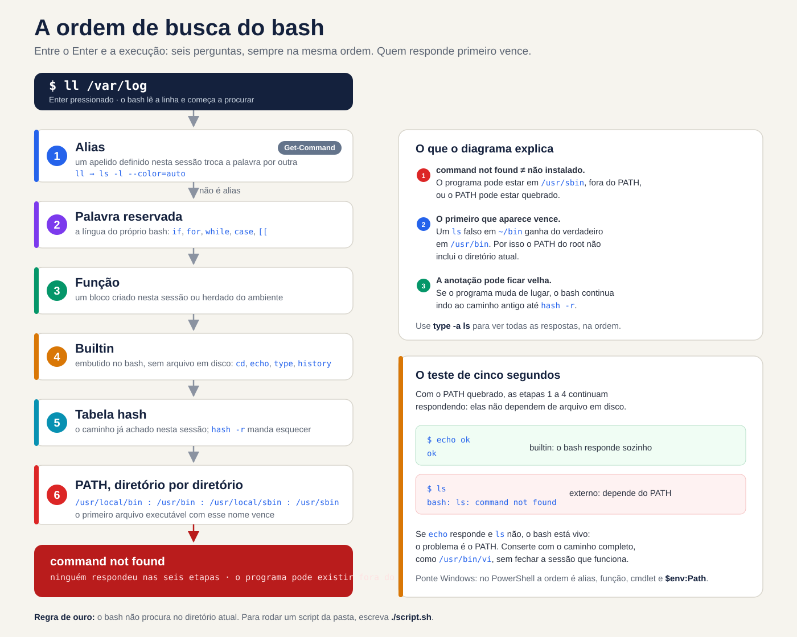
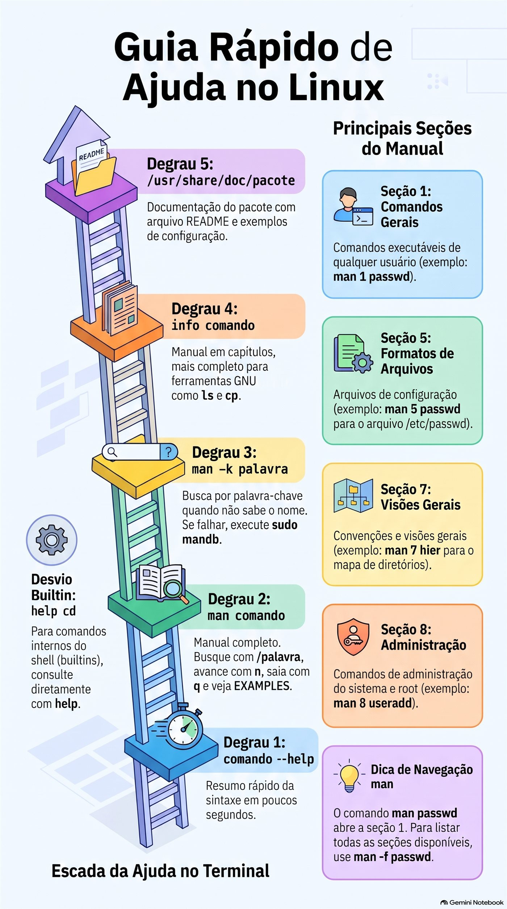
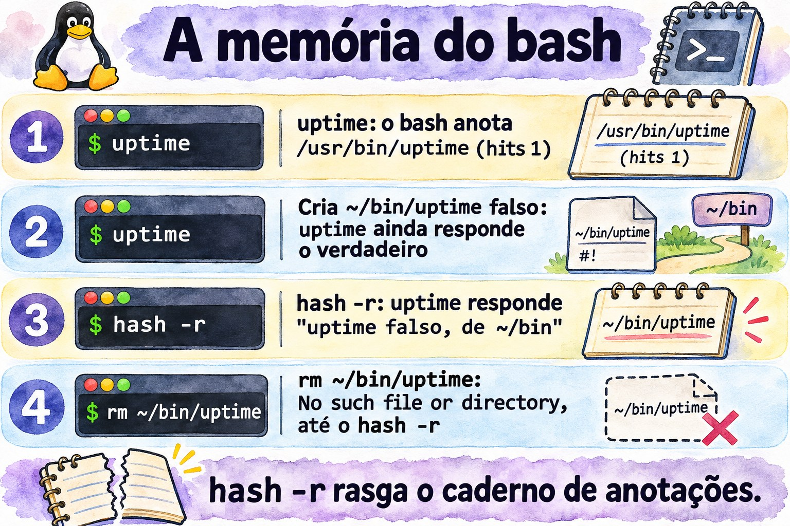
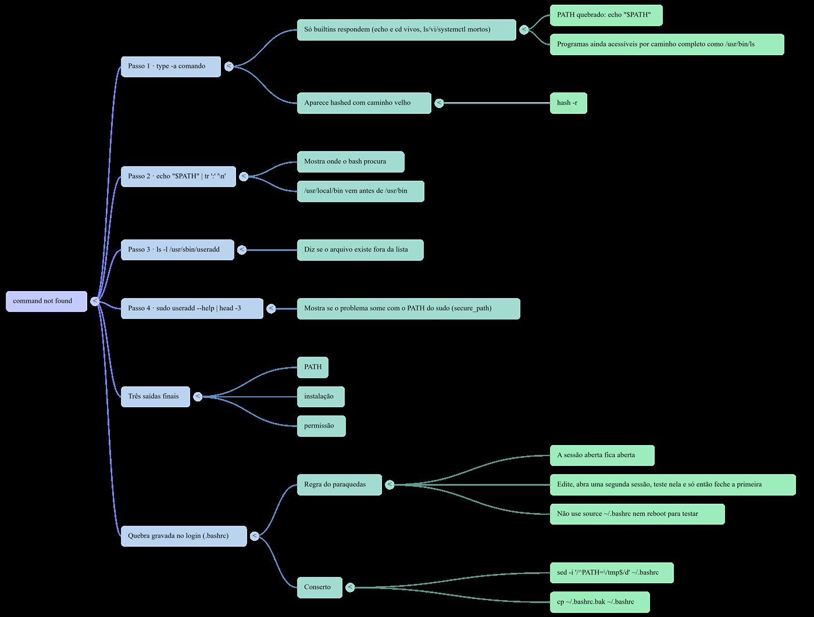

# Aula 1.2 · O shell e a ajuda

Você aprende a ler qualquer comando, descobre como o bash decide o que executar e passa a achar respostas dentro do próprio sistema, sem internet, como num servidor isolado.

| Ficha | Aula 1.2 |
| --- | --- |
| Módulo | M1 · Linha de comando, aula 2 de 10 |
| Quando | Semana 1 |
| Ao final você consegue | Decompor um comando em nome, opções e argumentos; explicar como o bash decide o que executar; diagnosticar um PATH quebrado; achar respostas com man, apropos, info, --help e /usr/share/doc, sem internet; usar histórico e atalhos sem pensar |
| Pré-requisitos | Aula 1.1 |
| Tempo | Cerca de 2h30 |
| Snapshots | m1a2-inicio e m1a2-fim nas duas VMs |

## 1 · Aquecimento

Três perguntas, de cabeça, antes de ler qualquer coisa. Escreva as respostas; o Gabarito confere no fim.

1. Na rocky-lab, `ll` lista os arquivos em formato longo. Na debian-lab, responde `bash: ll: command not found`. Existe um programa chamado `ll`?
2. Você está num servidor sem internet. Precisa lembrar quais campos tem cada linha do `/etc/passwd`. Onde você procura?
3. Na debian-lab, `which cd` não responde nada, mas `cd /etc` funciona. Onde está o programa `cd`?

## 2 · Por que importa

Sexta à noite, servidor de um cliente. Você acrescenta uma linha ao `.bashrc` para pôr um diretório novo no PATH, erra um caractere, fecha a sessão e entra de novo. Agora `ls`, `vi` e até `sudo` respondem `command not found`. Parece que o sistema foi apagado. Se aquela era a sua única sessão aberta, o resto da noite vai para o console remoto, ou para uma ida até o cliente.

Com esta aula, você reconhece o problema em cinco segundos: `echo` e `cd` ainda funcionam, então o bash está vivo e só perdeu o PATH. Você conserta com o caminho completo, como `/usr/bin/vi`, e leva um hábito que evita o susto: nunca feche a sessão que funciona antes de testar uma nova.

A segunda metade da aula é sobre achar respostas sem internet. Num servidor isolado ou numa emergência, nem sempre há navegador; a ajuda está dentro do sistema, no `man`, no `info` e em `/usr/share/doc`. No trabalho vale o mesmo, por outro motivo: o manual instalado no servidor descreve exatamente a versão que está nele. A resposta do fórum foi escrita para outra distribuição, outra versão, às vezes outra década.

## 3 · Modelo mental

> O bash é uma recepcionista com uma lista fixa de perguntas.

Quando você diz um nome, como `ls`, ela não sai procurando ao acaso. Segue sempre a mesma lista, na mesma ordem:

1. É um apelido? Se `ll` é apelido de `ls -l`, ela troca o nome e continua a lista com o nome verdadeiro. Isso é o **alias**.
2. É uma palavra da língua da casa, como `if` ou `for`? É uma **palavra reservada**.
3. É alguém que foi apresentado nesta sessão, com nome e tarefa? É uma **função**.
4. É alguém da própria recepção? Então ela resolve sem sair do balcão: é um **builtin**.
5. Já chamei esse nome hoje? Então vai direto à sala que anotou: é a **tabela hash**.
6. Se não, procura sala por sala, na ordem da lista do **PATH**.

Quem responde primeiro é chamado, e a busca para ali. Se ninguém responde, ela diz que não conhece ninguém com esse nome: `command not found`.

Dessa lista saem três consequências que você vai usar a carreira toda:

- `command not found` não quer dizer que o programa não está instalado. Quer dizer que ele não está em nenhuma sala da lista. Ele pode estar em `/usr/sbin`, fora do seu PATH, ou o PATH pode estar quebrado.
- O primeiro que aparece vence. Um `ls` falso em `~/bin` ganha do verdadeiro em `/usr/bin`, porque `~/bin` vem antes na lista. É por isso que o PATH do root nunca inclui o diretório atual.
- A anotação pode ficar velha. Se o programa muda de sala, a recepcionista continua indo à sala antiga até alguém mandá-la esquecer, com `hash -r`.


*Seis etapas em ordem: alias, palavra reservada, função, builtin, tabela hash e PATH. As quatro primeiras não dependem de arquivo em disco.*

Leia o diagrama de cima para baixo: cada etapa só é consultada se as anteriores não acharam nada. Repare na última caixa. Com o PATH quebrado, as etapas 1 a 4 ainda respondem, porque não dependem de arquivo em disco. É essa pista que transforma o susto de sexta à noite num diagnóstico de cinco segundos: se `echo` responde e `ls` não, o problema é o PATH.

**Ponte Windows.** O PowerShell tem a mesma recepcionista. `Get-Command ls` responde que `ls` é um alias de `Get-ChildItem`, e a ordem de busca é parecida: alias, função, cmdlet e, por último, os programas no `$env:Path`. Duas diferenças pegam quem vem do Windows. O separador do PATH no Linux é `:`, não `;`. E o bash nunca procura no diretório atual: no `cmd.exe`, um `script.bat` da pasta atual roda direto; no Linux, você digita `./script.sh`.

## 4 · Conceito em camadas

### Essencial

| Termo | O que é | Exemplo |
| --- | --- | --- |
| Shell | O programa que lê o que você digita e manda executar | `bash`, o padrão no Rocky e no Debian |
| Comando externo | Um programa em disco, achado pelo PATH | `/usr/bin/ls` |
| Builtin | Comando embutido no próprio bash, sem arquivo em disco | `cd`, `echo`, `type`, `history` |
| Alias | Apelido que troca uma palavra por outra antes de executar | `ll` vira `ls -l --color=auto` no Rocky |
| PATH | A lista de diretórios onde o bash procura comandos externos, separados por `:` | `/usr/local/bin:/usr/bin` |
| Tabela hash | A memória do bash: onde ele já achou cada comando nesta sessão | `hash` |
| `type` | Diz o que uma palavra é para o bash: alias, builtin, arquivo | `type -a ls` |
| `--help` | Resumo das opções, impresso pelo próprio comando | `ls --help` |
| `man` | O manual completo, dividido em seções | `man 5 passwd` |
| `apropos` ou `man -k` | Busca uma palavra nos títulos e resumos do manual | `man -k password` |
| `mandb` | Monta o índice que o `apropos` consulta | `sudo mandb` |
| `info` | Manual em capítulos, mais completo para as ferramentas GNU | `info coreutils` |
| `/usr/share/doc` | Documentação extra dos pacotes: README, exemplos, mudanças | `ls /usr/share/doc/sudo` |
| `history` | Os comandos que você já digitou, numerados | `history 20` |

**Anatomia de um comando.** Todo comando que você vai ler na vida tem as mesmas peças:

```text
ls  -lh  --sort=time  /var/log
│   │    │            └─ argumento: sobre o que o comando age
│   │    └─ opção longa: palavra inteira, dois hífens, pode levar valor
│   └─ opções curtas juntas: -l e -h, um hífen só
└─ nome: o que o bash vai procurar, na ordem do diagrama
```

**As seções do manual que importam.**

| Seção | Conteúdo | Exemplo |
| --- | --- | --- |
| 1 | Comandos de qualquer usuário | `man 1 passwd`: o comando que troca a senha |
| 5 | Formatos de arquivos de configuração | `man 5 passwd`: o arquivo `/etc/passwd` |
| 7 | Visões gerais e convenções | `man 7 hier`: o mapa dos diretórios |
| 8 | Comandos de administração, quase sempre do root | `man 8 useradd` |

`man passwd` abre a primeira seção que tiver a página, a 1. Para o arquivo, peça a seção: `man 5 passwd`. Na dúvida, `man -f passwd` lista todas.

**A escada da ajuda.** Quando não souber, suba um degrau por vez:

1. `comando --help`: o resumo, em segundos.
2. `man comando`: o manual completo. Dentro dele, `/palavra` e Enter buscam, `n` vai para a próxima ocorrência e `q` sai. Procure a seção EXAMPLES.
3. `man -k palavra`: quando você nem sabe o nome do comando. Se responder `nothing appropriate`, o índice ainda não existe; rode `sudo mandb`.
4. `info comando`: o manual em capítulos, mais completo para as ferramentas GNU, como `ls` e `cp`.
5. `/usr/share/doc/pacote`: README, exemplos de configuração e notas da distribuição.

Para builtins o caminho é outro: `help cd`.


*Suba um degrau por vez; para arquivo de configuração, peça a seção 5.*

### Ponte Windows

| No Windows | No Linux |
| --- | --- |
| `Get-Command ls` | `type ls` |
| `where.exe notepad` | `command -v ls` ou `which ls` |
| `Get-Help comando -Full` | `man comando` |
| `comando /?` ou `-?` | `comando --help` |
| `$env:Path`, separado por `;` | `$PATH`, separado por `:` |
| `Get-History`, F7 no `cmd.exe` | `history`, Ctrl+R |

### Aprofundamento

**De onde vem o PATH.** Ao entrar por SSH, o bash lê `/etc/profile` e depois `~/.bash_profile` no Rocky ou `~/.profile` no Debian, que por sua vez carregam o `~/.bashrc`. Cada arquivo pode mexer no PATH. No Rocky, o `/etc/profile` acrescenta `/usr/local/sbin` e `/usr/sbin` também para usuários comuns, e o `~/.bashrc` põe `~/.local/bin` e `~/bin` na frente. No Debian, o PATH de um usuário comum costuma vir sem os diretórios `sbin`; você confere no lab.

**O sudo tem o próprio PATH.** A linha `secure_path` do `/etc/sudoers` define onde o `sudo` procura. Por isso, no mesmo terminal, `useradd` pode dar `command not found` e `sudo useradd` funcionar.

**Mexer no PATH apaga a memória.** Qualquer atribuição ao PATH esvazia a tabela hash. Quando o PATH quebra, nem os comandos que você acabou de usar escapam.

**Pular etapas de propósito.** `\ls` ignora o alias; `command ls` ignora alias e função; `/usr/bin/ls` pula a busca inteira. `type -a ls` mostra todos os candidatos, na ordem em que o bash os encontraria.

**Não confie no `which`.** Ele só conhece o PATH. No Debian é um script que não vê alias nem builtin; no Rocky é um alias que tenta ler os seus aliases antes. Para saber o que o bash vai executar, use `type`; em scripts, `command -v`.

**O `--` encerra as opções.** Tudo depois dele é argumento, mesmo que comece com hífen: `rm -- -arquivo` apaga um arquivo chamado `-arquivo`.

**O histórico grava tudo.** Cada sessão guarda os comandos na memória e grava em `~/.bash_history` ao sair. A variável `HISTCONTROL` decide o que fica de fora: no Rocky, `ignoredups` descarta repetições seguidas; no Debian, `ignoreboth` também descarta as linhas que começam com espaço. Por isso senha nunca vai na linha de comando: ela fica no histórico, legível.

## 5 · Rocky × Debian

O shell é o mesmo bash nas duas VMs, mas cada distribuição monta o ambiente do seu jeito. Estas diferenças explicam metade dos "no meu servidor funciona, no do cliente não":

|  | rocky-lab | debian-lab |
| --- | --- | --- |
| PATH de um usuário comum | Inclui `/usr/local/sbin` e `/usr/sbin`, no fim | Costuma vir sem os diretórios `sbin`; confira no Passo 3 |
| `~/bin` e `~/.local/bin` | Sempre no PATH, postos pelo `~/.bashrc` | Só se o diretório existir no login, pelo `~/.profile` |
| `ll` | Alias criado em `/etc/profile.d/colorls.sh` | Não existe: a linha está comentada no `~/.bashrc` |
| `which` | Alias que lê os seus aliases e funções antes do PATH | Script em `/usr/bin/which`, que só olha o PATH |
| `HISTCONTROL` | `ignoredups` | `ignoreboth`: também ignora linhas que começam com espaço |
| `secure_path` do `sudo` | Inclui `/usr/sbin` | Inclui `/usr/sbin` |
| Manual das seções 5 e 7 | Pacote `man-pages`, fora da instalação mínima | Pacote `manpages` |
| Completar opções com Tab | Pacote `bash-completion`, fora da instalação mínima | Pacote `bash-completion` |
| Nome do serviço SSH | `sshd` | `ssh`; `sshd` também responde, como apelido |
| Documentação de um pacote | `rpm -qd sudo` | `ls /usr/share/doc/sudo` |

## 6 · Lab guiado

Abra três terminais: um na rocky-lab (`ssh rocky-lab`), um na debian-lab (`ssh debian-lab`) e um no nó Proxmox, para os snapshots. Em cada passo, rode, compare com a saída esperada e só então leia o Decida. As saídas são trechos; números e datas vão ser outros na sua tela.

Cada Decida é um caso real de trabalho. Escolha a letra antes de olhar a tabela: errar aqui, com a explicação ao lado, é o jeito mais barato de errar.

**Passo 1 · Snapshot antes de tudo.** No nó Proxmox:

```bash
qm snapshot 201 m1a2-inicio --description "Aula 1.2, antes do lab"
qm snapshot 202 m1a2-inicio --description "Aula 1.2, antes do lab"
qm listsnapshot 201
```

Saída esperada: a árvore mostra `m0a2-fim`, `m1a1-fim`, `m1a2-inicio` e, por último, `current`.

**Passo 2 · Instale a ajuda.** Nas VMs mínimas, parte do manual não vem instalada. Na rocky-lab:

```bash
sudo dnf install -y man-db man-pages info bash-completion
sudo mandb
```

Na debian-lab:

```bash
sudo apt install -y man-db manpages info bash-completion
sudo mandb
```

O que já estiver instalado é ignorado. O `mandb` monta o índice que o `man -k` consulta, e a saída termina com a contagem de páginas processadas. Depois saia das duas VMs com `exit` e entre de novo, para o `bash-completion` carregar.

**Passo 3 · Leia o seu PATH.** Antes de rodar, aposte: `/usr/sbin` aparece no PATH da debian-lab? Nas duas VMs:

```bash
echo "$PATH" | tr ':' '\n'
```

Na rocky-lab, um diretório por linha, nesta ordem:

```text
/home/rodrigo/.local/bin
/home/rodrigo/bin
/usr/local/bin
/usr/bin
/usr/local/sbin
/usr/sbin
```

Na debian-lab, algo como:

```text
/usr/local/bin
/usr/bin
/bin
/usr/local/games
/usr/games
```

Agora, na debian-lab, procure o `useradd` de três jeitos:

```bash
command -v useradd
ls -l /usr/sbin/useradd
sudo useradd --help | head -3
```

Se o PATH não tem `sbin`, o primeiro não responde nada, o segundo mostra que o arquivo existe e o terceiro funciona, porque o `sudo` procura no próprio `secure_path`. Se o seu PATH já tiver `/usr/sbin`, os três respondem, e a lição continua valendo para os Debian mais antigos que você vai encontrar nos clientes.

**Decida 1 · O useradd que sumiu.** Cenário: num Debian de cliente, logado como usuário comum, você roda `useradd --help` e recebe `bash: useradd: command not found`. O que você faz?

- **A)** Reinstala o pacote com `sudo apt install --reinstall passwd`.
- **B)** Confere com `ls -l /usr/sbin/useradd` e roda o comando com `sudo`.
- **C)** Acrescenta o diretório atual ao PATH com `PATH=$PATH:.`.
- **D)** Conclui que o Debian não tem `useradd` e usa o `adduser`.

Escolha a letra antes de olhar a tabela.

| Se você marcou | Resultado | Por quê |
| --- | --- | --- |
| A | ❌ Errada | O programa está instalado; só não está na lista de busca. Reinstalar não muda o PATH e ainda mexe num servidor de produção sem motivo. |
| B | ✅ Certa | `command not found` quer dizer "fora da lista", não "não instalado". O arquivo está em `/usr/sbin`, e criar usuário é tarefa de root: o `sudo` já procura lá. |
| C | ❌ Errada | O `useradd` não está no diretório atual, então nada muda. E pôr `.` no PATH abre a porta para um programa falso com nome de comando. |
| D | ❌ Errada | O `useradd` existe no Debian. E o `adduser` também fica em `/usr/sbin`: daria o mesmo erro. |

**Para fixar:** a recepcionista só procura nas salas da lista. Quem está em outra sala continua existindo.


*O arquivo existe em /usr/sbin; o que falta no PATH comum do Debian é a pasta, não o programa.*

**Passo 4 · Pergunte ao bash o que cada nome é.** Nas duas VMs:

```bash
type -a ls
type ll
type cd
type if
type -a which
```

Na rocky-lab, algo como:

```text
ls is aliased to `ls --color=auto'
ls is /usr/bin/ls
ll is aliased to `ls -l --color=auto'
cd is a shell builtin
if is a shell keyword
which is aliased to `(alias; declare -f) | /usr/bin/which --tty-only --read-alias --read-functions --show-tilde --show-dot'
which is /usr/bin/which
```

Na debian-lab, algo como:

```text
ls is aliased to `ls --color=auto'
ls is /usr/bin/ls
ls is /bin/ls
bash: type: ll: not found
cd is a shell builtin
if is a shell keyword
which is /usr/bin/which
which is /bin/which
```

Três leituras. O `ll` só existe onde alguém criou o alias. O `which` é uma coisa diferente em cada distribuição. E, se o PATH da debian-lab tem `/bin`, o `ls` aparece duas vezes: é o mesmo arquivo, porque nos Debian atuais o `/bin` é um atalho para `/usr/bin`.

**Decida 2 · O script que funciona no terminal e falha no cron.** Cenário: um script de backup na rocky-lab começa com `#!/bin/bash` e tem a linha `ll /backup > /tmp/lista.txt`. Rodado à mão, no terminal, funciona. Pelo cron, falha com `ll: command not found`. Por quê?

- **A)** O cron usa um PATH curto, sem `/usr/bin`.
- **B)** Aliases só existem em sessões interativas; o script precisa usar `ls -l`.
- **C)** O cron roda o script com `sh`, e não com `bash`.
- **D)** O usuário do cron não tem permissão de leitura em `/backup`.

Escolha a letra antes de olhar a tabela.

| Se você marcou | Resultado | Por quê |
| --- | --- | --- |
| A | ❌ Errada | O PATH do cron é curto, mas inclui `/usr/bin`. E não existe arquivo `ll` em lugar nenhum: nenhum PATH acharia. |
| B | ✅ Certa | O `ll` é um alias criado em `/etc/profile.d/colorls.sh`, que só é carregado em sessões interativas. Num script, o bash nem expande aliases. Em script, escreva o comando verdadeiro. |
| C | ❌ Errada | A primeira linha, `#!/bin/bash`, garante o bash. E, mesmo no bash, script não expande aliases. |
| D | ❌ Errada | Falta de permissão dá `Permission denied`, não `command not found`. Leia a mensagem: ela diz qual etapa falhou. |

**Para fixar:** alias é conforto de quem digita. Script não digita.

**Passo 5 · A memória do bash.** Na rocky-lab:

```bash
hash -r
hash
uptime
hash
type uptime
```

Saída esperada: primeiro `hash: hash table empty`; depois do `uptime`, a tabela mostra `/usr/bin/uptime` com 1 na coluna `hits`; e o `type` responde `uptime is hashed (/usr/bin/uptime)`.

Agora crie um `uptime` falso em `~/bin`, que vem antes de `/usr/bin` no PATH:

```bash
mkdir -p ~/bin
printf '#!/bin/bash\necho "uptime falso, de ~/bin"\n' > ~/bin/uptime
chmod +x ~/bin/uptime
uptime
```

Preveja antes do Enter: qual `uptime` responde? O verdadeiro. O bash nem olhou o PATH, porque o caminho já estava anotado. Mande-o esquecer:

```bash
hash -r
uptime
```

Agora responde `uptime falso, de ~/bin`. Por último, apague o falso sem limpar a tabela:

```bash
rm ~/bin/uptime
uptime
hash -r
uptime
```

O primeiro `uptime` responde `bash: /home/rodrigo/bin/uptime: No such file or directory`: o bash foi direto à sala anotada, e ela estava vazia. Depois do `hash -r`, volta o verdadeiro. Guarde esta mensagem: um caminho completo no erro, para um programa que você chamou só pelo nome, é sinal de anotação velha.

**Decida 3 · A versão que não muda.** Cenário: num servidor de cliente, você instala a versão nova de uma ferramenta de backup em `/usr/local/bin`. A antiga continua em `/usr/bin`. Na mesma sessão, a opção `--version` ainda mostra a antiga. O que você faz?

- **A)** Reinstala a versão nova, porque a instalação falhou.
- **B)** Roda `type` com o nome da ferramenta e, se ela aparecer como `hashed`, limpa com `hash -r`.
- **C)** Inverte a ordem do PATH, porque `/usr/local/bin` vem depois de `/usr/bin`.
- **D)** Reinicia o servidor para o sistema reconhecer a versão nova.

Escolha a letra antes de olhar a tabela.

| Se você marcou | Resultado | Por quê |
| --- | --- | --- |
| A | ❌ Errada | A instalação deu certo; o bash é que não procurou de novo. Reinstalar não apaga a anotação. |
| B | ✅ Certa | O bash anotou o caminho antigo quando você usou a ferramenta pela primeira vez. `hash -r` apaga as anotações; a próxima busca percorre o PATH e acha `/usr/local/bin` primeiro. |
| C | ❌ Errada | No Rocky e no Debian, `/usr/local/bin` vem antes de `/usr/bin`, justamente para o que você instala à mão vencer o que vem do pacote. |
| D | ❌ Errada | Funcionaria por acaso, porque a sessão nova começa sem anotações. Mas derruba os serviços do cliente por algo que um comando resolve. Sair e entrar de novo no SSH já bastaria. |

**Para fixar:** anotação velha manda a recepcionista à sala errada. `hash -r` rasga o caderno.



*O bash vai direto ao caminho anotado; só o hash -r faz ele olhar o PATH de novo.*

**Passo 6 · O manual e as seções.** Nas duas VMs:

```bash
ls --help | head -15
man -f passwd
man 5 passwd
```

O `man -f` mostra algo como:

```text
passwd (1)           - change user password
passwd (5)           - the password file
```

Na rocky-lab pode aparecer também `passwd (1ssl)`, do OpenSSL. Dentro do `man 5 passwd`, digite `/shell` e Enter: o cursor vai à descrição do campo do shell de login. `n` vai para a próxima ocorrência e `q` sai.

Agora um caso de trabalho: um cliente quer que um técnico reinicie um serviço sem virar root. A sintaxe está no próprio sistema:

```bash
man 5 sudoers
```

Dentro dele, digite `/^EXAMPLES` e Enter. A seção de exemplos tem linhas prontas para adaptar. Saia com `q`.

Por fim, busque sem saber o nome do comando:

```bash
man -k 'user account'
```

Algo como:

```text
userdel (8)          - delete a user account and related files
usermod (8)          - modify a user account
```

Se a resposta for `user account: nothing appropriate`, o índice não foi montado: rode `sudo mandb` e tente de novo.

**Decida 4 · O servidor sem internet.** Cenário: num servidor sem acesso à internet, um chamado pede que a conta do usuário `ana` expire em 31 de dezembro de 2027. Você não lembra o comando. O que você faz primeiro?

- **A)** Abre o `man passwd` e lê do começo ao fim.
- **B)** Roda `man -k expir`, acha o nome do comando e busca `/expir` dentro do manual dele.
- **C)** Abre o `info` e navega até achar.
- **D)** Testa `--help` em todo comando que começa com `user`.

Escolha a letra antes de olhar a tabela.

| Se você marcou | Resultado | Por quê |
| --- | --- | --- |
| A | ❌ Errada | O `passwd` cuida da validade da senha, não da expiração da conta. E ler um manual inteiro consome minutos que você não tem. |
| B | ✅ Certa | O `man -k` busca nos resumos de todas as páginas, e `expir` pega "expire", "expiry" e "expiration". Aparece o `chage`, e dentro do manual dele a busca leva à opção `-E`. Dois comandos e você está na linha certa. |
| C | ❌ Errada | O `info` é ótimo para as ferramentas GNU, mas não busca em todos os comandos, e os de gestão de usuários nem têm página `info`. |
| D | ❌ Errada | É chute com o cronômetro rodando. Pode até achar o `usermod -e`, mas por sorte. |

**Para fixar:** o `man -k` é o buscador de dentro do servidor. Ele só funciona depois que o `mandb` montou o índice.

**Passo 7 · info, help e /usr/share/doc.** Nas duas VMs:

```bash
info ls
```

Espaço avança, `n` vai para o próximo nó, `u` sobe um nível e `q` sai. O `info` do `ls` explica cada opção com mais detalhe que o `man`. Depois:

```bash
help cd
man cd
```

Na debian-lab, o `help cd` explica o builtin e o `man cd` responde `No manual entry for cd`. Na rocky-lab, o `man cd` costuma abrir uma página geral dos builtins do bash; o `help cd` continua sendo o caminho curto. Por último, a documentação dos pacotes:

```bash
ls /usr/share/doc | wc -l
ls /usr/share/doc/sudo
```

Na rocky-lab, `rpm -qd sudo` lista todos os arquivos de documentação do pacote, manuais incluídos.

**Decida 5 · O manual que não existe.** Cenário: você quer saber o que faz a opção `-P` do `cd`. Na debian-lab, `man cd` responde `No manual entry for cd`. O que você faz?

- **A)** Instala pacotes de manual até a página aparecer.
- **B)** Roda `help cd`.
- **C)** Conclui que o `cd` não tem opções.
- **D)** Procura o arquivo `/usr/bin/cd` para ler o que ele faz.

Escolha a letra antes de olhar a tabela.

| Se você marcou | Resultado | Por quê |
| --- | --- | --- |
| A | ❌ Errada | Existe um pacote com uma página `cd` do padrão POSIX, mas ela descreve o `cd` genérico, não o do bash. A documentação certa já está instalada. |
| B | ✅ Certa | O `cd` é um builtin: vive dentro do bash, e quem o documenta é o próprio bash, com o `help`. Lá estão o `-P` e o `-L`. |
| C | ❌ Errada | Falta de manual não é falta de opção. O `cd` tem `-L`, `-P` e outras. |
| D | ❌ Errada | Na debian-lab não existe `/usr/bin/cd`. O `cd` precisa ser builtin: um programa externo mudaria o diretório dele próprio e terminaria, e o seu shell continuaria onde estava. |

**Para fixar:** builtin se pergunta ao bash, com `help`.

**Passo 8 · Histórico e atalhos.** Na debian-lab:

```bash
ls /root
sudo !!
```

O primeiro dá `Permission denied`. O `!!` repete o último comando; o bash mostra `sudo ls /root` antes de executar. Depois:

```bash
ls -ld /var/log
cd !$
pwd
```

`!$` é o último argumento do comando anterior: o `cd` vai para `/var/log`. Agora três atalhos, só no teclado:

- Ctrl+R e digite `uptime`: o bash acha o último comando com essa palavra. Enter executa; Esc deixa editar antes.
- Digite `systemctl status ss` e aperte Tab duas vezes: aparecem `sshd.service` na rocky-lab e `ssh.service` na debian-lab.
- Ctrl+A vai ao início da linha, Ctrl+E ao fim e Ctrl+U apaga tudo antes do cursor.

Por fim, o `HISTCONTROL`, nas duas VMs. A segunda linha começa com um espaço:

```bash
echo "$HISTCONTROL"
 echo teste-com-espaco
history 3
```

Na debian-lab, o comando com espaço não aparece no histórico. Na rocky-lab, aparece.

**Decida 6 · O histórico como prova.** Cenário: um servidor de cliente parou de enviar e-mails, e o cliente jura que ninguém mexeu. Você roda `history` com o seu usuário e não vê nada estranho. O que você conclui?

- **A)** Ninguém mexeu; o histórico confirma.
- **B)** O `history` mostra só o seu usuário e pode ter sido editado; para saber quem fez o quê, você precisa dos registros do sistema.
- **C)** Que falta rodar `sudo history` para ver o histórico de todos.
- **D)** Que basta ler o `.bash_history` do root, que registra tudo o que acontece no servidor.

Escolha a letra antes de olhar a tabela.

| Se você marcou | Resultado | Por quê |
| --- | --- | --- |
| A | ❌ Errada | O `history` mostra só os comandos do seu usuário, das sessões já gravadas. Cada técnico, e o root, tem o seu. |
| B | ✅ Certa | O histórico é pista, não prova: é por usuário, é gravado ao sair, pode ser editado e, no Debian, ignora linhas com espaço na frente. Quem fez o quê vem dos registros do sistema, como os do `sudo` no journal, que você aprende a ler mais adiante no curso. |
| C | ❌ Errada | O `history` é um builtin, e o `sudo` só executa programas em disco. A resposta é `sudo: history: command not found`: a ordem de busca de novo. |
| D | ❌ Errada | Ele guarda só o que foi digitado como root, e só das sessões encerradas. Serve de pista, mas não mostra o que outros usuários fizeram com `sudo`. |

**Para fixar:** o `history` é a agenda de cada um. A auditoria é o livro de registro da portaria.

**O protocolo do command not found.** Quatro comandos, nesta ordem, em qualquer servidor. O exemplo usa o `useradd`; troque pelo comando da vez:

```bash
type -a useradd
echo "$PATH" | tr ':' '\n'
ls -l /usr/sbin/useradd
sudo useradd --help | head -3
```

O primeiro pergunta ao bash o que ele conhece. O segundo mostra onde ele procura. O terceiro diz se o arquivo existe fora da lista. O quarto mostra se o problema some com o PATH do `sudo`. Em menos de um minuto, você sabe se o caso é PATH, instalação ou permissão.


*Repetir comandos e editar a linha no teclado: !!, !$, Ctrl+R e os atalhos de edição.*

## 7 · Quebre e conserte

Agora você quebra de propósito o que mais derruba sessões de verdade: o PATH. São duas quebras. A primeira some quando a sessão termina. A segunda fica gravada no arquivo de login e volta em toda sessão nova. Faça tudo na rocky-lab: o snapshot `m1a2-inicio` está lá para isso.

### Quebra A · só nesta sessão

**Quebre.** Na rocky-lab:

```bash
PATH=/tmp
```

Nenhuma mensagem. Parece que nada mudou.

**Preveja.** Antes de rodar cada linha abaixo, diga se ela funciona. Anote os seus palpites.

```bash
ls
echo "$PATH"
cd /var/log
type -a ls
sudo ls /root
/usr/bin/ls /tmp
/usr/bin/sudo ls /root
```

**Descubra.** Algo como:

```text
bash: ls: command not found
/tmp
ls is aliased to `ls --color=auto'
bash: sudo: command not found
```

O `cd` não responde nada, porque deu certo. Os dois últimos funcionam: com o caminho completo, o bash não precisa procurar. O último pode pedir a sua senha, e o `sudo` acha o `ls` sozinho, pelo `secure_path` dele.

Repare no `type -a ls`. O alias continua lá, mas só troca o texto: `ls` vira `ls --color=auto`, e esse `ls` ainda precisa ser achado no PATH. É o diagrama da §3 ao vivo. As etapas de dentro do bash respondem: alias, builtin e o próprio `echo`. A etapa do PATH não acha nada.

**Decida 7 · A sessão sem comandos.** Cenário: numa sessão SSH num servidor de cliente, depois de colar um bloco de comandos de um tutorial, nada funciona: `ls`, `vi` e `systemctl` dão `command not found`. O `echo` e o `cd` funcionam. O que você faz primeiro?

- **A)** Reinicia o servidor pelo painel do hypervisor.
- **B)** Roda `echo "$PATH"` e, se estiver errado, corrige o PATH desta sessão.
- **C)** Reinstala o `coreutils`, porque os programas sumiram.
- **D)** Fecha a sessão e entra de novo, sem olhar nada.

Escolha a letra antes de olhar a tabela.

| Se você marcou | Resultado | Por quê |
| --- | --- | --- |
| A | ❌ Errada | Resolveria por acaso, se a quebra fosse só da sessão. Mas derruba os serviços do cliente e apaga a pista. Se a quebra estiver num arquivo de login, volta igual depois do boot. |
| B | ✅ Certa | `echo` e `cd` vivos com todo o resto morto é a assinatura do PATH quebrado. O `echo` é builtin, então funciona e mostra a causa em segundos. Os programas continuam acessíveis pelo caminho completo, como `/usr/bin/ls`. |
| C | ❌ Errada | Os programas estão no disco; o bash é que não sabe onde procurar. E o `dnf` também é um programa: com o PATH quebrado, nem ele responde. |
| D | ❌ Errada | Funciona se a quebra era só da sessão, mas você ainda não sabe disso. Se o tutorial gravou a mudança no `.bashrc`, a sessão nova vem igual. Você trocou um diagnóstico de cinco segundos por um palpite. |

**Para fixar:** quando só os builtins respondem, olhe o PATH antes de qualquer outra coisa.

**Conserte.** Devolva o PATH do Passo 3:

```bash
PATH=/home/rodrigo/.local/bin:/home/rodrigo/bin:/usr/local/bin:/usr/bin:/usr/local/sbin:/usr/sbin
```

Outro jeito: `exit` e entrar de novo. Essa quebra só existia na memória desta sessão.

**Verifique.**

```bash
hash
ls ~
type -a ls
```

O `hash` responde `hash: hash table empty`. A atribuição do PATH apagou as anotações, como na §4. Depois o `ls` funciona e o `type -a` mostra o alias e `/usr/bin/ls`.

### Quebra B · gravada no login

Esta é a do caso da sexta à noite, na §2. A regra de ouro vem antes do comando: **a sessão que você tem aberta agora fica aberta até o fim.** Ela é o seu paraquedas.

**Quebre.** Na rocky-lab, na sessão que já está aberta:

```bash
cp ~/.bashrc ~/.bashrc.bak
[ "$(hostname)" = rocky-lab ] && echo 'PATH=/tmp' >> ~/.bashrc
diff ~/.bashrc.bak ~/.bashrc
```

O `diff` mostra a única diferença entre a cópia e o arquivo, algo como:

```text
27a28
> PATH=/tmp
```

Se o `diff` não mostrar nada, você não está na rocky-lab. Confira com `hostname`. A cópia `.bak` é o primeiro hábito desta quebra: antes de mexer num arquivo de login, guarde uma cópia.

**Preveja.** Abra um **segundo** terminal no Windows e rode `ssh rocky-lab`. O login vai funcionar? O prompt aparece? O que funciona lá dentro?

**Descubra.** O login funciona e o prompt aparece. O SSH não depende do seu PATH: o `.bashrc` só é lido pelo bash, depois que você já entrou. Lá dentro:

```bash
ls
echo "$PATH"
vi ~/.bashrc
/usr/bin/diff ~/.bashrc.bak ~/.bashrc
```

Algo como:

```text
bash: ls: command not found
/tmp
bash: vi: command not found
27a28
> PATH=/tmp
```

Sem PATH, nem o editor abre. Mas o `diff` com caminho completo mostra exatamente a linha culpada.

**Conserte.** Desta vez, conserte de dentro da sessão quebrada, para treinar o caso em que não sobrou paraquedas:

```bash
/usr/bin/sed -i '/^PATH=\/tmp$/d' ~/.bashrc
/usr/bin/diff ~/.bashrc.bak ~/.bashrc
echo "$PATH"
```

O `sed -i` apaga do arquivo a linha que é exatamente `PATH=/tmp`. O `diff` não mostra nada, porque os dois arquivos estão iguais de novo. Mas o `echo` ainda mostra `/tmp`. O arquivo está consertado, a sessão não: ela leu o arquivo quando começou. Saia com `exit`.

No paraquedas, o mesmo conserto seria só `sed -i '/^PATH=\/tmp$/d' ~/.bashrc`, sem caminho completo. Ou `cp ~/.bashrc.bak ~/.bashrc`, que devolve a cópia inteira.

**Verifique.** No segundo terminal, abra uma sessão nova:

```bash
ssh rocky-lab
echo "$PATH" | tr ':' '\n'
ls ~
```

Voltou o PATH do Passo 3. Agora, e só agora, apague a cópia e feche o paraquedas:

```bash
rm ~/.bashrc.bak
```

**Decida 8 · A edição de sexta à noite.** Cenário: por SSH, você acabou de editar o `.bashrc` do root num servidor de cliente para acrescentar um diretório ao PATH. Qual é a ordem certa para testar?

- **A)** Salvar, sair da sessão e entrar de novo para testar.
- **B)** Salvar, abrir uma segunda sessão sem fechar a primeira, testar nela e só então fechar a primeira.
- **C)** Salvar e rodar `source ~/.bashrc` na mesma sessão. Se não der erro, está certo.
- **D)** Salvar e reiniciar o servidor para carregar o arquivo novo.

Escolha a letra antes de olhar a tabela.

| Se você marcou | Resultado | Por quê |
| --- | --- | --- |
| A | ❌ Errada | Se a mudança quebrou algo, você descobre do lado de fora, sem uma sessão boa para consertar. Aqui o login ainda entraria. Com um erro no `sshd_config` ou no firewall, nem isso. |
| B | ✅ Certa | A sessão antiga guarda o ambiente que funcionava, e é dela que você conserta se a nova vier quebrada. Só feche a antiga depois que a nova provar que está tudo certo. |
| C | ❌ Errada | Testa no lugar errado: se a linha quebra o PATH, você quebra a sua única sessão boa. E o `source` não reproduz um login limpo, porque o que já estava carregado continua lá e esconde erros. |
| D | ❌ Errada | O `.bashrc` é lido quando o shell começa, não no boot. Reiniciar não testa nada e derruba os serviços do cliente. |

**Para fixar:** a sessão aberta é o paraquedas. Ninguém tira o paraquedas antes de conferir o novo.

### E o snapshot?

Se algo saiu do controle, volte ao início do lab. No nó Proxmox:

```bash
qm rollback 201 m1a2-inicio
qm start 201
```

O rollback desfaz tudo desde o Passo 1, inclusive os pacotes de ajuda: refaça o Passo 2 antes de seguir.

### Bônus na Debian

Repita a Quebra A na debian-lab e acrescente três testes:

```bash
PATH=/tmp
/bin/ls /tmp
/usr/bin/ls -ld /bin
/usr/bin/sudo -i
```

O `/bin/ls` funciona tanto quanto o `/usr/bin/ls`. O segundo comando mostra o motivo, algo como `lrwxrwxrwx 1 root root 7 ... /bin -> usr/bin`: nos Debian atuais, `/bin` é um atalho para `/usr/bin`. O último abre um shell de root com o PATH do root, montado do zero. Confira com `echo "$PATH"`.

Essa é a saída de emergência quando o seu PATH quebrou e você precisa consertar algo do sistema. Volte com `exit` e conserte a sua sessão como na Quebra A, usando o PATH que você anotou no Passo 3, ou com `exit` e um login novo.

**A lição:** um arquivo de login quebrado não tranca a porta; tranca o que você faz depois de entrar. Com caminho completo, você ainda conserta tudo. Mas a defesa de verdade é de procedimento: mudou algo que afeta o acesso, teste numa sessão nova com a antiga aberta. Vale para o `.bashrc`, o `sshd_config`, as regras de firewall e o sudoers.


*Em menos de um minuto: é PATH, instalação ou permissão. E a sessão aberta é o paraquedas.*

## 8 · Armadilhas

| Sintoma | Causa | Saída |
| --- | --- | --- |
| `command not found` para um comando que você sabe que está instalado | O diretório dele não está no seu PATH. É o caso do `/usr/sbin` para usuário comum no Debian. | `ls -l /usr/sbin/nome` para confirmar; rode com `sudo` ou com o caminho completo. |
| No Debian, depois de `su`, o `useradd` dá `command not found` | Do Debian 10 em diante, o `su` sem hífen vira root, mas mantém o seu PATH, sem `sbin`. | `su -`, que monta o ambiente do root do zero. Se a instalação não definiu senha de root, o `su` nem entra: use `sudo -i`. |
| `bash: /home/rodrigo/bin/x: No such file or directory` para um comando chamado só pelo nome | Anotação velha na tabela hash: o arquivo mudou de lugar ou foi apagado. | `hash -r` |
| Instalou a versão nova e continua rodando a velha | Anotação velha, ou a velha está num diretório que vem antes no PATH. | `type -a nome` mostra todas; `hash -r` limpa as anotações. |
| `ll: command not found` num servidor, e no outro funciona | Alias só existe onde alguém criou. Em script, alias não funciona em lugar nenhum. | `ls -l`. Para o seu conforto, crie o alias no seu `~/.bashrc`; em script, escreva o comando verdadeiro. |
| O `which` aponta um arquivo, mas o bash roda outra coisa | O `which` do Debian só olha o PATH e ignora alias, função e builtin. | `type -a nome` |
| `man -k` responde `nothing appropriate` | O índice do manual não foi montado. | `sudo mandb` |
| `No manual entry for cd` | O `cd` é builtin: quem documenta é o bash. | `help cd` |
| No Rocky, `man 5 passwd` não acha a página | Instalação mínima, sem o pacote `man-pages`. | `sudo dnf install -y man-pages` |
| `sudo cd /var/lib/mysql` dá `sudo: cd: command not found` | O `sudo` só executa programas em disco. Builtins como `cd` e `history` não existem para ele. | `sudo ls /var/lib/mysql` para olhar, ou `sudo -i` para um shell de root. |
| `script.sh: command not found` com o script na pasta atual | O bash nunca procura no diretório atual, ao contrário do `cmd.exe`. | `./script.sh` |
| Uma senha digitada na linha de comando aparece no `history` | O bash grava tudo. Só o Debian ignora as linhas que começam com espaço. | Nunca passe senha na linha de comando. Se passou, trate como vazada e troque a senha. |
| Mudou o `.bashrc` e nada mudou | O arquivo só é lido quando o shell começa. | Teste numa sessão nova, com a antiga aberta. |
| Colou um tutorial e veio `$: command not found` | O `$` do prompt do tutorial foi colado junto com o comando. | Cole só o comando, sem o `$` da frente. |

## 9 · Quiz

Responda sem olhar a aula. As respostas comentadas estão no Gabarito, no fim.

1. Em que ordem o bash procura um nome que você digitou?
2. `type ls` responde `ls is hashed (/usr/bin/ls)`. O que isso quer dizer, e quando essa resposta engana você?
3. Na debian-lab, como usuário comum, `useradd --help` dá `command not found`, mas `sudo useradd --help` funciona. Explique em duas frases.
4. Em que seção do manual fica o formato do `/etc/shadow`? Escreva o comando que abre exatamente essa página.
5. Complete as lacunas: para ver todas as formas como o bash entende `ls`, rode `____ -a ls`. Para buscar no manual pela descrição, `man ___ 'user account'`. Se a busca responder `nothing appropriate`, rode `sudo _____`.
6. Por que o `cd` precisa ser um builtin?
7. Você rodou `cat /var/log/secure` e recebeu `Permission denied`. Qual é o jeito mais curto de repetir o comando com `sudo`?
8. Você editou o `.bashrc` de um servidor por SSH. Descreva o teste seguro em três passos.
9. Pergunta em inglês, como nos fóruns e na documentação: *Which command displays the manual page that describes the format of the /etc/passwd file?*
   - **A)** `man passwd`
   - **B)** `man 5 passwd`
   - **C)** `info passwd 5`
   - **D)** `help passwd`

## 10 · Flashcards e cola

| Frente | Verso |
| --- | --- |
| O que `command not found` quer dizer? | Que o nome não está em nenhuma etapa da busca. Não quer dizer que o programa não está instalado. |
| Ordem de busca do bash | Alias, palavra reservada, função, builtin, tabela hash, PATH. Para no primeiro que acha. |
| Ver tudo o que um nome pode ser | `type -a nome` |
| O comando velho insiste em rodar | `hash -r` |
| Ver o PATH, um diretório por linha | `echo "$PATH" \| tr ':' '\n'` |
| Seções 1, 5, 7 e 8 do manual | Comandos; formatos de arquivo; visões gerais; comandos de administração |
| Buscar no manual pela descrição | `man -k palavra`, igual a `apropos`. Se vier vazio, `sudo mandb`. |
| Dentro do `man`: buscar, próxima, sair | `/texto`, `n`, `q` |
| Ajuda de um builtin | `help cd` |
| Documentação extra de um pacote | `/usr/share/doc/pacote`; no Rocky, `rpm -qd pacote` |
| Repetir o último comando com sudo | `sudo !!` |
| Último argumento do comando anterior | `!$` |
| Buscar no histórico | Ctrl+R |
| `su` e `su -` | Sem hífen, mantém o seu PATH. Com hífen, monta o ambiente do root do zero. |
| Regra da sessão aberta | Mudou algo que afeta o acesso: teste numa sessão nova com a antiga aberta. |

**Para saber de cor.**

```bash
type -a useradd
echo "$PATH" | tr ':' '\n'
hash -r
ls --help
man -k 'user account'
man 5 passwd
help cd
sudo !!
```

**Para consultar.**

```bash
man 7 hier
man 5 sudoers
info coreutils
ls /usr/share/doc/sudo
rpm -qd sudo
dpkg -L sudo | grep /usr/share/doc
sudo mandb
history | grep useradd
```

No `man 5 sudoers`, busque `/^EXAMPLES`. O `rpm -qd` é do Rocky; o `dpkg -L` é do Debian.

## 11 · Checklist de saída

Marque só o que você consegue fazer sem olhar a aula:

- [ ] Explicar em uma frase por que `command not found` não quer dizer "não instalado".
- [ ] Dizer a ordem de busca do bash e conferir cada etapa com um comando.
- [ ] Achar a seção certa do manual para um arquivo de configuração.
- [ ] Achar um comando pela descrição, com `man -k`.
- [ ] Ler a ajuda de um builtin.
- [ ] Consertar um PATH quebrado, na sessão e no `.bashrc`, usando caminho completo.
- [ ] Explicar por que a sessão antiga fica aberta enquanto você testa a nova.

**Feche a aula.** No nó Proxmox:

```bash
qm snapshot 201 m1a2-fim --description "Aula 1.2 concluída"
qm snapshot 202 m1a2-fim --description "Aula 1.2 concluída"
qm delsnapshot 201 m1a2-inicio
qm delsnapshot 202 m1a2-inicio
qm listsnapshot 201
```

Saída esperada: `m1a1-fim`, depois `m1a2-fim` e, por último, `current`. O `m1a2-inicio` não aparece mais.

## 12 · Na vida real

Comando digitado uma vez, sem um problema de verdade atrás, some em um dia. Esta seção existe para isso não acontecer: uma missão no seu trabalho e um desafio amanhã, sem olhar a aula.

**Missão no trabalho (até amanhã, só leitura).** Escolha um servidor Linux real que você administra. Entre com o seu usuário e rode só comandos que leem:

```bash
echo "$PATH" | tr ':' '\n'
alias
type -a ll which ls
ls -l ~/.bashrc ~/.profile ~/.bash_profile
grep -n PATH ~/.bashrc ~/.profile ~/.bash_profile
```

Alguns arquivos podem não existir; o erro faz parte da resposta. Anote três respostas no seu diário de admin:

1. O PATH desse servidor tem `sbin`?
2. Algum alias ou linha de PATH foi deixado por outro admin, e não pela distribuição?
3. Quando o `.bashrc` foi alterado pela última vez?

E um segundo desafio, para a semana: na próxima vez que você for pesquisar um comando no Google durante o trabalho, tente antes `--help`, `man -k` e a busca com `/` dentro do `man`. Cronometre. Se em três minutos não achar, aí sim vá à internet, e anote no diário o que faltou.

**Amanhã, sem olhar.** Reserve de 10 a 15 minutos na debian-lab. Sem abrir esta aula, só com `--help`, `man` e `help`:

1. Descubra em que seção do manual está o formato do `/etc/group` e abra a página.
2. Com `man -k`, ache o comando que muda o shell de login de um usuário.
3. Rode `PATH=/tmp`. Sem sair da sessão, liste o `/etc` e devolva o PATH ao normal.
4. Descubra se o `history` é builtin ou programa, e onde está a ajuda dele.

Dica: se travar, as três perguntas são sempre as mesmas. O que é isso? (`type`). Onde está a ajuda? (`man -k`). É do bash? (`help`).

## 13 · Com o DeepTutor

| Comando | Quando usar |
| --- | --- |
| `!quiz 1.2` | Logo depois do lab: perguntas novas. |
| `!explica tabela hash do bash` | Quando um conceito ainda não fechou. |
| `!feynman ordem de busca do bash` | Você explica com as suas palavras e ele aponta as falhas. |
| `!quebra 1.2` | Uma quebra nova de PATH, alias ou manual para você consertar. |
| `!cartoes 1.2` | Os flashcards em repetição espaçada. |
| `!erro bash: useradd: command not found` | Cole um erro real e ele guia o diagnóstico. |
| `!revisao 1.2` | No D+1, D+3, D+7 e D+21. Junto: `!revisao 1.1` no D+1 e `!revisao 0.2` no D+3. |

## Gabarito comentado

**Aquecimento.**

1. Não existe programa `ll`. No Rocky, é um alias criado em `/etc/profile.d/colorls.sh`. No Debian, a linha do alias está comentada no `~/.bashrc`. O `type ll` mostra isso.
2. `man 5 passwd`. A seção 5 descreve formatos de arquivo, e já está no servidor, sem internet.
3. O `cd` é builtin: mora dentro do bash. O `which` do Debian só olha o PATH, por isso não acha nada. `type cd` responde `cd is a shell builtin`, e a ajuda vem do `help cd`.

**Quiz.**

1. Alias, palavra reservada, função, builtin, tabela hash, PATH. O bash para no primeiro que acha.
2. O bash já achou o `ls` em `/usr/bin/ls` e anotou o caminho, então não procura no PATH de novo. Engana quando o arquivo foi apagado, mudou de lugar ou ganhou um concorrente num diretório que vem antes no PATH. A saída é `hash -r`.
3. O `/usr/sbin` não está no PATH do usuário comum, então o bash não acha o `useradd`. O `sudo` procura no `secure_path` do `/etc/sudoers`, que inclui `/usr/sbin`.
4. Seção 5: `man 5 shadow`.
5. `type`, `-k` e `mandb`.
6. Um programa externo roda num processo filho. Ele mudaria o diretório do filho, terminaria, e o seu shell continuaria onde estava. Só o próprio bash pode mudar o próprio diretório.
7. `sudo !!`. O bash mostra o comando completo antes de executar.
8. Deixe a sessão atual aberta. Abra uma segunda sessão e teste nela. Só feche a primeira quando a segunda funcionar. Melhor ainda: guarde uma cópia `.bak` antes de editar.
9. Escolha a letra antes de olhar a tabela.

| Se você marcou | Resultado | Por quê |
| --- | --- | --- |
| A | ❌ Errada | O `man` abre a primeira seção que encontra, e a seção 1 é o comando `passwd`, que troca senha. |
| B | ✅ Certa | A seção 5 é a dos formatos de arquivo. É lá que estão os campos do `/etc/passwd`. |
| C | ❌ Errada | O `info` não recebe número de seção assim. E o `passwd` nem tem página `info` própria. |
| D | ❌ Errada | O `help` só documenta builtins do bash, e o `passwd` é um programa. A resposta é `no help topics match`. |

**Amanhã, sem olhar.**

1. `man -f group` mostra as seções. O formato está em `man 5 group`.
2. `man -k 'login shell'` mostra o `chsh`. O `usermod -s` também resolve, como você confirma no `man 8 usermod`.
3. `/usr/bin/ls /etc` funciona com o caminho completo. Para devolver o PATH, copie o valor de outra sessão com `echo "$PATH"` e atribua com `PATH=`, ou saia com `exit` e entre de novo.
4. `type history` responde `history is a shell builtin`. A ajuda está em `help history`.

---

<!-- navegacao -->
[← Aula 1.1 · O que é Linux](1.1-o-que-e-linux.md) · [Índice de aulas](../01-aulas.md) · [Aula 1.3 · Caminhos e navegação →](1.3-caminhos-e-navegacao.md)
