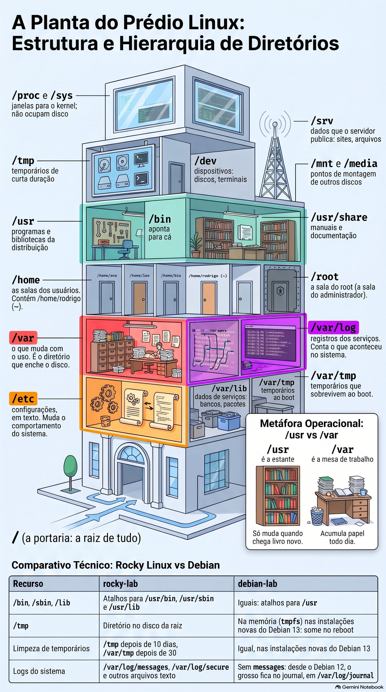
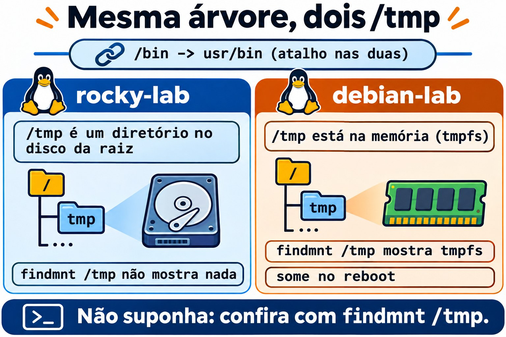
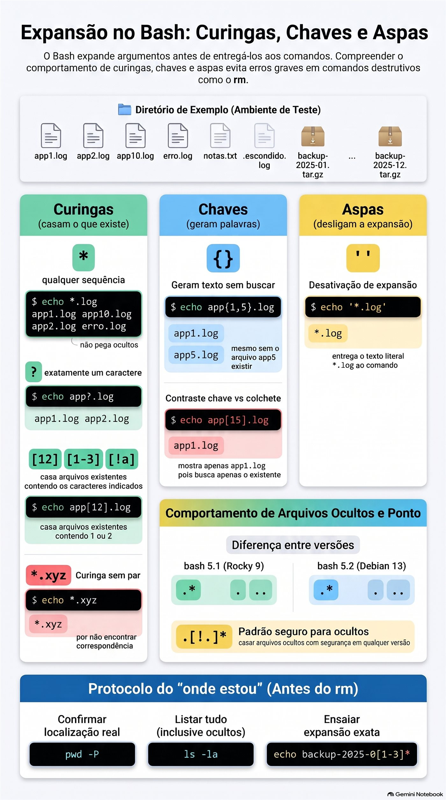
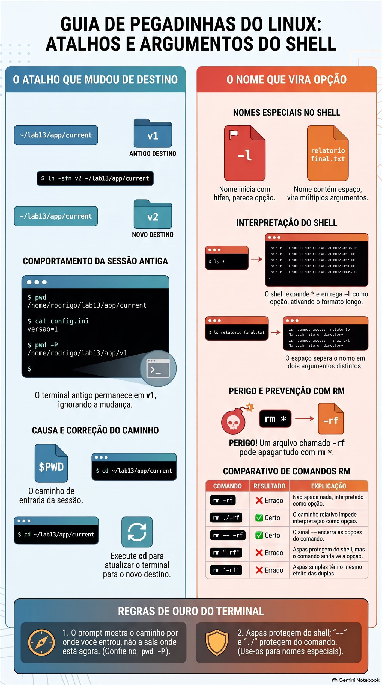

# Aula 1.3 · Caminhos e navegação

Você aprende a andar pela árvore do Linux sem se perder, a saber onde cada coisa mora num servidor e a usar curingas sem medo, porque passa a conferir antes o que eles vão pegar.

| Ficha | Aula 1.3 |
| --- | --- |
| Módulo | M1 · Linha de comando, aula 3 de 10 |
| Quando | Semana 2 |
| Ao final você consegue | Chegar a qualquer diretório por caminho absoluto ou relativo; dizer onde ficam configurações, logs, programas e dados num servidor; ler a saída longa do `ls` e achar o arquivo mais novo; mostrar arquivos ocultos; prever e conferir um curinga antes de usá-lo; perceber quando o prompt mostra um caminho que já não é o real |
| Pré-requisitos | Aula 1.2 |
| Tempo | Cerca de 2h30 |
| Snapshots | m1a3-inicio e m1a3-fim nas duas VMs |

## 1 · Aquecimento

Três perguntas, de cabeça, antes de ler qualquer coisa. Escreva as respostas; o Gabarito confere no fim.

1. Na debian-lab, `sudo cd /var/log` responde `sudo: cd: command not found`. Por quê?
2. Você vai mudar o `.bashrc` de um servidor por SSH. Qual é a regra antes de fechar a sessão?
3. Antes de um lab que quebra coisas, o que você faz no nó Proxmox, e com que comando?

## 2 · Por que importa

Segunda de manhã, o monitor avisa: a raiz de um servidor de cliente está em 97%. Você entra por SSH e precisa responder em minutos o que cresceu, onde e desde quando. Quem conhece a árvore vai direto ao `/var`, lista com `ls -ltr` e acha o log que não para de crescer. Quem não conhece abre diretório por diretório, inclusive o `/proc`, onde um arquivo de 128 TB parece o culpado e não ocupa um byte do disco.

O segundo caso é mais silencioso. Um script de backup funciona sempre que alguém roda na mão e falha toda noite quando roda agendado. O script não mudou. O que muda é o diretório de onde ele parte. Caminho relativo é uma instrução do tipo “duas portas à esquerda”, e o agendador não começa na mesma porta que você.

O terceiro acaba em restauração de backup: um curinga usado no diretório errado, ou que casou mais nomes do que você imaginava. Esta aula termina com dois hábitos de dez segundos que evitam os três casos: saber onde você está de verdade e ver a lista do curinga antes de usá-la.

## 3 · Modelo mental

> O sistema de arquivos é um prédio com uma única portaria: a `/`.

Todo arquivo do servidor está em alguma sala desse prédio, e todo caminho é um jeito de chegar até ela:

1. **Caminho absoluto** é o endereço completo, a partir da portaria: `/var/log/messages`. Funciona de qualquer lugar do prédio, como um endereço com rua, número e cidade.
2. **Caminho relativo** é uma instrução a partir de onde você está: “duas portas à esquerda”. `log/messages` só funciona se você já estiver em `/var`.
3. Quatro atalhos de conversa: `.` é “aqui”, `..` é “a sala de cima”, `~` é “a minha sala” e `cd -` é “volta para onde eu estava”.
4. A recepcionista da Aula 1.2 também lê as placas. Quando você diz “todos os `.log`”, é ela quem vai de porta em porta e monta a lista de nomes. O comando recebe a lista pronta e nunca vê o `*`.

Dessa planta saem três consequências que você vai usar a carreira toda:

- Script e agendamento usam caminho absoluto. Ninguém garante em que sala um script acorda.
- Antes de qualquer comando que apaga ou muda algo em massa, você confere onde está. Caminho relativo certo na sala errada é o desastre clássico.
- O curinga é traduzido pelo shell antes de o comando rodar, então dá para ver a tradução antes: `echo` com o mesmo curinga mostra a lista exata.

A planta do prédio, com o que mora em cada andar:

```text
/                 a portaria: a raiz de tudo
├── etc           configurações, em texto
├── var           o que muda com o uso
│   ├── log       registros dos serviços
│   ├── lib       dados de serviços: bancos, pacotes
│   └── tmp       temporários que sobrevivem ao boot
├── home          as salas dos usuários
│   └── rodrigo   a sua: ~
├── root          a sala do root
├── tmp           temporários de curta duração
├── usr           programas e bibliotecas da distribuição
│   ├── bin       programas: /bin aponta para cá
│   └── share     manuais e documentação
├── opt           software de terceiros, instalado à parte
├── srv           dados que o servidor publica: sites, arquivos
├── mnt  media    pontos de montagem de outros discos
├── dev           dispositivos: discos, terminais
└── proc  sys     janelas para o kernel; não ocupam disco
```

Guarde três andares antes dos outros: `/etc` é onde você muda o comportamento do sistema, `/var/log` é onde você descobre o que aconteceu e `/var` inteiro é o que enche o disco.



*Três andares primeiro: /etc muda, /var/log conta, /var enche.*

**Ponte Windows.** No Windows, cada disco é uma árvore separada (`C:\`, `D:\`). No Linux há uma árvore só: outro disco aparece como mais um diretório dentro dela, num ponto de montagem como `/mnt` ou `/srv`. O separador é `/`, e maiúsculas contam: `Relatorio.txt` e `relatorio.txt` são dois arquivos diferentes. E a diferença que mais engana: no `cmd.exe`, quem interpreta o `*` de `dir *.log` é o próprio `dir`. No Linux, o shell troca o curinga pelos nomes antes, e o `ls` nem fica sabendo que houve curinga.

## 4 · Conceito em camadas

### Essencial

| Termo | O que é | Exemplo |
| --- | --- | --- |
| Raiz | O diretório de onde sai toda a árvore | `/` |
| Diretório atual | A sala onde você está agora; os caminhos relativos partem dela | `pwd` |
| Caminho absoluto | Começa com `/` e funciona de qualquer lugar | `/etc/ssh/sshd_config` |
| Caminho relativo | Não começa com `/`; parte do diretório atual | `../log` |
| `.` e `..` | O diretório atual e o de cima | `cd ..` |
| `~` | O seu home; `~ana` é o home da usuária ana | `cd ~` |
| `cd -` | Volta ao diretório anterior e mostra qual é | `cd -` |
| Arquivo oculto | Qualquer nome que começa com ponto; o `ls` só mostra com `-a` | `.bashrc` |
| Curinga | Padrão que o shell troca pelos nomes que existem | `*.log`, `app?.log` |
| Expansão de chaves | Gera palavras, existam ou não os arquivos | `app{1,2}.log` |
| Link simbólico | Um atalho que aponta para outro caminho; o `ls -l` mostra a seta | `/bin -> usr/bin` |
| FHS | O padrão que diz o que vai em cada diretório | `man 7 hier` |

Os curingas cabem em quatro linhas:

1. `*`: qualquer sequência de caracteres, inclusive nenhuma. Não pega nomes que começam com ponto.
2. `?`: exatamente um caractere.
3. `[12]` e `[1-3]`: um caractere da lista ou da faixa. `[!a]`: qualquer caractere, menos esse.
4. Se nenhum nome casa, o curinga segue como texto, e o comando recebe o `*` cru.

E o `ls` de todo dia: `-l` formato longo, `-a` com ocultos, `-A` com ocultos menos `.` e `..`, `-h` tamanhos legíveis, `-t` por data, `-r` ordem inversa, `-d` o próprio diretório e não o conteúdo, `-R` recursivo.

### Ponte Windows

| No Windows | No Linux |
| --- | --- |
| `C:\Users\rodrigo` | `/home/rodrigo`, ou `~` |
| `cd` sem argumento, que mostra onde você está | `pwd`. No Linux, `cd` sozinho leva ao home. |
| `dir /a` | `ls -la` |
| `dir /od` | `ls -ltr` |
| `tree` | `tree`, que precisa ser instalado |
| Atributo oculto | Nome que começa com ponto |
| `C:`, `D:`, uma árvore por disco | Uma árvore só; os outros discos são montados em diretórios |
| `\` | `/` |
| `%USERPROFILE%` | `$HOME` |

### Aprofundamento

**O shell expande, o comando recebe.** Em `ls *.log`, quem procura os nomes é o bash. O `ls` recebe `app1.log app2.log erro.log` como se você tivesse digitado um por um. O `echo` recebe a mesma lista e só a imprime. Por isso `echo` é o ensaio de qualquer curinga.

**Curinga sem par passa cru.** Se nenhum nome casa, o bash entrega o texto do curinga como está: `ls *.xyz` responde `ls: cannot access '*.xyz': No such file or directory`. A mensagem é do `ls`, procurando um arquivo chamado literalmente `*.xyz`.

**Aspas desligam a expansão.** `'*.log'` chega ao comando como texto. É assim que você passa um padrão para um programa que faz a própria busca, como o `find`, que aparece mais adiante no curso.

**Chaves não são curinga.** `{a,b}` e `{01..12}` geram palavras antes de qualquer busca, existam ou não os arquivos. `echo app{1,5}.log` mostra `app5.log` mesmo que ele não exista. `echo app[15].log` mostra só o que existe.

**O ponto esconde, não protege.** Oculto é só uma convenção de nome para não poluir a listagem. Qualquer um com permissão de leitura vê os ocultos com `ls -a`. Proteção é permissão, que tem uma aula própria mais adiante.

**O `.*` muda com a versão do bash.** Até o bash 5.1, o do Rocky 9, `.*` também casa `.` e `..`. Do 5.2 em diante, o do Debian 13, não casa mais, por causa da opção `globskipdots`. Num bash antigo, um `chown -R rodrigo .*` sobe para o diretório de cima e muda o dono de tudo o que está lá. O padrão que funciona nos dois é `.[!.]*`.

**O prompt mostra o caminho por onde você entrou.** O bash guarda em `$PWD` o caminho que você digitou, com os atalhos. Se um atalho muda de destino depois, você continua na sala antiga e o prompt não percebe. O `pwd -P` pergunta ao sistema qual é o diretório real.

**O `/bin` agora é atalho.** No Rocky e no Debian atuais, `/bin`, `/sbin` e `/lib` são links simbólicos para `/usr/bin`, `/usr/sbin` e `/usr/lib`. Tutoriais antigos os tratam como diretórios separados; o resultado é o mesmo.

**`/proc` e `/sys` não estão no disco.** São janelas que o kernel abre na memória. `ls -lh /proc/kcore` mostra um tamanho absurdo, como 128T, e esse arquivo não ocupa um byte do disco.

## 5 · Rocky × Debian

A árvore segue o mesmo padrão nas duas VMs, mas os detalhes mudam. São eles que pegam você no servidor do cliente:

|  | rocky-lab | debian-lab |
| --- | --- | --- |
| `/bin`, `/sbin`, `/lib` | Atalhos para `/usr/bin`, `/usr/sbin` e `/usr/lib` | Iguais: atalhos para `/usr` |
| `/tmp` | Diretório no disco da raiz | Na memória (`tmpfs`) nas instalações novas do Debian 13: some no reboot. Confira no Passo 4. |
| Limpeza de temporários | `/tmp` depois de 10 dias, `/var/tmp` depois de 30 | Igual, nas instalações novas do Debian 13 |
| Logs do sistema | `/var/log/messages`, `/var/log/secure` e outros arquivos texto | Sem `messages`: desde o Debian 12, o grosso fica no journal, em `/var/log/journal` |
| Ponto depois das permissões no `ls -l` | Aparece: o arquivo tem contexto SELinux | Não aparece |
| `ls` colorido | Alias em `/etc/profile.d/colorls.sh` | Alias no `~/.bashrc` |
| bash e o `.*` | bash 5.1: `.*` casa também `.` e `..` | bash 5.2: não casa |
| `tree` | Fora da instalação mínima | Fora da instalação mínima |
| Manual do FHS | `man 7 hier`, do pacote `man-pages` instalado na 1.2 | `man 7 hier`, do pacote `manpages` |


*Caminho absoluto funciona de qualquer lugar; o relativo depende do diretório em que você está.*

## 6 · Lab guiado

Abra três terminais: um na rocky-lab (`ssh rocky-lab`), um na debian-lab (`ssh debian-lab`) e um no nó Proxmox, para os snapshots. Em cada passo, rode, compare com a saída esperada e só então leia o Decida. As saídas são trechos; números e datas vão ser outros na sua tela.

Cada Decida é um caso real de trabalho. Escolha a letra antes de olhar a tabela: errar aqui, com a explicação ao lado, é o jeito mais barato de errar.

**Passo 1 · Snapshot antes de tudo.** No nó Proxmox:

```bash
qm snapshot 201 m1a3-inicio --description "Aula 1.3, antes do lab"
qm snapshot 202 m1a3-inicio --description "Aula 1.3, antes do lab"
qm listsnapshot 201
```

Saída esperada: a árvore termina em `m1a2-fim`, `m1a3-inicio` e, por último, `current`.

**Passo 2 · Onde estou?** Antes de rodar, aposte: para onde vai um `cd` sem nada depois? Nas duas VMs:

```bash
pwd
cd /var/log
pwd
cd
pwd
cd -
cd ..
pwd
cd ~root
```

Algo como:

```text
/home/rodrigo
/var/log
/home/rodrigo
/var/log
/var
-bash: cd: /root: Permission denied
```

O `cd` sozinho volta ao home. O `cd -` alterna entre os dois últimos diretórios e imprime para onde foi. O `..` sobe um nível. A última linha é a recepcionista trabalhando: o shell traduziu `~root` para `/root`, o `cd` tentou entrar e o sistema negou, porque o home do root é fechado para usuários comuns.

**Decida 1 · O script que só funciona na mão.** Cenário: o script de backup de um cliente funciona sempre que você entra em `/opt/backup` e roda `./backup.sh`. Agendado no cron para as 2h, falha toda noite com `tar: lista.txt: Cannot open: No such file or directory`. O que você faz?

- **A)** Dá permissão total ao script e à lista com `chmod 777`.
- **B)** No script, troca `lista.txt` por `/opt/backup/lista.txt`, ou põe `cd /opt/backup || exit 1` logo no começo.
- **C)** Agenda o script como root.
- **D)** Acrescenta `/opt/backup` ao PATH.

Escolha a letra antes de olhar a tabela.

| Se você marcou | Resultado | Por quê |
| --- | --- | --- |
| A | ❌ Errada | A mensagem diz `No such file or directory`, não `Permission denied`. E `777` abre o backup do cliente para qualquer usuário do servidor. |
| B | ✅ Certa | O cron começa o script no home do usuário, não em `/opt/backup`. Um caminho relativo é procurado a partir do diretório atual, então o `tar` procura `lista.txt` no lugar errado. Com caminho absoluto, ou com o `cd` no começo, o script acha a lista de qualquer lugar. O `\|\| exit 1` para o script se o `cd` falhar. |
| C | ❌ Errada | O root também começa no home dele, o `/root`. A `lista.txt` continua não estando lá. |
| D | ❌ Errada | O PATH serve para achar comandos, não os arquivos que um comando abre. O `tar` nunca olha o PATH para achar a `lista.txt`. |

**Para fixar:** caminho relativo é “duas portas à esquerda”. Só funciona se quem lê sabe de onde partiu, e um script agendado acorda sem saber.

**Passo 3 · Absoluto ou relativo?** Antes de rodar, aposte: estando em `/var/log`, quais destas linhas funcionam? Nas duas VMs:

```bash
cd /var/log
ls ../lib
ls lib
ls /etc/ssh
ls ../../etc/hostname
realpath ../../etc
```

Algo como:

```text
alternatives  dnf  NetworkManager  rpm  selinux  systemd ...
ls: cannot access 'lib': No such file or directory
moduli  ssh_config  ssh_config.d  sshd_config  sshd_config.d ...
../../etc/hostname
/etc
```

Na debian-lab, a primeira linha mostra `apt`, `dpkg` e `systemd`, entre outros. O `../lib` funciona porque sobe para `/var` e entra em `lib`. O `lib` sozinho procura um `lib` dentro de `/var/log`, e ele não existe. O `/etc/ssh` funciona de qualquer lugar. O `realpath` traduz um caminho relativo para o absoluto: use antes de colar um caminho num script.

**Decida 2 · O tutorial colado.** Cenário: um tutorial manda rodar `cd etc/nginx`. Você está no seu home, cola a linha e recebe `No such file or directory`. O nginx está instalado e funcionando. O que você faz?

- **A)** Reinstala o nginx, porque falta a configuração.
- **B)** Roda `cd /etc/nginx`. O tutorial esqueceu a barra, ou supôs que você estava em `/`.
- **C)** Roda `sudo cd etc/nginx`.
- **D)** Cria o diretório com `mkdir -p etc/nginx` e entra nele.

Escolha a letra antes de olhar a tabela.

| Se você marcou | Resultado | Por quê |
| --- | --- | --- |
| A | ❌ Errada | A configuração está lá. O `cd` procurou `etc/nginx` dentro do seu home, onde ele não existe. |
| B | ✅ Certa | Sem barra na frente, o caminho parte do diretório atual. Com a barra, parte da raiz e chega ao `/etc/nginx` de onde você estiver. |
| C | ❌ Errada | Duas vezes errado: o `cd` é builtin e o `sudo` não o acha, como você viu na Aula 1.2. E o caminho continuaria relativo. |
| D | ❌ Errada | Você cria um `~/etc/nginx` vazio e passa a editar arquivos que o nginx nunca lê. É o tipo de erro que consome uma tarde. |

**Para fixar:** sem barra na frente, o caminho começa onde você está.

**Passo 4 · A planta do prédio.** Nas duas VMs:

```bash
ls /
ls -ld /bin /sbin /lib
findmnt /tmp
man 7 hier
```

O `ls -ld` mostra algo como:

```text
lrwxrwxrwx. 1 root root 7 Feb 10  2025 /bin -> usr/bin
lrwxrwxrwx. 1 root root 7 Feb 10  2025 /lib -> usr/lib
lrwxrwxrwx. 1 root root 8 Feb 10  2025 /sbin -> usr/sbin
```

O `l` no começo e a seta dizem que são atalhos. O ponto depois das permissões só aparece na rocky-lab: o arquivo tem contexto SELinux, assunto do módulo de segurança.

O `findmnt /tmp` não mostra nada na rocky-lab: lá, o `/tmp` é um diretório comum no disco da raiz. Na debian-lab, algo como:

```text
TARGET SOURCE FSTYPE OPTIONS
/tmp   tmpfs  tmpfs  rw,nosuid,nodev,size=...
```

O `/tmp` da debian-lab está na memória e se esvazia a cada reboot. Se não aparecer nada, a sua instalação foi configurada de outro jeito; o que vale é saber conferir.

No `man 7 hier`, digite `/log` e Enter; `n` vai para a próxima ocorrência. Leia o que o padrão diz sobre `/var/log`, `/opt` e `/srv`. Saia com `q`.

**Decida 3 · O disco cheio.** Cenário: o monitor avisa que a raiz de um servidor de cliente está em 98%. Por onde você começa a procurar?

- **A)** Por `/usr/bin`, onde ficam os programas.
- **B)** Por `/var`, onde ficam logs, cache de pacotes, bancos de dados e filas de e-mail.
- **C)** Por `/proc`, porque `ls -lh /proc/kcore` mostra um arquivo de 128T.
- **D)** Por `/etc`, onde ficam as configurações.

Escolha a letra antes de olhar a tabela.

| Se você marcou | Resultado | Por quê |
| --- | --- | --- |
| A | ❌ Errada | Os programas só mudam quando um pacote é instalado ou atualizado. E apagar algo ali quebra o sistema. |
| B | ✅ Certa | O `/var` é o andar que cresce sozinho com o uso: log que ninguém gira, cache do `dnf` ou do `apt`, banco de dados, fila de e-mail parada. É lá que está a maioria dos discos cheios. O `/home` e o `/tmp` vêm logo depois. |
| C | ❌ Errada | O `/proc` não está no disco. O tamanho do `kcore` é o espaço de memória que o kernel enxerga, não bytes gravados. |
| D | ❌ Errada | São arquivos de texto pequenos. O `/etc` inteiro costuma ter poucos megabytes. |

**Para fixar:** o `/usr` é a estante, que só muda quando chega livro novo. O `/var` é a mesa de trabalho, que acumula papel todo dia.



*A árvore é a mesma, mas o /tmp do Debian 13 está na memória e some no reboot.*

**Passo 5 · Ler o `ls` de verdade.** Nas duas VMs:

```bash
ls -l /etc/hostname
ls -lh /var/log
ls -ltr /var/log
ls -ld /var/log
```

A primeira linha, algo como:

```text
-rw-r--r--. 1 root root 10 Oct 20 09:12 /etc/hostname
```

Campo por campo:

- `-`: o tipo. `-` é arquivo, `d` é diretório, `l` é atalho.
- `rw-r--r--`: as permissões, que têm uma aula própria.
- `1`: quantos nomes apontam para esse arquivo.
- `root root`: o dono e o grupo.
- `10`: o tamanho em bytes. Com `-h`, os tamanhos viram `4.0K` ou `1.2M`.
- `Oct 20 09:12`: a última modificação.
- Por último, o nome.

Agora compare as listagens de `/var/log`. Com `-ltr`, os mais novos ficam no fim, logo acima do prompt: é o uso mais comum no trabalho. Na rocky-lab, `messages` e `secure` costumam estar entre os últimos. Na debian-lab, o `/var/log` é mais curto e o `journal` é um diretório. O `ls -ld` mostra uma linha só: o próprio `/var/log`, não o conteúdo.

**Decida 4 · Qual log mexeu por último?** Cenário: um serviço parou há dez minutos. Em `/opt/app/logs` há 400 arquivos, com nomes de data misturados. Você quer ver os que foram escritos por último, sem rolar a tela. Qual comando?

- **A)** `ls -l`
- **B)** `ls -ltr`
- **C)** `ls -lS`
- **D)** `ls -R`

Escolha a letra antes de olhar a tabela.

| Se você marcou | Resultado | Por quê |
| --- | --- | --- |
| A | ❌ Errada | Ordem alfabética. Os 400 nomes passam pela tela e o mais recente pode estar em qualquer lugar. |
| B | ✅ Certa | `-t` ordena por data e `-r` inverte: o mais novo fica na última linha, logo acima do cursor, sem rolar nada. |
| C | ❌ Errada | Ordena por tamanho. Ajuda no disco cheio, não para saber o que mudou agora. |
| D | ❌ Errada | Entra em todos os subdiretórios e inunda a tela, sem ordem de data. |

**Para fixar:** `t` de tempo, `r` de reverso. O mais novo fica pertinho do cursor.

**Passo 6 · Os ocultos.** Nas duas VMs:

```bash
ls ~
ls -a ~
ls -A ~
ls -ld ~/.ssh
```

O `ls ~` pode não mostrar nada. Os outros, algo como:

```text
.  ..  .bash_history  .bash_logout  .bash_profile  .bashrc  .ssh
.bash_history  .bash_logout  .bash_profile  .bashrc  .ssh
drwx------. 2 rodrigo rodrigo 29 Oct 15 18:40 /home/rodrigo/.ssh
```

Na debian-lab, aparece `.profile` no lugar de `.bash_profile`. O home não estava vazio: os arquivos de configuração do usuário começam com ponto e o `ls` os esconde por padrão. O `-A` é o `-a` sem o `.` e o `..`. O `.ssh` é o diretório onde está o `authorized_keys` da Aula 0.2: sem ele, a sua chave não entra.

**Decida 5 · A migração que trancou o usuário.** Cenário: você migrou o home de um usuário para um servidor novo copiando tudo com `*`. No servidor novo, a chave SSH dele não funciona mais e o login pede senha. O que aconteceu?

- **A)** Chaves SSH deixam de valer quando são copiadas.
- **B)** O `*` não pega nomes que começam com ponto, e o `.ssh`, com o `authorized_keys`, ficou para trás.
- **C)** O servidor novo não tem SSH instalado.
- **D)** Falta reiniciar o serviço SSH do servidor novo.

Escolha a letra antes de olhar a tabela.

| Se você marcou | Resultado | Por quê |
| --- | --- | --- |
| A | ❌ Errada | Uma chave é só um arquivo de texto e vale onde estiver. O problema é ela não estar lá. |
| B | ✅ Certa | O `*` não casa nomes com ponto na frente. Foram os arquivos visíveis e ficaram o `.ssh`, o `.bashrc` e o resto da configuração. Um `ls -A` no destino mostra a falta em um segundo. |
| C | ❌ Errada | Se o login pede senha, o SSH está respondendo. |
| D | ❌ Errada | O serviço lê o `authorized_keys` a cada login. Reiniciar não cria o arquivo que não foi copiado. |

**Para fixar:** o `*` não enxerga quem se esconde atrás de um ponto. Depois de copiar, confira com `ls -A`.

**Passo 7 · Curingas: o ensaio com `echo`.** Monte um diretório de brinquedo nas duas VMs. O `mkdir` e o `touch` são da Aula 1.4; aqui eles só criam arquivos vazios para você testar:

```bash
mkdir -p ~/lab13/logs
cd ~/lab13/logs
touch app1.log app2.log app10.log erro.log notas.txt .escondido.log
touch backup-2025-{01..12}.tar.gz
ls
```

O `ls` mostra 17 arquivos. O `.escondido.log` não aparece. Agora, antes de rodar cada linha abaixo, escreva a lista que você espera:

```bash
echo *.log
echo app?.log
echo app*.log
echo app[12].log
echo [!a]*
echo backup-2025-0[1-3]*
echo *.xyz
echo '*.log'
echo app{1,5}.log
echo app[15].log
echo .*
```

Algo como (a ordem pode mudar conforme o idioma do sistema):

```text
app1.log app10.log app2.log erro.log
app1.log app2.log
app1.log app10.log app2.log
app1.log app2.log
backup-2025-01.tar.gz ... backup-2025-12.tar.gz erro.log notas.txt
backup-2025-01.tar.gz backup-2025-02.tar.gz backup-2025-03.tar.gz
*.xyz
*.log
app1.log app5.log
app1.log
. .. .escondido.log
```

O `echo` não sabe nada de curinga: só imprime o que recebe. O que aparece é exatamente a lista que o shell entregaria a um `ls`, um `cp` ou um `rm`. Repare em quatro coisas. O `?` deixou o `app10.log` de fora, porque `10` são dois caracteres. O `*.log` não pegou o `.escondido.log`. O `*.xyz` e o `'*.log'` voltaram crus: um porque nada casou, o outro porque as aspas desligaram a expansão. E as chaves inventaram um `app5.log` que não existe, enquanto os colchetes só acharam o que existe. A última linha é da rocky-lab; na debian-lab, o `.*` mostra só `.escondido.log`, como você vê no Bônus.

**Decida 6 · Antes de apagar.** Cenário: o cliente pede para apagar os backups de janeiro a março de 2025, num diretório com dois anos de backups. Você montou a linha `rm backup-2025-0[1-3]*`. O que você faz antes de apertar Enter?

- **A)** Nada. O curinga está certo, é só apertar Enter.
- **B)** Roda `pwd`, depois troca `rm` por `echo` mantendo o mesmo curinga, confere a lista e só então volta ao `rm`.
- **C)** Reescreve como `rm backup-2025-0{1..3}*`, porque chaves são mais seguras que colchetes.
- **D)** Roda com `sudo`, para não parar no meio por falta de permissão.

Escolha a letra antes de olhar a tabela.

| Se você marcou | Resultado | Por quê |
| --- | --- | --- |
| A | ❌ Errada | O curinga pode estar certo e o diretório errado. Ou existe um `backup-2025-01-parcial` que ninguém lembrava. Você só sabe olhando. |
| B | ✅ Certa | O `pwd` confirma a sala, e o `echo` mostra a lista exata que o `rm` receberia. Custa dez segundos, e o `rm` não tem lixeira nem desfazer. |
| C | ❌ Errada | As chaves geram três curingas, e cada um é expandido do mesmo jeito. A lista é a mesma, e continua sem conferência. |
| D | ❌ Errada | Mais poder sem mais cuidado. Se a lista estiver errada, o `sudo` só garante que o estrago vai até o fim. |

**Para fixar:** o `echo` é o ensaio geral. Ensaio não custa nada; o `rm` não tem ensaio nem lixeira.


*O shell troca o curinga antes do comando; o echo mostra a lista exata.*

**O protocolo do “onde estou”.** Três comandos antes de qualquer coisa que apaga, move ou muda permissão em massa. O exemplo usa o curinga do Decida 6; troque pelo da vez:

```bash
pwd -P
ls -la
echo backup-2025-0[1-3]*
```

O primeiro diz onde você está de verdade, mesmo com atalhos no caminho. O segundo mostra o que existe ali, ocultos incluídos. O terceiro mostra a lista exata que o comando vai receber. São dez segundos, em qualquer servidor.

## 7 · Quebre e conserte

Agora você vê o terminal mentir, de dois jeitos. Na primeira quebra, o prompt mostra um lugar onde você não está mais. Na segunda, um nome de arquivo vira opção de comando. Faça tudo na rocky-lab, dentro do `~/lab13`: o snapshot `m1a3-inicio` está lá para isso.

### Quebra A · o atalho que mudou de destino

Muitos deploys funcionam assim: cada versão da aplicação fica num diretório, e um atalho chamado `current` aponta para a versão em uso. Para trocar de versão, basta mudar o destino do atalho.

**Quebre.** Na rocky-lab, monte uma aplicação de mentira com duas versões. O `>` grava o texto num arquivo, assunto da Aula 1.6, e o `ln -s` cria o atalho, assunto de uma aula de links mais adiante:

```bash
mkdir -p ~/lab13/app/v1 ~/lab13/app/v2
echo "versao=1" > ~/lab13/app/v1/config.ini
echo "versao=2" > ~/lab13/app/v2/config.ini
ln -sfn v1 ~/lab13/app/current
cd ~/lab13/app/current
cat config.ini
```

Responde `versao=1`, e o prompt mostra `current`. Deixe esta sessão onde está. Abra uma segunda sessão na rocky-lab (`ssh rocky-lab`) e faça o deploy da versão 2:

```bash
ln -sfn v2 ~/lab13/app/current
cat ~/lab13/app/current/config.ini
```

Responde `versao=2`. O deploy deu certo.

**Preveja.** Volte à primeira sessão, que continua no `current`. Antes de rodar cada linha, diga o que ela vai mostrar:

```bash
pwd
cat config.ini
pwd -P
ls -l ~/lab13/app
```

**Descubra.** Algo como:

```text
/home/rodrigo/lab13/app/current
versao=1
/home/rodrigo/lab13/app/v1
total 0
lrwxrwxrwx. 1 rodrigo rodrigo  2 Oct 20 10:15 current -> v2
drwxr-xr-x. 2 rodrigo rodrigo 24 Oct 20 10:10 v1
drwxr-xr-x. 2 rodrigo rodrigo 24 Oct 20 10:10 v2
```

O `cd` seguiu o atalho uma vez, na hora em que você entrou, e você ficou dentro do `v1`. O atalho mudou de destino; você não. O prompt e o `pwd` mostram o caminho por onde você chegou, guardado em `$PWD`, e por isso continuam dizendo `current`. O `pwd -P` pergunta ao sistema onde você está de verdade.

**Decida 7 · A correção que não pegou.** Cenário: logo depois de um deploy num cliente, você está num terminal em `/srv/app/current`. Edita o `config.ini`, reinicia o serviço e nada muda. O prompt garante que você está no `current`. O que você faz?

- **A)** Reinicia o serviço de novo, porque a primeira vez não pegou.
- **B)** Roda `pwd -P`. Se mostrar a versão antiga, você editou a release velha: entra de novo com `cd /srv/app/current` e refaz a edição.
- **C)** Reinstala a aplicação.
- **D)** Apaga o atalho `current` e põe no lugar uma cópia do diretório da versão nova.

Escolha a letra antes de olhar a tabela.

| Se você marcou | Resultado | Por quê |
| --- | --- | --- |
| A | ❌ Errada | O serviço lê o arquivo da versão em uso, e você editou outro. Reiniciar quantas vezes for não muda isso. |
| B | ✅ Certa | O terminal ficou no diretório antigo desde antes do deploy. O `pwd -P` mostra isso em um segundo, e entrar de novo pelo caminho faz o sistema seguir o atalho até a versão atual. |
| C | ❌ Errada | A aplicação está certa. O que estava errado era o lugar onde você editou. |
| D | ❌ Errada | Quebra o processo de deploy: na próxima versão, ninguém vai entender por que o `current` virou um diretório. E não resolve nada, porque o problema era o seu terminal. |

**Para fixar:** o prompt mostra o caminho por onde você entrou, não a sala onde está agora.

**Conserte.** Na primeira sessão:

```bash
cd ~/lab13/app/current
cat config.ini
```

**Verifique.**

```bash
pwd -P
```

Responde `/home/rodrigo/lab13/app/v2`, e o `cat` mostrou `versao=2`. Feche a segunda sessão com `exit`.

### Quebra B · os nomes que enganam o curinga

**Quebre.** Na rocky-lab, crie dois nomes problemáticos no diretório do Passo 7. O `--` da Aula 1.2 avisa ao `touch` que `-l` é um nome, não uma opção:

```bash
cd ~/lab13/logs
touch -- -l
touch "relatorio final.txt"
ls
```

O `ls` mostra os dois, e o nome com espaço aparece entre aspas simples. Tudo parece normal.

**Preveja.** Antes de rodar cada linha, diga o que ela vai mostrar:

```bash
ls *
ls relatorio final.txt
ls *.txt
```

**Descubra.** Algo como:

```text
-rw-r--r--. 1 rodrigo rodrigo 0 Oct 20 10:02 app10.log
-rw-r--r--. 1 rodrigo rodrigo 0 Oct 20 10:02 app1.log
...
ls: cannot access 'relatorio': No such file or directory
ls: cannot access 'final.txt': No such file or directory
notas.txt  'relatorio final.txt'
```

O primeiro `ls` saiu em formato longo sem você pedir. O shell trocou o `*` pela lista de nomes, e um deles era `-l`: o `ls` recebeu `-l` e entendeu como opção, como se você tivesse digitado. O segundo falhou porque o espaço separa argumentos, e o `ls` procurou dois arquivos, `relatorio` e `final.txt`. O terceiro funcionou: o curinga entrega cada nome inteiro, com espaço e tudo. O problema nunca é o nome; é como ele chega ao comando.

Com `ls`, o estrago é só visual. Com `rm *` num diretório que tem um arquivo chamado `-rf`, o `rm` recebe `-rf` como opção e apaga também os subdiretórios. Guarde isso para a Aula 1.4.

**Decida 8 · O arquivo que vira opção.** Cenário: num servidor de cliente, aparece em `/srv/upload` um arquivo chamado `-rf`, enviado por um formulário com defeito. Você precisa apagar só esse arquivo. Qual comando?

- **A)** `rm -rf`
- **B)** `rm ./-rf`
- **C)** `rm "-rf"`
- **D)** `rm '-rf'`

Escolha a letra antes de olhar a tabela.

| Se você marcou | Resultado | Por quê |
| --- | --- | --- |
| A | ❌ Errada | O `rm` recebe só opções e nenhum nome. Não apaga nada e não reclama: você sai achando que resolveu. |
| B | ✅ Certa | Com `./` na frente, o nome começa com ponto e o `rm` não o confunde com opção. `rm -- -rf` também funciona. |
| C | ❌ Errada | As aspas protegem do shell, não do comando. O shell tira as aspas e o `rm` recebe `-rf` do mesmo jeito: de novo, só opções. |
| D | ❌ Errada | Mesmo motivo do C. Aspas simples ou duplas, o `rm` recebe exatamente `-rf`. |

**Para fixar:** aspas protegem do shell; `--` e `./` protegem do comando.

**Conserte.**

```bash
ls -- *
ls ./*
ls "relatorio final.txt"
rm ./-l
```

O `--` encerra as opções. O `./` faz todo nome começar com ponto e barra, e nenhum deles parece opção. As aspas mantêm o nome com espaço inteiro. O `rm ./-l` apaga só o arquivo `-l`; a Aula 1.4 trata do `rm` com calma.

**Verifique.**

```bash
ls -A
ls *
```

O `-l` sumiu da lista, e o `ls *` voltou ao formato curto.


*O prompt mostra por onde você entrou; aspas protegem do shell, -- e ./ protegem do comando.*

### E o snapshot?

Se algo saiu do controle, volte ao início do lab. No nó Proxmox; para a debian-lab, troque 201 por 202:

```bash
qm rollback 201 m1a3-inicio
qm start 201
```

O rollback desfaz tudo desde o Passo 1, inclusive o `~/lab13`, e derruba as sessões SSH abertas. Entre de novo e refaça o Passo 7 antes de seguir.

### Bônus na Debian

Rode as mesmas linhas nas duas VMs e compare:

```bash
bash --version | head -1
cd ~/lab13/logs
echo .*
echo .[!.]*
shopt globskipdots
```

Na rocky-lab, o `echo .*` mostra `. .. .escondido.log`, e o `shopt` responde `invalid shell option name`, porque o bash 5.1 não conhece a opção. Na debian-lab, o `echo .*` mostra só `.escondido.log` e o `shopt` responde `globskipdots on`. O `.[!.]*` dá o mesmo resultado nas duas: é o padrão portátil para pegar só os ocultos.

Para fechar, a árvore desenhada. Na debian-lab:

```bash
sudo apt install -y tree
tree -L 1 /
tree -a ~/lab13
```

O `-L 1` limita o desenho a um nível; o `-a` mostra os ocultos. Na rocky-lab, o pacote tem o mesmo nome: `sudo dnf install -y tree`.

**A lição:** o terminal mostra o que você digitou e o caminho por onde entrou, e isso nem sempre é o que existe. `pwd -P` e um `echo` com o curinga levam dois segundos e mostram a verdade antes do estrago. Vale para deploy, para limpeza de disco e para qualquer comando em massa num servidor de cliente.

## 8 · Armadilhas

| Sintoma | Causa | Saída |
| --- | --- | --- |
| `cd: etc/ssh: No such file or directory`, mas o diretório existe | Faltou a `/`: o caminho é relativo ao diretório atual. | `cd /etc/ssh`; na dúvida, `pwd`. |
| O script funciona na mão e falha agendado | Caminhos relativos; o cron começa em outro diretório. | Caminhos absolutos, ou `cd /dir \|\| exit 1` no começo do script. |
| `ls: cannot access '*.log': No such file or directory` | Nenhum nome casou, e o curinga passou cru. | `ls` sem curinga: o diretório ou a extensão estão errados. |
| `ls *` sai em formato longo sem você pedir | Um arquivo chamado `-l` virou opção. | `ls -- *` ou `ls ./*` |
| `ls relatorio final.txt` dá dois erros | O espaço separa argumentos. | Aspas: `ls "relatorio final.txt"`. O Tab completa o nome do jeito certo. |
| Copiou tudo com `*` e faltou configuração | O `*` não pega nomes que começam com ponto. | Confira com `ls -A`; copie o diretório inteiro, como na Aula 1.4. |
| Editou o arquivo, nada mudou, e o prompt diz que você está no lugar certo | Você ficou no destino antigo de um atalho. | `pwd -P`, e entre de novo com `cd` no caminho. |
| `Relatorio.txt` não é achado, mas `relatorio.txt` existe | O Linux diferencia maiúsculas de minúsculas. | Use o Tab, que completa o nome exato. |
| `cd ~root` dá `Permission denied` | O home do root é fechado para usuários comuns. | `sudo ls /root` para olhar, ou `sudo -i`. |
| Um arquivo deixado em `/tmp` sumiu | No Debian 13, o `/tmp` fica na memória e se esvazia no reboot. Nas duas, arquivos velhos são apagados depois de 10 dias. | Nada que precise ficar vai para `/tmp`. Use o seu home ou um diretório de dados. |
| `ls -lh /proc/kcore` mostra 128T num disco de 32G | O `/proc` não está no disco: é o kernel mostrando a memória. | Ignore `/proc` e `/sys` quando procurar o que enche o disco. |
| `.*` pegou também `.` e `..` | bash 5.1 ou anterior, como o do Rocky 9. | `.[!.]*`, que funciona em qualquer versão. |
| `ls -l /var/log` lista o conteúdo, e você queria o próprio diretório | Sem `-d`, o `ls` entra no diretório. | `ls -ld /var/log` |
| `tree: command not found` | Não vem na instalação mínima. | `sudo dnf install -y tree` ou `sudo apt install -y tree`; ou `ls -R`. |
| `bash: cd: OLDPWD not set` | Sessão nova: ainda não existe diretório anterior. | Normal. Depois do primeiro `cd`, o `cd -` funciona. |

## 9 · Quiz

Responda sem olhar a aula. As respostas comentadas estão no Gabarito, no fim.

1. Qual é a diferença entre `/etc/ssh` e `etc/ssh`? De onde cada um funciona?
2. Você está em `/var/log`. Escreva um caminho relativo para `/etc/hostname`.
3. O que fazem `cd`, `cd -`, `cd ..` e `cd ~ana`?
4. Em que diretório você procura: a configuração do SSH; os logs; os programas da distribuição; os dados de um banco de dados; os homes dos usuários?
5. Complete as lacunas: para ver o próprio diretório e não o conteúdo, `ls ___ /var/log`. Para ver os mais novos no fim da tela, `ls -l___`. Para ver os ocultos sem `.` e `..`, `ls ___`.
6. Quem expande o `*`: o `ls` ou o shell? Como você prova isso com um comando?
7. Num diretório com `app1.log`, `app2.log` e `app10.log`, o que `echo app?.log` mostra? E `echo app{1,5}.log`?
8. O seu prompt diz `/srv/app/current`, mas a edição que você fez não surte efeito. Que comando confirma onde você está de verdade, e por que o prompt pode estar errado?
9. Pergunta em inglês, como nos fóruns e na documentação: *Which pattern matches file1.txt and file2.txt, but not file10.txt?*
   - **A)** `file*.txt`
   - **B)** `file?.txt`
   - **C)** `file[10].txt`
   - **D)** `file{1,10}.txt`

## 10 · Flashcards e cola

| Frente | Verso |
| --- | --- |
| Absoluto ou relativo? | Começa com `/`: absoluto, funciona de qualquer lugar. Sem `/`: relativo ao diretório atual. |
| Voltar ao diretório anterior | `cd -` |
| Ir ao home | `cd` sozinho, ou `cd ~` |
| Onde estou de verdade, sem atalhos | `pwd -P` |
| Configurações, logs, dados de serviços | `/etc`, `/var/log`, `/var/lib` |
| Programas da distribuição e de terceiros | `/usr/bin`; `/opt` |
| O que não ocupa disco | `/proc` e `/sys` |
| Os mais novos no fim da tela | `ls -ltr` |
| O próprio diretório, não o conteúdo | `ls -ld dir` |
| Ver os ocultos | `ls -a`; sem `.` e `..`, `ls -A` |
| `*`, `?`, `[12]`, `[!a]` | Qualquer sequência; um caractere; um da lista; qualquer um, menos esse |
| Curinga sem par | Passa cru para o comando: `cannot access '*.xyz'` |
| Chaves ou colchetes? | Chaves geram nomes, existam ou não. Colchetes só casam o que existe. |
| Ensaio de um curinga | `echo` com o mesmo curinga |
| Nome que começa com hífen | `./-nome` ou `--` antes dos nomes. Aspas não resolvem. |

**Para saber de cor.**

```bash
pwd
pwd -P
cd
cd -
cd ..
ls -la
ls -ltr
ls -ld /var/log
echo *.log
ls -- *
```

**Para consultar.**

```bash
man 7 hier
realpath ../../etc
ls -lh /var/log
ls -A ~
ls -R ~/lab13
echo .[!.]*
echo backup-2025-{07..12}*
findmnt /tmp
tree -L 1 /
shopt globskipdots
```

No `man 7 hier`, busque `/log` ou `/opt`. O `shopt globskipdots` só existe do bash 5.2 em diante.

## 11 · Checklist de saída

Marque só o que você consegue fazer sem olhar a aula:

- Dizer se um caminho é absoluto ou relativo, e de onde ele parte.
- Ir e voltar entre dois diretórios sem digitar o caminho de novo.
- Dizer onde ficam configurações, logs, programas, dados de serviços e homes.
- Achar o arquivo mais novo de um diretório com um comando.
- Mostrar os arquivos ocultos de um diretório.
- Prever a lista de um curinga e conferir com `echo` antes de usá-lo.
- Explicar por que o prompt pode mentir, e confirmar com `pwd -P`.

**Feche a aula.** No nó Proxmox:

```bash
qm snapshot 201 m1a3-fim --description "Aula 1.3 concluída"
qm snapshot 202 m1a3-fim --description "Aula 1.3 concluída"
qm delsnapshot 201 m1a3-inicio
qm delsnapshot 202 m1a3-inicio
qm listsnapshot 201
```

Saída esperada: `m1a2-fim`, depois `m1a3-fim` e, por último, `current`. O `m1a3-inicio` não aparece mais. O `~/lab13` fica nas VMs: a Aula 1.4 começa dele.

## 12 · Na vida real

Comando digitado uma vez, sem um problema de verdade atrás, some em um dia. Esta seção existe para isso não acontecer: uma missão no seu trabalho e um desafio amanhã, sem olhar a aula.

**Missão no trabalho (até amanhã, só leitura).** Escolha um servidor Linux real que você administra. Entre com o seu usuário e rode só comandos que leem:

```bash
pwd -P
ls -A ~
ls -ld /etc /var/log /tmp /opt /srv
ls -ltr /var/log | tail -5
ls -A /opt /srv
findmnt /tmp
```

O `tail -5` mostra só as cinco últimas linhas; ele é da Aula 1.5, e o `|` é da Aula 1.6. Anote três respostas no seu diário de admin:

1. Qual foi o último log escrito em `/var/log`, e de qual serviço ele é?
2. Existe algo em `/opt` ou em `/srv`? Veio de pacote da distribuição, ou alguém instalou à mão? Se não souber, anote como pergunta para o colega que montou o servidor.
3. Há algum arquivo oculto no seu home que você não criou? De onde ele veio?

E um segundo desafio, para a semana: toda vez que for usar um curinga no trabalho com um comando que muda algo (apagar, mover, mudar dono), rode antes o mesmo curinga com `echo`. Anote no diário quantas vezes a lista veio diferente do que você esperava.

**Amanhã, sem olhar.** Reserve de 10 a 15 minutos na debian-lab. Sem abrir esta aula:

1. Estando em `/var/log`, vá para `/etc/ssh` com um caminho relativo. Depois volte para `/var/log` sem digitar o caminho.
2. Liste o conteúdo de `/etc` com os arquivos modificados mais recentemente no fim da tela.
3. Em `~/lab13/logs`, mostre com `echo` só os backups do segundo semestre, de julho a dezembro.
4. Descubra se `/sbin` é um diretório ou um atalho, e para onde ele aponta.

Dica: se travar, as três perguntas são sempre as mesmas. Onde estou? (`pwd`). O que tem aqui? (`ls -la`). O que o shell vai entregar? (`echo`).

## 13 · Com o DeepTutor

| Comando | Quando usar |
| --- | --- |
| `!quiz 1.3` | Logo depois do lab: perguntas novas. |
| `!explica curinga e expansão de chaves` | Quando um conceito ainda não fechou. |
| `!feynman caminho absoluto e relativo` | Você explica com as suas palavras e ele aponta as falhas. |
| `!quebra 1.3` | Uma quebra nova de caminho, atalho ou curinga para você consertar. |
| `!cartoes 1.3` | Os flashcards em repetição espaçada. |
| `!erro ls: cannot access '*.log': No such file or directory` | Cole um erro real e ele guia o diagnóstico. |
| `!revisao 1.3` | No D+1, D+3, D+7 e D+21. Junto: `!revisao 1.2` no D+1 e `!revisao 1.1` no D+3. |

## Gabarito comentado

**Aquecimento.**

1. O `cd` é builtin: mora dentro do bash, e o `sudo` só executa programas em disco. Para entrar num diretório fechado, use `sudo -i`; para só olhar, `sudo ls` com o caminho.
2. A sessão aberta fica aberta. Teste numa sessão nova e só feche a primeira quando a segunda funcionar.
3. Um snapshot das duas VMs, com `qm snapshot 201 nome` e `qm snapshot 202 nome`. Se o lab sair do controle, `qm rollback` volta tudo.

**Quiz.**

1. `/etc/ssh` é absoluto: parte da raiz e funciona de qualquer lugar. `etc/ssh` é relativo: procura um `etc` dentro do diretório atual, e só chega ao lugar certo se você estiver em `/`.
2. `../../etc/hostname`. O primeiro `..` sobe para `/var`, o segundo para `/`.
3. `cd` vai ao seu home; `cd -` volta ao diretório anterior e mostra qual é; `cd ..` sobe um nível; `cd ~ana` vai ao home da usuária ana.
4. `/etc/ssh`; `/var/log`; `/usr/bin` e `/usr/sbin`; `/var/lib`; `/home`.
5. `-d`, `tr` e `-A`: `ls -ld /var/log`, `ls -ltr` e `ls -A`.
6. O shell. `echo *.log` mostra a lista sem nenhum `ls` envolvido, e `echo '*.log'` mostra o curinga cru, porque as aspas impedem a expansão.
7. `app1.log app2.log`: o `?` casa um caractere só, e `10` são dois. `app1.log app5.log`: as chaves geram as duas palavras, mesmo que o `app5.log` não exista.
8. `pwd -P`. O prompt e o `pwd` sem opção mostram o `$PWD`, o caminho por onde você entrou. Se o atalho `current` mudou de destino depois, você continua no diretório antigo. O `-P` pergunta ao sistema e resolve os atalhos.
9. Escolha a letra antes de olhar a tabela.

| Se você marcou | Resultado | Por quê |
| --- | --- | --- |
| A | ❌ Errada | O `*` casa qualquer quantidade de caracteres, inclusive o `10`. Pega os três arquivos. |
| B | ✅ Certa | O `?` casa exatamente um caractere. `1` e `2` passam; `10` são dois e fica de fora. |
| C | ❌ Errada | `[10]` casa um caractere, `1` ou `0`. Pega `file1.txt` e um eventual `file0.txt`, mas não `file2.txt`. |
| D | ❌ Errada | Chaves não casam nada: geram `file1.txt` e `file10.txt`, o contrário do pedido. |

**Amanhã, sem olhar.**

1. `cd /var/log`, depois `cd ../../etc/ssh`, depois `cd -`.
2. `ls -ltr /etc`.
3. `echo backup-2025-{07..12}*`, ou `echo backup-2025-0[7-9]* backup-2025-1[0-2]*`.
4. `ls -ld /sbin` responde algo como `/sbin -> usr/sbin`: é um atalho para `/usr/sbin`.

---

<!-- navegacao -->
[← Aula 1.2 · O shell e a ajuda](1.2-o-shell-e-a-ajuda.md) · [Índice de aulas](../01-aulas.md) · [Aula 1.4 · Criar, copiar, mover e apagar →](1.4-criar-copiar-mover-e-apagar.md)
