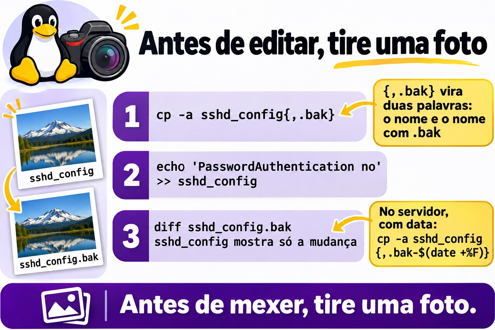
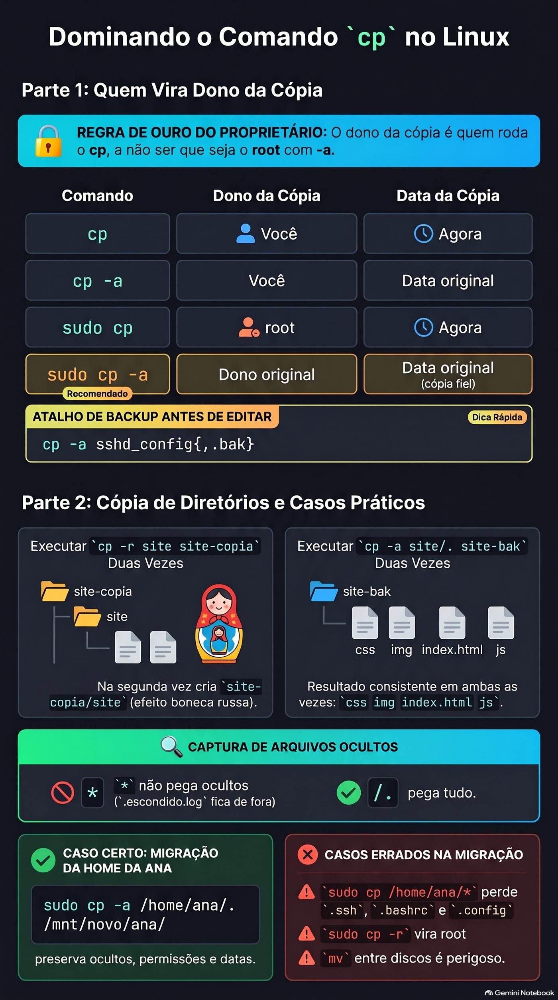

# Aula 1.4 · Criar, copiar, mover e apagar

Você aprende a criar, copiar, mover e apagar arquivos e diretórios sem perder o que importa. O caminho não é decorar opções. É entender o que cada comando faz por dentro e criar três hábitos: copiar antes de mexer, conferir antes de apagar e desconfiar de comando que não pergunta nada.

| Ficha | Aula 1.4 |
| --- | --- |
| Módulo | M1 · Linha de comando, aula 4 de 10 |
| Quando | Semana 2 |
| Ao final você consegue | Criar uma árvore de diretórios num comando; fazer a cópia de segurança de uma configuração antes de editá-la; copiar diretórios preservando dono, permissões e datas; renomear e mover sem substituir nada por engano; apagar sabendo exatamente o que vai sumir; explicar por que não há lixeira e por que o disco às vezes continua cheio depois do `rm` |
| Pré-requisitos | Aula 1.3, com o `~/lab13` ainda nas VMs |
| Tempo | Cerca de 2h30 |
| Snapshots | m1a4-inicio e m1a4-fim nas duas VMs |

## 1 · Aquecimento

Três perguntas, de cabeça, antes de ler qualquer coisa. Escreva as respostas; o Gabarito confere no fim.

1. Num diretório com `app1.log`, `app2.log` e `app10.log`, o que `echo app?.log` mostra?
2. Um arquivo se chama `-rf`. Por que `rm "-rf"` não o apaga, e qual comando apaga?
3. O seu prompt diz `/srv/app/current`, mas a edição que você fez não pegou. Qual comando mostra onde você está de verdade?

## 2 · Por que importa

Sexta, 18h. Um colega precisa liberar espaço no servidor de arquivos de um cliente e digita `rm -rf /srv/arquivos/ antigo`, com um espaço a mais depois da barra. O shell entrega dois alvos ao `rm`: o `/srv/arquivos/` inteiro e um `antigo` que nem existe ali. O `-f` cala o único aviso que haveria. Não aparece pergunta, nem mensagem, nem lixeira. O fim de semana vira restauração de backup, se houver backup.

O segundo caso é mais comum e mais discreto. Alguém restaura uma pasta do backup com `sudo cp -r`. Os arquivos voltam, mas com o root como dono e a data de hoje. O sistema que usava a pasta para de gravar nela, e ninguém liga uma coisa à outra até segunda-feira.

O terceiro acontece toda semana em algum lugar: um `mv` para a pasta compartilhada substitui, sem perguntar, um arquivo de mesmo nome que era de outra pessoa. No terminal, `cp`, `mv` e `rm` fazem exatamente o que você digitou, sem pedir confirmação. Esta aula mostra o que cada um faz por dentro e os hábitos de poucos segundos que deixam você mexer em servidor de cliente sem medo.

## 3 · Modelo mental

> Um diretório é a lista de moradores na portaria do prédio da Aula 1.3. Cada nome da lista aponta para um apartamento, e é no apartamento que o conteúdo mora.

1. **`mv` troca o nome na lista.** Renomear, ou passar o nome para a lista de outro andar, não muda ninguém de apartamento. Por isso é instantâneo dentro do mesmo prédio, que no Linux é o mesmo sistema de arquivos. Para outro prédio, ou seja, outro disco, aí é mudança de verdade: copiar tudo e esvaziar o apartamento antigo.
2. **`cp` mobilia um apartamento novo igual ao antigo.** O dono passa a ser quem copiou e a data é a de hoje, a não ser que você peça `-a`, que copia também o dono, a data e as permissões.
3. **`rm` risca o nome da lista.** Quando nenhum nome aponta mais para o apartamento e ninguém está lá dentro, ou seja, nenhum programa está com o arquivo aberto, o espaço fica livre. Não há lixeira: a portaria não guarda a lista riscada.
4. **Ninguém pergunta “tem certeza?”.** Por padrão, `cp` e `mv` substituem calados um nome que já existe no destino, e `rm` apaga sem confirmar.

Dessa planta saem três consequências:

- Antes de mexer numa configuração, copie. O `cp -a` com a expansão de chaves faz isso em um segundo.
- Antes de apagar, veja a lista: o protocolo da Aula 1.3, com `pwd -P`, `ls -la` e `echo`.
- Apagar não libera espaço enquanto um programa ainda usa o arquivo. É por isso que o disco às vezes continua cheio depois do `rm`.

O mesmo prédio, desenhado:

```text
lista do diretório         nº do apartamento     conteúdo no disco
notas.txt        ───────→  33711452    ───────→  [ bytes do arquivo ]

mv notas.txt anotacoes.txt   o nome muda; o nº continua 33711452
cp notas.txt copia.txt       nome novo, nº novo, bytes duplicados
rm notas.txt                 o nome sai da lista; os bytes ficam livres
                             quando nenhum nome e nenhum programa os usa
```

O número do apartamento existe de verdade: chama-se inode, e o `ls -i` mostra. Você vai vê-lo no Passo 3.

**Ponte Windows.** No Explorer, apagar manda para a Lixeira, e substituir um arquivo abre uma janela de confirmação. No terminal do Linux não existe nenhuma das duas coisas. E um comando faz o trabalho de dois: o `mv` é o `move` e o `ren` do `cmd.exe` ao mesmo tempo.


*mv troca a plaquinha, cp mobilia outro apartamento, rm risca o nome; o espaço volta quando ninguém mais usa.*

## 4 · Conceito em camadas

### Essencial

| Termo | O que é | Exemplo |
| --- | --- | --- |
| `mkdir -p` | Cria o diretório e os pais que faltarem; não reclama se já existe | `mkdir -p ~/lab14/a/b/c` |
| `touch` | Cria um arquivo vazio; se ele já existe, só atualiza a data | `touch index.html` |
| `cp` | Copia arquivos; a cópia ganha dono e data novos | `cp notas.txt /tmp/` |
| `cp -r` | Copia um diretório e tudo o que tem dentro | `cp -r site site-copia` |
| `cp -a` | Cópia de arquivo morto: recursiva, preservando dono, permissões, datas e atalhos | `cp -a /etc/ssh ~/ssh-bak` |
| `mv` | Renomeia ou move; no mesmo sistema de arquivos, só troca o nome | `mv velho.txt novo.txt` |
| `rm` | Apaga arquivos; diretório, só com `-r` | `rm erro.log` |
| `rmdir` | Apaga só diretório vazio | `rmdir img` |
| `-i` | Pergunta antes de cada substituição ou remoção | `mv -i a.txt pasta/` |
| `-I` | No `rm`: pergunta uma vez só, antes de apagar muito | `rm -rI copia` |
| `-v` | Mostra cada item criado, copiado, movido ou apagado | `rm -v *.tmp` |
| `-f` | Força: não pergunta e não avisa se o alvo não existe | `rm -f cache.tmp` |
| Inode | O número do apartamento: onde o conteúdo de fato está | `ls -i` |

Três formas de cópia que você vai usar a vida toda:

1. `cp -a sshd_config sshd_config.bak`: a cópia de segurança antes de editar. Com chaves, `cp -a sshd_config{,.bak}`.
2. `cp -a origem destino`: a cópia que preserva tudo, para backup e restauração.
3. `cp -a origem/. destino/`: copia o conteúdo para dentro do destino e dá o mesmo resultado na primeira e na décima vez.

### Ponte Windows

| No Windows | No Linux |
| --- | --- |
| `md`, que já cria os pais | `mkdir -p` |
| `copy` | `cp` |
| `xcopy /e` ou `robocopy /e` | `cp -r` |
| `robocopy /copyall` | `cp -a` |
| `move` e `ren` | `mv`, para as duas coisas |
| `del` | `rm` |
| `rd /s` | `rm -r` |
| `rd` | `rmdir` |
| Lixeira | Não existe no terminal: backup, snapshot e `.bak` |
| Janela “Substituir arquivo?” | Não existe por padrão; `-i` pergunta |

### Aprofundamento

**Apagar é desvincular.** O `rm` tira o nome da lista; quem libera o espaço é o sistema, quando nenhum nome e nenhum programa usam mais o conteúdo. Ferramentas de recuperação existem, mas no XFS e no ext4 elas raramente salvam o dia. O que salva é backup, snapshot e a cópia `.bak` que você fez antes.

**O `cp` cria, o `mv` renomeia.** Por isso o `mv` preserva tudo, até a etiqueta do SELinux, e o `cp` não. Entre sistemas de arquivos diferentes, o `mv` vira cópia seguida de remoção: demora e precisa de espaço livre no destino.

**O que o `-a` guarda.** O `cp -a` equivale a `-dR --preserve=all`: entra nos diretórios, copia atalhos como atalhos e preserva dono, grupo, permissões, datas, etiquetas do SELinux e atributos estendidos. Como usuário comum, você não consegue dar arquivos a outra pessoa, então o dono da cópia é você. Só o root preserva o dono original.

**A cópia muda conforme o destino existe.** `cp -r a b` cria `b` como cópia de `a` se `b` não existe. Se `b` já existe, cria `b/a`. O mesmo comando, rodado duas vezes, dá resultados diferentes. `cp -a a/. b/` sempre copia o conteúdo de `a` para dentro de `b`.

**O `-f` cala.** No `rm`, o `-f` tira as perguntas e também a mensagem de alvo inexistente. E a última opção vale: `rm -f` desliga um alias `rm -i`. Quem digita `rm -rf` por costume nunca vê a pergunta que o alias faria.

**O `-I` é melhor que o `-i`.** O `-i` pergunta arquivo por arquivo, e depois do vigésimo `y` ninguém lê mais nada. O `-I` pergunta uma vez, quando a remoção é recursiva ou tem mais de três arquivos.

**Uma quase lixeira.** `cp` e `mv` aceitam `--backup=numbered`: antes de substituir, guardam o arquivo antigo como `nome.~1~`, `nome.~2~` e assim por diante.

**`rm -rf /` é recusado; `rm -rf /*` não.** A proteção padrão, `--preserve-root`, só reconhece a raiz escrita sozinha. O `/*` é expandido pelo shell em `/bin`, `/boot`, `/etc` e o resto, e cada um vira um argumento comum. É por isso que uma variável vazia num script é perigosa, como você vê no Passo 7.

## 5 · Rocky × Debian

Os comandos são os mesmos, do pacote coreutils. O que muda é o que está em volta deles, e isso decide se o comando pergunta antes ou apaga calado:

|  | rocky-lab | debian-lab |
| --- | --- | --- |
| Aliases do root | `rm -i`, `cp -i` e `mv -i` ativos no `/root/.bashrc`: como root, os três perguntam | As mesmas linhas existem no `/root/.bashrc`, comentadas: não perguntam |
| O seu usuário | Sem esses aliases: não pergunta | Igual |
| `sudo rm`, `sudo cp`, `sudo mv` | O `sudo` não usa aliases: nunca perguntam | Igual |
| Versão do coreutils | 8.32 | 9.x: algumas mensagens mudam uma palavra ou outra |
| Sistema de arquivos da instalação | XFS | ext4 |
| `mv` do home para o `/tmp` | Instantâneo se os dois estão no mesmo sistema de arquivos | Sempre cópia e remoção, porque o `/tmp` está na memória |
| Etiqueta do SELinux | O `mv` leva a etiqueta; o `cp` ganha a do destino. Pode quebrar um serviço. | Sem SELinux: a diferença não existe |


*Quem pergunta antes de apagar depende do usuário, da distribuição e do sudo; o hábito vale mais que o alias.*

## 6 · Lab guiado

Abra três terminais: um na rocky-lab, um na debian-lab e um no nó Proxmox, para os snapshots. Em cada passo, rode, compare com a saída e só então leia o Decida. As saídas são trechos: números, datas e nomes vão ser outros na sua tela.

Cada Decida é um caso real de trabalho. Escolha a letra antes de olhar a tabela: errar aqui, com a explicação ao lado, é o jeito mais barato de errar.

**Passo 1 · Snapshot antes de tudo.** As VMs devem estar no estado `m1a3-fim`, com o `~/lab13` ainda lá. No nó Proxmox onde cada VM roda:

```bash
qm snapshot 201 m1a4-inicio
qm snapshot 202 m1a4-inicio
qm listsnapshot 201
```

Saída esperada: a lista termina em `m1a3-fim`, `m1a4-inicio` e `current`. Nas duas VMs, confira que a 1.3 deixou o material:

```bash
ls -A ~/lab13/logs
```

**Passo 2 · Criar a árvore inteira de uma vez.** Nas duas VMs:

```bash
mkdir ~/lab14
cd ~/lab14
mkdir site/css
```

Algo como:

```text
mkdir: cannot create directory 'site/css': No such file or directory
```

O `mkdir` cria um nível só. O pai `site` não existe, então ele recusa. Agora com `-p`, e com `-v` para ver cada passo:

```bash
mkdir -pv site/{css,js,img}
echo site/{css,js,img}
mkdir -p site/css
mkdir site
```

Algo como:

```text
mkdir: created directory 'site'
mkdir: created directory 'site/css'
mkdir: created directory 'site/js'
mkdir: created directory 'site/img'
site/css site/js site/img
mkdir: cannot create directory 'site': File exists
```

Três coisas para ver aí. As chaves não são do `mkdir`: o shell as expande antes, e o `echo` mostra o que ele entregou, como os curingas da 1.3. O `mkdir -p site/css` repetido não diz nada, porque já existe e está tudo certo. O `mkdir site` sem `-p` reclama.

**Decida 1 · O deploy que falha no servidor novo.** Cenário: o script de deploy roda `mkdir /srv/app/releases/$(date +%F)` toda noite. Num servidor recém-instalado, ele falha com `No such file or directory`. O que você faz?

- **A)** Troca por `mkdir -p` no script.
- **B)** Passa a rodar o script com `sudo`.
- **C)** Acrescenta `2>/dev/null` no fim da linha para sumir com o erro.
- **D)** Cria `/srv/app/releases` à mão nesse servidor e segue.

Escolha a letra antes de olhar a tabela.

| Se você marcou | Resultado | Por quê |
| --- | --- | --- |
| A | ✅ Certa | O `-p` cria os pais que faltam e não falha se já existem. O script passa a funcionar em servidor novo e velho, na primeira e na centésima noite. |
| B | ❌ Errada | Falta de permissão diria `Permission denied`. O erro aqui é pai inexistente, e o root também não cria dois níveis sem `-p`. |
| C | ❌ Errada | Esconde o erro e o deploy segue sem o diretório. A falha aparece mais adiante, longe da causa. |
| D | ❌ Errada | Resolve hoje e falha no próximo servidor novo. A correção pertence ao script. |

**Para fixar:** `-p` quer dizer "faça o caminho todo e não reclame do que já existe".

**Passo 3 · O número do apartamento.** Primeiro o `touch`, nas duas VMs:

```bash
touch site/index.html site/css/style.css
ls -l --time-style=+%T site/index.html
```

Espere uns dez segundos e repita os dois comandos. O tamanho continua zero, só a hora muda. O `touch` num arquivo que já existe não apaga nada: só atualiza a data. Agora o inode, o número do apartamento do Modelo mental:

```bash
echo "primeira linha" > notas.txt
ls -i notas.txt
mv notas.txt anotacoes.txt
ls -i anotacoes.txt
cp anotacoes.txt copia.txt
ls -i anotacoes.txt copia.txt
```

Algo como:

```text
33711452 notas.txt
33711452 anotacoes.txt
33711452 anotacoes.txt  33711460 copia.txt
```

O `mv` não mudou o número, só o nome na lista. A cópia ganhou um apartamento novo, com número próprio.

**Decida 2 · O log de 40 GB.** Cenário: o `app.log` tem 40 GB, o disco está com 2 GB livres e você quer guardar o arquivo atual como `app.log.1`, no mesmo diretório, com `mv app.log app.log.1`. O app continua rodando. O que acontece?

- **A)** O `mv` é instantâneo e não ocupa espaço, mas o app continua gravando no arquivo que agora se chama `app.log.1`.
- **B)** O `mv` falha por falta de espaço, porque precisa copiar os 40 GB.
- **C)** O `mv` é instantâneo, e o app passa a gravar num `app.log` novo automaticamente.
- **D)** O `mv` demora alguns minutos, proporcional ao tamanho.

Escolha a letra antes de olhar a tabela.

| Se você marcou | Resultado | Por quê |
| --- | --- | --- |
| A | ✅ Certa | No mesmo sistema de arquivos, o `mv` só troca o nome na lista. O app abriu o arquivo antes e segura o apartamento, não o nome: continua gravando lá. É por isso que o `logrotate` avisa o serviço depois de renomear. |
| B | ❌ Errada | Isso seria o `cp`, ou um `mv` para outro disco. No mesmo disco não há cópia. |
| C | ❌ Errada | Ninguém cria o `app.log` novo. O app só passa a usar outro arquivo quando reabre o log, depois de um reload ou restart. |
| D | ❌ Errada | O tempo proporcional ao tamanho só aparece entre sistemas de arquivos diferentes. |

**Para fixar:** `mv` no mesmo disco é trocar a plaquinha da porta. Quem está lá dentro nem percebe.

**Passo 4 · A cópia antes de editar.** Uma configuração de mentira, nas duas VMs:

```bash
printf 'Port 22\nPermitRootLogin no\n' > sshd_config
echo cp -a sshd_config{,.bak}
cp -a sshd_config{,.bak}
ls -l sshd_config*
```

Algo como:

```text
cp -a sshd_config sshd_config.bak
-rw-r--r--. 1 rodrigo rodrigo 32 Nov  2 10:12 sshd_config
-rw-r--r--. 1 rodrigo rodrigo 32 Nov  2 10:12 sshd_config.bak
```

O `{,.bak}` vira duas palavras: o nome sem nada e o nome com `.bak`. Agora edite e compare:

```bash
echo 'PasswordAuthentication no' >> sshd_config
diff sshd_config.bak sshd_config
cp -a sshd_config{,.bak-$(date +%F)}
ls sshd_config*
```

Algo como:

```text
2a3
> PasswordAuthentication no
sshd_config  sshd_config.bak  sshd_config.bak-2026-11-02
```

O `diff` mostra exatamente o que você mudou. Com a data no nome, o `.bak` de hoje não substitui o de ontem. No servidor de verdade é o mesmo comando, com `sudo` e o caminho completo: `sudo cp -a /etc/ssh/sshd_config{,.bak-$(date +%F)}`.

**Decida 3 · Antes de mexer no SSH do cliente.** Cenário: você vai desligar o login por senha no SSH de um servidor de cliente. Qual é o primeiro comando?

- **A)** `sudo cp -a /etc/ssh/sshd_config{,.bak-$(date +%F)}`
- **B)** `sudo cp /etc/ssh/sshd_config /tmp/`
- **C)** `sudo vi /etc/ssh/sshd_config`, com cuidado.
- **D)** `sudo mv /etc/ssh/sshd_config{,.bak}` e escrever um arquivo novo.

Escolha a letra antes de olhar a tabela.

| Se você marcou | Resultado | Por quê |
| --- | --- | --- |
| A | ✅ Certa | Cópia ao lado do original, com dono, permissões e etiqueta preservados, e com data. Se o `sshd` não subir, a volta é um `cp`. |
| B | ❌ Errada | O `/tmp` é limpo no reboot, e na Debian 13 ele fica na memória. O backup some justamente quando você mais precisa dele. |
| C | ❌ Errada | Cuidado não é caminho de volta. Se o `sshd` não subir, você pode perder o acesso sem saber o que estava antes. |
| D | ❌ Errada | Por um instante o arquivo não existe. E o novo nasce sem o conteúdo, a etiqueta e as permissões do original. |

**Para fixar:** antes de mexer, tire uma foto. A foto é o `.bak` com data, ao lado do original.



*Copie, edite, compare: o diff mostra exatamente o que você mudou.*

**Passo 5 · Quem vira dono da cópia.** Quatro cópias do mesmo arquivo do root, nas duas VMs:

```bash
cp /etc/hosts hosts-cp
cp -a /etc/hosts hosts-a
sudo cp /etc/hosts hosts-sudo
sudo cp -a /etc/hosts hosts-sudo-a
ls -l /etc/hosts hosts-*
```

Algo como:

```text
-rw-r--r--. 1 root    root    158 Jun 23  2020 /etc/hosts
-rw-r--r--. 1 rodrigo rodrigo 158 Jun 23  2020 hosts-a
-rw-r--r--. 1 rodrigo rodrigo 158 Nov  2 10:15 hosts-cp
-rw-r--r--. 1 root    root    158 Nov  2 10:15 hosts-sudo
-rw-r--r--. 1 root    root    158 Jun 23  2020 hosts-sudo-a
```

Leia linha por linha:

| Comando | Dono da cópia | Data da cópia |
| --- | --- | --- |
| `cp` | Você | Agora |
| `cp -a`, como você | Você, porque usuário comum não entrega arquivo a outra pessoa | A original |
| `sudo cp` | root | Agora |
| `sudo cp -a` | O dono original | A original: cópia fiel |

Regra: o dono da cópia é quem roda o `cp`, a não ser que seja o root com `-a`.

**Decida 4 · A restauração de sexta-feira.** Cenário: a pasta `/srv/dados/app`, do usuário `app`, foi apagada. O backup está em `/backup/app`, feito com `cp -a`. Como restaurar?

- **A)** `sudo cp -a /backup/app /srv/dados/`
- **B)** `sudo cp -r /backup/app /srv/dados/`
- **C)** `cp -a /backup/app /srv/dados/`, como seu usuário.
- **D)** `sudo mv /backup/app /srv/dados/`

Escolha a letra antes de olhar a tabela.

| Se você marcou | Resultado | Por quê |
| --- | --- | --- |
| A | ✅ Certa | O root com `-a` devolve dono, permissões, datas e etiquetas como eram. E o backup continua lá. |
| B | ❌ Errada | Os arquivos voltam com dono root e data de hoje. O serviço, que roda como `app`, não consegue mais gravar. Você vai provocar isso na Quebra A. |
| C | ❌ Errada | Sem root você não entrega os arquivos ao usuário `app`, e provavelmente nem grava em `/srv/dados`. |
| D | ❌ Errada | Restaura e some com o backup. Se algo der errado, não tem segunda tentativa. E se `/backup` for outro disco, o `mv` copia tudo e apaga a origem. |

**Para fixar:** restaurar é `cp -a` como root. O backup fica onde está.

**Passo 6 · Copiar diretórios.** Rode a mesma cópia duas vezes, nas duas VMs:

```bash
cp -r site site-copia
ls site-copia
cp -r site site-copia
ls site-copia
```

Algo como:

```text
css  img  index.html  js
css  img  index.html  js  site
```

Na segunda vez, `site-copia` já existia, então o `cp` criou `site-copia/site`. Num backup noturno isso vira uma boneca russa. Agora do jeito que dá sempre o mesmo resultado:

```bash
rm -r site-copia
cp -a site/. site-bak
cp -a site/. site-bak
ls site-bak
```

As duas vezes dão `css  img  index.html  js`. O `site/.` quer dizer "o que está dentro de site". Agora os ocultos, com os arquivos da 1.3:

```bash
mkdir dest-estrela dest-ponto
cp -a ~/lab13/logs/* dest-estrela/
cp -a ~/lab13/logs/. dest-ponto/
ls -A dest-estrela
ls -A dest-ponto
```

O `.escondido.log` aparece só em `dest-ponto`. O `*` não pega ocultos, como você viu na 1.3. O `/.` pega tudo. Se aparecerem outros nomes, sobras da 1.3, tudo bem: o que importa é a diferença.

**Decida 5 · A home da Ana no disco novo.** Cenário: você vai mover `/home/ana` para um disco novo montado em `/mnt/novo`. Qual comando?

- **A)** `sudo cp -a /home/ana/. /mnt/novo/ana/`
- **B)** `sudo cp -a /home/ana/* /mnt/novo/ana/`
- **C)** `sudo cp -r /home/ana /mnt/novo/`
- **D)** `sudo mv /home/ana /mnt/novo/`

Escolha a letra antes de olhar a tabela.

| Se você marcou | Resultado | Por quê |
| --- | --- | --- |
| A | ✅ Certa | Copia todo o conteúdo, ocultos incluídos, com dono, permissões e datas. O original fica intacto até você conferir. |
| B | ❌ Errada | O `*` deixa para trás `.ssh`, `.bashrc` e `.config`. A Ana entra e não tem chaves nem configuração. |
| C | ❌ Errada | Leva os ocultos, mas tudo vira do root e perde as datas. O `sshd` recusa chaves numa `.ssh` com dono errado. |
| D | ❌ Errada | Entre discos, o `mv` copia e apaga. Se cair no meio, você fica com metade de cada lado e sem o original. |

**Para fixar:** diretório inteiro é `origem/.` com `cp -a`.


*Diretório inteiro é origem/. com cp -a; só o root com -a preserva o dono.*

**Passo 7 · O `mv` que substitui calado.** Um caso de pasta compartilhada, nas duas VMs:

```bash
mkdir compartilhada
echo "versão da Maria" > compartilhada/relatorio.txt
echo "versão do João" > relatorio.txt
mv relatorio.txt compartilhada/
cat compartilhada/relatorio.txt
```

Saída: `versão do João`. A versão da Maria sumiu, sem pergunta e sem lixeira. Refaça a cena e tente as duas proteções:

```bash
echo "versão da Maria" > compartilhada/relatorio.txt
echo "versão do João" > relatorio.txt
mv -i relatorio.txt compartilhada/
```

Algo como `mv: overwrite 'compartilhada/relatorio.txt'?`. Responda `n` e o arquivo do João continua onde estava. Agora a quase lixeira:

```bash
mv --backup=numbered relatorio.txt compartilhada/
ls compartilhada/
cat compartilhada/relatorio.txt.~1~
```

Algo como `relatorio.txt  relatorio.txt.~1~`, e o `cat` mostra `versão da Maria`. O arquivo antigo foi guardado com número, em vez de sumir.

**Decida 6 · O relatório na pasta do financeiro.** Cenário: você entrega o relatório do mês em `/srv/financeiro`, onde três colegas também gravam. Qual comando?

- **A)** `mv relatorio.pdf /srv/financeiro/`
- **B)** `mv -i relatorio.pdf /srv/financeiro/`
- **C)** `cp relatorio.pdf /srv/financeiro/`, para não perder o seu.
- **D)** `mv -f relatorio.pdf /srv/financeiro/`

Escolha a letra antes de olhar a tabela.

| Se você marcou | Resultado | Por quê |
| --- | --- | --- |
| A | ❌ Errada | Se um colega já gravou um `relatorio.pdf`, o dele some calado. |
| B | ✅ Certa | Se o nome já existe, o `mv` pergunta antes. Você renomeia o seu e ninguém perde nada. Num script, use `--backup=numbered`. |
| C | ❌ Errada | O seu fica a salvo, mas o `cp` também substitui calado o do colega. |
| D | ❌ Errada | O `-f` existe justamente para não perguntar nada. |

**Para fixar:** em pasta dos outros, `-i` na mão e `--backup=numbered` no script.

**Passo 8 · Apagar sabendo o que vai sumir.** Primeiro os limites do `rmdir` e do `rm`, nas duas VMs:

```bash
mkdir vazio
rmdir vazio
rmdir site-bak
rm site-bak
rm -rIv site-bak
```

Algo como:

```text
rmdir: failed to remove 'site-bak': Directory not empty
rm: cannot remove 'site-bak': Is a directory
rm: remove 1 argument recursively? y
removed 'site-bak/index.html'
...
removed directory 'site-bak'
```

O `rmdir` só apaga diretório vazio, o `rm` sem `-r` não apaga diretório, e o `-I` pergunta uma vez só. Agora veja o que o shell entrega ao `rm` quando sobra um espaço, sem apagar nada:

```bash
printf '[%s]\n' rm -rf ~/lab14/ site-copia
```

Algo como:

```text
[rm]
[-rf]
[/home/rodrigo/lab14/]
[site-copia]
```

São quatro argumentos. O `rm` apagaria o `lab14` inteiro. O `printf '[%s]\n'` põe cada argumento entre colchetes, e é o raio X de qualquer comando perigoso. Por fim, o pior caso dos scripts, também só com `echo`:

```bash
ALVO=""
echo rm -rf "$ALVO"/*
echo rm -rf "${ALVO:?está vazia}"/*
```

Algo como:

```text
rm -rf /afs /bin /boot /dev /etc /home /lib /lib64 /media /mnt /opt /proc /root /run /sbin /srv /sys /tmp /usr /var
bash: ALVO: está vazia
```

Com a variável vazia, `"$ALVO"/*` virou `/*`: a raiz inteira, item por item, e o `--preserve-root` não reconhece. Você só viu porque usou `echo`. O `${ALVO:?mensagem}` faz o bash parar ali quando a variável está vazia ou não existe. Agora com a variável preenchida, de verdade:

```bash
ALVO=~/lab14/dest-estrela
echo rm -rf "${ALVO:?está vazia}"/*
rm -rf "${ALVO:?está vazia}"/*
ls -A "$ALVO"
```

O `echo` mostra só arquivos dentro de `dest-estrela`. O `rm` apaga, e o `ls -A` não mostra nada.

**Decida 7 · A limpeza do cron.** Cenário: o script de limpeza de um cliente tem a linha `rm -rf $TMPDIR_APP/*` e roda como root toda noite. Qual correção você faz?

- **A)** `rm -rf "$TMPDIR_APP"/*`
- **B)** `rm -rf "${TMPDIR_APP:?}"/*`
- **C)** `rm -ri $TMPDIR_APP/*`
- **D)** Nenhuma: o script funciona há anos.

Escolha a letra antes de olhar a tabela.

| Se você marcou | Resultado | Por quê |
| --- | --- | --- |
| A | ❌ Errada | As aspas protegem caminhos com espaço, mas com a variável vazia o resultado continua sendo `/*`. |
| B | ✅ Certa | As aspas protegem os espaços e o `:?` aborta o script se a variável vier vazia. Uma linha, dois desastres evitados. |
| C | ❌ Errada | No cron ninguém responde pergunta. E com a variável vazia continua sendo `/*`. |
| D | ❌ Errada | Funciona até o dia em que alguém comenta a linha que define a variável. Nesse dia, apaga o servidor. |

**Para fixar:** variável num `rm` vai sempre entre aspas e com `:?`.

**Decida 8 · O conselho do colega.** Cenário: como root, na rocky-lab, o `rm arquivo` pergunta `remove regular file?`. Na debian-lab não pergunta. Um colega diz: "usa sempre `rm -rf`, aí ele para de encher". O que você responde?

- **A)** "Boa, o `-f` é o jeito profissional."
- **B)** "Na Rocky o root tem o alias `rm -i`, e o `-f` o desliga. Prefiro conferir com `echo` e usar `-I` quando é muita coisa."
- **C)** "Põe `alias rm='rm -i'` em todo servidor e pode usar `-rf` tranquilo."
- **D)** "A Debian está mal configurada; precisa corrigir."

Escolha a letra antes de olhar a tabela.

| Se você marcou | Resultado | Por quê |
| --- | --- | --- |
| A | ❌ Errada | O `-f` cala a pergunta e também o aviso de alvo inexistente. Você perde as duas pistas de que digitou errado. |
| B | ✅ Certa | A pergunta vem do alias no `/root/.bashrc`. Um `-f` depois dele vence. A proteção que vale em qualquer servidor é o hábito: ver antes, apagar depois. |
| C | ❌ Errada | O `-f` vence o alias, e o `sudo` nem usa aliases. A rede de proteção não protege nada. |
| D | ❌ Errada | É escolha de configuração: na Debian as mesmas linhas estão comentadas no `/root/.bashrc`. |

**Para fixar:** a proteção não está no alias, está no hábito.

**Protocolo antes de apagar ou substituir.** Os cinco segundos que separam um sysadmin tranquilo de um fim de semana restaurando backup:

```bash
pwd -P
ls -la site
echo rm -r site
```

1. `pwd -P`: onde estou de verdade.
2. `ls -la alvo`: o que existe ali.
3. `echo` ou `printf '[%s]\n'` na frente do comando: o que o shell vai entregar.
4. Existe cópia? Um `.bak`, um snapshot ou um backup.
5. Só então o `rm`, de preferência com `-I` ou `-v`.


*Cinco conferências curtas antes de qualquer rm ou substituição.*

## 7 · Quebre e conserte

Duas panes que você vai encontrar em cliente. Em cada uma: quebre, preveja antes de olhar, descubra com os comandos, decida, conserte e verifique. Faça primeiro na rocky-lab; a Debian entra no bônus. As duas ficam dentro do `~/lab14`, então não há risco fora dele.

### Quebra A · Restaurei e o app parou de gravar

O caso da Decida 4, em miniatura. O `~/lab14/app/dados` faz o papel da pasta de um serviço que roda com o seu usuário.

**Prepare.**

```bash
mkdir -p ~/lab14/app/dados ~/lab14/backup
echo "registro 1" > ~/lab14/app/dados/registro.log
cp -a ~/lab14/app/dados ~/lab14/backup/
ls -l ~/lab14/backup/dados
```

**Quebre.** O desastre e a restauração apressada:

```bash
rm -rf ~/lab14/app/dados
sudo cp -r ~/lab14/backup/dados ~/lab14/app/
```

**Preveja.** O "serviço" vai gravar uma linha nova no `registro.log`. Vai funcionar? Escreva sim ou não, e por quê, antes de rodar o próximo bloco.

**Descubra.**

```bash
echo "registro 2" >> ~/lab14/app/dados/registro.log
ls -l ~/lab14/app/dados ~/lab14/backup/dados
```

Algo como:

```text
bash: /home/rodrigo/lab14/app/dados/registro.log: Permission denied
/home/rodrigo/lab14/app/dados:
-rw-r--r--. 1 root    root    11 Nov  2 10:40 registro.log

/home/rodrigo/lab14/backup/dados:
-rw-r--r--. 1 rodrigo rodrigo 11 Nov  2 10:31 registro.log
```

O conteúdo voltou, mas o dono virou root e a data é a da restauração. O arquivo pode ser lido por todos e gravado só pelo dono, que agora é o root. O backup, feito com `cp -a`, estava certo; quem estragou foi a restauração.

**Decida.** Como consertar?

- **A)** `sudo rm -rf ~/lab14/app/dados` e depois `cp -a ~/lab14/backup/dados ~/lab14/app/`
- **B)** `sudo chmod -R 777 ~/lab14/app/dados`
- **C)** Passar a rodar o serviço como root.
- **D)** `sudo chown -R rodrigo: ~/lab14/app/dados`

Escolha a letra antes de olhar a tabela.

| Se você marcou | Resultado | Por quê |
| --- | --- | --- |
| A | ✅ Certa | Refaz a restauração do jeito certo: dono, permissões e datas voltam do backup. Aqui o `cp -a` nem precisa de `sudo`, porque os arquivos do backup já são seus. |
| B | ❌ Errada | "Funciona", mas deixa qualquer usuário gravar na pasta e o dono continua errado. É o remendo mais comum em produção, e o mais perigoso. |
| C | ❌ Errada | Resolve o sintoma criando um problema de segurança: qualquer falha do serviço vira falha de root. |
| D | ❌ Incompleta | Conserta o dono, mas as datas continuam erradas. E numa árvore com donos diferentes você teria que saber o dono de cada arquivo. O `chown` tem aula própria, a 2.7. |

**Conserte.** Protocolo primeiro, depois a restauração certa:

```bash
ls -la ~/lab14/app/dados
sudo rm -rf ~/lab14/app/dados
cp -a ~/lab14/backup/dados ~/lab14/app/
```

**Verifique.**

```bash
ls -l ~/lab14/app/dados
echo "registro 2" >> ~/lab14/app/dados/registro.log
cat ~/lab14/app/dados/registro.log
```

O `ls` mostra você como dono e a hora do backup, não a da restauração. O `cat` mostra `registro 1` e `registro 2`.

### Quebra B · Apaguei e o disco não liberou

O `/var` de um cliente chega a 100%. Alguém apaga o log gigante e o `df` não se mexe. Você vai montar a cena com um arquivo de 300 MB e um processo que o mantém aberto.

**Quebre.**

```bash
cd ~/lab14
dd if=/dev/zero of=grande.bin bs=1M count=300 status=none
df -h ~
sleep 3600 < grande.bin &
rm grande.bin
ls grande.bin
```

O `sleep` recebe o arquivo como entrada e fica uma hora parado, com ele aberto. É o papel do serviço que escreve o log. O `ls` responde `No such file or directory`: para a lista do diretório, o arquivo não existe mais.

**Preveja.** O próximo `df -h ~` mostra os 300 MB de volta? Anote o número que você espera na coluna `Avail`.

**Descubra.**

```bash
df -h ~
ls -l /proc/$!/fd
sudo lsof +L1
```

Algo como:

```text
Filesystem           Size  Used Avail Use% Mounted on
/dev/mapper/rl-root   17G  2.9G   15G  17% /
lr-x------. 1 rodrigo rodrigo 64 Nov  2 10:52 0 -> /home/rodrigo/lab14/grande.bin (deleted)
COMMAND  PID    USER FD TYPE DEVICE  SIZE/OFF NLINK     NODE NAME
sleep   4242 rodrigo 0r  REG  253,0 314572800     0 33711470 /home/rodrigo/lab14/grande.bin (deleted)
```

O `Avail` não mudou. O `$!` é o número do último processo que você mandou para o fundo, o `sleep`, e o `(deleted)` é a prova: o nome foi riscado, mas o apartamento continua ocupado. No servidor você não sabe qual é o processo, então usa o `lsof +L1`, que lista arquivos abertos que já não têm nome nenhum (`NLINK 0`). Se o `lsof` não estiver instalado no lab: `sudo dnf install -y lsof` na Rocky, `sudo apt install -y lsof` na Debian.

**Decida.** No servidor do cliente, o `/var` continua em 100% depois de você apagar um log de 20 GB. O que você faz?

- **A)** Descobre quem segura o arquivo com `sudo lsof +L1` e reinicia só aquele serviço.
- **B)** Reinicia o servidor.
- **C)** Apaga mais arquivos até o `df` baixar.
- **D)** Roda `fsck` no `/var`.

Escolha a letra antes de olhar a tabela.

| Se você marcou | Resultado | Por quê |
| --- | --- | --- |
| A | ✅ Certa | O espaço volta quando o último programa fecha o arquivo. Reiniciar ou recarregar o serviço certo resolve em segundos, sem derrubar o resto. |
| B | ❌ Errada | Funciona, mas derruba tudo por causa de um processo, e você continua sem saber a causa. |
| C | ❌ Errada | Você apaga coisa útil e o espaço do primeiro continua preso. |
| D | ❌ Errada | Não há corrupção: o sistema está fazendo exatamente o que deve. E `fsck` num sistema montado é pedir problema. |

Da próxima vez, num log aberto, não apague: esvazie. O `truncate -s 0 arquivo` zera o conteúdo e o espaço volta na hora, com o serviço rodando. Na Aula 1.6 você vê o atalho `> arquivo`.

**Conserte.**

```bash
kill $!
df -h ~
```

Se você trocou de terminal no meio, o `$!` não existe mais lá. Use o PID que o `lsof` mostrou: `kill 4242`, com o seu número.

**Verifique.** O `Avail` subiu uns 300 MB, o `jobs` não mostra nada e o `sudo lsof +L1` não lista mais o `grande.bin`.

### E o snapshot?

O `m1a4-inicio` salva a VM inteira. Voltar a ele desfaz tudo o que veio depois, não só o arquivo que você queria. Ele é a rede de proteção da aula, não a ferramenta do dia a dia. No dia a dia, quem devolve um arquivo é o `.bak` ao lado do original e o backup. Repare na Quebra A: o conserto veio do backup, em segundos, sem tocar no resto da máquina.

### Bônus na Debian

Repita as duas Quebras na debian-lab: o resultado é o mesmo, porque os comandos são os mesmos. Depois veja o `mv` que vira cópia:

```bash
findmnt -T ~
findmnt -T /tmp
dd if=/dev/zero of=~/lab14/medio.bin bs=1M count=200 status=none
time mv ~/lab14/medio.bin ~/lab14/medio2.bin
time mv ~/lab14/medio2.bin /tmp/
rm /tmp/medio2.bin
```

No primeiro `mv`, o tempo é praticamente zero. No segundo, se o `findmnt` mostrou o `/tmp` como `tmpfs`, o `mv` copia os 200 MB para a memória e apaga a origem, e você vê o tempo subir. Se os dois estiverem no mesmo sistema de arquivos, os tempos ficam parecidos. A lição é a mesma: o `findmnt -T` diz, antes, se o `mv` vai ser instantâneo.

### Bônus na Rocky · A etiqueta que o `mv` leva junto

Só na rocky-lab, que tem SELinux:

```bash
touch ~/lab14/etq.txt
ls -Z ~/lab14/etq.txt
sudo cp ~/lab14/etq.txt /etc/etq-cp.txt
sudo mv ~/lab14/etq.txt /etc/etq-mv.txt
ls -Z /etc/etq-cp.txt /etc/etq-mv.txt
sudo restorecon -v /etc/etq-mv.txt
sudo rm -v /etc/etq-cp.txt /etc/etq-mv.txt
```

Algo como:

```text
unconfined_u:object_r:user_home_t:s0 /home/rodrigo/lab14/etq.txt
unconfined_u:object_r:etc_t:s0 /etc/etq-cp.txt
unconfined_u:object_r:user_home_t:s0 /etc/etq-mv.txt
Relabeled /etc/etq-mv.txt from unconfined_u:object_r:user_home_t:s0 to unconfined_u:object_r:etc_t:s0
removed '/etc/etq-cp.txt'
removed '/etc/etq-mv.txt'
```

A cópia ganhou a etiqueta do lugar novo, `etc_t`. O arquivo movido continua com a etiqueta de coisa da home, `user_home_t`. Num servidor web, esse é o caso clássico: o arquivo está em `/var/www/html`, as permissões estão certas e o Apache responde 403. O `restorecon` aplica a etiqueta certa para o lugar. Você vai ver isso a fundo na aula de SELinux.

### A lição

- O `cp` cria: dono, data e etiqueta novos, a não ser que você peça `-a`.
- O `mv` renomeia: leva tudo junto, até a etiqueta.
- O `rm` desvincula: o espaço só volta quando nenhum nome e nenhum programa usam mais o arquivo.
- Restaurar é `cp -a` como root, e o backup não sai do lugar.

## 8 · Armadilhas

| Armadilha | O que acontece | Como evitar |
| --- | --- | --- |
| `cp -r` para backup ou restauração | Dono e data viram os de quem copiou | `cp -a`, e como root se os donos forem outros |
| Repetir `cp -r a b` | Na segunda vez nasce `b/a` | `cp -a a/. b/` |
| `cp -a origem/* destino/` | Os ocultos ficam para trás | `cp -a origem/. destino/` |
| `mv` ou `cp` para pasta com arquivo de mesmo nome | Substitui calado | `-i` na mão, `--backup=numbered` no script |
| Espaço a mais no `rm -rf` | Um alvo vira dois | `echo` ou `printf '[%s]\n'` antes |
| Variável vazia em `rm -rf "$X"/*` | Vira `/*` | `"${X:?}"` |
| `rm` num log aberto | O espaço não volta | `truncate -s 0`, ou reiniciar quem segura o arquivo |
| Confiar no alias `rm -i` | O `-f` e o `sudo` passam por cima | O protocolo, sempre |
| `mv` para outro disco | Demora, precisa de espaço e, se cair, deixa metade de cada lado | `cp -a`, conferir, só então apagar a origem |
| `.bak` no `/tmp` | Some no reboot | `.bak` com data ao lado do original |
| `touch` para "zerar" um arquivo | Só muda a data | `truncate -s 0` |
| `mv` na Rocky para a pasta de um serviço | A etiqueta do SELinux vem junto e o serviço não lê | `cp`, ou `restorecon` depois do `mv` |

## 9 · Quiz

Dez perguntas. Responda todas antes de abrir o Gabarito.

**1.** Qual comando cria `/srv/app/releases/v2` quando nem `/srv/app` existe?

- a) `mkdir /srv/app/releases/v2`
- b) `mkdir -p /srv/app/releases/v2`
- c) `mkdir -r /srv/app/releases/v2`
- d) `touch -p /srv/app/releases/v2`

**2.** O diretório `copia` não existia. Você roda `cp -r site copia` duas vezes. O que tem em `copia`?

- a) Só o conteúdo de `site`.
- b) O conteúdo de `site` e também `copia/site`.
- c) Só o conteúdo de `site`, porque a segunda vez dá erro.
- d) O conteúdo de `site` duplicado, com números no nome.

**3.** Como usuário comum, você roda `cp -a /etc/hosts ~/`. Quem é o dono da cópia, e qual é a data dela?

- a) root, data original.
- b) Você, data de agora.
- c) Você, data original.
- d) root, data de agora.

**4.** Qual destes **não** libera espaço em disco na hora?

- a) `rm` de uma cópia que ninguém está usando.
- b) `rm` de um log que um serviço mantém aberto.
- c) `truncate -s 0` num log aberto.
- d) `rm -r` de um diretório de cópias antigas.

**5.** Complete o comando que apaga o diretório `projeto` e tudo o que tem dentro, perguntando uma vez só: `rm ____ projeto`

**6.** Já existe `compartilhada/relatorio.txt`. O que faz `mv relatorio.txt compartilhada/`?

- a) Pergunta antes de substituir.
- b) Dá erro e não move.
- c) Substitui o arquivo existente sem avisar.
- d) Cria `relatorio.txt.1`.

**7.** Qual linha protege um script contra variável vazia?

- a) `rm -rf "$D"/*`
- b) `rm -rf "${D:?}"/*`
- c) `rm -rfi $D/*`
- d) `sudo rm -rf $D/*`

**8.** Um `mv` de um arquivo de 40 GB para outro diretório do mesmo sistema de arquivos:

- a) É instantâneo e mantém o inode.
- b) Demora proporcional ao tamanho.
- c) Precisa de 40 GB livres.
- d) Muda o inode.

**9.** Which command removes the empty directory `old` and fails if the directory is not empty?

- A. `rm old`
- B. `rmdir old`
- C. `rm -r old`
- D. `rm -f old`

**10.** Na rocky-lab, como root, o `rm arquivo` pergunta antes de apagar. Por quê?

- a) O SELinux protege os arquivos do root.
- b) Há um alias `rm='rm -i'` no `/root/.bashrc`.
- c) O `rm` sempre pergunta quando quem roda é o root.
- d) O arquivo tem um atributo especial.

## 10 · Flashcards e cola

### Para saber de cor

| Situação | Comando |
| --- | --- |
| Criar um caminho inteiro | `mkdir -p a/b/c` |
| Várias pastas de uma vez | `mkdir -p site/{css,js,img}` |
| Backup antes de editar | `cp -a arquivo{,.bak-$(date +%F)}` |
| Copiar um diretório com tudo, ocultos incluídos | `cp -a origem/. destino/` |
| Restaurar do backup | `sudo cp -a /backup/pasta /destino/` |
| Mover sem substituir calado | `mv -i` |
| Apagar diretório perguntando uma vez | `rm -rI dir` |
| Ver o que o shell vai entregar | `printf '[%s]\n'` na frente do comando |
| Variável num `rm` | `"${VAR:?}"` |

### Para consultar

| Situação | Comando |
| --- | --- |
| Guardar o antigo ao substituir | `mv --backup=numbered`, `cp --backup=numbered` |
| Número do apartamento | `ls -i`, `stat` |
| Arquivo apagado ainda aberto | `sudo lsof +L1`, `ls -l /proc/$!/fd` |
| Esvaziar um log aberto | `truncate -s 0 arquivo` |
| O `mv` vai ser instantâneo? | `findmnt -T` na origem e no destino |
| Etiqueta do SELinux | `ls -Z`, `sudo restorecon -v arquivo` |
| Comparar com o backup | `diff arquivo.bak arquivo` |
| Apagar pais vazios | `rmdir -p a/b/c` |

### Flashcards

| Frente | Verso |
| --- | --- |
| O que o `mv` muda, no mesmo sistema de arquivos? | Só o nome na lista. O inode e o conteúdo continuam. |
| Por que o `df` não baixa depois do `rm`? | Um programa ainda está com o arquivo aberto. |
| `cp -r` ou `cp -a` para backup? | `-a`: preserva dono, permissões, datas, etiquetas e atalhos. |
| O que acontece com `cp -r a b` na segunda vez? | Nasce `b/a`. |
| Como copiar os ocultos? | `origem/.`, nunca `origem/*`. |
| O que faz `${X:?}`? | Para o bash se `X` estiver vazia ou não existir. |
| `-i` ou `-I` no `rm`? | `-i` pergunta arquivo por arquivo; `-I` pergunta uma vez, quando é muita coisa. |
| Por que o `sudo rm` não pergunta na Rocky? | O `sudo` não usa os aliases do shell. |
| Quem pode apagar um arquivo? | Quem pode gravar no diretório, mesmo que o arquivo seja de outro. |

## 11 · Checklist de saída

- [ ] Crio uma árvore inteira com `mkdir -p` e chaves, sem consultar.
- [ ] Faço o `.bak` com data antes de editar qualquer configuração.
- [ ] Explico quem vira dono da cópia em `cp`, `cp -a`, `sudo cp` e `sudo cp -a`.
- [ ] Copio um diretório com os ocultos, de um jeito que dá o mesmo resultado se rodar de novo.
- [ ] Sei por que o `mv` é instantâneo no mesmo disco, e quando não é.
- [ ] Uso o protocolo antes de qualquer `rm`.
- [ ] Protejo variável em `rm` com aspas e `:?`.
- [ ] Encontro um arquivo apagado que ainda ocupa espaço.

**Último exercício: apagar o `~/lab14` com o protocolo.** Nas duas VMs:

```bash
cd ~
pwd -P
ls -la ~/lab14
printf '[%s]\n' rm -rI ~/lab14
rm -rI ~/lab14
```

Depois da pergunta do `-I`, o `rm` ainda pergunta pelos `hosts-sudo` e `hosts-sudo-a`: são do root e protegidos contra gravação. Responda `y`. Você consegue apagá-los porque apagar é mexer na lista do diretório, e o diretório é seu. Na rocky-lab, confira também que o bônus não deixou rastro: `ls /etc/etq-*` deve responder `No such file or directory`. O `~/lab13` fica, porque a Aula 1.5 usa os logs dele.

Snapshots de fechamento, no nó Proxmox:

```bash
qm snapshot 201 m1a4-fim
qm snapshot 202 m1a4-fim
```

## 12 · Na vida real

**Missão, só leitura.** Abra um servidor Linux de verdade, do trabalho ou seu. Nada de `cp`, `mv` ou `rm` hoje: você só olha.

```bash
ls -la /etc/ssh/
ls -d /etc/*.bak* /etc/*/*.bak*
sudo cat /root/.bashrc
df -h
sudo lsof +L1
findmnt -T /var/log
findmnt -T /tmp
```

Se o `lsof` não estiver instalado, não instale nada em produção por causa disso. O mesmo achado sai de `sudo find /proc/[0-9]*/fd -lname '*(deleted)'`, que só lê.

**Perguntas para o diário:**

1. Quantos `.bak` você encontrou, de quando e de quem? A equipe faz cópia antes de editar, ou não sobra rastro?
2. Tem algum arquivo apagado segurando espaço agora? De qual serviço, e quanto?
3. O root desse servidor tem o alias `rm -i`? Alguém da equipe sabe disso?
4. Um `mv` do `/var/log` para o `/tmp` seria instantâneo nesse servidor?

**Desafio da semana.** Toda vez que for editar uma configuração, em qualquer servidor, comece com `cp -a arquivo{,.bak-$(date +%F)}` e termine com um `diff` entre o `.bak` e o arquivo. Anote no diário quantas vezes fez e se em alguma delas o `.bak` salvou você.

**Amanhã, sem olhar.** Na rocky-lab, sem abrir esta aula:

1. Crie `~/teste/a/b/c` e `~/teste/x/1`, `~/teste/x/2` e `~/teste/x/3`, com um comando para cada árvore.
2. Faça o backup datado de `/etc/hosts`, ao lado dele, preservando tudo.
3. Copie `~/lab13/logs`, ocultos incluídos, para `~/logs-copia`, de um jeito que dê o mesmo resultado se rodar de novo.
4. Explique em duas frases por que o `df` não baixou depois de um `rm`, e qual comando acha o culpado.
5. Escreva a linha de script que apaga o conteúdo de `$DESTINO` sem risco de virar `/*`.

## 13 · Com o DeepTutor

- `!quiz` Aula 1.4: dez perguntas sobre `mkdir`, `cp`, `mv` e `rm`.
- `!explica` a diferença entre `cp -r` e `cp -a`, com um exemplo de restauração que dá errado.
- `!feynman` inode: explique com as suas palavras e peça para o tutor achar o furo.
- `!quebra` uma pane nova com arquivos, para resolver na rocky-lab.
- `!cartoes` com os flashcards da seção 10.
- `!erro` com o `Permission denied` da Quebra A, pedindo o diagnóstico.
- `!revisao` daqui a dois dias, das aulas 1.3 e 1.4 juntas.

## Gabarito comentado

### Aquecimento

1. `app1.log app2.log`. O `?` vale exatamente um caractere, então o `app10.log` fica de fora.
2. As aspas somem antes de o `rm` rodar: ele recebe `-rf` e entende como opções. Funciona `rm ./-rf` ou `rm -- -rf`.
3. `pwd -P`, que resolve os atalhos e mostra o diretório de verdade.

### Quiz

1. **b.** O `-p` cria os pais que faltam. O a) falha sem os pais, o c) usa uma opção que o `mkdir` não tem e o d) cria arquivo, não diretório.
2. **b.** Na segunda vez `copia` já existe, e o `cp` põe `site` dentro dela.
3. **c.** Usuário comum não entrega arquivo a outra pessoa, então o dono é você. O `-a` preserva a data.
4. **b.** O nome sai da lista, mas o serviço segura o apartamento. O `truncate` do c) libera na hora porque esvazia o conteúdo.
5. **`-rI`.** Também valem `-Ir` e `-r -I`.
6. **c.** Por padrão, o `mv` substitui calado.
7. **b.** Aspas e `:?`. No a), vazia vira `/*`. O c) não tem ninguém para responder num script, e o d) piora tudo com root.
8. **a.** Mesma lista, nome novo, mesmo inode.
9. **B.** Uma explicação por alternativa:

| Alternativa | Resultado | Por quê |
| --- | --- | --- |
| A. `rm old` | ❌ Errada | Sem `-r`, o `rm` recusa diretório, vazio ou não: `Is a directory`. |
| B. `rmdir old` | ✅ Certa | Apaga só diretório vazio e falha com `Directory not empty` se houver algo dentro. |
| C. `rm -r old` | ❌ Errada | Apaga o diretório com tudo o que tiver dentro: não falha se houver conteúdo. |
| D. `rm -f old` | ❌ Errada | O `-f` não dá ao `rm` o poder de apagar diretório; ele continua recusando. |

10. **b.** O alias está no `/root/.bashrc` da Rocky. Na Debian, as mesmas linhas estão comentadas.

---

<!-- navegacao -->
[← Aula 1.3 · Caminhos e navegação](1.3-caminhos-e-navegacao.md) · [Índice de aulas](../01-aulas.md) · [Aula 1.5 · Ler e procurar texto →](1.5-ler-e-procurar-texto.md)
