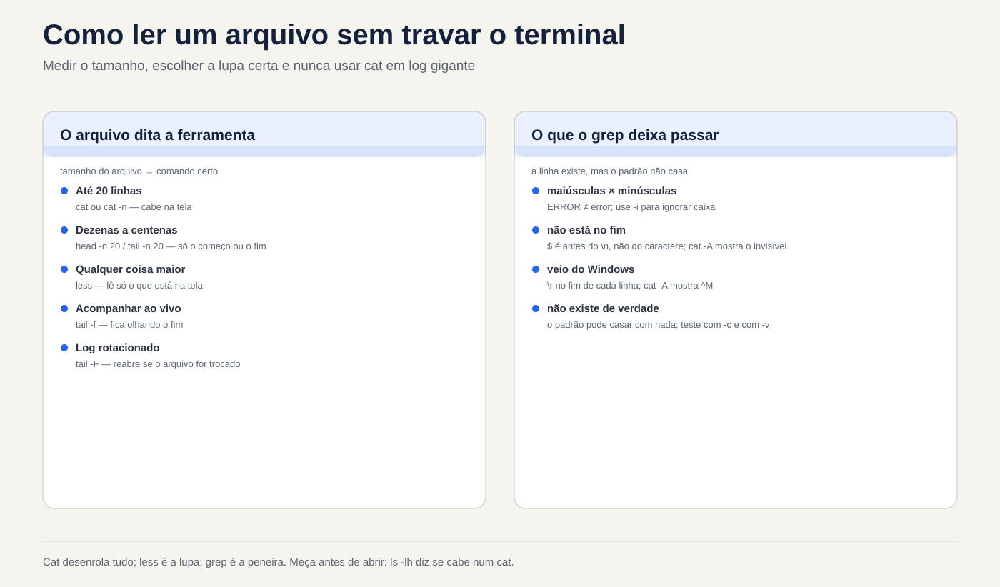
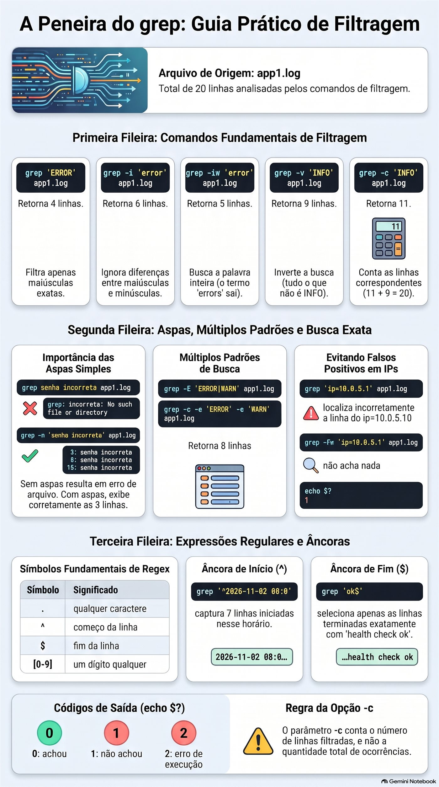

# Aula 1.5 · Ler e procurar texto

Você aprende a ler qualquer arquivo de texto do servidor sem travar o terminal e sem risco de alterá-lo, e a achar em segundos a linha que importa. Pode ser um log de 3 GB, uma configuração de 900 linhas ou uma pasta inteira de arquivos: o método é o mesmo. Medir antes de abrir, ir direto ao ponto e deixar o `grep` peneirar.

| Ficha | Aula 1.5 |
| --- | --- |
| Módulo | M1 · Linha de comando, aula 5 de 10 |
| Quando | Semana 2 |
| Ao final você consegue | Ler um arquivo de qualquer tamanho sem travar o terminal; ir direto ao fim de um log e acompanhá-lo ao vivo, inclusive depois da rotação; contar linhas e ocorrências; achar uma linha num arquivo ou numa pasta inteira; mostrar só as linhas ativas de uma configuração; descobrir por que o `grep` não acha uma linha que você está vendo na tela |
| Itens de prova | LE 013.2 · LPIC-1 103.2 e 103.7 (início) · RHCSA: usar `grep` e expressões regulares para analisar texto |
| Pré-requisitos | Aula 1.4, com o `~/lab13` ainda nas VMs |
| Tempo | Cerca de 2h30 |
| Snapshots | m1a5-inicio e m1a5-fim nas duas VMs |

## 1 · Aquecimento

Três perguntas, de cabeça, antes de ler qualquer coisa. Escreva as respostas; o Gabarito confere no fim.

1. Você apagou um log de 5 GB com `rm`, e o `df` não baixou. Qual comando mostra quem ainda segura o arquivo?
2. Você roda `mv app.log app.log.1` no mesmo sistema de arquivos. O que acontece com o inode?
3. Em `~/lab13/logs`, o que o shell entrega ao `grep` quando você digita `grep erro *.log`? O `.escondido.log` entra?

## 2 · Por que importa

Segunda, 9h. O cliente liga: o sistema caiu de madrugada. Você entra por SSH e digita `cat /var/log/app/app.log`. O arquivo tem 3 GB. O terminal rola por minutos, o `Ctrl+C` demora a responder, e o que aconteceu às 3h passa voando. Você tenta abrir no editor, e o servidor, que já estava sem memória, começa a engasgar.

O admin experiente faz outra coisa. Primeiro mede: `ls -lh` mostra 3 GB, então nada de `cat`. Vai direto ao fim com `tail -n 100`, porque o problema é recente. Peneira com `grep -n -i 'error'` e o horário da queda. Abre cinco linhas em volta do achado com `grep -C 5`. Pede para o cliente testar e acompanha ao vivo com `tail -F`. Em dois minutos ele tem a linha exata para colar no chamado, e não mudou um byte de nada.

O segundo caso: você muda `PermitRootLogin no` no `sshd_config`, reinicia o serviço, e o root continua entrando. Um `sudo grep -rn PermitRootLogin /etc/ssh/` mostra, em três segundos, um arquivo dentro de `sshd_config.d/` que é lido antes e vale mais. Sem o `grep`, isso leva uma tarde.

O terceiro é o mais irritante: o `grep` diz que a linha não existe, mas ela está ali, na sua tela. O arquivo veio do Windows. Esta aula mostra por que isso acontece e como ver o invisível.

## 3 · Modelo mental

> Um arquivo de texto é um rolo de papel com linhas. Cada comando desta aula é um jeito diferente de olhar o rolo, e nenhum deles escreve nele.

- `cat` desenrola o rolo inteiro de uma vez na sua frente. Ótimo para 20 linhas; um desastre para 2 milhões.
- `less` é uma lupa: anda para frente e para trás, pula para o fim, procura uma palavra. Só lê o pedaço que está na tela, por isso abre 3 GB na hora.
- `head` mostra o começo do rolo; `tail` mostra o fim. Com `-f`, o `tail` fica olhando o fim enquanto o rolo cresce.
- `wc` mede o rolo: linhas, palavras e bytes.
- `grep` é uma peneira: passa o rolo inteiro e só deixa sair as linhas que têm o que você pediu.

```text
                 app1.log (20 linhas)
   ┌───────────────────────────────────────────┐
   │  1  08:00:01 INFO  web: servidor iniciado │ ◄── head -n 3
   │  2  08:00:02 INFO  db: conexão aberta     │
   │  3  08:03:15 WARN  web: resposta lenta    │
   │  …                                        │
   │  5  08:06:02 ERROR auth: senha incorreta  │ ◄── grep ERROR deixa passar
   │  …                                        │
   │ 18  08:45:00 INFO  cron: limpeza de /tmp  │ ◄── tail -n 3
   │ 19  08:50:27 INFO  auth: login ok         │
   │ 20  09:00:00 INFO  web: health check ok   │
   └───────────────────────────────────────────┘
      less: a lupa que anda pelo rolo inteiro
      wc -l: 20
```

**A primeira ideia: tudo é linha.** Para essas ferramentas, uma linha termina num caractere invisível, o fim de linha, que se escreve `\n`. Quem não enxerga esse caractere cai nas duas armadilhas desta aula. Um arquivo salvo no Windows termina cada linha com `\r\n`, e aquele `\r` invisível faz o `grep` errar. E uma última linha sem `\n` não entra na conta do `wc -l`.

**A segunda ideia vem da Aula 1.4: o `tail -f` segue o apartamento, não o nome.** Ele abre o arquivo e fica olhando aquele inode. Quando o log é rotacionado com um `mv`, o nome passa a apontar para um arquivo novo, mas o `tail -f` continua no antigo, agora parado.

```text
antes:   app.log ────► inode 5001  ◄── tail -f olhando aqui

         mv app.log app.log.1      (a rotação)

depois:  app.log.1 ──► inode 5001  ◄── tail -f continua aqui, e nada mais chega
         app.log ────► inode 5002  ◄── o programa escreve aqui
```

A correção é uma letra: `tail -F` segue o nome e reabre o arquivo quando ele é trocado. A Quebra B faz você ver isso acontecer.

**Ponte Windows.** No Windows, você abre o Visualizador de Eventos e filtra com o mouse. No Linux, o log é um arquivo de texto, ou o journal, que tem aula própria, e estes seis comandos são o seu filtro. A diferença que mais engana quem vem do PowerShell: o `Select-String` ignora maiúsculas por padrão, e o `grep` não. Para o `grep`, `ERROR` e `error` são textos diferentes até você pedir `-i`.

## 4 · Conceito em camadas

### Essencial

| Comando | O que faz | Quando usar |
| --- | --- | --- |
| `cat arquivo` | Mostra o arquivo inteiro | Arquivo que cabe numa tela |
| `cat -n arquivo` | Mostra com o número de cada linha | Para dizer "linha 37" a alguém |
| `cat -A arquivo` | Mostra os invisíveis: `$` no fim de linha, `^I` no tab, `^M` no `\r` do Windows | Quando o texto parece certo e não funciona |
| `less arquivo` | Abre na lupa | Qualquer coisa maior que uma tela |
| `head -n 20 arquivo` | As primeiras 20 linhas | Cabeçalho, começo de um CSV |
| `tail -n 20 arquivo` | As últimas 20 linhas | O que aconteceu por último num log |
| `tail -f arquivo` | Mostra o fim e espera linhas novas | Acompanhar ao vivo |
| `tail -F arquivo` | Igual, mas reabre o arquivo se ele for trocado | Acompanhar um log que passa pelo logrotate |
| `wc -l arquivo` | Conta linhas | "Quantas tentativas de login?" |
| `grep 'texto' arquivo` | Mostra as linhas que contêm o texto | Achar a linha que importa |

Sem `-n`, o `head` e o `tail` mostram 10 linhas. Isso cai na prova.

**As opções do `grep` que você usa toda semana:**

| Opção | Efeito | Exemplo |
| --- | --- | --- |
| `-i` | Ignora maiúsculas e minúsculas | `grep -i 'error' app1.log` |
| `-n` | Mostra o número da linha | `grep -n 'ERROR' app1.log` |
| `-c` | Conta as linhas que batem, em vez de mostrá-las | `grep -c 'WARN' app1.log` |
| `-v` | Inverte: mostra as linhas que **não** batem | `grep -v 'INFO' app1.log` |
| `-w` | Só a palavra inteira: `error` não pega `errors` | `grep -iw 'error' app1.log` |
| `-e` | Mais de um padrão no mesmo comando | `grep -e 'ERROR' -e 'WARN' app1.log` |
| `-E` | Forma estendida, com a barra vertical como "ou" | No Passo 7 |
| `-F` | Texto literal: o ponto vale só ponto | `grep -F '10.0.5.1' app1.log` |
| `-r` | Procura em todos os arquivos de uma pasta | `sudo grep -r 'Port' /etc/ssh/` |
| `-l` | Mostra só o nome dos arquivos que têm o texto | `grep -rl 'senha' ~/lab13` |
| `-C 3` | Mostra 3 linhas antes e 3 depois de cada achado | `grep -C 3 'timeout' app1.log` |
| `-q` | Não mostra nada; só diz, pelo código de saída, se achou | `grep -q 'ERROR' app1.log; echo $?` |

**As teclas do `less`:**

| Tecla | O que faz |
| --- | --- |
| `Espaço` / `b` | Desce / sobe uma tela |
| `g` / `G` | Vai para a primeira / a última linha |
| `/texto` | Procura para baixo |
| `?texto` | Procura para cima |
| `n` / `N` | Próximo / anterior achado |
| `&texto` | Mostra só as linhas com o texto; `&` e Enter desfaz |
| `F` | Modo ao vivo, como o `tail -f`; `Ctrl+C` sai dele |
| `-N` | Liga e desliga o número das linhas |
| `-S` | Liga e desliga a quebra das linhas longas |
| `q` | Sai |
| `h` | Ajuda com todas as teclas |

### Ponte Windows

| Linux | cmd | PowerShell |
| --- | --- | --- |
| `cat arquivo` | `type arquivo` | `Get-Content arquivo` |
| `less arquivo` | `more arquivo` | `Get-Content arquivo` mais `Out-Host -Paging` |
| `head -n 5 arquivo` | Não tem | `Get-Content arquivo -TotalCount 5` |
| `tail -n 5 arquivo` | Não tem | `Get-Content arquivo -Tail 5` |
| `tail -f arquivo` | Não tem | `Get-Content arquivo -Tail 10 -Wait` |
| `wc -l arquivo` | `find /c /v "" arquivo` | `(Get-Content arquivo).Count` |
| `grep 'texto' arquivo` | `findstr "texto" arquivo` | `Select-String 'texto' arquivo` |
| `grep -i` | `findstr /i` | Já é o padrão do `Select-String` |
| `grep -v` | `findstr /v` | `Select-String -NotMatch` |
| `grep -r` | `findstr /s` | `Get-ChildItem -Recurse` mais `Select-String` |

### Aprofundamento

**Por que o `less` abre 3 GB na hora e o editor não.** O `less` lê só o pedaço que vai mostrar. O editor carrega o arquivo inteiro na memória. Num servidor apertado, abrir um log grande no `vi` piora o problema. E abrir um arquivo de produção num editor só para ler é pedir para salvar uma mudança sem querer. Para ler, `less`. Editor é para editar.

**Atalhos de abertura do `less`.** `less +G arquivo` já abre no fim. `less +F arquivo` já abre no modo ao vivo: `Ctrl+C` para de seguir e deixa você procurar para trás, e `F` volta a seguir. É o `tail -f` com lupa.

**Logs antigos e comprimidos.** O logrotate guarda os logs antigos com outro nome e, às vezes, comprimidos em `.gz`. Para eles existem `zcat`, `zless` e `zgrep`, que funcionam como `cat`, `less` e `grep`, mas abrem o `.gz` sem você descomprimir nada. Na Rocky e na Debian, o próprio `less` também abre `.gz`.

**`tail -f` contra `tail -F`.** O `-f` segue o arquivo que abriu, ou seja, o inode. O `-F` segue o nome: se o arquivo for trocado, ele avisa e reabre. O logrotate tem dois jeitos de rotacionar. No `create`, o padrão, ele faz um `mv` e cria um arquivo novo: o `-f` fica parado no antigo. No `copytruncate`, ele copia e esvazia o original: o `-f` continua funcionando, e avisa `file truncated`.

**Expressão regular, só o começo.** O texto que você dá ao `grep` não é um texto puro: é uma expressão regular. Quatro símbolos já mudam o resultado:

| Símbolo | Significa | Exemplo |
| --- | --- | --- |
| `.` | Qualquer caractere | `10.0.5.1` também pega `10203541` |
| `^` | Começo da linha | `^#` pega as linhas que começam com `#` |
| `$` | Fim da linha | `ok$` pega as linhas que terminam em `ok` |
| `[0-9]` | Um dígito qualquer | `erro [0-9]` pega `erro 5` e `erro 9` |

No `grep`, o `*` significa "zero ou mais do caractere anterior", e não "qualquer coisa" como no shell. O resto das expressões regulares tem aula própria, mais adiante no curso.

**Sempre aspas simples no padrão.** Sem aspas, o shell mexe no padrão antes de o `grep` ver: o espaço separa argumentos, e o `*` e o `[0-9]` podem virar nomes de arquivo. Com aspas simples, o `grep` recebe exatamente o que você digitou.

**O código de saída.** O `grep` termina com 0 quando acha, 1 quando não acha e 2 quando dá erro, como num arquivo inexistente. Scripts usam isso com `grep -q`. Você vê o código com `echo $?` logo depois do comando.

**O `-c` conta linhas, não ocorrências.** Uma linha com três `ERROR` conta 1. Para contar ocorrências existe o `grep -o`, que mostra cada achado numa linha, junto com o `wc -l`. A barra que liga os dois é assunto da Aula 1.6.

**Linha não é evento.** Um erro de Java pode ocupar 40 linhas de stack trace. O `wc -l` e o `grep -c` contam linhas. Antes de dizer ao cliente "foram 40 erros", olhe com `-C` se não é um erro só.

### O que cai na prova

- **LE:** para que servem `cat`, `less`, `head`, `tail`, `wc` e `grep`, e o padrão de 10 linhas do `head` e do `tail`. Perguntas curtas, em inglês, do tipo "which command shows the last lines of a file".
- **LPIC-1 103.2:** as opções de `head` e `tail` (`-n`, `-f`), de `wc` (`-l`, `-w`, `-c`) e o `cat -n`. Também os irmãos para comprimidos: `zcat`, `bzcat` e `xzcat`. O `nl` aparece como alternativa ao `cat -n`; por padrão, ele não numera linhas em branco.
- **LPIC-1 103.7:** `grep` com `-i`, `-v`, `-c`, `-n`, `-l`, `-r`, `-E` e `-F`; `egrep` e `fgrep` como nomes antigos de `grep -E` e `grep -F`; e o básico de expressão regular.
- **RHCSA:** a tarefa vem como problema: achar todas as linhas de um arquivo que contêm algo e guardar o resultado num arquivo. A parte de guardar é a Aula 1.6. O exame é corrigido por script: uma linha a mais ou a menos e a tarefa vale zero. Confira a contagem com `grep -c` antes de entregar.

## 5 · Rocky × Debian

| Ponto | rocky-lab (Rocky 9) | debian-lab (Debian 13) |
| --- | --- | --- |
| Log geral do sistema | `/var/log/messages`, escrito pelo rsyslog | Não existe por padrão: desde o Debian 12 o rsyslog não vem instalado, e os logs ficam só no journal, lido com `journalctl` |
| Log de login e de `sudo` | `/var/log/secure` | Também só no journal |
| Quem pode ler | Os dois arquivos são só do root: use `sudo` | O journal completo exige o grupo `adm` ou `systemd-journal`, ou `sudo` |
| Logs de pacote | `/var/log/dnf.log` | `/var/log/dpkg.log` e `/var/log/apt/history.log` |
| Nome dos logs antigos | `messages-20261101`: com a data e sem compressão | `dpkg.log.1`, `dpkg.log.2.gz`: numerados e comprimidos a partir do segundo |
| `sshd_config` | Permissão 600: só o root lê, então `sudo grep` | Permissão 644: qualquer um lê |
| Versão do `grep` | 3.6: o `egrep` funciona calado | 3.11: o `egrep` funciona, mas avisa que está obsoleto |
| Cor no `grep` | Alias `grep --color=auto` em `/etc/profile.d/` | Alias no `~/.bashrc` do usuário |

Por isso o laboratório usa arquivos que você mesmo cria, iguais nas duas VMs. Os logs de verdade de cada distribuição aparecem nos Bônus e na missão da vida real.

## 6 · Lab guiado

Tudo acontece em `~/lab13/logs`, nas duas VMs. Os arquivos que a Aula 1.3 criou ali estão vazios; hoje eles ganham conteúdo. Faça cada passo na rocky-lab e repita na debian-lab.


*Medir o tamanho, escolher a lupa certa e nunca usar cat em log gigante.*


*O grep não recorta o trecho: ele mostra a linha completa. Teste sempre com uma linha que deve casar e outra que não deve.*


### Passo 1 · Preparar o laboratório

No nó Proxmox, a partir do estado m1a4-fim:

```bash
qm snapshot 201 m1a5-inicio
qm snapshot 202 m1a5-inicio
```

Em cada VM, comece olhando o que já existe:

```bash
cd ~/lab13/logs
ls -la
wc -l *.log
```

Algo como:

```text
  0 app10.log
  0 app1.log
  0 app2.log
  0 erro.log
  0 total
```

Tudo zero: o `touch` cria arquivo vazio. E o `.escondido.log` não aparece, porque o `*` não pega nome que começa com ponto. Se sobraram os nomes estranhos da Aula 1.3, tire-os agora com `rm -fv -- -l 'relatorio final.txt'`.

Agora o `app1.log` ganha 20 linhas de um log realista, e o `grande.log` ganha 200 mil:

```bash
cat > app1.log <<'EOF'
2026-11-02 08:00:01 INFO  web: servidor iniciado na porta 8080
2026-11-02 08:00:02 INFO  db: conexão aberta com pg01
2026-11-02 08:03:15 WARN  web: resposta lenta em /relatorios (2,8 s)
2026-11-02 08:05:40 INFO  auth: login ok usuario=ana ip=10.0.5.21
2026-11-02 08:06:02 ERROR auth: senha incorreta usuario=root ip=203.0.113.50
2026-11-02 08:06:05 ERROR auth: senha incorreta usuario=root ip=203.0.113.50
2026-11-02 08:06:09 ERROR auth: senha incorreta usuario=admin ip=203.0.113.50
2026-11-02 08:10:00 INFO  cron: backup diário iniciado
2026-11-02 08:12:31 error db: timeout ao consultar pedidos (30 s)
2026-11-02 08:12:32 WARN  web: erro 502 devolvido ao cliente
2026-11-02 08:15:00 INFO  cron: backup diário concluído
2026-11-02 08:20:44 INFO  auth: login ok usuario=bruno ip=10.0.5.30
2026-11-02 08:21:10 ERROR disk: /var com 95% de uso
2026-11-02 08:25:00 INFO  web: deploy v2.4.1 aplicado
2026-11-02 08:30:12 WARN  db: réplica pg02 atrasada 40 s
2026-11-02 08:31:00 INFO  auth: logout usuario=ana
2026-11-02 08:40:03 WARN  web: 3 errors no último minuto
2026-11-02 08:45:00 INFO  cron: limpeza de /tmp concluída
2026-11-02 08:50:27 INFO  auth: login ok usuario=rodrigo ip=10.0.5.10
2026-11-02 09:00:00 INFO  web: health check ok
EOF
printf 'linha %s\n' $(seq 1 200000) > grande.log
ls -lh app1.log grande.log
```

O `cat > arquivo <<'EOF'` grava tudo o que vem até a linha `EOF`. Por enquanto, use como receita; a Aula 1.6 explica cada pedaço. O `printf` repete o modelo `linha N` para cada número que o `seq` gera. O `grande.log` deve ficar com algo como 2,4M.

O `app1.log` foi montado de propósito: tem `ERROR` em maiúsculas, um `error` em minúsculas, um `errors` dentro de um aviso e dois IPs parecidos. Cada um desses detalhes vira uma armadilha nos próximos passos.

### Passo 2 · `cat`: ver tudo e ver o invisível

```bash
cat app1.log
cat -n app1.log
cat -A app1.log
```

O `-n` numera as linhas: 20. O `-A` põe um `$` no fim de cada linha. É o `\n` que você não via. Guarde essa imagem: na Quebra A, um arquivo vindo do Windows mostra `^M$` no lugar do `$`.

Agora faça o erro uma vez, de propósito:

```bash
cat grande.log
```

São 200 mil linhas passando pela tela. Aperte `Ctrl+C`. Agora imagine 3 GB num SSH lento, de madrugada.

**Decida 1 · O log de 2 GB.** Cenário: o cliente diz que a aplicação deu erro agora há pouco. O `/var/log/app/app.log` tem 2 GB. Qual é o seu primeiro comando para ver o erro?

- **A)** `cat /var/log/app/app.log`
- **B)** `vi /var/log/app/app.log`
- **C)** `tail -n 100 /var/log/app/app.log`
- **D)** `head -n 100 /var/log/app/app.log`

Escolha a letra antes de olhar a tabela.

| Se você marcou | Resultado | Por quê |
| --- | --- | --- |
| A | ❌ Errada | São minutos de texto rolando, e o erro de agora há pouco passa voando no fim. |
| B | ❌ Errada | O editor carrega os 2 GB na memória de um servidor que já tem problema, e uma tecla errada salva uma mudança. |
| C | ✅ Certa | O que é recente está no fim. Cem linhas aparecem na hora, e você decide o próximo passo. |
| D | ❌ Errada | O começo do arquivo são dias ou semanas atrás. |

**Para fixar:** problema recente mora no fim do arquivo. Meça com `ls -lh` e depois use `tail` ou `less +G`.

### Passo 3 · `less`: a lupa

```bash
less grande.log
```

Dentro do `less`, faça nesta ordem:

1. `G`: vai para a última linha, `linha 200000`. Foi instantâneo.
2. `g`: volta para a primeira.
3. `/linha 123456` e Enter: pula para a linha procurada e a destaca.
4. `n`: procura a próxima. O `less` responde `Pattern not found`, porque só existe uma.
5. `-N` e Enter: liga os números de linha. Repita para desligar.
6. `q`: sai.

Agora o filtro, que pouca gente conhece:

```bash
less app1.log
```

Digite `&ERROR` e Enter. Ficam só as 4 linhas com `ERROR`. Digite `&` e Enter para ver tudo de novo, e `q` para sair. Por fim, `less +G app1.log` abre já no fim.

**Decida 2 · Só conferir uma configuração.** Cenário: num servidor de cliente, você quer apenas conferir o valor de `PermitRootLogin` no `/etc/ssh/sshd_config`. Como abre o arquivo?

- **A)** `sudo vi /etc/ssh/sshd_config` e sai com `:q`
- **B)** `sudo less /etc/ssh/sshd_config` e procura com `/PermitRootLogin`
- **C)** `sudo nano /etc/ssh/sshd_config`
- **D)** `sudo cat /etc/ssh/sshd_config` e procura com os olhos

Escolha a letra antes de olhar a tabela.

| Se você marcou | Resultado | Por quê |
| --- | --- | --- |
| A | ❌ Errada | Funciona, mas é um editor aberto como root no arquivo que controla o acesso ao servidor. Um `:wq` por hábito, ou um `dd` sem querer, muda a produção. |
| B | ✅ Certa | O `less` não sabe gravar. Você procura com `/` e sai com `q`, sem risco nenhum. |
| C | ❌ Errada | O mesmo risco da A: um `Ctrl+O` salva. |
| D | ❌ Incompleta | Não estraga nada, mas o arquivo tem mais de cem linhas, e procurar com os olhos é lento e falha. |

**Para fixar:** para ler, use uma ferramenta que não sabe escrever. E, quando você já sabe o que procura, `sudo grep -n 'PermitRootLogin' /etc/ssh/sshd_config` é ainda mais rápido. O Passo 8 volta a esse arquivo.

### Passo 4 · `head` e `tail`: as pontas do rolo

```bash
head app1.log
head -n 3 app1.log
tail -n 3 app1.log
tail -n +18 app1.log
head -n 7 app1.log | tail -n 3
```

O primeiro mostra 10 linhas, o padrão. O `tail -n +18` quer dizer "da linha 18 até o fim": aqui, as mesmas três últimas. O último comando mostra só as linhas 5 a 7, as três senhas incorretas. A barra `|` entrega a saída do `head` ao `tail`; ela é o centro da Aula 1.6.

**Ao vivo.** Abra uma segunda sessão SSH na mesma VM. Na sessão 1:

```bash
touch ~/lab13/logs/ao-vivo.log
tail -f ~/lab13/logs/ao-vivo.log
```

Na sessão 2, rode duas ou três vezes:

```bash
echo "$(date '+%F %T') INFO  web: teste ao vivo" >> ~/lab13/logs/ao-vivo.log
```

Cada linha aparece na sessão 1 no mesmo instante. O `>>` acrescenta no fim do arquivo, sem apagar o que existe; também é assunto da 1.6. Aperte `Ctrl+C` na sessão 1 para parar.

**Decida 3 · De olho no deploy.** Cenário: o desenvolvedor vai publicar a versão nova daqui a cinco minutos. A aplicação reinicia e recria o arquivo de log ao subir. Ele pede que você fique de olho no log enquanto testa. O que você roda?

- **A)** `tail -n 50 app.log`, repetido a cada minuto
- **B)** `tail -F app.log`
- **C)** `tail -f app.log`
- **D)** `less app.log`

Escolha a letra antes de olhar a tabela.

| Se você marcou | Resultado | Por quê |
| --- | --- | --- |
| A | ❌ Errada | Você perde o que passa entre uma rodada e outra e passa o deploy digitando. |
| B | ✅ Certa | Mostra cada linha nova na hora e, quando a aplicação recria o arquivo, reabre o novo sozinho. |
| C | ❌ Incompleta | Funciona até a aplicação recriar o log. Depois disso, fica olhando o arquivo antigo, e a tela fica parada justo no momento do teste. |
| D | ❌ Errada | O `less` mostra o arquivo como estava ao abrir. Só acompanha se você apertar `F`. |

**Para fixar:** ao vivo, use `tail -F`, com F maiúsculo, como padrão. Ele faz tudo o que o `-f` faz e não para quando o arquivo é trocado.

### Passo 5 · `wc`: medir antes de abrir

```bash
wc app1.log
wc -l app1.log grande.log
wc -l < app1.log
```

O primeiro mostra três números: linhas, palavras e bytes, nesta ordem. O segundo mostra `20`, `200000` e o total. O terceiro mostra só o número, sem o nome do arquivo, que é o formato que um script quer. O `<` também é da 1.6.

Agora a armadilha da última linha:

```bash
printf 'primeira\nsegunda' > sem-fim.txt
wc -l sem-fim.txt
cat -A sem-fim.txt
```

O `wc -l` responde 1, para um arquivo com duas linhas. O `cat -A` mostra por quê: `primeira$` tem fim de linha, e `segunda` não tem; até o seu prompt aparece colado nela. O `wc -l` conta os `\n`, não as linhas que você vê. Na vida real, isso aparece em CSV exportado por outro sistema, numa contagem que sempre dá um a menos, e no `crontab`, que recusa ou ignora a última linha sem fim de linha, conforme a versão.

**Decida 4 · Quantos erros houve?** Cenário: o gerente pergunta quantos erros a aplicação Java teve hoje. `grep -c 'Exception' app-java.log` responde 120. O que você diz?

- **A)** "Foram 120 erros."
- **B)** "Ainda não sei. Vou olhar alguns com `grep -C 5`, porque um erro de Java ocupa várias linhas."
- **C)** "Uns 120, mais ou menos."
- **D)** Roda `wc -l app-java.log` e informa o total.

Escolha a letra antes de olhar a tabela.

| Se você marcou | Resultado | Por quê |
| --- | --- | --- |
| A | ❌ Errada | O `-c` conta linhas. Um único erro de Java repete `Exception` em várias linhas, como nas que começam com `Caused by`. Podem ser 30 erros, ou 4. |
| B | ✅ Certa | Três exemplos com contexto mostram quantas linhas cada erro ocupa. Aí o número vira informação. |
| C | ❌ Errada | O mesmo erro da A, só que com dúvida na voz. |
| D | ❌ Errada | Conta tudo, inclusive as linhas de INFO. |

**Para fixar:** `grep -c` e `wc -l` contam linhas, e linha não é evento. Antes de um número ir para um relatório, olhe três exemplos com `-C`.

### Passo 6 · `grep`: a peneira

```bash
grep 'ERROR' app1.log
grep -c 'ERROR' app1.log
grep -i 'error' app1.log
grep -iw 'error' app1.log
grep -n 'senha incorreta' app1.log
grep -v 'INFO' app1.log
grep -c 'INFO' app1.log
```

O que você deve ver:

| Comando | Resultado | O que ensina |
| --- | --- | --- |
| `grep 'ERROR'` | 4 linhas | Só maiúsculas: o `error` do `db` fica de fora |
| `grep -c 'ERROR'` | `4` | O número, sem as linhas |
| `grep -i 'error'` | 6 linhas | Entram o `error` do `db` e o aviso com `3 errors` |
| `grep -iw 'error'` | 5 linhas | O `errors` sai: não é a palavra inteira |
| `grep -n 'senha incorreta'` | Linhas 5, 6 e 7 | O número na frente de cada linha |
| `grep -v 'INFO'` | 9 linhas | Tudo o que não é INFO |
| `grep -c 'INFO'` | `11` | E 11 mais 9 dá 20, o arquivo todo |

Na tela, o trecho achado aparece colorido. É o alias `--color=auto` da tabela Rocky × Debian.

**Decida 5 · O número para o gerente.** Cenário: o `app1.log` é o log de hoje, e o gerente quer o número de erros. A equipe escreve `ERROR` quase sempre, mas o módulo `db` escreve `error` em minúsculas. Que comando dá o número certo?

- **A)** `grep -c 'ERROR' app1.log`, que responde 4
- **B)** `grep -ci 'error' app1.log`, que responde 6
- **C)** `grep -ciw 'error' app1.log`, que responde 5
- **D)** `grep -c 'error' app1.log`, que responde 1

Escolha a letra antes de olhar a tabela.

| Se você marcou | Resultado | Por quê |
| --- | --- | --- |
| A | ❌ Errada | Deixa de fora o timeout do banco, que é um erro escrito em minúsculas. |
| B | ❌ Errada | Conta também a linha `WARN web: 3 errors`, que é um aviso, não um erro. |
| C | ✅ Certa | O `-i` junta maiúsculas e minúsculas, e o `-w` tira o `errors`. São 5 erros. |
| D | ❌ Errada | Só acha a linha em minúsculas. |

**Para fixar:** leia as linhas antes de confiar num número. O `-i` amplia a busca; o `-w` corta o que só contém a palavra dentro de outra.

### Passo 7 · Aspas, mais de um padrão e o ponto

```bash
grep senha incorreta app1.log
grep 'senha incorreta' app1.log
grep -E 'ERROR|WARN' app1.log
grep -c -e 'ERROR' -e 'WARN' app1.log
grep 'ip=10.0.5.1' app1.log
grep -Fw 'ip=10.0.5.1' app1.log; echo $?
grep '^2026-11-02 08:0' app1.log
grep 'ok$' app1.log
```

O primeiro mostra o que o espaço faz sem aspas. Algo como:

```text
grep: incorreta: No such file or directory
app1.log:2026-11-02 08:06:02 ERROR auth: senha incorreta usuario=root ip=203.0.113.50
...
```

O `grep` procurou `senha` em dois arquivos: um chamado `incorreta`, que não existe, e o `app1.log`. Por isso as linhas vêm com o nome do arquivo na frente. Com aspas, o resultado é o certo: as três linhas.

Os dois comandos seguintes dão o mesmo conjunto, 8 linhas de aviso e de erro. O `-E` liga a forma estendida, em que `|` quer dizer "ou"; o `-e` repetido faz o mesmo sem expressão nenhuma.

Agora o ponto. O `grep 'ip=10.0.5.1'` mostra uma linha, mas é a do `ip=10.0.5.10`. O texto procurado está dentro do IP maior. Com `-Fw`, não aparece nada, e o `echo $?` mostra `1`: não achou. O `-F` faz o ponto valer só ponto, e o `-w` exige que o achado termine ali.

Por último, as âncoras. O `^2026-11-02 08:0` pega as 7 linhas antes das 8h10. O `ok$` pega só o `health check ok`: as linhas de `login ok` têm mais coisa depois do `ok`.

**Decida 6 · Tudo menos INFO.** Cenário: para a reunião, você quer as linhas de aviso e de erro do `app1.log`, todas. Qual comando?

- **A)** `grep WARN ERROR app1.log`
- **B)** `grep -v 'INFO' app1.log`
- **C)** `grep -E 'WARN|ERROR' app1.log`
- **D)** `grep 'WARN|ERROR' app1.log`

Escolha a letra antes de olhar a tabela.

| Se você marcou | Resultado | Por quê |
| --- | --- | --- |
| A | ❌ Errada | O `ERROR` vira nome de arquivo: aparece `No such file or directory`, e só vêm os avisos. |
| B | ✅ Certa | São 9 linhas: 4 avisos, 4 `ERROR` e o `error` em minúsculas do banco. Dizer o que você não quer pega até o que você não previu. |
| C | ❌ Incompleta | São 8 linhas, e falta justamente o timeout do banco, em minúsculas. Com `-iE` ficaria certo. |
| D | ❌ Errada | Sem `-E`, a barra vertical é um caractere comum. O `grep` procura o texto `WARN` seguido de barra e de `ERROR`, e não acha nada. |

**Para fixar:** às vezes o jeito mais seguro é excluir o que você não quer. O `-v` não depende de você ter adivinhado todas as grafias.

**Decida 7 · O IP que não existe.** Cenário: a equipe de segurança pergunta se o IP 10.0.5.1 acessou o sistema hoje. Você roda `grep 'ip=10.0.5.1' app1.log`, e aparece uma linha. O que responde?

- **A)** "Sim, acessou: está no log."
- **B)** "Não. A linha é do 10.0.5.10, e com `grep -Fw 'ip=10.0.5.1'` não aparece nada."
- **C)** "Não dá para saber: o `grep` não é confiável para IP."
- **D)** "Sim, uma vez."

Escolha a letra antes de olhar a tabela.

| Se você marcou | Resultado | Por quê |
| --- | --- | --- |
| A | ❌ Errada | O `10.0.5.1` está dentro do `10.0.5.10`. Você acaba de acusar a máquina errada. |
| B | ✅ Certa | Você leu a linha, viu o IP de verdade e confirmou com a busca exata. |
| C | ❌ Errada | O `grep` é confiável. O padrão é que estava frouxo. |
| D | ❌ Errada | É o mesmo erro da A. |

**Para fixar:** para IP, usuário e número, use `-w`; para texto com ponto, use `-F`. Juntos: `grep -Fw`.


*-i amplia, -w corta, -F faz o ponto valer ponto, -v exclui; e sempre aspas simples.*

### Passo 8 · Procurar em pastas e em configurações

```bash
grep -rn 'senha' ~/lab13
grep -rl 'senha' ~/lab13
grep -C 2 'timeout' app1.log
```

O `-r` passa por todos os arquivos da pasta e das subpastas, e o `-n` diz a linha; juntos, você tem endereço completo, como `/home/rodrigo/lab13/logs/app1.log:5:`. O `-l` mostra só o nome do arquivo. É o que você quer quando a pergunta é "em qual arquivo está isso?".

O `-C 2` mostra as linhas 7 a 11 e conta uma história: às 08:12:31 o banco deu timeout, e um segundo depois o site devolveu erro 502 ao cliente. Sozinha, cada linha é um sintoma. Com o contexto, você tem a causa.

Agora uma configuração de verdade, só lendo:

```bash
sudo grep -rn 'PermitRootLogin' /etc/ssh/
sudo grep -Ev '^[[:space:]]*(#|$)' /etc/ssh/sshd_config
```

O primeiro mostra todas as linhas com `PermitRootLogin`, no arquivo principal e na pasta `sshd_config.d/`. Algo como `/etc/ssh/sshd_config:40:#PermitRootLogin prohibit-password`. Na Rocky, pode aparecer também um arquivo dentro de `sshd_config.d/`, se a instalação liberou o login do root.

O segundo é a receita mais útil desta aula: mostra só as linhas ativas. Lendo o padrão: `^` é o começo, `[[:space:]]*` são espaços ou tabs, zero ou mais, e `(#|$)` é um `#` ou o fim da linha. O `-v` tira tudo isso. Sobram as linhas que contam. Um arquivo de mais de cem linhas vira algo como seis a dez. E a primeira delas costuma ser `Include /etc/ssh/sshd_config.d/*.conf`, que explica o caso do Por que importa: o que está na pasta é lido antes do resto, e no `sshd` vale o primeiro valor lido.

**Decida 8 · Só o que vale.** Cenário: você assumiu um servidor e quer colar no chamado só as linhas ativas do `/etc/ssh/sshd_config`, sem comentários e sem linhas em branco. Qual comando?

- **A)** `grep -v '#' /etc/ssh/sshd_config`
- **B)** `sudo grep -Ev '^[[:space:]]*(#|$)' /etc/ssh/sshd_config`
- **C)** `sudo grep '^[A-Z]' /etc/ssh/sshd_config`
- **D)** `sudo cat /etc/ssh/sshd_config`, apagando os comentários à mão no chamado

Escolha a letra antes de olhar a tabela.

| Se você marcou | Resultado | Por quê |
| --- | --- | --- |
| A | ❌ Errada | Deixa as linhas em branco e tira qualquer linha com `#` no meio. Na Rocky, sem `sudo`, nem abre: `Permission denied`. |
| B | ✅ Certa | Tira comentários, inclusive os recuados, e linhas vazias. Sobra exatamente o que o `sshd` usa. |
| C | ❌ Incompleta | Perde as linhas recuadas dentro de um bloco `Match`, que costumam ser as mais perigosas do arquivo. |
| D | ❌ Errada | É lento, e na pressa você apaga uma linha ativa ou deixa um comentário. |

**Para fixar:** comentário é linha que **começa** com `#`, talvez depois de espaços. Guarde a receita do item B: ela serve para quase todo arquivo de configuração do Linux.

### Protocolo · Ler um log sem medo

1. **Meça.** `ls -lh arquivo` e, se precisar, `wc -l arquivo`.
2. **Vá à ponta certa.** Problema recente: `tail -n 100` ou `less +G`. Início do arquivo: `head`.
3. **Peneire com aspas simples.** `grep -n -i 'texto' arquivo`; para IP e números, `-Fw`.
4. **Abra o contexto.** `grep -C 5`, porque linha não é evento.
5. **Acompanhe ao vivo, se precisar.** `tail -F arquivo`.

Nunca: `cat` num arquivo que você não mediu, nem editor para ler arquivo de produção.

## 7 · Quebre e conserte

Duas quebras que todo admin encontra cedo ou tarde. Nenhuma mexe no sistema: tudo acontece em arquivos seus, dentro de `~/lab13/logs`. Em cada uma, siga a ordem: quebre, preveja antes de olhar, descubra a causa com as ferramentas da aula, decida, conserte e verifique.

### Quebra A · O arquivo que veio do Windows

**Quebre.** Este `printf` cria um arquivo de configuração do jeito que o Bloco de Notas do Windows cria:

```bash
cd ~/lab13/logs
printf 'PORTA=8080\r\nMODO=producao\r\n' > config-windows.env
cat config-windows.env
```

O `cat` mostra duas linhas normais:

```text
PORTA=8080
MODO=producao
```

**Preveja.** Agora você vai perguntar ao `grep` quantas linhas terminam em `producao`. Escreva o número antes de rodar.

```bash
grep -c 'producao$' config-windows.env
grep -c 'producao' config-windows.env
```

O primeiro responde `0`. O segundo responde `1`. A palavra está lá, mas não está no fim da linha.

**Descubra.**

```bash
cat -A config-windows.env
od -c config-windows.env
file config-windows.env
```

Algo como:

```text
PORTA=8080^M$
MODO=producao^M$
0000000   P   O   R   T   A   =   8   0   8   0  \r  \n   M   O   D   O
0000020   =   p   r   o   d   u   c   a   o  \r  \n
0000033
config-windows.env: ASCII text, with CRLF line terminators
```

Três ferramentas, a mesma resposta. Antes de cada `\n` existe um `\r`, que o `cat -A` mostra como `^M` e o `od -c` mostra pelo nome. O Windows termina cada linha com dois caracteres, `\r\n`; o Linux, só com `\n`. Para o `grep`, o `$` é o ponto logo antes do `\n`. Ali está o `\r`, não o `o` de `producao`.

E por que o `cat` não mostrou nada estranho? O terminal entende o `\r` como "volte ao começo da linha", como o carro de uma máquina de escrever. Como nada vem depois dele, a tela fica igual.

Se o `file` responder `command not found`, instale-o só na VM do lab: `sudo dnf install -y file` na Rocky ou `sudo apt install -y file` na Debian. O `cat -A` e o `od` existem em qualquer Linux.

**Decida 9 · O `.env` do desenvolvedor.** Cenário: o desenvolvedor editou o `.env` da aplicação no notebook dele, com Windows, e mandou por e-mail. Você copiou o arquivo para o servidor, e a aplicação não sobe: `modo inválido: producao`. Mas está escrito `producao`. O que você faz primeiro?

- **A)** Abre o arquivo no `vi`, apaga a linha e digita de novo
- **B)** Roda `cat -A` no arquivo e, vendo `^M`, converte as quebras de linha
- **C)** Reinicia a aplicação mais uma vez
- **D)** Pede ao desenvolvedor que mande o arquivo de novo

Escolha a letra antes de olhar a tabela.

| Se você marcou | Resultado | Por quê |
| --- | --- | --- |
| A | ❌ Incompleta | Pode resolver esta linha, mas você não descobre a causa, o `\r` continua nas outras e, na próxima vez, você perde o mesmo tempo. |
| B | ✅ Certa | O `^M` explica a mensagem: a aplicação leu `producao` seguido de um `\r`. Um comando corrige o arquivo inteiro. |
| C | ❌ Errada | O arquivo continua igual, e o erro também. |
| D | ❌ Errada | Ele manda pelo mesmo caminho, e o arquivo chega igual. |

**Para fixar:** quando o texto parece certo e o Linux discorda, rode `cat -A` antes de qualquer outra coisa.

**Conserte.**

```bash
cp config-windows.env config-windows.env.bak
sed -i 's/\r$//' config-windows.env
```

Use como receita; o `sed` tem aula própria. O `s/\r$//` troca o `\r` do fim de cada linha por nada, e o `-i` grava a mudança no próprio arquivo. Por isso a cópia vem antes: o `-i` não pede confirmação. Existe também o `dos2unix`, que faz o mesmo, mas nem sempre está instalado. O `sed` está em todo Linux.

**Verifique.**

```bash
cat -A config-windows.env
grep -c 'producao$' config-windows.env
file config-windows.env
```

Agora as linhas terminam só em `$`, o `grep` responde `1` e o `file` diz apenas `ASCII text`.

**A mesma quebra num script.** É aqui que ela mais aparece na vida real:

```bash
printf '#!/bin/bash\r\necho "script rodou"\r\n' > script-windows.sh
chmod +x script-windows.sh
./script-windows.sh
```

O `chmod +x` deixa o arquivo ser executado; permissões também têm aula própria. Algo como:

```text
-bash: ./script-windows.sh: /bin/bash^M: bad interpreter: No such file or directory
```

O `^M` está na própria mensagem: o sistema procurou um programa chamado `/bin/bash` seguido de `\r`, e ele não existe. Conserte com o mesmo `sed -i 's/\r$//' script-windows.sh` e rode de novo: aparece `script rodou`. Guarde a dupla `bad interpreter` e `^M`. Quando a vir, você já sabe a causa.

### Quebra B · O `tail -f` que parou

Você vai precisar de duas sessões SSH na mesma VM, como no Passo 4.

**Prepare.** Na sessão B:

```bash
mkdir -p ~/lab13/logs/rot
cd ~/lab13/logs/rot
echo "$(date '+%T') linha 1" > app.log
```

Na sessão A:

```bash
tail -f ~/lab13/logs/rot/app.log
```

**Quebre.** Na sessão B, rode uma linha por vez e olhe a sessão A depois de cada uma:

```bash
echo "$(date '+%T') antes da rotação" >> app.log
mv app.log app.log.1
echo "$(date '+%T') depois da rotação" >> app.log
```

O `mv` faz o que o `logrotate` faz toda noite num servidor: muda o nome do log atual, e a aplicação passa a escrever num arquivo novo, com o nome antigo.

**Preveja.** Antes de olhar a sessão A: a linha "antes" aparece? E a "depois"?

A "antes" aparece. A "depois", não: a tela fica parada. Agora, na sessão B:

```bash
echo "$(date '+%T') escrita no arquivo antigo" >> app.log.1
```

Esta aparece na sessão A. O `tail -f` continua acompanhando o arquivo que agora se chama `app.log.1`.

**Descubra.** Na sessão B:

```bash
ls -li
ls -l /proc/$(pgrep -n tail)/fd
```

Algo como:

```text
16777300 -rw-r--r--. 1 rodrigo rodrigo 28 Nov  2 10:21 app.log
16777299 -rw-r--r--. 1 rodrigo rodrigo 94 Nov  2 10:22 app.log.1
...
lr-x------. 1 rodrigo rodrigo 64 Nov  2 10:22 3 -> /home/rodrigo/lab13/logs/rot/app.log.1
lr-x------. 1 rodrigo rodrigo 64 Nov  2 10:22 4 -> anon_inode:inotify
```

Leia como na Aula 1.4: o `mv` não muda o inode. O `app.log.1` tem o número que o `app.log` tinha quando o `tail` o abriu. O `pgrep -n tail` acha o processo `tail` mais recente, e a pasta `fd` desse processo, dentro de `/proc`, lista os arquivos que ele mantém abertos. O descritor 3 aponta para `app.log.1`. O `tail -f` segue o arquivo que abriu, não o nome. É o desenho do Modelo mental, agora na sua tela.

**Decida 10 · O monitor parado.** Cenário: o `logrotate` roda toda noite à meia-noite. A equipe deixa um `tail -f` do log da aplicação aberto numa tela da sala. Toda manhã, a tela está parada desde a meia-noite. O que você muda?

- **A)** Troca o `tail -f` por `tail -F`
- **B)** Cria um agendamento que reinicia o `tail` toda hora
- **C)** Troca por `less +F`
- **D)** Reinicia a aplicação depois de cada rotação

Escolha a letra antes de olhar a tabela.

| Se você marcou | Resultado | Por quê |
| --- | --- | --- |
| A | ✅ Certa | O `-F` segue o nome: quando o arquivo é trocado, ele reabre o novo sozinho. |
| B | ❌ Errada | É um remendo. A tela ainda fica até uma hora parada, e você ganhou mais uma coisa para manter. |
| C | ❌ Errada | No modo `F`, o `less` também acompanha o arquivo que abriu e para do mesmo jeito. |
| D | ❌ Errada | O problema está em quem lê, não em quem escreve. A aplicação já escreve no arquivo novo. |

**Para fixar:** `tail -f` segue o arquivo aberto; `tail -F` segue o nome. Log que roda pede `-F`.

**Conserte.** Na sessão A, aperte `Ctrl+C` e rode:

```bash
tail -F ~/lab13/logs/rot/app.log
```

Na sessão B, faça outra rotação:

```bash
mv app.log app.log.2
echo "$(date '+%T') depois da segunda rotação" >> app.log
```

Na sessão A, algo como:

```text
tail: '/home/rodrigo/lab13/logs/rot/app.log' has become inaccessible: No such file or directory
tail: '/home/rodrigo/lab13/logs/rot/app.log' has appeared;  following new file
10:25:40 depois da segunda rotação
```

A mensagem exata varia com a versão e com a velocidade da troca; às vezes é `has been replaced;  following new file`. O que importa é a última linha: ela apareceu.

**Verifique.** Na sessão B:

```bash
echo "$(date '+%T') teste final" >> app.log
```

A linha aparece na sessão A. Aperte `Ctrl+C` para sair.

Uma nota para depois: alguns `logrotate` usam `copytruncate`, que copia o conteúdo para o arquivo antigo e esvazia o atual sem trocar o inode. Nesse caso até o `-f` sobrevive, e mostra algo como `file truncated`. Como você nem sempre sabe qual é o caso, `-F` é o padrão seguro.

### E o snapshot?

Nenhuma quebra mexeu no sistema, só em arquivos seus dentro de `~/lab13`. Não precisa voltar nada. Se quiser refazer a aula do zero, `qm rollback 201 m1a5-inicio` no nó Proxmox, e o mesmo com `202` para a Debian, volta ao começo do Passo 1.

### Bônus Debian · Onde foram parar os logs?

Quem vem de tutoriais antigos procura `/var/log/syslog` e `/var/log/auth.log`. Na Debian 13 eles não existem: o `rsyslog` não vem instalado, e os logs do sistema ficam só no journal do systemd.

```bash
ls /var/log
ls /var/log/syslog
sudo journalctl -n 20
sudo journalctl -f
```

O segundo responde `No such file or directory`. O `journalctl -n 20` é o `tail -n 20` do journal, e o `journalctl -f` é o `tail -f`; saia com `Ctrl+C`. Sem `sudo`, o `journalctl` pode mostrar só as suas mensagens, com uma dica: quem está nos grupos `adm` ou `systemd-journal` vê tudo. O journal tem aula própria. Por enquanto basta saber que ele entrega texto, e texto o `grep` peneira:

```bash
sudo journalctl -b | grep -ic 'error'
```

Os logs de pacotes continuam em arquivo:

```bash
tail -n 5 /var/log/dpkg.log
grep ' install ' /var/log/dpkg.log | tail -n 5
tail -n 20 /var/log/apt/history.log
ls /var/log/dpkg.log*
```

O segundo mostra os cinco últimos pacotes instalados. O `history.log` mostra cada `apt install` com a data e a linha de comando completa: é o primeiro lugar para responder "quem instalou isso, e quando?". Se algum deles responder `Permission denied`, repita com `sudo`. Se o `ls` mostrar um `dpkg.log.2.gz`, ele está compactado, e o `zgrep` lê sem descompactar:

```bash
zgrep -c ' install ' /var/log/dpkg.log.2.gz
```

### Bônus Rocky · Os logs clássicos

A Rocky mantém o `rsyslog` e os arquivos de sempre, legíveis só pelo root:

```bash
ls /var/log/messages* /var/log/secure*
sudo tail -n 5 /var/log/secure
sudo grep -c 'COMMAND=' /var/log/secure
sudo grep -c 'denied' /var/log/audit/audit.log
```

O `ls` mostra o arquivo atual e os já rodados, com a data no nome, algo como `messages-20261101`. O `tail` do `secure` traz uma surpresa: a última linha é você. Algo como:

```text
Nov  2 10:30:12 rocky-lab sudo[2412]: rodrigo : TTY=pts/0 ; PWD=/home/rodrigo/lab13/logs ; USER=root ; COMMAND=/usr/bin/tail -n 5 /var/log/secure
```

Todo `sudo` fica registrado: quem, de qual terminal, em qual pasta e com qual comando. O `grep -c 'COMMAND='` conta quantos `sudo` rodaram desde a última rotação. É assim que se responde "quem mexeu no servidor ontem à noite?".

O último conta as negações do SELinux no log de auditoria. Num lab novo, o normal é zero ou perto disso. Num servidor em que "a aplicação não consegue ler o arquivo, mas a permissão está certa", esse número costuma ser a resposta. A aula de SELinux começa por aqui.

### A lição

O que você vê na tela pode não ser o que existe. O texto pode carregar caracteres invisíveis, e o `cat -A` mostra todos. O nome pode já apontar para outro arquivo, e só o `tail -F` segue o nome. Por trás das duas quebras está o mesmo hábito do Protocolo: antes de concluir, olhe o que o arquivo realmente é.

## 8 · Armadilhas

| Armadilha | O que acontece | Como evitar |
| --- | --- | --- |
| `cat` num log enorme | Minutos de texto rolando, e o terminal não responde | `ls -lh` antes; depois `tail` ou `less +G` |
| Editor para ler configuração de produção | Um `:wq` por hábito muda o servidor | `less`, ou `grep -n` se você sabe o que procura |
| `head` para ver um erro recente | Mostra o passado do arquivo | Problema recente está no fim: `tail` |
| Texto com espaço sem aspas | A segunda palavra vira nome de arquivo: `No such file or directory` | Aspas simples sempre |
| Esquecer que o `grep` diferencia maiúsculas | `ERROR` não acha `error` | `-i`, e leia as linhas antes de contar |
| `-i` sem `-w` | `errors` e `terror` entram na conta | `-iw` para palavra inteira |
| Ponto em IP | `10.0.5.1` acha `10.0.5.10` | `grep -Fw` |
| `grep -c` como número de eventos | Um erro de várias linhas conta várias vezes | Três exemplos com `-C` antes do número |
| `*` da regex lido como o do shell | `grep 'app*.log'` não quer dizer "app, qualquer coisa, .log" | Na regex, "qualquer coisa" é `.*` |
| `grep` numa pasta sem `-r` | `Is a directory` | `grep -rn` |
| `grep -v '#'` para limpar configuração | Some a linha com `#` no meio, ficam as vazias | A receita do Passo 8 |
| `tail -f` num log que roda | A tela para depois da rotação | `tail -F` |
| Arquivo vindo do Windows | O `$` não casa, e o script dá `bad interpreter` | `cat -A`, depois `sed -i 's/\r$//'` com cópia antes |
| Última linha sem fim de linha | O `wc -l` dá um a menos | `cat -A` mostra se o último `$` existe |

## 9 · Quiz

Dez perguntas, sem consultar. Escreva a letra ou a resposta de cada uma e só depois abra o Gabarito.

**1.** Sem opções, quantas linhas o `head` e o `tail` mostram?

- **A)** 5
- **B)** 10
- **C)** 20
- **D)** A tela inteira

**2.** No `app1.log`, por que `grep -c 'ERROR'` responde 4 e `grep -ic 'error'` responde 6?

- **A)** Com `-i`, o `grep` conta ocorrências, não linhas
- **B)** Com `-i`, entram o `error` em minúsculas do banco e o `errors` do aviso
- **C)** Sem `-i`, o `-c` ignora as linhas repetidas
- **D)** Com `-i`, o `grep` também lê os arquivos ocultos

**3.** Uma linha tem a palavra `ERROR` três vezes. Quanto ela soma no `grep -c 'ERROR'`?

- **A)** 3
- **B)** 1
- **C)** 0
- **D)** Depende do `-w`

**4.** O log roda toda noite, e você precisa acompanhá-lo por dias, numa tela. Qual comando?

- **A)** `tail -f app.log`
- **B)** `tail -F app.log`
- **C)** `less app.log`
- **D)** `head -n 100 app.log`

**5.** Complete: para ver os caracteres invisíveis de um arquivo, como o `\r` do Windows, rode `cat ___ arquivo`.

**6.** O que `grep -v '^#' sshd_config` mostra?

- **A)** Só as linhas comentadas
- **B)** As linhas que não começam com `#`, inclusive as linhas em branco
- **C)** Só as linhas que não têm nenhum `#`
- **D)** Exatamente as linhas ativas

**7.** Dentro do `less`, como você vai ao fim do arquivo e procura `timeout` de baixo para cima?

- **A)** `G` e depois `?timeout`
- **B)** `g` e depois `/timeout`
- **C)** `F` e depois `n`
- **D)** `q` e depois `grep timeout`

**8.** Qual comando mostra a linha com `timeout` e mais duas linhas antes e duas depois dela?

- **A)** `grep -n 2 'timeout' app1.log`
- **B)** `grep -C 2 'timeout' app1.log`
- **C)** `grep -A 2 'timeout' app1.log`
- **D)** `tail -n 2 'timeout' app1.log`

**9.** No estilo do Linux Essentials, em inglês: *Which command displays the last 5 lines of the file `notes.txt`?*

- **A)** `head -n 5 notes.txt`
- **B)** `tail -n 5 notes.txt`
- **C)** `tail -n +5 notes.txt`
- **D)** `wc -l 5 notes.txt`

**10.** Na Debian 13, `egrep 'ERROR|WARN' app1.log` funciona, mas mostra um aviso de que o comando está obsoleto. Como se escreve o mesmo hoje?

- **A)** `grep -F 'ERROR|WARN' app1.log`
- **B)** `grep -E 'ERROR|WARN' app1.log`
- **C)** `grep -w 'ERROR|WARN' app1.log`
- **D)** `grep -r 'ERROR|WARN' app1.log`

## 10 · Flashcards e cola

### Para saber de cor

Esta parte é para guardar na cabeça. São os comandos que você usa toda semana.

- `ls -lh arquivo` antes de abrir qualquer log
- `tail -n 50 arquivo` ou `less +G arquivo`: problema recente mora no fim
- `tail -F arquivo`: ao vivo, e sobrevive à rotação
- `grep -n -i 'texto' arquivo`: sempre com aspas simples
- `grep -c` conta linhas; `-v` inverte; `-w` exige a palavra inteira; `-r` entra nas pastas; `-l` mostra só o nome do arquivo
- `grep -C 3`: o contexto em volta do achado
- `cat -A arquivo`: o invisível; `^M` quer dizer Windows
- `wc -l arquivo`: quantas linhas
- No `less`: `/` procura, `n` repete, `G` vai ao fim, `g` ao começo, `q` sai

### Para consultar

Esta parte você não precisa decorar. Guarde onde ela está.

- `grep -Ev '^[[:space:]]*(#|$)' arquivo`: só as linhas ativas de uma configuração
- `grep -Fw 'ip=10.0.5.1' arquivo`: texto exato, com o ponto valendo ponto, e palavra inteira
- `grep -E 'ERROR|WARN'` ou `grep -e 'ERROR' -e 'WARN'`: mais de um padrão
- `grep -A 3` e `grep -B 3`: só depois ou só antes do achado
- `tail -n +18 arquivo`: da linha 18 até o fim; `head -n -3 arquivo`: tudo menos as três últimas
- `less`: `&texto` filtra; `F` acompanha; `-N` numera; `-S` não quebra linha longa
- `zcat`, `zless` e `zgrep`: o mesmo, em arquivos `.gz`
- `file arquivo`: diz se há `CRLF line terminators`
- `cp arquivo arquivo.bak` e `sed -i 's/\r$//' arquivo`: converte do Windows para o Linux
- `ls -l /proc/$(pgrep -n tail)/fd`: os arquivos abertos pelo `tail` mais recente
- Rocky: `/var/log/messages`, `/var/log/secure`, `/var/log/audit/audit.log`. Debian: `journalctl`, `/var/log/dpkg.log`, `/var/log/apt/history.log`

### Flashcards

| Frente | Verso |
| --- | --- |
| Quantas linhas `head` e `tail` mostram sem opção? | 10 |
| Diferença entre `tail -f` e `tail -F` | O `-f` segue o arquivo aberto, o inode; o `-F` segue o nome e reabre o arquivo novo depois da rotação |
| O que um `^M` no `cat -A` indica? | Fim de linha do Windows, `\r\n` |
| O que o `grep -c` conta? | Linhas que casam, não ocorrências |
| Como achar o IP 10.0.5.1 sem pegar o 10.0.5.10? | `grep -Fw 'ip=10.0.5.1'` |
| Três linhas antes e depois do achado | `grep -C 3` |
| Procurar em todos os arquivos de uma pasta, com o número da linha | `grep -rn` |
| Só o nome dos arquivos que contêm o texto | `grep -rl` |
| No `less`, procurar para frente e para trás | `/texto` e `?texto`; `n` repete |
| Por que o `wc -l` pode dar uma linha a menos? | A última linha não termina com `\n` |
| Onde ficam os logs do sistema na Debian 13? | No journal: `journalctl` |
| Onde a Rocky registra cada `sudo`? | Em `/var/log/secure` |
| O que é o `egrep` hoje? | Um nome antigo para `grep -E` |
| O que quer dizer `bad interpreter` com `^M`? | O script foi salvo no Windows |

## 11 · Checklist de saída

Marque só o que você consegue fazer sem olhar a aula:

- [ ] Abrir um log grande sem `cat`, ir ao fim e procurar uma palavra no `less`
- [ ] Mostrar as últimas N linhas de um arquivo, e da linha N em diante
- [ ] Acompanhar ao vivo um log que roda, sem a tela parar
- [ ] Contar linhas com `wc -l` e explicar por que linha não é evento
- [ ] Usar o `grep` com `-i`, `-w`, `-v`, `-c`, `-n`, `-r`, `-l` e `-C`
- [ ] Escrever padrões com aspas, `-E`, `-F`, `^` e `$`
- [ ] Mostrar só as linhas ativas de um arquivo de configuração
- [ ] Reconhecer um arquivo vindo do Windows e convertê-lo
- [ ] Dizer onde ficam os logs do sistema na Rocky e na Debian

**Último exercício, sem olhar.** Feche esta aula. Em `~/lab13/logs`, responda cada pergunta com um comando:

1. Quantas linhas do `app1.log` são do módulo `auth`?
2. De qual IP vieram as senhas incorretas?
3. Qual foi o último aviso, `WARN`, do dia?
4. Quantas linhas não são `INFO`?
5. O `config-windows.env.bak` ainda tem fim de linha do Windows?

As respostas estão no fim do Gabarito.

**Snapshots de fechamento.** No nó Proxmox:

```bash
qm snapshot 201 m1a5-fim
qm snapshot 202 m1a5-fim
```

Não apague nada de `~/lab13`: a Aula 1.6 usa o `app1.log` para montar pipes.

## 12 · Na vida real

**Missão da semana, só leitura.** Escolha um servidor que você administra de verdade. Se ele for de cliente, faça só o que o contrato permite; se tiver dúvida, use a rocky-lab e a debian-lab. Nenhum comando desta missão altera nada: não abra editor e não reinicie serviço.

Num servidor Rocky, RHEL ou Alma:

```bash
ls -lh /var/log
sudo tail -n 50 /var/log/messages
sudo grep -c 'Failed password' /var/log/secure
sudo grep 'Failed password' /var/log/secure | tail -n 5
```

Num servidor Debian sem `rsyslog`:

```bash
ls -lh /var/log
sudo journalctl -n 50
sudo journalctl -u ssh --since today | grep -c 'Failed password'
```

Se o servidor tiver `/var/log/auth.log`, como o Ubuntu e Debians mais antigos, use-o no lugar do `secure`.

Em qualquer um deles:

```bash
sudo grep -rn 'PermitRootLogin' /etc/ssh/
sudo grep -Ev '^[[:space:]]*(#|$)' /etc/ssh/sshd_config
```

Por fim, o teste ao vivo. Numa sessão, deixe rodando `sudo tail -F /var/log/secure` na Rocky ou `sudo journalctl -f -u ssh` na Debian. De outro terminal, entre no servidor por SSH e veja o seu próprio login aparecer. Saia com `Ctrl+C`.

**Para o diário.** Responda em poucas linhas:

1. Quantas tentativas de senha errada o servidor registrou? Vêm de poucos IPs ou de muitos? Contar IPs diferentes com um comando só é assunto da Aula 1.6; por enquanto, olhe.
2. Onde o `PermitRootLogin` está definido: no arquivo principal ou num `.conf` da pasta `sshd_config.d/`? Qual valor vale?
3. Quantas linhas ativas o `sshd_config` tem? Alguma surpreendeu você?
4. Qual é o maior arquivo em `/var/log`? Ele roda? Procure versões com data, com `.1` ou com `.gz`.
5. Seu login apareceu ao vivo? Quanto tempo depois de você entrar?

**Desafio da semana.** Todo dia, ao abrir o terminal pela primeira vez, aplique o Protocolo num log que você nunca leu: meça, vá à ponta certa, peneire, abra o contexto. No diário, uma linha por dia: qual log, e o que você achou. Em cinco dias, você terá lido cinco logs diferentes e saberá o que mora em cada um.

**Amanhã, sem olhar.** Abra um terminal amanhã e, sem consultar nada:

1. Mostre as últimas 20 linhas de um log do sistema.
2. Conte quantas linhas têm `error` como palavra inteira, sem diferenciar maiúsculas.
3. Mostre só as linhas ativas do `sshd_config`.
4. Acompanhe ao vivo um log que sobreviva à rotação.
5. Explique em voz alta por que o `tail -f` para depois do `logrotate`.

Se travar em algum, volte só ao Passo daquele item.

## 13 · Com o DeepTutor

Use o DeepTutor da sua rede local depois do lab, não no lugar dele:

- `!quiz Aula 1.5`: peça dez perguntas novas com cenários de log, no formato das Decidas.
- `!explica tail -f e logrotate`: peça a explicação com o inode, e confira com o que você viu no `/proc`.
- `!feynman`: explique o `-w` e o `-F` como se fosse para um estagiário. O DeepTutor aponta onde ficou vago.
- `!quebra`: peça um log novo com uma armadilha escondida, como IPs parecidos ou maiúsculas misturadas, e ache-a só com `grep`.
- `!cartoes`: gere flashcards a partir da seção 10 e revise em três dias.
- `!erro`: cole uma mensagem real, como `bad interpreter` ou `Is a directory`, e peça a causa antes da solução.
- `!revisao`: agende a revisão da Aula 1.5 para daqui a três dias e para daqui a uma semana.

## Gabarito comentado

### Aquecimento

1. **`sudo lsof +L1`.** Ele lista arquivos apagados que algum processo ainda mantém abertos. O `rm` tira o nome, mas o espaço só volta quando o processo fecha o arquivo, ou quando o serviço é reiniciado. É o mesmo mecanismo da Quebra B: o processo segura o inode, não o nome.
2. **O inode continua o mesmo.** No mesmo sistema de arquivos, o `mv` só troca o nome na pasta; o conteúdo e o inode não se mexem. É por isso que o `tail -f` segue o `app.log.1`.
3. **O shell entrega a lista dos `.log` visíveis**, algo como `app1.log`, `app10.log`, `app2.log` e `erro.log`, na ordem do idioma do sistema. O `grep` nunca vê o `*`. O `.escondido.log` não entra, porque o `*` não pega nomes que começam com ponto. E, antes do Passo 1, os arquivos estavam vazios: o `grep` não mostrava nada e terminava com código 1.

### Quiz

1. **B.** São 10 linhas. Para mudar, use `-n`.
2. **B.** O `-i` não muda o que se conta, só o que casa. Entram a linha `error db: timeout` e a linha `WARN web: 3 errors`. Com `-iw`, o `errors` sai e o resultado é 5.
3. **B.** O `-c` conta linhas. Para contar ocorrências, use `grep -o 'ERROR' arquivo` e conte as linhas da saída com `wc -l`. A Aula 1.6 explica como juntar os dois.
4. **B.** O `tail -F` segue o nome e reabre o arquivo novo depois da rotação. O `-f` para na primeira noite. O `less` mostra só o que existia ao abrir, e o `head` mostra o começo.
5. **`-A`.** Ele mostra `^M` para o `\r`, `^I` para o tab e `$` no fim de cada linha. O `cat -v` e o `cat -e` também mostram o `^M`; o `-A` mostra tudo de uma vez.
6. **B.** O `^#` tira só as linhas que começam com `#`. Ficam as linhas em branco e os comentários recuados com espaço. Por isso a resposta D está errada: para as linhas ativas, use a receita do Passo 8.
7. **A.** O `G` vai ao fim, e o `?` procura para cima. O `n` repete na mesma direção.
8. **B.** O `-C 2` mostra duas antes e duas depois. O `-A 2` mostra só as duas depois. O `-n 2` não existe dessa forma: o `-n` liga os números de linha, e o `2` vira o padrão procurado.
9. **B.** Veja cada alternativa:

| Se você marcou | Resultado | Por quê |
| --- | --- | --- |
| A | ❌ Errada | O `head` mostra as cinco primeiras linhas, não as últimas. |
| B | ✅ Certa | O `tail -n 5` mostra as cinco últimas. A forma antiga `tail -5` também funciona e pode aparecer na prova. |
| C | ❌ Errada | Com o `+`, o `tail` mostra da quinta linha até o fim do arquivo. |
| D | ❌ Errada | O `wc -l` conta linhas e trataria o `5` como nome de arquivo. |

10. **B.** O `egrep` é o `grep -E`, e o `fgrep` é o `grep -F`. A prova LPIC-1 ainda cita os nomes antigos, então saiba os dois. A alternativa A trata a barra vertical como texto, e o `-w` e o `-r` não ligam a forma estendida.

### Último exercício

1. `grep -c 'auth:' app1.log` responde 7.
2. `grep 'senha incorreta' app1.log` mostra três linhas, todas do IP `203.0.113.50`.
3. `grep 'WARN' app1.log | tail -n 1` mostra o aviso das 08:40:03, `3 errors no último minuto`.
4. `grep -vc 'INFO' app1.log` responde 9.
5. Sim. `cat -A config-windows.env.bak` ainda mostra `^M$`, porque a cópia foi feita antes do `sed`. O `file` confirma com `with CRLF line terminators`.

---

<!-- navegacao -->
[← Aula 1.4 · Criar, copiar, mover e apagar](1.4-criar-copiar-mover-e-apagar.md) · [Índice de aulas](../01-aulas.md) · [Aula 1.6 · Redirecionamentos e pipes →](1.6-redirecionamentos-e-pipes.md)
