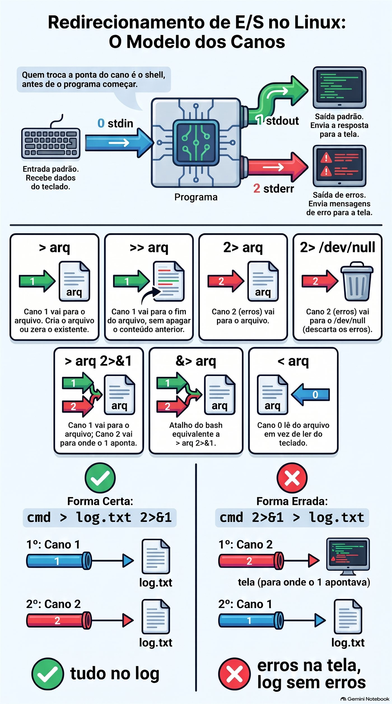
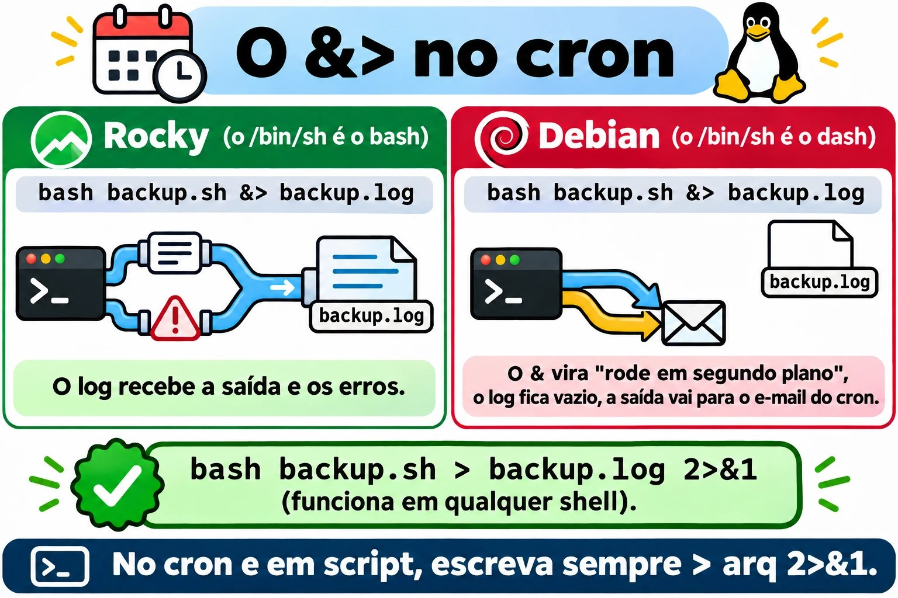
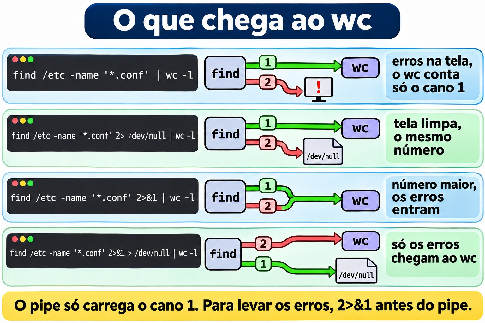
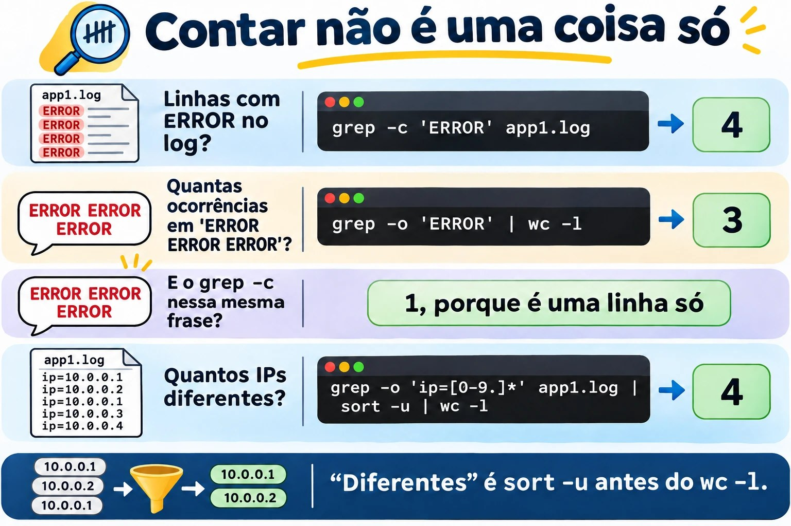
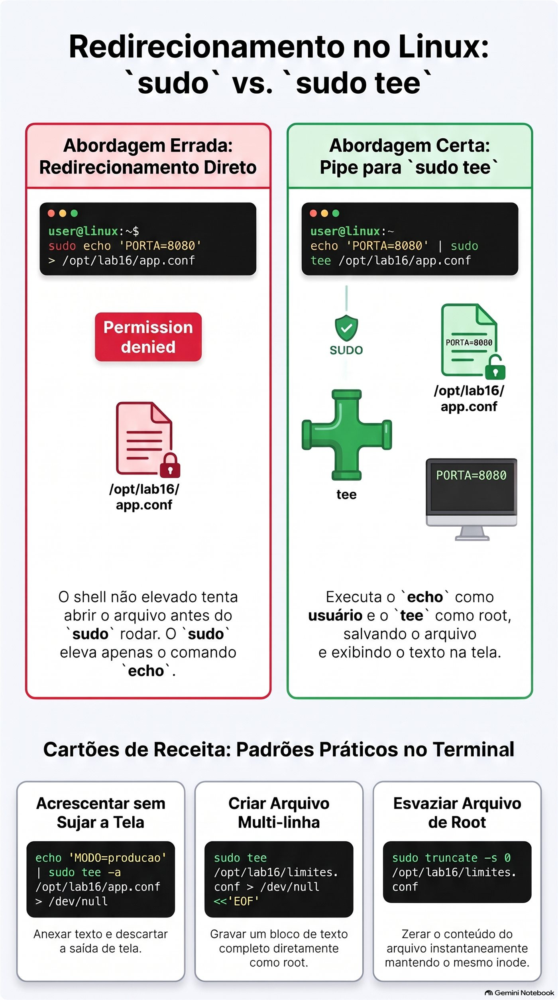
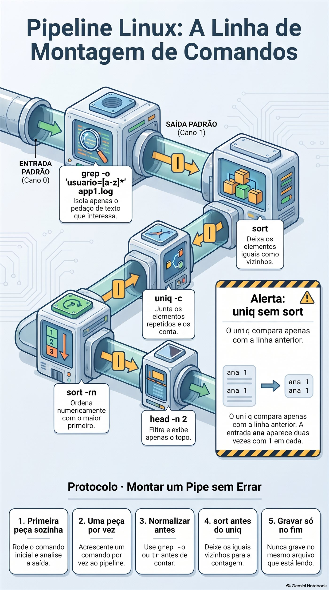
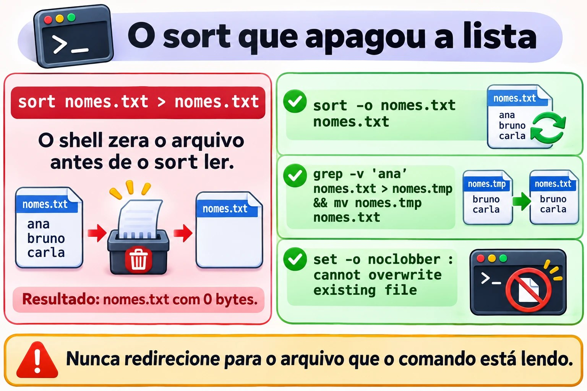

# Aula 1.6 · Redirecionamentos e pipes

Você aprende a mandar a saída de qualquer comando para onde quiser: um arquivo, o fim de um arquivo, o lixo ou a entrada de outro comando. Com isso, uma pergunta como "quais IPs mais erraram a senha hoje?" vira uma linha só, e você para de copiar resultado da tela para o Bloco de Notas. Você também aprende os jeitos clássicos de destruir um arquivo com um único `>`, para nunca cair neles num servidor de cliente.

| Ficha | Aula 1.6 |
| --- | --- |
| Módulo | M1 · Linha de comando, aula 6 de 10 |
| Quando | Semana 2 |
| Ao final você consegue | Gravar a saída de um comando num arquivo sem apagar o que já havia; separar os erros da saída normal e jogar fora o que não interessa; criar um arquivo inteiro de uma vez com here-doc; escrever num arquivo do root sem levar `Permission denied`; montar pipes que respondem perguntas de verdade, como "quantos IPs diferentes" e "quem mais aparece"; ver e guardar a saída ao mesmo tempo com `tee` |
| Pré-requisitos | Aula 1.5, com o `~/lab13` ainda nas VMs |
| Tempo | Cerca de 2h30 |
| Snapshots | m1a6-inicio e m1a6-fim nas duas VMs |

## 1 · Aquecimento

Três perguntas, de cabeça, antes de ler qualquer coisa. Escreva as respostas; o Gabarito confere no fim.

1. Na Aula 1.5, qual comando contava as linhas do `app1.log` com `ERROR`, sem mostrá-las? Qual era o número?
2. O `grep` não achou nada e não escreveu nada. Como você descobre, logo depois, que ele não achou?
3. Palpite: `ls /etc/hostname /naoexiste` mostra duas linhas, uma normal e uma de erro. Para o shell, as duas saem pelo mesmo caminho?

## 2 · Por que importa

Quarta, 18h. Você precisa acrescentar o novo servidor de banco ao `/etc/hosts` de uma máquina de cliente. Como root, digita `echo '10.0.5.40 pg03' > /etc/hosts`. Um `>` só, onde deveriam ser dois. O arquivo agora tem uma linha: a sua. O `localhost` sumiu, e com ele os nomes dos outros servidores. Meia hora depois, o suporte liga: a aplicação não acha mais o banco antigo. Foi um caractere.

Segundo caso. Um backup roda todo dia às 2h pelo cron, com a saída indo para `/var/log/backup.log`. Todo dia o log diz `backup iniciado` e `backup concluído`. Três semanas depois, o cliente precisa restaurar um arquivo, e o backup está vazio. O `tar` reclamava toda noite que a pasta não existia, mas reclamava pelo canal de erros, e esse canal não ia para o log. Ninguém viu. Faltaram quatro caracteres na linha do cron: `2>&1`.

Terceiro caso, o bom. Sexta, 17h, o gestor pergunta: "quantos IPs diferentes tentaram entrar como root esta semana, e quais os cinco que mais tentaram?". Sem pipes, você abre o log no editor e começa a contar. Com pipes, é uma linha:

```bash
sudo grep 'Failed password for root' /var/log/secure | grep -o 'from [0-9.]*' | sort | uniq -c | sort -rn | head -5
```

Em dois segundos você tem a tabela para colar no e-mail. No fim desta aula, você lê essa linha sem esforço e monta outras iguais.

E o quarto caso, que pega todo mundo uma vez: `sudo echo 'x' > /etc/arquivo` responde `Permission denied`, mesmo com `sudo`. Até o fim da aula você sabe por quê, e o conserto tem três letras: `tee`.

## 3 · Modelo mental

> Todo programa nasce com três canos. Pelo cano 0 entra o que ele lê; pelo cano 1 sai a resposta; pelo cano 2 saem os erros. Sem você dizer nada, o 0 vem do teclado, e o 1 e o 2 vão para a tela. Redirecionar é trocar a ponta de um cano. Quem troca é o shell, antes de o programa começar.

```text
                    ┌─────────────┐
  teclado ───0────► │  programa   │ ───1───► tela   (saída: stdout)
  (stdin)           │  ls, grep…  │ ───2───► tela   (erros: stderr)
                    └─────────────┘
```

Os nomes em inglês aparecem em toda documentação: **stdin** é o 0, **stdout** é o 1, **stderr** é o 2. Esses números se chamam descritores de arquivo.

Por que dois canos de saída, se os dois vão para a tela? Para você poder separá-los. A resposta vai para um arquivo, e os erros continuam na tela, ou vão para outro arquivo, ou para o lixo:

```text
  ls /etc/hostname /naoexiste  > saida.txt  2> erros.txt

                    ┌─────────────┐ ───1───► saida.txt   /etc/hostname
                    │     ls      │
                    └─────────────┘ ───2───► erros.txt   ls: cannot access '/naoexiste'…
```

O pipe liga o cano 1 de um programa ao cano 0 do próximo. Repare no que **não** entra no pipe:

```text
  grep 'ERROR' app1.log | wc -l

    ┌──────┐ ──1──►━━━━ pipe ━━━━►──0──┌──────┐ ──1──► tela: 4
    │ grep │                           │  wc  │
    └──────┘ ──2──► tela               └──────┘
             (os erros do grep passam por fora do pipe)
```

**A primeira ideia: o shell arruma os canos antes de o comando rodar.** Quando você escreve `> arquivo`, o shell abre esse arquivo para escrita, e abrir com `>` quer dizer zerar. Só depois o comando começa. Duas consequências derrubam gente experiente:

- `sort nomes.txt > nomes.txt` apaga a lista. O shell zera o `nomes.txt`, e só depois o `sort` vai ler, e encontra um arquivo vazio. A Quebra A faz você ver isso.
- `sudo echo 'x' > /etc/arquivo` dá `Permission denied`. O `sudo` eleva só o `echo`. Quem abre o `/etc/arquivo` é o seu shell, rodando como você, antes de o `sudo` começar.

**A segunda ideia: o `2>&1` se lê da esquerda para a direita.** Ele quer dizer "o cano 2 passa a apontar para onde o cano 1 aponta **agora**". Por isso a ordem importa:

```text
  cmd > log.txt 2>&1              cmd 2>&1 > log.txt

  1º  1 ──► log.txt               1º  2 ──► tela   (para onde o 1 apontava)
  2º  2 ──► log.txt               2º  1 ──► log.txt
      resultado: tudo no log          resultado: erros na tela, log sem erros
```

A primeira forma é a certa. A segunda é o erro do backup do segundo caso, e vira a Quebra B.

**A terceira ideia: no Linux, o pipe carrega texto.** Cada programa da fila faz uma coisa só, e bem: o `grep` peneira, o `cut` corta colunas, o `sort` ordena, o `uniq` junta repetidos vizinhos, o `wc` conta, o `head` pega o topo. Juntando peças pequenas, você monta a pergunta que quiser, como num lego.

```text
  log ─► grep          ─► grep -o         ─► sort ─► uniq -c ─► sort -rn         ─► head
         só as linhas     só o pedaço                 conta      maior primeiro      o topo
         que importam     que interessa
```

**Ponte Windows.** O cmd e o PowerShell têm os mesmos `>`, `>>`, `2>` e `2>&1`, e também o pipe. A diferença está no que passa pelo pipe. No PowerShell, passam objetos com propriedades: você pede `Sort-Object Length` e pronto. No Linux, passam linhas de texto, e você corta o texto com `cut` antes de ordenar. Parece mais primitivo, mas funciona com qualquer programa já escrito, e não só com os que conhecem objetos. Uma pegadinha de quem vive nos dois mundos: no Windows PowerShell 5.1, o `>` grava o arquivo em UTF-16. Copie um arquivo desses para o Linux, e o `grep` pode responder `binary file matches`, ou simplesmente não achar nada.


*Os três canos de todo programa, e por que a ordem do 2>&1 decide o que vai para o log.*

## 4 · Conceito em camadas

### Essencial

**Redirecionamentos.** O shell faz; o programa nem fica sabendo.

| Escreva | O que faz | Exemplo |
| --- | --- | --- |
| `> arq` | Manda a saída, o cano 1, para o arquivo. Cria o arquivo, ou **zera** o que já existe | `ls /etc > lista.txt` |
| `>> arq` | Manda a saída para o fim do arquivo, sem apagar nada | `date >> historico.txt` |
| `2> arq` | Manda os erros, o cano 2, para o arquivo | `find /etc -name '*.conf' 2> erros.txt` |
| `2> /dev/null` | Joga os erros fora | `find /etc -name '*.conf' 2> /dev/null` |
| `> arq 2>&1` | Saída e erros no mesmo arquivo, nesta ordem | `bash backup.sh > backup.log 2>&1` |
| `>> arq 2>&1` | O mesmo, acrescentando | A forma certa para o cron |
| `&> arq` | Atalho do bash para `> arq 2>&1` | `bash backup.sh &> backup.log` |
| `< arq` | O cano 0 lê do arquivo, não do teclado | `wc -l < app1.log` |
| `<<'EOF'` | Here-doc: o cano 0 lê o texto que vem até a linha `EOF` | No Passo 5 |
| `> arq`, sem comando | Zera o arquivo, ou cria um vazio | `> app.log` |

O `/dev/null` é o buraco negro do Linux: tudo o que entra some, e quem lê dele recebe um arquivo vazio. Ele existe em qualquer Linux.

**O pipe.** É a barra vertical. Ele liga o cano 1 de um comando ao cano 0 do próximo, sem arquivo no meio:

```bash
grep 'ERROR' app1.log | wc -l
cut -d: -f7 /etc/passwd | sort | uniq -c
```

**Os filtros que vivem no meio dos pipes.** Todos leem de um arquivo, se você der o nome, ou do cano 0, se vierem depois de um pipe.

| Comando | O que faz | Exemplo |
| --- | --- | --- |
| `sort` | Ordena as linhas em ordem alfabética | `sort nomes.txt` |
| `sort -n` | Ordena por número: 9 antes de 10 | `sort -n tamanhos.txt` |
| `sort -r` | Inverte a ordem | `sort -rn`: o maior primeiro |
| `sort -u` | Ordena e tira as linhas repetidas | `sort -u ips.txt` |
| `sort -t: -k3 -n` | Ordena pela 3ª coluna, com colunas separadas por `:` | `sort -t: -k3 -n /etc/passwd` |
| `uniq` | Junta linhas repetidas **vizinhas**: precisa de `sort` antes | Sempre depois de um `sort` |
| `uniq -c` | Junta e conta quantas eram | Sempre depois de um `sort` |
| `cut -d: -f1` | Corta a 1ª coluna, com colunas separadas por `:` | `cut -d: -f1 /etc/passwd` |
| `cut -d' ' -f3` | Corta a 3ª coluna, separada por espaço | `cut -d' ' -f3 app1.log` |
| `tr -s ' '` | Junta espaços repetidos num só | Antes de um `cut -d' '` |
| `grep -o` | Mostra só o pedaço que casou, um por linha | `grep -o 'ip=[0-9.]*' app1.log` |
| `wc -l` | Conta as linhas que chegam | No fim do pipe |
| `head -n 5` | Só as cinco primeiras | Depois de um `sort -rn`: o top 5 |
| `tee arq` | Mostra na tela **e** grava no arquivo | No Passo 8 |
| `tee -a arq` | O mesmo, acrescentando | Com `sudo`, escreve em arquivo do root |

Duas receitas que você vai usar todo dia: `sort | uniq` dá o mesmo que `sort -u`, e `sort | uniq -c | sort -rn` é a receita do ranking.

### Ponte Windows

| Linux | cmd | PowerShell |
| --- | --- | --- |
| `cmd > arq` | `cmd > arq` | `cmd > arq` ou `Out-File arq` |
| `cmd >> arq` | `cmd >> arq` | `cmd >> arq` ou `Out-File arq -Append` |
| `cmd 2> arq` | `cmd 2> arq` | `cmd 2> arq` |
| `cmd > arq 2>&1` | `cmd > arq 2>&1` | `cmd > arq 2>&1`, ou `*> arq` para todos os fluxos |
| `/dev/null` | `nul` | `$null` ou `Out-Null` |
| `tee arq` | Não tem | `Tee-Object arq` |
| `sort` | `sort` | `Sort-Object` |
| `sort -u` | Não tem | `Sort-Object -Unique` |
| `uniq -c` | Não tem | `Group-Object` |
| `cut -d: -f1` | Não tem | `ForEach-Object { $_.Split(':')[0] }` |
| `wc -l` | `find /c /v ""` | `Measure-Object -Line` |
| Here-doc `<<'EOF'` | Não tem | Here-string `@' … '@` |

### Avançado

- **`set -o noclobber`** faz o `>` recusar sobrescrever um arquivo que já existe: `cannot overwrite existing file`. Para forçar, escreva `>|`. Desliga com `set +o noclobber`. Não protege o `>>`, que nunca apaga.
- **`|&`** é o atalho do bash para `2>&1 |`: manda saída e erros juntos para o próximo comando.
- **`${PIPESTATUS[@]}` e `set -o pipefail`.** O `$?` de um pipe é o do último comando. `grep x naoexiste.txt | wc -l` mostra um erro e o número `0`, e o `$?` é 0, porque o `wc` funcionou. Logo depois, `echo ${PIPESTATUS[@]}` mostra `2 0`: o código de cada peça. Em script, `set -o pipefail` faz o pipe falhar se qualquer peça falhar. Você usa isso no módulo de scripts.
- **`<<<`**, a here-string, entrega uma frase curta no cano 0: `wc -w <<< 'uma frase curta'` responde 3.
- **`<<-EOF`** tira os tabs do começo de cada linha. Serve para recuar um here-doc dentro de um script.
- **`<(comando)`**, a substituição de processo, entrega a saída de um comando como se fosse um arquivo: `diff <(sort ontem.txt) <(sort hoje.txt)` compara duas listas sem criar arquivos temporários. É o jeito clássico de comparar os pacotes de dois servidores.
- **`xargs`** transforma linhas em argumentos: `find ~/lab13 -name '*.log' | xargs wc -l` conta as linhas de todos os logs de uma vez. Com nomes que têm espaço, use `find … -print0 | xargs -0 …`. O Passo 9 mostra por quê.
- **`exec > arq 2>&1`**, dentro de um script, manda para o arquivo tudo o que vem depois. Fica para o módulo de scripts.

## 5 · Rocky × Debian

O bash é o mesmo nas duas, e todo redirecionamento desta aula funciona igual no terminal. As diferenças aparecem em três lugares: no `/bin/sh`, nos programas que você põe no pipe e na ordem do `sort`.

| Ponto | Rocky 9 | Debian 13 |
| --- | --- | --- |
| Quem é o `/bin/sh` | O próprio bash | O `dash`, um shell menor e mais rápido |
| `&>` num script `#!/bin/sh` ou numa linha do cron | Funciona | Quebra em silêncio: o comando vai para segundo plano, e o arquivo fica vazio |
| Contar pacotes instalados | `rpm -qa`, contado com `wc -l` | `dpkg -l`, só as linhas que começam com `ii`, contadas com `wc -l` |
| Gerenciador que reclama no pipe | O `dnf` não reclama | O `apt` escreve `WARNING: apt does not have a stable CLI interface` no cano 2 |
| Logs para montar pipes | `/var/log/secure` e `/var/log/messages` | `journalctl`, que já sai pronto para o pipe |
| Ordem do `sort` | Depende do idioma, na variável `LANG` | Igual |

Confira com `ls -l /bin/sh` nas duas: algo como `/bin/sh -> bash` na Rocky e `/bin/sh -> dash` na Debian.

A segunda linha da tabela é a mais traiçoeira. O cron roda cada linha com `/bin/sh`. Na Debian, `bash backup.sh &> backup.log` vira duas coisas: `bash backup.sh &`, que roda em segundo plano com a saída indo para o e-mail do cron, que quase ninguém lê, e `> backup.log`, que só zera o arquivo. O backup roda, o log fica vazio todo dia, e ninguém entende. A regra prática: no terminal, use `&>` à vontade. Em script e no cron, escreva sempre `> arq 2>&1`, que funciona em qualquer shell.

O aviso do `apt` é o exemplo perfeito de por que existem dois canos. Na Debian, compare:

```bash
apt list --installed | wc -l
apt list --installed 2> /dev/null | wc -l
```

Os dois números são iguais, e só o primeiro mostra o aviso na tela. O aviso saiu pelo cano 2 e passou por fora do pipe. O `wc` nunca o viu.



*O mesmo `&>` funciona na Rocky e quebra em silêncio no cron da Debian: em script e no cron, escreva `> arq 2>&1`.*

## 6 · Lab guiado

Faça tudo nas duas VMs, a não ser quando o passo disser só uma. Os arquivos ficam em `~/lab13/pipes`, e a matéria-prima é o `app1.log` da Aula 1.5. Em cada passo, quando aparecer **Preveja**, escreva a resposta antes de apertar Enter.

### Passo 1 · Preparar

No nó Proxmox:

```bash
qm snapshot 201 m1a6-inicio
qm snapshot 202 m1a6-inicio
```

Em cada VM:

```bash
mkdir -p ~/lab13/pipes
cd ~/lab13/pipes
wc -l ~/lab13/logs/app1.log
cp ~/lab13/logs/app1.log .
ls -l
```

O `wc` deve responder `20 /home/student/lab13/logs/app1.log`. Se o número for outro, ou o arquivo não existir, volte ao Passo 1 da Aula 1.5 e crie o `app1.log` de novo. A cópia local existe para você poder errar à vontade: o original fica guardado em `~/lab13/logs`.

### Passo 2 · `>` e `>>`: o arquivo que some e o que cresce

```bash
echo 'primeira' > notas.txt
cat notas.txt
echo 'segunda' > notas.txt
```

**Preveja.** O que o próximo `cat` vai mostrar: uma linha ou duas?

```bash
cat notas.txt
```

Só `segunda`. O segundo `>` zerou o arquivo antes de o `echo` escrever. Agora acrescente:

```bash
echo 'terceira' >> notas.txt
date >> notas.txt
cat -n notas.txt
```

Três linhas: `segunda`, `terceira` e a data. O `>>` nunca apaga.

Agora a promessa da Aula 1.4: esvaziar um arquivo sem trocar o inode.

```bash
ls -li notas.txt
> notas.txt
ls -li notas.txt
> novo-vazio.txt
ls -l novo-vazio.txt
```

O número do inode, na primeira coluna, é o mesmo antes e depois, e o tamanho caiu para 0. É assim que se esvazia um log que um programa está usando: o programa continua escrevendo no mesmo arquivo, e o espaço volta na hora. O `> novo-vazio.txt` mostra o outro uso: sem comando, o `>` cria um arquivo vazio.

O mesmo efeito existe como comando, e isso vai importar no Passo 8:

```bash
echo 'de novo' > notas.txt
truncate -s 0 notas.txt
ls -l notas.txt
```

O `truncate -s 0` deixa o arquivo com tamanho zero, igual ao `>` sozinho.

Para a Decida, faça uma cópia do `hosts` do sistema. Você mexe na cópia, nunca no original:

```bash
cp /etc/hosts hosts.txt
wc -l hosts.txt
```

**Decida 1 · O `/etc/hosts`.** Cenário: você precisa acrescentar a linha `10.0.5.40 pg03` ao fim do `hosts.txt`, sem perder nada do que já existe. Qual comando?

- **A)** `echo '10.0.5.40 pg03' > hosts.txt`
- **B)** `echo '10.0.5.40 pg03' >> hosts.txt`
- **C)** `echo '10.0.5.40 pg03' < hosts.txt`
- **D)** `cat '10.0.5.40 pg03' >> hosts.txt`

Escolha a letra antes de olhar a tabela.

| Se você marcou | Resultado | Por quê |
| --- | --- | --- |
| A | ❌ Errada | O `>` zera o arquivo antes de o `echo` rodar, e sobra só a linha nova. É o caso da quarta-feira da seção 2. |
| B | ✅ Certa | O `>>` acrescenta no fim. O `wc -l` passa a mostrar uma linha a mais, e o `tail -n 2` mostra a linha nova no fim. |
| C | ❌ Errada | O `<` liga o arquivo à entrada do `echo`, e o `echo` nunca lê a entrada. A linha aparece na tela, e o arquivo fica igual. |
| D | ❌ Errada | O `cat` procura um arquivo chamado `10.0.5.40 pg03`, responde `No such file or directory`, e nada é acrescentado. |

**Para fixar:** antes de apertar Enter numa linha com `>`, leia o `>` em voz alta como "zera". Se não era isso que você queria, são dois.

Rode a B e confira:

```bash
echo '10.0.5.40 pg03' >> hosts.txt
tail -n 2 hosts.txt
wc -l hosts.txt
```

### Passo 3 · O cano 2: os erros não vão para o arquivo

```bash
ls /etc/hostname /naoexiste
```

Duas linhas: o nome do arquivo e o erro. Agora mande a saída para um arquivo.

**Preveja.** Com `> saida.txt`, o que ainda aparece na tela?

```bash
ls /etc/hostname /naoexiste > saida.txt
cat saida.txt
```

O erro continua na tela: `ls: cannot access '/naoexiste': No such file or directory`. O `saida.txt` tem só `/etc/hostname`. O `>` desviou o cano 1; o cano 2 continuou apontando para a tela. Agora separe os dois e depois jogue os erros fora:

```bash
ls /etc/hostname /naoexiste 2> erros.txt
cat erros.txt
ls /etc/hostname /naoexiste > saida.txt 2> erros.txt
ls /etc/hostname /naoexiste 2> /dev/null
```

O último é o mais usado na vida real. Um exemplo que você vai repetir muito: o `find` como usuário comum reclama de cada pasta que ele não pode abrir.

```bash
find /etc -name '*.conf' | wc -l
find /etc -name '*.conf' 2> /dev/null | wc -l
```

O primeiro enche a tela de `find: '/etc/sudoers.d': Permission denied` e de outras pastas fechadas, e no fim mostra um número. O segundo mostra só o número. A lista exata de pastas muda entre a Rocky e a Debian.

**Decida 2 · O número que não mudou.** Cenário: você esperava que o primeiro número fosse maior, porque as linhas de erro "estavam na saída". Mas os dois números são iguais. Por quê?

- **A)** O `wc` ignora as linhas que começam com `find:`
- **B)** Os erros saíram pelo cano 2, que passa por fora do pipe; o `wc` recebeu só o cano 1
- **C)** O `2> /dev/null` não funciona com o `find`
- **D)** A segunda execução usou um cache, por isso deu igual

Escolha a letra antes de olhar a tabela.

| Se você marcou | Resultado | Por quê |
| --- | --- | --- |
| A | ❌ Errada | O `wc` não lê o conteúdo para decidir o que contar: conta toda linha que chega. As linhas de erro simplesmente não chegaram. |
| B | ✅ Certa | O pipe liga só o cano 1. Os erros foram direto para a tela, nos dois casos. O `wc` contou exatamente a mesma coisa. |
| C | ❌ Errada | Funciona: na segunda vez, os erros sumiram da tela. O número igual tem outra causa. |
| D | ❌ Errada | Não há cache nenhum. O `find` percorreu as pastas de novo, e a lista de arquivos era a mesma. |

**Para fixar:** o pipe só carrega o cano 1. Se você quiser os erros dentro do pipe, escreva `2>&1` antes do pipe.

Confira:

```bash
find /etc -name '*.conf' 2>&1 | wc -l
```

Agora o número é maior: entraram as linhas de erro.

### Passo 4 · Saída e erros juntos, e a ordem que muda tudo

```bash
ls /etc/hostname /naoexiste > tudo.txt 2>&1
cat tudo.txt
ls /etc/hostname /naoexiste &> tudo2.txt
cat tudo2.txt
```

Os dois arquivos têm as duas linhas. O `ls` costuma escrever o erro primeiro, porque ele reclama dos nomes que não existem antes de listar os que existem.

**Preveja.** Agora a ordem invertida. Onde vai aparecer o erro?

```bash
ls /etc/hostname /naoexiste 2>&1 > errado.txt
cat errado.txt
```

O erro aparece na tela, e o `errado.txt` tem só `/etc/hostname`. Volte ao desenho da seção 3: no momento do `2>&1`, o cano 1 ainda apontava para a tela, então o 2 foi para a tela. Só depois o 1 foi para o arquivo.

A mesma regra, usada a seu favor: contar só os erros do `find`.

```bash
find /etc -name '*.conf' 2>&1 > /dev/null | wc -l
```

Leia da esquerda para a direita. O 2 vai para onde o 1 aponta agora, o pipe. Depois o 1 vai para o lixo. Só os erros chegam ao `wc`: algo como 3 a 6, conforme a VM.

Por fim, o acumulado, que é a forma do cron:

```bash
date >> exec.log 2>&1
ls /naoexiste >> exec.log 2>&1
date >> exec.log 2>&1
cat exec.log
```

Três linhas: a data, o erro e a data. Cada execução acrescenta, nada se perde, e os erros ficam registrados na ordem em que aconteceram.

**Decida 3 · Guardar tudo.** Cenário: você vai rodar um comando demorado e quer a saída e os erros em `upd.log`, para ler depois com calma. Qual linha?

- **A)** `cmd 2>&1 > upd.log`
- **B)** `cmd > upd.log 2>1`
- **C)** `cmd > upd.log 2>&1`
- **D)** `cmd > upd.log 2> upd.log`

Escolha a letra antes de olhar a tabela.

| Se você marcou | Resultado | Por quê |
| --- | --- | --- |
| A | ❌ Errada | A ordem está invertida: o 2 vai para a tela, para onde o 1 apontava, e só a saída vai para o arquivo. |
| B | ❌ Errada | Sem o `&`, o `1` é um nome de arquivo. Os erros vão para um arquivo chamado `1`. Teste com `ls /naoexiste > upd.log 2>1` e depois `ls -l 1`. |
| C | ✅ Certa | Primeiro o 1 vai para o `upd.log`; depois o 2 vai para onde o 1 aponta. Tudo no mesmo arquivo, na ordem certa. |
| D | ❌ Errada | Os dois canos abrem o mesmo arquivo separadamente, cada um escrevendo a partir do começo. Um escreve por cima do outro, e o texto sai embaralhado. Teste com `ls /etc/hostname /naoexiste > d.txt 2> d.txt` e `cat d.txt`. |

**Para fixar:** o `&` em `2>&1` diz "é um cano, não um arquivo". E a ordem é sempre: primeiro o destino, depois o `2>&1`.

Se você testou a B e a D, limpe: `rm -v 1 d.txt`.



*O pipe só leva o cano 1: o que o `wc` conta depende de para onde vão os erros.*

### Passo 5 · A entrada: `<` e o here-doc

```bash
wc -l app1.log
wc -l < app1.log
```

O primeiro responde `20 app1.log`; o segundo, só `20`. Com o `<`, quem abre o arquivo é o shell, e o `wc` recebe só o conteúdo, sem saber o nome. É a forma que você usa em script, quando quer só o número: `total=$(wc -l < app1.log)`.

Alguns programas só sabem ler do cano 0. O `tr`, que troca caracteres, é o mais comum:

```bash
tr 'a-z' 'A-Z' app1.log
tr 'a-z' 'A-Z' < app1.log | head -n 3
```

O primeiro responde `tr: extra operand 'app1.log'`. O segundo mostra as três primeiras linhas em maiúsculas. Repare em `CONEXãO`: o `tr` troca só as letras de a a z, sem acento.

Agora o here-doc, que você usa desde a Aula 1.5 como receita:

```bash
cat > app.conf <<'EOF'
# configuração da aplicação
PORTA=8080
MODO=producao
LOG=/var/log/app/app.log
EOF
cat -n app.conf
```

Cada pedaço tem uma função. O `<<'EOF'` diz ao shell: leia as próximas linhas até achar uma linha só com `EOF` e entregue tudo no cano 0. O `cat` sem nome de arquivo lê do cano 0 e escreve no cano 1. O `> app.conf` manda o cano 1 para o arquivo. A palavra `EOF` é só um costume; vale qualquer palavra, desde que a linha final tenha só ela, sem espaço antes nem depois.

É o jeito mais seguro de colar uma configuração pronta num servidor por SSH: nada de editor, nada de linha cortada no meio.

**Preveja.** As duas versões abaixo só diferem nas aspas do `EOF`. O que cada uma mostra?

```bash
cat <<EOF
Usuário: $USER
Pasta: $HOME
Hoje: $(date +%F)
EOF
cat <<'EOF'
Usuário: $USER
Pasta: $HOME
Hoje: $(date +%F)
EOF
```

A primeira troca cada `$` pelo valor: algo como `Usuário: student`, `Pasta: /home/student` e a data de hoje. A segunda mostra o texto exatamente como foi escrito, com os cifrões. Sem aspas, o shell preenche as variáveis; com aspas, ele não mexe em nada.

**Decida 4 · O script que perdeu o `$1`.** Cenário: você cria um script pelo terminal e testa:

```bash
cat > saudacao.sh <<EOF
#!/bin/bash
echo "Olá, $1"
EOF
bash saudacao.sh Ana
```

A resposta é só ` Olá,  `, sem o nome. Por quê?

- **A)** O script precisa de `chmod +x` para ler o `$1`
- **B)** Sem aspas no `EOF`, o shell trocou o `$1` pelo valor dele na hora de criar o arquivo, e o valor era vazio
- **C)** O here-doc não aceita aspas duplas dentro
- **D)** O `$1` só funciona quando o script roda como `./saudacao.sh`

Escolha a letra antes de olhar a tabela.

| Se você marcou | Resultado | Por quê |
| --- | --- | --- |
| A | ❌ Errada | Com `bash saudacao.sh`, o script roda sem `chmod`. O problema está dentro do arquivo, não na permissão. |
| B | ✅ Certa | O `cat saudacao.sh` mostra `echo "Olá, "`: o `$1` sumiu antes de o script existir. No seu terminal, o `$1` estava vazio. |
| C | ❌ Errada | O here-doc aceita qualquer texto, com aspas simples ou duplas. |
| D | ❌ Errada | O `$1` é o primeiro argumento nos dois jeitos de rodar. |

**Para fixar:** here-doc que grava script ou configuração com `$` dentro leva sempre `<<'EOF'`, com aspas. Sem aspas, só quando você quer que o shell preencha as variáveis.

Conserte e teste:

```bash
cat saudacao.sh
cat > saudacao.sh <<'EOF'
#!/bin/bash
echo "Olá, $1"
EOF
cat saudacao.sh
bash saudacao.sh Ana
```

Agora a resposta é `Olá, Ana`.

### Passo 6 · Pipes: contar, ordenar, juntar

Comece pelo que você já sabe, de dois jeitos:

```bash
grep -c 'ERROR' app1.log
grep 'ERROR' app1.log | wc -l
```

Os dois respondem 4. Agora a dúvida que ficou da Aula 1.5, linhas contra ocorrências:

```bash
echo 'ERROR ERROR ERROR' | grep -c 'ERROR'
echo 'ERROR ERROR ERROR' | grep -o 'ERROR' | wc -l
```

O primeiro responde 1, porque é uma linha. O segundo responde 3: o `grep -o` põe cada ocorrência numa linha própria, e o `wc -l` conta essas linhas.

Agora uma pergunta de verdade: quais IPs aparecem no log, e quantas vezes? Monte o pipe uma peça por vez, olhando a saída a cada passo:

```bash
grep -o 'ip=[0-9.]*' app1.log
grep -o 'ip=[0-9.]*' app1.log | sort
grep -o 'ip=[0-9.]*' app1.log | sort | uniq -c
```

O `[0-9.]` quer dizer "um dígito ou um ponto", e o `*`, "quantos vierem". Expressões regulares têm aula própria; por enquanto, use como receita. O último comando mostra algo como:

```text
      1 ip=10.0.5.10
      1 ip=10.0.5.21
      1 ip=10.0.5.30
      3 ip=203.0.113.50
```

E quantos IPs diferentes:

```bash
grep -o 'ip=[0-9.]*' app1.log | sort -u | wc -l
```

Responde 4. Essa é a contagem que a Aula 1.5 prometeu.

**Preveja.** Agora os usuários, mas sem o `sort`. Quantas vezes a palavra `ana` vai aparecer na saída do segundo comando?

```bash
grep -o 'usuario=[a-z]*' app1.log
grep -o 'usuario=[a-z]*' app1.log | uniq -c
```

Algo como:

```text
      1 usuario=ana
      2 usuario=root
      1 usuario=admin
      1 usuario=bruno
      1 usuario=ana
      1 usuario=student
```

A `ana` aparece duas vezes, com 1 em cada. O `uniq` só compara uma linha com a anterior: as duas linhas do `root` estavam juntas e viraram uma; as duas da `ana` estavam separadas e ficaram separadas. Com o `sort` antes, os iguais ficam vizinhos:

```bash
grep -o 'usuario=[a-z]*' app1.log | sort | uniq -c
grep -o 'usuario=[a-z]*' app1.log | sort | uniq -c | sort -rn
grep -o 'usuario=[a-z]*' app1.log | sort | uniq -c | sort -rn | head -n 2
```

O último é a receita do ranking, o top 2: `root` e `ana`, com 2 cada.

**Decida 5 · Quantos IPs diferentes.** Cenário: o gestor quer saber quantos IPs diferentes aparecem no `app1.log`. Qual comando dá a resposta certa, hoje e em qualquer log?

- **A)** `grep -c 'ip=' app1.log`
- **B)** `grep -o 'ip=[0-9.]*' app1.log | uniq | wc -l`
- **C)** `grep -o 'ip=[0-9.]*' app1.log | sort -u | wc -l`
- **D)** `grep -o 'ip=[0-9.]*' app1.log | wc -l`

Escolha a letra antes de olhar a tabela.

| Se você marcou | Resultado | Por quê |
| --- | --- | --- |
| A | ❌ Errada | Responde 6: conta as linhas que têm IP, e o `203.0.113.50` entra três vezes. |
| B | ❌ Incompleta | Aqui dá 4 por sorte, porque as três linhas do `203.0.113.50` estão juntas. Num log real, com os IPs intercalados, a conta sai maior que a verdade. |
| C | ✅ Certa | O `sort -u` ordena e tira os repetidos, onde quer que estejam. O `wc -l` conta o que sobrou: 4. |
| D | ❌ Errada | Responde 6: conta todas as ocorrências, com repetição. |

**Para fixar:** "diferentes" é `sort -u`, ou `sort` e depois `uniq`, e só então `wc -l`. O `uniq` sozinho só enxerga o vizinho.



*Linhas, ocorrências e valores diferentes são três perguntas, e cada uma pede um pipe.*

### Passo 7 · Colunas com `cut`, e o espaço duplo

O `/etc/passwd` é o arquivo perfeito para treinar: uma linha por usuário, sete colunas separadas por `:`. Usuário, senha, que hoje é só um `x`, UID, GID, comentário, pasta pessoal e shell. Os detalhes ficam para a aula de usuários.

```bash
head -n 3 /etc/passwd
cut -d: -f1 /etc/passwd | head -n 5
cut -d: -f1,7 /etc/passwd | tail -n 3
cut -d: -f7 /etc/passwd | sort | uniq -c | sort -rn
sort -t: -k3 -n /etc/passwd | tail -n 3
```

O quarto comando responde "quais shells os usuários têm, e quantos de cada". Algo como, na Rocky:

```text
     17 /sbin/nologin
      2 /bin/bash
      1 /sbin/shutdown
      1 /sbin/halt
      1 /bin/sync
```

Na Debian, o mais comum é `/usr/sbin/nologin`, e os números mudam. O que importa: só quem tem um shell de verdade, como o `/bin/bash`, consegue entrar e digitar comandos. Essa é uma pergunta de auditoria que você vai responder em servidor de cliente. O último comando ordena pelo UID, a terceira coluna, como número, e mostra os três maiores: o `student` e, no fim, o `nobody`, com 65534.

Agora o `app1.log`, cujas colunas são separadas por espaço. A terceira é o nível:

```bash
cut -d' ' -f3 app1.log | sort | uniq -c
```

Algo como:

```text
      1 error
      4 ERROR
     11 INFO
      4 WARN
```

A ordem depende do idioma do sistema: com `LANG=C`, o `ERROR` vem primeiro e o `error` por último.

**Preveja.** A quarta coluna deveria ser o serviço: `web:`, `db:`, `auth:`. O que aparece nas seis primeiras linhas?

```bash
cut -d' ' -f4 app1.log | head -n 6
cut -d' ' -f4 app1.log | head -n 6 | cat -A
```

Quatro linhas vazias e duas com `auth:`. O `cat -A` confirma: quatro `$` sozinhos. Olhe o log de novo: depois de `INFO` e de `WARN` há **dois** espaços, para alinhar com o `ERROR`. Para o `cut`, cada espaço separa uma coluna, então entre os dois espaços existe uma coluna vazia. Nas linhas de `ERROR`, com um espaço só, a quarta coluna é o serviço.

O conserto é juntar os espaços antes de cortar:

```bash
tr -s ' ' < app1.log | cut -d' ' -f4 | head -n 6
```

Agora sim: `web:`, `db:`, `web:`, `auth:`, `auth:`, `auth:`. Na aula de `awk`, você verá que ele já trata vários espaços como um só.

**Decida 6 · O relatório por nível.** Cenário: o gestor quer quantas linhas há de cada nível no `app1.log`, e o `error` em minúsculas deve contar junto com o `ERROR`. Qual comando?

- **A)** `cut -d' ' -f3 app1.log | uniq -c`
- **B)** `cut -d' ' -f3 app1.log | sort | uniq -c`
- **C)** `cut -d' ' -f3 app1.log | tr 'a-z' 'A-Z' | sort | uniq -c`
- **D)** `cut -d' ' -f4 app1.log | sort | uniq -c`

Escolha a letra antes de olhar a tabela.

| Se você marcou | Resultado | Por quê |
| --- | --- | --- |
| A | ❌ Errada | Sem `sort`, o `uniq` junta só os vizinhos, e o `INFO` aparece picado em várias linhas. |
| B | ❌ Incompleta | A contagem é certa, mas mostra `error` e `ERROR` separados. O gestor pediu juntos. |
| C | ✅ Certa | O `tr` deixa tudo em maiúsculas antes de ordenar e contar: 5 `ERROR`, 11 `INFO` e 4 `WARN`. |
| D | ❌ Errada | A quarta coluna é o serviço, e vem vazia nas linhas com espaço duplo. Nem é o nível. |

**Para fixar:** normalize antes de contar. Maiúsculas com `tr 'a-z' 'A-Z'`, espaços com `tr -s ' '`, e sempre `sort` antes de `uniq`. Outra forma da C: `sort -f` com `uniq -ci`, que ignoram maiúsculas.

### Passo 8 · `tee`, e escrever onde só o root escreve

O `tee` é um T de encanamento: copia para um arquivo tudo o que passa e deixa o fluxo seguir.

```bash
grep 'ERROR' app1.log | tee erros-hoje.txt | wc -l
cat erros-hoje.txt
grep 'WARN' app1.log | tee -a erros-hoje.txt
wc -l erros-hoje.txt
```

O primeiro comando mostra só o `4`, mas o arquivo ficou com as quatro linhas. O terceiro mostra os avisos na tela e os acrescenta ao arquivo, que fica com 8 linhas. Na vida real, é assim que você acompanha um comando longo na tela e guarda tudo para o chamado ao mesmo tempo.

Agora o caso do `sudo`. Crie uma pasta que só o root pode escrever:

```bash
sudo mkdir -p /opt/lab16
ls -ld /opt/lab16
echo 'PORTA=8080' > /opt/lab16/app.conf
```

Algo como `bash: /opt/lab16/app.conf: Permission denied`. Normal: a pasta é do root.

**Preveja.** E com `sudo` na frente?

```bash
sudo echo 'PORTA=8080' > /opt/lab16/app.conf
```

O mesmo `Permission denied`. Volte à primeira ideia da seção 3: o seu shell, rodando como você, tenta abrir o arquivo para o `>` antes de o `sudo` começar. O `sudo` só elevaria o `echo`, que nem chega a rodar.

O conserto é pedir a um programa que rode como root para abrir o arquivo. O `tee` faz isso:

```bash
echo 'PORTA=8080' | sudo tee /opt/lab16/app.conf
echo 'MODO=producao' | sudo tee -a /opt/lab16/app.conf > /dev/null
cat /opt/lab16/app.conf
ls -l /opt/lab16/app.conf
```

O primeiro mostra `PORTA=8080` na tela: é a cópia que o `tee` deixa passar. No segundo, o `> /dev/null` joga fora essa cópia, e a tela fica limpa. Esse `>` pode ser seu, sem root, porque escreve no `/dev/null`, não no arquivo do root. O arquivo final tem duas linhas e pertence ao root.

Para um arquivo inteiro como root, junte o `sudo tee` com o here-doc:

```bash
sudo tee /opt/lab16/limites.conf > /dev/null <<'EOF'
# limites da aplicação
MAX_CONEXOES=200
TIMEOUT=30
EOF
cat /opt/lab16/limites.conf
```

E para esvaziar um arquivo do root, o comando que você viu no Passo 2:

```bash
sudo truncate -s 0 /opt/lab16/limites.conf
ls -l /opt/lab16/limites.conf
```

Existe também o `sudo sh -c 'echo PORTA=8080 > /opt/lab16/app.conf'`, que roda um shell inteiro como root. Funciona, mas as aspas se complicam rápido. Prefira o `tee`.

**Decida 7 · O `/var` cheio.** Cenário: o `/var` está com 98%. O `/var/log/app/app.log` tem 4 GB, e a aplicação está escrevendo nele agora. Você precisa liberar espaço já, sem parar a aplicação, e o histórico do log pode ir embora. Qual comando?

- **A)** `sudo rm /var/log/app/app.log`
- **B)** `sudo > /var/log/app/app.log`
- **C)** `sudo truncate -s 0 /var/log/app/app.log`
- **D)** `sudo mv /var/log/app/app.log /tmp/`

Escolha a letra antes de olhar a tabela.

| Se você marcou | Resultado | Por quê |
| --- | --- | --- |
| A | ❌ Errada | É a Aula 1.4: o `rm` tira o nome, mas a aplicação continua segurando o inode. O espaço não volta, e ela segue escrevendo num arquivo sem nome. |
| B | ❌ Errada | Quem faz o `>` é o seu shell, sem root: `Permission denied`, e nada muda. O `sudo` sem comando nem chega a rodar. |
| C | ✅ Certa | O `truncate` roda como root e zera o mesmo inode. O espaço volta na hora, e a aplicação continua escrevendo no mesmo arquivo. |
| D | ❌ Errada | Se o `/tmp` estiver no mesmo sistema de arquivos, nada muda: é a Aula 1.4. Se estiver em outro, o `mv` copia 4 GB e apaga o original, e o espaço do `/var` continua preso, porque a aplicação ainda segura o inode. |

**Para fixar:** para zerar um arquivo do root, use `sudo truncate -s 0`. Para escrever num arquivo do root, mande o texto pelo pipe para `sudo tee`, ou `sudo tee -a` para acrescentar. E nunca use `rm` num log aberto.


*O sudo eleva o comando, não o redirecionamento: quem precisa ser root é quem abre o arquivo.*

### Passo 9 · `xargs`: de linhas para argumentos

O pipe entrega texto no cano 0. Mas muitos comandos, como `wc`, `ls` e `rm`, esperam nomes de arquivo como argumentos, e não no cano 0. O `xargs` faz essa ponte: lê linhas e as entrega como argumentos ao comando que vem depois dele.

```bash
find ~/lab13 -name '*.log' | wc -l
find ~/lab13 -name '*.log' | xargs wc -l
```

O primeiro conta **quantos arquivos** `.log` existem, porque o `wc` recebeu a lista de nomes como texto. O segundo conta **as linhas dentro** de cada arquivo, com um total no fim, porque o `wc` recebeu os nomes como argumentos, como se você os tivesse digitado.

Agora a armadilha. Crie um log com espaço no nome, como o `relatorio final.txt` da Aula 1.3:

```bash
echo 'teste' > ~/lab13/pipes/'relatorio final.log'
find ~/lab13 -name '*.log' | xargs wc -l
```

Algo como `wc: /home/student/lab13/pipes/relatorio: No such file or directory` e `wc: final.log: No such file or directory`. O `xargs` separa os argumentos por espaço, e um nome virou dois. O conserto:

```bash
find ~/lab13 -name '*.log' -print0 | xargs -0 wc -l
```

O `-print0` separa os nomes com um caractere nulo, que nenhum nome de arquivo pode ter, e o `-0` diz ao `xargs` para separar por ele. Agora o `relatorio final.log` aparece com 1 linha.

**Decida 8 · A limpeza dos `.tmp`.** Cenário: num servidor de arquivos, você precisa apagar todos os `.tmp` de `/srv/dados`. Alguns nomes têm espaço, como `relatorio final.tmp`, e existe também um arquivo importante chamado só `relatorio`. Qual comando?

- **A)** `find /srv/dados -name '*.tmp' | xargs rm`
- **B)** `find /srv/dados -name '*.tmp' -print0 | xargs -0 rm`
- **C)** `rm $(find /srv/dados -name '*.tmp')`
- **D)** `find /srv/dados -name '*.tmp' | rm`

Escolha a letra antes de olhar a tabela.

| Se você marcou | Resultado | Por quê |
| --- | --- | --- |
| A | ❌ Errada | O `relatorio final.tmp` vira dois argumentos: `relatorio` e `final.tmp`. O `relatorio` importante é apagado, e o `.tmp` fica. |
| B | ✅ Certa | Com `-print0` e `-0`, cada nome chega inteiro ao `rm`, com espaço e tudo. |
| C | ❌ Errada | O mesmo problema da A: o shell quebra a saída do `find` nos espaços antes de entregá-la ao `rm`. |
| D | ❌ Errada | O `rm` não lê nomes do cano 0: responde `rm: missing operand`, e nada é apagado. |

**Para fixar:** quando o pipe leva nomes de arquivo para o `xargs`, use sempre `-print0` com `-0`. E, antes de qualquer `rm`, rode a mesma linha com `ls -l` no lugar dele e leia a lista.

No lab, faça só a conferência, sem apagar nada:

```bash
find ~/lab13 -name '*.log' -print0 | xargs -0 ls -l
```

### Protocolo · Montar um pipe sem errar

1. **Rode a primeira peça sozinha** e olhe a saída. Se ela não tem o que você quer, nenhuma peça depois conserta.
2. **Acrescente uma peça por vez.** Use a seta para cima e termine com `| head` enquanto testa.
3. **Normalize antes de contar:** `grep -o` isola o pedaço, `tr -s ' '` junta os espaços, `tr 'a-z' 'A-Z'` iguala as maiúsculas.
4. **`sort` sempre antes de `uniq`.** O ranking é `sort | uniq -c | sort -rn | head`.
5. **Só no fim, grave o resultado**: num arquivo novo ou com `>>`, nunca no arquivo que você está lendo. Se o destino for do root, use `sudo tee`.


*Um pipe se monta como lego: uma peça por vez, olhando a saída de cada uma.*

## 7 · Quebre e conserte

Duas quebras que acontecem de verdade, e com frequência. Nenhuma das duas dá erro na hora, e é isso que as torna perigosas. Faça tudo em `~/lab13/pipes`, nas duas VMs.

### Quebra A · O `sort` que apagou a lista

**Quebre.**

```bash
cd ~/lab13/pipes
printf '%s\n' carla ana bruno ana davi > nomes.txt
cp nomes.txt nomes.bak
cat nomes.txt
sort nomes.txt > nomes.txt
```

Você quis ordenar a lista "no lugar", gravando o resultado no próprio arquivo. O prompt voltou sem nenhuma mensagem.

**Preveja.** Antes de olhar: o que o `cat nomes.txt` mostra agora? Os cinco nomes em ordem, os cinco na ordem antiga, ou nada?

**Descubra.**

```bash
cat nomes.txt
wc -l nomes.txt
ls -l nomes.txt nomes.bak
```

O `cat` não mostra nada, o `wc` responde `0 nomes.txt`, e o `ls -l` mostra 0 bytes no `nomes.txt` e 25 no `nomes.bak`. A lista sumiu.

**Decida 9 · Por que sumiu.** Cenário: o `sort nomes.txt > nomes.txt` deixou o arquivo vazio, sem nenhuma mensagem de erro. Qual é a explicação?

- **A)** O `sort` tirou os nomes repetidos e, junto, levou os outros.
- **B)** O shell abriu o `nomes.txt` para o `>` e o zerou antes de o `sort` começar. O `sort` leu um arquivo vazio e gravou nada.
- **C)** O `sort` só grava em arquivo com `-o`. Com `>`, a saída se perde.
- **D)** O `sort` ainda está rodando em segundo plano e vai gravar daqui a pouco.

Escolha a letra antes de olhar a tabela.

| Se você marcou | Resultado | Por quê |
| --- | --- | --- |
| A | ❌ Errada | O `sort` só tira repetidos com `-u`. E, mesmo com `-u`, sobrariam quatro nomes. |
| B | ✅ Certa | É a primeira ideia da seção 3: o shell prepara os canos antes de rodar o comando. Abrir com `>` zera o arquivo na hora, e o `sort` chega tarde. |
| C | ❌ Errada | Com `>`, a saída vai para o arquivo, sim. O problema é o momento em que o shell abre esse arquivo. O `-o` é o conserto, não a causa. |
| D | ❌ Errada | Sem `&` no fim, o comando roda em primeiro plano, e o prompt só volta quando ele termina. O arquivo já está vazio, e vai continuar assim. |

**Para fixar:** nunca redirecione para o arquivo que o comando está lendo. Vale para `sort`, `grep`, `tr`, `cut`, qualquer um.

**Conserte.** Recupere a lista do `.bak` e ordene do jeito certo:

```bash
cp nomes.bak nomes.txt
sort -o nomes.txt nomes.txt
cat nomes.txt
```

O `-o` é do próprio `sort`: ele lê toda a entrada primeiro e só depois abre o arquivo de saída. Agora aparecem `ana`, `ana`, `bruno`, `carla` e `davi`. Para qualquer outro comando, o jeito universal é um arquivo temporário:

```bash
cp nomes.bak nomes.txt
grep -v 'ana' nomes.txt > nomes.tmp && mv nomes.tmp nomes.txt
cat nomes.txt
```

O `&&` só roda o `mv` se o `grep` deu certo. Sobram `carla`, `bruno` e `davi`.

E para não cair nisso de novo, o shell tem uma trava, o `noclobber`:

```bash
cp nomes.bak nomes.txt
set -o noclobber
sort nomes.txt > nomes.txt
wc -l nomes.txt
```

Algo como `bash: nomes.txt: cannot overwrite existing file`, e o arquivo continua com 5 linhas. Com a trava ligada, o `>` se recusa a sobrescrever um arquivo que já existe. Para forçar, use `>|`. O `>>` continua funcionando, porque não apaga nada. Para desligar a trava:

```bash
set +o noclobber
```

Um detalhe: o `cat nomes.txt >> nomes.txt` dá `cat: nomes.txt: input file is output file`. O `cat` do GNU percebe esse caso e se recusa. Com `>` não há o que perceber: quando o comando começa, o arquivo já foi zerado.

**Verifique.**

```bash
wc -l nomes.txt
diff nomes.txt nomes.bak && echo 'igual ao backup'
```

Cinco linhas e `igual ao backup`.



*O shell zera o arquivo antes de o `sort` ler: três jeitos de ordenar sem perder a lista.*

### Quebra B · O log de backup que mente

**Quebre.** Crie um script de backup com um erro de propósito: uma das pastas não existe.

```bash
cd ~/lab13/pipes
cat > backup.sh <<'EOF'
#!/bin/bash
echo "$(date +%T) backup iniciado"
tar -czf /tmp/backup-lab.tar.gz ~/lab13/logs ~/lab13/naoexiste
echo "$(date +%T) backup concluído"
EOF
bash backup.sh > backup.log
```

O `EOF` entre aspas guarda o `$(date +%T)` e o `~` como texto, para serem calculados quando o script rodar. Na tela, aparece algo como:

```text
tar: Removing leading `/' from member names
tar: /home/student/lab13/naoexiste: Cannot stat: No such file or directory
tar: Exiting with failure status due to previous errors
```

**Preveja.** O que o `backup.log` diz? E o código de saída do script, é 0 ou não?

**Descubra.**

```bash
cat backup.log
bash backup.sh > backup.log 2> /dev/null
echo $?
```

O log tem algo como:

```text
10:42:01 backup iniciado
10:42:01 backup concluído
```

E o `echo $?` responde 0. O log diz que deu tudo certo, e o código de saída também. O erro do `tar` foi pelo cano 2, para a tela, e no cron não há tela: ninguém ia ver. Na vida real, é assim que se descobre, no dia do desastre, que o backup falhava havia meses.

Agora a tentativa com a ordem errada:

```bash
bash backup.sh 2>&1 > backup.log
cat backup.log
```

Os erros continuam na tela, e o log continua limpo. O `2>&1` copiou o destino do cano 1 no momento em que foi lido, quando o cano 1 ainda apontava para a tela.

**Decida 10 · A linha do crontab.** Cenário: você vai agendar o `backup.sh` no cron, todo dia às 2h. Cada execução deve acrescentar ao `backup.log` as mensagens normais e os erros, juntos e na ordem. Qual redirecionamento?

- **A)** `bash backup.sh > backup.log 2>&1`
- **B)** `bash backup.sh 2>&1 >> backup.log`
- **C)** `bash backup.sh >> backup.log 2>&1`
- **D)** `bash backup.sh &>> backup.log`

Escolha a letra antes de olhar a tabela.

| Se você marcou | Resultado | Por quê |
| --- | --- | --- |
| A | ❌ Incompleta | Junta os dois canos na ordem certa, mas o `>` zera o log a cada execução. Amanhã você só vê a noite de hoje. |
| B | ❌ Errada | É a ordem errada: os erros vão para onde o cron manda a saída, que é um e-mail local que ninguém lê ou lugar nenhum. |
| C | ✅ Certa | O `>>` acrescenta o cano 1 ao log, e o `2>&1` manda o cano 2 para o mesmo lugar. Funciona em qualquer shell. |
| D | ❌ Errada | Na Rocky funciona, porque o `sh` do cron é o bash. Na Debian o cron usa o dash, que lê o `&` como "rode em segundo plano": o backup roda solto, a saída vai para o e-mail do cron, e o log não recebe nada. |

**Para fixar:** no crontab, é sempre `>> arquivo 2>&1`, nessa ordem, e com caminhos completos, porque o cron não sabe em que pasta você está. A linha completa ficaria assim, mas não a instale agora; o cron tem aula própria:

```text
0 2 * * * /bin/bash /home/student/lab13/pipes/backup.sh >> /home/student/lab13/pipes/backup.log 2>&1
```

**Conserte.** Rode com o redirecionamento certo:

```bash
bash backup.sh >> backup.log 2>&1
cat backup.log
```

Agora o erro do `tar` aparece no log, entre o "iniciado" e o "concluído". Mas repare: o script ainda escreve "concluído" depois do erro, e o código de saída continua 0, porque o último comando é o `echo`, que sempre dá certo. O script mente de outro jeito. O conserto disso, com `set -e`, `set -o pipefail` e o teste do `$?`, vem no módulo de scripts. Por enquanto, o hábito: leia o log inteiro, não só a última linha.

**Verifique.**

```bash
grep -c 'Cannot stat' backup.log
tail -n 5 backup.log
```

O `grep -c` responde 1: só a última execução guardou o erro. As três anteriores gravaram um log limpo, que mentia.

### E o snapshot?

Nenhuma das duas quebras precisou dele, e isso é a lição. Na Quebra A, você só recuperou a lista porque tinha feito o `nomes.bak`. Num servidor de verdade, voltar a VM inteira para recuperar um arquivo desfaz tudo o que aconteceu depois, inclusive o trabalho dos usuários. O hábito que salva é `cp arquivo arquivo.bak` antes de mexer, ou o `sort -o`. Na Quebra B, nenhum snapshot ajuda: o estrago é não saber que o backup falhava. Só o `2>&1` no lugar certo resolve.

### Bônus Debian

Primeiro, o `&>` no `sh`, que na Debian é o dash. Rode nas duas VMs e compare:

```bash
sh -c 'ls /etc/hostname /naoexiste &> amp.txt'
cat amp.txt
```

Na Rocky, o `amp.txt` tem as duas linhas, a saída e o erro. Na Debian, as duas linhas aparecem na tela, e o `amp.txt` fica vazio: o dash rodou o `ls` em segundo plano e depois criou o arquivo vazio com o `> amp.txt`. É exatamente o que acontece num script `sh` ou no cron da Debian.

Depois, os pacotes, usando o que você aprendeu hoje:

```bash
[ "$(hostname)" = debian-lab ] && dpkg -l | grep '^ii' | wc -l
[ "$(hostname)" = debian-lab ] && dpkg -l | grep '^ii' | tr -s ' ' | cut -d' ' -f2 | head -n 5
```

O primeiro conta os pacotes instalados. O segundo junta os espaços e corta a segunda coluna, o nome do pacote. É o problema do espaço duplo do Passo 7, num arquivo de verdade.

Por último, os logins por SSH, que na Debian ficam só no journal:

```bash
[ "$(hostname)" = debian-lab ] && sudo journalctl -u ssh --no-pager | grep -c 'Accepted'
```

Quantos logins deram certo desde o último boot. Para ver falhas, gere algumas no lab: rode `ssh errado@127.0.0.1` e digite qualquer coisa errada como senha, três vezes. Depois:

```bash
[ "$(hostname)" = debian-lab ] && sudo journalctl -u ssh --no-pager | grep 'Failed password' | grep -o 'from [0-9.]*' | sort | uniq -c
```

Algo como `3 from 127.0.0.1`.

### Bônus Rocky

```bash
[ "$(hostname)" = rocky-lab ] && rpm -qa | wc -l
[ "$(hostname)" = rocky-lab ] && rpm -qa | sort | head -n 5
[ "$(hostname)" = rocky-lab ] && rpm -qa --last | head -n 5
```

Quantos pacotes, os cinco primeiros em ordem alfabética e os cinco instalados mais recentemente. Agora o pipe da história do gestor, da seção 2. Gere as falhas como no bônus da Debian, com `ssh errado@127.0.0.1`, e rode:

```bash
[ "$(hostname)" = rocky-lab ] && sudo grep 'Failed password' /var/log/secure | grep -o 'from [0-9.]*' | sort | uniq -c | sort -rn
```

Algo como `3 from 127.0.0.1`. Num servidor exposto à internet, esta mesma linha mostra, em segundos, quem está tentando adivinhar a senha do root.

### A lição

O shell prepara os canos antes de rodar o comando: o `>` zera o arquivo antes de alguém ler. E quem não manda o cano 2 para o log perde justamente a mensagem que importava. Nenhuma das duas quebras avisa na hora, então o que protege é o hábito: `sort -o` ou um arquivo temporário, `>> log 2>&1` em tudo o que roda sozinho, e ler o log inteiro.

## 8 · Armadilhas

| Armadilha | O que acontece | Como evitar |
| --- | --- | --- |
| `sort f > f`, ou `grep x f > f` | O arquivo fica vazio, sem nenhum erro. | `sort -o f f`, ou um arquivo temporário e depois `mv`. |
| `>` quando você queria `>>` | O conteúdo antigo se perde. | Leia a linha antes do Enter. Em sessões arriscadas, `set -o noclobber`. |
| `2>&1 > arq` | Os erros continuam na tela. | `> arq 2>&1`: primeiro o destino, depois a cópia. |
| `2>1`, sem o `&` | Cria um arquivo chamado `1`. | `2>&1`. |
| `sudo echo x > /etc/arq` | `Permission denied`: quem abre o arquivo é o seu shell, sem root. | Mande o texto pelo pipe para `sudo tee /etc/arq`. |
| `sudo > arq` para zerar | `Permission denied`, e nada muda. | `sudo truncate -s 0 arq`. |
| `rm` num log aberto | O espaço não volta. | `truncate -s 0`. |
| `uniq` sem `sort` | Repetidos que não estão lado a lado continuam separados. | `sort` sempre antes de `uniq`. |
| `cut -d' '` com espaços duplos | Aparecem colunas vazias. | `tr -s ' '` antes do `cut`, ou `awk`. |
| `grep -c` para contar ocorrências | Conta linhas, não ocorrências. | `grep -o` e depois `wc -l`. |
| `wc -l` na lista do `find` | Conta arquivos, não linhas. | `xargs wc -l`, com `-print0` e `-0`. |
| `xargs` com nomes que têm espaço | Um nome vira dois, e o `rm` pode apagar o arquivo errado. | `find -print0` com `xargs -0`. Teste antes com `ls -l`. |
| `&>` num script `sh` ou no cron da Debian | O comando vai para segundo plano, e o log fica vazio. | `> arq 2>&1`, que funciona em qualquer shell. |
| `<<EOF` sem aspas | `$1`, `$HOME` e `$(...)` são trocados na hora. | `<<'EOF'` quando o texto deve ir literal. |
| Esperar que os erros passem pelo pipe | O `wc` e o `grep` não veem o cano 2. | `2>&1` antes do pipe, ou `2> /dev/null` para descartar. |
| `tr 'a-z' 'A-Z' arquivo` | `extra operand`: o `tr` só lê do cano 0. | `tr 'a-z' 'A-Z' < arquivo`. |
| `sort` em servidores com idiomas diferentes | A ordem muda de um servidor para o outro. | `LC_ALL=C sort` quando a ordem precisa ser igual em toda parte. |

## 9 · Quiz

Dez perguntas, sem consultar. Escreva a letra ou a resposta de cada uma e só depois abra o Gabarito.

**1.** O `notas.txt` já existe e tem dez linhas. O que acontece com ele em `echo 'oi' > notas.txt`?

- **A)** A linha `oi` vai para o fim
- **B)** O arquivo é zerado e fica só com `oi`
- **C)** O shell se recusa, porque o arquivo já existe
- **D)** O `oi` aparece na tela, e o arquivo não muda

**2.** O `find /etc -name '*.conf' | wc -l` mostra o número e também algumas linhas `Permission denied` na tela. Por quê?

- **A)** O `wc` não consegue contar linhas de erro
- **B)** Os erros saem pelo cano 2, e o pipe só leva o cano 1
- **C)** O `find` precisa de `-print0` para o pipe funcionar
- **D)** O pipe só funciona com `sudo`

**3.** Qual linha grava a saída normal e os erros de `cmd` no mesmo arquivo?

- **A)** `cmd 2>&1 > tudo.log`
- **B)** `cmd > tudo.log 2>1`
- **C)** `cmd > tudo.log 2>&1`
- **D)** `cmd 2> tudo.log`

**4.** O `grep -o 'usuario=[a-z]*' app1.log | uniq -c` mostra a `ana` duas vezes, com 1 em cada. O que falta?

- **A)** Um `sort` antes do `uniq`
- **B)** O `-i` no `grep`
- **C)** Um `sort -rn` depois do `uniq -c`
- **D)** Um `wc -l` no fim

**5.** Complete: para acrescentar uma linha ao `/etc/motd`, que é do root, sem mostrar nada na tela, rode `echo 'Manutenção às 22h' | ___ > /dev/null`.

**6.** No `app1.log`, depois de `INFO` e de `WARN` há dois espaços. O que o `cut -d' ' -f4 app1.log` mostra nessas linhas?

- **A)** O serviço, como `web:`
- **B)** Uma linha vazia
- **C)** O nível, como `INFO`
- **D)** Um erro do `cut`

**7.** Você precisa gravar `PORTA=9090` no `/etc/app.conf`, que é do root, no lugar do conteúdo atual. Qual comando funciona?

- **A)** `sudo echo 'PORTA=9090' > /etc/app.conf`
- **B)** `echo 'PORTA=9090' | sudo tee /etc/app.conf`
- **C)** `sudo > /etc/app.conf echo 'PORTA=9090'`
- **D)** `echo 'PORTA=9090' | sudo cat /etc/app.conf`

**8.** Qual pipe mostra os três usuários que mais aparecem no `app1.log`, com a contagem?

- **A)** `grep -o 'usuario=[a-z]*' app1.log | uniq -c | head -n 3`
- **B)** `grep -o 'usuario=[a-z]*' app1.log | sort | uniq -c | sort -rn | head -n 3`
- **C)** `grep -o 'usuario=[a-z]*' app1.log | sort -u | head -n 3`
- **D)** `grep -c 'usuario=' app1.log | sort -rn | head -n 3`

**9.** Em inglês, como nos fóruns e na documentação: Which command writes only the error messages of `find /` to the file `errors.txt` and discards the normal output?

- **A)** `find / > errors.txt`
- **B)** `find / 2> errors.txt > /dev/null`
- **C)** `find / 2>&1 errors.txt`
- **D)** `find / | errors.txt`

**10.** Na Debian, um script com `#!/bin/sh` tem a linha `backup &> /var/log/bkp.log`, e o log sempre fica vazio. Qual é a linha certa?

- **A)** `backup &>> /var/log/bkp.log`
- **B)** `backup > /var/log/bkp.log 2>&1`
- **C)** `backup 2>&1 > /var/log/bkp.log`
- **D)** `backup | /var/log/bkp.log`

## 10 · Flashcards e cola

### Para saber de cor

Esta parte é para guardar na cabeça. São os comandos que você usa toda semana.

- `>` cria ou zera; `>>` acrescenta; `<` entrega um arquivo no cano 0
- Cano 0 é a entrada, 1 a saída, 2 os erros; o pipe leva só o 1
- `2> /dev/null`: some com os erros
- `> arq 2>&1`: tudo no mesmo arquivo; primeiro o destino, depois a cópia
- `>> arq 2>&1`: a forma do cron, que funciona em qualquer shell
- `sort | uniq -c | sort -rn | head`: o ranking
- `sort -u | wc -l`: quantos diferentes
- `grep -o 'texto' arquivo | wc -l`: ocorrências, não linhas
- `cut -d: -f1`: uma coluna; `tr -s ' '` antes, se houver espaços repetidos
- `echo texto | sudo tee arquivo`: escrever onde só o root escreve; `-a` acrescenta
- Nunca `comando arquivo > arquivo`: use `sort -o` ou um arquivo temporário

### Para consultar

Esta parte você não precisa decorar. Guarde onde ela está.

- `sort -n`, `-r`, `-f` e `-t: -k3`: por número, invertido, ignorando maiúsculas, pela coluna 3 separada por `:`
- `sort -o arq arq`: ordenar no lugar
- `uniq -d`: só os repetidos; `uniq -ci`: conta ignorando maiúsculas
- `tr 'a-z' 'A-Z' < arq`: maiúsculas; `tr -d '\r' < arq`: tira o fim de linha do Windows
- `sudo tee arq > /dev/null <<'EOF'`: um arquivo inteiro como root
- `sudo truncate -s 0 arq`: zera sem trocar o inode
- `find /pasta -name '*.log' -print0 | xargs -0 wc -l`: nomes com espaço
- `set -o noclobber` e `>|`: a trava do `>` e como passar por cima dela
- `<<'EOF'` vai literal; `<<EOF` troca o `$`; `<<<` entrega uma palavra só
- `diff <(sort a.txt) <(sort b.txt)`: compara a saída de dois comandos
- `echo "${PIPESTATUS[@]}"` e `set -o pipefail`: o código de saída de cada parte do pipe
- `LC_ALL=C sort`: a mesma ordem em qualquer servidor
- Rocky: `rpm -qa | wc -l`. Debian: `dpkg -l | grep '^ii' | wc -l`

### Flashcards

| Frente | Verso |
| --- | --- |
| O que o `>` faz com um arquivo que já existe? | Zera o arquivo antes de o comando rodar |
| Qual é o número do cano de erros? | 2. A entrada é o 0 e a saída normal é o 1 |
| O que passa por um pipe? | Só o cano 1, a saída normal |
| Ordem certa para juntar saída e erros num arquivo | `> arq 2>&1` |
| O que o `2>1` faz? | Cria um arquivo chamado `1` |
| Por que `sort` antes de `uniq`? | O `uniq` só compara uma linha com a anterior |
| Contar ocorrências, não linhas | `grep -o`, e depois `wc -l` |
| Contar valores diferentes | `sort -u`, e depois `wc -l` |
| Por que `sudo echo x > /etc/arq` falha? | Quem abre o arquivo é o seu shell, sem root |
| Escrever num arquivo do root | Mande o texto pelo pipe para `sudo tee`; `-a` acrescenta |
| Esvaziar um log aberto | `sudo truncate -s 0 arquivo` |
| O `cut` devolve colunas vazias | Há espaços repetidos: `tr -s ' '` antes |
| Nomes com espaço no `xargs` | `find -print0` com `xargs -0` |
| `<<EOF` ou `<<'EOF'`? | Com aspas, o texto vai literal; sem aspas, o `$` é trocado |
| Por que evitar `&>` no cron da Debian? | O `sh` é o dash, que lê o `&` como segundo plano |

## 11 · Checklist de saída

Marque só o que você consegue fazer sem olhar a aula:

- [ ] Explicar os três canos, 0, 1 e 2, e qual deles passa pelo pipe
- [ ] Escolher entre `>` e `>>` sem hesitar, e dizer por que `sort f > f` zera o arquivo
- [ ] Escrever `> arq 2>&1` na ordem certa e explicar por que a outra ordem falha
- [ ] Descartar os erros com `2> /dev/null` e contar só os erros
- [ ] Montar um ranking com `sort`, `uniq -c`, `sort -rn` e `head`
- [ ] Contar valores diferentes sem cair no `uniq` sozinho
- [ ] Cortar colunas com `cut`, inclusive quando há espaços repetidos
- [ ] Escrever num arquivo do root com `sudo tee` e esvaziá-lo com `sudo truncate`
- [ ] Passar nomes de arquivo para outro comando com `find -print0` e `xargs -0`
- [ ] Criar um arquivo com here-doc e saber quando o `EOF` vai entre aspas
- [ ] Escrever o redirecionamento certo para o cron, inclusive na Debian

**Último exercício, sem olhar.** Feche esta aula. Em `~/lab13/pipes`, responda cada pergunta com um comando:

1. Quantos usuários diferentes aparecem no `app1.log`?
2. Qual serviço tem mais linhas de `WARN`, e quantas?
3. Grave em `confs.txt` a lista dos arquivos `.conf` de `/etc`, sem nenhum erro na tela, e diga quantos são.
4. Recrie o `/opt/lab16/limites.conf` com as três linhas do Passo 8, usando `sudo tee` e um here-doc, sem nada na tela.
5. Explique em duas frases por que `cmd 2>&1 > arq` não grava os erros no arquivo.

As respostas estão no fim do Gabarito.

**Snapshots de fechamento.** No nó Proxmox:

```bash
qm snapshot 201 m1a6-fim
qm snapshot 202 m1a6-fim
```

Não apague o `~/lab13`: os logs voltam nas próximas aulas. O `/opt/lab16` não será mais usado; se quiser, remova-o depois do snapshot com `sudo rm -rv /opt/lab16`.

## 12 · Na vida real

**Missão da semana, só leitura.** Escolha um servidor que você administra de verdade. Se ele for de cliente, faça só o que o contrato permite; se tiver dúvida, use a rocky-lab e a debian-lab. Nenhum comando desta missão altera o sistema: não abra editor, não reinicie serviço e não redirecione nada para fora da sua pasta pessoal.

Num servidor Rocky, RHEL ou Alma, quem tenta adivinhar senhas, e quantos são:

```bash
sudo grep 'Failed password' /var/log/secure | grep -o 'from [0-9.]*' | sort | uniq -c | sort -rn | head -n 10
sudo grep 'Failed password' /var/log/secure | grep -o 'from [0-9.]*' | sort -u | wc -l
sudo grep -c 'Failed password for root' /var/log/secure
```

Num servidor Debian sem `rsyslog`, o mesmo pelo journal:

```bash
sudo journalctl -u ssh --since '7 days ago' --no-pager | grep 'Failed password' | grep -o 'from [0-9.]*' | sort | uniq -c | sort -rn | head -n 10
sudo journalctl -u ssh --since '7 days ago' --no-pager | grep 'Failed password' | grep -o 'from [0-9.]*' | sort -u | wc -l
```

Se o servidor tiver `/var/log/auth.log`, como o Ubuntu, use-o no lugar do `secure`. Para guardar o ranking sem tocar no servidor, acrescente `| tee ~/ips-$(date +%F).txt` ao fim do primeiro comando.

Em qualquer um deles, quem pode entrar com shell e como o cron guarda os logs:

```bash
cut -d: -f7 /etc/passwd | sort | uniq -c | sort -rn
grep 'bash$' /etc/passwd | cut -d: -f1
sudo crontab -l
cat /etc/crontab
ls /etc/cron.d
sudo grep -rn '&>' /etc/crontab /etc/cron.d
sudo grep -rn '/dev/null' /etc/crontab /etc/cron.d
```

Se o root não tiver crontab, o `sudo crontab -l` responde `no crontab for root`, pelo cano 2. Os dois últimos comandos mostram as linhas de cron que usam `&>` ou que jogam a saída no `/dev/null`.

**Para o diário.** Responda em poucas linhas:

1. Quantos IPs diferentes tentaram senha errada? Essa pergunta ficou aberta na Aula 1.5, e agora se responde com uma linha. Algum IP é da sua própria rede?
2. No top 3, quantas tentativas tem cada IP? É um ataque insistente de poucos IPs ou muitos IPs tentando pouco?
3. Quantas contas têm `/bin/bash`? Você reconhece todas?
4. Alguma linha de cron joga a saída no `/dev/null` ou usa `&>`? Se for um backup, você saberia se ele falhasse? Não mude nada: anote o arquivo e a linha.

**Desafio da semana.** Monte o "boletim da manhã" de um servidor num arquivo da sua pasta pessoal, acrescentando um bloco por dia com `>>`. Cada bloco tem a data, o uso do `/var`, o top 3 de IPs com senha errada e o número de IPs diferentes. Comece assim e complete o resto com o que você aprendeu hoje:

```bash
echo "== $(date +%F) ==" >> ~/boletim.txt
df -h /var >> ~/boletim.txt 2>&1
```

Em cinco dias, compare os blocos: os IPs mudam? O `/var` cresce? No diário, uma linha por dia com o que mudou.

**Amanhã, sem olhar.** Abra um terminal amanhã e, sem consultar nada:

1. Mostre o ranking de usuários do `app1.log`, com a contagem, numa linha só.
2. Escreva o redirecionamento certo para uma linha de cron que guarda a saída e os erros.
3. Grave `PORTA=9090` no `/opt/lab16/app.conf`, que é do root. Se já apagou a pasta, recrie-a com `sudo mkdir -p /opt/lab16`.
4. Ordene um arquivo no lugar, sem perder o conteúdo.
5. Explique em voz alta por que `sudo echo x > /etc/arquivo` falha.

Se travar em algum, volte só ao Passo daquele item.

## 13 · Com o DeepTutor

Use o DeepTutor da sua rede local depois do lab, não no lugar dele:

- `!quiz Aula 1.6`: peça dez perguntas novas sobre redirecionamento e pipes, no formato das Decidas.
- `!explica 2>&1`: peça a explicação com o desenho dos canos, e confira com a ordem errada que você testou no Passo 4.
- `!feynman`: explique por que `sort f > f` zera o arquivo, como se fosse para um estagiário. O DeepTutor aponta onde ficou vago.
- `!quebra`: peça um log novo, com espaços irregulares e maiúsculas misturadas, e monte o ranking certo seguindo o Protocolo.
- `!cartoes`: gere flashcards a partir da seção 10 e revise em três dias.
- `!erro`: cole uma mensagem real, como `extra operand`, `cannot overwrite existing file` ou `missing operand`, e peça a causa antes da solução.
- `!revisao`: agende a revisão das Aulas 1.3 a 1.6 para daqui a três dias e para daqui a uma semana. É o fim da semana 2.

## Gabarito comentado

### Aquecimento

1. **`grep -c 'ERROR' app1.log`, que responde 4.** O `-c` conta as linhas sem mostrá-las. Hoje você viu outro jeito de chegar ao mesmo número: `grep 'ERROR' app1.log | wc -l`.
2. **Com `echo $?`, logo depois.** O `grep` termina com 0 quando acha, com 1 quando não acha e com 2 quando dá erro, como um arquivo que não existe.
3. **Não.** A linha normal sai pelo cano 1, e a de erro pelo cano 2. Na tela as duas parecem iguais, mas o `>` desvia só o cano 1, e o erro continua aparecendo. Foi o Passo 3.

### Quiz

1. **B.** O `>` zera o arquivo antes de o `echo` rodar. O shell só se recusaria, como na C, com o `set -o noclobber` ligado.
2. **B.** O `wc` nunca viu os erros: eles foram direto para a tela. Para contá-los também, use `2>&1` antes do pipe; para escondê-los, `2> /dev/null`.
3. **C.** A A é a ordem errada: os erros ficam na tela. A B cria um arquivo chamado `1`. A D grava só os erros.
4. **A.** O `uniq` só junta linhas iguais que estão lado a lado. A C ordenaria o resultado, mas a `ana` já teria sido contada em duas partes.
5. **`sudo tee -a /etc/motd`.** O `-a` acrescenta; sem ele, o `tee` zeraria o arquivo. O `> /dev/null` joga fora a cópia que o `tee` mostraria na tela, e pode ser seu, sem root.
6. **B.** Entre os dois espaços existe uma coluna vazia, e é ela que o `-f4` pega. O conserto é `tr -s ' '` antes do `cut`.
7. **B.** Na A e na C, quem abre o arquivo é o seu shell, sem root, e a resposta é `Permission denied`. Na D, o `cat` recebe um nome de arquivo, ignora o pipe e só mostra o conteúdo atual.
8. **B.** É a receita do ranking. A A conta errado, porque falta o `sort`. A C tira os repetidos, mas perde a contagem. A D conta linhas e devolve um número só.
9. **B.** Veja cada alternativa:

| Se você marcou | Resultado | Por quê |
| --- | --- | --- |
| A | ❌ Errada | Grava a saída normal no arquivo, e os erros ficam na tela. |
| B | ✅ Certa | O `2>` manda os erros para o arquivo, e o `> /dev/null` descarta a saída normal. Aqui a ordem não importa, porque nenhum dos dois copia o outro. |
| C | ❌ Errada | O `2>&1` manda os erros para onde já vai a saída normal, a tela. O `errors.txt` vira mais um caminho para o `find` procurar, e nenhum arquivo é criado. |
| D | ❌ Errada | O pipe tenta rodar um programa chamado `errors.txt`, e a resposta é algo como `command not found`. |

10. **B.** O `sh` da Debian é o dash, que lê o `&` como "rode em segundo plano" e depois cria o log vazio com o `>`. A A tem o mesmo problema. A C é a ordem errada. A D tenta rodar o arquivo de log como programa.

### Último exercício

1. `grep -o 'usuario=[a-z]*' app1.log | sort -u | wc -l` responde 5.
2. `grep 'WARN' app1.log | tr -s ' ' | cut -d' ' -f4 | sort | uniq -c | sort -rn` mostra `3 web:` e `1 db:`. É o `web:`, com 3. Sem o `tr -s ' '`, a quarta coluna sairia vazia.
3. `find /etc -name '*.conf' > confs.txt 2> /dev/null` e depois `wc -l < confs.txt`. O número muda de uma VM para a outra; o que importa é a tela limpa.
4. O mesmo bloco do Passo 8: `sudo tee /opt/lab16/limites.conf > /dev/null <<'EOF'`, as três linhas e o `EOF` sozinho na última linha. Confira com `cat /opt/lab16/limites.conf`.
5. O shell lê da esquerda para a direita. No `2>&1`, o cano 2 copia o destino que o cano 1 tem naquele momento, a tela; o `> arq` muda o cano 1 depois, e o cano 2 continua apontando para a tela.

---

<!-- navegacao -->
[← Aula 1.5 · Ler e procurar texto](1.5-ler-e-procurar-texto.md) · [Índice de aulas](../01-aulas.md) · [Aula 1.7 · Arquivar e compactar →](1.7-arquivar-e-compactar.md)
