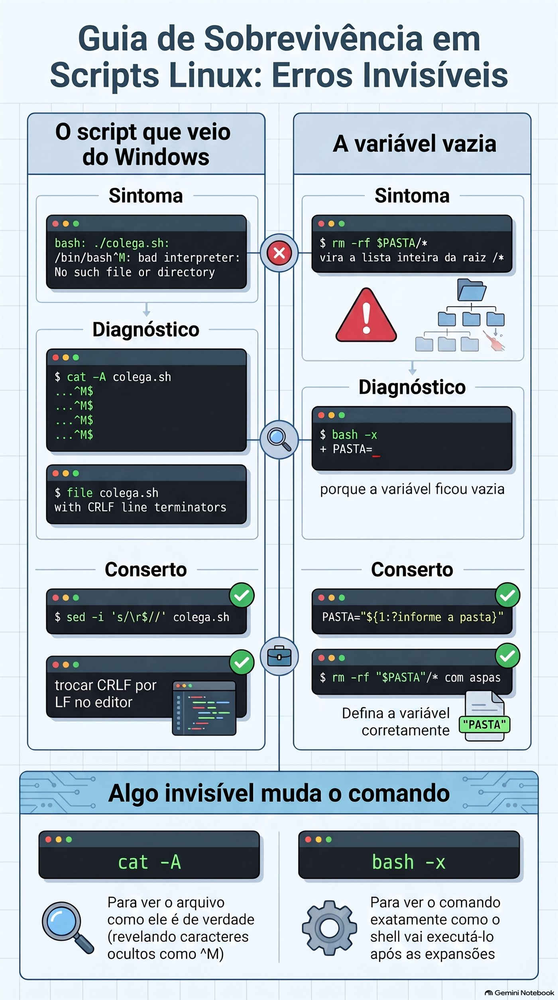

# Aula 1.8 · Primeiro script

Você transforma o Protocolo de backup da Aula 1.7 num script de verdade: um arquivo que você chama pelo nome, de qualquer pasta, passando o que quer guardar, e que faz os cinco passos sempre na mesma ordem. No caminho, aprende os três erros que derrubam o primeiro script de todo mundo: a permissão que falta, a aspa que falta e o arquivo que veio do Windows.

| Ficha | Aula 1.8 |
| --- | --- |
| Módulo | M1 · Linha de comando, aula 8 de 10 |
| Quando | Semana 3 |
| Ao final você consegue | Escrever um script com shebang, comentários e variáveis; torná-lo executável e chamá-lo de três jeitos, sabendo a diferença; usar aspas simples e duplas sem surpresa; receber argumentos com `$1`, `$2`, `$#` e `"$@"`; proteger o script de uma variável vazia; depurar com `bash -n` e `bash -x`; instalar o script no `~/bin` |
| Itens de prova | LE 013.3 · LPIC-1 105.2, a parte de scripts simples · RHCSA: criar scripts simples e processar a entrada do script (`$1`, `$2`...) |
| Pré-requisitos | Aula 1.7 completa, com o `~/lab13/arquivo` ainda nas VMs |
| Tempo | Cerca de 2h30 |
| Snapshots | m1a8-inicio e m1a8-fim nas duas VMs |

## 1 · Aquecimento

Três perguntas, de cabeça, antes de ler qualquer coisa. Escreva as respostas; o Gabarito confere no fim.

1. Na Aula 1.7, qual comando testa um `.tar.gz` até o último byte, sem extrair nada?
2. Na Aula 1.7, por que o Protocolo usa `-C` na criação do backup?
3. Palpite: você salva um arquivo `ola.sh` com um `echo` dentro e digita `ola.sh` no terminal, na mesma pasta. O que acontece?

## 2 · Por que importa

Sexta, 18h. Você precisa fazer o backup do `/etc` de seis servidores antes de uma atualização. Na Aula 1.7, o Protocolo tinha cinco passos. Seis servidores vezes cinco passos são trinta comandos digitados à mão, no fim do dia. No quarto servidor você esquece o `chmod 600`. No quinto, digita `-cfz` em vez de `-czf`. Ninguém percebe até o dia em que precisa do backup.

Um script não fica cansado. Ele faz os cinco passos na mesma ordem, toda vez, e você só confere o resultado. É a diferença entre saber um procedimento e ter um procedimento.

Segundo caso. Um colega escreve um script no Notepad do Windows, copia para o servidor e roda. O erro é `bad interpreter: No such file or directory`, apontando para o `/bin/bash`, que obviamente existe. Ele perde uma hora reinstalando o bash. O problema era um caractere invisível no fim de cada linha. Você vai ver esse erro hoje, de propósito, e consertar em um comando.

Terceiro caso, o perigoso. Um script de limpeza tem `rm -rf "$PASTA"/*`. Num dia, a variável `PASTA` chega vazia. O comando vira `rm -rf /*`. Isso já aconteceu em produtos conhecidos e em muito servidor de cliente. Hoje você aprende a linha que impede isso, e testa sem apagar nada.

E o quarto, a prova: o RHCSA pede scripts simples que recebem argumentos. Não é programação, é exatamente o que esta aula ensina.

## 3 · Modelo mental

> Um script é uma receita escrita. O shell é o cozinheiro que lê linha por linha.

Tudo o que você digita no terminal pode ir para um arquivo, uma linha embaixo da outra. Quando você manda executar, um shell abre o arquivo e faz exatamente o que faria se você digitasse. Não existe uma linguagem nova aqui: são os mesmos comandos das aulas 1.2 a 1.7.

Três perguntas definem se a receita roda:

- **Quem lê a receita?** A primeira linha, o *shebang*, diz qual cozinheiro: `#!/bin/bash`. Sem ela, quem escolhe é quem chamou, e o resultado muda de máquina para máquina.
- **A receita pode ser executada?** O Linux não olha a extensão `.sh`. Ele olha a permissão `x`. Sem ela, o arquivo é só texto.
- **Onde está a receita?** Se você digita só o nome, o shell procura nas pastas do `PATH`, e a pasta atual não está lá. Ou você diz onde está, com `./`, ou instala numa pasta do `PATH`.

E duas peças deixam a receita reaproveitável:

- **Variáveis** são as anotações do cozinheiro: `destino=/backup`. Ao ler, `$destino`.
- **Argumentos** são os ingredientes que você entrega na hora: `backup-app.sh /etc` faz o `$1` valer `/etc`. A mesma receita serve para qualquer pasta.

```text
  você digita:   backup-app.sh  /etc  /backup
                      │           │      │
                      $0          $1     $2        $# = 2

  o shell:  1. acha o arquivo (PATH ou ./)
            2. confere a permissão x
            3. lê a 1ª linha  #!/bin/bash  e chama o bash
            4. o bash executa linha por linha, trocando $1 e $2 pelos valores
```

## 4 · Conceito em camadas

### Essencial

**O arquivo.** Um script mínimo:

```bash
#!/bin/bash
# ola.sh - meu primeiro script
echo "Olá, $USER. Hoje é $(date +%F)."
```

- `#!/bin/bash` é o shebang. Precisa ser a primeira linha, começando exatamente com `#!`, sem espaço antes.
- Linhas que começam com `#` são comentários. O shell ignora. Você, daqui a seis meses, não.
- O resto são comandos comuns. O `$(date +%F)` você já usou na Aula 1.7: o shell roda o comando e põe a saída no lugar. A Aula 1.9 detalha.

**Executar.** Três jeitos, com resultados diferentes:

| Como você chama | O que precisa | O que acontece |
| --- | --- | --- |
| `bash ola.sh` | Só permissão de leitura | Você escolhe o bash; o shebang é ignorado |
| `./ola.sh` | Permissão `x` | O kernel lê o shebang e chama o programa indicado |
| `ola.sh` | Permissão `x` e estar numa pasta do `PATH` | O shell procura no `PATH`; a pasta atual não conta |

Para dar a permissão: `chmod +x ola.sh`. A Aula 2.7 explica as permissões em detalhe; por enquanto, `+x` basta.

**Variáveis.**

```bash
destino=/backup        # cria: SEM espaço antes nem depois do =
echo $destino          # lê com $
echo "${destino}_old"  # chaves separam o nome do texto colado
```

`destino = /backup`, com espaços, não cria nada: o shell entende que você quer rodar um comando chamado `destino` com os argumentos `=` e `/backup`.

**Aspas.**

| Escreveu | O shell faz | Exemplo com `nome=Rodrigo` |
| --- | --- | --- |
| `'...'` simples | Nada. Tudo é literal | `echo 'Oi $nome'` → `Oi $nome` |
| `"..."` duplas | Troca `$variável` e `$(comando)`, mantém espaços | `echo "Oi $nome"` → `Oi Rodrigo` |
| Sem aspas | Troca, e depois **quebra nos espaços** e expande `*` | Perigo com nomes de arquivo com espaço |

A regra prática: **variável sempre entre aspas duplas**, `"$destino"`. Sem exceção, até você saber por que quer a exceção.

**Argumentos.**

| Variável | Valor |
| --- | --- |
| `$0` | O nome com que o script foi chamado |
| `$1`, `$2`... `${10}` | O primeiro, o segundo... o décimo argumento |
| `$#` | Quantos argumentos vieram |
| `"$@"` | Todos os argumentos, cada um inteiro, mesmo com espaço |
| `$?` | O código de saída do último comando. A Aula 1.9 usa muito |

**Valor padrão e valor obrigatório.**

```bash
destino="${2:-$HOME/backups}"     # se $2 veio vazio, usa $HOME/backups
origem="${1:?uso: $0 PASTA}"      # se $1 veio vazio, para o script com essa mensagem
```

O `:?` é o cinto de segurança do script. A Aula 1.9 traz o `if`, que faz o mesmo de forma mais flexível; até lá, `:?` resolve.

**Depurar.**

```bash
bash -n script.sh     # só confere a sintaxe, não executa nada
bash -x script.sh     # executa mostrando cada linha, já com as variáveis trocadas
```

### Ponte Windows

| No Windows | No Linux | Cuidado |
| --- | --- | --- |
| `.bat`, `.cmd`, `.ps1` decidem o interpretador pela extensão | O shebang decide; a extensão `.sh` é só para humanos | Um `.sh` com `#!/usr/bin/python3` roda como Python |
| `Set-ExecutionPolicy` decide se scripts rodam | A permissão `x` de cada arquivo decide | Não existe um interruptor global |
| A pasta atual entra na busca do `cmd` | A pasta atual **não** está no `PATH` | Por isso o `./` |
| `set destino=C:\bkp` e `%destino%` | `destino=/bkp` e `$destino` | No Linux, espaço em volta do `=` quebra |
| `%1`, `%2`, `%*` | `$1`, `$2`, `"$@"` |  |
| Fim de linha CRLF (`\r\n`) | Fim de linha LF (`\n`) | Script salvo no Windows quebra no Linux. Quebra A |

No PowerShell, `$destino = "C:\bkp"` aceita espaços em volta do `=`. É o hábito que mais derruba quem vem do Windows.

### Avançado

- **`source` ou `.` não executam: incluem.** `./script.sh` roda num shell novo, filho do seu. Um `cd` ou uma variável criada lá dentro morre quando o script termina. `source script.sh` roda as linhas no seu próprio shell, e o `cd` fica. É assim que o `~/.bashrc` é lido.
- **`export`.** Uma variável criada no terminal não chega ao script, a não ser que seja exportada: `export DESTINO=/backup`. Variáveis de ambiente, como `PATH`, `HOME` e `USER`, já são exportadas.
- **`set -u`** faz o script parar ao usar uma variável que não existe, em vez de tratá-la como vazia. **`set -e`** para no primeiro comando que falhar. São úteis, mas têm armadilhas; a Aula 1.9 mostra quando confiar neles.
- **`#!/usr/bin/env bash`** procura o bash no `PATH`, útil quando ele não está em `/bin`, como em alguns BSDs. Em Rocky e Debian, `#!/bin/bash` funciona sempre.
- **`readonly`** impede que uma variável seja mudada depois: `readonly DESTINO=/backup`.

### O que cai na prova

- **LE 013.3:** shebang, `chmod +x`, executar com `./`, variáveis, `$1` e `$#`, comentários. Perguntas curtas do tipo "qual linha cria a variável corretamente".
- **LPIC-1 105.2:** parâmetros posicionais, `$?`, `$#`, `$@`, `source`, diferença entre executar e incluir.
- **RHCSA:** uma tarefa do tipo "crie `/usr/local/bin/meuscript` que recebe um argumento e faz X", e o corretor roda o script com argumentos dele. Shebang, permissão e caminho certos valem tanto quanto a lógica.

## 5 · Rocky × Debian

|  | Rocky Linux 9 e 10 | Debian 13 |
| --- | --- | --- |
| `/bin/sh` aponta para | `bash` | `dash`, um shell menor e mais rápido |
| Script com `#!/bin/sh` e recurso do bash, como `{1..3}` | Funciona, porque é o bash | Quebra ou dá resultado diferente |
| `~/bin` no `PATH` | Já está, pelo `~/.bashrc`, mesmo que a pasta ainda não exista | Entra pelo `~/.profile`, só se a pasta existir **no login**. Crie e saia da sessão |
| `~/.local/bin` no `PATH` | Já está | Mesma regra do `~/bin` |
| `dos2unix` para tirar o CRLF | `sudo dnf install dos2unix` | `sudo apt install dos2unix` |
| `bash --version` | 5.1 na Rocky 9, 5.2 na Rocky 10 | 5.2 |

A regra que evita a primeira linha da tabela: **se usa recursos do bash, escreva `#!/bin/bash`**. Use `#!/bin/sh` só quando o script for POSIX puro, e teste no Debian.

## 6 · Lab guiado

Faça tudo nas duas VMs, a não ser quando o passo disser só uma. Os scripts ficam em `~/lab13/scripts`, e a matéria-prima é a aplicação de mentira da Aula 1.7, em `~/lab13/arquivo/app`. Em cada passo, quando aparecer **Preveja**, escreva a resposta antes de apertar Enter.

### Passo 1 · Preparar

No nó Proxmox:

```bash
qm snapshot 201 m1a8-inicio
qm snapshot 202 m1a8-inicio
```

Em cada VM:

```bash
ls ~/lab13/arquivo/app
mkdir -p ~/lab13/scripts
cd ~/lab13/scripts
echo "$SHELL"
bash --version | head -1
```

O `ls` deve mostrar `conf`, `iniciar.sh`, `logs` e `www`. Se a pasta não existir, refaça o Passo 1 da Aula 1.7. O `$SHELL` deve ser `/bin/bash`.

### Passo 2 · O primeiro arquivo e os três jeitos de chamar

Crie o script com um *here-document*, o `cat > arquivo <<'EOF'` que você usou na Aula 1.7. As aspas em `'EOF'` fazem o texto entrar no arquivo exatamente como está, sem trocar o `$USER` agora.

```bash
cat > ola.sh <<'EOF'
#!/bin/bash
# ola.sh - meu primeiro script
echo "Olá, $USER. Hoje é $(date +%F)."
echo "Estou rodando em $(hostname)."
EOF
cat ola.sh
ls -l ola.sh
```

**Preveja.** Você vai digitar `ola.sh`, só o nome, estando na mesma pasta. O que aparece?

```bash
ola.sh
```

`bash: ola.sh: command not found`. O arquivo está ali, mas o shell não procura na pasta atual: procura nas pastas do `PATH`. Veja quais são:

```bash
echo "$PATH"
```

Agora diga onde o arquivo está, com `./`:

```bash
./ola.sh
```

`bash: ./ola.sh: Permission denied`. O `ls -l` de antes mostrou `-rw-r--r--`: não há nenhum `x`. Para o Linux, isso é texto, não programa.

**Decida 1 · O jeito que funciona sem `x`.** Antes de dar a permissão, você roda `bash ola.sh`. O que acontece?

- **A)** `Permission denied`, como no `./ola.sh`.
- **B)** Funciona, porque quem está sendo executado é o `bash`, e o `ola.sh` é só um arquivo que ele lê.
- **C)** Funciona, porque o `bash` ignora as permissões de qualquer arquivo.
- **D)** `command not found`, porque o `ola.sh` não está no `PATH`.

Escolha a letra antes de olhar a tabela.

| Se você marcou | Resultado | Por quê |
| --- | --- | --- |
| A | ❌ Errada | O `x` é exigido de quem é executado. Aqui o executado é o `/bin/bash`, que tem `x`. O `ola.sh` só precisa ser lido, e tem `r`. |
| B | ✅ Certa | O `bash` recebe o nome do arquivo como argumento, abre e lê linha por linha, como faria com um `cat`. O shebang vira um comentário comum. |
| C | ❌ Errada | Se você tirar o `r` com `chmod -r ola.sh`, o `bash ola.sh` falha com `Permission denied`. Ele respeita a leitura; só não precisa do `x`. |
| D | ❌ Errada | O `PATH` só entra em jogo para achar o primeiro nome da linha, que aqui é `bash`. O `ola.sh` é um argumento com caminho relativo. |

**Para fixar:** `bash script.sh` precisa de `r`; `./script.sh` precisa de `r` e `x`; `script.sh` precisa de `r`, `x` e estar no `PATH`.

Confira:

```bash
bash ola.sh
chmod +x ola.sh
ls -l ola.sh
./ola.sh
```

Agora o `ls -l` mostra `-rwxr-xr-x`, e o `./ola.sh` funciona. Uma última experiência com o shebang:

```bash
head -1 ola.sh
file ola.sh
```

O `file` responde algo como `Bourne-Again shell script, Unicode text, UTF-8 text executable`. Ele leu a primeira linha, como o kernel faz.

### Passo 3 · Variáveis e aspas, no terminal

Antes de pôr variáveis num script, erre no terminal, onde é barato:

```bash
destino = /backup
```

**Preveja** a mensagem. É `bash: destino: command not found`. O shell leu `destino` como um comando, com dois argumentos. Agora do jeito certo:

```bash
destino=/backup
echo $destino
echo "Os backups vão para $destino"
echo 'Os backups vão para $destino'
echo "${destino}_antigo"
echo "$destino_antigo"
```

As duas últimas linhas são a pegadinha das chaves. `"${destino}_antigo"` mostra `/backup_antigo`. `"$destino_antigo"` mostra uma linha vazia: o shell procurou uma variável chamada `destino_antigo`, que não existe, e trocou por nada, sem erro nenhum.

Agora um nome de arquivo com espaço, o caso que mais quebra scripts:

```bash
cd /tmp
arq="relatorio final.txt"
```

**Decida 2 · A aspa que faltou.** Você digita `touch $arq`, sem aspas, e depois `ls`. O que aparece?

- **A)** Um arquivo `relatorio final.txt`.
- **B)** Dois arquivos: `relatorio` e `final.txt`.
- **C)** Um arquivo chamado `$arq`.
- **D)** Erro, porque o `touch` não aceita espaço no nome.

Escolha a letra antes de olhar a tabela.

| Se você marcou | Resultado | Por quê |
| --- | --- | --- |
| A | ❌ Errada | Seria o resultado de `touch "$arq"`. Sem aspas, depois de trocar a variável o shell quebra o texto nos espaços. |
| B | ✅ Certa | O shell troca `$arq` por `relatorio final.txt` e depois divide nos espaços. O `touch` recebe dois argumentos e cria dois arquivos. |
| C | ❌ Errada | Isso aconteceria com aspas simples: `touch '$arq'`. Sem aspas, a variável é trocada. |
| D | ❌ Errada | O `touch` aceita qualquer nome. Ele nem fica sabendo que havia um espaço: recebe dois nomes separados. |

**Para fixar:** variável sempre entre aspas duplas. `touch "$arq"`, `rm "$arq"`, `cp "$arq" "$destino"`.

Confira e limpe:

```bash
touch $arq
ls -l relatorio final.txt
touch "$arq"
ls -l "$arq"
rm -v relatorio final.txt "$arq"
cd ~/lab13/scripts
```

Imagine o mesmo erro com `rm $arq`: você apagaria `relatorio` e `final.txt`, que podiam ser outros arquivos, e o `relatorio final.txt` continuaria lá.

### Passo 4 · Argumentos

Um script que só mostra o que recebeu:

```bash
cat > args.sh <<'EOF'
#!/bin/bash
# args.sh - mostra os argumentos recebidos
echo "Nome do script: $0"
echo "Primeiro:       $1"
echo "Segundo:        $2"
echo "Quantidade:     $#"
echo "Todos, um por linha:"
printf '  [%s]\n' "$@"
EOF
chmod +x args.sh
```

O `printf` repete o modelo `[%s]` uma vez para cada argumento. É um truque para ver exatamente onde cada argumento começa e termina.

**Preveja** o `$#` de cada linha antes de rodar:

```bash
./args.sh
./args.sh um dois tres
./args.sh um "dois tres"
./args.sh "$HOME" *.sh
```

Respostas: 0, 3, 2, e a última depende de quantos `.sh` existem na pasta. O `*.sh` é expandido **antes** de o script começar: ele nunca vê o asterisco, só recebe a lista de nomes. Repare também que, sem argumento, `$1` vem vazio e o script segue em frente, sem reclamar. Guarde isso para a Quebra B.

**Decida 3 · O décimo argumento.** Você roda `./args.sh a b c d e f g h i j`. Dentro do script, uma linha diz `echo "$10"`. O que ela mostra?

- **A)** `j`, o décimo argumento.
- **B)** `a0`, o primeiro argumento seguido de um zero.
- **C)** Uma linha vazia, porque só existem `$1` a `$9`.
- **D)** Erro de sintaxe.

Escolha a letra antes de olhar a tabela.

| Se você marcou | Resultado | Por quê |
| --- | --- | --- |
| A | ❌ Errada | Seria o resultado de `"${10}"`. Sem chaves, o shell só lê um dígito depois do `$`. |
| B | ✅ Certa | O shell lê `$1`, que vale `a`, e cola o `0` como texto. É a mesma pegadinha do `$destino_antigo`. |
| C | ❌ Errada | Existem `${10}`, `${11}` e quantos você passar. Só a forma curta, sem chaves, para no 9. |
| D | ❌ Errada | Não há erro: o shell aceita `$10` e o interpreta, de um jeito que você não queria. |

**Para fixar:** acima de 9, use chaves: `${10}`. Na dúvida, use chaves sempre.

Confira:

```bash
echo 'echo "com \$10:   $10"'   >> args.sh
echo 'echo "com \${10}: ${10}"' >> args.sh
tail -2 args.sh
./args.sh a b c d e f g h i j
```

### Passo 5 · O Protocolo vira script

Este é o passo central. Você vai escrever o mesmo script três vezes, cada versão melhor que a anterior.

**Versão 1, tudo fixo.** É o Protocolo da Aula 1.7, colado num arquivo:

```bash
cat > backup-app.sh <<'EOF'
#!/bin/bash
# backup-app.sh v1 - tudo fixo
mkdir -p ~/backups
tar -czf ~/backups/app-$(date +%F_%H%M).tar.gz -C ~/lab13/arquivo app
ls -lh ~/backups
EOF
chmod +x backup-app.sh
./backup-app.sh
```

Funciona, mas só serve para essa pasta, e o nome do arquivo aparece só dentro do `tar`. Se você quiser testar e gravar o `sha256sum` em seguida, vai ter de repetir o nome, com a hora, que já mudou.

**Versão 2, com variáveis.** O nome é calculado uma vez e usado em todo lugar:

```bash
cat > backup-app.sh <<'EOF'
#!/bin/bash
# backup-app.sh v2 - variáveis
origem="$HOME/lab13/arquivo/app"
destino="$HOME/backups"
data="$(date +%F_%H%M)"
arquivo="$destino/app-$data.tar.gz"

mkdir -p "$destino"
tar -czf "$arquivo" -C "$HOME/lab13/arquivo" app
tar -tzf "$arquivo" > /dev/null && echo "OK: o arquivo abre até o fim"
sha256sum "$arquivo" > "$arquivo.sha256"
chmod 600 "$arquivo" "$arquivo.sha256"
ls -lh "$arquivo" "$arquivo.sha256"
EOF
bash -n backup-app.sh
./backup-app.sh
```

O `bash -n` não mostra nada quando a sintaxe está certa. Repare que dentro do script usei `$HOME`, e não `~`: o `~` não é trocado dentro de aspas, e uma variável entre aspas é mais segura.

**Preveja.** Rode de novo, agora com `bash -x`. Quantas linhas começando com `+` vão aparecer?

```bash
bash -x ./backup-app.sh
```

Uma para cada comando, com as variáveis já trocadas pelos valores: `+ data=2026-11-02_1430`, `+ tar -czf /home/rodrigo/backups/app-2026-11-02_1430.tar.gz ...`. O `-x` é o raio X do script: quando algo der errado, é a primeira coisa que você roda.

**Versão 3, com argumentos.** Agora a pasta vem de fora, e o destino tem um valor padrão:

```bash
cat > backup-app.sh <<'EOF'
#!/bin/bash
# backup-app.sh - backup de uma pasta pelo Protocolo da Aula 1.7
# Uso: backup-app.sh PASTA [DESTINO]
#   PASTA    o que guardar, obrigatório
#   DESTINO  onde guardar, padrão ~/backups

origem="${1:?uso: $0 PASTA [DESTINO]}"
destino="${2:-$HOME/backups}"
nome="$(basename "$origem")"
pai="$(dirname "$origem")"
data="$(date +%F_%H%M)"
arquivo="$destino/$nome-$data.tar.gz"

echo "Backup de $origem para $arquivo"
mkdir -p "$destino"
tar -czf "$arquivo" -C "$pai" "$nome"
tar -tzf "$arquivo" > /dev/null && echo "OK: o arquivo abre até o fim"
sha256sum "$arquivo" > "$arquivo.sha256"
chmod 600 "$arquivo" "$arquivo.sha256"
ls -lh "$arquivo" "$arquivo.sha256"
EOF
bash -n backup-app.sh
```

O `basename` devolve o último pedaço do caminho, e o `dirname`, o resto. Para `/home/rodrigo/lab13/arquivo/app`, eles devolvem `app` e `/home/rodrigo/lab13/arquivo`. É o `-C` do Protocolo, calculado sozinho.

Teste os três casos:

```bash
./backup-app.sh
./backup-app.sh ~/lab13/arquivo/app
./backup-app.sh ~/lab13/arquivo/app /tmp/bkp-teste
ls -l ~/backups /tmp/bkp-teste
```

O primeiro para na hora com `./backup-app.sh: line 7: 1: uso: ./backup-app.sh PASTA [DESTINO]`, sem criar nada. O segundo usa o destino padrão. O terceiro grava em `/tmp/bkp-teste`. Confira a impressão digital do último:

```bash
sha256sum -c /tmp/bkp-teste/app-*.sha256
```

`OK`. Como o `sha256sum` gravou o caminho completo, a conferência funciona de qualquer pasta.

**Decida 4 · O backup de `/etc`.** Você roda `./backup-app.sh /etc`, como usuário comum. O que acontece?

- **A)** Funciona igual, com todo o `/etc` dentro.
- **B)** O `tar` reclama de vários arquivos que não consegue ler, como o `shadow`, cria um backup incompleto, e mesmo assim aparece `OK: o arquivo abre até o fim`.
- **C)** O script para na primeira linha, porque `/etc` não é uma pasta do usuário.
- **D)** O `tar` recusa o backup inteiro e nada é criado.

Escolha a letra antes de olhar a tabela.

| Se você marcou | Resultado | Por quê |
| --- | --- | --- |
| A | ❌ Errada | Usuário comum não lê `/etc/shadow`, `/etc/sudoers` e outros. O `tar` não tem como guardar o que não consegue ler. |
| B | ✅ Certa | O `tar` mostra `Cannot open: Permission denied` para cada um, guarda o resto e termina com erro. Mas a linha seguinte só testa se o arquivo abre, e ele abre. O script diz OK para um backup sem os arquivos mais importantes. |
| C | ❌ Errada | O `:?` só confere se o `$1` veio. `/etc` veio, então o script segue. |
| D | ❌ Errada | O `tar` é teimoso: pula o que não consegue ler e continua. Por isso o backup existe, só que incompleto. |

**Para fixar:** um script que não confere o resultado de cada passo mente para você. A Aula 1.9 ensina o `if` e o `$?`, e esta é a primeira coisa que você vai consertar com eles.

Confira, olhando o fim da saída:

```bash
./backup-app.sh /etc /tmp/bkp-teste 2>&1 | tail -5
sudo ./backup-app.sh /etc /tmp/bkp-teste | tail -3
```

Com `sudo`, não há reclamação, e o arquivo fica com dono `root` e permissão 600. É o que um backup do `/etc` deve ser.

### Passo 6 · Instalar no `~/bin`

Um script que você chama com `./` de dentro de uma pasta ainda não é uma ferramenta. Instale:

```bash
mkdir -p ~/bin
cp backup-app.sh ~/bin/
cd /
backup-app.sh ~/lab13/arquivo/app
```

**Decida 5 · Rocky e Debian.** Você fez exatamente isso nas duas VMs, sem sair da sessão. Qual é o resultado?

- **A)** Funciona nas duas.
- **B)** Funciona na rocky-lab; na debian-lab, `command not found`.
- **C)** Funciona na debian-lab; na rocky-lab, `command not found`.
- **D)** Não funciona em nenhuma até reiniciar a VM.

Escolha a letra antes de olhar a tabela.

| Se você marcou | Resultado | Por quê |
| --- | --- | --- |
| A | ❌ Errada | No Debian, o `~/bin` só entra no `PATH` se existir no momento do login. Ele não existia quando você entrou. |
| B | ✅ Certa | O `~/.bashrc` da Rocky põe `~/bin` no `PATH` sempre. O `~/.profile` do Debian só põe se a pasta já existir ao entrar. |
| C | ❌ Errada | É o contrário. Confira com `echo "$PATH"` nas duas. |
| D | ❌ Errada | Reiniciar resolve, mas é exagero. Basta sair e entrar de novo, ou ler o arquivo de novo com `source ~/.profile`. |

**Para fixar:** depois de criar o `~/bin`, saia e entre de novo. Confira com `type nome-do-script`.

Confira, na debian-lab:

```bash
echo "$PATH" | tr ':' '\n' | grep bin
source ~/.profile
type backup-app.sh
cd / && backup-app.sh ~/lab13/arquivo/app
```

O `type` responde `backup-app.sh is /home/rodrigo/bin/backup-app.sh`. O script virou um comando.

> **Protocolo · Script que não envergonha**
>
> 1. Primeira linha: `#!/bin/bash`. Segunda: um comentário dizendo o que faz. Terceira: `# Uso:` com os argumentos.
> 2. Argumento obrigatório com `${1:?uso: ...}`; opcional com `${2:-padrão}`.
> 3. Calcule nomes uma vez, em variáveis, e use as variáveis em todo lugar.
> 4. Toda variável entre aspas duplas: `"$arquivo"`.
> 5. Antes de rodar: `bash -n`. Se algo estranho acontecer: `bash -x`.
> 6. Teste sem argumentos, com um argumento e com um caminho que tem espaço.
> 7. `chmod +x`, instale em `~/bin` ou, para todos os usuários, em `/usr/local/bin`.

## 7 · Quebre e conserte

### Quebra A · O script que veio do Windows

Um colega manda um script que escreveu no Notepad. Simule o arquivo dele: o `\r\n` no fim de cada linha é exatamente o que o Notepad grava.

```bash
cd ~/lab13/scripts
printf '#!/bin/bash\r\n# do colega\r\necho "versao do colega"\r\n' > colega.sh
chmod +x colega.sh
./colega.sh
```

**Observe.** A mensagem é algo como:

```text
bash: ./colega.sh: /bin/bash^M: bad interpreter: No such file or directory
```

O `/bin/bash` existe. Mas repare no `^M` colado nele.

**Diagnostique.** Mostre o que o `cat` normal esconde:

```bash
cat colega.sh
cat -A colega.sh
file colega.sh
```

O `cat -A` mostra `^M$` no fim de cada linha: `^M` é o `\r`, e `$` marca o fim da linha. O `file` diz `with CRLF line terminators`. O kernel leu a primeira linha como `/bin/bash\r` e procurou um programa com esse nome, com um caractere invisível no fim. Não existe.

**Decida A · O conserto.** O que resolve de vez?

- **A)** Rodar com `bash colega.sh`.
- **B)** Tirar o `\r` do fim de cada linha: `sed -i 's/\r$//' colega.sh`, ou `dos2unix colega.sh`.
- **C)** Reinstalar o bash.
- **D)** Trocar o shebang para `#!/bin/sh`.

Escolha a letra antes de olhar a tabela.

| Se você marcou | Resultado | Por quê |
| --- | --- | --- |
| A | ❌ Errada | Escapa do shebang, mas o bash lê cada linha com o `\r` no fim. O `echo` imprime um `\r` escondido, e um `cd /tmp\r` falha com `No such file or directory`. O problema muda de lugar. |
| B | ✅ Certa | O arquivo passa a ter fins de linha do Linux. O `sed` já vem instalado nas duas VMs; o `dos2unix` faz o mesmo e precisa ser instalado. |
| C | ❌ Errada | O bash está perfeito. É o caso da seção 2: uma hora perdida no lugar errado. |
| D | ❌ Errada | A primeira linha continua com `\r`, agora `/bin/sh^M`, e o erro é o mesmo. |

**Para fixar:** `bad interpreter` com `^M` é sempre CRLF. Confira com `cat -A` e conserte com `sed -i 's/\r$//'`.

**Conserte.**

```bash
sed -i 's/\r$//' colega.sh
cat -A colega.sh
file colega.sh
./colega.sh
```

Agora o `cat -A` mostra só `$` no fim, e o script roda. Para não receber o problema: no VS Code, o canto inferior direito mostra `CRLF`; clique e troque para `LF` antes de salvar. No Notepad++, menu Editar, Conversão de fim de linha.

### Quebra B · A variável vazia

Este é o erro que já apagou servidores inteiros. Você vai reproduzir com segurança: o script só **mostra** o comando, com `echo`, e não apaga nada.

```bash
cat > limpa.sh <<'EOF'
#!/bin/bash
# limpa.sh - limpa uma pasta de temporários (versão perigosa)
PASTA=$1
echo "Vou executar:" rm -rf $PASTA/*
EOF
chmod +x limpa.sh
```

Primeiro, o uso normal:

```bash
mkdir -p /tmp/temporarios && touch /tmp/temporarios/a.tmp /tmp/temporarios/b.tmp
./limpa.sh /tmp/temporarios
```

`Vou executar: rm -rf /tmp/temporarios/a.tmp /tmp/temporarios/b.tmp`. Certo. Agora alguém esquece o argumento.

**Observe.**

```bash
./limpa.sh
```

`Vou executar: rm -rf /bin /boot /dev /etc /home /lib ...`. A lista inteira da raiz; na Rocky, ela começa por `/afs`. Sem o `echo`, este era o fim do servidor.

**Diagnostique.** Use o raio X:

```bash
bash -x ./limpa.sh
```

A primeira linha com `+` é `+ PASTA=`: a variável recebeu nada. Em seguida, `$PASTA/*` virou `/*`, e o shell expandiu o asterisco para tudo o que existe na raiz.

**Decida B · O cinto de segurança.** Qual troca impede o desastre?

- **A)** Pôr aspas: `rm -rf "$PASTA"/*`.
- **B)** Exigir o argumento: `PASTA="${1:?informe a pasta}"`, e manter as aspas no `rm`.
- **C)** Trocar `rm -rf` por `rm -r`.
- **D)** Rodar o script sempre como usuário comum.

Escolha a letra antes de olhar a tabela.

| Se você marcou | Resultado | Por quê |
| --- | --- | --- |
| A | ❌ Errada | As aspas protegem contra espaços, mas `"$PASTA"/*` com `PASTA` vazio continua sendo `""/*`, ou seja, `/*`. Ajuda, não salva. |
| B | ✅ Certa | Sem argumento, o script para na linha da variável, antes de chegar ao `rm`. As aspas continuam lá para o caso de a pasta ter espaço no nome. |
| C | ❌ Errada | Sem o `f`, o `rm` pergunta em arquivos protegidos e mostra erros, mas apaga tudo o que tem permissão de apagar. |
| D | ❌ Errada | Diminui o estrago, mas o usuário ainda apaga tudo o que é dele, inclusive o `/home` dele. E scripts de limpeza costumam rodar como root, no cron. |

**Para fixar:** toda variável usada num `rm`, `mv` ou `chmod -R` precisa ser obrigatória, com `:?`, e estar entre aspas.

**Conserte.**

```bash
sed -i 's|^PASTA=\$1$|PASTA="${1:?informe a pasta}"|' limpa.sh
sed -i 's|rm -rf \$PASTA/\*|rm -rf "$PASTA"/*|' limpa.sh
cat limpa.sh
./limpa.sh
./limpa.sh /tmp/temporarios
```

Agora, sem argumento, o script para com `line 3: 1: informe a pasta`, e com argumento funciona como antes. Abra o `backup-app.sh` e confira que ele já nasceu com esse cinto, no `$1`.

### A lição

Os dois erros de hoje têm a mesma cara: algo invisível que muda o comando. Um `\r` que você não vê no fim da linha. Uma variável vazia que você não vê no meio do `rm`. Os dois se revelam com as mesmas ferramentas: `cat -A` para ver o arquivo como ele é, e `bash -x` para ver o comando como o shell vai executá-lo. Quando um script faz algo que você não pediu, não leia o script: rode com `-x` e leia o que ele fez.


*Um caractere que você não vê e uma variável que você não vê: cat -A e bash -x revelam os dois.*

## 8 · Armadilhas

| Você digita ou vê | O que acontece | O certo |
| --- | --- | --- |
| `destino = /backup` | `destino: command not found` | `destino=/backup`, sem espaços |
| `script.sh`, na pasta do script | `command not found` | `./script.sh`, ou instalar no `PATH` |
| `./script.sh` logo depois de criar | `Permission denied` | `chmod +x script.sh` |
| `bad interpreter` com `^M` | Arquivo com CRLF do Windows | `sed -i 's/\r$//' script.sh` |
| `echo '$HOME'` | Mostra `$HOME`, literal | Aspas duplas: `echo "$HOME"` |
| `touch $arq` com espaço no nome | Cria dois arquivos | `touch "$arq"` |
| `"$nome_backup"` | Procura uma variável chamada `nome_backup`, que não existe, e mostra vazio, sem erro | `"${nome}_backup"`, sempre com chaves ao colar texto |
| `echo "$10"` | Mostra `$1` seguido de `0` | `"${10}"` |
| `rm -rf "$PASTA"/*` sem conferir `$PASTA` | Com a variável vazia, vira `rm -rf /*` | `PASTA="${1:?...}"` antes |
| `#!/bin/sh` e `{1..5}` no script | Funciona na Rocky, quebra no Debian | `#!/bin/bash` |
| `~` dentro de aspas: `"~/backups"` | Não é trocado; cria uma pasta chamada `~` | `"$HOME/backups"` |
| `cd /var/log` dentro do script | Ao terminar, você continua na pasta de antes | Normal: o script roda num shell filho. Para ficar, `source` |
| Script com `tar` que falhou e `OK` no fim | O teste seguinte não sabe que o `tar` falhou | Conferir o `$?`. Aula 1.9 |

## 9 · Quiz

Dez perguntas, sem consultar. Escreva a letra ou a resposta de cada uma e só depois abra o Gabarito.

**1.** Qual linha cria a variável `porta` com o valor 8080?

- **A)** `porta = 8080`
- **B)** `$porta=8080`
- **C)** `porta=8080`
- **D)** `set porta 8080`

**2.** O `s.sh` tem permissão `-rw-r--r--`. Qual destas chamadas **falha**?

- **A)** `bash s.sh`
- **B)** `./s.sh`
- **C)** `source s.sh`
- **D)** `sh s.sh`

**3.** Você roda `./args.sh "um dois" tres`. Quanto valem `$#` e `$1`?

- **A)** `3` e `um`
- **B)** `2` e `um dois`
- **C)** `2` e `"um dois"`, com as aspas
- **D)** `3` e `um dois`

**4.** Com `nome=web01`, o que mostra `echo 'Servidor: $nome'`?

- **A)** `Servidor: web01`
- **B)** `Servidor: $nome`
- **C)** `Servidor:`
- **D)** Erro de sintaxe

**5.** O shebang de um script diz `#!/bin/bsh`, com um erro de digitação. O que acontece com `./script.sh` e com `bash script.sh`?

- **A)** Os dois funcionam: o bash corrige o nome.
- **B)** Os dois falham com `bad interpreter`.
- **C)** `./script.sh` falha com `bad interpreter`; `bash script.sh` funciona, porque o shebang vira comentário.
- **D)** `./script.sh` funciona; `bash script.sh` falha.

**6.** No script, `destino="${2:-/backup}"`. Quanto vale `destino` em `./s.sh /etc` e em `./s.sh /etc /mnt/usb`?

- **A)** `/backup` nos dois
- **B)** vazio e `/mnt/usb`
- **C)** `/backup` e `/mnt/usb`
- **D)** `/etc` e `/mnt/usb`

**7.** O que faz `origem="${1:?falta a pasta}"` quando o script é chamado sem argumentos?

**8.** Você criou `~/bin` e copiou o `meu.sh` para lá, numa VM Debian, sem sair da sessão. `meu.sh` dá `command not found`. Qual é a causa mais provável, e como confirmar?

**9.** O `vai.sh` contém só `cd /var/log`. Onde você está depois de `./vai.sh`? E depois de `source vai.sh`?

**10.** *Which of the following variables contains the number of arguments passed to a shell script?*

- **A)** `$@`
- **B)** `$#`
- **C)** `$*`
- **D)** `$0`
- **E)** `$?`

## 10 · Flashcards e cola

### Para saber de cor

Esta parte é para guardar na cabeça. É o esqueleto de todo script que você vai escrever.

- `#!/bin/bash` na primeira linha, sem espaço antes
- `chmod +x script.sh` e depois `./script.sh`
- `nome=valor`, sem espaço; `"$nome"` para ler, sempre com aspas duplas
- `'...'` não troca nada; `"..."` troca `$variável` e `$(comando)`
- `$1`, `$2`: argumentos; `$#`: quantos; `"$@"`: todos; `$0`: o nome do script
- `${1:?mensagem}`: obrigatório; `${2:-padrão}`: opcional
- `bash -n script.sh`: confere a sintaxe; `bash -x script.sh`: mostra cada linha executada
- `cat -A script.sh`: mostra o `^M` do Windows; `sed -i 's/\r$//' script.sh` conserta

### Para consultar

Esta parte você não precisa decorar. Guarde onde ela está.

- `"${nome}_texto"`: chaves ao colar texto no nome; `${10}` acima de 9
- `basename /a/b/c` dá `c`; `dirname /a/b/c` dá `/a/b`
- `source script.sh` ou `. script.sh`: roda no shell atual; `cd` e variáveis ficam
- `export NOME=valor`: a variável chega aos scripts chamados depois
- `type comando` ou `command -v comando`: de onde vem o comando
- `~/bin` para você; `/usr/local/bin` para todos os usuários, com `sudo`
- Debian: `~/bin` entra no `PATH` no login, se existir. Rocky: sempre
- `#!/bin/sh` no Debian é o `dash`, sem os recursos do bash
- `set -u` para em variável inexistente; `set -e` para no primeiro erro. Aula 1.9
- `file script.sh` mostra `with CRLF line terminators` quando veio do Windows

### Flashcards

| Frente | Verso |
| --- | --- |
| O que é o shebang? | A primeira linha, `#!/bin/bash`, que diz ao kernel qual programa lê o script |
| O Linux decide pela extensão `.sh`? | Não. Decide pelo shebang e pela permissão `x` |
| Por que `script.sh` dá `command not found` na pasta do script? | A pasta atual não está no `PATH`. Use `./script.sh` |
| Que permissão o `bash script.sh` exige? | Só leitura. Quem é executado é o `bash` |
| O que há de errado em `nome = valor`? | Os espaços. O shell roda um comando chamado `nome` |
| Diferença entre `'$HOME'` e `"$HOME"`? | Simples é literal; duplas trocam pelo valor |
| O que acontece com `touch $arq` se `arq` tem espaço? | Cria um arquivo para cada palavra |
| O que guarda `$#`? | Quantos argumentos o script recebeu |
| Por que `"$@"` e não `$*`? | `"$@"` mantém cada argumento inteiro, mesmo com espaço |
| O que mostra `"$10"`? | `$1` seguido de um `0`. Use `${10}` |
| O que faz `${1:?msg}`? | Para o script com a mensagem se `$1` vier vazio |
| O que faz `${2:-/backup}`? | Usa `/backup` se `$2` vier vazio |
| `bad interpreter` com `^M`: causa? | Fins de linha do Windows, CRLF |
| Para que serve `bash -x`? | Mostrar cada comando já com as variáveis trocadas |
| Por que um `cd` dentro do script não muda sua pasta? | O script roda num shell filho, que morre no fim |

## 11 · Checklist de saída

Marque só o que você consegue fazer sem olhar a aula:

- [ ] Escrever um script com shebang, comentário de uso e variáveis
- [ ] Explicar por que `script.sh`, `./script.sh` e `bash script.sh` dão resultados diferentes
- [ ] Usar aspas simples e duplas e prever o resultado
- [ ] Receber argumentos com `$1`, `$2` e `$#`, e mostrar todos com `"$@"`
- [ ] Tornar um argumento obrigatório e dar valor padrão a outro
- [ ] Depurar com `bash -n` e `bash -x`
- [ ] Reconhecer e consertar um script com CRLF
- [ ] Explicar por que uma variável vazia num `rm` é perigosa, e impedir
- [ ] Instalar um script no `~/bin` e fazer funcionar no Rocky e no Debian
- [ ] Explicar a diferença entre executar e usar `source`

**Último exercício, sem olhar.** Feche esta aula. Em `~/lab13/scripts`, crie o `saudacao.sh`:

1. Ele recebe um nome como primeiro argumento, obrigatório. Sem ele, para com a mensagem `uso: saudacao.sh NOME [CIDADE]`.
2. Recebe uma cidade como segundo argumento, opcional, com padrão `Roma`.
3. Mostra `Olá, NOME, de CIDADE. Você me passou N argumentos.`
4. Funciona com `./saudacao.sh "Ana Maria" Milano`, mostrando o nome inteiro.
5. Está instalado no `~/bin` e funciona a partir de `/tmp`.

As respostas estão no fim do Gabarito.

**Snapshots de fechamento.** No nó Proxmox:

```bash
qm snapshot 201 m1a8-fim
qm snapshot 202 m1a8-fim
```

Não apague o `~/bin/backup-app.sh`: na Aula 1.9 ele ganha `if`, código de saída e um log, e deixa de dizer OK para um backup incompleto.

## 12 · Na vida real

**Missão da semana, só leitura.** Escolha um servidor que você administra de verdade. Se ele for de cliente, faça só o que o contrato permite; se tiver dúvida, use a rocky-lab e a debian-lab. Nenhum comando desta missão cria, edita, executa ou apaga script algum: você só lê.

Onde moram os scripts da casa:

```bash
ls -l /usr/local/bin /usr/local/sbin ~/bin 2> /dev/null
ls -l /etc/cron.daily /etc/cron.d 2> /dev/null
sudo crontab -l 2> /dev/null
crontab -l 2> /dev/null
```

Para cada script que aparecer, olhe a primeira linha e o tipo:

```bash
file /usr/local/bin/*
head -n 1 /usr/local/bin/* 2> /dev/null
```

Procure scripts que vieram do Windows:

```bash
grep -l $'\r' /usr/local/bin/* /usr/local/sbin/* 2> /dev/null
```

O `$'\r'` é o jeito do bash de escrever o `\r` na linha de comando. Se aparecer algum nome, esse script funciona por sorte, ou está sendo chamado com `bash script`, ou não funciona e ninguém percebeu.

Escolha o script mais importante, como o de backup, e leia com calma:

```bash
less /usr/local/bin/NOME-DO-SCRIPT
grep -n 'rm ' /usr/local/bin/NOME-DO-SCRIPT
```

Para cada `rm` que o `grep` mostrar, olhe se a variável está entre aspas e se alguém garante que ela não chega vazia.

No Proxmox, os scripts costumam morar em `/root`, em `/usr/local/bin` ou em hooks de backup:

```bash
ls -l /root/*.sh /usr/local/bin 2> /dev/null
grep -n 'script' /etc/vzdump.conf
```

**Para o diário.** Responda em poucas linhas:

1. Quantos scripts da casa você encontrou? Quais rodam sozinhos, pelo cron?
2. Todos têm shebang? Algum usa `#!/bin/sh` com recursos do bash, num Debian?
3. Algum tinha `^M`?
4. O script mais importante tem um comentário dizendo o que faz e como usar?
5. Algum `rm` com variável sem aspas, ou sem conferência de vazio? Anote o arquivo e a linha, e não mexa: proponha a correção a quem é responsável.

**Desafio da semana.** Um script por dia. Copie um script real, de um servidor que você administra, para a rocky-lab, sem senhas nem chaves dentro. Leia com o Protocolo da seção 6 ao lado e anote o que falta: shebang, uso, aspas, `:?`. Reescreva a cópia, no laboratório, com o que faltava, e rode com `bash -n` e `bash -x`. No diário, uma linha por dia: qual script, quantos itens do Protocolo faltavam, e qual era o mais perigoso.

**Amanhã, sem olhar.** Abra um terminal amanhã e, sem consultar nada:

1. Escreva um script de três linhas que mostra o `hostname` e a data.
2. Rode com `bash`, tente com `./`, dê a permissão e rode de novo.
3. Faça ele receber um nome como argumento obrigatório.
4. Rode com `bash -x` e explique cada linha com `+`.
5. Explique em voz alta por que `rm -rf $PASTA/*` é perigoso.

Se travar em algum, volte só ao Passo daquele item.

## 13 · Com o DeepTutor

Use o DeepTutor da sua rede local depois do lab, não no lugar dele. Os comandos começam com `!`:

- `!quiz Aula 1.8`: peça dez perguntas novas sobre aspas, argumentos e permissões, no formato das Decidas.
- `!explica aspas`: peça a diferença entre simples, duplas e nenhuma, com um exemplo que quebre em cada caso.
- `!feynman`: explique para um estagiário por que `script.sh` dá `command not found` na pasta do script. O DeepTutor aponta onde ficou vago.
- `!quebra`: peça um script quebrado novo, como um `$10`, um `~` entre aspas ou uma variável com espaço, e conserte só com `bash -x` e `cat -A`.
- `!simulado RHCSA script`: peça três tarefas de prova do tipo "crie `/usr/local/bin/x` que recebe um argumento", cada uma com o comando que o corretor usaria.
- `!cartoes`: gere flashcards a partir da seção 10 e revise em três dias.
- `!erro`: cole uma mensagem real, como `bad interpreter` ou `unbound variable`, e peça a causa antes da solução.
- `!revisao`: agende a revisão da Aula 1.8 para daqui a três dias e para daqui a uma semana.

## Gabarito comentado

### Aquecimento

1. **`gzip -t arquivo.tar.gz`, ou `tar -tzf arquivo.tar.gz > /dev/null`.** Os dois leem o arquivo até o último byte. O `file` lê só o começo e não pega um backup cortado.
2. **Para os caminhos ficarem relativos e começarem numa pasta com nome.** Assim, a extração cai na pasta onde você está, dentro de uma pasta só, e nunca por cima do sistema. Hoje o script calculou esse `-C` sozinho, com o `dirname`.
3. **`command not found`.** O shell procura o comando nas pastas do `PATH`, e a pasta atual não está lá. Com `./ola.sh`, o erro muda para `Permission denied`, porque falta o `x`. São dois obstáculos, e o Passo 2 mostrou os dois.

### Quiz

1. **C.** Sem espaço em volta do `=` e sem `$` ao criar. O `$` é só para ler. A é o erro de quem vem do PowerShell, e D é sintaxe do `csh`.
2. **B.** O `./` exige o `x`. As outras três passam o arquivo para um shell que só precisa lê-lo.
3. **B.** As aspas agrupam `um dois` num argumento só e não fazem parte do valor. São dois argumentos.
4. **B.** Aspas simples não trocam nada. Com aspas duplas, seria `Servidor: web01`.
5. **C.** O kernel tenta rodar `/bin/bsh`, que não existe. Com `bash script.sh`, quem roda é o bash, e a primeira linha é só um comentário.
6. **C.** Sem `$2`, vale o padrão. Com `$2`, vale o que veio.
7. **O script para na hora**, mostrando algo como `./s.sh: line 3: 1: falta a pasta`, e termina com código de saída diferente de zero. Nenhuma linha depois dela é executada.
8. **O `~/.profile` do Debian só põe o `~/bin` no `PATH` se a pasta existir no login**, e ela não existia quando você entrou. Confirme com `echo "$PATH"` ou `type meu.sh`. Para resolver, saia e entre de novo, ou rode `source ~/.profile`.
9. **Com `./vai.sh`, na mesma pasta de antes**: o `cd` aconteceu num shell filho, que terminou. **Com `source vai.sh`, em `/var/log`**: as linhas rodaram no seu próprio shell.
10. **B.** Veja cada alternativa:

| Se você marcou | Resultado | Por quê |
| --- | --- | --- |
| A | ❌ Errada | `$@` são os próprios argumentos, não a quantidade. |
| B | ✅ Certa | `$#` é o número de argumentos posicionais. |
| C | ❌ Errada | `$*` também são os argumentos, juntos num texto só. |
| D | ❌ Errada | `$0` é o nome com que o script foi chamado. |
| E | ❌ Errada | `$?` é o código de saída do último comando. |

### Último exercício

Uma resposta possível:

```bash
cat > saudacao.sh <<'EOF'
#!/bin/bash
# saudacao.sh - cumprimenta alguém
# Uso: saudacao.sh NOME [CIDADE]
nome="${1:?uso: saudacao.sh NOME [CIDADE]}"
cidade="${2:-Roma}"
echo "Olá, $nome, de $cidade. Você me passou $# argumentos."
EOF
chmod +x saudacao.sh
./saudacao.sh
./saudacao.sh "Ana Maria" Milano
cp saudacao.sh ~/bin/
cd /tmp && saudacao.sh Rodrigo
```

1. Sem argumento, o `:?` para o script com a mensagem.
2. O `:-` dá `Roma` quando não vem a cidade.
3. O `$#` conta os argumentos que chegaram.
4. Com aspas na chamada, `Ana Maria` chega inteira em `$1`. Com aspas no `echo`, sai inteira.
5. No Debian, se o `~/bin` foi criado nesta sessão, saia e entre de novo antes do último comando.
