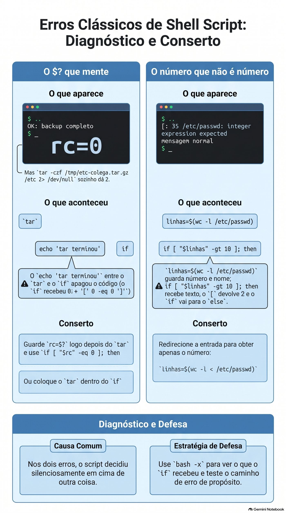

# Aula 1.9 · Decidir e repetir

Na Aula 1.8, o `backup-app.sh` disse OK para um backup do `/etc` que ficou sem os arquivos mais importantes. Hoje ele aprende a desconfiar: confere o resultado de cada passo, para quando algo dá errado, deixa um registro no log e devolve um código que outro script, ou o cron, consegue ler. Depois você faz o mesmo backup para uma lista de pastas, com um laço, sem repetir uma linha.

| Ficha | Aula 1.9 |
| --- | --- |
| Módulo | M1 · Linha de comando, aula 9 de 10 |
| Quando | Semana 3 |
| Ao final você consegue | Ler e usar o código de saída, `$?`; testar arquivos, textos e números com `test` e `[ ]`; decidir com `if`, `elif`, `else`, `&&` e `\|\|`; repetir com `for` e `while read`; guardar a saída de um comando com `$(...)` e fazer contas com `$((...))`; terminar um script com `exit N`; registrar no log com `logger` |
| Itens de prova | LE 013.3 · LPIC-1 105.2: `test`, `if`, `for`, `while`, código de saída, substituição de comando · RHCSA: executar código condicionalmente, usar laços para processar arquivos e argumentos, processar a saída de comandos dentro do script |
| Pré-requisitos | Aula 1.8 completa, com o `~/bin/backup-app.sh` nas duas VMs |
| Tempo | Cerca de 2h30 |
| Snapshots | m1a9-inicio e m1a9-fim nas duas VMs |

## 1 · Aquecimento

Três perguntas, de cabeça, antes de ler qualquer coisa. Escreva as respostas; o Gabarito confere no fim.

1. Na Aula 1.8, o que faz `origem="${1:?uso: ...}"` quando o script é chamado sem argumentos?
2. Na Aula 1.8, por que o `backup-app.sh /etc`, rodado como usuário comum, terminou dizendo que o arquivo abria até o fim?
3. Palpite: você roda `ls /naoexiste` e, em seguida, `echo $?`. Que número aparece?

## 2 · Por que importa

Um script de backup roda no cron, todo dia às 2h, há oito meses. Ninguém olha a saída, porque ele "sempre funcionou". No dia em que o disco do servidor morre, você abre a pasta de backups e encontra arquivos de 45 bytes desde março: o `tar` falhava toda noite, e o script seguia em frente e copiava o arquivo vazio para o NAS. O comando avisou. O script não perguntou.

Todo comando do Linux responde, ao terminar, com um número: zero se deu certo, outro número se não deu. É a informação mais importante que um script tem, e quase todo script ruim a ignora. Hoje você aprende a ler esse número e a decidir em cima dele.

Segundo caso. Você precisa fazer backup de seis pastas, ou conferir dez servidores, ou renomear trezentos logs. Copiar a mesma linha seis vezes funciona até o dia em que você corrige uma e esquece as outras cinco. Um laço escreve a linha uma vez e a repete para cada item.

E a prova: o RHCSA pede scripts que decidem e repetem. Uma tarefa típica é "crie um script que, para cada usuário de uma lista, faça X; se o argumento não for informado, termine com código 1". O corretor confere o código de saída.

## 3 · Modelo mental

> Todo comando termina acendendo um semáforo. Zero é verde; qualquer outro número é vermelho, e o número diz qual foi o problema.

O semáforo não é o que o comando mostra na tela. Um `grep` pode não mostrar nada e ter funcionado; um `tar` pode mostrar um monte de linhas e ter falhado. O shell guarda o semáforo do **último** comando em `$?` e o troca a cada novo comando, inclusive um `echo`.

Com o semáforo, três ferramentas:

- **`if` decide.** Ele roda um comando e olha o semáforo. Verde, entra no `then`; vermelho, vai para o `else`. O `if` não entende texto nem números: só o semáforo.
- **`[ ]` pergunta.** É um comando como outro qualquer, cujo único trabalho é responder com verde ou vermelho. `[ -d /etc ]` pergunta "`/etc` é uma pasta?" e responde com o semáforo. Por isso aparece tanto dentro do `if`, mas não é obrigatório.
- **`for` e `while` repetem.** O `for` repete uma vez para cada item de uma lista. O `while` repete enquanto um comando der verde, como o `read`, que dá verde enquanto ainda há linhas para ler.

```text
  if  tar -czf ...  ;  then  ...  else  ...  fi
      └── roda ───┘
            │
            └─ semáforo ($?)   0 ──► then
                              ≠0 ──► else

  [ -d "$origem" ]   é só um comando que responde 0 (sim) ou 1 (não)
```

## 4 · Conceito em camadas

### Essencial

**O código de saída.**

```bash
ls /etc/hostname
echo $?          # 0: deu certo
ls /naoexiste
echo $?          # 2: deu errado; 2 é o código do ls para "não consegui"
```

| Código | Significado mais comum |
| --- | --- |
| `0` | Deu certo |
| `1` | Falha geral. No `grep`, "não achei nenhuma linha", o que não é um erro |
| `2` | Uso errado ou erro sério. No `grep` e no `tar`, erro de verdade |
| `126` | O arquivo existe, mas não pode ser executado |
| `127` | Comando não encontrado |
| `130` | Interrompido com Ctrl+C |

O seu script também termina com um código: o do último comando executado, ou o que você escolher com `exit N`. Quem chama o seu script, seja você, outro script ou o cron, lê esse número.

**`&&` e `||`.** O jeito curto de decidir em uma linha:

```bash
mkdir -p "$destino" && echo "pasta pronta"     # só roda o echo se o mkdir deu certo
cd "$destino" || exit 1                         # se o cd falhou, termina o script
```

**`test` e `[ ]`.** São o mesmo comando com duas grafias. Dentro dos colchetes, **espaço depois do `[` e antes do `]`**, sempre.

| Pergunta | Verde quando |
| --- | --- |
| `[ -e "$x" ]` | `$x` existe, seja o que for |
| `[ -f "$x" ]` | `$x` é um arquivo comum |
| `[ -d "$x" ]` | `$x` é uma pasta |
| `[ -r "$x" ]`, `-w`, `-x` | Você pode ler, escrever, executar |
| `[ -s "$x" ]` | `$x` existe e não está vazio |
| `[ -z "$v" ]` | O texto está vazio |
| `[ -n "$v" ]` | O texto não está vazio |
| `[ "$a" = "$b" ]`, `!=` | Textos iguais, diferentes |
| `[ "$n" -eq 5 ]`, `-ne`, `-lt`, `-le`, `-gt`, `-ge` | Números: igual, diferente, menor, menor ou igual, maior, maior ou igual |
| `[ ! -d "$x" ]` | O `!` inverte a pergunta |

**`if`.**

```bash
if [ -d "$origem" ]; then
    echo "pasta encontrada"
elif [ -e "$origem" ]; then
    echo "existe, mas não é uma pasta"
else
    echo "não existe"
fi
```

O `if` aceita qualquer comando, não só `[ ]`:

```bash
if grep -q root /etc/passwd; then echo "tem root"; fi
if ! tar -czf "$arquivo" -C "$pai" "$nome"; then echo "o tar falhou"; fi
```

**`for`.** Uma vez para cada item:

```bash
for servidor in rocky-lab debian-lab; do
    echo "conferindo $servidor"
done

for arquivo in /var/log/*.log; do      # o shell monta a lista, mesmo com espaço nos nomes
    echo "$arquivo"
done

for i in {1..5}; do echo "$i"; done    # 1 a 5
```

**`while read`.** Uma vez para cada linha de um arquivo:

```bash
while read -r pasta; do
    echo "vou guardar $pasta"
done < pastas.txt
```

O `-r` faz o `read` não mexer em barras invertidas. Use sempre.

**`$(...)` e `$((...))`.**

```bash
hoje="$(date +%F)"              # guarda a saída de um comando
linhas="$(wc -l < /etc/passwd)" # com o <, o wc mostra só o número
total=$((total + 1))            # conta com números inteiros
```

A crase, `` `date` ``, faz o mesmo que `$(date)`. Você vai encontrá-la em scripts antigos; escreva com `$(...)`, que é mais fácil de ler e de aninhar.

**`exit N`.** Termina o script na hora, com o código `N`. Combine com quem vai ler: 0 para sucesso e números diferentes para erros diferentes, documentados no comentário do topo.

**`logger`.** Grava uma linha no log do sistema, com uma etiqueta: `logger -t backup-app "OK /etc"`. Para ler: `journalctl -t backup-app`. É assim que um script do cron conta o que fez, sem ninguém olhando a tela.

![O semáforo: código de saída, if e \[ \]](../img/c823509b5c5327dcced014a96df1068f.jpg)

*Todo comando acende um semáforo, e o if só sabe ler essa cor.*

### Ponte Windows

| No Windows | No Linux | Cuidado |
| --- | --- | --- |
| `%ERRORLEVEL%` no `cmd`, `$LASTEXITCODE` no PowerShell | `$?` | No Linux, o `$?` muda depois de **qualquer** comando, até um `echo` |
| No PowerShell, `$?` é `True` ou `False` | No bash, `$?` é um número, e 0 é sucesso | É o contrário da intuição: 0 é o bom |
| `if exist arquivo` | `if [ -e "$arquivo" ]` | Os espaços dentro do `[ ]` são obrigatórios |
| No PowerShell, `-eq` e `-gt` comparam qualquer coisa | No `[ ]`, `-eq` e `-gt` são só para números; textos usam `=` | `[ 10 \> 9 ]` compara como texto e dá falso |
| `for %%f in (*.log) do` | `for f in *.log; do ...; done` |  |
| `exit /b 1` | `exit 1` |  |
| Visualizador de Eventos, `Write-EventLog` | `logger` e `journalctl` |  |

### Avançado

- **`[[ ]]`** é a versão do bash: aceita `&&` e `||` dentro, compara padrões com `==` e não quebra com variável vazia sem aspas. Não existe no `dash`, o `/bin/sh` do Debian. Nesta aula, `[ ]` com aspas, que funciona em qualquer shell.
- **Pipeline.** O `$?` de `comando1 | comando2` é o do **último** comando. Um `tar ... | gzip` com o `tar` falhando dá verde. `set -o pipefail` faz o pipeline ficar vermelho se qualquer parte falhar; `${PIPESTATUS[@]}` mostra o código de cada parte.
- **`set -e`** para o script no primeiro comando que falhar, mas não vale dentro de `if`, nem antes de `&&` e `||`, nem em pipelines sem `pipefail`. Ajuda, mas não substitui o `if` explícito nos passos que importam.
- **`while read` e o `ssh`.** Um `ssh` dentro de um `while read ... done < lista` come o resto da lista, porque lê da mesma entrada. Use `ssh -n`.
- **`case`** decide entre vários textos de uma vez, como `start`, `stop` e `status`. Fica para o Módulo 4, nos scripts de serviço.
- **O `tar` e seus códigos.** O GNU tar sai com 1 quando um arquivo mudou enquanto era guardado, e com 2 em erro fatal, como `Permission denied`. Os dois são vermelhos para o `if`.

### O que cai na prova

- **LE 013.3:** o que é `$?`, `if` e `test` básicos, `for` sobre uma lista. Perguntas do tipo "qual o valor de `$?` depois de...".
- **LPIC-1 105.2:** `test` com `-f`, `-d`, `-z`, `-eq`; `if`, `for`, `while`, `seq`; `exit`; substituição de comando; códigos de saída. Cai muito a diferença entre `-eq` e `=`.
- **RHCSA:** um script que recebe argumentos, decide e repete, e termina com um código de saída específico. Exemplo: "crie `/usr/local/bin/checa`, que recebe nomes de usuário; para cada um que não existir, mostre uma mensagem; termine com 1 se faltou algum".

## 5 · Rocky × Debian

|  | Rocky Linux 9 e 10 | Debian 13 |
| --- | --- | --- |
| `[[ ]]` num script com `#!/bin/sh` | Funciona, porque `/bin/sh` é o bash | `[[: not found`, porque `/bin/sh` é o `dash` |
| `{1..5}` num script com `#!/bin/sh` | Funciona | Mostra `{1..5}`, literal |
| Mensagem de `[ "abc" -gt 1 ]` | `integer expression expected` | `integer expression expected`. No bash 5.3, mais novo, a frase encurtou para `integer expected` |
| `logger -t backup-app "msg"` | Vai para o journal; o `rsyslog` também copia para `/var/log/messages` | Vai para o journal; sem `rsyslog` instalado, não existe `/var/log/syslog` |
| Ler o que o `logger` gravou | `journalctl -t backup-app` | `journalctl -t backup-app` |
| `seq 1 5` | Instalado | Instalado |

A regra que serve nas duas: **`#!/bin/bash` em todo script desta aula, `[ ]` com aspas, e `journalctl -t` para ler o log**.

## 6 · Lab guiado

Faça tudo nas duas VMs, a não ser quando o passo disser só uma. Os testes rápidos são no terminal; os scripts ficam em `~/lab13/scripts`; o `backup-app.sh` instalado na Aula 1.8 está em `~/bin`. Em cada passo, quando aparecer **Preveja**, escreva a resposta antes de apertar Enter.

### Passo 1 · Preparar

No nó Proxmox:

```bash
qm snapshot 201 m1a9-inicio
qm snapshot 202 m1a9-inicio
```

Em cada VM:

```bash
type backup-app.sh
ls ~/lab13/arquivo/app
cd ~/lab13/scripts
```

O `type` deve responder `backup-app.sh is /home/SEU_USUARIO/bin/backup-app.sh`. Se responder `not found`, refaça o Passo 6 da Aula 1.8.

### Passo 2 · O semáforo, `$?`

```bash
ls /etc/hostname
echo $?
ls /naoexiste
echo $?
```

`0` e depois `2`. A mensagem de erro do `ls` vai para a tela; o código vai para o `$?`.

**Preveja.** Logo depois do `ls /naoexiste`, você roda `echo $?` duas vezes seguidas. O que mostra cada uma?

```bash
ls /naoexiste
echo $?
echo $?
```

`2` e depois `0`. O segundo `echo` mostra o código do **primeiro** `echo`, que deu certo. O `$?` é apagado a cada comando. Guarde isso: é a Quebra A desta aula.

Agora o `grep`, que tem três respostas:

```bash
grep -q root /etc/passwd;        echo "achou: $?"
grep -q naoexiste /etc/passwd;   echo "não achou: $?"
grep -q root /arquivo/inexistente; echo "erro: $?"
```

`0`, `1` e `2`. O `-q` deixa o `grep` quieto: ele não mostra nada, só responde com o código.

**Decida 1 · O que significa o 1.** Num script, `grep -q "ERRO" app.log` terminou com código 1. O que aconteceu?

- **A)** O `grep` falhou: o arquivo provavelmente não existe.
- **B)** O `grep` funcionou e não encontrou nenhuma linha com `ERRO`.
- **C)** O `grep` encontrou exatamente uma linha com `ERRO`.
- **D)** O `grep` foi interrompido.

Escolha a letra antes de olhar a tabela.

| Se você marcou | Resultado | Por quê |
| --- | --- | --- |
| A | ❌ Errada | Arquivo inexistente dá `2`, com mensagem `No such file or directory`. |
| B | ✅ Certa | Para o `grep`, 1 é "procurei e não achei". Num monitoramento de log, é a boa notícia. |
| C | ❌ Errada | O código não conta linhas. Achar uma ou mil dá `0`. Para contar, `grep -c`. |
| D | ❌ Errada | Interrompido com Ctrl+C dá `130`. |

**Para fixar:** vermelho nem sempre é erro. Leia o `man` do comando, na seção *EXIT STATUS*, antes de decidir o que cada número significa.

Confira:

```bash
man grep | grep -A6 'EXIT STATUS'
```

### Passo 3 · Perguntar com `[ ]`

```bash
[ -d /etc ];            echo "pasta: $?"
[ -f /etc ];            echo "arquivo: $?"
[ -f /etc/hostname ];   echo "arquivo: $?"
[ -z "" ];              echo "vazio: $?"
[ 10 -gt 9 ];           echo "maior: $?"
```

`0`, `1`, `0`, `0`, `0`. O `[` é um comando de verdade:

```bash
type [
ls -l /usr/bin/[
```

Por ser um comando, ele precisa de espaços, como qualquer outro. Veja o que acontece sem:

```bash
[-d /etc]
```

`bash: [-d: command not found`, código 127. O shell procurou um programa chamado `[-d`.

**Preveja.** `[ 10 \> 9 ]` compara 10 com 9 usando `>`. Verde ou vermelho?

```bash
[ 10 \> 9 ];  echo $?
[ 10 -gt 9 ]; echo $?
```

`1` e `0`. Com `>`, os dois lados são comparados como **texto**, letra por letra, como no dicionário: `"1"` vem antes de `"9"`, então `"10"` é menor. Números se comparam com `-gt`, `-lt` e companhia.

**Decida 2 · A variável vazia no `[ ]`.** O script tem `if [ $resposta = sim ]; then`. Um dia, `resposta` chega vazia. O que acontece?

- **A)** O teste dá falso, em silêncio, e o script vai para o `else`.
- **B)** Aparece `[: =: unary operator expected`, o teste devolve 2, e o script vai para o `else`.
- **C)** O script para na hora com erro de sintaxe.
- **D)** O teste dá verdadeiro, porque vazio é igual a qualquer coisa.

Escolha a letra antes de olhar a tabela.

| Se você marcou | Resultado | Por quê |
| --- | --- | --- |
| A | ❌ Errada | Seria assim com aspas. Sem aspas, a variável vazia some da linha. |
| B | ✅ Certa | Sem aspas, o shell monta `[ = sim ]`. O `[` vê só dois pedaços e reclama. Código 2 é vermelho, então o `if` vai para o `else` e o script segue, com uma mensagem estranha na tela. |
| C | ❌ Errada | Não é erro de sintaxe do bash: é o `[`, um comando, reclamando dos argumentos. O script continua. |
| D | ❌ Errada | Nenhum comando trata vazio como coringa. |

**Para fixar:** variável dentro de `[ ]` sempre entre aspas: `[ "$resposta" = sim ]`. É a regra da Aula 1.8 com mais um motivo.

Confira:

```bash
resposta=
[ $resposta = sim ];   echo $?
[ "$resposta" = sim ]; echo $?
```

`unary operator expected` e `2`, depois só `1`, limpo.

### Passo 4 · Decidir com `if`

```bash
cat > existe.sh <<'EOF'
#!/bin/bash
# existe.sh - diz o que é cada caminho recebido
# Uso: existe.sh CAMINHO
alvo="${1:?uso: $0 CAMINHO}"

if [ -d "$alvo" ]; then
    echo "$alvo é uma pasta"
elif [ -f "$alvo" ]; then
    echo "$alvo é um arquivo de $(wc -c < "$alvo") bytes"
elif [ -e "$alvo" ]; then
    echo "$alvo existe, mas não é pasta nem arquivo comum"
else
    echo "$alvo não existe" >&2
    exit 1
fi
EOF
chmod +x existe.sh
./existe.sh /etc;           echo "rc=$?"
./existe.sh /etc/hostname;  echo "rc=$?"
./existe.sh /dev/null;      echo "rc=$?"
./existe.sh /naoexiste;     echo "rc=$?"
```

Pasta, arquivo, "existe, mas não é", e `não existe` com `rc=1`. O `>&2` manda a mensagem de erro para a saída de erros, a Aula 1.5: quem redirecionar só a saída normal ainda vê o erro.

**Decida 3 · Qual `if` está certo?** Você quer saber se o usuário `root` aparece no `/etc/passwd`.

- **A)** `if [ grep -q root /etc/passwd ]; then`
- **B)** `if grep -q root /etc/passwd; then`
- **C)** `if [ $(grep root /etc/passwd) ]; then`
- **D)** `if grep -q root /etc/passwd = 0; then`

Escolha a letra antes de olhar a tabela.

| Se você marcou | Resultado | Por quê |
| --- | --- | --- |
| A | ❌ Errada | O `[` recebe as palavras `grep`, `-q`, `root` e `/etc/passwd` como texto e não sabe o que fazer com elas: reclama com um erro de sintaxe, cuja frase muda conforme a versão do bash, e devolve 2. O `grep` nunca roda, e o `if` vai para o `else`. |
| B | ✅ Certa | O `if` roda o `grep` e olha o semáforo. É a forma mais curta e a mais correta. |
| C | ❌ Errada | Funciona por acaso enquanto a saída for uma palavra só: a linha do root não tem espaço. Se o `grep` achar duas linhas, ou uma com espaço, o `[` recebe pedaços demais e reclama. Usa a saída, quando o que importa é o código. |
| D | ❌ Errada | O `grep` recebe `=` e `0` como nomes de arquivo. Com `-q`, ele para no primeiro acerto e nem chega a abrir esses dois, então parece funcionar. No dia em que não achar, reclama que `=` e `0` não existem e devolve 2. Certo por acaso é errado. |

**Para fixar:** o `if` recebe um **comando**. Use `[ ]` só quando a pergunta é sobre arquivos, textos ou números; quando é "esse comando deu certo?", ponha o comando direto.

Confira o A, para ver a mensagem:

```bash
if [ grep -q root /etc/passwd ]; then echo sim; else echo não; fi
if grep -q root /etc/passwd; then echo sim; else echo não; fi
```

E o jeito curto, com `&&` e `||`:

```bash
grep -q root /etc/passwd && echo "tem root" || echo "sem root"
```

### Passo 5 · Repetir com `for`

```bash
for vm in rocky-lab debian-lab; do
    echo "vou conferir $vm"
done

for i in {1..3}; do echo "volta $i"; done
for i in $(seq 1 3); do echo "volta $i"; done
```

Agora, uma pasta com nomes de log, um deles com espaço, como acontece quando o arquivo vem de um Windows:

```bash
mkdir -p ~/lab13/logs-teste
cd ~/lab13/logs-teste
touch app.log "nota fiscal.log" erro.log
ls -l
```

**Decida 4 · Percorrer os logs.** Qual laço passa pelos três arquivos, um de cada vez, com o nome inteiro?

- **A)** `for f in $(ls); do echo "[$f]"; done`
- **B)** `for f in *.log; do echo "[$f]"; done`
- **C)** `for f in "$(ls)"; do echo "[$f]"; done`
- **D)** `for f in $(ls *.log); do echo "[$f]"; done`

Escolha a letra antes de olhar a tabela.

| Se você marcou | Resultado | Por quê |
| --- | --- | --- |
| A | ❌ Errada | A saída do `ls` é quebrada nos espaços: aparecem `[nota]` e `[fiscal.log]`, separados. Quatro voltas, duas erradas. |
| B | ✅ Certa | O próprio shell monta a lista com o `*`, e cada nome vira um item inteiro, com espaço ou não. Três voltas. |
| C | ❌ Errada | As aspas juntam tudo num item só: uma volta, com os três nomes e as quebras de linha dentro. |
| D | ❌ Errada | O mesmo problema do A. O `*.log` ajuda o `ls`, mas a quebra nos espaços acontece depois. |

**Para fixar:** para percorrer arquivos, use o `*` direto no `for`. Nunca `for f in $(ls)`.

Confira:

```bash
for f in $(ls); do echo "[$f]"; done
for f in *.log; do echo "[$f]"; done
```

E um laço útil, que conta as linhas de cada log:

```bash
for f in *.log; do
    echo "$(wc -l < "$f") linhas  $f"
done
cd ~/lab13/scripts
```

### Passo 6 · Repetir com `while read` e contar

Uma lista de pastas, uma por linha, com uma linha vazia e uma pasta que não existe, de propósito:

```bash
cat > pastas.txt <<'EOF'
/home/SEU_USUARIO/lab13/arquivo/app
/home/SEU_USUARIO/lab13/logs-teste

/home/SEU_USUARIO/naoexiste
EOF
sed -i "s|SEU_USUARIO|$USER|" pastas.txt
cat -A pastas.txt
```

O `cat -A` mostra a linha vazia como `$` sozinho. Agora leia linha por linha, pulando a vazia:

```bash
total=0
while read -r pasta; do
    [ -z "$pasta" ] && continue
    total=$((total + 1))
    if [ -d "$pasta" ]; then
        echo "OK      $pasta"
    else
        echo "FALTA   $pasta"
    fi
done < pastas.txt
echo "Total: $total"
```

Duas linhas `OK`, uma `FALTA`, `Total: 3`. O `continue` pula para a próxima volta.

**Decida 5 · O total que some.** Um colega escreveu o mesmo laço assim: `cat pastas.txt | while read -r pasta; do ... done`, e depois `echo "Total: $total"`. O que aparece no fim?

- **A)** `Total: 3`, igual.
- **B)** `Total: 0`.
- **C)** `Total: 4`, porque agora a linha vazia conta.
- **D)** Erro: o `while` não aceita pipe.

Escolha a letra antes de olhar a tabela.

| Se você marcou | Resultado | Por quê |
| --- | --- | --- |
| A | ❌ Errada | Dentro do laço, a conta chega a 3. Mas ela acontece em outro lugar. |
| B | ✅ Certa | Num pipe, o bash roda o `while` num shell filho. O `total` que chega a 3 é o do filho, e morre com ele. O `echo` de fora vê o `total` de antes do laço: 0. É o mesmo motivo do `cd` que não fica, da Aula 1.8. |
| C | ❌ Errada | O `[ -z ]` com `continue` pula a linha vazia nos dois jeitos. |
| D | ❌ Errada | O `while` aceita pipe sem reclamar. Por isso o erro é traiçoeiro: não há mensagem. |

**Para fixar:** num laço que guarda alguma coisa para depois, leia o arquivo com `done < arquivo`, nunca com `cat arquivo |`.

Confira:

```bash
total=0
cat pastas.txt | while read -r pasta; do [ -z "$pasta" ] && continue; total=$((total + 1)); done
echo "Total pelo pipe: $total"
total=0
while read -r pasta; do [ -z "$pasta" ] && continue; total=$((total + 1)); done < pastas.txt
echo "Total pelo <: $total"
```

### Passo 7 · O `backup-app.sh` aprende a desconfiar

É o conserto prometido na Decida 4 da Aula 1.8. A versão nova confere cada passo, devolve um código diferente para cada tipo de problema, registra tudo num log próprio e no journal, e não deixa um backup incompleto com cara de bom.

```bash
cp ~/bin/backup-app.sh ~/bin/backup-app.sh.v3
cat > ~/bin/backup-app.sh <<'EOF'
#!/bin/bash
# backup-app.sh - backup de uma pasta pelo Protocolo da Aula 1.7
# Uso: backup-app.sh PASTA [DESTINO]
#   PASTA    o que guardar, obrigatório
#   DESTINO  onde guardar, padrão ~/backups
# Saída: 0 = backup completo e conferido
#        1 = o backup falhou ou ficou incompleto
#        2 = a pasta não existe

origem="${1:?uso: $0 PASTA [DESTINO]}"
destino="${2:-$HOME/backups}"
nome="$(basename "$origem")"
pai="$(dirname "$origem")"
data="$(date +%F_%H%M)"
arquivo="$destino/$nome-$data.tar.gz"
log="$destino/backup-app.log"

mkdir -p "$destino" || exit 1

if [ ! -d "$origem" ]; then
    echo "ERRO: $origem não é uma pasta" >&2
    echo "$(date '+%F %T') ERRO pasta $origem" >> "$log"
    logger -t backup-app "ERRO pasta $origem"
    exit 2
fi

echo "Backup de $origem para $arquivo"

if ! tar -czf "$arquivo" -C "$pai" "$nome"; then
    echo "ERRO: o tar falhou; o backup de $origem está incompleto" >&2
    mv "$arquivo" "$arquivo.INCOMPLETO" 2> /dev/null
    echo "$(date '+%F %T') ERRO tar $origem" >> "$log"
    logger -t backup-app "ERRO tar $origem"
    exit 1
fi

if ! tar -tzf "$arquivo" > /dev/null; then
    echo "ERRO: $arquivo não abre até o fim" >&2
    echo "$(date '+%F %T') ERRO teste $arquivo" >> "$log"
    logger -t backup-app "ERRO teste $arquivo"
    exit 1
fi

sha256sum "$arquivo" > "$arquivo.sha256"
chmod 600 "$arquivo" "$arquivo.sha256"
echo "$(date '+%F %T') OK $origem $arquivo" >> "$log"
logger -t backup-app "OK $origem $arquivo"
ls -lh "$arquivo" "$arquivo.sha256"
EOF
bash -n ~/bin/backup-app.sh && echo "sintaxe ok"
```

Leia o script de cima para baixo antes de rodar. Repare em três escolhas:

- O teste da pasta vem **antes** de qualquer `tar`. Erro barato primeiro.
- O `tar` está **dentro** do `if`. Não existe um `$?` para ser apagado no caminho.
- Um backup que falhou não é apagado: é renomeado para `.INCOMPLETO`. Ninguém confunde com um bom, e você ainda pode olhar o que entrou.

Agora os três caminhos, conferindo o código de cada um:

```bash
backup-app.sh ~/lab13/arquivo/app /tmp/bkp9;  echo "rc=$?"
backup-app.sh ~/naoexiste /tmp/bkp9;          echo "rc=$?"
backup-app.sh /etc /tmp/bkp9 2> /tmp/bkp9-erros.txt;  echo "rc=$?"
```

**Preveja.** Antes de rodar a terceira linha: qual `rc`, e que arquivos novos aparecem em `/tmp/bkp9`?

```bash
ls -l /tmp/bkp9
tail -3 /tmp/bkp9-erros.txt
cat /tmp/bkp9/backup-app.log
```

`rc=0`, `rc=2` e `rc=1`. Para o `/etc`, o `tar` reclamou dos arquivos que o usuário comum não lê, terminou com o aviso `Exiting with failure status due to previous errors`, e o script renomeou o arquivo para `etc-...tar.gz.INCOMPLETO`. O log tem uma linha `OK`, uma `ERRO pasta` e uma `ERRO tar`. Na Aula 1.8, esse mesmo comando dizia OK.

O mesmo registro está no journal do sistema, onde o cron e o monitoramento procuram:

```bash
journalctl -t backup-app --since today
```

Com `sudo`, o `/etc` vai inteiro:

```bash
sudo ~/bin/backup-app.sh /etc /tmp/bkp9; echo "rc=$?"
```

`rc=0`.

**O laço por cima.** Agora o script que faz backup de uma lista inteira, chamando o `backup-app.sh` para cada linha e contando o resultado:

```bash
cat > ~/bin/backup-lista.sh <<'EOF'
#!/bin/bash
# backup-lista.sh - roda o backup-app.sh para cada pasta de uma lista
# Uso: backup-lista.sh LISTA [DESTINO]
#   LISTA    arquivo com uma pasta por linha
#   DESTINO  repassado ao backup-app.sh

lista="${1:?uso: $0 LISTA [DESTINO]}"
destino="${2:-$HOME/backups}"
ok=0
falhas=0

while read -r pasta; do
    [ -z "$pasta" ] && continue
    if backup-app.sh "$pasta" "$destino"; then
        ok=$((ok + 1))
    else
        falhas=$((falhas + 1))
    fi
done < "$lista"

echo "Resumo: $ok OK, $falhas com erro"
[ "$falhas" -eq 0 ]
EOF
chmod +x ~/bin/backup-lista.sh
backup-lista.sh ~/lab13/scripts/pastas.txt /tmp/bkp9; echo "rc=$?"
```

`Resumo: 2 OK, 1 com erro` e `rc=1`. A última linha do script é um teste: ela vira o código de saída. Zero falhas, verde; qualquer falha, vermelho. O cron, ou quem chamar, sabe que algo deu errado sem ler a saída.

Faça o mesmo na outra VM e compare os logs.

> **Protocolo · Script que avisa quando falha**
>
> 1. No comentário do topo, documente os códigos de saída: `# Saída: 0 = ..., 1 = ..., 2 = ...`.
> 2. Confira o que é barato antes do que é caro: argumentos e pastas antes do `tar`.
> 3. Ponha o comando que importa **dentro** do `if`: `if ! tar ...; then`. Se precisar do número, guarde na linha seguinte: `rc=$?`.
> 4. Mensagem de erro para `>&2`, e uma linha no log com data, `ERRO` e o motivo. Use `logger -t nome` para ir ao journal.
> 5. Resultado que falhou não fica com cara de bom: renomeie, marque ou mova.
> 6. Termine com `exit N` em cada saída de erro; no fim feliz, o último comando decide.
> 7. Teste os três caminhos, sucesso, erro de entrada e erro no meio, conferindo o `echo $?` de cada um.

## 7 · Quebre e conserte

### Quebra A · O `$?` que mente

Um colega escreveu um backup do `/etc` "com conferência". Faça como ele, como usuário comum, sem `sudo`:

```bash
cd ~/lab13/scripts
cat > confere.sh <<'EOF'
#!/bin/bash
# confere.sh - backup do /etc com conferência (versão do colega)
tar -czf /tmp/etc-colega.tar.gz /etc 2> /dev/null
echo "tar terminou"
if [ $? -eq 0 ]; then
    echo "OK: backup completo"
else
    echo "ERRO: backup com problema"
fi
EOF
chmod +x confere.sh
```

**Observe.**

```bash
./confere.sh; echo "rc=$?"
```

`tar terminou`, `OK: backup completo` e `rc=0`. Mas você sabe, desde a Aula 1.8, que um usuário comum não lê o `/etc` inteiro.

**Diagnostique.** Rode com o raio X e confira o `tar` sozinho:

```bash
bash -x ./confere.sh
tar -czf /tmp/etc-colega.tar.gz /etc 2> /dev/null; echo "tar sozinho: $?"
```

O `tar` sozinho dá `2`. No `bash -x`, a linha `+ '[' 0 -eq 0 ']'` mostra que o `if` recebeu `0`. Esse `0` é do `echo "tar terminou"`, que veio entre o `tar` e o `if`, deu certo e apagou o código do `tar`.

**Decida A · O conserto.** O que resolve?

- **A)** Trocar `-eq` por `=`: `if [ $? = 0 ]`.
- **B)** Tirar o `2> /dev/null`, para ver os erros.
- **C)** Pôr o `tar` dentro do `if`, `if tar -czf ...; then`, ou guardar o código logo depois dele, `rc=$?`, e testar `"$rc"`.
- **D)** Trocar o `echo` por um `printf`.

Escolha a letra antes de olhar a tabela.

| Se você marcou | Resultado | Por quê |
| --- | --- | --- |
| A | ❌ Errada | Compara como texto em vez de número, mas o `$?` continua sendo o do `echo`: `0`. |
| B | ❌ Errada | Os erros aparecem na tela, o que ajuda quem estiver olhando. No cron, ninguém olha, e o script continua dizendo OK. |
| C | ✅ Certa | Com o `tar` dentro do `if`, não existe um `$?` para ser apagado. Se você precisar do número, para registrar ou para decidir entre 1 e 2, guarde em `rc` na linha **imediatamente** seguinte. |
| D | ❌ Errada | O `printf` também dá certo e também apaga o código. Qualquer comando no meio faz o mesmo. |

**Para fixar:** o `$?` vale só até o próximo comando. Teste o comando direto no `if`, ou guarde `rc=$?` na linha seguinte, sem nada no meio.

**Conserte.**

```bash
cat > confere.sh <<'EOF'
#!/bin/bash
# confere.sh - backup do /etc com conferência (consertado)
tar -czf /tmp/etc-colega.tar.gz /etc 2> /dev/null
rc=$?
echo "tar terminou com código $rc"
if [ "$rc" -eq 0 ]; then
    echo "OK: backup completo"
else
    echo "ERRO: backup com problema" >&2
    exit 1
fi
EOF
./confere.sh; echo "rc=$?"
sudo ./confere.sh; echo "rc=$?"
```

Como usuário: `tar terminou com código 2`, `ERRO` e `rc=1`. Com `sudo`: código 0, `OK` e `rc=0`.

### Quebra B · O número que não é número

Um script de alerta conta as contas de usuário e avisa se passar de 10:

```bash
cat > contas.sh <<'EOF'
#!/bin/bash
# contas.sh - avisa se há muitas contas no sistema
linhas=$(wc -l /etc/passwd)
if [ "$linhas" -gt 10 ]; then
    echo "ALERTA: $linhas contas"
else
    echo "normal: $linhas contas"
fi
EOF
chmod +x contas.sh
```

**Observe.**

```bash
./contas.sh; echo "rc=$?"
```

Algo como `[: 35 /etc/passwd: integer expression expected`, seguido de `normal: 35 /etc/passwd contas`, e `rc=0`. Sim, `normal`: o `[` reclamou, devolveu 2, e o `if` foi para o `else`. Num servidor com 500 contas, a mensagem seria a mesma. No bash 5.3, mais novo que o das VMs, a frase é `integer expected`.

**Diagnostique.** Veja o que a variável guardou:

```bash
linhas=$(wc -l /etc/passwd)
echo "[$linhas]"
wc -l < /etc/passwd
```

`[35 /etc/passwd]`. Quando recebe o nome do arquivo, o `wc` mostra o número **e** o nome. O `-gt` só aceita números inteiros. Com `<`, o `wc` lê da entrada, não sabe o nome do arquivo e mostra só o número.

**Decida B · O conserto.** O que resolve?

- **A)** Trocar `-gt` por `>`: `[ "$linhas" \> 10 ]`.
- **B)** Tirar as aspas: `[ $linhas -gt 10 ]`.
- **C)** `linhas=$(wc -l < /etc/passwd)`.
- **D)** Usar `[[ ]]` no lugar de `[ ]`.

Escolha a letra antes de olhar a tabela.

| Se você marcou | Resultado | Por quê |
| --- | --- | --- |
| A | ❌ Errada | Some a mensagem, mas a comparação passa a ser de texto: `"35 /etc/passwd"` contra `"10"`, letra por letra. Um sistema com 9 contas daria alerta, porque `"9"` vem depois de `"1"`. |
| B | ❌ Errada | Sem aspas, o `[` recebe quatro pedaços, `35`, `/etc/passwd`, `-gt` e `10`, e reclama de outro jeito: `too many arguments`. O problema é o conteúdo, não as aspas. |
| C | ✅ Certa | A variável recebe só `35`, e o `-gt` funciona. É o mesmo `<` do Passo 4 e do `for` dos logs. |
| D | ❌ Errada | O `[[ ]]` também exige um número no `-gt` e dá erro parecido. |

**Para fixar:** antes de comparar números, olhe a variável com `echo "[$var]"`. Os colchetes mostram espaços e pedaços extras que você não esperava.

**Conserte.**

```bash
sed -i 's|wc -l /etc/passwd|wc -l < /etc/passwd|' contas.sh
cat contas.sh
./contas.sh; echo "rc=$?"
```

`ALERTA: 35 contas`, ou `normal`, se a sua VM tiver 10 ou menos. Sem mensagem estranha.

### A lição

Os dois erros de hoje têm a mesma cara: o script **parece** ter decidido, mas decidiu em cima de outra coisa. Na Quebra A, de um `$?` que já era de outro comando. Na Quebra B, de um teste que nem chegou a comparar e devolveu 2, que o `if` trata igual a "não". Nos dois casos, o script terminou com `rc=0` e uma mensagem tranquila. A defesa é a mesma: `bash -x` para ver o que o `if` realmente recebeu, e testar o caminho de erro de propósito, como no Passo 7, antes de confiar no caminho feliz.


*Nos dois casos, o script terminou com rc=0 e decidiu em cima de outra coisa.*

## 8 · Armadilhas

| Você digita ou vê | O que acontece | O certo |
| --- | --- | --- |
| `[-d /etc]` | `[-d: command not found` | `[ -d /etc ]`, com espaços |
| `if [ $var = sim ]` com `var` vazia | `unary operator expected` e o `if` vai para o `else` | `[ "$var" = sim ]` |
| `[ "$n" > 5 ]` | Não compara nada: **cria um arquivo chamado `5`**, porque `>` é redirecionamento | `[ "$n" -gt 5 ]` |
| `[ 10 \> 9 ]` | Falso: compara como texto | `-gt`, `-lt` para números |
| `[ "$a" -eq "$b" ]` com textos | `integer expression expected` | `=` para textos |
| `comando; echo "..."; if [ $? -eq 0 ]` | Testa o código do `echo` | `if comando; then`, ou `rc=$?` logo depois |
| `if [ grep -q x arq ]` | O `[` reclama; o `grep` nunca roda | `if grep -q x arq; then` |
| `grep` com código 1 tratado como erro | Alarme falso a cada vez que está tudo limpo | 1 é "não achou"; 2 é erro |
| `for f in $(ls)` | Nomes com espaço viram dois itens | `for f in *` |
| `cat arq \| while read ...` e depois usar a variável | A variável volta ao valor de antes do laço | `while read ...; done < arq` |
| `read` sem `-r` | Barras invertidas somem do texto lido | `read -r` |
| `x=$(wc -l arquivo)` | Guarda número **e** nome | `x=$(wc -l < arquivo)` |
| `total=total+1` | Guarda o texto `total+1` | `total=$((total + 1))` |
| Script sem `exit` no erro | O cron recebe 0, mesmo com falha | `exit 1` em cada caminho de erro |
| `tar ... \| gzip` e conferir `$?` | Vale o código do `gzip` | `set -o pipefail`, ou `tar -czf` direto |
| `ssh servidor cmd` dentro de `while read` | O laço para depois do primeiro servidor | `ssh -n servidor cmd` |

## 9 · Quiz

Dez perguntas, sem consultar. Escreva a letra ou a resposta de cada uma e só depois abra o Gabarito.

**1.** Você roda `ls /naoexiste`, depois `echo $?`, e de novo `echo $?`. O que mostra o segundo `echo`?

- **A)** `2`
- **B)** `0`
- **C)** `1`
- **D)** `127`

**2.** Qual linha testa corretamente se `/backup` é uma pasta?

- **A)** `[ -f /backup ]`
- **B)** `[-d /backup]`
- **C)** `[ -d /backup ]`
- **D)** `[ -e /backup ]`

**3.** A variável `n` vale `7`. Qual teste responde verde se `n` for maior que 5, sem efeito colateral?

- **A)** `[ "$n" > 5 ]`
- **B)** `[ "$n" -gt 5 ]`
- **C)** `[ "$n" \> 5 ]`
- **D)** `[ n -gt 5 ]`

**4.** `grep -q ERRO app.log` terminou com código 1. O que aconteceu?

- **A)** O arquivo não existe.
- **B)** Há exatamente uma linha com `ERRO`.
- **C)** O `grep` funcionou e não achou `ERRO`.
- **D)** O `grep` não tem permissão de ler o arquivo.

**5.** Numa pasta com os arquivos `a b.log` e `c.log`, quantas voltas dá `for f in *.log; do echo "$f"; done`? E `for f in $(ls *.log); do echo "$f"; done`?

- **A)** 2 e 2
- **B)** 3 e 3
- **C)** 2 e 3
- **D)** 3 e 2

**6.** Com `n=0` e um arquivo `lista` de três linhas, o que mostra `cat lista | while read -r l; do n=$((n + 1)); done; echo "$n"`?

- **A)** `3`
- **B)** `0`
- **C)** Vazio
- **D)** Erro de sintaxe

**7.** Explique, em uma frase, o que faz `cd "$destino" || exit 1` dentro de um script.

**8.** O seu script detectou que o backup falhou. Que linha faz o cron, ou outro script, saber disso sem ler a saída? E como você confere, no terminal, que funcionou?

**9.** `linhas=$(wc -l /etc/passwd)` seguido de `[ "$linhas" -gt 10 ]` dá `integer expression expected`. Por quê, e como consertar?

**10.** *A shell script contains the line `if [ -f "$1" ]; then`. When is this condition true?*

- **A)** When `$1` is a directory
- **B)** When `$1` exists and is a regular file
- **C)** When `$1` is not empty
- **D)** When `$1` is an executable file
- **E)** When `$1` is a file that is not empty

## 10 · Flashcards e cola

### Para saber de cor

Esta parte é para guardar na cabeça. É o que transforma uma lista de comandos num script que decide.

- `$?`: o código do último comando. `0` é sucesso; qualquer outro número é falha
- O `$?` muda depois de **qualquer** comando, até um `echo`. Guarde com `rc=$?` na linha seguinte
- `if comando; then ...; elif ...; else ...; fi`. O `if` olha o código, não a saída
- `[ -d "$x" ]` pasta, `[ -f "$x" ]` arquivo, `[ -e "$x" ]` existe, `[ -z "$v" ]` vazio, `[ ! ... ]` inverte
- Espaço depois do `[` e antes do `]`; variável sempre entre aspas
- Textos: `=` e `!=`. Números: `-eq -ne -lt -le -gt -ge`
- `comando && se_deu_certo`; `comando || se_falhou`
- `for f in *.log; do ...; done`, nunca `for f in $(ls)`
- `while read -r linha; do ...; done < arquivo`, nunca `cat arquivo | while`
- `x="$(comando)"` guarda a saída; `n=$((n + 1))` faz conta
- `exit N` termina com o código `N`

### Para consultar

Esta parte você não precisa decorar. Guarde onde ela está.

- `grep`: 0 achou, 1 não achou, 2 erro. `tar`: 0 ok, 1 arquivo mudou durante o backup, 2 erro fatal
- `126` sem permissão de execução; `127` comando não encontrado; `130` Ctrl+C
- `man COMANDO`, seção *EXIT STATUS*, para os códigos de cada um
- `[ -r ]`, `[ -w ]`, `[ -x ]` permissões; `[ -s ]` existe e não está vazio
- `{1..5}` ou `$(seq 1 5)` para contar; `continue` pula a volta; `break` sai do laço
- `wc -l < arquivo` mostra só o número
- `logger -t etiqueta "mensagem"` grava no journal; `journalctl -t etiqueta` lê
- `[[ ]]` só no bash; no Debian, `#!/bin/sh` é o `dash`, sem `[[`
- `set -o pipefail` e `${PIPESTATUS[@]}` para códigos de pipeline
- `set -e` para no primeiro erro, mas não dentro de `if`, `&&` e `||`
- `ssh -n` dentro de `while read`

### Flashcards

| Frente | Verso |
| --- | --- |
| Que código indica sucesso? | `0`. Qualquer outro número é falha |
| Onde fica o código do último comando? | Em `$?` |
| Por que `echo $?` duas vezes seguidas dá números diferentes? | O segundo mostra o código do primeiro `echo` |
| O que o `if` olha? | O código de saída do comando, não o que ele mostra |
| O que é o `[`? | Um comando, como outro qualquer, que responde 0 ou 1 |
| Por que `[-d /etc]` dá `command not found`? | Sem espaço, o shell procura um programa chamado `[-d` |
| `[ $v = sim ]` com `v` vazia: o que acontece? | `unary operator expected`, código 2, e o `if` vai para o `else` |
| `-eq` ou `=`? | `-eq` para números, `=` para textos |
| O que faz `[ "$n" > 5 ]`? | Cria um arquivo chamado `5`. O `>` é redirecionamento |
| `grep -q` deu 1. É erro? | Não. Significa "não achei" |
| Como percorrer arquivos com espaço no nome? | `for f in *` |
| Por que `cat arq \| while` perde o contador? | O laço roda num shell filho, que morre no fim do pipe |
| Como guardar só o número de linhas? | `n=$(wc -l < arquivo)` |
| Como o cron sabe que o script falhou? | Pelo código de saída: `exit 1` |
| Onde ler o que um script gravou com `logger -t x`? | `journalctl -t x` |

## 11 · Checklist de saída

Marque só o que você consegue fazer sem olhar a aula:

- [ ] Explicar o que é o código de saída e conferir com `echo $?`
- [ ] Dizer o que significam 0, 1 e 2 no `grep` e no `tar`
- [ ] Testar se algo é pasta, arquivo ou existe, com `[ ]` e aspas
- [ ] Comparar textos com `=` e números com `-gt`, sabendo por que não trocar
- [ ] Escrever um `if` com `elif` e `else`, e outro com um comando direto, sem `[ ]`
- [ ] Percorrer arquivos com `for`, mesmo com espaço no nome
- [ ] Ler um arquivo linha por linha com `while read -r`, contando, sem perder o total
- [ ] Guardar a saída de um comando e fazer contas com `$((...))`
- [ ] Terminar um script com códigos diferentes para erros diferentes
- [ ] Registrar no journal com `logger` e ler com `journalctl -t`

**Último exercício, sem olhar.** Feche esta aula. Em `~/lab13/scripts`, crie o `conta-linhas.sh`:

1. Ele recebe um ou mais arquivos como argumentos. Sem nenhum, mostra `uso: conta-linhas.sh ARQUIVO...` e termina com 1.
2. Para cada argumento que for um arquivo, mostra `N linhas  NOME`, com o número sozinho.
3. Para cada argumento que não for um arquivo, mostra `AVISO: NOME não existe`, na saída de erros, e conta a falha.
4. Funciona com nomes que têm espaço.
5. Termina com 0 se todos existirem, e com 1 se faltou algum.

Teste com `./conta-linhas.sh /etc/passwd /etc/hostname /naoexiste; echo $?`. As respostas estão no fim do Gabarito.

**Snapshots de fechamento.** No nó Proxmox:

```bash
qm snapshot 201 m1a9-fim
qm snapshot 202 m1a9-fim
```

Não apague o `~/bin/backup-app.sh` nem o `~/lab13`: a Aula 1.10 é o desafio do módulo, e você vai precisar de tudo o que o Módulo 1 construiu.

## 12 · Na vida real

**Missão da semana, só leitura.** Escolha um servidor que você administra de verdade. Se ele for de cliente, faça só o que o contrato permite; se tiver dúvida, use a rocky-lab e a debian-lab. Nenhum comando desta missão muda nada: você só pergunta e lê o código de saída.

O semáforo dos serviços e da rede:

```bash
systemctl is-active sshd; echo "ssh: $?"
systemctl is-active ssh;  echo "ssh no Debian: $?"
ip route | grep default
ping -c1 -W1 IP_DO_GATEWAY > /dev/null; echo "gateway: $?"
```

Troque `IP_DO_GATEWAY` pelo endereço que o `ip route` mostrou. O `systemctl is-active` responde `active` e código 0, ou outra coisa e código diferente de 0: é assim que os scripts de monitoramento perguntam se um serviço está de pé.

Agora, os scripts da casa que você encontrou na missão da Aula 1.8. Eles conferem alguma coisa?

```bash
grep -n -E '\$\?|if |exit ' /usr/local/bin/* 2> /dev/null | head -30
grep -L -E '\$\?|if |exit ' /usr/local/bin/* 2> /dev/null
```

O primeiro mostra onde os scripts decidem. O segundo, com `-L`, lista os que **não** têm nem `$?`, nem `if`, nem `exit`: scripts que fazem tudo em sequência e nunca perguntam se deu certo.

No Proxmox, confira se o backup da última noite aconteceu, contando os arquivos novos:

```bash
find /var/lib/vz/dump -newermt "$(date -d yesterday +%F)" -name '*.zst' | wc -l
grep -l 'ERROR' /var/log/vzdump/*.log 2> /dev/null | tail -5
```

Se o seu armazenamento de backup não for o `/var/lib/vz/dump`, troque pelo caminho dele. Compare o número com a quantidade de VMs que deveriam ter sido salvas.

**Para o diário.** Responda em poucas linhas:

1. Que códigos o `systemctl is-active` e o `ping` devolveram? Algum diferente de 0?
2. Quantos scripts da casa nunca conferem nada? Algum deles roda pelo cron?
3. O script de backup mais importante sabe dizer que falhou? Com `exit`, com log, com e-mail?
4. O backup de ontem no Proxmox gerou o número esperado de arquivos?
5. Qual conserto da seção 6 você proporia primeiro, e para quem? Anote, e não mexa: produção é só leitura.

**Desafio da semana.** Na rocky-lab, escreva o `checa-servidor.sh`, só de leitura:

1. Recebe um limite como argumento opcional, padrão 80.
2. Para cada sistema de arquivos de `df --output=pcent,target -x tmpfs -x devtmpfs`, mostra `ok` ou `ALERTA` com o uso e o ponto de montagem. Dica: `tail -n +2` tira o cabeçalho, e `tr -d '%'` tira o `%`.
3. Mostra `Alertas: N` no fim e termina com 1 se houver algum.
4. Cuidado com a Decida 5: se você ler o `df` por um pipe, o contador some. Grave a saída num arquivo em `/tmp` e leia com `done <`.

Teste com limite 1, para ver os alertas, e com 99. Quando funcionar nas duas VMs, rode uma vez no servidor real, só para ler. No diário, uma linha por dia com o resultado.

**Amanhã, sem olhar.** Abra um terminal amanhã e, sem consultar nada:

1. Rode um comando que dá certo e um que falha, e mostre o código de cada um.
2. Escreva um `if` que diz se `/etc/hostname` é um arquivo.
3. Escreva um `for` que mostra o tamanho de cada `.conf` em `/etc`, com `wc -c <`.
4. Leia o `/etc/passwd` com `while read -r` e conte as linhas que terminam em `bash`.
5. Explique em voz alta por que o `echo` entre o `tar` e o `if` estraga a conferência.

Se travar em algum, volte só ao Passo daquele item.

## 13 · Com o DeepTutor

Use o DeepTutor da sua rede local depois do lab, não no lugar dele. Os comandos começam com `!`:

- `!quiz Aula 1.9`: peça dez perguntas novas sobre `$?`, `[ ]`, `if` e laços, no formato das Decidas.
- `!explica $?`: peça três exemplos em que o código de saída engana, como o `grep` com 1 e o `echo` no meio.
- `!feynman`: explique para um estagiário por que `cat arquivo | while read` perde o contador. O DeepTutor aponta onde ficou vago.
- `!quebra`: peça um script quebrado novo, como um `[ $v -eq 1 ]` com `v` vazia, um `for f in $(ls)` ou um `if [ comando ]`, e conserte só com `bash -x` e `echo "[$var]"`.
- `!simulado RHCSA script`: peça três tarefas de prova do tipo "crie um script que, para cada usuário de uma lista, faça X e termine com 1 se faltar algum", cada uma com o comando que o corretor usaria.
- `!cartoes`: gere flashcards a partir da seção 10 e revise em três dias.
- `!erro`: cole uma mensagem real, como `integer expression expected` ou `unary operator expected`, e peça a causa antes da solução.
- `!revisao`: agende a revisão da Aula 1.9 para daqui a três dias e para daqui a uma semana.

## Gabarito comentado

### Aquecimento

1. **Para o script na hora**, mostrando a mensagem depois do `?`, e termina com código diferente de zero. Nenhuma linha seguinte roda. Hoje você viu o mesmo efeito com `if` e `exit 2`, só que com mais controle.
2. **Porque o script só testava se o arquivo abria, não se o `tar` tinha dado certo.** O `tar` pulou o que não conseguia ler, terminou com código 2, e ninguém olhou esse código. O arquivo incompleto abria perfeitamente. A versão do Passo 7 põe o `tar` dentro do `if` e renomeia o arquivo para `.INCOMPLETO`.
3. **`2`.** O `ls` usa 2 para "não consegui acessar". Não é 1, como muita gente chuta: cada comando tem a sua tabela, na seção *EXIT STATUS* do `man`.

### Quiz

1. **B.** O segundo `echo` mostra o código do primeiro `echo`, que deu certo. O `2` do `ls` sobreviveu só até o primeiro.
2. **C.** A testa arquivo comum, B não tem espaços e vira `command not found`, D diz só que existe, seja o que for.
3. **B.** A cria um arquivo chamado `5` e responde verde porque `"7"` não é vazio. C compara como texto e acerta por acaso: com `n=10`, daria falso. D compara a letra `n`, não a variável, e reclama de `integer expression expected`.
4. **C.** Para o `grep`, 1 é "não achei". Arquivo inexistente ou sem permissão dá 2, e achar uma ou mil linhas dá 0.
5. **C.** O `*.log` entrega dois nomes inteiros. O `$(ls *.log)` é quebrado nos espaços depois: `a`, `b.log` e `c.log`.
6. **B.** O `while` roda num shell filho, por causa do pipe. O `n` que chega a 3 morre com ele, e o `echo` vê o `n` de fora, que ainda é 0.
7. **Tenta entrar na pasta; se não conseguir, termina o script com código 1.** Sem isso, o script continuaria na pasta errada, e um `tar` ou um `rm` seguinte agiria sobre o lugar errado.
8. **`exit 1`**, ou outro número diferente de zero, documentado no topo. No terminal: rode o script e, logo em seguida, `echo $?`.
9. **Porque o `wc` mostra o número e o nome do arquivo**, e a variável fica com `35 /etc/passwd`, que não é um número. Conserte com `linhas=$(wc -l < /etc/passwd)`. Para enxergar o problema, `echo "[$linhas]"`.
10. **B.** Veja cada alternativa:

| Se você marcou | Resultado | Por quê |
| --- | --- | --- |
| A | ❌ Errada | Pasta é `-d`. O `-f` responde 1 para uma pasta. |
| B | ✅ Certa | `-f` é verdadeiro quando o caminho existe e é um arquivo comum. |
| C | ❌ Errada | Texto não vazio é `-n "$1"`. |
| D | ❌ Errada | Executável é `-x`. |
| E | ❌ Errada | Arquivo não vazio é `-s`. Um arquivo vazio passa no `-f`. |

### Último exercício

Uma resposta possível:

```bash
cat > conta-linhas.sh <<'EOF'
#!/bin/bash
# conta-linhas.sh - mostra quantas linhas tem cada arquivo
# Uso: conta-linhas.sh ARQUIVO...
# Saída: 0 = todos existem; 1 = faltou algum
if [ "$#" -eq 0 ]; then
    echo "uso: conta-linhas.sh ARQUIVO..." >&2
    exit 1
fi

faltou=0
for arq in "$@"; do
    if [ -f "$arq" ]; then
        echo "$(wc -l < "$arq") linhas  $arq"
    else
        echo "AVISO: $arq não existe" >&2
        faltou=$((faltou + 1))
    fi
done

[ "$faltou" -eq 0 ]
EOF
chmod +x conta-linhas.sh
./conta-linhas.sh; echo "rc=$?"
./conta-linhas.sh /etc/passwd /etc/hostname /naoexiste; echo "rc=$?"
./conta-linhas.sh /etc/passwd /etc/hostname; echo "rc=$?"
```

1. O `$#` conta os argumentos; com zero, o script para com 1 antes de tudo.
2. O `wc -l <` mostra só o número, sem o nome.
3. O `>&2` manda o aviso para a saída de erros, e o contador guarda a falha.
4. O `"$@"`, com aspas, entrega cada argumento inteiro ao `for`.
5. A última linha é um teste: zero falhas dá 0; qualquer falha dá 1. É o mesmo truque do `backup-lista.sh`.
