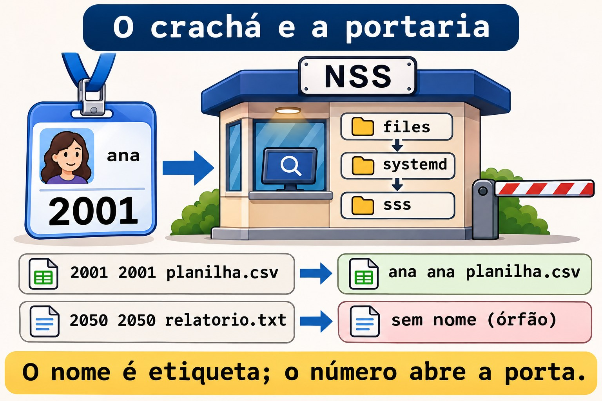
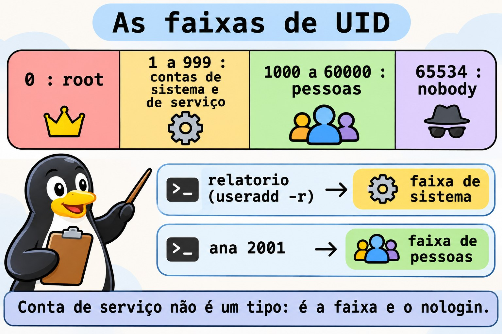
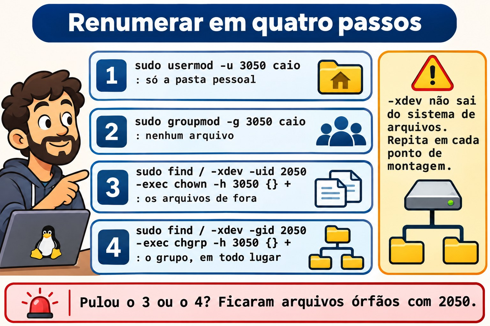

# Aula 10.1 · Contas

No Windows, uma conta é um SID: você renomeia o usuário e nada quebra, porque as permissões apontam para o número, e não para o nome. No Linux é igual, só que o número se chama UID e fica à vista. Na Aula 2.6 você criou, alterou e apagou contas. Nesta aula você vê de onde o sistema tira as contas, cria contas de serviço do jeito certo, renomeia e renumera um usuário sem deixar arquivo órfão, e cria contas em lote a partir de uma lista.

> **Núcleo desta aula:** consultar contas com `getent`, que segue o `/etc/nsswitch.conf`; ler as faixas de UID do `/etc/login.defs`; criar conta de serviço com `useradd -r` ou `systemd-sysusers`; renomear com `usermod -l -d -m` e `groupmod -n`; renumerar com `usermod -u` e `groupmod -g`, e consertar o resto com `find -uid` e `find -nouser`. O resto é aprofundamento.

| Ficha |  |
| --- | --- |
| **Módulo** | M10 · Usuários e acesso privilegiado, aula 1 de 4 |
| **Quando** | Semana 15 |
| **Ao final** | Você separa contas de pessoas e de serviços, muda nome e número de uma conta com segurança e acha arquivos sem dono |
| **Pré-requisitos** | Aulas 2.6, 8.2 e 9.6 |
| **Tempo** | cerca de 2h |
| **Snapshots** | `m10a1-inicio` e `m10a1-fim` na rocky-lab e na debian-lab |

## 1 · Aquecimento

Responda antes de ler.

1. O `ls -l` mostra `2050` no lugar do nome do dono. O que aconteceu com essa conta?
2. Um serviço novo precisa de uma conta. Ela deve ter senha? E pasta pessoal?
3. A Ana virou Ana Souza e quer o login `asouza`. O que muda nos arquivos dela?

## 2 · Por que importa

| O chamado | A resposta errada | O que ela causa |
| --- | --- | --- |
| "Troque o login da estagiária" | `vipw` e trocar o nome à mão | A pasta pessoal, o grupo e o crontab ficam com o nome velho |
| "Os UIDs não batem entre os servidores" | `usermod -u` e pronto | Arquivos fora da pasta pessoal ficam com o número antigo, sem dono |
| "Crie uma conta para o serviço de relatórios" | `useradd relatorio` comum | Conta com Bash, pasta pessoal e UID de pessoa: alvo fácil |
| "Crie as 30 contas da turma nova" | 30 comandos digitados à mão | Erro de digitação, UID duplicado, uma conta esquecida |
| "O `id fulano` funciona e o `grep fulano /etc/passwd` não" | Concluir que a conta não existe | A conta vem de outra fonte, como LDAP ou SSSD |

## 3 · Modelo mental

> Pense num **crachá com número**. O nome no crachá (o login) é só uma etiqueta para gente ler. O que abre as portas é o **número** (UID e GID), gravado em cada arquivo do disco. Trocar o nome é reimprimir o crachá: as portas continuam abrindo. Trocar o número é mudar a fechadura de quem tem o crachá: cada porta que tinha o número velho precisa ser trocada também, uma por uma. E a **portaria** (o NSS) pode consultar mais de uma lista de crachás: o `/etc/passwd`, o systemd ou um diretório da empresa.

```
quem pergunta            quem responde (na ordem do /etc/nsswitch.conf)
id ana         →  NSS →  files   /etc/passwd, /etc/group, /etc/shadow
ls -l                    systemd contas dinâmicas e de fallback
getent passwd            sss     LDAP ou AD, via SSSD (quando existe)

o disco guarda só números:   -rw-r--r--  2001  2001  planilha.csv
o NSS traduz para nomes:     -rw-r--r--  ana   ana   planilha.csv
sem tradução:                -rw-r--r--  2050  2050  relatorio.txt  (órfão)
```



*O nome é etiqueta; o número abre a porta.*

### Ponte Windows

| No Windows | No Linux | Onde a comparação engana |
| --- | --- | --- |
| SID | UID e GID | O UID é curto e escolhido por você; dois servidores podem dar o mesmo número a pessoas diferentes |
| Usuários locais (SAM) | `/etc/passwd` e `/etc/shadow` | São arquivos de texto: dá para ler, comparar e versionar |
| Conta de domínio (AD) | Conta vinda do SSSD, via NSS | Não aparece no `/etc/passwd`, só no `getent` |
| `NT SERVICE\...`, contas de serviço | Contas de sistema, abaixo de 1000 | Não há tipo especial: é a faixa de UID e o shell `nologin` |
| `Rename-LocalUser` | `usermod -l` | O Linux não move a pasta pessoal sozinho: é o `-d -m` |
| `Import-Csv` e `New-LocalUser` | Laço `while read` com `useradd` | O Linux tem também o `newusers`, que lê um arquivo no formato do `passwd` |

## 4 · O essencial

### Consultar pela portaria

| Quero... | Comando |
| --- | --- |
| Uma conta, de qualquer fonte | `getent passwd ana` |
| Pelo número | `getent passwd 2001` |
| Só do arquivo local | `getent -s files passwd ana` |
| Um grupo | `getent group equipe` |
| As fontes configuradas | `grep -E '^(passwd\|group\|shadow):' /etc/nsswitch.conf` |

O `grep` no `/etc/passwd` só enxerga o arquivo. O `getent` pergunta como o sistema pergunta, na ordem do `nsswitch.conf`. Em servidor ligado a um domínio, só o `getent` mostra a verdade.

### As faixas de número

| Faixa | Quem usa | Onde se define |
| --- | --- | --- |
| 0 | `root` | Fixo |
| 1 a 999 | Contas de sistema e de serviço | `SYS_UID_MIN` e `SYS_UID_MAX` |
| 1000 a 60000 | Pessoas | `UID_MIN` e `UID_MAX` |
| 65534 | `nobody` | Fixo |

```bash
grep -E '^#?\s*(SYS_)?[UG]ID_(MIN|MAX)' /etc/login.defs
```



*Conta de serviço não é um tipo: é a faixa e o nologin.*

### Conta de serviço

```bash
sudo useradd -r -s /usr/sbin/nologin -d /var/lib/relatorio -M -c "Relatorios" relatorio
```

`-r` pega o UID da faixa de sistema e não aplica validade de senha. `-M` não cria pasta pessoal. `nologin` recusa login interativo. A conta não recebe senha: ninguém entra como ela, e o serviço roda com `User=relatorio` na unit.

O jeito do systemd é declarar a conta num arquivo, e o `systemd-sysusers` cria o que falta:

```text
u coletor - "Coletor de metricas" /var/lib/coletor /usr/sbin/nologin
```

O `-` deixa o sistema escolher o UID. Os pacotes trazem os seus arquivos em `/usr/lib/sysusers.d/`; os seus ficam em `/etc/sysusers.d/`.

### Renomear: o nome muda, o número fica

```bash
sudo usermod -l caio -d /home/caio -m estag   # novo login, nova pasta, move o conteúdo
sudo groupmod -n caio estag                   # o grupo pessoal também tem nome
```

O `usermod -l` não renomeia o que é guardado pelo nome: o crontab em `/var/spool/cron/`, regras do `sudoers`, a caixa de e-mail e scripts que citam o login.

### Renumerar: o número muda, os arquivos não

| Passo | Comando | O que faz |
| --- | --- | --- |
| 1 | `sudo usermod -u 3050 caio` | Muda o UID e ajusta só os arquivos **dentro da pasta pessoal** |
| 2 | `sudo groupmod -g 3050 caio` | Muda o GID do grupo; não ajusta arquivo nenhum |
| 3 | `sudo find / -xdev -uid 2050 -exec chown -h 3050 {} +` | Conserta os arquivos de fora |
| 4 | `sudo find / -xdev -gid 2050 -exec chgrp -h 3050 {} +` | Conserta o grupo, inclusive dentro da pasta pessoal |

O `-xdev` não sai do sistema de arquivos de partida: repita para cada ponto de montagem (`/srv/app`, `/boot`, os volumes de dados). A conta não pode ter processos rodando.



*Pulou o 3 ou o 4? Ficaram arquivos órfãos com 2050.*

### Achar órfãos

```bash
sudo find / -xdev \( -nouser -o -nogroup \) -ls 2>/dev/null
```

### Rocky × Debian

|  | Rocky | Debian |
| --- | --- | --- |
| Quem escreve o `nsswitch.conf` | O `authselect` (Aula 10.2): não edite à mão | Você, direto no arquivo |
| Fontes de `passwd` | `files`, `systemd` e, se houver SSSD, `sss` | `files` e `systemd` |
| `SYS_UID_MIN` | `201`, ativo no `login.defs` | Comentado: vale o padrão do `useradd` |
| Senha de conta nova, antes do `passwd` | `!!` no `shadow` | `!` no `shadow` |
| `nologin` | `/usr/sbin/nologin` (e `/sbin/nologin`, o mesmo arquivo) | `/usr/sbin/nologin` |
| Crontab dos usuários | `/var/spool/cron/NOME` | `/var/spool/cron/crontabs/NOME` |
| Ferramenta amigável | Só `useradd` | `adduser`, que pergunta tudo (Aula 2.6) |

## 5 · Lab guiado

**Passo 0 · Snapshots e estado.** No Proxmox: `qm snapshot 201 m10a1-inicio` e `qm snapshot 202 m10a1-inicio`. Na rocky-lab, confira o que as aulas anteriores deixaram:

```bash
getent passwd ana bruno
getent group equipe
sudo ls -ld /srv/equipe
```

A Ana (2001) e o Bruno (2002) têm que aparecer, os dois no grupo `equipe` (2000), e a `/srv/equipe` em `drwxrws--T root equipe`. Se a Ana sumiu da rocky-lab (uma versão antiga do desafio da 8.5 a apagava), recrie com o mesmo número:

```bash
sudo useradd -u 2001 -c "Ana Lima" -m -s /bin/bash -G equipe ana
```

**Passo 1 · A portaria.**

```bash
grep -E '^(passwd|group|shadow):' /etc/nsswitch.conf
getent passwd student
getent -s files passwd student
getent passwd | wc -l
wc -l < /etc/passwd
```

As duas contagens costumam bater. Se o `getent` contar mais, há contas vindas de outra fonte. Agora peça uma conta que não está no arquivo:

```bash
getent -s files passwd nobody
getent passwd 65534
```

Nas duas VMs o `nobody` está no `/etc/passwd`. Num sistema mínimo sem ele, o módulo `systemd` do NSS responderia sozinho: é para isso que ele está na lista.

**Passo 2 · As faixas.**

```bash
grep -E '^#?\s*(SYS_)?[UG]ID_(MIN|MAX)' /etc/login.defs
getent passwd | awk -F: '$3 >= 1000 && $3 < 60000 {print $3, $1}' | sort -n
getent passwd | awk -F: '$3 < 1000 {print $3, $1, $7}' | sort -n | head
```

O segundo comando lista as pessoas, o terceiro as contas de sistema. Repare na última coluna do terceiro: quase todas com `nologin` ou `false`.

**Passo 3 · Duas contas de serviço.**

```bash
sudo useradd -r -s /usr/sbin/nologin -d /var/lib/relatorio -M -c "Relatorios" relatorio
getent passwd relatorio
sudo chage -l relatorio | head -n 3
```

O UID sai abaixo de 1000, a pasta não existe e a senha nunca vence. Agora pelo systemd:

```bash
command -v systemd-sysusers
ls /usr/lib/sysusers.d/ | head
echo 'u coletor - "Coletor de metricas" /var/lib/coletor /usr/sbin/nologin' | sudo tee /etc/sysusers.d/coletor.conf
sudo systemd-sysusers /etc/sysusers.d/coletor.conf
getent passwd coletor
ls -ld /var/lib/coletor
```

O `ls` final responde `No such file or directory`: o `systemd-sysusers` cria a conta, não a pasta. Quem cria a pasta é a unit do serviço, com `StateDirectory=coletor`, ou um `tmpfiles.d`. Rode o `systemd-sysusers` de novo: ele não faz nada, porque a conta já existe. É isso que permite que todo pacote declare as contas que precisa sem medo de duplicar.

**Passo 4 · Renomear.** Crie a conta da estagiária e um arquivo dela fora da pasta pessoal:

```bash
sudo useradd -u 2050 -c "Estagiaria" -m -s /bin/bash estag
sudo install -d -m 1777 /srv/lab101
sudo -u estag touch /srv/lab101/relatorio.txt
echo '0 8 * * 1 echo bom dia' | sudo crontab -u estag -
```

Ela foi contratada e vai se chamar `caio`:

```bash
sudo usermod -l caio -d /home/caio -m estag
sudo groupmod -n caio estag
getent passwd caio
ls -ld /home/caio
ls -l /srv/lab101
sudo crontab -l -u caio
```

A pasta mudou de nome, e o arquivo de fora aparece como `caio caio`: o número não mudou, e o disco só guarda o número. O crontab não aparece com o nome novo: `no crontab for caio`. Ele está no arquivo antigo:

```bash
sudo ls /var/spool/cron/            # Rocky
sudo ls /var/spool/cron/crontabs/   # Debian
```

O arquivo continua com o nome `estag`. Mova para o nome novo e confira:

```bash
sudo mv /var/spool/cron/estag /var/spool/cron/caio                     # Rocky
sudo mv /var/spool/cron/crontabs/estag /var/spool/cron/crontabs/caio   # Debian
sudo crontab -l -u caio
```

**Passo 5 · Renumerar.** Os servidores da equipe usam a faixa 3000 para pessoas contratadas. O `caio` vai de 2050 para 3050:

```bash
sudo usermod -u 3050 caio
sudo groupmod -g 3050 caio
ls -ln /home/caio /srv/lab101
sudo find / -xdev \( -nouser -o -nogroup \) -ls 2>/dev/null
```

Na pasta pessoal, o dono virou 3050, e o grupo continua 2050: o `groupmod` não mexe em arquivo. Em `/srv/lab101`, o dono e o grupo continuam 2050: o `usermod` não sai da pasta pessoal. O `find` acha os órfãos. Conserte:

```bash
sudo find / -xdev -uid 2050 -exec chown -h 3050 {} +
sudo find / -xdev -gid 2050 -exec chgrp -h 3050 {} +
sudo find / -xdev \( -nouser -o -nogroup \) -ls 2>/dev/null
ls -l /home/caio /srv/lab101
```

O último `find` volta vazio, e tudo aparece como `caio caio`. Se o `/srv/app` da 9.6 tivesse arquivos do `caio`, o `-xdev` teria pulado: lá é outro sistema de arquivos, e o `find` precisa rodar a partir dele também.

**Passo 6 · Contas em lote.** Uma lista com login, UID e nome:

```bash
printf '%s\n' 'gil:2201:Gil Prado' 'helo:2202:Helo Dias' 'ivo:2203:Ivo Matos' | sudo tee /srv/lab101/novos.txt
while IFS=: read -r nome uid gecos; do
  sudo useradd -u "$uid" -c "$gecos" -m -s /bin/bash "$nome" && echo "criada: $nome"
done < /srv/lab101/novos.txt
for u in gil helo ivo; do sudo passwd -S "$u"; done
```

As três contas nascem sem senha: o `passwd -S` mostra `LK` na Rocky e `L` no Debian. Ninguém entra até você definir uma senha, e é o estado certo para uma conta recém-criada. Rode o laço de novo: cada linha falha com `user 'gil' already exists`, e nada se duplica.

**Passo 7 · subuid.** Cada pessoa criada pelo `useradd` ganha também uma faixa de números extras, que os contêineres sem root (M18) vão usar:

```bash
grep -E '^(ana|caio|gil):' /etc/subuid /etc/subgid
```

Cada linha diz `nome:início:quantidade`, como `gil:100000:65536`. As faixas não se sobrepõem. Se a Ana não aparecer, ela foi criada antes de o sistema ter `/etc/subuid`: anote para a M18.

**Passo 8 · debian-lab.** Repita os passos 0 a 7. No Passo 4, use o caminho do crontab do Debian.

### Decida 1

O `caio` vai receber a pasta de outra equipe por NFS, e lá o UID dele é 3050. Na sua máquina é 2050. O que fazer?

A) Só `usermod -u 3050 caio`. B) `usermod -u` e `groupmod -g`, e depois `find -uid` e `find -gid` em cada sistema de arquivos. C) Criar uma segunda conta com UID 3050.

Marque uma opção antes.

| Se você marcou | Resultado | Por quê |
| --- | --- | --- |
| A | Pela metade | Os arquivos de fora da pasta pessoal e o grupo ficam com o número velho |
| B | Certo | Muda os números e conserta o disco inteiro |
| C | Confusão | Duas contas para a mesma pessoa, e arquivos divididos entre elas |

**Para fixar:** o disco guarda números. Mudou o número, conserte o disco.

### Decida 2

Um serviço novo de backup precisa de conta. Qual comando?

A) `useradd backupsvc`. B) `useradd -r -s /usr/sbin/nologin -M backupsvc`. C) Rodar o serviço como `root`, que é mais simples.

Marque uma opção antes.

| Se você marcou | Resultado | Por quê |
| --- | --- | --- |
| A | Fraco | UID de pessoa, Bash e pasta pessoal: quem descobrir a senha entra |
| B | Certo | Faixa de sistema, sem login e sem pasta |
| C | Perigoso | Uma falha no serviço vira o servidor inteiro |

**Para fixar:** serviço tem conta própria, sem login.

## 6 · Quebre e conserte

### Quebra 1 · O número que já tem dono

```bash
sudo useradd -u 2001 -m -s /bin/bash teste
```

**Sintoma:** `useradd: UID 2001 is not unique`.

**Investigação:** `getent passwd 2001` mostra a Ana.

**Causa:** cada UID pertence a uma conta só. O `useradd -o` permitiria duplicar, e é quase sempre um erro: as duas contas viram a mesma pessoa para o kernel.

**Conserto:** escolha um número livre. Para ver o próximo da faixa: `getent passwd | awk -F: '$3 >= 2000 && $3 < 3000 {print $3}' | sort -n | tail -n 1`.

### Quebra 2 · A conta em uso

```bash
sudo systemd-run --uid=gil --unit=lab101 sleep 600
sudo usermod -l gilberto gil
```

**Sintoma:** `usermod: user gil is currently used by process` seguido de um número.

**Investigação:** `ps -u gil -o pid,cmd` mostra o `sleep`.

**Causa:** o `usermod` recusa mudar nome, número ou pasta de uma conta com processos, porque eles continuariam com a identidade velha.

**Conserto:** pare o que está rodando (`sudo systemctl stop lab101`, ou `sudo loginctl terminate-user gil` para sessões) e repita. Na vida real, isso entra na janela de manutenção. Volte o nome: `sudo usermod -l gil gilberto`.

### Quebra 3 · O grupo que ainda é de alguém

```bash
sudo groupdel caio
```

**Sintoma:** `groupdel: cannot remove the primary group of user 'caio'`.

**Investigação:** `id caio` e `getent passwd caio`: o quarto campo é 3050, o GID do grupo `caio`.

**Causa:** um grupo que é o principal de alguém não pode sumir: a conta ficaria com um GID sem nome.

**Conserto:** apague a conta primeiro (`userdel` apaga o grupo pessoal junto) ou troque o grupo principal dela com `usermod -g`. Aqui, o grupo fica: a limpeza cuida disso.

### Limpeza

```bash
sudo systemctl stop lab101 2>/dev/null
for u in caio gil helo ivo; do sudo userdel -r "$u"; done
sudo userdel relatorio
sudo userdel coletor
sudo rm /etc/sysusers.d/coletor.conf
sudo rm -r /srv/lab101
sudo find / -xdev \( -nouser -o -nogroup \) -ls 2>/dev/null
getent passwd ana bruno
```

O `userdel -r caio` pode avisar `caio mail spool (/var/spool/mail/caio) not found`: ele não tinha e-mail, e o aviso é inofensivo. O `find` tem que voltar vazio, e a Ana e o Bruno continuam como estavam.

## 7 · Armadilhas

| Armadilha | O que acontece | Como evitar |
| --- | --- | --- |
| Conferir conta com `grep /etc/passwd` | Não vê contas do SSSD | `getent passwd` |
| Editar o `nsswitch.conf` na Rocky | O `authselect` reescreve | `authselect` (Aula 10.2) |
| `usermod -l` sem `-d -m` | A pasta continua com o nome velho | Sempre `-l NOVO -d /home/NOVO -m` |
| Esquecer o grupo pessoal | Login novo, grupo com nome velho | `groupmod -n` logo depois |
| `usermod -u` e pronto | Arquivos de fora da pasta ficam órfãos | `find -uid` em cada sistema de arquivos |
| `find /` sem `-xdev` | Desce no `/proc` e em compartilhamentos de rede | `-xdev` e um `find` por montagem |
| Conta de serviço com `useradd` comum | Bash, pasta e senha que vence | `useradd -r -s /usr/sbin/nologin -M` |
| `useradd -o` | Duas contas com o mesmo número | Nunca, salvo motivo raro e documentado |

## 8 · Quiz

Responda sem olhar. O gabarito está no fim da aula.

1. Por que o `getent passwd` pode mostrar uma conta que o `/etc/passwd` não tem?
2. Em que faixa fica o UID de uma conta criada com `useradd -r`, e por quê?
3. O que o `systemd-sysusers` faz se a conta já existe?
4. Depois de `usermod -l caio -d /home/caio -m estag`, o que ainda fica com o nome velho?
5. Depois de `usermod -u`, quais arquivos ficam com o número velho?
6. Para que serve o `-xdev` no `find` de órfãos?

## 9 · Cola

**Para saber de cor:**

| Quero... | Comando |
| --- | --- |
| Consultar conta | `getent passwd NOME` |
| Conta de serviço | `sudo useradd -r -s /usr/sbin/nologin -M NOME` |
| Renomear | `sudo usermod -l NOVO -d /home/NOVO -m VELHO` e `sudo groupmod -n NOVO VELHO` |
| Renumerar | `sudo usermod -u NOVO NOME` e `sudo groupmod -g NOVO NOME` |
| Consertar o disco | `sudo find / -xdev -uid VELHO -exec chown -h NOVO {} +` |
| Achar órfãos | `sudo find / -xdev \( -nouser -o -nogroup \) -ls` |

**Para consultar:**

| Quero... | Comando |
| --- | --- |
| Só o arquivo local | `getent -s files passwd NOME` |
| Fontes do NSS | `grep -E '^(passwd\|group):' /etc/nsswitch.conf` |
| Faixas de UID | `grep -E '^#?\s*(SYS_)?[UG]ID_(MIN\|MAX)' /etc/login.defs` |
| Declarar conta (systemd) | `/etc/sysusers.d/NOME.conf` e `sudo systemd-sysusers` |
| Estado da senha | `sudo passwd -S NOME` |
| Faixas de subuid | `grep NOME /etc/subuid /etc/subgid` |

**Flashcards:**

- UID → *o número que o disco guarda.*
- Login → *a etiqueta que o NSS traduz.*
- `getent` → *pergunta como o sistema pergunta.*
- `useradd -r` → *faixa de sistema, sem validade.*
- Renomear → *o número fica, a pasta muda com `-d -m`.*
- Renumerar → *o disco não acompanha: `find -uid`.*

## 10 · Checklist e fechamento

- [ ] Consulto contas com `getent` e sei de quais fontes elas vêm
- [ ] Leio as faixas de UID e separo pessoas de serviços
- [ ] Crio conta de serviço com `useradd -r` e com `systemd-sysusers`
- [ ] Renomeio uma conta com a pasta, o grupo e o crontab
- [ ] Renumero uma conta e conserto os arquivos com `find`
- [ ] Crio contas em lote a partir de uma lista, sem duplicar
- [ ] Deixo a Ana e o Bruno como estavam, e nenhum órfão no disco

**Último exercício, sem olhar a aula:** na debian-lab, crie a conta de serviço `filas`, sem login e sem pasta, por `/etc/sysusers.d/`. Confira o UID e o shell, e apague a conta e o arquivo.

**Snapshot de fim** (no Proxmox):

```bash
qm snapshot 201 m10a1-fim
qm snapshot 202 m10a1-fim
```

## 11 · Na vida real

**Missão, só leitura.** Num servidor Linux que você administre (ou com autorização), rode **apenas**:

```bash
grep -E '^(passwd|group):' /etc/nsswitch.conf
getent passwd | awk -F: '$3 >= 1000 && $3 < 60000 {print $3, $1, $7}' | sort -n
getent passwd | awk -F: '$3 < 1000 && $7 !~ /(nologin|false)$/ {print $3, $1, $7}'
sudo find / -xdev \( -nouser -o -nogroup \) 2>/dev/null | head -n 20
```

Perguntas para responder:

1. As contas vêm só de arquivos, ou também de um domínio?
2. Alguma conta de sistema tem shell de login? Ela precisa?
3. Há arquivos órfãos? De que número, e de quem era esse número?

## 12 · Aprofundar quando quiser

- **`man nsswitch.conf`, `man getent`:** as fontes e a ordem.
- **`man sysusers.d`, `man systemd-sysusers`:** o formato completo, com grupos (`g`) e membros (`m`).
- **`man newusers`:** cria contas em lote a partir de um arquivo no formato do `passwd`, com senha.
- **`man login.defs`:** todas as faixas e padrões do `useradd`.

**DeepTutor** (http://10.1.0.149:3782, KB "Curso Linux Sysadmin"):

- `!explica UID, login e NSS com uma metáfora`
- `!feynman por que renumerar um usuário deixa arquivos órfãos`
- `!quiz Aula 10.1, 5 perguntas sobre contas`

## Gabarito comentado

### Aquecimento

1. A conta foi apagada ou renumerada, e o arquivo ficou com o número antigo. O NSS não acha nome para 2050, e o `ls` mostra o número.
2. Não, e não. Conta de serviço não faz login: sem senha, com `nologin` e sem pasta pessoal, a não ser a pasta de dados do serviço.
3. Nada, se só o nome mudar: os arquivos guardam o UID. Mudam a pasta pessoal (se você usar `-d -m`), o grupo pessoal (com `groupmod -n`) e o que é guardado pelo nome, como o crontab.

### Quiz

1. Porque o `getent` consulta todas as fontes do `nsswitch.conf`, como o SSSD e o systemd, e o arquivo é só uma delas.
2. Na faixa de sistema, abaixo de 1000, entre `SYS_UID_MIN` e `SYS_UID_MAX`: assim ninguém confunde a conta com uma pessoa.
3. Nada: ele só cria o que falta. Por isso pode rodar sempre.
4. O crontab, as regras do `sudoers`, a caixa de e-mail e scripts que citam o login. O grupo pessoal também, até o `groupmod -n`.
5. Os de fora da pasta pessoal. E, depois do `groupmod -g`, o grupo de todos os arquivos, inclusive dentro da pasta.
6. Para não sair do sistema de arquivos de partida: evita `/proc`, `/sys` e compartilhamentos de rede. Cada montagem local precisa do seu próprio `find`.

---

<!-- navegacao -->
[← Aula 9.7 · Crescer sem destruir](9.7-crescer-sem-destruir.md) · [Índice de aulas](../01-aulas.md) · [Aula 10.2 · Senhas e validade →](10.2-senhas-e-validade.md)
