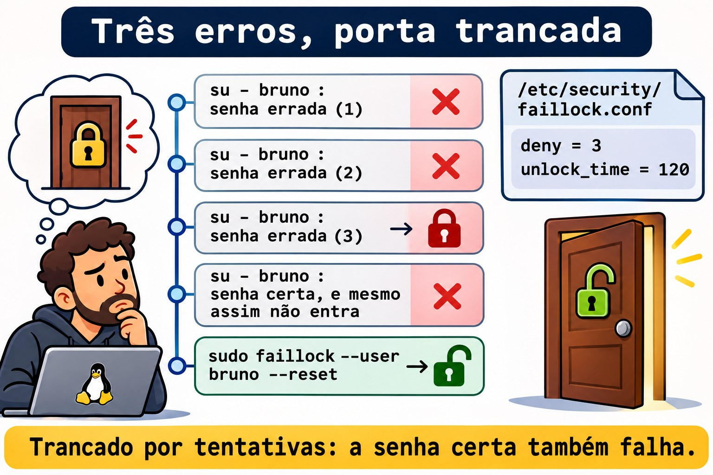

# Aula 10.2 · Senhas e validade

No Windows, a política de senha mora numa GPO: tamanho mínimo, complexidade, histórico, bloqueio depois de tantas tentativas. Você marca as caixas e todo login passa a obedecer. No Linux, quem decide é o PAM, uma pilha de módulos que cada programa de login consulta. Na Aula 2.6 você usou o `chage` numa conta. Nesta aula você monta a política inteira: qualidade da senha, bloqueio por tentativas e validade, e aplica nas contas que já existem.

> **Núcleo desta aula:** ler uma pilha do PAM em `/etc/pam.d/`; ligar recursos pelo `authselect` (Rocky) ou pelo `pam-auth-update` (Debian), nunca editando os arquivos gerados; definir a qualidade em `/etc/security/pwquality.conf.d/*.conf`; bloquear tentativas com o `pam_faillock` e soltar com `faillock --reset`; e lembrar que o `login.defs` só vale para contas novas: as antigas recebem `chage`. O resto é aprofundamento.

| Ficha |  |
| --- | --- |
| **Módulo** | M10 · Usuários e acesso privilegiado, aula 2 de 4 |
| **Quando** | Semana 15 |
| **Ao final** | Você define e testa uma política de senha, bloqueia e desbloqueia contas por tentativas e aplica validade em contas existentes |
| **Pré-requisitos** | Aulas 2.6 e 10.1 |
| **Tempo** | cerca de 2h |
| **Snapshots** | `m10a2-inicio` e `m10a2-fim` na rocky-lab e na debian-lab |

## 1 · Aquecimento

Responda antes de ler.

1. Você colocou `PASS_MAX_DAYS 90` no `/etc/login.defs`. A senha do Bruno vence em 90 dias?
2. O `root` troca a senha da Ana por `123`. O sistema aceita?
3. A conta do Bruno foi bloqueada por senha errada. Ele entra por SSH com chave?

## 2 · Por que importa

| O chamado | A resposta errada | O que ela causa |
| --- | --- | --- |
| "Exija senhas de 12 caracteres" | Editar o `/etc/pam.d/system-auth` na Rocky | O próximo `authselect` desfaz a mudança sem avisar |
| "As senhas têm que vencer em 90 dias" | Mudar só o `login.defs` | As contas que já existem continuam sem vencer |
| "Bloqueie depois de 3 tentativas" | `deny=3` sem `unlock_time` pensado | Um robô tranca as contas de todo mundo, e só você destrava |
| "O usuário está bloqueado" | `passwd -u` | Não é o `passwd` que bloqueou: é o `faillock` |
| "O estagiário precisa trocar a senha no primeiro acesso" | Mandar um e-mail pedindo | Ninguém troca; a senha provisória fica para sempre |

## 3 · Modelo mental

> Pense numa **portaria com quatro guichês**, sempre na mesma ordem. O primeiro confere **quem você é** (`auth`). O segundo confere **se você pode entrar agora** (`account`): conta vencida, bloqueada, fora do horário. O terceiro só abre quando você **troca a senha** (`password`) e confere se a nova presta. O quarto **prepara a sua sessão** (`session`): limites, pasta, registro. Cada programa (o `sshd`, o `su`, o `login`, o `passwd`) tem a sua fila, em `/etc/pam.d/`. E cada guichê tem vários atendentes em sequência: os módulos.

```
/etc/pam.d/su      (cada programa tem um arquivo)
auth      → pam_faillock preauth   já está trancado?
            pam_unix               a senha confere?
            pam_faillock authfail  errou: conta mais uma
account   → pam_unix               a conta ou a senha venceram?
password  → pam_pwquality          a senha nova presta?
            pam_unix               grava o hash no /etc/shadow
session   → pam_limits, pam_unix   limites e registro
```

| Controle | Se o módulo diz sim | Se o módulo diz não |
| --- | --- | --- |
| `required` | Segue | Segue, mas o resultado final é não |
| `requisite` | Segue | Para na hora: não |
| `sufficient` | Para na hora: sim (se nada antes falhou) | Segue, como se ele não existisse |
| `optional` | Só conta se for o único | Só conta se for o único |
| `include` e `substack` | Puxa as linhas de outro arquivo | Idem |


*Uma linha errada no PAM trava o login de todos.*

### Ponte Windows

| No Windows | No Linux | Onde a comparação engana |
| --- | --- | --- |
| GPO de senha | `pwquality.conf` e o módulo `pam_pwquality` | Vale só na troca de senha, e o `root` pode passar por cima |
| Limite de bloqueio da conta | `pam_faillock` e `faillock.conf` | Na Rocky, liga com `authselect`; no Debian, não vem ligado |
| Duração máxima da senha | `chage -M` por conta | O `login.defs` só define o padrão de quem ainda vai nascer |
| "O usuário deve alterar a senha no próximo logon" | `chage -d 0` | Idêntico, inclusive no efeito |
| Cada serviço autentica do seu jeito | Todos passam pelo PAM | Uma linha errada num arquivo trava o login de todos |

## 4 · O essencial

### Quem escreve os arquivos do PAM

|  | Rocky | Debian |
| --- | --- | --- |
| Arquivos comuns | `system-auth` e `password-auth` | `common-auth`, `common-account`, `common-password`, `common-session` |
| Quem gera | `authselect` | `pam-auth-update`, a partir de `/usr/share/pam-configs/` |
| Ver o estado | `authselect current` | `pam-auth-update` (menu) e `grep` nos `common-*` |
| Ligar um recurso | `sudo authselect enable-feature with-faillock` | Instalar o pacote; ele se registra no `pam-auth-update` |
| Qualidade de senha | Já vem ligada (`pam_pwquality`) | `sudo apt install libpam-pwquality` |

Editar à mão um arquivo gerado funciona até a próxima atualização, que regrava tudo. Na Rocky, o `authselect check` avisa se alguém mexeu.

### Qualidade da senha

```bash
sudo tee /etc/security/pwquality.conf.d/10-curso.conf <<'EOF'
minlen = 12
minclass = 3
EOF
```

| Opção | Significa |
| --- | --- |
| `minlen = 12` | Pelo menos 12 caracteres |
| `minclass = 3` | Pelo menos 3 tipos entre minúsculas, maiúsculas, números e símbolos |
| `maxrepeat = 3` | No máximo 3 caracteres iguais seguidos |
| `dictcheck = 1` | Recusa palavras de dicionário |
| `enforce_for_root` | Recusa também quando é o `root` que troca |

Só valem arquivos terminados em `.conf` dentro do `pwquality.conf.d/`. É o contrário do `sudoers.d`, que ignora arquivos com ponto no nome (Aula 2.5). Para testar uma senha sem trocar nada, use o `pwscore`.

### Bloqueio por tentativas

As regras ficam no `/etc/security/faillock.conf`, que vem todo comentado:

```text
deny = 3
unlock_time = 120
```

`deny` é o número de falhas que tranca a conta; `unlock_time`, quantos segundos ela fica trancada.

| Comando | Faz |
| --- | --- |
| `sudo faillock --user bruno` | Mostra as falhas registradas |
| `sudo faillock --user bruno --reset` | Zera e destrava |

O `root` não é bloqueado, a não ser com `even_deny_root`. E o bloqueio vale para quem passa pela etapa `auth`: login por chave no SSH não passa por ela.



*Trancado por tentativas: a senha certa também falha.*

### Validade: padrão novo e contas velhas

| Onde | Vale para | Exemplo |
| --- | --- | --- |
| `/etc/login.defs` | Contas criadas **depois** | `PASS_MAX_DAYS 90`, `PASS_MIN_DAYS 1`, `PASS_WARN_AGE 14` |
| `chage` | A conta que você nomear | `sudo chage -M 90 -m 1 -W 14 ana` |
| `chage -d 0` | Força a troca no próximo login | `sudo chage -d 0 caio` |


*Mudou o login.defs? As contas antigas não sabem.*

### Rocky × Debian

|  | Rocky | Debian |
| --- | --- | --- |
| `pam_pwquality` | Ligado, com `local_users_only` | Depois do `apt install libpam-pwquality` |
| `pwscore` | Pacote `libpwquality` | Pacote `libpwquality-tools` |
| `pam_faillock` | `authselect enable-feature with-faillock` | O módulo existe, mas não vem ligado: Aprofundar |
| Histórico de senhas | `authselect enable-feature with-pwhistory` | `pam_pwhistory` à mão no `common-password` |
| Log das falhas | `/var/log/secure` e o journal | `/var/log/auth.log`, se houver, e o journal |

## 5 · Lab guiado

**Passo 0 · Snapshots e estado.** No Proxmox: `qm snapshot 201 m10a2-inicio` e `qm snapshot 202 m10a2-inicio`. Na rocky-lab:

```bash
getent passwd ana bruno
sudo passwd -S bruno
sudo chage -l bruno
```

Você vai precisar entrar como o Bruno com senha. Se o `passwd -S` mostrar `LK` (ou `L`), defina uma senha boa para ele, com pelo menos 12 caracteres e três tipos, e anote no seu caderno do lab:

```bash
sudo passwd bruno
```

Se o `chage -l` mostrar uma data passada em `Account expires` (resto da Aula 2.6), tire a validade da conta: `sudo chage -E -1 bruno`.

**Passo 1 · Ler uma pilha.**

```bash
sudo authselect current
grep -vE '^\s*(#|$)' /etc/pam.d/su
grep -vE '^\s*(#|$)' /etc/pam.d/system-auth
```

O `authselect current` mostra o perfil (algo como `sssd`) e os recursos ligados. No `su`, procure a linha `auth substack system-auth`: o `su` não tem regras próprias de senha, ele puxa as comuns. No `system-auth`, ache o `pam_pwquality` no guichê `password` e confira que ainda não há `pam_faillock`.

```bash
sudo authselect check
```

A resposta esperada diz que a configuração atual é válida. Se alguém tivesse editado o `system-auth` à mão, ela avisaria.

**Passo 2 · Qualidade.** Primeiro, o padrão:

```bash
grep -vE '^\s*(#|$)' /etc/security/pwquality.conf
ls /etc/security/pwquality.conf.d/
echo 'Xk7pQ2wzR' | pwscore
```

O arquivo principal vem todo comentado, e a pasta vazia ou quase. A senha `Xk7pQ2wzR` tem 9 caracteres e três classes: com o padrão, ela passa e o `pwscore` responde um número de 0 a 100. Use senhas aleatórias como essa nos testes: palavras do dicionário, mesmo com números no fim, são recusadas por outro motivo e confundem o teste. Agora a política do curso:

```bash
sudo tee /etc/security/pwquality.conf.d/10-curso.conf <<'EOF'
minlen = 12
minclass = 3
EOF
echo 'Xk7pQ2wzR' | pwscore
echo 'xk7pq2wzr4tm' | pwscore
echo 'Xk7-pQ2w-zMr4' | pwscore
```

A primeira agora é recusada por ser curta, a segunda por ter só duas classes (minúsculas e números), e a terceira passa. As mensagens são do tipo `Password quality check failed:` seguida do motivo.

**Passo 3 · O root passa por cima.**

```bash
sudo passwd bruno
```

Digite uma senha curta, como `Xk7pQ2wzR`. O `passwd` responde `BAD PASSWORD:` com o motivo, e mesmo assim aceita: quem pede é o `root`. Defina de novo a senha boa do Passo 0 antes de seguir. Para obrigar o `root` também, a política precisaria de `enforce_for_root`. Pense bem antes: no dia em que você precisar destravar alguém com uma senha provisória, a regra vale para você.

**Passo 4 · Bloqueio por tentativas.**

```bash
sudo authselect enable-feature with-faillock
grep faillock /etc/pam.d/system-auth
grep -vE '^\s*(#|$)' /etc/security/faillock.conf
```

O `system-auth` ganhou três linhas com `pam_faillock`: o `preauth` antes do `pam_unix`, o `authfail` depois, e uma no guichê `account`. O `faillock.conf` vem todo comentado: valem os padrões. Defina a política:

```bash
printf '%s\n' 'deny = 3' 'unlock_time = 120' | sudo tee -a /etc/security/faillock.conf
```

Agora erre a senha do Bruno três vezes, de propósito:

```bash
su - bruno
su - bruno
su - bruno
sudo faillock --user bruno
```

Cada `su` termina em `su: Authentication failure`. O `faillock` mostra três linhas, com a hora e a origem de cada falha. Agora tente com a senha **certa**:

```bash
su - bruno
```

Falha do mesmo jeito: a conta está trancada por 120 segundos. Dependendo da versão, aparece também uma linha dizendo que a conta está bloqueada. Destrave:

```bash
sudo faillock --user bruno --reset
su - bruno
```

Agora entra. Digite `exit` para voltar.

**Passo 5 · Validade nas contas que já existem.**

```bash
grep -E '^PASS_(MAX|MIN|WARN)' /etc/login.defs
sudo chage -l ana | grep -E 'Maximum|Minimum|warning'
```

O padrão é `99999`: nunca vence. Mude o padrão para contas novas:

```bash
sudo sed -i -E 's/^PASS_MAX_DAYS\s+.*/PASS_MAX_DAYS\t90/; s/^PASS_MIN_DAYS\s+.*/PASS_MIN_DAYS\t1/; s/^PASS_WARN_AGE\s+.*/PASS_WARN_AGE\t14/' /etc/login.defs
grep -E '^PASS_(MAX|MIN|WARN)' /etc/login.defs
sudo chage -l ana | grep -E 'Maximum|Minimum|warning'
```

O `login.defs` mudou e a Ana continua com `99999`. Aplique a política em todos do grupo `equipe`:

```bash
membros=$(getent group equipe | cut -d: -f4 | tr , ' ')
echo "$membros"
for u in $membros; do sudo chage -M 90 -m 1 -W 14 "$u"; done
for u in $membros; do echo "== $u"; sudo chage -l "$u" | grep -E 'Maximum|Minimum|warning'; done
```

Agora os dois têm 90, 1 e 14. Uma conta nova já nasce assim:

```bash
sudo useradd -m -s /bin/bash lab102
sudo chage -l lab102 | grep -E 'Maximum|Minimum|warning'
```

**Passo 6 · Troca obrigatória no primeiro acesso.**

```bash
sudo passwd lab102
sudo chage -d 0 lab102
sudo chage -l lab102 | head -n 2
su - lab102
```

Defina uma senha provisória boa no `passwd`. Depois do `chage -d 0`, a primeira linha diz `password must be changed`. No `su`, depois da senha provisória, o sistema avisa que a troca é obrigatória e pede a senha atual e a nova duas vezes, já com as regras do Passo 2. Troque, e digite `exit`.

**Passo 7 · debian-lab.** O Debian não traz o `pam_pwquality`:

```bash
grep -vE '^\s*(#|$)' /etc/pam.d/common-password
sudo apt install -y libpam-pwquality libpwquality-tools
grep -vE '^\s*(#|$)' /etc/pam.d/common-password
```

A linha do `pam_pwquality` apareceu antes do `pam_unix`: o pacote se registrou no `pam-auth-update` sozinho. Repita os passos 0, 2, 3, 5 e 6. O bloqueio por tentativas (Passo 4) fica para a Rocky.

### Decida 1

Uma auditoria pede senhas que vençam em 90 dias em todos os servidores. Você tem 40 contas de pessoas em cada um. O que fazer?

A) `PASS_MAX_DAYS 90` no `login.defs`. B) `login.defs` e um laço de `chage -M 90` nas contas de pessoas. C) `chage -M 90` em todas as contas do `/etc/passwd`.

Marque uma opção antes.

| Se você marcou | Resultado | Por quê |
| --- | --- | --- |
| A | Pela metade | Só as contas criadas a partir de agora vão vencer |
| B | Certo | O padrão para o futuro e a regra aplicada nas contas atuais |
| C | Perigoso | Contas de serviço não têm senha; com validade, viram um alerta falso, e um serviço que dependa de `account` pode parar |

**Para fixar:** `login.defs` é o padrão de quem vai nascer; quem já existe recebe `chage`.

### Decida 2

Um robô está testando senhas no SSH e as contas da equipe vivem trancadas. O que fazer?

A) Tirar o `pam_faillock`. B) Manter o bloqueio, limitar o SSH a chaves e restringir de onde se conecta. C) Aumentar o `deny` para 50.

Marque uma opção antes.

| Se você marcou | Resultado | Por quê |
| --- | --- | --- |
| A | Fraco | O robô volta a tentar senhas sem limite |
| B | Certo | Sem senha no SSH, não há o que adivinhar; o bloqueio segue valendo no console e no `su` |
| C | Fraco | O robô tenta 50 vezes por conta, e você perde a proteção |

**Para fixar:** o bloqueio protege a senha; a melhor proteção é não aceitar senha onde não precisa.

## 6 · Quebre e conserte

### Quebra 1 · A regra que ninguém lê

```bash
echo 'minlen = 20' | sudo tee /etc/security/pwquality.conf.d/20-teste
echo 'Xk7-pQ2w-zMr4' | pwscore
```

**Sintoma:** a senha de 13 caracteres passa, mesmo com a regra de 20.

**Investigação:** `ls /etc/security/pwquality.conf.d/` mostra o arquivo `20-teste`, sem `.conf`.

**Causa:** o `pwquality` só lê arquivos terminados em `.conf` nessa pasta.

**Conserto:** renomeie e teste de novo; a senha agora é recusada:

```bash
sudo mv /etc/security/pwquality.conf.d/20-teste /etc/security/pwquality.conf.d/20-teste.conf
echo 'Xk7-pQ2w-zMr4' | pwscore
sudo rm /etc/security/pwquality.conf.d/20-teste.conf
```

### Quebra 2 · A senha certa que não entra

Na rocky-lab, erre a senha do Bruno três vezes com `su - bruno` e peça para um colega, ou para você mesmo daqui a um minuto, entrar com a senha certa.

**Sintoma:** `su: Authentication failure` com a senha certa.

**Investigação:** `sudo faillock --user bruno` mostra as falhas. No journal: `sudo journalctl -t su --since '-10min'`.

**Causa:** o `pam_faillock` trancou a conta. O `passwd -S` não mostra esse bloqueio, e `passwd -u` não resolve: são mecanismos diferentes.

**Conserto:** `sudo faillock --user bruno --reset`, ou esperar o `unlock_time`.

### Quebra 3 · A política que não pegou

```bash
sudo useradd -m -s /bin/bash lab102b
sudo chage -M 99999 lab102b
grep '^PASS_MAX_DAYS' /etc/login.defs
sudo chage -l lab102b | grep Maximum
```

**Sintoma:** o `login.defs` diz 90 e a conta diz 99999.

**Investigação:** o `login.defs` é lido só pelo `useradd`, na criação. Depois disso, quem vale é o quinto campo do `/etc/shadow` da conta: `sudo getent shadow lab102b | cut -d: -f5`.

**Causa:** alguém mudou a conta depois de criada, ou ela foi criada antes da política.

**Conserto:** `sudo chage -M 90 -m 1 -W 14 lab102b`. Para achar todas as contas de pessoas fora da regra:

```bash
sudo getent shadow | awk -F: '$5 > 90 {print $1, $5}'
```

A lista mostra também contas de sistema, com `99999`: elas não têm senha, e ficam como estão.

### Limpeza

```bash
sudo userdel -r lab102
sudo userdel -r lab102b
sudo faillock --user bruno --reset
```

A política fica: o `10-curso.conf`, o `faillock` ligado e o `login.defs` com 90 dias são o que o desafio do módulo pede. Na debian-lab, faça a mesma limpeza, sem o `faillock`.

## 7 · Armadilhas

| Armadilha | O que acontece | Como evitar |
| --- | --- | --- |
| Editar `system-auth` na Rocky | O `authselect` reescreve | `authselect enable-feature` |
| Arquivo sem `.conf` no `pwquality.conf.d` | A regra é ignorada | Sempre `NN-nome.conf` |
| Testar a política como `root` | Tudo parece aceito, com um aviso | Teste com `pwscore` ou como o próprio usuário |
| Só `login.defs` | Contas antigas sem validade | `chage` nas contas existentes |
| `passwd -u` numa conta do `faillock` | Nada muda | `faillock --user NOME --reset` |
| Validade em conta de serviço | Alertas falsos, serviços que param | Só contas de pessoas |
| Uma linha errada no PAM | Ninguém entra | Mantenha uma sessão de `root` aberta enquanto mexe |

## 8 · Quiz

Responda sem olhar. O gabarito está no fim da aula.

1. Quais são os quatro tipos de linha do PAM, e o que cada um confere?
2. Por que não se edita o `system-auth` na Rocky?
3. O que acontece com um arquivo `pwquality.conf.d/regras` sem `.conf`?
4. Qual a diferença entre `requisite` e `required`?
5. A conta foi trancada pelo `faillock`. Como você vê e como destrava?
6. Depois de mudar o `PASS_MAX_DAYS`, o que falta fazer?

## 9 · Cola

**Para saber de cor:**

| Quero... | Comando |
| --- | --- |
| Testar uma senha | `echo 'SENHA' \| pwscore` |
| Ver falhas e destravar | `sudo faillock --user NOME` e `--reset` |
| Ver o estado do PAM (Rocky) | `sudo authselect current` |
| Ligar o bloqueio (Rocky) | `sudo authselect enable-feature with-faillock` |
| Validade numa conta | `sudo chage -M 90 -m 1 -W 14 NOME` |
| Troca no primeiro acesso | `sudo chage -d 0 NOME` |

**Para consultar:**

| Quero... | Comando |
| --- | --- |
| Pilha de um programa | `grep -vE '^\s*(#\|$)' /etc/pam.d/NOME` |
| Conferir o `authselect` | `sudo authselect check` |
| Qualidade no Debian | `sudo apt install libpam-pwquality libpwquality-tools` |
| Contas fora da validade | `sudo getent shadow \| awk -F: '$5 > 90 {print $1, $5}'` |
| Membros de um grupo | `getent group NOME \| cut -d: -f4 \| tr , ' '` |
| Falhas no journal | `sudo journalctl -t su --since '-1h'` |

**Flashcards:**

- `auth` → *quem é você.*
- `account` → *pode entrar agora.*
- `password` → *a senha nova presta.*
- `requisite` → *disse não, para na hora.*
- `pwquality.conf.d` → *só `*.conf`.*
- `login.defs` → *padrão de quem vai nascer.*

## 10 · Checklist e fechamento

- [ ] Leio uma pilha do PAM e sei o que cada guichê faz
- [ ] Ligo recursos pelo `authselect` sem editar os arquivos gerados
- [ ] Defino a qualidade da senha num arquivo `.conf` e testo com `pwscore`
- [ ] Tranco e destravo uma conta com o `faillock`
- [ ] Aplico validade nas contas que já existem
- [ ] Forço a troca de senha no primeiro acesso

**Último exercício, sem olhar a aula:** na rocky-lab, crie a conta `lab102c`, dê uma senha provisória, force a troca no primeiro acesso e confirme com `chage -l` que ela nasceu com 90 dias de validade. Apague a conta.

**Snapshot de fim** (no Proxmox):

```bash
qm snapshot 201 m10a2-fim
qm snapshot 202 m10a2-fim
```

## 11 · Na vida real

**Missão, só leitura.** Num servidor Linux que você administre (ou com autorização), rode **apenas**:

```bash
sudo authselect current 2>/dev/null || grep -vE '^\s*(#|$)' /etc/pam.d/common-password
grep -rvE '^\s*(#|$)' /etc/security/pwquality.conf /etc/security/pwquality.conf.d/ 2>/dev/null
grep -E '^PASS_(MAX|MIN|WARN)' /etc/login.defs
sudo getent shadow | awk -F: '$2 ~ /^\$/ {print $1, $5}'
```

Perguntas para responder:

1. Existe política de qualidade? Quais são as regras?
2. O `login.defs` e as contas de pessoas concordam sobre a validade?
3. Há bloqueio por tentativas? E o SSH aceita senha?

## 12 · Aprofundar quando quiser

- **`man pam.conf`, `man pam.d`:** a sintaxe completa, inclusive os controles com colchetes, como `[success=1 default=ignore]`.
- **`man pwquality.conf`, `man pam_pwquality`:** todas as opções, como `usercheck` e `badwords`.
- **`man faillock.conf`, `man pam_faillock`:** `fail_interval`, `even_deny_root` e como ligar o módulo à mão no `common-auth` do Debian.
- **`man authselect`, `man authselect-profiles`:** perfis próprios, quando os recursos prontos não bastam.

**DeepTutor** (http://10.1.0.149:3782, KB "Curso Linux Sysadmin"):

- `!explica a pilha do PAM com a metáfora dos guichês`
- `!feynman por que o login.defs não muda contas que já existem`
- `!quiz Aula 10.2, 5 perguntas sobre PAM, pwquality e faillock`

## Gabarito comentado

### Aquecimento

1. Não. O `login.defs` só é lido quando uma conta nasce. A do Bruno já existe: precisa de `chage -M 90`.
2. Aceita, com um aviso `BAD PASSWORD`. O `pam_pwquality` só obriga o `root` com `enforce_for_root`.
3. Entra, se a chave dele estiver no `authorized_keys`: o login por chave não passa pela etapa `auth`, onde o `faillock` age.

### Quiz

1. `auth` confere a identidade, `account` confere se a conta pode entrar agora, `password` confere e grava a senha nova, `session` prepara e registra a sessão.
2. Porque ele é gerado pelo `authselect`. A próxima mudança de perfil ou de recurso regrava o arquivo, e a sua edição some.
3. É ignorado: a regra não vale, sem erro nenhum.
4. Os dois fazem o resultado final ser não. O `requisite` para na hora; o `required` deixa os outros módulos rodarem, o que não entrega em qual etapa a tentativa falhou.
5. `sudo faillock --user NOME` mostra as falhas; `sudo faillock --user NOME --reset` destrava.
6. Aplicar a validade nas contas que já existem, com `chage -M`, e conferir com `chage -l`.

---

<!-- navegacao -->
[← Aula 10.1 · Contas](10.1-contas.md) · [Índice de aulas](../01-aulas.md) · [Aula 10.3 · Grupos e trabalho em equipe →](10.3-grupos-e-trabalho-em-equipe.md)
