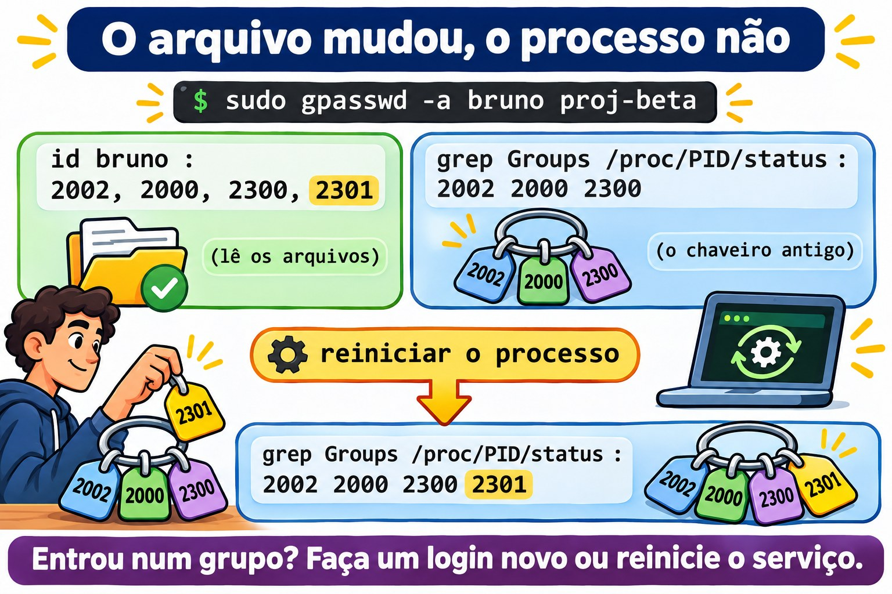

# Aula 10.3 · Grupos e trabalho em equipe

No Windows, você cria um grupo no AD, dá permissão ao grupo na pasta e delega a outra pessoa o direito de mudar quem participa. Quem entra no grupo só ganha o acesso depois de fazer logon de novo. No Linux, a ideia é a mesma, e até a pegadinha do logon é igual. Na Aula 2.8 você montou uma pasta de equipe com setgid. Nesta aula você organiza vários projetos, cada um com o seu grupo, delega a gestão de um grupo sem dar `sudo`, entende por que o acesso novo não chega a quem já está logado e acerta o `umask` de quem trabalha em conjunto.

> **Núcleo desta aula:** separar o grupo principal (um só, no `/etc/passwd`) dos suplementares (no `/etc/group`); lembrar que quem tem o grupo como principal não aparece na lista de membros; criar uma pasta por projeto com `install -d -m 2770 -g`; delegar a gestão com `gpasswd -A`; saber que um processo guarda os grupos que tinha quando nasceu; e saber que trocar o grupo principal de alguém muda o `umask` dele. O resto é aprofundamento.

| Ficha |  |
| --- | --- |
| **Módulo** | M10 · Usuários e acesso privilegiado, aula 3 de 4 |
| **Quando** | Semana 15 |
| **Ao final** | Você monta grupos de projeto com pastas próprias, delega a gestão de um grupo e explica por que um acesso novo ainda não funciona |
| **Pré-requisitos** | Aulas 2.7, 2.8, 8.5 e 10.2 |
| **Tempo** | cerca de 2h |
| **Snapshots** | `m10a3-inicio` e `m10a3-fim` na rocky-lab e na debian-lab |

## 1 · Aquecimento

Responda antes de ler.

1. O `getent group equipe` não lista o Bruno, e mesmo assim ele grava na `/srv/equipe`. Como?
2. Você pôs o Bruno num grupo novo. Ele já estava logado. Ele tem o acesso?
3. A Ana coordena o projeto Alfa. Ela precisa de `sudo` para incluir alguém no grupo do projeto?

## 2 · Por que importa

| O chamado | A resposta errada | O que ela causa |
| --- | --- | --- |
| "Liste quem tem acesso ao projeto" | Só o `getent group` | Faltam as pessoas que têm o grupo como principal |
| "Eu entrei no grupo e continuo sem acesso" | Mexer nas permissões da pasta | O problema é a sessão antiga; a pasta estava certa |
| "A coordenadora quer incluir gente no grupo dela" | Dar `sudo` para o `gpasswd` | Com o `sudo`, ela muda qualquer grupo, inclusive o `wheel` |
| "Deixe o grupo do projeto como principal de todos" | `usermod -g proj-alfa` em cada um | O `umask` deles muda para `022`, e os colegas param de editar os arquivos uns dos outros |
| "Apague o grupo do projeto antigo" | `groupdel` com a pasta ainda lá | Os arquivos ficam com um número no lugar do grupo |

## 3 · Modelo mental

> Pense num **chaveiro**. Cada pessoa tem uma **chave principal**, a que vai no arquivo novo que ela cria, e um **molho de chaves extras**, uma para cada grupo de que participa. O chaveiro é montado **no login**: quem ganha uma chave nova só passa a carregá-la quando monta o chaveiro de novo. E cada pasta de projeto tem uma **fechadura** só: o grupo do projeto, que o setgid passa para todo arquivo criado ali dentro.

```
/etc/passwd   bruno:x:2002:2002:...      ← chave principal (GID 2002, o grupo bruno)
/etc/group    equipe:x:2000:ana,bruno    ← chaves extras: quem está na lista
              proj-alfa:x:2300:ana,bruno
/etc/gshadow  proj-alfa:!:ana:ana,bruno  ← quem pode mudar a lista: ana

login do bruno → o chaveiro é montado: 2002, 2000, 2300
                 todo processo filho herda o mesmo chaveiro
entrou num grupo depois? → o chaveiro só muda num login novo
```


*Ganhou uma chave nova? Só a carrega depois de um login novo.*

### Ponte Windows

| No Windows | No Linux | Onde a comparação engana |
| --- | --- | --- |
| Grupo de segurança do AD | Grupo do `/etc/group` | O Linux não aninha grupos: grupo dentro de grupo não existe |
| "Grupo principal" do usuário | Grupo principal do `/etc/passwd` | No Linux ele importa todo dia: é o grupo dos arquivos que a pessoa cria |
| "Gerenciado por", com o direito de mudar os membros | `gpasswd -A` (administrador do grupo) | Fica no `/etc/gshadow`, e só vale para aquele grupo |
| Token de acesso montado no logon | Grupos do processo, montados no login | Igual: entrou no grupo, faça um login novo |
| Permissão de leitura para auditores | ACL de grupo (Aula 8.5) | O modo tem um grupo só; o segundo grupo precisa de ACL |

## 4 · O essencial

### Principal e suplementares

| Tipo | Onde fica | Quantos | O que decide |
| --- | --- | --- | --- |
| Principal | Quarto campo do `/etc/passwd` | Um | O grupo dos arquivos que a pessoa cria (fora de pastas com setgid) |
| Suplementar | Quarto campo do `/etc/group` | Vários | O acesso a pastas e arquivos daquele grupo |

Com `USERGROUPS_ENAB yes` no `login.defs`, o padrão das duas distribuições, todo `useradd` cria também um grupo pessoal, com o mesmo nome. É por isso que o grupo pode ter `w` no `umask` (Aula 2.7): ninguém mais está no grupo pessoal.

**A pegadinha da lista:** o `/etc/group` só lista os membros suplementares. Para saber todos os membros de um grupo, some os dois:

```bash
getent group equipe | cut -d: -f4
getent passwd | awk -F: '$4 == 2000 {print $1}'
```

### Uma pasta por projeto

```bash
sudo groupadd -g 2300 proj-alfa
sudo install -d -m 2770 -o root -g proj-alfa /srv/projetos/alfa
```

O `install -d` cria a pasta já com dono, grupo e modo, num comando só. `2770`: setgid, tudo para o dono e o grupo, nada para os outros.

### Quem cuida da lista

| Comando | Quem pode rodar | Faz |
| --- | --- | --- |
| `gpasswd -A ana proj-alfa` | `root` | A Ana passa a administrar o grupo |
| `gpasswd -a bruno proj-alfa` | `root` ou um administrador do grupo | Inclui |
| `gpasswd -d bruno proj-alfa` | `root` ou um administrador do grupo | Tira |
| `gpasswd -M ana,bruno proj-alfa` | `root` ou um administrador do grupo | Troca a lista inteira |

O `gpasswd` é setuid: a Ana roda sem `sudo`, e ele confere no `/etc/gshadow` se ela administra aquele grupo.

### O chaveiro é montado no login

| Onde | Quando os grupos novos chegam |
| --- | --- |
| Sessão SSH ou console | No próximo login |
| Serviço do systemd | No próximo `restart` |
| `sudo -u bruno ...` | Na hora: o `sudo` monta os grupos de novo |
| Shell atual | `newgrp` abre um shell novo com o grupo (Aula 2.6) |

Para ver os grupos de um processo que já está rodando: `grep Groups /proc/PID/status`. O `id bruno` mostra o que está nos arquivos, e não o que o processo carrega.



*Entrou num grupo? Faça um login novo ou reinicie o serviço.*

### De onde vem o umask

| Onde | Rocky | Debian |
| --- | --- | --- |
| `UMASK` e `USERGROUPS_ENAB` no `/etc/login.defs` | Lidos | Lidos |
| Quem aplica no login | O `/etc/profile` e o `/etc/bashrc`, ou o `pam_umask` | O `pam_umask`, nas versões recentes |
| Regra do grupo pessoal | Se o nome do grupo principal é igual ao do usuário, `002`; senão, `022` | A mesma |

A consequência prática: quem troca o grupo principal de alguém para um grupo de projeto troca, sem querer, o `umask` dele para `022`.


*Trocar o grupo principal muda o umask sem avisar.*

### Rocky × Debian

|  | Rocky | Debian |
| --- | --- | --- |
| `groupadd`, `gpasswd`, `install` | Iguais | Iguais |
| Ferramenta amigável | Não há | `adduser bruno proj-alfa` inclui num grupo |
| `umask` de usuário com grupo pessoal | Em geral `0002` | Em geral `0002`; depende da versão |
| Onde procurar a regra | `grep -n umask /etc/profile /etc/bashrc` | `grep -rn umask /etc/pam.d/common-session /etc/login.defs` |
| `setfacl` | Já instalado | Pacote `acl`, se faltar (Aula 8.5) |

## 5 · Lab guiado

**Passo 0 · Snapshots e estado.** No Proxmox: `qm snapshot 201 m10a3-inicio` e `qm snapshot 202 m10a3-inicio`. Na rocky-lab:

```bash
id ana
id bruno
getent group equipe
sudo stat -c '%A %U:%G %n' /srv/equipe
sudo passwd -S bruno
```

A Ana e o Bruno têm o grupo pessoal como principal (`gid=2001(ana)` e `gid=2002(bruno)`) e o `equipe` como suplementar. O Bruno tem a senha que você definiu na Aula 10.2.

**Passo 1 · Principal e suplementares.**

```bash
id -gn bruno
id -Gn bruno
grep -E '^(bruno|equipe):' /etc/group
getent passwd | awk -F: '$4 == 2000 {print $1}'
```

O primeiro mostra só o principal, o segundo todos. No `/etc/group`, o grupo `bruno` tem a lista de membros vazia: ele é o principal do Bruno, e principal não entra na lista. O `awk` procura quem tem o `equipe` (2000) como principal: por enquanto, ninguém.

**Passo 2 · Dois projetos.**

```bash
sudo groupadd -g 2300 proj-alfa
sudo groupadd -g 2301 proj-beta
sudo install -d -m 0755 /srv/projetos
sudo install -d -m 2770 -o root -g proj-alfa /srv/projetos/alfa
sudo install -d -m 2770 -o root -g proj-beta /srv/projetos/beta
sudo gpasswd -a ana proj-alfa
ls -l /srv/projetos
```

As duas pastas aparecem como `drwxrws---`, uma de cada grupo. A Ana está no Alfa; ninguém está no Beta.

**Passo 3 · Delegar o Alfa para a Ana.**

```bash
sudo gpasswd -A ana proj-alfa
sudo getent gshadow proj-alfa
sudo -u ana gpasswd -a bruno proj-alfa
getent group proj-alfa
```

O `gshadow` mostra a Ana no terceiro campo, o dos administradores. Ela incluiu o Bruno sem `sudo`: o `sudo -u ana` aqui só serve para você agir como ela. Agora ela tenta mexer no Beta:

```bash
sudo -u ana gpasswd -a bruno proj-beta
```

A resposta é `gpasswd: Permission denied.`: ela administra o Alfa, e só o Alfa.

**Passo 4 · O chaveiro antigo.** Coloque um processo do Bruno para rodar, como se fosse uma sessão aberta:

```bash
sudo systemd-run --uid=bruno --unit=lab103 sleep 600
pid=$(systemctl show -p MainPID --value lab103)
grep Groups /proc/$pid/status
```

A linha mostra números: `2002`, `2000` e `2300`. Agora inclua o Bruno no Beta:

```bash
sudo gpasswd -a bruno proj-beta
id bruno
grep Groups /proc/$pid/status
```

O `id` já mostra o `proj-beta`, porque lê os arquivos. O processo continua sem o `2301`: o chaveiro dele foi montado antes. Reinicie e confira:

```bash
sudo systemctl stop lab103
sudo systemd-run --uid=bruno --unit=lab103 sleep 600
pid=$(systemctl show -p MainPID --value lab103)
grep Groups /proc/$pid/status
sudo systemctl stop lab103
```

Agora o `2301` aparece. Com uma pessoa é igual: sair e entrar de novo.

**Passo 5 · O umask de quem trabalha junto.**

```bash
grep -E '^(UMASK|USERGROUPS_ENAB)' /etc/login.defs
sudo su - bruno -c umask
sudo su - bruno -c 'touch /srv/projetos/alfa/plano.txt'
sudo stat -c '%A %U:%G %n' /srv/projetos/alfa/plano.txt
sudo -u ana sh -c 'echo "revisado" >> /srv/projetos/alfa/plano.txt'
```

O `umask` do Bruno é o que você anotou na Aula 2.7, em geral `0002`. O arquivo nasce `-rw-rw-r--`, do Bruno, com o grupo `proj-alfa` vindo do setgid, e a Ana consegue editar.

**Passo 6 · Quem só lê.** A revisora Lia precisa ler o Alfa, sem mudar nada:

```bash
sudo groupadd -g 2302 revisao
sudo useradd -u 2310 -c "Lia Revisora" -m -s /bin/bash -G revisao lia
sudo setfacl -m g:revisao:rx -m d:g:revisao:rx /srv/projetos/alfa
sudo -u lia ls /srv/projetos/alfa
sudo -u lia cat /srv/projetos/alfa/plano.txt
sudo -u lia touch /srv/projetos/alfa/lia.txt
```

Ela lista e lê, e o `touch` dá `Permission denied`. O `ls -ld /srv/projetos/alfa` agora mostra um `+` no fim do modo: a pasta tem ACL. A linha com `d:` vale para os arquivos que ainda vão nascer (Aula 8.5).

**Passo 7 · debian-lab.** Repita os passos 0 a 6. No Passo 5, compare o `umask` com o da Rocky e procure de onde ele veio:

```bash
grep -rn umask /etc/pam.d/common-session /etc/login.defs
```

### Decida 1

O Bruno saiu do projeto Alfa, e você rodou `gpasswd -d bruno proj-alfa`. Ele tem uma sessão SSH aberta desde de manhã. O acesso dele à pasta acabou?

A) Sim, na hora. B) Não: a sessão aberta carrega o grupo até terminar; encerre as sessões dele. C) Só depois de reiniciar o servidor.

Marque uma opção antes.

| Se você marcou | Resultado | Por quê |
| --- | --- | --- |
| A | Errado | Os processos já abertos guardam os grupos que tinham |
| B | Certo | Encerre com `sudo loginctl terminate-user bruno` e, se ele roda algum serviço, reinicie o serviço |
| C | Exagero | Basta acabar com os processos dele |

**Para fixar:** tirar do grupo muda os arquivos; quem já está logado só perde o acesso quando sai.

### Decida 2

A Ana coordena o Alfa e quer incluir e tirar pessoas sozinha. Como?

A) Uma regra de `sudo` para `/usr/bin/gpasswd`. B) `gpasswd -A ana proj-alfa`. C) Colocar a Ana no `wheel`.

Marque uma opção antes.

| Se você marcou | Resultado | Por quê |
| --- | --- | --- |
| A | Perigoso | Com o `sudo`, ela muda qualquer grupo, inclusive o `wheel` e o `sudo` |
| B | Certo | Ela administra só aquele grupo, sem `sudo` |
| C | Muito perigoso | Ela vira administradora do servidor inteiro |

**Para fixar:** delegue o grupo, não o `root`.

## 6 · Quebre e conserte

### Quebra 1 · O membro que não aparece

```bash
sudo usermod -g equipe bruno
sudo gpasswd -d bruno equipe
getent group equipe | cut -d: -f4
sudo -u bruno touch /srv/equipe/teste-bruno.txt && echo gravou
```

**Sintoma:** o Bruno sumiu da lista do `equipe` e continua gravando na pasta da equipe. Se o laço de `chage` da Aula 10.2 rodasse agora, ele ficaria sem a política de senha.

**Investigação:** `id bruno` mostra `gid=2000(equipe)`. O `awk` do Passo 1 agora acha o Bruno. Repare também que o `usermod -g` passou para o `equipe` os arquivos da pasta pessoal que eram do grupo `bruno`: a volta, na Quebra 2, desfaz isso.

**Causa:** o `equipe` virou o grupo principal dele, e o principal não entra na lista do `/etc/group`.

**Conserto:** ainda não: deixe assim para a Quebra 2. Fica a regra: todo script que lista os membros de um grupo usa os dois comandos do Passo 1.

### Quebra 2 · Os colegas que não editam

```bash
sudo su - bruno -c umask
sudo su - bruno -c 'touch /srv/projetos/alfa/v2.txt'
sudo stat -c '%A %U:%G %n' /srv/projetos/alfa/v2.txt
sudo -u ana sh -c 'echo "nota" >> /srv/projetos/alfa/v2.txt'
```

**Sintoma:** o arquivo nasce `-rw-r--r--`, e a Ana recebe `Permission denied`.

**Investigação:** o `umask` do Bruno, que era `0002`, agora é `0022`. Nada mudou no `login.defs` nem na pasta.

**Causa:** a regra do grupo pessoal: o grupo principal do Bruno (`equipe`) não tem mais o nome dele, e o login aplica `022`.

**Conserto:** volte o grupo pessoal como principal e o `equipe` como suplementar; corrija o arquivo que nasceu errado:

```bash
sudo usermod -g bruno bruno
sudo gpasswd -a bruno equipe
sudo chmod g+w /srv/projetos/alfa/v2.txt
sudo rm /srv/equipe/teste-bruno.txt
id bruno
sudo su - bruno -c umask
```

### Quebra 3 · O grupo que virou número

```bash
sudo groupdel proj-beta
ls -ld /srv/projetos/beta
```

**Sintoma:** a pasta aparece com `2301` no lugar do grupo.

**Investigação:** `getent group 2301` não responde nada. `sudo find / -xdev -nogroup` acha a pasta (Aula 10.1).

**Causa:** o `groupdel` apaga a linha do `/etc/group`, e não mexe no disco. Ele aceitou porque o `proj-beta` não era o principal de ninguém.

**Conserto:** recrie com o **mesmo número**, e a pasta volta a ter nome:

```bash
sudo groupadd -g 2301 proj-beta
ls -ld /srv/projetos/beta
```

Os membros, porém, não voltam: o Bruno precisa ser incluído de novo. Antes de apagar um grupo, procure os arquivos dele com `find / -xdev -group NOME`.

### Limpeza

```bash
sudo userdel -r lia
sudo rm -r /srv/projetos
sudo groupdel proj-alfa
sudo groupdel proj-beta
sudo groupdel revisao
id ana
id bruno
sudo find / -xdev \( -nouser -o -nogroup \) -ls 2>/dev/null
```

A Ana e o Bruno voltam ao estado do Passo 0: grupo pessoal como principal, `equipe` como suplementar. O `find` volta vazio.

## 7 · Armadilhas

| Armadilha | O que acontece | Como evitar |
| --- | --- | --- |
| Listar membros só pelo `/etc/group` | Faltam os que têm o grupo como principal | Somar o `awk` no `/etc/passwd` |
| Esperar acesso sem um login novo | "Entrei no grupo e não funciona" | Sair e entrar; reiniciar o serviço |
| `usermod -G grupo` sem `-a` | Tira a pessoa de todos os outros grupos | Sempre `-aG`, ou `gpasswd -a` |
| Grupo de projeto como principal | O `umask` vira `022` | Grupo pessoal como principal, projeto como suplementar |
| `sudo` para o `gpasswd` | A pessoa muda qualquer grupo | `gpasswd -A` naquele grupo |
| `groupdel` com arquivos no disco | Arquivos com número no lugar do nome | `find -group` antes |
| Mais de 16 grupos e NFS com `AUTH_SYS` | O servidor NFS só vê os 16 primeiros | Menos grupos por pessoa; o NFS chega no M13 |

## 8 · Quiz

Responda sem olhar. O gabarito está no fim da aula.

1. Onde fica o grupo principal de uma conta, e onde ficam os suplementares?
2. Por que um membro de um grupo pode não aparecer no `getent group`?
3. O que o `gpasswd -A ana proj-alfa` permite à Ana, e o que não permite?
4. Você incluiu o Bruno num grupo. Por que um processo que ele já tinha aberto não ganhou o acesso?
5. Por que trocar o grupo principal de alguém pode mudar o `umask` dessa pessoa?
6. Você apagou um grupo e a pasta ficou com um número. Como devolver o nome?

## 9 · Cola

**Para saber de cor:**

| Quero... | Comando |
| --- | --- |
| Grupo principal e todos | `id -gn NOME` e `id -Gn NOME` |
| Todos os membros | `getent group G \| cut -d: -f4` e `getent passwd \| awk -F: '$4 == GID {print $1}'` |
| Pasta de projeto | `sudo install -d -m 2770 -o root -g G /srv/projetos/P` |
| Delegar o grupo | `sudo gpasswd -A NOME G` |
| Incluir e tirar | `gpasswd -a NOME G` e `gpasswd -d NOME G` |
| Grupos de um processo | `grep Groups /proc/PID/status` |

**Para consultar:**

| Quero... | Comando |
| --- | --- |
| Administradores do grupo | `sudo getent gshadow G` |
| Trocar a lista inteira | `gpasswd -M a,b,c G` |
| Encerrar as sessões de alguém | `sudo loginctl terminate-user NOME` |
| `umask` de um login | `sudo su - NOME -c umask` |
| Grupo que só lê | `sudo setfacl -m g:G:rx -m d:g:G:rx PASTA` |
| Arquivos de um grupo | `sudo find / -xdev -group G` |

**Flashcards:**

- Grupo principal → *um só, no `/etc/passwd`.*
- Lista do `/etc/group` → *só os suplementares.*
- `gpasswd -A` → *administra aquele grupo, sem `sudo`.*
- Grupo novo → *chega no próximo login.*
- Grupo principal trocado → *`umask` `022`.*
- `groupdel` → *apaga o nome, não os arquivos.*

## 10 · Checklist e fechamento

- [ ] Separo grupo principal de suplementar e listo todos os membros de um grupo
- [ ] Crio grupos de projeto com pastas `2770` e setgid
- [ ] Delego a gestão de um grupo com `gpasswd -A`
- [ ] Explico por que um acesso novo só vale num login novo, e vejo os grupos de um processo
- [ ] Sei de onde vem o `umask` e por que ele muda com o grupo principal
- [ ] Dou acesso só de leitura a um segundo grupo com ACL
- [ ] Deixo a Ana e o Bruno como estavam

**Último exercício, sem olhar a aula:** na debian-lab, crie o grupo `proj-gama` (GID 2303) com a pasta `/srv/gama`, coloque o Bruno como administrador, faça ele incluir a Ana e prove que a Ana edita um arquivo criado pelo Bruno. Desfaça tudo.

**Snapshot de fim** (no Proxmox):

```bash
qm snapshot 201 m10a3-fim
qm snapshot 202 m10a3-fim
```

## 11 · Na vida real

**Missão, só leitura.** Num servidor Linux que você administre (ou com autorização), rode **apenas**:

```bash
getent group | awk -F: '$3 >= 1000 && $3 < 60000 {print $3, $1, $4}' | sort -n
getent passwd | awk -F: '$3 >= 1000 && $3 < 60000 {print $1, $4}'
sudo getent gshadow | awk -F: '$3 != "" {print $1, $3}'
grep -E '^(UMASK|USERGROUPS_ENAB)' /etc/login.defs
```

Perguntas para responder:

1. Alguma pessoa tem um grupo de projeto como principal? O `umask` dela está certo?
2. Algum grupo tem administrador? Alguém sabe disso?
3. Quantos grupos tem a pessoa com mais grupos? Passa de 16?

## 12 · Aprofundar quando quiser

- **`man gpasswd`, `man gshadow`:** administradores, membros e senha de grupo.
- **`man pam_umask`, `man login.defs`:** a regra do grupo pessoal, e `HOME_MODE`.
- **`man credentials`:** UID, GID e grupos suplementares de um processo.
- **`man systemd.exec`:** `SupplementaryGroups=` e `UMask=`, para dar grupos e `umask` a um serviço sem mexer na conta.

**DeepTutor** (http://10.1.0.149:3782, KB "Curso Linux Sysadmin"):

- `!explica grupo principal e suplementar com a metáfora do chaveiro`
- `!feynman por que um grupo novo só vale depois de um login novo`
- `!quiz Aula 10.3, 5 perguntas sobre grupos, gpasswd e umask`

## Gabarito comentado

### Aquecimento

1. O `equipe` é o grupo principal dele, no `/etc/passwd`. A lista do `/etc/group` só mostra os suplementares.
2. Não, se ele não fizer um login novo. A sessão dele carrega os grupos que tinha ao entrar.
3. Não. Com `gpasswd -A ana proj-alfa`, ela inclui e tira membros daquele grupo sozinha.

### Quiz

1. O principal fica no quarto campo do `/etc/passwd`; os suplementares, no quarto campo de cada linha do `/etc/group`.
2. Porque a lista do `/etc/group` só tem os suplementares. Quem tem o grupo como principal só aparece no `/etc/passwd`.
3. Permite incluir, tirar e trocar a lista de membros do `proj-alfa`, sem `sudo`. Não permite mexer em nenhum outro grupo, nem nas permissões das pastas.
4. Porque os grupos de um processo são montados quando ele nasce e passam para os filhos. O processo precisa ser reiniciado, ou a pessoa precisa fazer um login novo.
5. Porque o login dá `002` só quando o grupo principal tem o mesmo nome do usuário. Com outro grupo como principal, ele aplica `022`.
6. Recriando o grupo com o mesmo GID: `groupadd -g NÚMERO NOME`. Os membros precisam ser incluídos de novo.

---

<!-- navegacao -->
[← Aula 10.2 · Senhas e validade](10.2-senhas-e-validade.md) · [Índice de aulas](../01-aulas.md) · [Aula 10.4 · sudo de verdade →](10.4-sudo-de-verdade.md)
