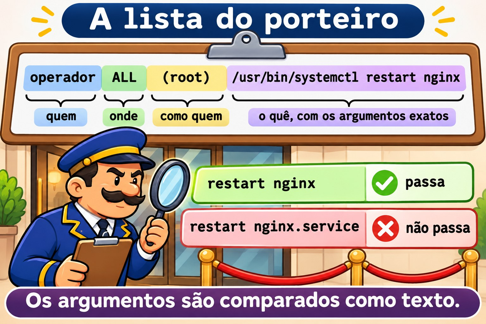
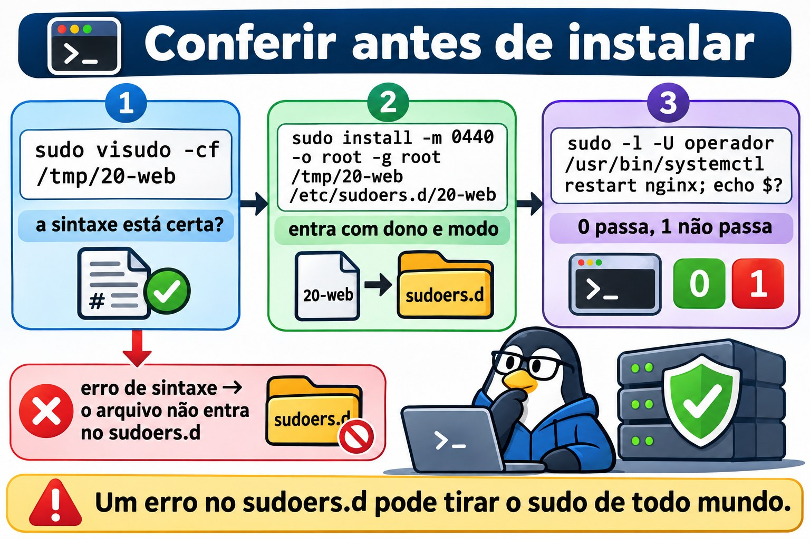
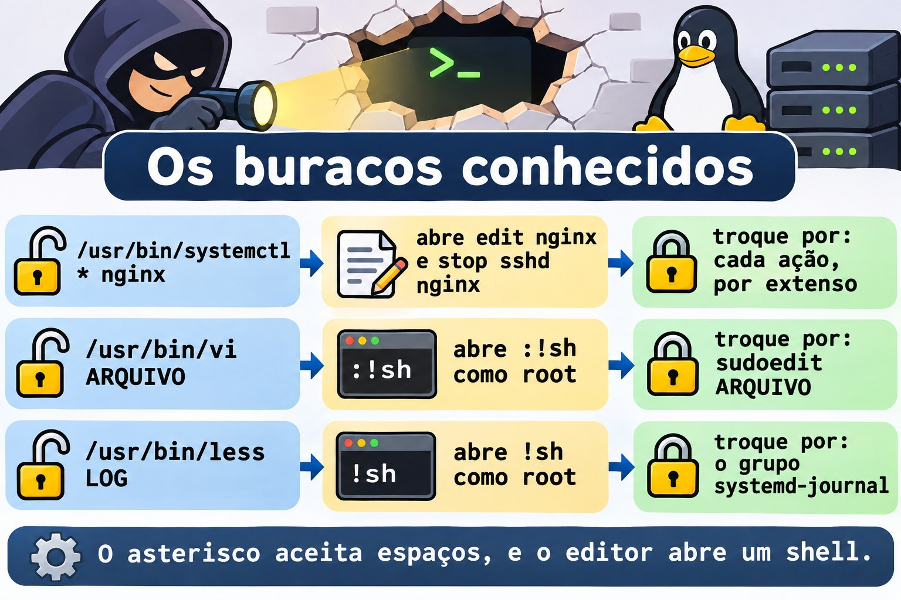
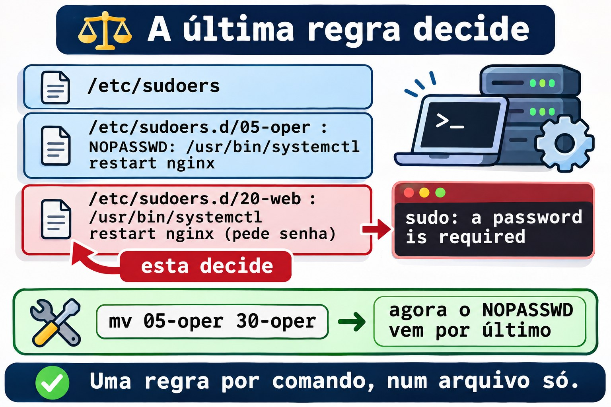

# Aula 10.4 · sudo de verdade

No Windows, colocar alguém no grupo Administradores resolve na hora e entrega tudo. Para dar só uma tarefa, você monta uma delegação, ou um endpoint do JEA, com a lista exata de comandos. No Linux, o `wheel` (Rocky) e o `sudo` (Debian) são o grupo Administradores, e o `sudoers` é a delegação fina. Na Aula 2.5 você escreveu a primeira regra. Nesta aula você escreve regras que não abrem brechas: só os comandos e os argumentos certos, sem curinga perigoso, com edição segura de arquivo e com registro de tudo. No fim vem o Desafio do M10.

> **Núcleo desta aula:** ler uma regra como `quem onde=(como quem) o quê`; agrupar comandos num `Cmnd_Alias`; lembrar que os argumentos têm de bater exatamente; testar uma regra com `sudo -l -U` antes de usar; conferir um arquivo com `visudo -cf` antes de instalar; evitar o `*` nos argumentos; e saber que, entre duas regras que batem, vale a última. O resto é aprofundamento.

| Ficha |  |
| --- | --- |
| **Módulo** | M10 · Usuários e acesso privilegiado, aula 4 de 4, com o Desafio do módulo |
| **Quando** | Semana 15 |
| **Ao final** | Você dá a uma pessoa exatamente um comando como `root`, prova que nada além disso passa e acha quem tem mais acesso do que devia |
| **Pré-requisitos** | Aulas 2.5, 10.2 e 10.3 |
| **Tempo** | cerca de 2h30, mais 1h para o Desafio |
| **Snapshots** | `m10a4-inicio` e `m10a4-fim` na rocky-lab e na debian-lab |

## 1 · Aquecimento

Responda antes de ler.

1. A regra permite `/usr/bin/systemctl restart nginx`. O operador consegue rodar `sudo systemctl restart nginx.service`?
2. Por que dar `sudo less /var/log/secure` a alguém é o mesmo que dar `root`?
3. Dois arquivos do `/etc/sudoers.d/` falam do mesmo comando, um com `NOPASSWD` e outro sem. Qual vale?

## 2 · Por que importa

| O chamado | A resposta errada | O que ela causa |
| --- | --- | --- |
| "O operador precisa reiniciar o nginx" | Colocar no `wheel` | Ele pode tudo, inclusive apagar o servidor |
| "Deixe ele mexer só no nginx" | `/usr/bin/systemctl * nginx` | O `*` aceita `edit nginx`, que abre um editor como `root`, e `stop sshd nginx` |
| "Ele precisa ler os logs" | `sudo less /var/log/...` | Dentro do `less`, `!sh` abre um shell de `root` |
| "Ele precisa editar a config do site" | `sudo vi /etc/nginx/...` | Mesma coisa: o `vi` também abre shell |
| "Criei a regra e ela não funciona" | Editar o arquivo de novo, às cegas | O problema era o argumento diferente ou outra regra depois dessa |

## 3 · Modelo mental

> Pense na **lista do porteiro**. Cada linha diz **quem** pode, **em qual prédio**, **no lugar de quem** e **fazer o quê**. O porteiro lê a lista inteira, de cima para baixo, arquivo por arquivo, e **a última linha que combina com o pedido decide**. E ele é literal: se a lista diz "abrir a sala 12", "abrir a sala 12 e a 13" não combina.

```
operador   ALL  =(root)  /usr/bin/systemctl restart nginx
quem       onde   como     o quê, com os argumentos exatos

leitura:   /etc/sudoers  →  /etc/sudoers.d/ em ordem alfabética (05-..., 20-..., 30-...)
decisão:   a última linha que combina com quem, onde, como e o quê
```



*Os argumentos são comparados como texto.*

### Ponte Windows

| No Windows | No Linux | Onde a comparação engana |
| --- | --- | --- |
| Grupo Administradores | `wheel` (Rocky) e `sudo` (Debian) | Quem está nele pode tudo, com a própria senha |
| "Executar como administrador" (UAC) | `sudo comando` | O `sudo` pede a senha **de quem chama**, e não a do `root` |
| JEA, com a lista de comandos permitidos | `Cmnd_Alias` e uma regra no `sudoers.d` | Os argumentos são comparados como texto: um a mais e não passa |
| Log de segurança (4688, 4672) | `journalctl _COMM=sudo` e `/var/log/secure` | Cada `sudo` vira uma linha, aceito ou negado |
| Política aplicada por GPO | Arquivo no `/etc/sudoers.d/` | Um erro de sintaxe pode tirar o `sudo` de todo mundo: confira antes |

## 4 · O essencial

### A regra

| Parte | Exemplo | Significa |
| --- | --- | --- |
| Quem | `operador`, `%web` | Uma conta, ou um grupo com `%` |
| Onde | `ALL` | Em qualquer máquina que use este arquivo |
| Como quem | `(root)` | Roda como `root`; `(ALL)` deixa escolher qualquer um |
| Opções | `NOPASSWD:` | Não pede senha |
| O quê | `/usr/bin/systemctl restart nginx` | Caminho completo e argumentos exatos |

```text
Cmnd_Alias WEB_OPER = /usr/bin/systemctl restart nginx, /usr/bin/systemctl reload nginx
operador ALL=(root) WEB_OPER
```

Os argumentos são comparados como texto: `restart nginx` não aceita `restart nginx.service` nem `restart nginx sshd`. Um comando sem argumentos na regra aceita **qualquer** argumento; para proibir todos, escreva `""` depois do comando.

E o `status`? Ele não precisa de `sudo`: qualquer usuário roda `systemctl status nginx`. Não dê por `sudo` o que a pessoa já pode fazer sem ele.

### Conferir antes de instalar

```bash
sudo visudo -cf /tmp/20-web
sudo install -m 0440 -o root -g root /tmp/20-web /etc/sudoers.d/20-web
sudo -l -U operador
sudo -l -U operador /usr/bin/systemctl restart nginx; echo $?
```

O `visudo -cf` confere a sintaxe de um arquivo antes que ele chegue ao `sudoers.d`. O `sudo -l -U` mostra as regras de outra pessoa; com um comando no fim, responde se aquele comando passa (código 0) ou não (código 1), sem rodar nada.



*Um erro no sudoers.d pode tirar o sudo de todo mundo.*

### Os buracos conhecidos

| Dar isto | Abre | Dar isto no lugar |
| --- | --- | --- |
| `/usr/bin/systemctl * nginx` | `edit nginx` e `stop sshd nginx` | Cada ação, por extenso |
| `/usr/bin/vi ARQUIVO` | `:!sh` como `root` | `sudoedit ARQUIVO` |
| `/usr/bin/less LOG` | `!sh` como `root` | O grupo `systemd-journal` (ou `adm` no Debian) |
| Um script em `/home/operador/` | Ele mesmo edita o script | Script do `root`, em `/usr/local/sbin/`, modo `0755` |
| `(ALL)` no "como quem" | Rodar como qualquer conta | `(root)` ou a conta do serviço |

O `sudoedit` copia o arquivo para uma pasta temporária, abre o editor **como a própria pessoa** e só grava de volta, como `root`, quando ela sai do editor. Um `:!sh` dentro dele abre um shell da pessoa, e não do `root`.



*O asterisco aceita espaços, e o editor abre um shell.*

### Opções úteis

| Opção | Faz |
| --- | --- |
| `Defaults:operador timestamp_timeout=5` | A senha vale por 5 minutos para ele |
| `Defaults logfile=/var/log/sudo.log` | Um log só do `sudo`, além do journal |
| `Defaults:operador log_output` | Grava a saída de cada comando; o `sudoreplay` reproduz |
| `NOEXEC:` antes do comando | Impede o comando de abrir outros programas, quando funciona |

### Rocky × Debian

|  | Rocky | Debian |
| --- | --- | --- |
| Grupo de administradores | `wheel` | `sudo` |
| Inclusão do `sudoers.d` | `#includedir /etc/sudoers.d` | `@includedir /etc/sudoers.d` |
| `systemctl` | `/usr/bin/systemctl` | `/usr/bin/systemctl` |
| `nginx` | `sudo dnf install -y nginx` e `systemctl enable --now nginx` | `sudo apt install -y nginx` (já sobe sozinho) |
| Log do `sudo` | `/var/log/secure` e o journal | O journal, e o `/var/log/auth.log`, se houver |
| Grupo de leitura de logs | `systemd-journal` | `systemd-journal` e `adm` |

## 5 · Lab guiado

**Passo 0 · Snapshots e estado.** No Proxmox: `qm snapshot 201 m10a4-inicio` e `qm snapshot 202 m10a4-inicio`. Na rocky-lab:

```bash
sudo ls -l /etc/sudoers.d/
getent group wheel
sudo visudo -c
```

O `visudo -c` confere todos os arquivos e termina com `parsed OK` em cada um. Anote o que já existe no `sudoers.d`: você vai deixar igual no fim.

**Passo 1 · O nginx e a lista principal.**

```bash
sudo dnf install -y nginx
sudo systemctl enable --now nginx
systemctl is-active nginx
sudo grep -vE '^\s*$|^#( |#|$)' /etc/sudoers
```

O `grep` tira os comentários e deixa o `#includedir`, que não é comentário. Sobram os `Defaults`, a linha do `root`, a do `%wheel` e o `#includedir /etc/sudoers.d`. Leia a do `%wheel` com a tabela da seção 4: quem está no grupo, em qualquer máquina, como qualquer conta, qualquer comando.

**Passo 2 · O operador.**

```bash
sudo useradd -u 2410 -c "Operador Web" -m -s /bin/bash operador
sudo passwd operador
id operador
```

Dê uma senha que passe na política da Aula 10.2 e anote no caderno do lab. O operador não está no `wheel`: por enquanto, ele não tem `sudo` nenhum.

```bash
sudo -l -U operador
```

A resposta diz que ele não pode rodar `sudo` nesta máquina.

**Passo 3 · A regra, conferida antes de instalar.**

```bash
cat > /tmp/20-web <<'FIM'
Cmnd_Alias WEB_OPER = /usr/bin/systemctl restart nginx, /usr/bin/systemctl reload nginx
operador ALL=(root) WEB_OPER
FIM
sudo visudo -cf /tmp/20-web
sudo install -m 0440 -o root -g root /tmp/20-web /etc/sudoers.d/20-web
rm /tmp/20-web
sudo visudo -c
sudo -l -U operador
```

O `visudo -cf` responde `parsed OK`, e só então o arquivo entra no `sudoers.d`, já com dono e modo certos. O `sudo -l -U` agora lista os dois comandos, como `(root)`.

**Passo 4 · Testar sem rodar.**

```bash
sudo -l -U operador /usr/bin/systemctl restart nginx; echo $?
sudo -l -U operador /usr/bin/systemctl restart nginx.service; echo $?
sudo -l -U operador /usr/bin/systemctl stop nginx; echo $?
```

O primeiro imprime o caminho do comando e `0`. Os outros dois terminam em `1`: `nginx.service` não é o texto da regra, e `stop` não está nela.

**Passo 5 · Agora como o operador.**

```bash
su - operador
sudo systemctl restart nginx
systemctl status nginx --no-pager | head -n 5
sudo systemctl restart nginx.service
sudo systemctl stop nginx
exit
```

O `sudo` pede a senha **do operador**, uma vez. O `restart` funciona, e o `status` roda sem `sudo`. Os dois últimos respondem algo como `Sorry, user operador is not allowed to execute '/usr/bin/systemctl stop nginx' as root on rocky-lab.`

**Passo 6 · O registro.**

```bash
sudo journalctl _COMM=sudo --since '-10min' --no-pager | grep operador
```

Cada tentativa virou uma linha, com `TTY`, `PWD`, `USER=root` e o `COMMAND`. As negadas trazem `command not allowed`. É isso que você mostra numa auditoria.

**Passo 7 · O curinga, só olhando.** Instale uma regra ruim por um instante e pergunte ao `sudo`, **sem rodar**:

```bash
echo 'operador ALL=(root) /usr/bin/systemctl * nginx' > /tmp/25-curinga
sudo visudo -cf /tmp/25-curinga
sudo install -m 0440 -o root -g root /tmp/25-curinga /etc/sudoers.d/25-curinga
sudo -l -U operador /usr/bin/systemctl edit nginx; echo $?
sudo -l -U operador /usr/bin/systemctl stop sshd nginx; echo $?
sudo rm /etc/sudoers.d/25-curinga /tmp/25-curinga
```

Os dois passam, com `0`. O `edit` abre um editor como `root`, e de lá sai um shell. O segundo derruba o `sshd`. A sintaxe estava certa; a regra é que estava errada. Não rode esses comandos.

**Passo 8 · Editar com segurança.**

```bash
sudo install -m 0644 /dev/null /etc/nginx/conf.d/curso.conf
echo 'operador ALL=(root) sudoedit /etc/nginx/conf.d/curso.conf, /usr/sbin/nginx -t' > /tmp/21-web-conf
sudo visudo -cf /tmp/21-web-conf
sudo install -m 0440 -o root -g root /tmp/21-web-conf /etc/sudoers.d/21-web-conf
rm /tmp/21-web-conf
su - operador
sudoedit /etc/nginx/conf.d/curso.conf
```

O editor abre um arquivo temporário. Escreva uma linha `# editado pelo operador`, grave e saia. Ainda como operador:

```bash
sudo /usr/sbin/nginx -t
sudo systemctl reload nginx
cat /etc/nginx/conf.d/curso.conf
exit
```

O `nginx -t` responde `syntax is ok` e `test is successful`, e o arquivo tem a linha nova. O operador editou um arquivo do `root` sem nunca ter um editor rodando como `root`.

**Passo 9 · Auditar quem pode o quê.**

```bash
getent group wheel
for u in $(getent passwd | awk -F: '$3 >= 1000 && $3 < 60000 {print $1}'); do
  echo "== $u"; sudo -l -U "$u" | sed -n '/may run/,$p'
done
```

Cada pessoa aparece com o que pode, ou sem linha nenhuma, se não pode nada. O `student` tem `(ALL) ALL`, pelo `wheel`; o operador, só os três comandos dele.

**Passo 10 · debian-lab.** Repita os passos 0 a 9. Instale com `sudo apt install -y nginx`, e no Passo 9 troque `wheel` por `sudo`.

### Decida 1

Pedem que o operador possa parar, iniciar, reiniciar e recarregar o nginx. Qual regra?

A) `operador ALL=(root) /usr/bin/systemctl * nginx`. B) Um `Cmnd_Alias` com as quatro ações por extenso. C) `operador ALL=(root) /usr/bin/systemctl`.

Marque uma opção antes.

| Se você marcou | Resultado | Por quê |
| --- | --- | --- |
| A | Perigoso | O `*` aceita espaços: `edit nginx` e `stop sshd nginx` passam |
| B | Certo | Só as quatro linhas, com o texto exato |
| C | Muito perigoso | Sem argumentos na regra, qualquer argumento passa: o operador para o servidor inteiro |

**Para fixar:** escreva cada comando por extenso; o `*` nos argumentos aceita mais do que parece.

### Decida 2

O operador precisa ler os logs do nginx. Como?

A) `operador ALL=(root) /usr/bin/less /var/log/nginx/error.log`. B) Colocar o operador no grupo que lê os logs (`systemd-journal`, e `adm` no Debian) e usar `journalctl -u nginx`. C) `chmod 644` em todos os logs.

Marque uma opção antes.

| Se você marcou | Resultado | Por quê |
| --- | --- | --- |
| A | Perigoso | Dentro do `less`, `!sh` abre um shell de `root` |
| B | Certo | Ele lê sem `sudo`; nada roda como `root` |
| C | Fraco | Todo mundo passa a ler, e a próxima rotação de log desfaz |

**Para fixar:** acesso de leitura se dá por grupo, e não por `sudo`.

## 6 · Quebre e conserte

### Quebra 1 · O caminho incompleto

```bash
echo 'operador ALL=(root) systemctl restart nginx' > /tmp/22-ruim
sudo visudo -cf /tmp/22-ruim; echo $?
```

**Sintoma:** o `visudo` recusa o arquivo, com código `1` e uma mensagem de erro de sintaxe que aponta a linha e a coluna; nas versões atuais, ela diz que esperava um caminho completo.

**Investigação:** a coluna indicada é a do `systemctl`.

**Causa:** o `sudoers` exige o caminho completo do comando. Sem ele, qualquer `systemctl` que a pessoa pusesse no `PATH` serviria.

**Conserto:** `command -v systemctl` dá o caminho; corrija para `/usr/bin/systemctl`. E repare no que **não** aconteceu: como você conferiu antes de instalar, o `sudoers.d` nunca recebeu o arquivo ruim. Apague: `rm /tmp/22-ruim`.

### Quebra 2 · O operador que pode tudo

```bash
sudo usermod -aG wheel operador
sudo -l -U operador | sed -n '/may run/,$p'
```

No Debian, use o grupo `sudo`.

**Sintoma:** além dos três comandos, aparece `(ALL) ALL`.

**Investigação:** `id operador` mostra o `wheel`. A regra do `20-web` continua certa: o que abriu tudo foi a linha `%wheel` do `/etc/sudoers`.

**Causa:** alguém "resolveu rápido" um chamado. É o achado mais comum em auditoria de `sudo`.

**Conserto:** `sudo gpasswd -d operador wheel` e `sudo -l -U operador` de novo. Se ele tinha uma sessão aberta, ela ainda carrega o `wheel` (Aula 10.3): encerre com `sudo loginctl terminate-user operador`.

### Quebra 3 · O NOPASSWD que não vale

```bash
echo 'operador ALL=(root) NOPASSWD: /usr/bin/systemctl restart nginx' > /tmp/05-oper
sudo visudo -cf /tmp/05-oper
sudo install -m 0440 -o root -g root /tmp/05-oper /etc/sudoers.d/05-oper
sudo -u operador sudo -k
sudo -u operador sudo -n /usr/bin/systemctl restart nginx; echo $?
```

O `sudo -k` apaga a senha que o operador já tinha digitado, e o `-n` proíbe o `sudo` de pedir senha.

**Sintoma:** `sudo: a password is required`, com código `1`, mesmo com o `NOPASSWD`.

**Investigação:** `sudo -l -U operador` lista as duas regras: a do `05-oper`, com `NOPASSWD`, e a do `20-web`, sem.

**Causa:** os arquivos são lidos em ordem alfabética, e a última regra que combina decide. O `20-web` vem depois do `05-oper`.

**Conserto:** mude a ordem e teste de novo; agora o código é `0`:

```bash
sudo mv /etc/sudoers.d/05-oper /etc/sudoers.d/30-oper
sudo -u operador sudo -n /usr/bin/systemctl restart nginx; echo $?
sudo rm /etc/sudoers.d/30-oper /tmp/05-oper
```

O conserto que dura é outro: uma regra só por comando, num arquivo só.



*Uma regra por comando, num arquivo só.*

### Limpeza

```bash
sudo rm /etc/sudoers.d/20-web /etc/sudoers.d/21-web-conf
sudo rm /etc/nginx/conf.d/curso.conf
sudo systemctl reload nginx
sudo userdel -r operador
sudo ls -l /etc/sudoers.d/
sudo visudo -c
```

O `sudoers.d` volta ao que você anotou no Passo 0. O nginx fica instalado: o Desafio precisa dele.

## 7 · Armadilhas

| Armadilha | O que acontece | Como evitar |
| --- | --- | --- |
| Editar o `sudoers.d` direto, sem conferir | Um erro de sintaxe tira o `sudo` de todos | `visudo -cf` num arquivo temporário, depois `install` |
| `*` nos argumentos | Passa muito mais do que você queria | Cada comando por extenso |
| Comando sem argumentos na regra | Qualquer argumento passa | Argumentos explícitos, ou `""` para nenhum |
| `sudo` para editor, `less` ou `more` | Shell de `root` | `sudoedit` e grupos de leitura |
| `(ALL)` no "como quem" | A pessoa roda como qualquer conta | `(root)` ou a conta do serviço |
| Dois arquivos com regras do mesmo comando | Vale o último em ordem alfabética | Uma regra por comando |
| Pessoa no `wheel` "só por hoje" | Fica para sempre | Auditoria com `sudo -l -U` |
| Testar só com a sua conta | Você tem `ALL` e tudo funciona | `sudo -l -U NOME COMANDO` e um teste como a pessoa |

## 8 · Quiz

Responda sem olhar. O gabarito está no fim da aula.

1. Quais são as partes de `operador ALL=(root) /usr/bin/systemctl restart nginx`?
2. O que o `sudo -l -U operador /usr/bin/systemctl stop nginx` responde, e por que ele é seguro?
3. Por que `/usr/bin/systemctl * nginx` é uma regra perigosa?
4. O que o `sudoedit` faz de diferente de `sudo vi`?
5. Dois arquivos do `sudoers.d` dão regras diferentes para o mesmo comando. Qual vale?
6. Por que conferir com `visudo -cf` antes de copiar o arquivo para o `sudoers.d`?

## 9 · Cola

**Para saber de cor:**

| Quero... | Comando |
| --- | --- |
| Conferir um arquivo novo | `sudo visudo -cf ARQUIVO` |
| Instalar com dono e modo | `sudo install -m 0440 -o root -g root ARQUIVO /etc/sudoers.d/NN-nome` |
| Conferir tudo | `sudo visudo -c` |
| Ver as regras de alguém | `sudo -l -U NOME` |
| Testar um comando sem rodar | `sudo -l -U NOME /caminho/comando args; echo $?` |
| Ver o registro | `sudo journalctl _COMM=sudo --since '-1h'` |

**Para consultar:**

| Quero... | Comando |
| --- | --- |
| Lista principal sem comentários | `sudo grep -vE '^\s*$\|^#( \|#\|$)' /etc/sudoers` |
| Agrupar comandos | `Cmnd_Alias NOME = /cmd1 args, /cmd2 args` |
| Editar arquivo protegido | `NOME ALL=(root) sudoedit /caminho/arquivo` |
| Esquecer a senha digitada | `sudo -k` |
| Testar sem pedir senha | `sudo -n comando` |
| Quem é administrador | `getent group wheel` (Rocky) e `getent group sudo` (Debian) |

**Flashcards:**

- Regra → *quem, onde, como quem, o quê.*
- Argumentos → *comparados como texto.*
- Sem argumentos → *qualquer argumento.*
- `*` → *aceita espaços.*
- Duas regras → *vale a última.*
- `sudoedit` → *o editor roda como você.*

## 10 · Checklist e fechamento

- [ ] Leio uma regra do `sudoers` parte por parte
- [ ] Escrevo um `Cmnd_Alias` com argumentos exatos
- [ ] Confiro com `visudo -cf` e instalo com `install -m 0440`
- [ ] Testo uma regra com `sudo -l -U` sem rodar o comando
- [ ] Reconheço curingas, editores e paginadores perigosos
- [ ] Dou edição segura com `sudoedit`
- [ ] Audito quem tem `sudo` e o que pode

**Último exercício, sem olhar a aula:** na debian-lab, dê à Ana o direito de rodar só `/usr/bin/systemctl reload nginx`, sem senha. Prove com `sudo -u ana sudo -n` que o `reload` passa e o `restart` não. Apague a regra.

**Snapshot de fim** (no Proxmox):

```bash
qm snapshot 201 m10a4-fim
qm snapshot 202 m10a4-fim
```

## 11 · Na vida real

**Missão, só leitura.** Num servidor Linux que você administre (ou com autorização), rode **apenas**:

```bash
getent group wheel sudo
sudo ls -l /etc/sudoers.d/
sudo grep -rhvE '^\s*$|^#( |#|$)' /etc/sudoers /etc/sudoers.d/
sudo journalctl _COMM=sudo --since '-7d' --no-pager | grep -c 'command not allowed'
```

Perguntas para responder:

1. Quantas pessoas estão no grupo de administradores? Todas precisam?
2. Alguma regra tem `*` nos argumentos, um editor, um paginador ou `NOPASSWD: ALL`?
3. Quantas negações houve na última semana? De quem?

## 12 · Aprofundar quando quiser

- **`man sudoers`:** a gramática completa, os curingas, `Defaults`, `NOEXEC` e a ordem das regras.
- **`man sudoreplay`:** reproduzir uma sessão gravada com `log_output`.
- **`man sudoedit`:** como a edição segura funciona e as pastas que ela recusa.
- **GTFOBins:** uma lista pública de programas que abrem shell quando rodam por `sudo`. Consulte antes de liberar qualquer programa.

**DeepTutor** (http://10.1.0.149:3782, KB "Curso Linux Sysadmin"):

- `!explica uma regra do sudoers com a metáfora da lista do porteiro`
- `!feynman por que um curinga nos argumentos do sudo é perigoso`
- `!quiz Aula 10.4, 5 perguntas sobre sudoers, sudoedit e auditoria`

## Desafio do M10 · A equipe de plantão

> **A missão:** na rocky-lab, monte a equipe de plantão: três pessoas, uma pasta comum, uma política de senha e uma pessoa que só pode reiniciar o nginx. Tudo por um script que pode rodar de novo sem estragar nada.

Sem passo a passo. As dicas estão no Gabarito.

**Antes de começar:** no Proxmox, `qm snapshot 201 m10-desafio-inicio`.

**Requisitos:**

1. Grupo `plantao` com GID 2400. Contas `dora` (2401), `edu` (2402) e `fabi` (2403), com grupo pessoal como principal, `plantao` como suplementar, pasta pessoal e Bash.
2. Pasta `/srv/plantao`, do grupo `plantao`, em que os três criam e editam os arquivos uns dos outros, e mais ninguém entra.
3. A Dora administra o grupo `plantao`, sem `sudo`.
4. As senhas dos três vencem em 90 dias, com 1 dia mínimo entre trocas e aviso 14 dias antes. Cada um recebe uma senha provisória e tem de trocá-la no primeiro acesso.
5. A Fabi pode rodar como `root` só `/usr/bin/systemctl restart nginx`, com a própria senha. A Dora e o Edu não têm `sudo`.
6. Os requisitos 1, 2, 3, 5 e a validade do requisito 4 saem de um script `~/m10-desafio.sh`, que roda como `root`, pode rodar duas vezes seguidas sem erro e não duplica nada.

**Critérios de aceite:**

- [ ] `sudo bash ~/m10-desafio.sh` roda duas vezes seguidas sem erro
- [ ] `getent group plantao` mostra os três, e `sudo getent gshadow plantao` mostra a Dora como administradora
- [ ] `sudo chage -l edu` mostra 90, 1 e 14, e `password must be changed`
- [ ] `sudo -u dora bash -c 'umask 002; echo escala > /srv/plantao/escala.txt'` e `sudo -u edu bash -c 'echo troca >> /srv/plantao/escala.txt'` funcionam
- [ ] `sudo -l -U fabi` mostra só o `restart` do nginx; `sudo -l -U fabi /usr/bin/systemctl stop nginx; echo $?` dá `1`
- [ ] `sudo -l -U dora` e `sudo -l -U edu` dizem que eles não podem usar `sudo`
- [ ] `sudo visudo -c` não mostra erro

**Ao terminar:**

```bash
sudo rm /etc/sudoers.d/30-plantao
for u in dora edu fabi; do sudo userdel -r "$u"; done
sudo rm -r /srv/plantao
sudo groupdel plantao
```

No Proxmox: `qm snapshot 201 m10-desafio-fim`.

**Você fechou o M10.** Agora você gerencia contas de pessoas e de serviços, muda nomes e números sem deixar arquivo órfão, define e aplica política de senha, organiza grupos com delegação e dá acesso privilegiado na medida exata, com registro. O próximo módulo está no [plano do curso](../00-plano-do-curso.md).

## Gabarito comentado

### Aquecimento

1. Não. Os argumentos são comparados como texto, e `nginx.service` não é `nginx`.
2. Porque o `less` roda como `root` e aceita `!sh`, que abre um shell com o mesmo usuário: `root`.
3. O que vier por último em ordem alfabética: a última regra que combina decide.

### Quiz

1. `operador` é quem; `ALL` é onde; `(root)` é como quem; `/usr/bin/systemctl restart nginx` é o quê, com os argumentos exatos.
2. Responde se o comando passa (imprime o caminho, código 0) ou não (código 1). É seguro porque só consulta a política: nada roda.
3. Porque o `*` aceita qualquer texto, inclusive espaços: passam `edit nginx`, que abre um editor como `root`, e `stop sshd nginx`.
4. O `sudoedit` abre o editor como a própria pessoa, numa cópia, e só grava o arquivo como `root` no fim. Com `sudo vi`, o editor inteiro roda como `root`, e um `:!sh` vira shell de `root`.
5. O que é lido por último, em ordem alfabética, porque a última regra que combina decide.
6. Porque um erro de sintaxe num arquivo do `sudoers.d` pode fazer o `sudo` recusar tudo, inclusive para você. Conferindo antes, o arquivo ruim nunca chega lá.

### Dicas do Desafio

Leia uma de cada vez.

1. **Rodar de novo sem erro:** antes de criar, pergunte se já existe: `getent group plantao >/dev/null || groupadd -g 2400 plantao`, e o mesmo com `getent passwd` antes de cada `useradd`. O `install -d`, o `chage -M` e o `gpasswd -A` podem rodar de novo sem problema.
2. **A pasta:** `install -d -m 2770 -o root -g plantao /srv/plantao`. O `umask 002` do critério de aceite faz o papel do login (Aula 2.8).
3. **A regra:** escreva num arquivo temporário (`mktemp`), confira com `visudo -cf` e instale com `install -m 0440` como `/etc/sudoers.d/30-plantao`. Se o `visudo` recusar, o `set -e` para o script antes de instalar.
4. **A ordem das senhas:** primeiro `passwd` para cada um, depois `chage -d 0`. Ao contrário, o `passwd` grava a data de hoje como última troca e desfaz o `chage -d 0`. Por isso as senhas provisórias ficam fora do script.
5. **Um script possível:**

```bash
#!/bin/bash
set -euo pipefail
getent group plantao >/dev/null || groupadd -g 2400 plantao
for linha in dora:2401 edu:2402 fabi:2403; do
  nome=${linha%%:*}
  uid=${linha##*:}
  getent passwd "$nome" >/dev/null || useradd -u "$uid" -m -s /bin/bash -G plantao "$nome"
  chage -M 90 -m 1 -W 14 "$nome"
done
install -d -m 2770 -o root -g plantao /srv/plantao
gpasswd -A dora plantao
regra=$(mktemp)
echo 'fabi ALL=(root) /usr/bin/systemctl restart nginx' > "$regra"
visudo -cf "$regra" >/dev/null
install -m 0440 -o root -g root "$regra" /etc/sudoers.d/30-plantao
rm -f "$regra"
```

Depois do script: `sudo passwd dora` e `sudo chage -d 0 dora`, e o mesmo para o Edu e a Fabi.

---

<!-- navegacao -->
[← Aula 10.3 · Grupos e trabalho em equipe](10.3-grupos-e-trabalho-em-equipe.md) · [Índice de aulas](../01-aulas.md) · [Aula 11.1 · TCP/IP para quem administra →](11.1-tcp-ip-para-quem-administra.md)
