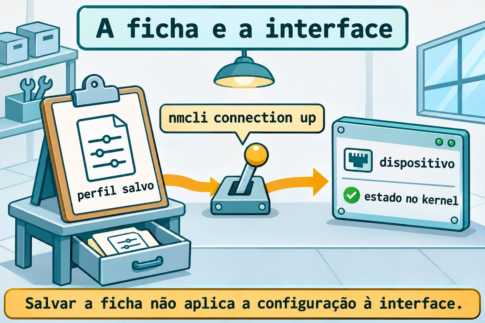
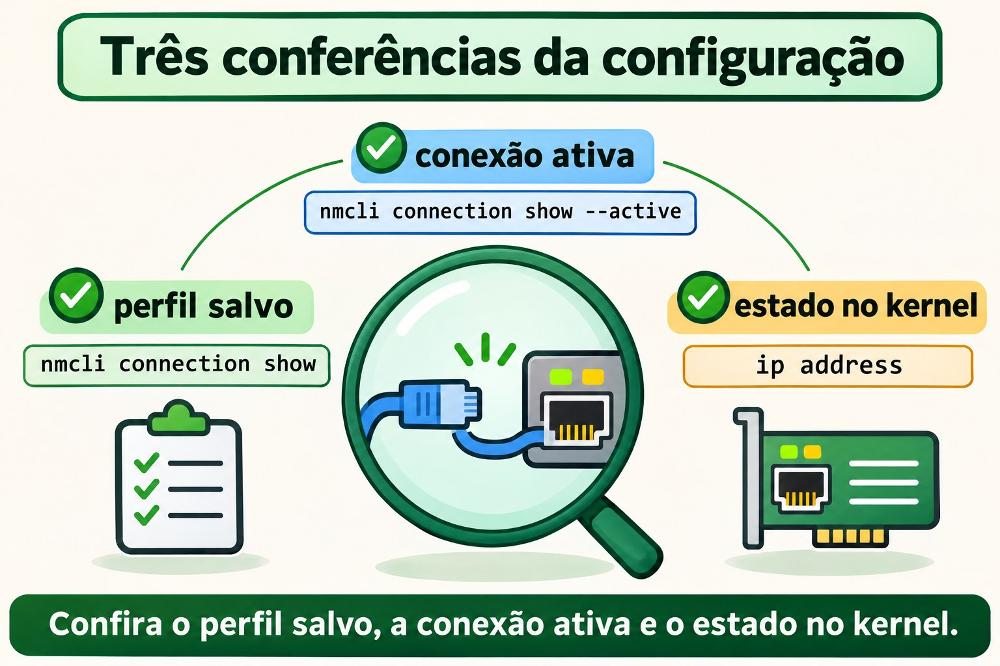
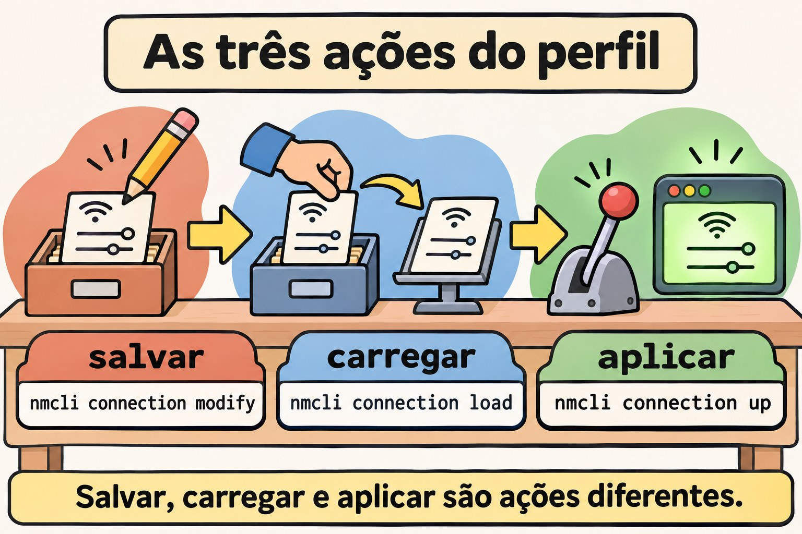

# Aula 11.2 · NetworkManager e nmcli

No Windows Server, você distingue a placa da configuração aplicada a ela. No Linux com NetworkManager, essa distinção aparece como dispositivo e perfil de conexão. Na Aula 11.1 você leu endereços, prefixos e rotas; agora vai salvar uma configuração, ativá-la e comprovar o que sobrevive ao reboot. Você fará o mesmo exercício na Rocky e no Debian, sem migrar a interface usada pelo SSH.

> **Núcleo desta aula:** dispositivo é a interface; perfil é a configuração salva; ativar aplica o perfil ao dispositivo. Salvar, carregar e aplicar são operações diferentes. O resto é aprofundamento.

| Ficha |  |
| --- | --- |
| **Módulo** | M11 · Rede, aula 2 de 5 |
| **Quando** | Semana 16 |
| **Ao final** | Você cria um perfil persistente, configura IPv4 e IPv6, distingue DNS salvo de DNS em uso e reconhece um keyfile |
| **Pré-requisitos** | Aula 11.1; acesso SSH, `sudo` e console noVNC das VMs 201 e 202 |
| **Tempo** | Cerca de 90 minutos, mais 30 minutos para repetir sem consultar |
| **Snapshots** | `m11a2-inicio` e `m11a2-fim` nas duas VMs |

## 1 · Aquecimento

Responda antes de abrir o terminal. Confira o gabarito no fim.

1. O que o `/26` informa em um endereço IPv4?
2. `ip route get` testa a entrega de um pacote ou consulta uma decisão local?
3. Um serviço em `127.0.0.1` fica disponível para outras máquinas só porque a VM tem IP na rede?

## 2 · Por que importa

Você recebe um servidor que funcionava ontem. Alguém adicionou um endereço com `ip address add`; depois do reboot, ele sumiu. Outra pessoa editou um arquivo de conexão e esperou que a interface mudasse imediatamente. Nos dois casos, faltou distinguir o estado atual da configuração persistente.

| O que você observa | Onde conferir | O que isso demonstra |
| --- | --- | --- |
| Endereço atual | `ip address` | O que o kernel usa agora |
| Perfil salvo | `nmcli connection show` | A configuração conhecida pelo NetworkManager |
| Perfil ativo | `nmcli connection show --active` | Qual configuração está aplicada |
| Arquivo persistente | Keyfile em disco | O que o serviço poderá carregar de novo |

Seu trabalho termina quando a configuração esperada está em uso e volta depois do reboot. A presença de um arquivo, sozinha, não fecha essa verificação.

## 3 · Modelo mental

Pense em uma sala com uma ficha de instalação. A sala é o dispositivo. A ficha diz qual endereço, quais rotas e quais servidores DNS usar. Guardar uma ficha no arquivo não muda a sala; alguém precisa executar a instalação descrita nela.

```text
keyfile no disco → perfil carregado → ativação → dispositivo → estado no kernel
      salvar          carregar         aplicar                conferir com ip
```

Você pode guardar vários perfis para uma interface. No exercício, haverá um perfil ativo e outro apenas para planejamento. O nome do perfil serve para você reconhecê-lo; o UUID identifica aquela configuração sem depender do nome.



*Salvar a ficha não aplica a configuração à interface.*

### Ponte Windows

| Windows Server | NetworkManager | Ideia que você reaproveita |
| --- | --- | --- |
| Adaptador de rede | Dispositivo em `nmcli device` | A interface que recebe a configuração |
| Configuração de IP do adaptador | Perfil em `nmcli connection` | Endereço, rotas e DNS como conjunto |
| Consultar IP atual | `ip -br address` | Conferir o estado efetivo |
| Configuração persistente | Perfil salvo em disco | Reaplicar depois do boot |
| Servidores DNS do adaptador | Propriedades `ipv4.dns` e `ipv6.dns` | Resolução é uma configuração própria |

O perfil de conexão do NetworkManager não é o perfil de firewall Público ou Privado do Windows. Aqui ele descreve como configurar a interface.

## 4 · O essencial

### Dispositivo e conexão não são sinônimos

`nmcli device status` lista interfaces e o estado de gerenciamento. `nmcli connection show` lista perfis. Um perfil pode existir sem estar ativo; uma interface pode existir sem ser gerenciada pelo NetworkManager.

```bash
nmcli device status
nmcli connection show
nmcli connection show --active
```

Na Rocky, NetworkManager é o gerenciador esperado. No Debian, descubra primeiro quem administra a interface real. A Aula 11.3 trata de `ifupdown`, NetworkManager e `systemd-networkd`; instalar outro gerenciador não significa entregar a placa a ele.

### Salvar, carregar e aplicar

| Operação | Comando | Efeito |
| --- | --- | --- |
| Criar perfil | `nmcli connection add` | Salva uma nova configuração |
| Alterar perfil | `nmcli connection modify` | Atualiza as propriedades salvas |
| Recarregar arquivos | `nmcli connection reload` | Relê perfis do disco |
| Carregar um arquivo | `nmcli connection load ARQUIVO` | Lê aquele keyfile |
| Ativar perfil | `nmcli connection up PERFIL` | Aplica a configuração |
| Reaplicar mudanças compatíveis | `nmcli device reapply INTERFACE` | Atualiza a conexão já ativa |

`modify` não equivale a `up`. Depois de editar um perfil ativo, confira o estado efetivo; para este lab, reative somente o perfil da interface interna. A reativação da placa do SSH pode interromper seu acesso.

### IPv4 fixo é endereço com prefixo

`ipv4.method manual` usa os endereços informados em `ipv4.addresses`. `ipv4.method auto` solicita configuração automática, normalmente por DHCP em Ethernet. Nunca use `shared` neste exercício: esse modo compartilha conectividade e não representa um cliente DHCP comum.

Um perfil interno não precisa de gateway. Configure `ipv4.never-default yes` para que ele não se torne candidato à rota padrão IPv4. A mesma separação existe para IPv6.

### IPv6 tem configuração própria

| Propriedade | Ideia |
| --- | --- |
| `ipv6.method auto` | Configuração automática IPv6 |
| `ipv6.method manual` | Endereços IPv6 informados no perfil |
| `ipv6.addresses` | Endereço com prefixo IPv6 |
| `ipv6.gateway` | Próximo salto padrão IPv6 |
| `ipv6.never-default yes` | Impede rota padrão por esse perfil |

Na interface interna, você usará `2001:db8:11::10/64`. Esse prefixo é de documentação e ficará somente dentro da VM, sem bridge, cabo ou anúncio para a rede do curso. Não o instale na interface Ethernet real.

### DNS salvo não é consulta bem-sucedida

`ipv4.dns` e `ipv6.dns` armazenam endereços de servidores DNS. Com método automático, `ignore-auto-dns yes` descarta os servidores recebidos automaticamente daquela família. Isso não cria um servidor DNS nem comprova que ele responde.

O sistema reúne as informações DNS das conexões ativas segundo sua configuração. Para observar os dados da interface, use `nmcli device show`. A integração com `resolv.conf` será detalhada na Aula 11.4.

No lab, você gravará DNS em um perfil inativo. Não o ativará: os endereços de exemplo não atendem consultas e não devem entrar na resolução usada pelo sistema.



*Confira o perfil salvo, a conexão ativa e o estado no kernel.*

### Keyfiles e permissões

Os perfis no formato keyfile usam seções como `[connection]`, `[ipv4]` e `[ipv6]`. O diretório de configuração persistente é `/etc/NetworkManager/system-connections/`; arquivos em `/run/NetworkManager/system-connections/` são temporários.

Um keyfile pode conter segredos. Use dono `root:root` e modo `600`. O NetworkManager recusa arquivos com acesso indevido a outros usuários. Prefira `nmcli` para alterações comuns; depois de editar um arquivo diretamente, carregue-o e ative o perfil quando for o momento de aplicar.

### Rocky × Debian

| Item | Rocky 9, VM 201 | Debian 13, VM 202 |
| --- | --- | --- |
| Nome e acesso | `rocky-lab`, `ssh rocky-lab` | `debian-lab`, `ssh debian-lab` |
| IP real do curso | `10.1.0.51` | `10.1.0.52` |
| Pacote | `NetworkManager` | `network-manager` |
| Unidade | `NetworkManager.service` | `NetworkManager.service` |
| Interface real | Normalmente gerenciada por NetworkManager | Identifique o gerenciador antes de mudar |
| Exercício desta aula | Perfil `dummy` interno | Mesmo perfil, com preparação isolada se necessário |
| Keyfile persistente | `/etc/NetworkManager/system-connections/` | Mesmo diretório |

## 5 · Lab guiado

Repita a sequência na Rocky e no Debian como `student`. Use uma sessão Bash por VM para manter as variáveis do exercício. Os perfis começam com `m11a2-`; a única interface alterada será `m11dummy0`, que não tem ligação com a rede externa.

**Antes de mudar qualquer configuração de rede:** abra o console noVNC e confira que consegue entrar como `student` e usar `sudo`. Mudanças na placa usada pelo SSH exigem esse console ou um plano de retorno testado. Este lab não altera o IP, o gateway ou o perfil da placa real.

**Passo 0 · Guardar o ponto de volta.** No nó Proxmox que hospeda cada VM:

**Palpite:** um snapshot no mesmo storage protege você contra a perda desse storage?

```bash
qm snapshot 201 m11a2-inicio
qm snapshot 202 m11a2-inicio
qm listsnapshot 201
qm listsnapshot 202
```

**Saída esperada:** as listas contêm `m11a2-inicio`.

**Verifique:** confirme as duas VMs antes de continuar. Snapshot é ponto de retorno do lab, não substituto do backup.

**Passo 1 · Registrar a rede e o gerenciador.** Dentro de cada VM:

**Palpite:** instalar `nmcli` prova que o NetworkManager já administra sua placa?

```bash
test ! -e "$HOME/m11a2" && mkdir -m 0700 "$HOME/m11a2"
ip -br address | tee "$HOME/m11a2/enderecos-inicio.txt"
ip -4 route | tee "$HOME/m11a2/rotas-inicio.txt"
systemctl is-active NetworkManager.service
systemctl is-enabled NetworkManager.service
systemctl is-active networking.service systemd-networkd.service
```

**Saída esperada:** a rede real e o estado das unidades. Uma unidade ausente pode aparecer como `not-found`; um serviço inativo não significa falha da rede inteira.

**Verifique:** se a pasta já existir, pare para não misturar tentativas. Registre quem mantém a placa do curso. Não pare esse gerenciador.

**Passo 2 · Preparar NetworkManager sem entregar a placa real.** Na Rocky, o serviço deve estar ativo; confira `nmcli --version` e siga ao Passo 3. No Debian com serviço já ativo, também siga ao Passo 3.

**Palpite:** dois gerenciadores tentando configurar a mesma placa tornam o diagnóstico mais simples ou mais difícil?

No Debian sem NetworkManager ativo, use a preparação abaixo somente se ele estiver ausente ou desabilitado. Se estiver mascarado, falhando ou habilitado mas parado, investigue essa condição antes de continuar.

```bash
if test -e /etc/NetworkManager/conf.d/99-m11a2-isolado.conf; then
  printf 'Existing lab configuration; stop here.\n'
else
sudo install -d -m 0755 /etc/NetworkManager/conf.d
sudo tee /etc/NetworkManager/conf.d/99-m11a2-isolado.conf > /dev/null <<'EOF'
[main]
dns=none
[keyfile]
unmanaged-devices=*,except:interface-name:m11dummy0
EOF
sudo apt update
sudo apt install -y network-manager
sudo systemctl start NetworkManager.service
printf 'debian-isolado\n' > "$HOME/m11a2/preparacao"
fi
```

**Saída esperada:** NetworkManager inicia com todas as interfaces fora do seu gerenciamento, exceto `m11dummy0`; `dns=none` impede que ele altere a resolução do sistema nessa preparação.

**Verifique:** pare se o teste inicial indicar que o arquivo já existe. Confira `nmcli device status`, `ip -br address` e `ip -4 route`: a placa real mantém sua configuração e aparece como não gerenciada pelo NetworkManager nesta preparação. Você não migrou `ifupdown` nem `systemd-networkd`.

**Passo 3 · Identificar as duas listas.** Nas duas VMs, com NetworkManager ativo:

**Palpite:** um perfil sem dispositivo na lista deixou de existir?

```bash
nmcli --version
nmcli device status
nmcli -f NAME,UUID,TYPE,DEVICE connection show
nmcli connection show --active
ip link show m11dummy0
```

**Saída esperada:** perfis e dispositivos reais; o último comando informa que `m11dummy0` ainda não existe.

**Verifique:** confirme que não existe perfil com nome `m11a2-interno` ou `m11a2-plano`. Se algum desses recursos já existir, pare e identifique a tentativa anterior.

**Passo 4 · Criar IPv4 e IPv6 fixos na interface interna.**

**Palpite:** sem gateway no perfil, os dois endereços locais deixarão de existir?

```bash
sudo nmcli connection add type dummy ifname m11dummy0 \
  con-name m11a2-interno connection.autoconnect no \
  ipv4.method manual ipv4.addresses 192.0.2.10/24 \
  ipv4.never-default yes ipv6.method manual \
  ipv6.addresses 2001:db8:11::10/64 ipv6.never-default yes
nmcli -f connection.id,connection.interface-name,connection.autoconnect,ipv4,ipv6 \
  connection show m11a2-interno
sudo nmcli connection up m11a2-interno
```

**Saída esperada:** o perfil é salvo e ativado; NetworkManager cria a interface `dummy` com os endereços informados.

**Verifique:** `ip -br address show dev m11dummy0` mostra IPv4 e IPv6. Se IPv6 estiver desativado no kernel, registre a condição e ajuste o pré-requisito do lab antes de prosseguir; não altere a política da VM por tentativa.

**Passo 5 · Conferir o estado que realmente entrou.**

**Palpite:** uma rota conectada da interface interna substitui a rota padrão da placa real?

```bash
nmcli connection show --active
nmcli -f GENERAL,IP4,IP6 device show m11dummy0
ip -4 route show dev m11dummy0
ip -6 route show dev m11dummy0
ip -4 route show default
ping -4 -c 2 -W 2 192.0.2.10
ping -6 -c 2 -W 2 2001:db8:11::10
```

**Saída esperada:** perfil ativo, endereços e rotas internas. Os pings recebem respostas da própria VM.

**Verifique:** a rota padrão IPv4 continua pela interface original. Esses pings comprovam endereços locais; não comprovam comunicação com outro computador.

**Passo 6 · Planejar DNS sem publicar DNS de exemplo.**

**Palpite:** preencher `ipv4.dns` em um perfil inativo já muda as consultas do sistema?

```bash
sudo nmcli connection clone m11a2-interno m11a2-plano
sudo nmcli connection modify m11a2-plano connection.autoconnect no \
  ipv4.dns 192.0.2.53 ipv4.ignore-auto-dns yes \
  ipv6.dns 2001:db8:11::53 ipv6.ignore-auto-dns yes
nmcli -f connection.id,connection.autoconnect,ipv4.dns,ipv4.ignore-auto-dns,ipv6.dns \
  connection show m11a2-plano
nmcli connection show --active
```

**Saída esperada:** DNS de exemplo salvo em `m11a2-plano`; somente `m11a2-interno` continua ativo nessa interface.

**Verifique:** não ative `m11a2-plano`. O clone tem outro UUID, mas herdou os endereços e a interface do original. Uma clonagem exige revisar as propriedades herdadas antes de usar.

**Passo 7 · Ler o keyfile criado.** Localize pelo UUID, sem presumir o nome do arquivo:

**Palpite:** renomear o perfil obriga o UUID a mudar?

```bash
PLANO_UUID=$(nmcli -g connection.uuid connection show m11a2-plano)
PLANO_FILE=$(sudo grep -rlF --include='*.nmconnection' "uuid=$PLANO_UUID" /etc/NetworkManager/system-connections/)
printf '%s\n' "$PLANO_FILE"
sudo stat -c '%U:%G %a %n' "$PLANO_FILE"
sudo sed -n '/^\[connection\]/,/^\[/p' "$PLANO_FILE"
```

**Saída esperada:** exatamente um caminho, dono `root:root` e modo `600`. O trecho mostra a seção de conexão do perfil.

**Verifique:** antes de usar o caminho nas quebras, confirme que ele é um único arquivo do perfil `m11a2-plano` dentro do diretório indicado. Não mostre arquivos de outras conexões: eles podem conter segredos.

**Passo 8 · Preparar a persistência.**

**Palpite:** `connection.autoconnect no` impede até uma ativação manual?

```bash
sudo nmcli connection modify m11a2-interno connection.autoconnect yes
sudo systemctl enable NetworkManager.service
nmcli -g connection.autoconnect connection show m11a2-interno
nmcli -g connection.autoconnect connection show m11a2-plano
```

**Saída esperada:** `yes` para o perfil interno e `no` para o plano.

**Verifique:** serviço no boot e autoconexão do perfil são duas condições distintas. O reboot será feito depois das quebras; você ainda não comprovou persistência.

### Decida 1

Você alterou `ipv4.addresses` no perfil, mas `ip address` ainda mostra o endereço anterior. O que faz primeiro?

A) Reinicia a VM inteira. B) Confere perfil e dispositivo, depois aplica a mudança à interface correta. C) Apaga a rota padrão.

| Se você marcou | Resultado | Por quê |
| --- | --- | --- |
| A | Prematuro | Você pode aplicar e verificar a mudança localmente |
| B | Certo | Salvar e aplicar são etapas diferentes |
| C | Sem relação | O endereço salvo não foi aplicado ao dispositivo |

### Decida 2

Um Debian usa `ifupdown` na placa do SSH. Instalar NetworkManager autoriza ativar outro perfil nessa placa?

A) Sim, a última instalação decide. B) Sim, se o nome do perfil for diferente. C) Não; primeiro é preciso planejar quem gerencia a interface e como voltar.

| Se você marcou | Resultado | Por quê |
| --- | --- | --- |
| A | Incorreto | Instalação não é migração planejada |
| B | Incorreto | Nomes diferentes não isolam o mesmo dispositivo |
| C | Certo | A posse da interface e o retorno precisam estar claros |

## 6 · Quebre e conserte

Faça as quebras somente em `m11dummy0` e nos dois perfis da aula. A interface real permanece sob o gerenciador original. Se você abriu outra sessão Bash, recalcule `PLANO_UUID` e `PLANO_FILE` pelo Passo 7.

### Quebra 1 · Mudou a ficha, não a interface

**Palpite:** o endereço antigo desaparece só porque você editou o perfil?

```bash
sudo nmcli connection modify m11a2-interno ipv4.addresses 192.0.2.20/24
nmcli -g ipv4.addresses connection show m11a2-interno
ip -4 address show dev m11dummy0
```

**Sintoma:** o perfil salvo mostra `192.0.2.20/24`; a interface ainda usa `192.0.2.10/24`.

**Investigação:** compare a propriedade do perfil com a saída de `ip`. Você consultou duas camadas diferentes.

**Causa:** `connection modify` salvou a mudança sem reativar a conexão em uso.

**Conserto:** aplique somente o perfil interno e depois restaure seu endereço inicial:

```bash
sudo nmcli connection up m11a2-interno
ip -4 address show dev m11dummy0
sudo nmcli connection modify m11a2-interno ipv4.addresses 192.0.2.10/24
sudo nmcli connection up m11a2-interno
```

**Verifique:** a primeira ativação coloca `.20`; a segunda devolve `.10`. IPv6 permanece configurado.

**Prevenção:** ao registrar uma mudança, anote o perfil salvo e a conferência do estado aplicado.

### Quebra 2 · Funciona na mão, não volta sozinho

**Palpite:** um perfil com autoconexão desligada pode funcionar quando você pede `up`?

```bash
sudo nmcli connection modify m11a2-interno connection.autoconnect no
sudo nmcli connection down m11a2-interno
nmcli connection show --active
sudo nmcli connection up m11a2-interno
nmcli -g connection.autoconnect connection show m11a2-interno
```

**Sintoma:** a ativação manual funciona, mas a propriedade continua `no`.

**Investigação:** confira conexão ativa e `connection.autoconnect`. Estar ativo agora não prova ativação automática no próximo boot.

**Causa:** você autorizou a ativação manual sem autorizar a autoconexão do perfil.

**Conserto:** `sudo nmcli connection modify m11a2-interno connection.autoconnect yes`.

**Verifique:** a propriedade volta a `yes`; no fechamento, o reboot confirmará o resultado.

**Prevenção:** confira a unidade habilitada e a autoconexão do perfil antes do teste de persistência.

### Quebra 3 · O arquivo existe, mas é recusado

**Palpite:** um keyfile legível por qualquer usuário é aceito por estar no diretório certo?

```bash
sudo chmod 0644 "$PLANO_FILE"
sudo nmcli connection load "$PLANO_FILE"
sudo stat -c '%U:%G %a %n' "$PLANO_FILE"
sudo journalctl -u NetworkManager.service -n 20 --no-pager
```

**Sintoma:** o carregamento explícito falha; o arquivo mostra modo `644`. A mensagem informa a recusa do arquivo, com detalhes nas mensagens do serviço.

**Investigação:** confira o caminho, o dono e as permissões. O perfil já carregado pode continuar listado; isso não demonstra que a nova leitura foi aceita.

**Causa:** outros usuários conseguem ler o keyfile, contrariando a proteção exigida pelo NetworkManager.

**Conserto:** restaure as permissões do perfil de planejamento e carregue-o:

```bash
sudo chown root:root "$PLANO_FILE"
sudo chmod 0600 "$PLANO_FILE"
sudo nmcli connection load "$PLANO_FILE"
```

**Verifique:** o carregamento termina sem erro e `stat` mostra `root:root 600`. O perfil continua inativo.

**Prevenção:** crie perfis com `nmcli`; ao copiar um keyfile, confira dono e modo antes de carregar.



*Salvar, carregar e aplicar são ações diferentes.*

### Limpeza

**Palpite:** apagar o perfil de planejamento exige desligar a placa usada pelo SSH?

```bash
sudo nmcli connection delete m11a2-plano
nmcli connection show --active
nmcli -g connection.autoconnect connection show m11a2-interno
```

**Saída esperada:** o plano é removido; o interno permanece ativo com autoconexão `yes`.

**Verifique:** guarde o perfil interno até o reboot de conferência. A remoção final e o retorno do Debian preparado nesta aula vêm logo depois desse teste.

## 7 · Armadilhas

| Erro comum | O que fazer | Por quê |
| --- | --- | --- |
| Confundir perfil e dispositivo | Comparar `connection show` e `device status` | São objetos diferentes |
| Salvar e presumir aplicação | Conferir com `ip` depois de ativar | Estado salvo não é estado efetivo |
| Editar a placa do SSH sem retorno | Abrir noVNC antes | A mudança pode cortar o acesso |
| Instalar outro gerenciador e ativar tudo | Definir quem controla cada interface | Dois gerenciadores podem disputar a configuração |
| Usar `shared` no lugar de `auto` | Escolher o método pelo objetivo | Compartilhamento não é cliente DHCP comum |
| Clonar sem revisar | Conferir interface, endereços, DNS e autoconexão | O clone herda propriedades |
| Ativar DNS de exemplo | Manter o plano inativo | Endereço salvo não significa servidor acessível |
| Usar `reload` para aplicar IP | Carregar e depois ativar quando necessário | Relê arquivo, não reativa a interface |
| Deixar keyfile com modo `644` | Usar `root:root 600` | Perfis podem conter segredos |

## 8 · Quiz

Responda sem consultar o laboratório.

1. Qual diferença existe entre dispositivo, perfil salvo e conexão ativa?
2. Você editou um keyfile. O que `connection load` faz e o que ainda falta para aplicar?
3. Um endereço adicionado só com `ip address add` comprova persistência?
4. Para que servem `ipv4.never-default` e `ipv6.never-default` no exercício?
5. Um perfil tem DNS configurado e está inativo. Isso comprova que o sistema usa aquele DNS?
6. Por que um `up` bem-sucedido não comprova que a conexão voltará no próximo boot?

## 9 · Cola

| Quero... | Comando |
| --- | --- |
| Listar dispositivos | `nmcli device status` |
| Listar perfis | `nmcli connection show` |
| Ver perfis ativos | `nmcli connection show --active` |
| Inspecionar perfil | `nmcli connection show m11a2-interno` |
| Inspecionar estado da interface | `nmcli device show m11dummy0` |
| Ativar perfil interno | `sudo nmcli connection up m11a2-interno` |
| Permitir autoconexão | `sudo nmcli connection modify m11a2-interno connection.autoconnect yes` |
| Recarregar arquivos | `sudo nmcli connection reload` |
| Carregar um keyfile | `sudo nmcli connection load "$PLANO_FILE"` |
| Conferir o kernel | `ip -br address show dev m11dummy0` |

**Flashcards:** dispositivo → *interface*; perfil → *configuração salva*; `up` → *ativar*; `reload` → *reler arquivos*; autoconexão → *ativação automática permitida*; keyfile → *perfil em disco*.

Revise em D+1, D+3, D+7 e D+21. Refaça a primeira quebra sem consultar e explique onde cada comando buscou sua informação.

## 10 · Checklist e fechamento

- [ ] Distingo dispositivo, perfil e conexão ativa
- [ ] Identifico o gerenciador antes de alterar a interface real
- [ ] Configurei IPv4 e IPv6 fixos na interface interna nas duas distros
- [ ] Mantive gateway e DNS da rede real fora do exercício
- [ ] Comparei configuração salva com estado no kernel
- [ ] Consertei as três quebras sem alterar a placa do SSH
- [ ] Reconheço dono e permissões de um keyfile

**Último exercício:** antes do reboot, confirme `.10`, IPv6 e autoconexão `yes` no perfil interno. Explique por que isso ainda precisa do teste abaixo.

**Reboot de conferência:** em cada VM, rode `sudo systemctl reboot`, acompanhe pelo noVNC e reconecte pelo alias. Depois:

```bash
nmcli connection show --active
ip -br address show dev m11dummy0
ip -4 route show default
```

**Saída esperada:** o perfil interno voltou, com `192.0.2.10/24` e `2001:db8:11::10/64`; a rota padrão continua na placa original.

**Verifique:** compare com o inventário inicial da interface real. Você comprovou persistência do perfil interno, não migrou a configuração da Ethernet.

**Retorno ao estado de rede inicial:** remova o perfil do exercício nas duas VMs:

```bash
sudo nmcli connection delete m11a2-interno
ip -br address
ip -4 route
```

No Debian que recebeu a preparação isolada, confirme o arquivo `~/m11a2/preparacao` antes de executar o retorno abaixo. Não execute esse bloco onde NetworkManager já estava ativo antes da aula.

```bash
cat "$HOME/m11a2/preparacao"
sudo systemctl disable --now NetworkManager.service
sudo rm -- /etc/NetworkManager/conf.d/99-m11a2-isolado.conf
systemctl is-active NetworkManager.service
systemctl is-enabled NetworkManager.service
```

O serviço fica inativo e desabilitado, como na preparação inicial; o pacote permanece instalado para a Aula 11.3. Não execute `nmcli` nesse Debian após o retorno, pois o cliente pode solicitar a ativação do serviço por D-Bus.

**Verifique:** nas duas VMs, confira o endereço real e a rota padrão com `ip`; guarde os registros em `~/m11a2` no diário do laboratório. Se o dispositivo interno ainda existir após apagar o perfil, remova somente ele com `sudo ip link delete m11dummy0`.

**Snapshot de fim:** no nó Proxmox, depois do retorno:

```bash
qm snapshot 201 m11a2-fim
qm snapshot 202 m11a2-fim
```

## 11 · Na vida real

**Missão, só leitura.** Em um servidor que você administre ou tenha autorização para observar, consulte primeiro o serviço e os endereços:

```bash
systemctl is-active NetworkManager.service
ip -br address
ip -4 route
ip -6 route
```

Somente se NetworkManager já estiver ativo, consulte também `nmcli device status`, `nmcli connection show --active` e as propriedades sem segredos de um perfil conhecido. Não inicie um gerenciador parado para fazer esta missão.

1. Qual interface atende a rede de serviço e quem a gerencia?
2. O nome do perfil corresponde ao nome da interface ou você estava presumindo isso?
3. O que está salvo e o que está aplicado? Quais evidências sustentam sua resposta?
4. Existe comprovação de persistência no registro de mudança, ou apenas uma captura antes do reboot?

## 12 · Aprofundar quando quiser

- [`man nmcli`](https://networkmanager.pages.freedesktop.org/NetworkManager/NetworkManager/nmcli.html): objetos, filtros e operações de conexão.
- [`man nm-settings-nmcli`](https://networkmanager.pages.freedesktop.org/NetworkManager/NetworkManager/nm-settings-nmcli.html): métodos IP, DNS e autoconexão.
- [`man nm-settings-keyfile`](https://networkmanager.pages.freedesktop.org/NetworkManager/NetworkManager/nm-settings-keyfile.html): seções, diretórios e proteção dos arquivos.
- [`man NetworkManager.conf`](https://networkmanager.pages.freedesktop.org/NetworkManager/NetworkManager/NetworkManager.conf.html): `dns=none` e seleção de dispositivos não gerenciados.
- [Ethernet com NetworkManager na família RHEL 9](https://docs.redhat.com/en/documentation/red_hat_enterprise_linux/9/html/configuring_and_managing_networking/configuring-an-ethernet-connection_configuring-and-managing-networking): aplicação dos métodos de endereço.
- [Keyfiles na família RHEL 9](https://docs.redhat.com/en/documentation/red_hat_enterprise_linux/9/html/configuring_and_managing_networking/assembly_networkmanager-connection-profiles-in-keyfile-format_configuring-and-managing-networking): armazenamento persistente dos perfis.
- [Interface interna com IPv4 e IPv6 na família RHEL 9](https://docs.redhat.com/en/documentation/red_hat_enterprise_linux/9/html/configuring_and_managing_networking/creating-a-dummy-interface_configuring-and-managing-networking): uso de `dummy` para testes locais.

**DeepTutor** (http://10.1.0.149:3782, KB "Curso Linux Sysadmin"):

- `!explica dispositivo, perfil salvo e conexão ativa com a metáfora da ficha de instalação`
- `!feynman alterei o perfil, mas ip address não mudou: critique meu diagnóstico e minha ordem de aplicação`
- `!quiz Aula 11.2, 6 perguntas sobre nmcli, persistência, DNS, IPv6 e keyfiles, uma por vez`

## Gabarito comentado

### Aquecimento

1. O comprimento do prefixo de rede, em bits. Ele permite calcular a sub-rede; não representa uma porta nem o número do host.
2. Consulta a decisão local de roteamento. Não transmite um pacote para comprovar entrega.
3. Não. Loopback atende a própria máquina; publicar em outro endereço exige um bind apropriado e um caminho permitido.

### Quiz

1. Dispositivo é a interface; perfil é o conjunto de propriedades salvo; conexão ativa é a aplicação de um perfil ao dispositivo. Consulte `device status`, o perfil e a lista de conexões ativas.
2. Carrega aquele arquivo no NetworkManager. Depois, uma ativação aplica o perfil; `ip` confere o resultado no kernel.
3. Não. A adição altera o estado atual; a persistência depende da configuração mantida pelo gerenciador e deve ser conferida após o reboot.
4. Impedem que o perfil interno forneça a rota padrão de cada família. As rotas conectadas dos seus prefixos continuam existindo.
5. Não. O valor está salvo no perfil; ele precisa estar ativo e participar da configuração de resolução para ser usado. Mesmo isso não comprova resposta do servidor DNS.
6. `up` é um pedido manual. A volta automática depende do serviço, da autoconexão e da disponibilidade do dispositivo. O teste de reboot confere o conjunto.

<!-- navegacao -->
[← Aula 11.1 · TCP/IP para quem administra](11.1-tcp-ip-para-quem-administra.md) · [Índice de aulas](../01-aulas.md) · [Aula 11.3 · Rede no Debian →](11.3-rede-no-debian.md)
