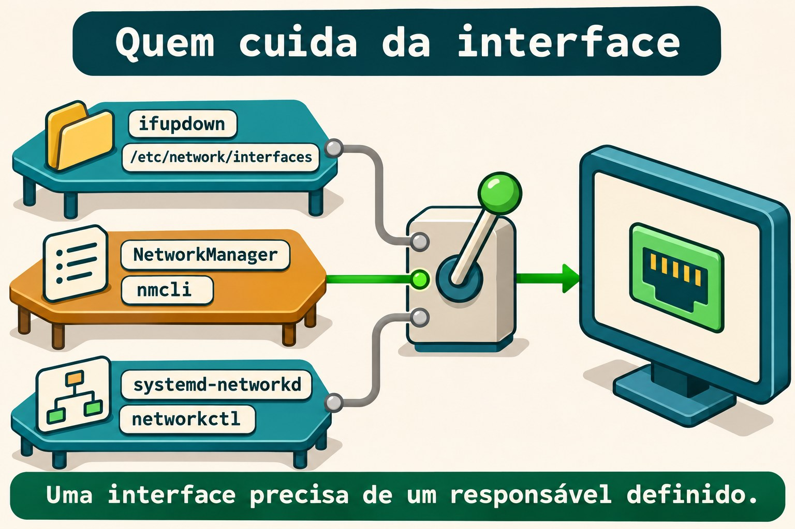
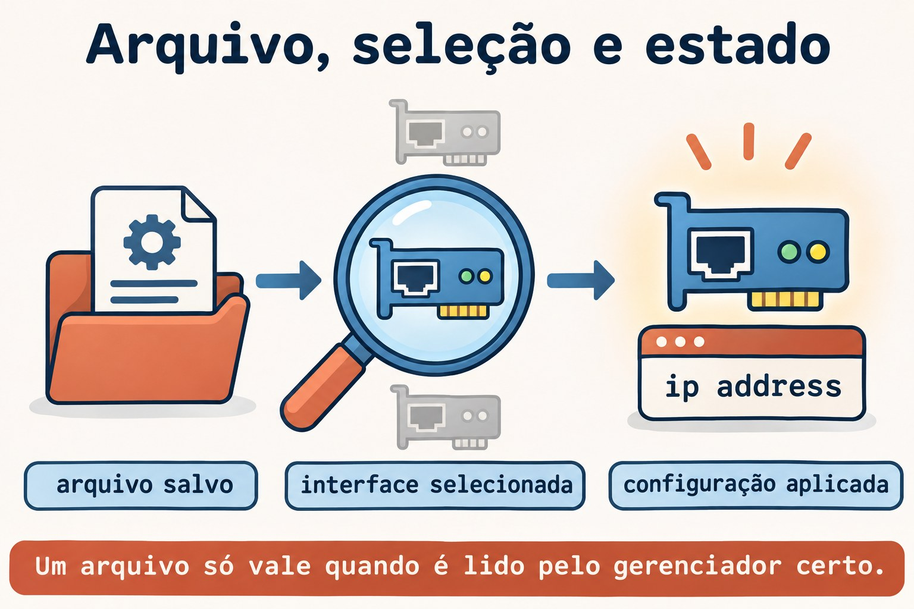

# Aula 11.3 · Rede no Debian

No Windows Server, você procura a configuração que realmente administra a placa antes de alterar um endereço. No Debian, essa pergunta vem antes do nome do comando: quem cuida desta interface? Na Aula 11.2 você trabalhou com perfis do NetworkManager; agora vai ler e aplicar uma configuração de `ifupdown`, comparar os dois modelos e reconhecer arquivos do `systemd-networkd`.

> **Núcleo desta aula:** descubra o responsável pela interface, encontre o arquivo que ele lê e confira o estado aplicado no kernel. Um arquivo correto no lugar errado não configura a rede. O resto é aprofundamento.

| Ficha |  |
| --- | --- |
| **Módulo** | M11 · Rede, aula 3 de 5 |
| **Quando** | Semana 16 |
| **Ao final** | Você identifica o gerenciador, interpreta `interfaces`, aplica uma interface interna e compara com NetworkManager e networkd |
| **Pré-requisitos** | Aulas 11.1 e 11.2; SSH, `sudo`, noVNC; Debian com `ifupdown` e Rocky com NetworkManager |
| **Tempo** | Cerca de 90 minutos, mais 30 minutos para repetir sem consultar |
| **Snapshots** | `m11a3-inicio` e `m11a3-fim` nas VMs 201 e 202 |

## 1 · Aquecimento

Responda sem consultar. O gabarito fica no fim.

1. Qual é a diferença entre perfil salvo e conexão ativa no NetworkManager?
2. Um endereço adicionado com `ip address add` comprova persistência depois do reboot?
3. Antes de mudar a placa usada pelo SSH, qual acesso ou plano de retorno precisa estar disponível?

## 2 · Por que importa

Você edita um perfil de NetworkManager, mas o Debian continua usando outro endereço. O arquivo parece certo, o comando existe e a rede funciona. O problema é que aquela interface está sob `ifupdown`; você alterou uma configuração que não participa do caminho de ativação.

| Pergunta | Evidência útil |
| --- | --- |
| Quem está instalado? | Pacotes e comandos disponíveis |
| Quem está em execução? | Unidades e processos do gerenciador |
| Quem administra esta interface? | Configuração, seleção e estado do dispositivo |
| Qual endereço entrou? | `ip address` |
| O que volta no boot? | Configuração persistente e teste de reboot |

O nome da distribuição não responde sozinho às cinco perguntas. Uma instalação mínima e uma instalação com ambiente gráfico podem usar modelos diferentes.

## 3 · Modelo mental

Pense em três equipes que podem receber a ficha de uma mesma instalação. Cada equipe lê uma linguagem própria. Você precisa escolher quem executa a ficha e impedir que outra equipe tente configurar a mesma interface ao mesmo tempo.

```text
ifupdown            → interfaces → ifup       → interface → ip address
NetworkManager      → perfil     → nmcli      → interface → ip address
systemd-networkd    → .network   → networkctl → interface → ip address
```

O kernel mantém o estado atual da rede. Os gerenciadores organizam como esse estado é criado e mantido. Ter dois serviços instalados não é automaticamente um conflito; o conflito aparece quando as responsabilidades pela mesma interface se sobrepõem.



*Uma interface precisa de um responsável definido.*

### Ponte Windows

| Windows Server | Debian e Rocky | O que você compara |
| --- | --- | --- |
| Descobrir a origem da configuração | Identificar o gerenciador da interface | Quem aplica a configuração |
| Configuração estática da placa | `iface ... inet static` ou perfil manual | Endereço e prefixo persistentes |
| Configuração obtida automaticamente | Método `dhcp` ou `auto`, conforme a ferramenta | Solicitar dados ao mecanismo correto |
| Consultar o endereço atual | `ip -br address` | Estado efetivo, independente do gerenciador |
| Conferir depois do reinício | Reboot e nova consulta | Persistência demonstrada |

## 4 · O essencial

### ifupdown: arquivo e ação

`ifupdown` lê `/etc/network/interfaces` e os arquivos incluídos por ele. `ifup` configura uma interface; `ifdown` desfaz a configuração; `ifquery` interpreta as definições e consulta o estado registrado pela ferramenta.

```bash
sudo ifquery --list
sudo ifquery m11dummy1
```

O primeiro comando lista interfaces definidas. O segundo só encontra `m11dummy1` depois que você instalar a configuração do lab. Uma definição lida por `ifquery` não comprova endereço aplicado nem comunicação.

### As linhas que você precisa reconhecer

| Trecho | Significado |
| --- | --- |
| `auto m11dummy1` | Inclui a interface na ativação com `ifup -a`, usada no boot |
| `allow-hotplug enp6s18` | Permite ativação associada à detecção do dispositivo |
| `iface m11dummy1 inet static` | Define IPv4 estático |
| `iface m11dummy1 inet6 static` | Define IPv6 estático |
| `address 198.51.100.10/24` | Endereço IPv4 e prefixo |
| `gateway ...` | Define o próximo salto padrão dessa família |
| `source ...` | Inclui outros arquivos de configuração |

`allow-hotplug` acompanha a detecção do dispositivo, não a conexão de um cabo Ethernet. `auto` não significa DHCP: ele escolhe quando ativar; o método na linha `iface` escolhe como configurar.

### O diretório só participa se for incluído

Um arquivo em `/etc/network/interfaces.d/` precisa ser alcançado por uma diretiva do arquivo principal. Com `source /etc/network/interfaces.d/*`, o padrão seleciona arquivos daquele diretório. Com `source-directory`, há regras próprias para os nomes aceitos, incluindo apenas letras, números, hífen e sublinhado.

No lab, o arquivo se chama `m11a3`, sem extensão, e você confirma sua leitura com `ifquery`. Um rascunho em `~/m11a3` não participa da configuração padrão.

Ao pesquisar diretórios protegidos, deixe a seleção de arquivos para o comando executado sob `sudo`, por exemplo `sudo grep -r --include='*.network' ... DIRETORIO`. Um glob aberto pelo shell do `student` é expandido antes de `sudo`.

### networking.service não é um daemon de endereçamento

Com `ifupdown`, `networking.service` executa tarefas de configuração e pode ficar como `active (exited)`. Isso indica que a unidade terminou sua ação e mantém o estado ativo. Não é motivo, sozinho, para reiniciar a rede.

Leia a configuração, o registro de `ifupdown` e o estado no kernel. Evite `ifdown -a` e reiniciar `networking` para corrigir uma única interface: essas ações têm alcance maior que o defeito investigado.

### NetworkManager: outra origem, mesma conferência

Na Rocky, você compara o perfil salvo com a conexão ativa, como na 11.2. No Debian, o plugin `ifupdown` do NetworkManager normalmente deixa de gerenciar interfaces declaradas em `interfaces` quando `managed=false` está configurado.

Essa regra depende da configuração carregada; não a presuma só pelo pacote instalado. Nesta aula, o Debian do lab mantém NetworkManager e networkd inativos, e a Rocky mantém NetworkManager como responsável.

### systemd-networkd: selecionar antes de aplicar

Um arquivo `.network` tem uma seção `[Match]` para selecionar interfaces e uma seção `[Network]` para sua configuração. Um arquivo `.netdev` descreve a criação de um dispositivo virtual; `.network` não é o arquivo de criação de uma interface `dummy`.

Os arquivos são considerados em ordem alfanumérica. O primeiro `.network` que corresponde à interface é usado; os posteriores que também correspondem não são somados. Arquivos com o mesmo nome obedecem à prioridade dos diretórios, com `/etc` acima de `/run` e dos diretórios do sistema.

`networkctl reload` relê arquivos e pode reconfigurar interfaces afetadas. `networkctl reconfigure INTERFACE` pede a reconfiguração de uma interface, sem reler sozinho arquivos editados. Nenhum dos dois entra como tentativa nesta aula: você apenas escreve um exemplo fora dos diretórios do serviço.



*Um arquivo só vale quando é lido pelo gerenciador certo.*

### Rocky × Debian

| Item | Rocky 9, VM 201 | Debian 13, VM 202 |
| --- | --- | --- |
| Acesso e IP real | `ssh rocky-lab`, `10.1.0.51` | `ssh debian-lab`, `10.1.0.52` |
| Responsável esperado no lab | NetworkManager ativo | `ifupdown`, com `networking.service` |
| Configuração aplicada | Perfil `m11a3-interno` | `/etc/network/interfaces.d/m11a3` |
| Aplicar somente o recurso do lab | `nmcli connection up m11a3-interno` | `ifup m11dummy1` |
| Consultar definição | `nmcli connection show m11a3-interno` | `ifquery m11dummy1` |
| Conferir endereço | `ip -br address show dev m11dummy1` | Mesmo comando |
| Pacote específico | `NetworkManager` | `ifupdown` |

## 5 · Lab guiado

Você criará a interface interna `m11dummy1` nas duas VMs, com IPv4 `198.51.100.10/24` e IPv6 `2001:db8:13::10/64`. São endereços de documentação, usados somente dentro de cada VM. Não haverá bridge, servidor DHCP, gateway novo nem mudança no DNS.

**Antes de qualquer alteração:** abra o noVNC das duas VMs e confirme acesso como `student` com `sudo`. A placa de SSH permanece intacta. Não execute estes passos no nó Proxmox: os comandos de rede do lab são para as VMs 201 e 202.

**Passo 0 · Guardar o ponto de volta.** No nó Proxmox de cada VM:

**Palpite:** o snapshot substitui uma verificação de retorno pelo console?

```bash
qm snapshot 201 m11a3-inicio
qm snapshot 202 m11a3-inicio
qm listsnapshot 201
qm listsnapshot 202
```

**Saída esperada:** `m11a3-inicio` aparece nas duas listas.

**Verifique:** confirme os snapshots e o acesso noVNC antes de continuar.

**Passo 1 · Identificar o responsável.** Dentro das duas VMs:

**Palpite:** encontrar o executável `nmcli` prova que ele administra a placa?

```bash
cat /etc/os-release
systemctl is-active NetworkManager.service
systemctl is-active networking.service
systemctl is-active systemd-networkd.service
ip -br address
ip -4 route
```

**Saída esperada:** Rocky com NetworkManager ativo; Debian com `networking.service` ativo e NetworkManager e networkd inativos. Unidades ausentes também podem aparecer na consulta.

**Verifique:** no Debian, confira `systemctl status networking.service --no-pager`; `active (exited)` é normal neste modelo. Se o inventário identificar outro responsável, pare a aplicação do lab e registre a diferença; não migre a placa para forçar o roteiro.

**Passo 2 · Ler a origem da configuração.** No Debian:

**Palpite:** um arquivo dentro de `interfaces.d` é lido mesmo sem uma inclusão no principal?

```bash
dpkg-query -W ifupdown
command -v ifup ifdown ifquery
sudo cat /etc/network/interfaces
sudo grep -r -n -E '^[[:space:]]*(auto|allow-hotplug|iface|source)' \
  /etc/network/interfaces.d/
sudo ifquery --list
```

**Saída esperada:** pacote e comandos presentes; o principal inclui `interfaces.d` por `source` ou `source-directory`. O `grep` pode terminar sem correspondências se o diretório estiver vazio.

**Verifique:** anote a definição da placa real e a inclusão do diretório. Se `ifupdown` não estiver instalado ou o diretório não estiver incluído, não instale outro gerenciador nem altere o principal às cegas; resolva esse pré-requisito pelo console antes do lab.

Na Rocky, use `nmcli device status` e `nmcli connection show --active` para registrar quem mantém a interface real. Não execute `nmcli` no Debian com o serviço parado.

**Passo 3 · Reservar os recursos do exercício.** Nas duas VMs:

**Palpite:** endereços iguais em duas interfaces internas isoladas criam disputa na rede física?

```bash
mkdir -m 0700 "$HOME/m11a3"
ip -br address | tee "$HOME/m11a3/enderecos-inicio.txt"
ip -4 route | tee "$HOME/m11a3/rotas-inicio.txt"
ip link show m11dummy1
```

**Saída esperada:** pasta criada, inventário registrado e dispositivo ainda inexistente.

**Verifique:** pare se a pasta ou o dispositivo já existir. Na Rocky, confira também que não existem perfis `m11a3-interno` e `m11a3-rascunho`; no Debian, confirme com `sudo test ! -e /etc/network/interfaces.d/m11a3` que o arquivo está livre.

**Passo 4 · Preparar a definição do Debian.** Grave o rascunho somente na `debian-lab`:

**Palpite:** a linha `auto` escolhe o método estático ou o momento da ativação?

```bash
cat > "$HOME/m11a3/interfaces" <<'EOF'
auto m11dummy1
iface m11dummy1 inet static
    address 198.51.100.10/24
    pre-up test -d /sys/class/net/m11dummy1 || ip link add m11dummy1 type dummy
iface m11dummy1 inet6 static
    address 2001:db8:13::10/64
EOF
ifquery --interfaces="$HOME/m11a3/interfaces" m11dummy1
sudo ifup --no-act --interfaces="$HOME/m11a3/interfaces" m11dummy1
```

**Saída esperada:** a definição é interpretada; a simulação mostra as ações previstas sem criar a interface.

**Verifique:** `ip link show m11dummy1` ainda informa dispositivo inexistente. `pre-up` criará a interface interna antes dos endereços; o teste evita recriá-la se já existir no momento da ativação.

**Passo 5 · Instalar e aplicar.** No Debian:

**Palpite:** ler o arquivo e conseguir ativar uma interface são a mesma evidência?

```bash
sudo install -m 0644 -o root -g root "$HOME/m11a3/interfaces" /etc/network/interfaces.d/m11a3
sudo ifquery m11dummy1
sudo ifup m11dummy1
```

**Saída esperada:** a consulta padrão encontra a definição instalada; a ativação cria a interface e aplica os dois endereços. Se `ifquery` falhar, pare antes de executar `ifup` e investigue a inclusão.

Na Rocky, aplique a configuração equivalente com o gerenciador que já está ativo:

```bash
sudo nmcli connection add type dummy ifname m11dummy1 \
  con-name m11a3-interno connection.autoconnect yes \
  ipv4.method manual ipv4.addresses 198.51.100.10/24 ipv4.never-default yes \
  ipv6.method manual ipv6.addresses 2001:db8:13::10/64 ipv6.never-default yes
sudo nmcli connection up m11a3-interno
```

**Verifique:** nas duas VMs, `ip -br address show dev m11dummy1` deve mostrar os mesmos endereços internos. O formato persistente é diferente, mas o kernel recebe configuração equivalente.

**Passo 6 · Comparar definição, registro e kernel.** Nas duas VMs:

**Palpite:** o registro de uma ferramenta substitui a consulta do endereço real?

```bash
ip -br address show dev m11dummy1
ip -4 route show dev m11dummy1
ip -6 route show dev m11dummy1
ip -4 route show default
ping -4 -c 2 -W 2 198.51.100.10
ping -6 -c 2 -W 2 2001:db8:13::10
```

**Saída esperada:** endereços e rotas internas, respostas locais e a rota padrão original.

**Verifique:** no Debian, compare `sudo ifquery m11dummy1` e `sudo ifquery --state m11dummy1`; na Rocky, compare o perfil salvo e `nmcli connection show --active`. O registro de ativação não mede a resposta de uma aplicação.

**Passo 7 · Reconhecer networkd sem trocar de responsável.** Nas duas VMs, grave somente um exemplo no diretório pessoal:

**Palpite:** um `.network` cria sozinho uma interface `dummy` inexistente?

```bash
cat > "$HOME/m11a3/30-m11dummy1.netdev" <<'EOF'
[NetDev]
Name=m11dummy1
Kind=dummy
EOF
cat > "$HOME/m11a3/30-m11dummy1.network" <<'EOF'
[Match]
Name=m11dummy1
[Network]
Address=198.51.100.10/24
Address=2001:db8:13::10/64
IPv6AcceptRA=no
EOF
cat "$HOME/m11a3/30-m11dummy1.network"
```

**Saída esperada:** dois arquivos de estudo; a leitura mostra seleção por nome e dois endereços.

**Verifique:** os arquivos continuam em `~/m11a3`, não em `/etc/systemd/network/`. Não habilite networkd, não execute `networkctl reload` e não copie o exemplo para o diretório do serviço. Compare intenção e sintaxe, sem disputar a interface.

### Decida 1

O Debian mostra `networking.service` como `active (exited)` e a interface tem o endereço correto. O que você conclui?

A) A rede está necessariamente parada. B) A unidade pode ter concluído a configuração; você confere interface e evidências do chamado. C) Precisa instalar NetworkManager.

| Se você marcou | Resultado | Por quê |
| --- | --- | --- |
| A | Incorreto | A unidade não precisa manter um daemon para deixar o endereço configurado |
| B | Certo | Estado da unidade e estado da interface respondem perguntas diferentes |
| C | Sem justificativa | Instalar outro gerenciador não diagnostica a falha |

### Decida 2

Você precisa corrigir somente a interface interna. Qual alcance combina com o objetivo?

A) `ifdown -a`. B) Reiniciar todos os serviços de rede. C) Consultar a definição e agir somente em `m11dummy1`.

| Se você marcou | Resultado | Por quê |
| --- | --- | --- |
| A | Amplo demais | Pode derrubar outras interfaces configuradas |
| B | Amplo demais | Afeta responsáveis e interfaces fora do defeito |
| C | Certo | A ação fica limitada ao recurso investigado |

## 6 · Quebre e conserte

Faça as três quebras nos recursos internos. Os defeitos serão na seleção automática, na origem editada e na validação. Não execute uma configuração inválida na interface real.

### Quebra 1 · Ativo agora, ausente da seleção automática

**Palpite:** retirar `auto` de um arquivo apaga imediatamente um endereço do kernel?

No Debian:

```bash
sudo sed -i '/^auto m11dummy1$/d' /etc/network/interfaces.d/m11a3
sudo ifquery --list --allow=auto
ip -br address show dev m11dummy1
```

Na Rocky:

```bash
sudo nmcli connection modify m11a3-interno connection.autoconnect no
nmcli -g connection.autoconnect connection show m11a3-interno
ip -br address show dev m11dummy1
```

**Sintoma:** os endereços continuam aplicados; no Debian, a interface saiu da lista `auto`; na Rocky, a autoconexão ficou `no`.

**Investigação:** compare a seleção para o boot com o endereço atual. Não reinicie a VM enquanto a seleção estiver quebrada.

**Causa:** você retirou a ativação automática sem desfazer a configuração que já estava em uso.

**Conserto:** no Debian, reinstale o rascunho original com o `install` do Passo 5. Na Rocky, execute `sudo nmcli connection modify m11a3-interno connection.autoconnect yes`.

**Verifique:** `sudo ifquery --list --allow=auto` volta a incluir `m11dummy1` no Debian; a propriedade volta a `yes` na Rocky.

**Prevenção:** confira o mecanismo de ativação automática além do endereço atual.

### Quebra 2 · Você editou a origem errada

**Palpite:** um rascunho com outro endereço substitui sozinho a configuração em uso?

No Debian, crie uma cópia fora da cadeia de inclusão:

```bash
cp "$HOME/m11a3/interfaces" "$HOME/m11a3/rascunho"
sed -i 's/198.51.100.10/198.51.100.20/' "$HOME/m11a3/rascunho"
ifquery --interfaces="$HOME/m11a3/rascunho" m11dummy1
sudo ifquery m11dummy1
```

Na Rocky, crie um perfil diferente e mantenha-o inativo:

```bash
sudo nmcli connection clone m11a3-interno m11a3-rascunho
sudo nmcli connection modify m11a3-rascunho connection.autoconnect no ipv4.addresses 198.51.100.20/24
nmcli -g ipv4.addresses connection show m11a3-rascunho
nmcli -g ipv4.addresses connection show m11a3-interno
```

**Sintoma:** o rascunho tem `.20`; a origem usada pelo lab continua com `.10`.

**Investigação:** no Debian, compare consulta com `--interfaces` e consulta padrão. Na Rocky, compare o nome do perfil editado com o perfil ativo.

**Causa:** você alterou um arquivo não incluído ou um perfil que não está aplicado.

**Conserto:** descarte o rascunho com `rm -- "$HOME/m11a3/rascunho"` no Debian e `sudo nmcli connection delete m11a3-rascunho` na Rocky. Não ative os rascunhos.

**Verifique:** `ip -4 address show dev m11dummy1` continua com `.10` nas duas VMs.

**Prevenção:** identifique a origem efetivamente lida antes de editar.

### Quebra 3 · Método inválido, validação antes da aplicação

**Palpite:** uma ferramenta deve aplicar um método que não reconhece?

No Debian, estrague somente uma cópia:

```bash
cp "$HOME/m11a3/interfaces" "$HOME/m11a3/invalido"
sed -i 's/inet static/inet statci/' "$HOME/m11a3/invalido"
ifquery --interfaces="$HOME/m11a3/invalido" m11dummy1
```

Na Rocky:

```bash
sudo nmcli connection modify m11a3-interno ipv4.method statci
```

**Sintoma:** as ferramentas recusam o método desconhecido. Não espere um texto idêntico nas duas: a evidência é a rejeição antes da aplicação.

**Investigação:** leia a linha ou a propriedade apontada e compare `statci` com o valor aceito por cada ferramenta.

**Causa:** `ifupdown` usa `static` nessa definição; NetworkManager usa `manual` na propriedade correspondente. `statci` não é válido em nenhum dos dois.

**Conserto:** no Debian, corrija a cópia com `sed -i 's/inet statci/inet static/' "$HOME/m11a3/invalido"` e repita a consulta. Na Rocky, confira que `nmcli -g ipv4.method connection show m11a3-interno` continua `manual`.

**Verifique:** a definição corrigida é interpretada e `ip -br address show dev m11dummy1` continua com os endereços originais nas duas VMs.

**Prevenção:** valide a definição antes de aplicar; não traduza valores de uma ferramenta para outra por semelhança de nome.


*Estar ativo agora não comprova a volta no próximo boot.*

### Limpeza

**Palpite:** remover os exemplos pessoais exige reiniciar o gerenciador da placa real?

No Debian, apague a cópia inválida já corrigida:

```bash
rm -- "$HOME/m11a3/invalido"
sudo ifquery --list --allow=auto
```

**Saída esperada:** arquivo de teste removido e interface interna novamente selecionada para o boot.

**Verifique:** mantenha a configuração interna nas duas VMs até o reboot de conferência. Os arquivos `.network` e `.netdev` ficam somente como estudo no diretório pessoal.

## 7 · Armadilhas

| Erro comum | O que fazer | Por quê |
| --- | --- | --- |
| Escolher o comando só pela distro | Identificar o responsável real | Uma distro admite mais de um modelo |
| Interpretar `active (exited)` como falha | Conferir o tipo de unidade e a interface | A configuração pode ter terminado normalmente |
| Confundir `auto` com DHCP | Separar momento de ativação e método | `auto` também ativa configurações estáticas |
| Ler `allow-hotplug` como cabo conectado | Pensar na detecção do dispositivo | O evento não é a presença de sinal no cabo |
| Criar arquivo sem verificar inclusão | Conferir com `ifquery` padrão | O diretório não é lido por existir |
| Usar `ifdown -a` para um defeito local | Nomear a interface exata | O alcance global pode derrubar o SSH |
| Instalar `.network` com seleção ampla | Conferir `[Match]` e a ordem | O primeiro arquivo correspondente decide |
| Expandir glob protegido antes de sudo | Usar seleção dentro do comando privilegiado | O shell do usuário pode não conseguir listar o diretório |

## 8 · Quiz

Responda sem consultar o lab e indique a evidência de cada conclusão.

1. O que distingue `auto` de `iface ... inet static`?
2. Por que um arquivo em `interfaces.d` pode não ser usado?
3. O que `ifquery` mostra que `ip address` não mostra, e vice-versa?
4. `allow-hotplug` detecta necessariamente a conexão do cabo Ethernet?
5. Dois `.network` correspondem à mesma interface. Suas configurações são somadas?
6. Por que você não iniciou networkd para experimentar os arquivos pessoais?

## 9 · Cola

| Quero... | Comando |
| --- | --- |
| Identificar serviço esperado | `systemctl is-active networking.service NetworkManager.service systemd-networkd.service` |
| Ver o arquivo principal | `sudo cat /etc/network/interfaces` |
| Listar definições de ifupdown | `sudo ifquery --list` |
| Ver seleção automática | `sudo ifquery --list --allow=auto` |
| Ler definição específica | `sudo ifquery m11dummy1` |
| Ler arquivo de estudo | `ifquery --interfaces="$HOME/m11a3/interfaces" m11dummy1` |
| Simular sem aplicar | `sudo ifup --no-act --interfaces="$HOME/m11a3/interfaces" m11dummy1` |
| Aplicar somente o recurso do lab | `sudo ifup m11dummy1` |
| Ver o registro da ferramenta | `sudo ifquery --state m11dummy1` |
| Conferir o kernel | `ip -br address show dev m11dummy1` |

**Flashcards:** responsável → *quem aplica*; arquivo → *origem da configuração*; `auto` → *seleção para ifup -a*; `allow-hotplug` → *detecção do dispositivo*; `ifquery` → *definição e registro*; `ip` → *estado no kernel*.

Revise em D+1, D+3, D+7 e D+21. Explique por que editar o arquivo errado pode não produzir mensagem de erro e ainda assim não resolver o chamado.

## 10 · Checklist e fechamento

- [ ] Identifico o responsável por interface antes de editar
- [ ] Leio a inclusão de arquivos no ifupdown
- [ ] Distingo seleção automática, método e estado aplicado
- [ ] Comparei a mesma intenção no Debian e na Rocky
- [ ] Reconheço `.netdev`, `.network` e seleção por `[Match]`
- [ ] Fiz as três quebras sem alterar a placa do SSH
- [ ] Restaurei a seleção automática antes do reboot

**Último exercício:** explique, sem consultar, a cadeia entre arquivo, responsável, ativação e endereço. Mostre onde cada quebra interrompeu essa cadeia.

**Reboot de conferência:** confirme `auto m11dummy1` no Debian e autoconexão `yes` na Rocky. Em cada VM, rode `sudo systemctl reboot`, acompanhe pelo noVNC e reconecte pelo alias.

```bash
ip -br address show dev m11dummy1
ip -4 route show default
```

**Saída esperada:** os endereços internos voltaram e a rota padrão original permanece. No Debian, a criação da interface foi executada pela ação `pre-up` da definição.

**Verifique:** confirme IPv4 e IPv6, consulte a definição do respectivo gerenciador e compare a placa real com o inventário inicial.

**Retorno ao estado inicial:** no Debian, desative a interface antes de remover sua definição:

```bash
sudo ifdown m11dummy1
sudo rm -- /etc/network/interfaces.d/m11a3
sudo ip link delete m11dummy1
```

Na Rocky:

```bash
sudo nmcli connection delete m11a3-interno
ip link show m11dummy1
```

Se o dispositivo interno ainda existir na Rocky depois de apagar o perfil, remova somente ele com `sudo ip link delete m11dummy1`. Nas duas VMs, confira `ip -br address` e `ip -4 route`; mantenha `~/m11a3` como registro e exemplos, sem copiar seus arquivos para diretórios de serviços.

**Snapshot de fim:** no nó Proxmox, após o retorno:

```bash
qm snapshot 201 m11a3-fim
qm snapshot 202 m11a3-fim
```

## 11 · Na vida real

**Missão, só leitura.** Em um servidor que você administre ou tenha autorização para observar:

```bash
systemctl is-active networking.service NetworkManager.service systemd-networkd.service
ip -br address
ip -4 route
ip -6 route
```

Se `ifupdown` estiver instalado, consulte as definições com `sudo ifquery --list`. Use consultas de NetworkManager ou networkd somente se o respectivo serviço já estiver ativo. Não inicie serviços, não recarregue arquivos e não reative interfaces nesta missão.

1. Quem administra cada interface de serviço? Quais evidências mostram isso?
2. Qual arquivo ou perfil participa da ativação da interface escolhida?
3. Há um rascunho ou arquivo antigo que alguém poderia confundir com a origem em uso?
4. A configuração tem registro de teste após reboot ou apenas uma consulta do estado atual?

## 12 · Aprofundar quando quiser

- [`man interfaces`](https://manpages.debian.org/trixie/ifupdown/interfaces.5.en.html): definições, inclusões, `auto`, `allow-hotplug` e ações auxiliares.
- [`man ifup`](https://manpages.debian.org/trixie/ifupdown/ifup.8.en.html): aplicação, remoção, simulação e consulta de estado.
- [`man ifquery`](https://manpages.debian.org/trixie/ifupdown/ifquery.8.en.html): leitura de definições e seleção por classe.
- [`man systemd.network`](https://manpages.debian.org/trixie/systemd/systemd.network.5.en.html): seleção e ordem dos arquivos `.network`.
- [`man networkctl`](https://manpages.debian.org/trixie/systemd/networkctl.1.en.html): consultas e diferença entre recarregar e reconfigurar.
- [NetworkManager no Debian](https://wiki.debian.org/NetworkManager): integração com `interfaces` e interfaces não gerenciadas.

**DeepTutor** (http://10.1.0.149:3782, KB "Curso Linux Sysadmin"):

- `!explica ifupdown, NetworkManager e networkd como responsáveis diferentes por uma interface`
- `!feynman arquivo correto no lugar errado: critique minha explicação separando inclusão, seleção e aplicação`
- `!quiz Aula 11.3, 6 perguntas sobre interfaces, auto, allow-hotplug e comparação de gerenciadores, uma por vez`

## Gabarito comentado

### Aquecimento

1. O perfil guarda propriedades; a conexão ativa representa sua aplicação ao dispositivo. Consulte ambos e confira o kernel.
2. Não. A adição altera o estado atual; o retorno depende da configuração persistente e do mecanismo que a aplica.
3. Console noVNC funcional ou um plano de retorno testado. O SSH depende da interface e do caminho que você pretende alterar.

### Quiz

1. `auto` seleciona a ativação com `ifup -a`; `inet static` define o método IPv4. Momento e método são informações diferentes.
2. Porque o principal precisa incluí-lo e o nome precisa ser aceito pela forma de inclusão. A consulta padrão de `ifquery` confirma a leitura.
3. `ifquery` interpreta definições e consulta o registro de ifupdown; `ip address` mostra endereços no kernel. Nenhum deles, sozinho, comprova uma operação da aplicação.
4. Não. Ele permite ativação associada à detecção do dispositivo; não equivale a detectar sinal no cabo.
5. Não. O primeiro arquivo correspondente em ordem alfanumérica é usado. Para arquivos de mesmo nome, considere a prioridade dos diretórios.
6. Porque a interface já tem um responsável. Os arquivos eram uma comparação de sintaxe; ativar outro gerenciador exigiria uma migração planejada e verificação do alcance.

<!-- navegacao -->
[← Aula 11.2 · NetworkManager e nmcli](11.2-networkmanager-e-nmcli.md) · [Índice de aulas](../01-aulas.md) · [Aula 11.4 · Nomes e resolução →](11.4-nomes-e-resolucao.md)
