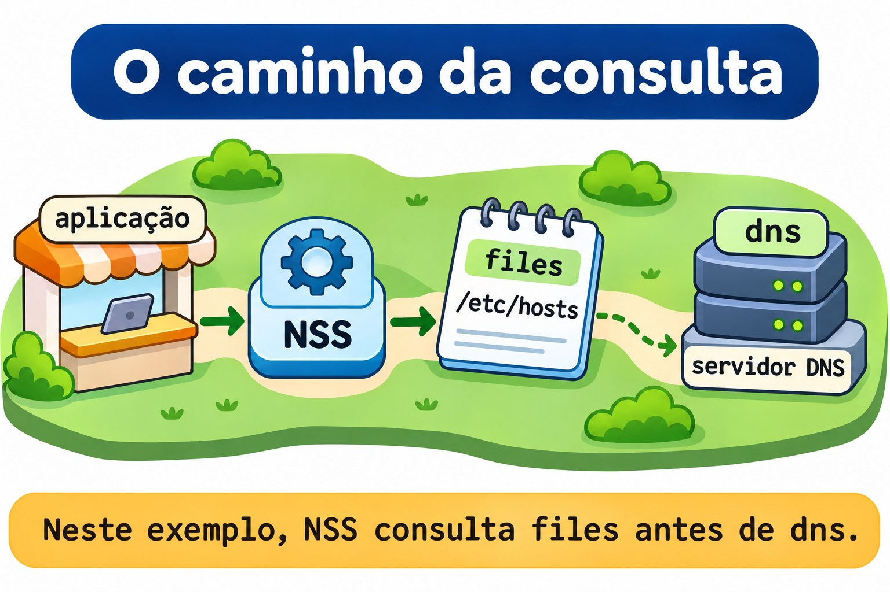
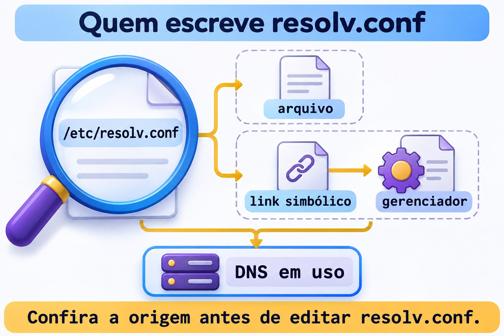

# Aula 11.4 · Nomes e resolução

No Windows Server, nome do computador, arquivo local de hosts e servidor DNS são peças diferentes. No Linux, a mesma separação evita mudanças no lugar errado. Depois de identificar o gerenciador da interface na 11.3, você vai descobrir como um programa encontra o IP de um nome, alterar o hostname no lab e conferir quem mantém a configuração de resolução.

> **Núcleo desta aula:** hostname identifica a máquina; resolução transforma um nome em endereço; NSS escolhe as fontes para programas que usam esse mecanismo. Resolver um nome não comprova que a aplicação respondeu. O resto é aprofundamento.

| Ficha |  |
| --- | --- |
| **Módulo** | M11 · Rede, aula 4 de 5 |
| **Quando** | Semana 17 |
| **Ao final** | Você distingue hostname e resolução, consulta NSS com `getent` e identifica a origem de `resolv.conf` |
| **Pré-requisitos** | Aulas 11.1 a 11.3; SSH, `sudo`, noVNC, `python3` e `curl` nas duas VMs |
| **Tempo** | Cerca de 90 minutos, mais 30 minutos para repetir sem consultar |
| **Snapshots** | `m11a4-inicio` e `m11a4-fim` nas VMs 201 e 202 |

## 1 · Aquecimento

Responda sem consultar. O gabarito fica no fim.

1. Por que um arquivo correto pode não participar da configuração de uma interface?
2. Que comando mostra a decisão de rota para um IP sem enviar um pacote de teste?
3. Resolver um IP ou receber resposta ICMP comprova que o HTTP funciona?

## 2 · Por que importa

O chamado diz que a aplicação abre pelo IP, mas não pelo nome. Você troca o gateway e reinicia a rede. Nada muda: o nome estava associado a outro IP em `/etc/hosts`. O caminho da rede funcionava; a primeira hipótese deveria ter sido a resolução usada pelo cliente.

| Pergunta | Evidência |
| --- | --- |
| Como a máquina se identifica? | `hostnamectl --static` |
| Que IP o sistema obtém para um nome? | `getent ahostsv4 NOME` |
| O arquivo local contém a entrada? | Consulta de `files` e leitura de `/etc/hosts` |
| Quais fontes participam? | Linha `hosts:` de `/etc/nsswitch.conf` |
| Qual resposta a aplicação recebeu? | Cliente do protocolo, como `curl` |

Um resultado de resolução é uma etapa do diagnóstico. Compare o endereço retornado com o endereço em que o serviço realmente atende.

## 3 · Modelo mental

Pense em um prédio com placa de identificação, agenda local e central de informações. A placa é o hostname. A agenda é `/etc/hosts`. A central representa o DNS. O recepcionista que decide onde procurar representa o NSS.

```text
programa → NSS → fontes configuradas → endereço → conexão → aplicação
                 files: /etc/hosts
                 dns: consulta DNS
```

Mudar a placa do prédio não envia automaticamente uma atualização à central de informações. Algumas redes têm mecanismos próprios de atualização dinâmica; `hostnamectl` não é, por si só, uma ferramenta de publicação de registros DNS.


*Mudar o hostname não publica um registro no DNS.*

### Ponte Windows

| Windows Server | Linux | Ideia que você reaproveita |
| --- | --- | --- |
| Nome do computador | `hostnamectl` | Identidade local do sistema |
| Arquivo local de hosts | `/etc/hosts` | Associação local entre nome e IP |
| Configuração do cliente DNS | Origem de `/etc/resolv.conf` e gerenciador | Onde o cliente obtém seus servidores |
| Consultar a resolução do sistema | `getent` | Perguntar pelo caminho usado por programas integrados ao sistema |
| Testar a aplicação depois do nome | Cliente do protocolo | Nome resolvido e serviço funcionando são evidências distintas |

## 4 · O essencial

### Hostname não é registro DNS

`hostnamectl --static` consulta o hostname estático. Ele é persistente, normalmente armazenado em `/etc/hostname`. O hostname transitório funciona como alternativa recebida da configuração de rede; o nome descritivo, chamado pretty hostname, tem finalidade de apresentação.

No lab, você usará `hostnamectl --static set-hostname` para alterar apenas a identidade estática. O nome exibido em um prompt já aberto pode ficar antigo; consulte a ferramenta e o arquivo em vez de tomar o prompt como prova.

### hosts: IP, nome principal e aliases

Uma entrada de `/etc/hosts` começa pelo endereço, seguido do nome principal e dos aliases. Nomes sem domínio e nomes completos só são equivalentes quando a configuração usada pela consulta estabelece essa relação.

```text
127.0.0.2 app.m11.test app-m11
```

Essa linha cria um mapa local para dois nomes. Ela não cria um servidor DNS, não configura um IP na placa Ethernet e não publica nada para outras máquinas. No Linux, `127.0.0.0/8` é a faixa de loopback; o serviço deste lab ficará somente nela.

### NSS: a ordem e as condições importam

`/etc/nsswitch.conf` define fontes de consulta para bases como usuários, grupos e hosts. O trecho abaixo é um exemplo de linha, não uma instrução para substituir a sua configuração:

```text
hosts: files dns
```

Nesse exemplo, a consulta tenta a tabela local antes do DNS. Outras instalações usam fontes como `myhostname` e `resolve`, além de condições entre colchetes que mudam quando a consulta continua ou termina. Leia a linha inteira.

Na Rocky, a configuração de NSS pode ser mantida pelo `authselect`. Não reescreva `nsswitch.conf` para encaixar o lab. Aqui você apenas lê a política e compara consultas.



*Neste exemplo, NSS consulta files antes de dns.*

### getent: perguntar ao sistema e isolar uma fonte

| Consulta | O que você observa |
| --- | --- |
| `getent ahostsv4 NOME` | Resolução IPv4 pelo mecanismo NSS |
| `getent -s files ahostsv4 NOME` | Somente a tabela local de hosts, para IPv4 |
| `getent -s files hosts NOME` | Entrada da tabela local, incluindo o exemplo IPv6 |
| `getent -s dns ahostsv4 NOME` | Consulta pela fonte DNS, sem usar a entrada de files |

`ahostsv4` pode mostrar o mesmo IP em linhas para tipos de socket diferentes. Isso não significa que você gravou várias entradas. O código `2` de `getent` indica que uma chave não foi encontrada.

Programas também podem manter cache próprio ou usar outro mecanismo de resolução. O lab usa clientes novos a cada teste para comparar as fontes sem depender de uma aplicação que ficou aberta.

### resolv.conf: conteúdo e responsável

O cliente DNS tradicional lê `/etc/resolv.conf`. `nameserver` informa um servidor; `search` define sufixos de busca para nomes relativos; `options` ajusta o comportamento do resolvedor. Um sufixo de busca não cria uma entrada em `/etc/hosts`.

O arquivo pode ser regular ou um link simbólico para conteúdo gerado. NetworkManager, DHCP e ferramentas de integração como `resolvconf` podem participar dessa manutenção. Com `systemd-resolved`, `127.0.0.53` costuma representar um resolvedor local, não necessariamente o DNS final da rede.

Se NSS usa a fonte `resolve`, parte da resolução conversa diretamente com `systemd-resolved`. Por isso, a linha NSS, o arquivo e o serviço ativo precisam ser lidos juntos. Não instale nem inicie resolved apenas porque viu um exemplo dele.



*Confira a origem antes de editar resolv.conf.*

### Rocky × Debian

| Item | Rocky 9, VM 201 | Debian 13, VM 202 |
| --- | --- | --- |
| Acesso | `ssh rocky-lab` | `ssh debian-lab` |
| IP da placa do curso | `10.1.0.51` | `10.1.0.52` |
| Hostname temporário deste exercício | `rocky-nomes` | `debian-nomes` |
| Mapa local e política NSS | `/etc/hosts` e `/etc/nsswitch.conf` | Mesmos caminhos |
| Origem do DNS | Confira NetworkManager e a configuração carregada | Confira o gerenciador identificado na 11.3 |
| Ferramenta de consulta | `getent`, fornecido por `glibc-common` | `getent`, fornecido por `libc-bin` |
| Endereço do serviço local | `127.0.0.2:18084` | Mesmo endereço dentro da própria VM |

## 5 · Lab guiado

Faça a sequência inteira na Rocky e depois no Debian, como `student`. Abra duas sessões por VM: A para o servidor HTTP e B para consultas. As mudanças serão no hostname estático e em um bloco marcado de `/etc/hosts`. Não altere DNS, endereço da placa, gateway ou política NSS.

**Antes de alterar:** confira acesso pelo noVNC e a sessão SSH por alias. A alteração do nome local não muda o IP nem a chave SSH da VM. Não faça o exercício no nó Proxmox.

**Passo 0 · Guardar o ponto de volta.** No nó Proxmox de cada VM:

**Palpite:** o snapshot registra por que você mudou uma entrada ou esse raciocínio precisa estar no diário?

```bash
qm snapshot 201 m11a4-inicio
qm snapshot 202 m11a4-inicio
qm listsnapshot 201
qm listsnapshot 202
```

**Saída esperada:** `m11a4-inicio` aparece nas duas listas.

**Verifique:** confirme os snapshots antes de seguir para as VMs.

**Passo 1 · Registrar a identidade e as fontes.** Na janela B:

**Palpite:** o nome visto no prompt mostra qual servidor DNS está configurado?

```bash
mkdir -m 0700 "$HOME/m11a4"
hostnamectl --static | tee "$HOME/m11a4/hostname.inicio"
ip -br address | tee "$HOME/m11a4/enderecos.inicio"
grep -n '^hosts:' /etc/nsswitch.conf
ls -l /etc/resolv.conf
readlink -f /etc/resolv.conf
cat /etc/resolv.conf
command -v getent python3 curl timeout
```

**Saída esperada:** hostname estático atual, endereços reais, linha NSS e configuração local de resolução.

**Verifique:** pare se a pasta já existir ou o hostname estático estiver vazio. Para o caminho padrão esperado neste lab, `files` precisa participar antes de fontes e condições que encerrem a consulta; registre uma política diferente antes de tentar aplicar o roteiro.

**Passo 2 · Proteger o arquivo e reservar nomes.**

**Palpite:** copiar `hosts` para um backup já muda a resolução usada pelos programas?

```bash
sudo cp -a -- /etc/hosts "$HOME/m11a4/hosts.inicio"
sudo grep -n -E 'm11a4|app\.m11\.test|app-m11|app6\.m11\.test|rocky-nomes|debian-nomes' /etc/hosts
ss -ltn 'sport = :18084'
```

**Saída esperada:** backup criado, nenhuma correspondência para os nomes reservados e somente o cabeçalho do filtro de sockets.

**Verifique:** se algum nome ou a porta já estiver em uso, pare e identifique o recurso. Não remova entradas existentes para liberar o exercício.

**Passo 3 · Criar o mapa local antes de trocar o hostname.** Na Rocky, execute somente:

**Palpite:** preparar uma entrada local faz com que outra máquina também conheça esse nome?

```bash
NOVO_HOST=rocky-nomes
```

No Debian, execute somente:

```bash
NOVO_HOST=debian-nomes
```

Depois, na janela B da VM em teste:

```bash
printf '# BEGIN m11a4\n127.0.1.1 %s\n127.0.0.2 app.m11.test app-m11\n::1 app6.m11.test\n# END m11a4\n' "$NOVO_HOST" | sudo tee -a /etc/hosts
getent -s files ahostsv4 "$NOVO_HOST"
getent -s files ahostsv4 app.m11.test
getent -s files hosts app6.m11.test
```

**Saída esperada:** o novo nome local retorna `127.0.1.1`; a aplicação retorna `127.0.0.2`; o exemplo IPv6 retorna `::1`.

**Verifique:** confirme os três endereços. A entrada do novo hostname foi preparada para manter a resolução local durante a mudança; o hostname original continua no arquivo quando já existia.

**Passo 4 · Alterar a identidade estática.**

**Palpite:** `hostnamectl` vai editar o registro da aplicação ou publicar um registro no DNS?

```bash
sudo hostnamectl --static set-hostname "$NOVO_HOST"
hostnamectl --static
cat /etc/hostname
getent -s files ahostsv4 app.m11.test
```

**Saída esperada:** ferramenta e arquivo mostram o hostname novo; a aplicação continua associada a `127.0.0.2`.

**Verifique:** não use o prompt antigo como critério. O nome da VM no Proxmox e o alias SSH do Windows não foram renomeados por esse comando.

**Passo 5 · Comparar o caminho padrão e a tabela local.**

**Palpite:** obter o mesmo IP em duas consultas demonstra que ambas passaram pelo DNS?

```bash
getent ahostsv4 app.m11.test
getent -s files ahostsv4 app.m11.test
getent -s files ahostsv4 app-m11
grep -n '^hosts:' /etc/nsswitch.conf
```

**Saída esperada:** os nomes da aplicação retornam `127.0.0.2`; as linhas por tipo de socket podem repetir o IP.

**Verifique:** a consulta forçada a `files` encontrou o mapa local. O resultado padrão deve ser interpretado junto com a ordem e as condições de NSS, não chamado automaticamente de resposta DNS.

**Passo 6 · Exigir uma resposta da aplicação.** Na janela B:

**Palpite:** um nome com IP correto basta para afirmar que existe HTTP naquela porta?

```bash
mkdir -m 0700 "$HOME/m11a4/www"
printf 'NAMES ok\n' > "$HOME/m11a4/www/index.html"
```

Na janela A da mesma VM, mantenha o servidor em primeiro plano:

```bash
python3 -m http.server 18084 --bind 127.0.0.2 --directory "$HOME/m11a4/www"
```

Na B:

```bash
curl --noproxy '*' --connect-timeout 2 --max-time 4 -4 -fsS http://app.m11.test:18084/
curl --noproxy '*' --connect-timeout 2 --max-time 4 -4 -fsS http://127.0.0.2:18084/
ss -ltn 'sport = :18084'
```

**Saída esperada:** os dois pedidos devolvem `NAMES ok`; o socket atende em `127.0.0.2:18084`.

**Verifique:** o pedido por nome percorreu resolução e HTTP; o pedido por IP permite comparar sem resolver o nome. Nenhum dos dois comprova acesso remoto ao serviço de loopback.

**Passo 7 · Descobrir a origem do DNS sem alterá-lo.**

**Palpite:** `127.0.0.53` em `resolv.conf` identifica necessariamente o servidor final da rede?

```bash
ls -l /etc/resolv.conf
readlink -f /etc/resolv.conf
grep -n -E '^[[:space:]]*(nameserver|search|domain|options)' /etc/resolv.conf
systemctl is-active NetworkManager.service
systemctl is-active systemd-resolved.service
```

**Saída esperada:** tipo do arquivo, caminho resolvido, diretivas presentes e estado dos serviços. Um serviço ausente não torna o arquivo inválido.

**Verifique:** se NetworkManager já estiver ativo, consulte `nmcli -f GENERAL.DEVICE,IP4.DNS,IP6.DNS device show`. Se resolved já estiver ativo, consulte `resolvectl status`. Não inicie um serviço parado para preencher o exemplo.

### Decida 1

`getent` retorna um IP antigo, mas a aplicação responde pelo IP correto. Qual teste reduz a dúvida?

A) Trocar o gateway. B) Comparar a fonte `files`, a linha NSS e o endereço retornado. C) Desligar o firewall.

| Se você marcou | Resultado | Por quê |
| --- | --- | --- |
| A | Sem evidência | O acesso pelo IP correto já funcionou |
| B | Certo | Você investiga a etapa que forneceu outro destino |
| C | Sem evidência | Não explica o IP diferente retornado para o nome |

### Decida 2

Você viu que `resolv.conf` é um link para conteúdo gerado. Qual ação combina com uma mudança persistente?

A) Identificar o responsável e alterar sua configuração. B) Apagar o link e colocar um DNS qualquer. C) Marcar o arquivo como imutável.

| Se você marcou | Resultado | Por quê |
| --- | --- | --- |
| A | Certo | A origem precisa manter a configuração desejada |
| B | Arriscado | Você rompe a integração sem tratar sua origem |
| C | Inadequado | Esconde a disputa de manutenção em vez de resolvê-la |

## 6 · Quebre e conserte

Faça as três quebras nas duas VMs, mantendo o servidor da janela A em funcionamento. Altere somente a entrada reservada do bloco `m11a4`.

### Quebra 1 · O nome deixou de existir na tabela local

**Palpite:** remover a associação de um nome encerra o processo que atende pelo IP?

```bash
sudo sed -i 's/^127\.0\.0\.2 app\.m11\.test app-m11$/127.0.0.2 app-errado.m11.test app-m11/' /etc/hosts
getent -s files ahostsv4 app.m11.test
echo $?
curl --noproxy '*' --connect-timeout 2 --max-time 4 -4 -fsS http://127.0.0.2:18084/
```

**Sintoma:** a consulta forçada a `files` não mostra entrada e termina com código `2`; o HTTP pelo IP continua devolvendo `NAMES ok`.

**Investigação:** confira a grafia no bloco do lab. O processo continua ativo; a associação do nome pedido foi substituída.

**Causa:** nome consultado e nome cadastrado não coincidem.

**Conserto:** restaure somente a linha reservada:

```bash
sudo sed -i 's/^127\.0\.0\.2 app-errado\.m11\.test app-m11$/127.0.0.2 app.m11.test app-m11/' /etc/hosts
getent -s files ahostsv4 app.m11.test
```

**Verifique:** a consulta volta a mostrar `127.0.0.2`; o pedido HTTP por nome volta a responder.

**Prevenção:** compare nome completo e aliases antes de mudar rede ou serviço.

### Quebra 2 · O nome existe, mas aponta para outro destino

**Palpite:** uma resolução bem-sucedida comprova que o endereço está correto para a aplicação?

```bash
sudo sed -i 's/^127\.0\.0\.2 app\.m11\.test app-m11$/127.0.0.3 app.m11.test app-m11/' /etc/hosts
getent ahostsv4 app.m11.test
ss -ltn 'sport = :18084'
curl --noproxy '*' --connect-timeout 2 --max-time 4 -4 -fsS http://app.m11.test:18084/
```

**Sintoma:** a resolução retorna `127.0.0.3`, mas o atendimento está em `127.0.0.2`; o cliente não consegue conectar ao destino pedido.

**Investigação:** compare o IP retornado por `getent` com o bind mostrado por `ss`. O nome foi encontrado; a associação está errada.

**Causa:** a tabela local levou o cliente a outro endereço de loopback.

**Conserto:** volte ao endereço do serviço:

```bash
sudo sed -i 's/^127\.0\.0\.3 app\.m11\.test app-m11$/127.0.0.2 app.m11.test app-m11/' /etc/hosts
curl --noproxy '*' --connect-timeout 2 --max-time 4 -4 -fsS http://app.m11.test:18084/
```

**Verifique:** o resultado volta a ser `NAMES ok` sem reiniciar o servidor HTTP.

**Prevenção:** valide o endereço retornado, não apenas o sucesso da consulta.

### Quebra 3 · O teste ignorou a fonte que você alterou

**Palpite:** forçar a fonte DNS permite comprovar uma alteração feita somente em `/etc/hosts`?

```bash
getent -s files ahostsv4 app.m11.test
timeout 5 getent -s dns ahostsv4 app.m11.test
getent ahostsv4 app.m11.test
```

**Sintoma:** a consulta de `files` encontra `127.0.0.2`; o teste forçado a `dns` não usa essa entrada local. O limite de cinco segundos evita esperar indefinidamente pelo DNS configurado.

**Investigação:** identifique qual fonte cada comando consultou. A aula não criou registro no servidor DNS; a resposta dessa fonte depende da configuração de DNS da rede.

**Causa:** você escolheu um teste que ignora a fonte modificada. Isso não comprova defeito em `/etc/hosts`.

**Conserto:** use a consulta padrão para observar o caminho NSS e a consulta de `files` para isolar o mapa local. Não publique nem altere DNS para fazer os resultados parecerem iguais.

**Verifique:** `getent -s files ahostsv4 app.m11.test` e o HTTP por nome continuam funcionando.

**Prevenção:** registre se o teste consulta o sistema, uma fonte específica ou a própria aplicação.

### Limpeza

**Palpite:** parar o HTTP remove automaticamente as entradas que você acrescentou em `/etc/hosts`?

Na janela A, pressione `Ctrl+C`. Na B:

```bash
ss -ltn 'sport = :18084'
getent -s files ahostsv4 app.m11.test
hostnamectl --static
```

**Saída esperada:** nenhum atendimento na porta; o mapa local e o hostname temporário ainda existem.

**Verifique:** mantenha-os até o reboot de conferência. A remoção final ocorre depois de comprovar persistência.

## 7 · Armadilhas

| Erro comum | O que fazer | Por quê |
| --- | --- | --- |
| Chamar toda resolução de DNS | Identificar as fontes NSS | O resultado pode vir de hosts |
| Mudar hostname esperando publicação | Separar identidade e registro DNS | São configurações distintas |
| Confiar no prompt antigo | Consultar hostnamectl e o arquivo | A sessão pode manter a apresentação anterior |
| Encontrar nome e parar o diagnóstico | Comparar endereço e serviço | Um IP errado também pode ser retornado com sucesso |
| Interpretar linhas de ahostsv4 como duplicatas | Ler tipo de socket e endereço | A saída distingue usos do mesmo resultado |
| Editar resolv.conf sem identificar a origem | Conferir link, arquivo e responsável | O conteúdo pode ser gerado novamente |
| Trocar NSS mantido por authselect | Identificar a origem da política | Você pode desfazer a integração do sistema |
| Usar consulta de uma fonte como teste de todas | Declarar o alcance do teste | files, DNS e HTTP não são a mesma evidência |

## 8 · Quiz

Responda sem consultar e indique um comando que sustentaria sua conclusão.

1. O que muda com `hostnamectl --static set-hostname` e o que ele não publica sozinho?
2. Que nomes a entrada `127.0.0.2 app.m11.test app-m11` associa ao endereço?
3. Por que `getent -s files` e `getent -s dns` podem dar resultados diferentes?
4. O que você verifica antes de editar `/etc/resolv.conf`?
5. Um nome retornou um IP. O que ainda falta para comprovar HTTP?
6. Qual diferença existe entre `nameserver` e `search` no cliente DNS?

## 9 · Cola

| Quero... | Comando |
| --- | --- |
| Ler o hostname estático | `hostnamectl --static` |
| Conferir sua persistência | `cat /etc/hostname` |
| Ler a ordem de hosts | `grep -n '^hosts:' /etc/nsswitch.conf` |
| Consultar IPv4 pelo NSS | `getent ahostsv4 app.m11.test` |
| Isolar a tabela local | `getent -s files ahostsv4 app.m11.test` |
| Ler o exemplo IPv6 local | `getent -s files hosts app6.m11.test` |
| Ver tipo do arquivo de resolução | `ls -l /etc/resolv.conf` |
| Seguir seu caminho | `readlink -f /etc/resolv.conf` |
| Consultar resolved já ativo | `resolvectl status` |
| Exigir a resposta HTTP | `curl --noproxy '*' -4 -fsS http://app.m11.test:18084/` |

**Flashcards:** hostname → *identidade local*; hosts → *mapa local*; NSS → *fontes e condições*; getent → *consulta do sistema*; DNS → *consulta ao servidor*; HTTP → *operação da aplicação*.

Revise em D+1, D+3, D+7 e D+21. Explique por que corrigir um nome não exige automaticamente reiniciar a rede.

## 10 · Checklist e fechamento

- [ ] Distingo identidade local, resolução e resposta da aplicação
- [ ] Leio nome principal e aliases em hosts
- [ ] Identifico fontes e condições na linha NSS
- [ ] Comparei consultas padrão e por fonte nas duas distros
- [ ] Identifico quem mantém resolv.conf antes de pensar em editá-lo
- [ ] Corrigi as quebras sem alterar DNS ou a placa do SSH
- [ ] Parei o servidor HTTP antes do reboot

**Último exercício:** explique por que o acesso por IP continuou funcionando na primeira quebra e por que a segunda resolveu o nome sem chegar ao serviço correto.

**Reboot de conferência:** confirme o nome temporário e o bloco local corretos. Em cada VM, execute `sudo systemctl reboot`, acompanhe pelo noVNC e reconecte usando o alias original.

```bash
hostnamectl --static
getent -s files ahostsv4 app.m11.test
ss -ltn 'sport = :18084'
```

**Saída esperada:** o hostname temporário e a entrada local persistiram; o servidor HTTP não voltou, pois era um processo de primeiro plano.

**Verifique:** compare a placa real com `~/m11a4/enderecos.inicio`. Você comprovou duas configurações persistentes, não a publicação de um registro DNS.

**Retorno ao estado inicial:** restaure primeiro o hostname original, depois remova somente o bloco da aula:

```bash
HOST_ORIGINAL=$(cat "$HOME/m11a4/hostname.inicio")
sudo hostnamectl --static set-hostname "$HOST_ORIGINAL"
sudo sed -i '/^# BEGIN m11a4$/,/^# END m11a4$/d' /etc/hosts
hostnamectl --static
sudo diff -u "$HOME/m11a4/hosts.inicio" /etc/hosts
ip -br address
```

**Verifique:** o hostname original voltou. Sem outras alterações durante o lab, `diff` não mostra diferenças; se mostrar, leia antes de restaurar um arquivo inteiro. Os registros em `~/m11a4` ficam como diário do exercício.

**Snapshot de fim:** no nó Proxmox de cada VM:

```bash
qm snapshot 201 m11a4-fim
qm snapshot 202 m11a4-fim
```

## 11 · Na vida real

**Missão, só leitura.** Em um servidor que você administre ou tenha autorização para observar:

```bash
hostnamectl --static
grep -n '^hosts:' /etc/nsswitch.conf
ls -l /etc/resolv.conf
readlink -f /etc/resolv.conf
cat /etc/resolv.conf
```

1. O hostname é estático? Existe um nome DNS conhecido para esse serviço e quem o mantém?
2. A configuração usa arquivo regular, link ou resolvedor local?
3. Quais fontes podem responder antes do DNS na política NSS?
4. Há entradas locais antigas que explicariam um destino diferente do esperado?

Não inicie resolved, não altere NSS e não publique registros nesta missão. Guarde apenas informações autorizadas no diário.

## 12 · Aprofundar quando quiser

- [`man hostnamectl`](https://manpages.debian.org/trixie/systemd/hostnamectl.1.en.html): tipos de hostname e seleção do nome estático.
- [`man hosts`](https://manpages.debian.org/trixie/manpages/hosts.5.en.html): nome principal, aliases e endereços.
- [`man nsswitch.conf`](https://manpages.debian.org/trixie/manpages/nsswitch.conf.5.en.html): fontes e condições de continuação.
- [`man getent`](https://manpages.debian.org/trixie/manpages/getent.1.en.html): bases, fonte específica e códigos de saída.
- [`man resolv.conf`](https://manpages.debian.org/trixie/manpages/resolv.conf.5.en.html): servidores, busca e opções do cliente.
- [`man systemd-resolved`](https://manpages.debian.org/trixie/systemd-resolved/systemd-resolved.8.en.html): integração com NSS e formas de manter resolv.conf.

**DeepTutor** (http://10.1.0.149:3782, KB "Curso Linux Sysadmin"):

- `!explica hostname, hosts, NSS e DNS com a metáfora da placa, agenda e central de informações`
- `!feynman abre pelo IP e falha pelo nome: critique minha investigação separando resolução e aplicação`
- `!quiz Aula 11.4, 6 perguntas sobre hostnamectl, hosts, getent, NSS e resolv.conf, uma por vez`

## Gabarito comentado

### Aquecimento

1. Porque o gerenciador pode não ler aquele arquivo ou sua seleção pode não alcançar a interface. Identifique origem e responsável.
2. `ip route get IP`. Ele consulta a decisão local, sem transmitir um pacote de teste ao destino.
3. Não. A aplicação precisa ser consultada com o protocolo e a porta esperados.

### Quiz

1. Altera o hostname estático persistente; não publica sozinho um registro no servidor DNS. Confira a ferramenta e `/etc/hostname`.
2. `app.m11.test` como nome principal e `app-m11` como alias. Ambos apontam localmente para `127.0.0.2`.
3. Porque uma consulta lê a tabela local e a outra usa a fonte DNS. O dado alterado pode existir apenas em uma delas.
4. Tipo do arquivo, destino do link quando houver e responsável que gera seu conteúdo. Leia também a integração com NSS e os serviços já ativos.
5. Conferir o endereço retornado, a porta, o bind e uma resposta HTTP com o conteúdo esperado. A consulta de nomes não testa essa operação.
6. `nameserver` informa onde consultar DNS; `search` informa sufixos de busca para nomes relativos. Nenhum deles cria uma entrada local em hosts.

<!-- navegacao -->
[← Aula 11.3 · Rede no Debian](11.3-rede-no-debian.md) · [Índice de aulas](../01-aulas.md) · [Aula 11.5 · Diagnóstico de rede →](11.5-diagnostico-de-rede.md)
