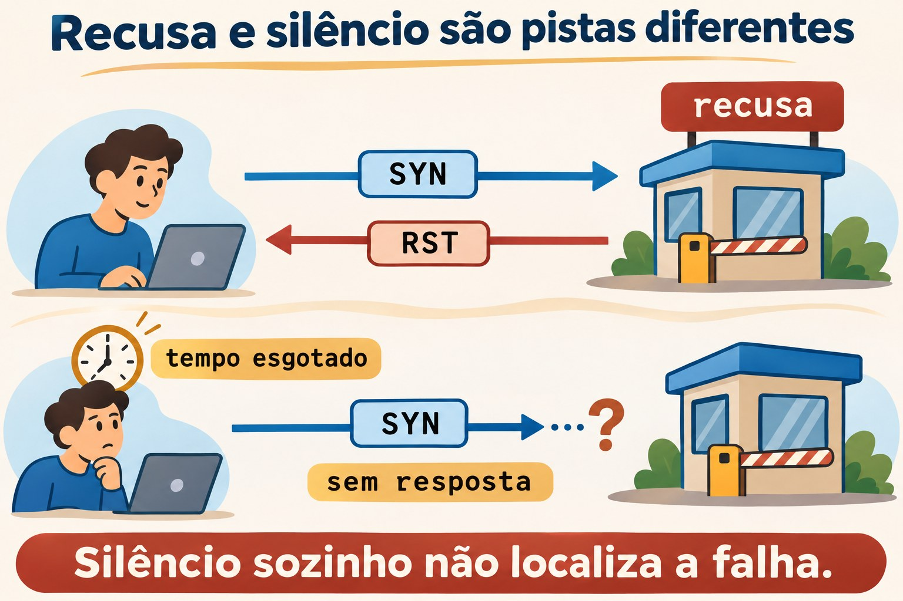
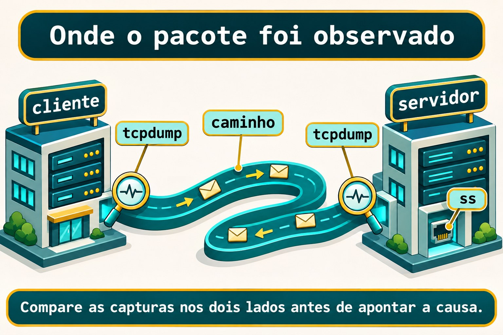

# Aula 11.5 · Diagnóstico de rede

No Windows Server, você separa resolução, caminho e porta antes de culpar a rede inteira. No Linux, vai fazer o mesmo com ferramentas pequenas e evidências que se completam. Esta aula fecha o módulo: você observa uma conexão, planta falhas controladas e comprova uma configuração persistente com IPv4 e IPv6.

> **Núcleo desta aula:** teste nome, rota, porta e aplicação separadamente. Capture nos pontos certos e limite sua conclusão ao que observou. O resto é aprofundamento.

| Ficha |  |
| --- | --- |
| **Módulo** | M11 · Rede, aula 5 de 5 |
| **Quando** | Semana 17 |
| **Ao final** | Você distingue falha de resolução, recusa TCP e ausência de resposta; registra evidências antes de corrigir |
| **Pré-requisitos** | Aulas 11.1 a 11.4; usuário `student`, `sudo`, SSH e noVNC nas duas VMs |
| **Tempo** | Cerca de 90 minutos, mais uma sessão para o desafio |
| **Snapshots** | `m11a5-inicio` e `m11a5-fim` nas VMs 201 e 202 |

## 1 · Aquecimento

Responda sem consultar. As respostas comentadas ficam no fim.

1. Qual é a diferença entre endereço configurado, perfil salvo e rota escolhida?
2. Por que `getent` e `dig` podem responder de maneiras diferentes para o mesmo nome?
3. Por que trocar o IP pela própria sessão SSH exige um console ou plano de volta?

## 2 · Por que importa

A aplicação não abre. O ping responde e alguém conclui que o problema está no navegador. Você olha o socket: o processo escuta apenas no loopback. O endereço da VM responde, mas aquela porta não atende pela interface da rede.

Seu relatório precisa dizer qual destino, família IP, porta e horário foram testados. “A rede está boa” não descreve o que foi verificado.

| Observação | Conclusão útil |
| --- | --- |
| Nome vira o IP esperado | A resolução usada neste teste respondeu |
| Conexão TCP abre | O estabelecimento TCP funcionou nessa porta |
| HTTP retorna o conteúdo esperado | A aplicação respondeu à requisição testada |

## 3 · Modelo mental

Pense no prédio do curso. O catálogo informa o endereço; a planta indica o caminho; a portaria recebe a conexão; o setor interno presta o serviço. Encontrar a rua não significa ser atendido pelo setor.

```text
nome -> endereço -> rota -> porta TCP -> resposta da aplicação
          |          |          |                 |
       getent    ip route      nc               curl
DNS: dig                         sockets: ss
                    observação de pacotes: tcpdump
```


*Um teste bem-sucedido não comprova a próxima camada.*

### Ponte Windows

| Windows Server | Linux | Pergunta |
| --- | --- | --- |
| `Resolve-DnsName` | `dig` | O servidor DNS respondeu o quê? |
| `Test-NetConnection` | `nc` e `ip route get` | Porta TCP e caminho escolhido |
| `Get-NetTCPConnection` | `ss` | Quem escuta e em qual endereço? |
| Captura de pacotes | `tcpdump` | O que passou neste ponto? |

## 4 · O essencial

### Nome, família e rota

Comece pelo destino exato. Force IPv4 ou IPv6 quando a hipótese envolver uma família. Um endereço IPv6 local funcionando não demonstra que existe uma rota IPv6 até a internet.

```bash
getent ahostsv4 debian-lab
ip -4 route get 10.1.0.52
ip -6 route get ::1
```

O primeiro comando usa NSS. O segundo consulta a decisão de encaminhamento do kernel e não envia uma sonda. Confira destino, origem escolhida e interface.

### ICMP e caminho

`ping` testa respostas ICMP. `tracepath` usa sondas UDP e respostas do caminho para mostrar saltos e informações de MTU. Um salto silencioso não identifica sozinho onde o tráfego da aplicação parou.

```bash
ping -4 -n -c 3 -W 1 10.1.0.52
tracepath -4 -n -m 5 10.1.0.52
```

### Porta não é aplicação

`nc -vz` tenta estabelecer TCP sem enviar uma requisição da aplicação. Um socket em escuta aparece em `ss -lntp`; a opção de processo exige privilégio para mostrar processos de outros usuários.

Uma recusa TCP indica uma rejeição ativa, normalmente um RST. Tempo esgotado indica que o teste não recebeu a resposta necessária dentro do prazo. A origem precisa da rejeição ou do silêncio exige mais evidências.



*Silêncio sozinho não localiza a falha.*

### DNS sem atalhos na interpretação

`dig` consulta DNS; não lê `/etc/hosts` como fonte de nomes. Leia o status, o servidor consultado e a resposta. `NOERROR` com resposta vazia difere de `NXDOMAIN`; nenhuma dessas respostas equivale a ausência de comunicação com o servidor.

```bash
dig -r +time=2 +tries=1 . NS
```

O ponto representa a raiz do DNS. O comando usa os servidores configurados; `-r` ignora ajustes pessoais de `dig`. Não esconda o status com uma consulta que mostre apenas a resposta curta.

### Captura é um ponto de observação

Escolha a interface, o filtro e a duração. `-nn` evita resolver nomes e portas; `-p` evita modo promíscuo. Uma captura no cliente mostra o que foi observado ali, não o que o servidor recebeu.



*Compare as capturas nos dois lados antes de apontar a causa.*

### Rocky × Debian

| Item | Rocky 9 | Debian 13 |
| --- | --- | --- |
| `nc` desta aula | Pacote `nmap-ncat` | Pacote `netcat-openbsd` |
| `dig` | `bind-utils` | `bind9-dnsutils` |
| `tracepath` | `iputils` | `iputils-tracepath` |
| Captura | `tcpdump` | `tcpdump` |
| Gerenciador | NetworkManager | O identificado na 11.3 |

## 5 · Lab guiado

Faça os testes locais nas duas VMs. Use três terminais identificados: A para o servidor temporário, B para os testes e C para a captura. O serviço HTTP fica no loopback e não exige abrir firewall.

### Passo 1 · Preparar e proteger

**Palpite:** o snapshot instala ferramentas ou apenas registra o estado atual da VM?

No host Proxmox, nunca dentro das VMs:

```bash
qm snapshot 201 m11a5-inicio
qm snapshot 202 m11a5-inicio
```

Na Rocky, instale as ferramentas. Na Debian, use o segundo bloco.

```bash
sudo dnf install -y iputils iproute bind-utils nmap-ncat tcpdump python3 curl
```

```bash
sudo apt update
sudo apt install -y iputils-ping iputils-tracepath iproute2 bind9-dnsutils netcat-openbsd tcpdump python3 curl
```

**Saída esperada:** snapshots criados e pacotes instalados sem erro.

**Verifique:** no host, confira `qm listsnapshot 201` e `qm listsnapshot 202`. Nas VMs, confira `command -v ping tracepath ss dig nc tcpdump python3 curl`.

### Passo 2 · Registrar o ponto de partida

**Palpite:** enxergar uma rota na tabela comprova que o outro lado respondeu?

No terminal B, escolha o IP da outra VM: na Rocky use o primeiro valor; na Debian use o segundo. Execute apenas uma atribuição.

```bash
ALVO=10.1.0.52
```

```bash
ALVO=10.1.0.51
```

Antes de criar a pasta, confirme que ela não existe. Se existir, guarde os registros antigos em outro local e escolha uma sessão limpa.

```bash
test ! -e "$HOME/m11a5"
mkdir -m 700 "$HOME/m11a5"
ip -br address | tee "$HOME/m11a5/address.inicio"
ip -4 route get "$ALVO"
sudo ss -lntp 'sport = :18085'
sudo ss -lnup 'sport = :53'
```

**Saída esperada:** rota para a outra VM e nenhuma escuta TCP na porta `18085`. Anote se existe DNS local na porta `53`; o teste de DNS quebrado exige que `127.0.0.2:53` esteja livre.

**Verifique:** se aparecer escuta em `18085`, pare este preparo e escolha um lab sem esse serviço. Uma escuta UDP em `0.0.0.0:53` também ocupa o endereço reservado ao defeito.

### Passo 3 · Comparar TCP com HTTP

**Palpite:** uma conexão TCP que abre já leu o arquivo da aplicação?

No terminal A de cada VM, crie o conteúdo e deixe o processo em primeiro plano.

```bash
mkdir "$HOME/m11a5/www"
printf 'NETWORK ok\n' > "$HOME/m11a5/www/index.html"
python3 -m http.server 18085 --bind 127.0.0.1 --directory "$HOME/m11a5/www"
```

No terminal B:

```bash
sudo ss -lntp 'sport = :18085'
nc -4 -vz -w 2 127.0.0.1 18085
curl --noproxy '*' -4 --connect-timeout 2 --max-time 4 -fsS http://127.0.0.1:18085/
```

**Saída esperada:** escuta em `127.0.0.1:18085`, conexão TCP aceita e conteúdo `NETWORK ok` no HTTP. As mensagens de `nc` diferem entre as distros.

**Verifique:** compare o log do terminal A. O teste `nc` abre TCP; o teste `curl` envia uma requisição HTTP e lê a resposta.

### Decida 1

O ping responde, mas o serviço não abre. Qual teste separa melhor porta de aplicação?

| Opção | Ação |
| --- | --- |
| A | Repetir o ping mais cem vezes |
| B | Testar a porta com `nc` e depois o protocolo com `curl` |
| C | Trocar o gateway imediatamente |

Escolha B. O objetivo é obter uma evidência nova, sem mudar a rede antes de localizar a falha.

### Passo 4 · Observar a outra VM

**Palpite:** se ICMP ficar sem resposta, a porta SSH necessariamente estará indisponível?

No terminal B, mantenha `ALVO` definido para a outra VM.

```bash
ping -4 -n -c 3 -W 1 "$ALVO"
timeout 12 tracepath -4 -n -m 5 "$ALVO"
nc -4 -vz -w 2 "$ALVO" 22
```

**Saída esperada:** no lab com SSH operacional, a porta `22` aceita a conexão. Registre o resultado real de ICMP e dos saltos; não invente tempos nem trate um salto silencioso como prova de bloqueio.

**Verifique:** abra uma nova sessão `ssh rocky-lab` ou `ssh debian-lab` a partir do Windows. O teste TCP não verificou autenticação nem execução de comandos.

### Passo 5 · Ler uma resposta DNS

**Palpite:** uma resposta DNS negativa e um servidor sem resposta são o mesmo incidente?

```bash
cat /etc/resolv.conf
dig -r +time=2 +tries=1 . NS
getent ahostsv4 localhost
```

**Saída esperada:** a consulta DNS mostra o servidor e o resultado real da rede do lab. A consulta local encontra IPv4 de loopback por NSS. Se DNS já falhar, registre a falha como condição inicial antes de plantar outro defeito.

**Verifique:** identifique no resultado de `dig` o status e o servidor. Escreva se houve resposta DNS ou falha de comunicação, sem confundir esses dois casos.

### Passo 6 · Capturar uma transação pequena

**Palpite:** o filtro por porta HTTP vai capturar todas as sessões SSH da VM?

No terminal C, execute a captura. No B, rode o `curl` do passo 3 enquanto ela estiver ativa. A captura sai pela saída padrão; o shell de `student` abre o arquivo privado, evitando depender da permissão do usuário para o qual o capturador reduz seus privilégios.

```bash
sudo timeout 15 tcpdump -i lo -nn -p -s 96 -c 20 -w - 'tcp port 18085' > "$HOME/m11a5/http.pcap"
```

Depois, no B:

```bash
sudo tcpdump -nn -r "$HOME/m11a5/http.pcap"
```

**Saída esperada:** pacotes TCP locais com a porta `18085`. A captura termina por limite de pacotes ou de tempo; `timeout` retorna `124` quando encerra pelo prazo.

**Verifique:** encontre o início com SYN e SYN/ACK, indicado normalmente por `[S]` e `[S.]`. O recorte de `96` bytes serve para este cabeçalho local; não é uma captura integral do conteúdo HTTP.

### Decida 2

Na rede entre as VMs, você viu SYN sair do cliente, mas não observou resposta. O que fazer?

| Opção | Ação |
| --- | --- |
| A | Declarar que o firewall do servidor bloqueou |
| B | Comparar captura no destino e socket em escuta |
| C | Desligar a proteção do host |

Escolha B. Para repetir o teste SSH, capture por poucos segundos em cada VM com filtro `host 10.1.0.51 and host 10.1.0.52 and tcp port 22`, usando a interface mostrada por `ip route get`. Capture apenas no seu lab.

## 6 · Quebre e conserte

### Quebra 1 · Porta sem ouvinte

No terminal A, encerre apenas o servidor temporário com Ctrl+C.

**Sintoma:** `nc` e HTTP falham no mesmo endereço que funcionava.

**Investigação:** compare ICMP, socket e tentativa TCP no terminal B.

```bash
ping -4 -n -c 1 127.0.0.1
sudo ss -lntp 'sport = :18085'
nc -4 -vz -w 2 127.0.0.1 18085
```

**Causa:** o IP local funciona, mas o processo deixou de escutar. No loopback normal deste lab, a porta fechada recebe recusa imediata.

**Conserto:** no A, execute novamente o servidor HTTP do passo 3.

**Verifique:** repita o `curl` local e obtenha `NETWORK ok`.

**Prevenção:** monitore a porta e o protocolo esperado, além da presença do host.

### Quebra 2 · Família errada

Mantenha o servidor ligado apenas em IPv4 e tente IPv6.

**Sintoma:** IPv4 entrega a página, mas a tentativa para `::1` falha.

**Investigação:** confira o endereço exato do socket.

```bash
ping -6 -n -c 1 ::1
sudo ss -lntp 'sport = :18085'
nc -6 -vz -w 2 ::1 18085
```

**Causa:** o servidor foi vinculado a `127.0.0.1`; isso não cria uma escuta em `::1`.

**Conserto:** encerre o servidor com Ctrl+C no A e inicie a escuta IPv6 local.

```bash
python3 -m http.server 18085 --bind ::1 --directory "$HOME/m11a5/www"
```

**Verifique:** no B, execute os dois testes abaixo.

```bash
nc -6 -vz -w 2 ::1 18085
curl --noproxy '*' -6 --connect-timeout 2 --max-time 4 -fsS 'http://[::1]:18085/'
```

**Prevenção:** anote família, endereço de escuta e porta como parte da configuração do serviço.

### Quebra 3 · Consultar o DNS errado

**Sintoma:** a consulta explícita abaixo falha, embora a consulta DNS do passo 5 tenha respondido. Só faça esta comparação após obter a resposta normal de referência. Este defeito afeta apenas o comando, sem editar a configuração global.

**Investigação:** confirme a ausência de escuta em `127.0.0.2:53`, depois compare as consultas.

```bash
dig -r @127.0.0.2 +time=1 +tries=1 . NS
dig -r +time=2 +tries=1 . NS
```

**Causa:** a primeira consulta escolheu um endereço sem servidor DNS. A segunda voltou à configuração normal. A mensagem exata da falha varia entre versões.

**Conserto:** retire o servidor explícito incorreto do comando. Não altere `/etc/hosts` para esconder a falha.

**Verifique:** a consulta normal deve voltar ao resultado de referência anotado no passo 5.

**Prevenção:** registre o servidor realmente consultado junto com a resposta DNS.

### Limpeza

Encerre o servidor temporário com Ctrl+C no A. As capturas já terminam por tempo ou contagem; guarde a pasta privada como registro. Nenhum arquivo global de rede foi modificado no lab guiado.

```bash
sudo ss -lntp 'sport = :18085'
ip -br address
```

Compare os endereços com `address.inicio`. O desafio abaixo cria e remove apenas uma interface de exercício, sem trocar o endereço usado pelo SSH.

## 7 · Armadilhas

| Erro comum | O que fazer | Por quê |
| --- | --- | --- |
| Ping respondeu, aplicação está boa | Testar TCP e o protocolo | ICMP não verifica HTTP |
| Um salto não respondeu, ali está o defeito | Comparar o tráfego real nos dois lados | Sondas e aplicação usam tráfegos diferentes |
| Capturar tudo indefinidamente | Limitar interface, filtro e duração | Reduz exposição e facilita a análise |
| Procurar DNS com `dig` e esperar ler hosts | Comparar DNS e NSS separadamente | As fontes consultadas são diferentes |
| Usar um glob protegido antes de `sudo` | Deixar o programa privilegiado selecionar os arquivos | O shell comum expande o glob antes |

## 8 · Quiz

1. Um `nc` TCP aceito comprova que o login SSH foi autorizado?
2. Qual teste mostra uma decisão de rota sem enviar uma sonda?
3. Como diferenciar uma resposta DNS negativa de ausência de resposta DNS?
4. SYN observado apenas no cliente comprova que o servidor o recebeu?
5. Uma escuta em `127.0.0.1` atende automaticamente `::1`?
6. Por que confirmar a configuração depois do reboot?

## 9 · Cola

| Tarefa | Comando |
| --- | --- |
| Consultar resolução NSS | `getent ahostsv4 localhost` |
| Consultar DNS | `dig -r +time=2 +tries=1 . NS` |
| Decisão IPv4 | `ip -4 route get 10.1.0.52` |
| Escuta TCP e processo | `sudo ss -lntp` |
| Tentativa TCP | `nc -4 -vz -w 2 10.1.0.52 22` |
| Ler captura sem resolver nomes | `sudo tcpdump -nn -r "$HOME/m11a5/http.pcap"` |

**Flashcards:** crie quatro cartões sobre resolução, rota, TCP e aplicação. Revise em D+1, D+3, D+7 e D+21.

## 10 · Checklist e fechamento

- [ ] Fiz o lab guiado nas duas distros.
- [ ] Separei as evidências de ICMP, TCP, DNS e HTTP.
- [ ] Expliquei as três falhas sem desligar proteções.
- [ ] Concluí o desafio, restaurei o DNS e removi o perfil de exercício.

**Último exercício:** escreva um relatório com sintoma, hipótese, teste, resultado e conclusão. Identifique uma afirmação que suas evidências ainda não permitem fazer.

**Reboot de conferência:** primeiro faça a verificação de persistência do desafio. Após a limpeza dele, reinicie as duas VMs e confirme SSH, endereços originais, DNS normal e ausência do servidor temporário e da interface de exercício.

```bash
sudo systemctl reboot
```

Depois de concluir o desafio e a limpeza, crie os snapshots finais no host Proxmox.

```bash
qm snapshot 201 m11a5-fim
qm snapshot 202 m11a5-fim
```

## 11 · Na vida real

Em um servidor que você administre ou tenha autorização para inspecionar, faça uma missão somente de leitura. Observe endereços, rotas e sockets com `ip -br address`, `ip route` e `sudo ss -lntp`. Não instale ferramentas, não altere perfis e não capture tráfego de usuários nesta missão.

Qual serviço escuta apenas no loopback? Qual escuta em um endereço da rede? Que evidência adicional seria necessária para confirmar o atendimento de uma aplicação a um cliente remoto?

## 12 · Aprofundar quando quiser

- [ping(8)](https://man7.org/linux/man-pages/man8/ping.8.html) e [tracepath(8)](https://man7.org/linux/man-pages/man8/tracepath.8.html): sondas e interpretação.
- [ss(8)](https://man7.org/linux/man-pages/man8/ss.8.html) e [nc(1)](https://manpages.debian.org/trixie/netcat-openbsd/nc.1.en.html): sockets e tentativas TCP.
- [Ncat](https://nmap.org/ncat/guide/ncat-usage.html), [dig(1)](https://manpages.debian.org/trixie/bind9-dnsutils/dig.1.en.html) e [tcpdump(8)](https://manpages.debian.org/trixie/tcpdump/tcpdump.8.en.html): variantes e opções do lab.
- [nmcli](https://networkmanager.pages.freedesktop.org/NetworkManager/NetworkManager/nmcli.html) e [propriedades IPv4](https://networkmanager.pages.freedesktop.org/NetworkManager/NetworkManager/settings-ipv4.html): persistência e prioridade DNS do desafio.

**DeepTutor** (http://10.1.0.149:3782, KB "Curso Linux Sysadmin"):

- `!explica Compare ping, nc, curl e tcpdump e limite a conclusão de cada teste.`
- `!feynman Vou explicar por que SYN sem resposta não identifica sozinho a causa. Critique minha explicação.`
- `!quiz Crie seis incidentes de resolução, rota, porta e aplicação sem sugerir desligar proteções.`

## Desafio do M11 · Endereço persistente, DNS recuperado

Na VM 201, entregue IPv4 e IPv6 fixos que sobrevivam ao reboot. Use uma interface dummy própria, sem mudar a interface de acesso nem anunciar DHCP na rede. Essa escolha comprova persistência local; não demonstra conectividade IPv6 externa.

Faça a etapa de DNS pelo noVNC. Ela muda temporariamente o resolvedor usado pela VM. Tenha a consulta DNS inicial funcionando e confirme que `127.0.0.2:53` está livre, como no passo 2.

### Preparação e critérios

Este roteiro usa a Rocky padrão com NetworkManager mantendo diretamente `/etc/resolv.conf`, sem um intermediário local de DNS. Confira `ls -l /etc/resolv.conf`, `sudo NetworkManager --print-config` e o cabeçalho do arquivo antes de prosseguir. Se a origem for diferente, adapte com o responsável pelo lab antes de aplicar o defeito global.

Confirme que não existem perfil `m11final` nem interface `m11dummy5`. Se existirem, não reutilize trabalho anterior sem revisá-lo. Os prefixos documentais abaixo ficam apenas nessa interface local.

```bash
nmcli connection show
ip link show
dig -r +time=2 +tries=1 . NS
sudo nmcli connection add type dummy ifname m11dummy5 con-name m11final connection.autoconnect yes ipv4.method manual ipv4.addresses 192.0.2.15/24 ipv4.never-default yes ipv6.method manual ipv6.addresses 2001:db8:15::15/64 ipv6.never-default yes
sudo nmcli connection up m11final
ip -br address show dev m11dummy5
```

Espere o IPv6 sair de `tentative` em `ip -6 address show dev m11dummy5`. Reinicie a VM 201 e confirme perfil ativo, endereços presentes e os dois testes locais:

```bash
nmcli connection show --active
ip -br address show dev m11dummy5
ping -4 -n -c 1 192.0.2.15
ping -6 -n -c 1 2001:db8:15::15
```

### Defeito DNS e recuperação

Registre primeiro a consulta DNS normal. Depois, no noVNC, configure no perfil de exercício um DNS incorreto com prioridade negativa. Nesse gerenciador, a menor prioridade negativa exclui servidores de perfis com prioridade maior da seleção DNS.

```bash
sudo nmcli connection modify m11final ipv4.dns 127.0.0.2 ipv4.dns-priority -100
sudo nmcli connection up m11final
cat /etc/resolv.conf
dig -r +time=1 +tries=1 . NS
ping -4 -n -c 1 192.0.2.15
```

Antes de concluir, confira que o único servidor selecionado no arquivo é `127.0.0.2`. O DNS deve falhar enquanto o IP local continua funcionando. Se houver outro servidor, não atribua qualquer sucesso ou falha a esse defeito: revise a origem e as prioridades.

Remova apenas as propriedades que você adicionou ao perfil novo e confira o retorno à resposta DNS inicial. Não edite o arquivo gerado à mão.

```bash
sudo nmcli connection modify m11final ipv4.dns '' ipv4.dns-priority 0
sudo nmcli connection up m11final
cat /etc/resolv.conf
dig -r +time=2 +tries=1 . NS
```

Entregue o antes e depois do reboot, a falha DNS, a recuperação e uma explicação de por que ICMP local continuou funcionando. Não basta mostrar o perfil salvo.

### Limpeza do desafio

Após guardar as evidências, remova o perfil e a interface criados. Confirme a recuperação DNS antes de sair do console.

```bash
sudo nmcli connection down m11final
sudo nmcli connection delete m11final
sudo ip link delete m11dummy5
dig -r +time=2 +tries=1 . NS
ip -br address
```

Se a interface já não existir após desativar o perfil, o comando de exclusão informa isso; confirme a ausência com `ip link show`. Os endereços da interface SSH precisam permanecer iguais aos iniciais.

## Gabarito comentado

### Aquecimento

1. O endereço pertence ao estado ativo; o perfil guarda a intenção persistente; a rota decide a saída para um destino. Confira os três.
2. `getent` usa NSS; `dig` consulta DNS. Um nome local em hosts não precisa existir no DNS.
3. A sessão depende do endereço e do caminho que você está alterando. O noVNC permite corrigir sem depender desse SSH.

### Quiz

1. Não. O estabelecimento TCP antecede a autenticação do serviço.
2. `ip route get` consulta a decisão do kernel para o destino informado.
3. A negativa tem uma resposta com status DNS; a ausência de resposta aparece como falha de comunicação ou tempo esgotado. Leia também o servidor consultado.
4. Não. Compare a captura do destino e considere o caminho de retorno antes de apontar uma causa.
5. Não. IPv4 e IPv6 são famílias distintas; confira a escuta efetiva.
6. O estado ativo pode ter sido criado sem persistência. O reboot testa se o gerenciador reconstrói a configuração salva.

### Dicas do Desafio

Separe intenção, estado e comportamento: perfil salvo, endereço ativo após reboot e teste de resposta local. No DNS, compare o arquivo gerado com a propriedade que o gerenciador recebeu. A correção precisa acontecer na origem da configuração.

O próximo módulo usa essas evidências para aprofundar SSH e proteção do host. Guarde seu relatório: ele vale mais que uma lista de comandos sem contexto.

<!-- navegacao -->
[← Aula 11.4 · Nomes e resolução](11.4-nomes-e-resolucao.md) · [Índice de aulas](../01-aulas.md) · [Plano do curso: M12 em diante →](../00-plano-do-curso.md)
