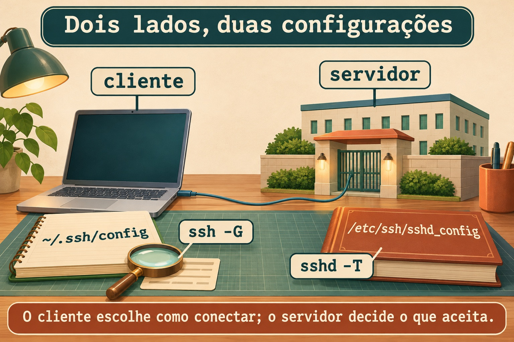
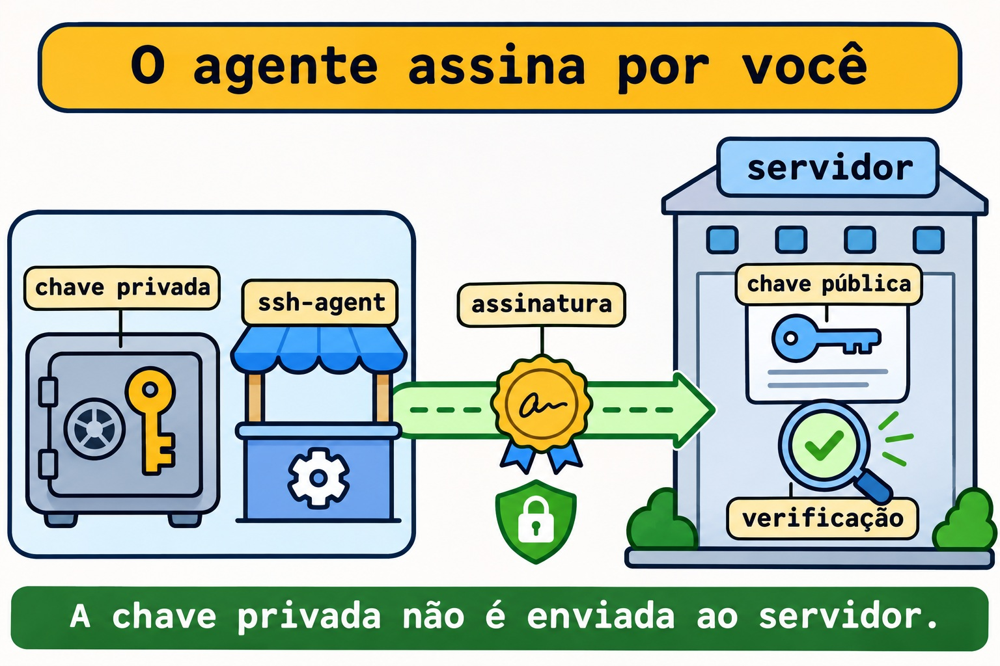
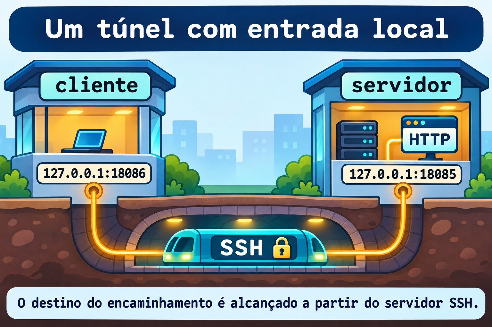

# Aula 12.1 · SSH a fundo

No Windows Server, você já separa identidade, credencial e destino. No SSH, essa separação aparece na chave do usuário, na chave do host e na configuração do cliente. Depois do diagnóstico de rede do M11, você vai organizar conexões, usar um agente e abrir um túnel que só atende localmente.

> **Núcleo desta aula:** o cliente decide como chegar; o servidor decide o que permite; a chave do host identifica o destino. Valide a configuração antes de aplicar e preserve uma sessão de recuperação. O resto é aprofundamento.

| Ficha |  |
| --- | --- |
| **Módulo** | M12 · Segurança do host, aula 1 de 5 |
| **Quando** | Semana 17 |
| **Ao final** | Você confere identidades, organiza o cliente, usa agente e túnel local e valida regras de servidor sem perder acesso |
| **Pré-requisitos** | Aulas 0.2 e 11.5; `student`, SSH por chave nas duas VMs, `sudo`, `python3`, `curl` e noVNC |
| **Tempo** | Cerca de 90 minutos |
| **Snapshots** | `m12a1-inicio` e `m12a1-fim` nas VMs 201 e 202 |

## 1 · Aquecimento

Responda sem consultar. O gabarito fica no fim.

1. Conectar à porta `22` com `nc` comprova que sua chave foi aceita?
2. Por que uma escuta em `127.0.0.1` não atende diretamente outra máquina?
3. Que diferença existe entre uma configuração salva e o comportamento efetivo?

## 2 · Por que importa

Você recebe um alerta de chave do host alterada. Apagar a entrada e tentar de novo faz a mensagem sumir, mas não explica quem está do outro lado. O caminho profissional é conferir a impressão digital pelo console confiável antes de aceitar a nova identidade.

Outro chamado diz que uma página interna não abre. O serviço escuta apenas no loopback do servidor. Um encaminhamento local permite chegar a essa porta pelo SSH sem publicar o HTTP na rede.

| Peça | Pergunta |
| --- | --- |
| Chave do host | Estou falando com o servidor esperado? |
| Chave do usuário | Este usuário controla a credencial autorizada? |
| Regra do servidor | Esta operação é permitida para esta conexão? |

## 3 · Modelo mental

O cliente guarda uma agenda de prédios. O servidor mantém sua portaria e uma lista de chaves públicas autorizadas. O agente é um balcão local que realiza assinaturas com uma chave carregada; ele não entrega a chave privada ao prédio.

```text
cliente: destino + identidade -> canal SSH -> servidor: regras + autorização
           |                                      |
      ~/.ssh/config                       /etc/ssh/sshd_config
           |                                      |
        ssh -G                                 sshd -T
```



*O cliente escolhe como conectar; o servidor decide o que aceita.*

### Ponte Windows

| Conceito | Windows com OpenSSH | Linux |
| --- | --- | --- |
| Configuração do usuário | `$HOME\.ssh\config` | `~/.ssh/config` |
| Agente | Serviço `ssh-agent` | Processo e socket do agente |
| Carregar chave | `ssh-add` | `ssh-add` |
| Inspecionar destino | `ssh -G` | `ssh -G` |

No Windows, o agente é um serviço: seu preparo pode exigir PowerShell elevado. O lab do agente abaixo acontece no Linux e usa um processo temporário, sem alterar o serviço do Windows.

## 4 · O essencial

### Duas chaves com funções diferentes

A pública do usuário entra em `authorized_keys` no servidor. A privada fica protegida no cliente. As chaves do host identificam o servidor; a pública correspondente fica registrada em `known_hosts` no cliente após a conferência.

Use uma frase secreta na chave privada. O agente reduz a repetição da digitação, mas uma sessão local comprometida ainda pode usar as operações de assinatura oferecidas por ele.



*A chave privada não é enviada ao servidor.*

### Configuração do cliente

`ssh -G` mostra a configuração calculada sem abrir a conexão. Em geral, o primeiro valor encontrado para uma opção prevalece; coloque destinos específicos antes das regras gerais. `-F` permite testar uma agenda separada sem mexer na existente.

`IdentitiesOnly yes` limita as identidades oferecidas às configuradas. Não use `StrictHostKeyChecking no` como solução para uma identidade de servidor desconhecida.

### Túnel local e salto

Em `-L 127.0.0.1:18086:127.0.0.1:18085`, o primeiro endereço é a entrada no cliente. O segundo é o destino alcançado pelo servidor SSH. Os dois loopbacks pertencem a lados diferentes da conexão.

`-N` dispensa o comando remoto. `ExitOnForwardFailure yes` detecta falha ao criar a escuta local, mas não comprova que o serviço de destino esteja funcionando.



*O destino do encaminhamento é alcançado a partir do servidor SSH.*

`ProxyJump` usa um servidor intermediário para transportar a conexão até o destino. A autenticação do destino continua no cliente; não é preciso copiar a chave privada para o intermediário nem encaminhar o agente.

### Servidor seguro, mudança verificável

`sshd -t` verifica sintaxe e condições de configuração; `sshd -T` mostra valores efetivos. Com `-C`, você informa os dados de uma conexão para avaliar regras `Match`. Nenhum desses testes substitui uma nova conexão real.

Antes de aplicar regras: tenha noVNC, preserve a sessão atual, valide, recarregue e teste uma segunda sessão com a chave. Só depois encerre a primeira. Nesta aula você valida uma configuração candidata fora de `/etc`; não recarrega o serviço ativo.

### Rocky × Debian

| Item | Rocky 9 | Debian 13 |
| --- | --- | --- |
| Cliente | `openssh-clients` | `openssh-client` |
| Servidor | `openssh-server` | `openssh-server` |
| Unidade de serviço | `sshd.service` | `ssh.service` |
| Validador | `/usr/sbin/sshd` | `/usr/sbin/sshd` |
| Política adicional | SELinux e política criptográfica | Configuração e políticas locais |

## 5 · Lab guiado

Repita os testes locais nas duas VMs como `student`. Você cria uma chave exclusiva de exercício e usa SSH de cada VM para ela mesma. Isso isola o aprendizado sem substituir a chave que já dá acesso pelo Windows.

### Passo 1 · Proteger e conferir

**Palpite:** um snapshot substitui a verificação da chave do host?

No host Proxmox:

```bash
qm snapshot 201 m12a1-inicio
qm snapshot 202 m12a1-inicio
```

No terminal B de cada VM, confirme o usuário e os pré-requisitos. A pasta de exercício precisa estar ausente antes de criar uma nova.

```bash
id -un
command -v ssh ssh-keygen ssh-agent ssh-add python3 curl
test ! -e "$HOME/m12a1"
mkdir -m 700 "$HOME/m12a1"
sudo ss -lntp 'sport = :22'
sudo ss -lntp 'sport = :18085 or sport = :18086'
```

**Saída esperada:** usuário `student`, ferramentas encontradas, SSH em escuta e portas `18085` e `18086` livres. Se alguma verificação falhar, ajuste o preparo antes de prosseguir.

**Verifique:** mantenha a sessão do Windows aberta e confirme que o console noVNC da VM está disponível.

### Passo 2 · Criar identidade e agenda de exercício

**Palpite:** o servidor precisa receber a chave privada para autorizar a pública?

Crie a chave com uma frase secreta. Não deixe o campo vazio. Os caminhos abaixo são exclusivos desta aula.

```bash
ssh-keygen -t ed25519 -f "$HOME/m12a1/id_ed25519" -C m12a1-lab
chmod 700 "$HOME/.ssh"
cp -a "$HOME/.ssh/authorized_keys" "$HOME/m12a1/authorized_keys.inicio"
printf '\n' >> "$HOME/.ssh/authorized_keys"
cat "$HOME/m12a1/id_ed25519.pub" >> "$HOME/.ssh/authorized_keys"
chmod 600 "$HOME/.ssh/authorized_keys"
cat > "$HOME/m12a1/config" <<'EOF'
Host m12-local
    HostName 127.0.0.1
    User student
    Port 22
    IdentityFile ~/m12a1/id_ed25519
    IdentitiesOnly yes
    UserKnownHostsFile ~/m12a1/known_hosts
    HostKeyAlgorithms ssh-ed25519
    ForwardAgent no
    ExitOnForwardFailure yes
    ServerAliveInterval 30
    ServerAliveCountMax 3
EOF
chmod 600 "$HOME/m12a1/config"
ssh -F "$HOME/m12a1/config" -G m12-local | grep -E '^(hostname|user|port|identityfile|forwardagent) '
```

**Saída esperada:** par de chaves criado, apenas a pública adicionada à autorização e configuração calculada apontando para o loopback. O arquivo `authorized_keys` já existia pelo acesso por chave da aula 0.2.

**Verifique:** `ssh -G` não abriu uma sessão nem confirmou a aceitação da chave. Confira usuário, destino e arquivo de identidade antes da tentativa real.

### Passo 3 · Conferir o host e autenticar

**Palpite:** a impressão digital pedida no primeiro acesso pertence à sua chave de usuário ou ao servidor?

No console confiável da VM, veja a impressão digital da chave pública do host. No B, abra o acesso de exercício e compare antes de aceitar.

```bash
sudo ssh-keygen -lf /etc/ssh/ssh_host_ed25519_key.pub
ssh -F "$HOME/m12a1/config" m12-local 'id -un; hostname'
```

**Saída esperada:** o primeiro acesso usa a agenda separada, pede confirmação da identidade ainda não registrada e solicita a frase secreta da chave. O comando remoto mostra `student` e o hostname da própria VM.

**Verifique:** a impressão exibida no acesso precisa coincidir com a obtida no console. Se não coincidir, pare e investigue.

### Decida 1

O SSH avisa que a chave do host mudou. O que vem primeiro?

| Opção | Ação |
| --- | --- |
| A | Apagar todas as entradas de `known_hosts` |
| B | Conferir a identidade pelo console confiável |
| C | Desativar a verificação de host |

Escolha B. Uma reinstalação pode explicar a mudança, mas a confirmação vem de uma fonte independente da conexão em dúvida.

### Passo 4 · Usar um agente temporário

**Palpite:** carregar a chave no agente apaga o arquivo privado do disco?

No B, abra uma shell filha sob um agente próprio. Os comandos seguintes são executados dentro dela.

```bash
ssh-agent bash
ssh-add -t 600 "$HOME/m12a1/id_ed25519"
ssh-add -l
ssh -F "$HOME/m12a1/config" -o BatchMode=yes m12-local 'id -un'
```

**Saída esperada:** uma identidade carregada por até dez minutos e acesso sem nova pergunta de frase secreta. O agente pode assinar usando a chave em memória; o arquivo privado continua existindo.

**Verifique:** o comando com `BatchMode=yes` não pode recorrer a uma pergunta interativa. Se falhar depois de dez minutos, recarregue apenas a chave de exercício com `ssh-add`.

### Passo 5 · Abrir um encaminhamento local

**Palpite:** abrir o túnel publica o HTTP em todas as interfaces do cliente?

No terminal A da mesma VM, inicie HTTP só no loopback.

```bash
mkdir "$HOME/m12a1/www"
printf 'SSH TUNNEL ok\n' > "$HOME/m12a1/www/index.html"
python3 -m http.server 18085 --bind 127.0.0.1 --directory "$HOME/m12a1/www"
```

No B, dentro da shell do agente, deixe o túnel em primeiro plano. No C, faça os testes do segundo bloco.

```bash
ssh -F "$HOME/m12a1/config" -N -L 127.0.0.1:18086:127.0.0.1:18085 m12-local
```

```bash
ss -lnt 'sport = :18086'
curl --noproxy '*' --connect-timeout 2 --max-time 4 -fsS http://127.0.0.1:18086/
```

**Saída esperada:** entrada em `127.0.0.1:18086` e resposta `SSH TUNNEL ok`. O SSH transporta a conexão até a porta HTTP do lado servidor.

**Verifique:** `ss` deve mostrar loopback, não `0.0.0.0` nem `[::]`. Neste exercício os dois lados estão na mesma VM, mas continuam sendo papéis diferentes; em uso remoto, o último loopback pertence à VM de destino.

### Decida 2

O túnel abriu, mas o HTTP falha. O que deve ser verificado antes de culpar a criptografia?

| Opção | Ação |
| --- | --- |
| A | O endereço e a porta do serviço no lado servidor |
| B | Apagar a chave privada |
| C | Abrir o HTTP para a rede inteira |

Escolha A. A escuta local pode existir enquanto o destino do encaminhamento está errado ou sem serviço.

### Passo 6 · Salto e configuração candidata

**Palpite:** passar por um intermediário exige deixar a chave privada nele?

Do terminal do Windows já preparado na 0.2, faça o salto pela Rocky até a Debian. Os aliases existentes conservam usuário e arquivo de chave de cada destino. O cliente local precisa conseguir autenticar nas duas VMs com suas chaves existentes. Confira qualquer nova identidade pelo console.

```bash
ssh -o ForwardAgent=no -J rocky-lab debian-lab hostname
```

Nas duas VMs, inspecione as regras atuais sem mudá-las e escreva uma candidata separada. Essa porta candidata não será aberta.

```bash
sudo /usr/sbin/sshd -t
sudo /usr/sbin/sshd -T -C user=student,host=localhost,addr=127.0.0.1 | grep -E '^(permitrootlogin|pubkeyauthentication|passwordauthentication|kbdinteractiveauthentication|allowtcpforwarding|allowagentforwarding) '
cat > "$HOME/m12a1/sshd.candidate" <<'EOF'
Port 22285
ListenAddress 127.0.0.1
HostKey /etc/ssh/ssh_host_ed25519_key
PidFile /run/sshd-m12a1.pid
AuthorizedKeysFile .ssh/authorized_keys
PermitRootLogin no
PubkeyAuthentication yes
PasswordAuthentication no
KbdInteractiveAuthentication no
UsePAM yes
AllowAgentForwarding no
AllowTcpForwarding local
X11Forwarding no
EOF
sudo /usr/sbin/sshd -t -f "$HOME/m12a1/sshd.candidate"
sudo /usr/sbin/sshd -T -f "$HOME/m12a1/sshd.candidate" -C user=student,host=localhost,addr=127.0.0.1 | grep -E '^(permitrootlogin|pubkeyauthentication|passwordauthentication|kbdinteractiveauthentication|allowtcpforwarding|allowagentforwarding) '
```

**Saída esperada:** o salto retorna o hostname da Debian. A candidata passa na sintaxe e mostra login de root e autenticações interativas desativados, chave pública ativa, encaminhamento de agente desativado e encaminhamento TCP local permitido.

**Verifique:** a candidata não contém `Include`, portanto não herda os arquivos ativos neste teste. Nenhuma dessas opções foi aplicada ao serviço: a porta `22` e o acesso normal precisam continuar funcionando.

## 6 · Quebre e conserte

### Quebra 1 · Destino de cliente errado

**Sintoma:** a tentativa abaixo falha, mas a sessão já aberta continua funcionando.

**Investigação:** compare a porta calculada com a porta em escuta.

```bash
ssh -F "$HOME/m12a1/config" -p 22286 -G m12-local | grep '^port '
ssh -F "$HOME/m12a1/config" -p 22286 -o ConnectTimeout=3 m12-local hostname
sudo ss -lntp 'sport = :22 or sport = :22286'
```

**Causa:** a opção da linha de comando substituiu a porta da agenda. A falha acontece antes da autenticação.

**Conserto:** retire `-p 22286` da tentativa e use a agenda validada.

**Verifique:** `ssh -F "$HOME/m12a1/config" m12-local hostname` volta a responder.

**Prevenção:** consulte `ssh -G` antes de mudar o servidor para compensar um erro do cliente.

### Quebra 2 · Túnel aberto, destino fechado

Encerre o túnel no B com Ctrl+C. Confirme que `18087` não está em escuta e use essa porta incorreta como destino.

**Sintoma:** a entrada local existe, mas o HTTP não entrega o conteúdo.

**Investigação:** no B, abra o túnel abaixo; no C, repita o `curl` da entrada.

```bash
ss -lnt 'sport = :18087'
ssh -F "$HOME/m12a1/config" -N -L 127.0.0.1:18086:127.0.0.1:18087 m12-local
```

**Causa:** a entrada foi criada, mas o servidor SSH não encontra serviço no destino escolhido. O terminal do túnel informa a falha de abertura do canal.

**Conserto:** encerre esse túnel e reabra o comando do passo 5 com destino `18085`.

**Verifique:** o mesmo `curl` volta a mostrar `SSH TUNNEL ok`.

**Prevenção:** registre os dois lados do encaminhamento; testar a escuta local não testa a aplicação remota.

### Quebra 3 · Regra inválida antes de aplicar

**Sintoma:** a candidata deixa de passar na validação, mas o SSH ativo continua disponível.

**Investigação:** acrescente uma diretiva inexistente apenas na cópia de exercício.

```bash
printf '\nInvalidOption yes\n' >> "$HOME/m12a1/sshd.candidate"
sudo /usr/sbin/sshd -t -f "$HOME/m12a1/sshd.candidate"
```

**Causa:** a diretiva não existe. O validador informa o arquivo e a linha problemática sem precisar reiniciar o serviço.

**Conserto:** remova apenas a linha plantada na candidata.

```bash
sed -i '/^InvalidOption yes$/d' "$HOME/m12a1/sshd.candidate"
sudo /usr/sbin/sshd -t -f "$HOME/m12a1/sshd.candidate"
```

**Verifique:** a candidata volta a passar; abra uma nova sessão normal do Windows para comprovar que o serviço real continua acessível.

**Prevenção:** valide sintaxe e valores efetivos antes de recarregar. Depois da aplicação, teste uma segunda sessão antes de fechar a primeira.

### Limpeza

Encerre o túnel com Ctrl+C no B e o HTTP com Ctrl+C no A. No B, remova apenas a chave de exercício do agente e saia da shell filha. Não use a opção que remove todas as identidades de um agente compartilhado.

```bash
ssh-add -d "$HOME/m12a1/id_ed25519"
exit
```

Agora na shell original, retire apenas a linha da pública adicionada. O filtro preserva outras chaves; uma saída vazia do filtro não é autorização para restaurar cegamente o backup inteiro. O separador em branco acrescentado no preparo pode permanecer.

```bash
grep -vxF -f "$HOME/m12a1/id_ed25519.pub" "$HOME/.ssh/authorized_keys" > "$HOME/m12a1/authorized_keys.clean"
diff -u "$HOME/.ssh/authorized_keys" "$HOME/m12a1/authorized_keys.clean"
```

Confira no `diff` que só a linha `m12a1-lab` foi removida. Apenas depois dessa conferência, grave o resultado.

```bash
cat "$HOME/m12a1/authorized_keys.clean" > "$HOME/.ssh/authorized_keys"
chmod 600 "$HOME/.ssh/authorized_keys"
sudo ss -lntp 'sport = :18085 or sport = :18086'
```

Guarde os arquivos de exercício em sua pasta privada; a chave já não está autorizada. Não altere a chave do Windows nem sua autorização original.

## 7 · Armadilhas

| Erro comum | O que fazer | Por quê |
| --- | --- | --- |
| Copiar a privada para o salto | Usar `ProxyJump` | O cliente autentica no destino |
| Abrir o túnel em todas as interfaces | Vincular a entrada a `127.0.0.1` | Mantém a entrada local |
| Confundir `ssh_config` com `sshd_config` | Identificar cliente e servidor | Cada lado decide coisas diferentes |
| Desligar senha antes de testar a chave | Validar nova sessão e manter console | Evita perder acesso |
| Remover toda a confiança do cliente | Conferir a identidade e corrigir a entrada específica | Preserva os outros destinos |

## 8 · Quiz

1. Qual chave identifica o servidor e onde sua confiança é registrada pelo cliente?
2. `ssh -G` comprova autenticação?
3. O que `IdentitiesOnly yes` limita?
4. Em um túnel local, de qual máquina é o último `127.0.0.1`?
5. Por que o salto não exige encaminhar o agente?
6. Que sequência evita perder acesso ao endurecer o servidor?

## 9 · Cola

| Tarefa | Comando |
| --- | --- |
| Configuração calculada do cliente | `ssh -G rocky-lab` |
| Digitais das identidades do agente | `ssh-add -l` |
| Sintaxe do servidor ativo | `sudo /usr/sbin/sshd -t` |
| Valores efetivos para uma conexão | `sudo /usr/sbin/sshd -T -C user=student,host=localhost,addr=127.0.0.1` |
| Depurar uma tentativa | `ssh -vv rocky-lab` |

**Flashcards:** crie cartões sobre chave do host, chave do usuário, agente, precedência do cliente e lados do túnel. Revise em D+1, D+3, D+7 e D+21.

## 10 · Checklist e fechamento

- [ ] Repeti chave, agente e túnel nas duas VMs.
- [ ] Conferi a impressão digital por uma fonte confiável.
- [ ] Validei a candidata sem aplicar regras ao servidor ativo.
- [ ] Retirei a autorização de exercício e mantive a chave original.
- [ ] Encerrei HTTP, túnel e agente temporário.

**Último exercício:** desenhe o túnel, identifique os dois loopbacks e explique qual configuração controla cada lado.

**Reboot de conferência:** reinicie uma VM por vez e abra uma nova sessão pelo Windows usando a chave original. Confirme que as portas do exercício não voltaram; o serviço SSH normal precisa continuar disponível.

```bash
sudo systemctl reboot
```

No host Proxmox, depois de conferir as duas VMs:

```bash
qm snapshot 201 m12a1-fim
qm snapshot 202 m12a1-fim
```

## 11 · Na vida real

Em um host que você administre ou tenha autorização para inspecionar, faça somente leitura. Veja a configuração calculada de um destino já autorizado com `ssh -G` e, no servidor, leia `sudo /usr/sbin/sshd -T`. Não altere permissões, chaves, autorização ou serviço nesta missão.

Qual identidade o cliente oferece? Qual verificação de host está ativa? O servidor permite encaminhamento de agente? Seu relatório deve citar a configuração observada, sem publicar chaves privadas nem dados internos.

## 12 · Aprofundar quando quiser

- [ssh(1)](https://man.openbsd.org/ssh) e [ssh_config(5)](https://man.openbsd.org/ssh_config): cliente, salto e encaminhamentos.
- [ssh-agent(1)](https://man.openbsd.org/ssh-agent) e [ssh-add(1)](https://man.openbsd.org/ssh-add): agente e identidades carregadas.
- [sshd(8)](https://man.openbsd.org/sshd) e [sshd_config(5)](https://man.openbsd.org/sshd_config): validação e regras efetivas.
- [Agente e chaves no Windows](https://learn.microsoft.com/en-us/windows-server/administration/openssh/openssh_keymanagement): diferenças do serviço local.

Confira também `man ssh`, `man ssh_config` e `man sshd_config` nas VMs: a documentação instalada corresponde à versão disponível nelas.

**DeepTutor** (http://10.1.0.149:3782, KB "Curso Linux Sysadmin"):

- `!explica Separe chave do host, chave do usuário e ssh-agent com uma analogia de portaria.`
- `!feynman Vou explicar de qual lado ficam os dois endereços de um túnel local. Critique minha explicação.`
- `!quiz Crie seis situações de SSH que exijam distinguir cliente, servidor, identidade e encaminhamento.`

## Gabarito comentado

### Aquecimento

1. Não. Abrir TCP só verifica a conexão; a autenticação SSH vem depois.
2. Loopback pertence à própria máquina. Outra máquina não chega diretamente a essa escuta pela interface de rede.
3. Um arquivo salvo pode não estar carregado ou pode perder precedência. Compare o valor calculado e uma tentativa real.

### Quiz

1. A chave do host identifica o servidor; sua pública fica associada ao destino em `known_hosts` após a verificação.
2. Não. Ele calcula opções do cliente sem conectar.
3. Limita as identidades oferecidas às explicitamente configuradas; não autoriza a chave no servidor.
4. Do lado servidor SSH, que abre a conexão até o destino do encaminhamento.
5. O cliente local continua responsável pela autenticação no destino, usando o canal transportado pelo intermediário.
6. Console e sessão preservada, validação de sintaxe e valores, aplicação controlada e teste de segunda sessão com a chave.

<!-- navegacao -->
[← Aula 11.5 · Diagnóstico de rede](11.5-diagnostico-de-rede.md) · [Índice de aulas](../01-aulas.md) · [Aula 12.2 · Firewall →](12.2-firewall.md)
