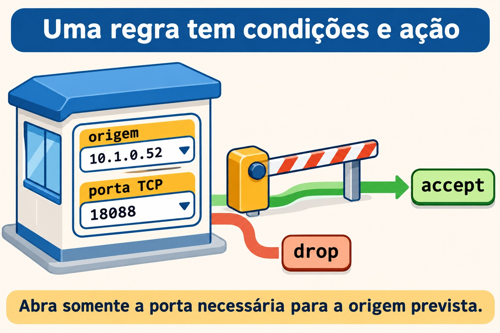
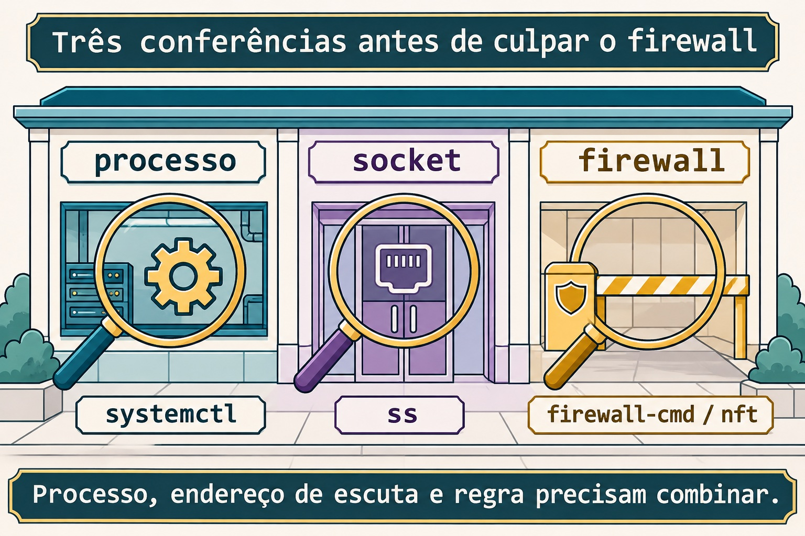

# Aula 12.2 · Firewall

No Windows Server, você separa perfil de rede, regra de entrada e serviço em escuta. No Linux, essa separação continua valendo. Depois de proteger o acesso SSH na 12.1, você vai liberar uma porta só para a outra VM, observar o bloqueio e conferir o que permanece após o reboot.

> **Núcleo desta aula:** identifique a zona ou cadeia certa, restrinja origem e porta, confira regras ativas e persistentes e teste de outro host. O resto é aprofundamento.

| Ficha | |
| --- | --- |
| **Módulo** | M12 · Segurança do host, aula 2 de 5 |
| **Quando** | Semana 17 |
| **Ao final** | Você filtra uma porta HTTP com firewalld e nftables, sem alterar a regra SSH |
| **Pré-requisitos** | Aulas 11.5 e 12.1; `student`, `sudo`, SSH funcional e noVNC nas VMs 201 e 202 |
| **Tempo** | Cerca de 90 minutos, mais a repetição sem consultar |
| **Snapshots** | `m12a2-inicio` e `m12a2-fim` nas duas VMs |

## 1 · Aquecimento

Responda sem consultar. O gabarito está no fim.

1. Qual é a diferença entre uma porta TCP acessível e uma aplicação respondendo corretamente?
2. Por que você mantém uma sessão aberta ao alterar a configuração do SSH?
3. Que comando identifica o processo e o endereço de uma escuta TCP?

## 2 · Por que importa

Um serviço funciona dentro do servidor, mas o outro host não recebe resposta. Você encontra uma porta liberada em uma zona que não atende aquele tráfego. A regra existe; foi colocada no lugar errado.

O chamado só termina quando o cliente previsto acessa a porta prevista e a configuração continua correta após reiniciar. Tirar a proteção do host apagaria a pista e ampliaria o acesso.

## 3 · Modelo mental

O firewall é a portaria do prédio. A regra compara o crachá de origem e a porta de destino antes de decidir. A sala interna ainda precisa ter alguém atendendo: uma permissão no firewall não cria um socket.

```text
origem -> condições da regra -> ação -> serviço em escuta
             origem + porta     accept / drop
```



*Abra somente a porta necessária para a origem prevista.*

### Ponte Windows

| Windows Server | Linux | Ideia comum |
| --- | --- | --- |
| Perfil da rede | Zona do firewalld | Escolher onde a política vale |
| Regra de entrada | Regra no caminho de entrada | Comparar origem, protocolo e porta |
| Configuração salva | Configuração permanente | Reconstruir a política no boot |
| Serviço escutando | Socket visto por `ss` | Ter uma aplicação para atender |

## 4 · O essencial

### firewalld: zona, serviço e porta

Na Rocky, use `firewall-cmd` para falar com o firewalld. Uma zona reúne a política aplicada a interfaces ou origens. Confira as zonas ativas antes de acrescentar uma regra.

```bash
sudo firewall-cmd --get-active-zones
sudo firewall-cmd --get-default-zone
sudo firewall-cmd --info-service=ssh
```

Um serviço do firewalld é uma definição de portas e protocolos, como `ssh` ou `http`. Isso difere da unidade do systemd. A definição `http` normalmente cobre TCP `80`; o processo do lab usará TCP `18088`.

### Ativo e permanente

Sem `--permanent`, o comando altera a configuração ativa. Com essa opção, altera o que está salvo. No início do serviço, a configuração permanente é carregada para o estado ativo.

Para este lab, você modifica cada regra de forma explícita nos dois estados. Não usa uma cópia global do estado ativo nem recarrega políticas alheias para gravar uma regra de exercício.


*Confira o estado ativo e o que voltará após o reboot.*

### nftables: tabela, cadeia e regra

Na Debian deste lab, você usa `nft` em uma tabela própria. A cadeia de entrada compara pacotes destinados ao host. A ordem importa: primeiro permite a origem prevista para a porta do exercício; depois descarta outras origens para essa mesma porta.

A política da cadeia será `accept` para os demais pacotes. Ela não substitui a proteção já existente. Um aceite nessa cadeia ainda pode encontrar uma rejeição em outra cadeia posterior.

### Validação e observação

`nft -c -f` verifica o arquivo sem aplicar a alteração. `nft -f` aplica o lote. Um contador ajuda a mostrar qual regra recebeu pacotes. Um contador parado exige conferir interface, endereço, família e origem do teste.



*Processo, endereço de escuta e regra precisam combinar.*

### Rocky × Debian

| Item | Rocky 9 | Debian 13 |
| --- | --- | --- |
| Gerenciador do lab | firewalld já ativo | `nft` sem firewalld ativo |
| Escopo da alteração | Duas rich rules na zona correta | Tabela `inet m12a2` |
| Persistência | Regras permanentes do firewalld | Unidade própria que carrega só a tabela do lab |
| Conferência | Consultar ativo e permanente | Validar arquivo, listar tabela e testar |

## 5 · Lab guiado

Mantenha noVNC disponível e uma sessão SSH já aberta nas duas VMs. As regras desta aula selecionam somente TCP `18088`; a porta do seu SSH não entra no filtro. Trabalhe com terminais separados para servidor HTTP e cliente.

### Passo 1 · Proteger e identificar

**Palpite:** uma regra que escolhe só TCP `18088` deveria decidir o acesso SSH em TCP `22`?

No host Proxmox, crie os snapshots antes do lab.

```bash
qm snapshot 201 m12a2-inicio
qm snapshot 202 m12a2-inicio
```

Na Rocky, confira o serviço. Na Debian, confira as regras existentes. Se a Debian usa firewalld, não acrescente um segundo gerenciador: volte à base deste lab antes de continuar.

```bash
sudo firewall-cmd --state
sudo firewall-cmd --get-active-zones
```

```bash
systemctl is-active firewalld
sudo nft list ruleset
```

**Saída esperada:** firewalld ativo na Rocky; na Debian, `nft` disponível e nenhuma tabela `inet m12a2`. Não prossiga se regras existentes já bloqueiam a porta de exercício e você não sabe quem as mantém.

**Verifique:** confirme SSH novo a partir do Windows e noVNC funcional. Tenha `python3` e `curl` nas duas VMs; obtenha pacotes faltantes com o procedimento do M6 antes de seguir.

### Passo 2 · Preparar o serviço testemunho

**Palpite:** o teste feito no próprio servidor percorre necessariamente a mesma zona que um cliente remoto?

Nas duas VMs, confirme que a pasta do lab não existe e que a porta está livre antes de criá-las. Se houver trabalho anterior, revise-o em vez de sobrescrevê-lo.

```bash
test ! -e "$HOME/m12a2"
sudo ss -lntp 'sport = :18088'
mkdir -m 700 "$HOME/m12a2"
mkdir "$HOME/m12a2/www"
printf 'FIREWALL ok\n' > "$HOME/m12a2/www/index.html"
ip -br address > "$HOME/m12a2/address.inicio"
```

Na Rocky, execute apenas a primeira atribuição. Na Debian, apenas a segunda.

```bash
HOST_IP=10.1.0.51
```

```bash
HOST_IP=10.1.0.52
```

Depois, em cada VM:

```bash
printf '%s\n' "$HOST_IP" > "$HOME/m12a2/ip"
python3 -m http.server 18088 --bind "$HOST_IP" --directory "$HOME/m12a2/www"
```

**Saída esperada:** servidor HTTP em primeiro plano, vinculado ao IP da VM e à porta `18088`.

**Verifique:** em outro terminal da mesma VM, confirme `sudo ss -lntp 'sport = :18088'`. Teste remotamente entre as VMs com `curl --noproxy '*' --connect-timeout 2 --max-time 4 http://10.1.0.51:18088/` e troque o destino por `10.1.0.52` no sentido contrário. Anote a situação inicial.

### Passo 3 · Filtrar na Rocky

**Palpite:** liberar a origem prevista antes de descartar as demais permite um cliente sem abrir a porta para todos?

Na Rocky, leia as zonas ativas. Informe a zona que recebe o tráfego da VM 202; confira associações de origem e interface. Não copie um nome de zona sem verificá-lo.

```bash
sudo firewall-cmd --get-active-zones
read -r -p 'ZONE: ' ZONE
sudo firewall-cmd --zone="$ZONE" --list-all
printf '%s\n' "$ZONE" > "$HOME/m12a2/zone"
ALLOW='rule priority="-20" family="ipv4" source address="10.1.0.52/32" port port="18088" protocol="tcp" accept'
DROP='rule priority="-10" family="ipv4" port port="18088" protocol="tcp" drop'
printf '%s\n' "$ALLOW" > "$HOME/m12a2/allow"
printf '%s\n' "$DROP" > "$HOME/m12a2/drop"
```

Confirme com `--list-rich-rules` que essas duas regras exatas não existiam. As prioridades negativas fazem estas comparações antes das permissões comuns da zona. A origem permitida é examinada antes do descarte.

```bash
sudo firewall-cmd --zone="$ZONE" --add-rich-rule="$DROP"
```

Na Debian, tente o `curl` para a Rocky: ele deve atingir o limite de tempo. Depois, na Rocky:

```bash
sudo firewall-cmd --zone="$ZONE" --add-rich-rule="$ALLOW"
sudo firewall-cmd --zone="$ZONE" --list-rich-rules
```

**Saída esperada:** da Debian, a página da Rocky volta a entregar `FIREWALL ok`. A mudança foi apenas na configuração ativa.

**Verifique:** repita o teste remoto e abra um SSH novo. A regra de descarte continua existindo, mas a origem permitida encontra o aceite primeiro.

### Decida 1

O processo usa `18088`, mas alguém liberou o serviço `http`. Qual é a próxima ação?

| Opção | Ação |
| --- | --- |
| A | Desligar o firewall |
| B | Conferir a definição do serviço e usar a porta real com origem limitada |
| C | Abrir todas as portas altas |

Escolha B. Nome de serviço e porta efetiva precisam corresponder ao processo.

### Passo 4 · Filtrar na Debian

**Palpite:** uma tabela própria pode selecionar só a porta de exercício e deixar os demais pacotes seguirem para a política existente?

Na Debian, guarde o conjunto inicial como evidência. O arquivo não será usado para substituir o conjunto inteiro.

```bash
sudo nft list ruleset > "$HOME/m12a2/ruleset.inicio"
cat > "$HOME/m12a2/m12a2.nft" <<'EOF'
table inet m12a2 {}
flush table inet m12a2
table inet m12a2 {
    chain input {
        type filter hook input priority -10; policy accept;
        ip saddr 10.1.0.51 ip daddr 10.1.0.52 tcp dport 18088 counter accept
        ip daddr 10.1.0.52 tcp dport 18088 counter drop
    }
}
EOF
sudo nft -c -f "$HOME/m12a2/m12a2.nft"
sudo nft -f "$HOME/m12a2/m12a2.nft"
sudo nft list table inet m12a2
```

A primeira declaração garante a tabela. O esvaziamento seguinte alcança somente essa tabela de exercício, para reaplicar o arquivo sem duplicar regras. As regras selecionam o IPv4 da Debian; o loopback fica fora desse descarte.

**Saída esperada:** validação sem erro e tabela com duas regras. Da Rocky, o HTTP da Debian entrega `FIREWALL ok` e o contador da regra de aceite cresce.

**Verifique:** confirme os contadores com outra listagem e mantenha SSH novo funcionando. Um bloqueio de outra política continua valendo: esta tabela não o anula.

### Passo 5 · Salvar sem substituir outras políticas

**Palpite:** escrever a regra no disco prova que o kernel já a está usando?

Na Rocky, grave exatamente as duas regras testadas.

```bash
sudo firewall-cmd --permanent --zone="$ZONE" --add-rich-rule="$DROP"
sudo firewall-cmd --permanent --zone="$ZONE" --add-rich-rule="$ALLOW"
sudo firewall-cmd --check-config
sudo firewall-cmd --permanent --zone="$ZONE" --list-rich-rules
```

Na Debian, confirme que os dois arquivos globais abaixo ainda não existem. Se existirem, pare esta instalação e revise a autoria. Não substitua arquivos de outro exercício.

```bash
sudo test ! -e /etc/nftables.d/m12a2.nft
sudo test ! -e /etc/systemd/system/m12a2-firewall.service
sudo install -d -m 0755 /etc/nftables.d
sudo install -m 0644 "$HOME/m12a2/m12a2.nft" /etc/nftables.d/m12a2.nft
cat > "$HOME/m12a2/m12a2-firewall.service" <<'EOF'
[Unit]
Description=Course M12A2 firewall table
DefaultDependencies=no
Wants=network-pre.target
Before=network-pre.target shutdown.target
After=local-fs.target nftables.service
Conflicts=shutdown.target

[Service]
Type=oneshot
RemainAfterExit=yes
ExecStart=/usr/sbin/nft -f /etc/nftables.d/m12a2.nft
ExecStop=/usr/sbin/nft delete table inet m12a2

[Install]
WantedBy=multi-user.target
EOF
sudo nft -c -f /etc/nftables.d/m12a2.nft
sudo install -m 0644 "$HOME/m12a2/m12a2-firewall.service" /etc/systemd/system/m12a2-firewall.service
sudo systemd-analyze verify /etc/systemd/system/m12a2-firewall.service
sudo systemctl daemon-reload
sudo systemctl enable --now m12a2-firewall.service
```

**Saída esperada:** regras permanentes na Rocky e unidade de exercício ativa na Debian. Ela carrega somente o arquivo da tabela própria; `/etc/nftables.conf` continua intacto.

**Verifique:** na Debian, consulte `systemctl status m12a2-firewall.service` e `sudo nft list table inet m12a2`. Na Rocky, compare a listagem ativa com a permanente.

### Decida 2

Você quer corrigir só a tabela do exercício na Debian. O que preserva as políticas que não são suas?

| Opção | Ação |
| --- | --- |
| A | Apagar o conjunto global de regras |
| B | Reaplicar apenas o arquivo validado da tabela `m12a2` |
| C | Substituir a configuração de todos os serviços |

Escolha B. O alvo da alteração deve ser tão pequeno quanto o problema.

### Passo 6 · Conferir após reboot

**Palpite:** o servidor Python iniciado no terminal volta sozinho só porque as regras foram salvas?

Reinicie as duas VMs, uma de cada vez. Use noVNC para conferir qualquer erro antes de tentar outra alteração.

```bash
sudo systemctl reboot
```

Na Rocky, recupere as variáveis dos registros locais; na Debian, confira a unidade.

```bash
ZONE=$(cat "$HOME/m12a2/zone")
ALLOW=$(cat "$HOME/m12a2/allow")
DROP=$(cat "$HOME/m12a2/drop")
sudo firewall-cmd --zone="$ZONE" --query-rich-rule="$ALLOW"
sudo firewall-cmd --permanent --zone="$ZONE" --query-rich-rule="$ALLOW"
```

```bash
systemctl is-active m12a2-firewall.service
sudo nft list table inet m12a2
```

Em cada VM, inicie novamente o servidor temporário em um terminal próprio.

```bash
HOST_IP=$(cat "$HOME/m12a2/ip")
python3 -m http.server 18088 --bind "$HOST_IP" --directory "$HOME/m12a2/www"
```

**Saída esperada:** as regras voltam; o HTTP só volta depois de iniciar o processo. O cliente autorizado continua recebendo `FIREWALL ok`.

**Verifique:** teste HTTP nos dois sentidos entre as VMs, SSH novo e os endereços originais. Guarde as evidências antes das quebras.

## 6 · Quebre e conserte

### Quebra 1 · Salvo não significa ativo

Na Rocky, remova apenas o aceite ativo; mantenha a cópia permanente e o descarte.

```bash
sudo firewall-cmd --zone="$ZONE" --remove-rich-rule="$ALLOW"
```

**Sintoma:** da Debian, o HTTP da Rocky atinge o limite de tempo.

**Investigação:** compare as consultas da mesma regra nos dois estados.

```bash
sudo firewall-cmd --zone="$ZONE" --query-rich-rule="$ALLOW"
sudo firewall-cmd --permanent --zone="$ZONE" --query-rich-rule="$ALLOW"
sudo ss -lntp 'sport = :18088'
```

**Causa:** o aceite está salvo, mas foi retirado do estado ativo. O processo ainda escuta e a regra de descarte continua ativa.

**Conserto:** aplique novamente o aceite ativo.

```bash
sudo firewall-cmd --zone="$ZONE" --add-rich-rule="$ALLOW"
```

**Verifique:** o cliente autorizado recebe a página novamente.

**Prevenção:** registre ativo e permanente separadamente, inclusive na revisão de mudanças.

### Quebra 2 · Origem incorreta

Na Debian, guarde a configuração válida antes de trocar a origem permitida.

```bash
cp "$HOME/m12a2/m12a2.nft" "$HOME/m12a2/m12a2.valid.nft"
sed -i 's/10\.1\.0\.51/10.1.0.99/' "$HOME/m12a2/m12a2.nft"
sudo nft -c -f "$HOME/m12a2/m12a2.nft"
sudo nft -f "$HOME/m12a2/m12a2.nft"
```

**Sintoma:** da Rocky, a página da Debian deixa de responder.

**Investigação:** faça uma tentativa remota e leia os contadores na Debian.

```bash
sudo nft list table inet m12a2
```

**Causa:** a regra é sintaticamente válida, mas descreve outra origem. O tráfego da VM 201 encontra a regra de descarte.

**Conserto:** restaure o arquivo local válido e reaplique só a tabela do exercício.

```bash
cp "$HOME/m12a2/m12a2.valid.nft" "$HOME/m12a2/m12a2.nft"
sudo nft -c -f "$HOME/m12a2/m12a2.nft"
sudo nft -f "$HOME/m12a2/m12a2.nft"
```

**Verifique:** uma nova tentativa da Rocky recebe `FIREWALL ok` e aumenta o contador de aceite.

**Prevenção:** valide tanto a sintaxe quanto o significado da origem, do protocolo e da porta.

### Quebra 3 · Processo no endereço errado

Na Debian, pare o servidor temporário com Ctrl+C e reinicie-o só no loopback.

```bash
python3 -m http.server 18088 --bind 127.0.0.1 --directory "$HOME/m12a2/www"
```

**Sintoma:** a página abre pelo loopback na Debian, mas o cliente Rocky falha.

**Investigação:** confira o endereço de escuta e a regra antes de ampliar qualquer permissão.

```bash
sudo ss -lntp 'sport = :18088'
sudo nft list table inet m12a2
curl --noproxy '*' --max-time 4 http://127.0.0.1:18088/
```

**Causa:** o processo deixou de atender no IP da rede. O aceite do firewall não faz o processo escutar em outro endereço.

**Conserto:** pare a instância de loopback com Ctrl+C e use novamente o comando do passo 6 com o IP registrado.

**Verifique:** a Rocky volta a receber o conteúdo pelo IP da Debian.

**Prevenção:** confira processo, socket e firewall como três evidências diferentes.

### Limpeza

Pare apenas os dois servidores Python com Ctrl+C nos terminais onde estão rodando. Na Rocky, retire as duas regras do lab nos dois estados. Não pare o firewalld.

```bash
sudo firewall-cmd --zone="$ZONE" --remove-rich-rule="$ALLOW"
sudo firewall-cmd --zone="$ZONE" --remove-rich-rule="$DROP"
sudo firewall-cmd --permanent --zone="$ZONE" --remove-rich-rule="$ALLOW"
sudo firewall-cmd --permanent --zone="$ZONE" --remove-rich-rule="$DROP"
```

Na Debian, desative a unidade própria. A parada remove somente `inet m12a2`. Depois retire os dois arquivos que esta aula criou.

```bash
sudo systemctl disable --now m12a2-firewall.service
sudo rm -- /etc/systemd/system/m12a2-firewall.service /etc/nftables.d/m12a2.nft
sudo systemctl daemon-reload
sudo nft list ruleset
```

Guarde os registros na pasta privada. Confira que não restou escuta em `18088`, que os endereços originais continuam presentes e que SSH novo funciona. Nenhuma limpeza remove regras de outros serviços.

## 7 · Armadilhas

| Erro comum | O que fazer | Por quê |
| --- | --- | --- |
| Testar só no próprio servidor | Testar da outra VM | O caminho local difere do remoto |
| Abrir `http` para uma porta diferente | Ler a definição e o socket | Nome do serviço não adivinha a porta |
| Salvar sem conferir o ativo | Consultar os dois estados | Disco e memória são distintos |
| Apagar todo o conjunto nftables | Alterar só a tabela própria | Outras políticas continuam necessárias |
| Usar firewalld e nft como donos da mesma política | Identificar o gerenciador | Evita duas fontes de configuração |

## 8 · Quiz

1. Qual é a diferença entre serviço do firewalld e unidade do systemd?
2. Adicionar uma regra permanente muda automaticamente a regra ativa?
3. Por que o aceite da origem vem antes do descarte da porta neste lab?
4. O que `nft -c -f` verifica e o que ainda precisa ser testado?
5. Uma regra de aceite pode corrigir um processo que escuta apenas no loopback?
6. Por que não restaurar cegamente o conjunto inteiro registrado no início?

## 9 · Cola

| Tarefa | Comando |
| --- | --- |
| Zonas ativas | `sudo firewall-cmd --get-active-zones` |
| Definição de serviço | `sudo firewall-cmd --info-service=http` |
| Regras ativas da zona | `sudo firewall-cmd --zone="$ZONE" --list-rich-rules` |
| Regras permanentes | `sudo firewall-cmd --permanent --zone="$ZONE" --list-rich-rules` |
| Validar o arquivo do lab | `sudo nft -c -f "$HOME/m12a2/m12a2.nft"` |
| Contadores do lab | `sudo nft list table inet m12a2` |

**Flashcards:** crie cinco cartões sobre zona, origem, porta, estado ativo e persistência. Revise em D+1, D+3, D+7 e D+21.

## 10 · Checklist e fechamento

- [ ] Sei qual zona recebe o tráfego na Rocky.
- [ ] Testei HTTP remotamente nos dois sentidos.
- [ ] Conferi regras após reboot sem confundir processo com firewall.
- [ ] Corrigi as três falhas e retirei apenas minhas regras.

**Último exercício:** explique por que uma sintaxe válida com origem errada continua sendo uma política errada. Inclua o teste que revelou isso.

**Reboot de conferência:** após a limpeza, reinicie as duas VMs, uma por vez. Confirme SSH, ausência do serviço temporário e ausência da tabela de exercício. Na Rocky, as duas regras do lab não devem voltar.

No host Proxmox, crie os snapshots finais apenas depois dessa conferência.

```bash
qm snapshot 201 m12a2-fim
qm snapshot 202 m12a2-fim
```

## 11 · Na vida real

Em um host que você administre ou tenha autorização para inspecionar, faça somente leitura. Identifique o gerenciador e observe suas regras com os comandos de listagem desta aula. Não instale pacotes nem altere zonas, regras ou serviços.

Qual regra é mais ampla que o necessário? Qual porta em escuta não possui finalidade documentada? Onde a política persistente é mantida? Registre perguntas para o responsável antes de propor mudanças.

## 12 · Aprofundar quando quiser

- [firewall-cmd](https://firewalld.org/documentation/man-pages/firewall-cmd.html): consultas, serviços e regras.
- [Runtime versus Permanent](https://firewalld.org/documentation/configuration/runtime-versus-permanent.html): separação dos estados.
- [Rich Language](https://firewalld.org/documentation/man-pages/firewalld.richlanguage.html): condições e prioridades.
- [nftables](https://www.netfilter.org/projects/nftables/manpage.html) e [cadeias](https://wiki.nftables.org/wiki-nftables/index.php/Configuring_chains): lotes, validação, prioridades e vereditos.
- [systemd.service](https://manpages.debian.org/trixie/systemd/systemd.service.5.en.html): dependências padrão e unidades de início antecipado.

**DeepTutor** (http://10.1.0.149:3782, KB "Curso Linux Sysadmin"):

- `!explica Compare zona, serviço do firewalld, porta e unidade do systemd com a portaria de um prédio.`
- `!feynman Vou explicar por que uma regra salva pode não estar ativa. Aponte as lacunas.`
- `!quiz Crie seis casos de origem, porta e persistência sem sugerir desligar o firewall.`

## Gabarito comentado

### Aquecimento

1. TCP aberto comprova o estabelecimento da conexão; a resposta da aplicação depende do protocolo e do conteúdo solicitado.
2. A sessão antiga ajuda a corrigir antes de depender da configuração nova. O noVNC mantém acesso fora do caminho SSH.
3. `sudo ss -lntp` mostra escutas TCP, endereços e processos quando há permissão.

### Quiz

1. O primeiro descreve tráfego permitido; a segunda administra um processo ou tarefa do sistema.
2. Não. Você precisa conferir ou alterar o estado ativo separadamente.
3. Para a origem autorizada ser aceita antes de alcançar o descarte da mesma porta.
4. Verifica se o lote pode ser aceito sem aplicar a mudança; origem real, caminho, aplicação e persistência exigem testes.
5. Não. A aplicação precisa escutar no endereço que o cliente usa.
6. Você poderia apagar mudanças legítimas ou políticas de outros serviços. A limpeza da aula tem um alvo próprio e conhecido.

<!-- navegacao -->
[← Aula 12.1 · SSH a fundo](12.1-ssh-a-fundo.md) · [Índice de aulas](../01-aulas.md) · [Aula 12.3 · SELinux: modos e contextos →](12.3-selinux-modos-e-contextos.md)
