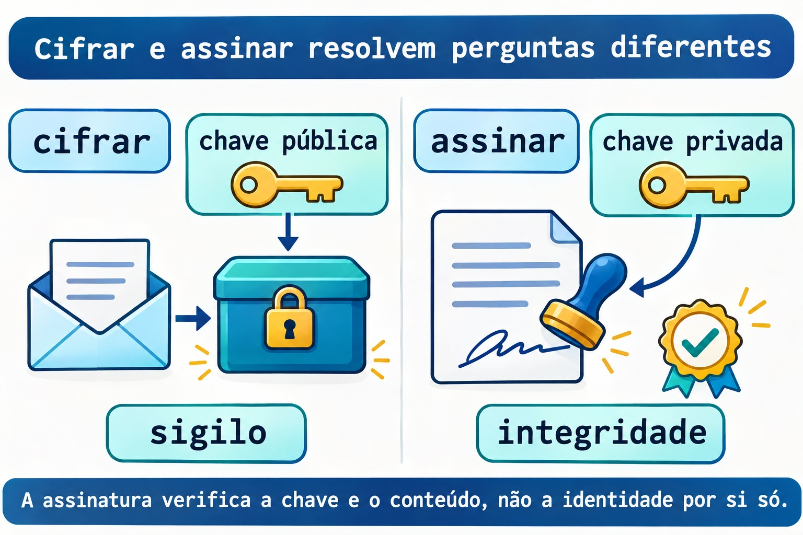

# Aula 12.5 · Auditoria e criptografia

No Windows Server, você já relaciona contas, permissões, sessões e serviços. No Linux, vai montar esse inventário sem remover privilégios por impulso. Depois, vai cifrar e assinar um arquivo com uma chave exclusiva do lab. O desafio final reúne firewall, SELinux e serviço persistente.

> **Núcleo desta aula:** privilégio exige finalidade; histórico depende de coleta; cifrar protege o conteúdo e assinar permite verificar conteúdo e chave. O resto é aprofundamento.

| Ficha | |
| --- | --- |
| **Módulo** | M12 · Segurança do host, aula 5 de 5 |
| **Quando** | Semana 18 |
| **Ao final** | Você investiga privilégios, distingue sessão atual de histórico e verifica cifragem e assinatura |
| **Pré-requisitos** | Aulas 12.1 a 12.4, GnuPG e ferramentas de auditoria; nginx e ferramentas SELinux já usados no módulo |
| **Tempo** | Cerca de 90 minutos, mais uma sessão para o desafio |
| **Snapshots** | `m12a5-inicio` e `m12a5-fim` nas VMs 201 e 202 |

## 1 · Aquecimento

1. Uma porta liberada no firewall cria um serviço em escuta?
2. Qual é a diferença entre registrar um contexto com `semanage fcontext` e aplicá-lo com `restorecon`?
3. Por que a correção de um AVC começa pela operação negada, e não por liberar tudo?

## 2 · Por que importa

Uma revisão encontra um arquivo com SUID, uma porta sem finalidade documentada e uma assinatura válida. São três perguntas diferentes. O SUID pode ser legítimo; a porta precisa de dono; a assinatura corresponde a uma chave, cuja identidade precisa ser conferida por outro meio.

Auditar é transformar essas observações em decisões justificadas. Você registra o que existe, compara com a intenção e altera apenas o que compreendeu.

## 3 · Modelo mental

O inventário é a lista de chaves e salas do prédio. A cifragem é uma caixa que só a chave do destinatário consegue abrir. A assinatura é um selo verificável sobre o documento; o nome escrito no selo não comprova sozinho a identidade de quem o criou.

```text
inventário -> finalidade -> decisão registrada
cifrar: conteúdo legível -> conteúdo protegido
assinar: conteúdo + chave privada -> assinatura verificável
```


*Antes de remover um privilégio, descubra quem precisa dele.*

### Ponte Windows

| Windows Server | Linux | Pergunta |
| --- | --- | --- |
| Token e permissões de execução | Dono, modos, SUID e política MAC | Quem ganha qual acesso? |
| Sessões e registros de logon | `who`, histórico e journal | O que está acontecendo e o que foi registrado? |
| Assinatura e cifragem | Operações OpenPGP do GnuPG | Quero sigilo, integridade ou ambos? |

## 4 · O essencial

### Privilégio não é diagnóstico

O bit SUID merece investigação, não remoção automática. Confira tipo de arquivo, dono, pacote e finalidade. O inventário desta aula procura em `/usr` sem atravessar outros sistemas de arquivos; não remove bits de programas da distribuição.

### Sessão atual e histórico

`who` lê o registro de sessões atuais. O histórico exige que o mecanismo de coleta já estivesse funcionando. Uma lista vazia não demonstra que ninguém entrou na máquina.

Na Debian 13, o substituto previsto para o `last` tradicional é `wtmpdb last`, com coleta por `libpam-wtmpdb`. Instalar o coletor hoje não reconstrói registros antigos. Na Rocky 9, você usa `last`.

### Limite tem escopo

`ulimit` mostra ou altera limites do shell e dos processos que ele iniciar. Isso não muda todos os serviços do host. O exercício modifica apenas um limite soft dentro de um subshell, que termina junto com o teste.

### Duas operações criptográficas

Você cifra para a chave pública do destinatário; a chave privada correspondente decifra. Você assina com sua chave privada; a chave pública permite verificar a assinatura. Uma assinatura válida ainda exige conferir a impressão digital da chave por um canal confiável.



*A assinatura verifica a chave e o conteúdo, não a identidade por si só.*

### Rocky × Debian

| Item | Rocky 9 | Debian 13 |
| --- | --- | --- |
| Histórico tradicional do lab | `last` | `wtmpdb last` com coleta configurada |
| Pacote de GnuPG | `gnupg2` | `gnupg`, com pinentry disponível |
| Conferir pacote de um arquivo | `rpm -qf` | `dpkg-query -S` |
| Proteção no desafio | SELinux enforcing e firewalld | nftables e inspeção de AppArmor |

## 5 · Lab guiado

Repita o lab nas duas VMs. As chaves ficam em um diretório novo e privado; não use sua chave pessoal nem envie chave privada para outra máquina.

### Passo 1 · Proteger e preparar

**Palpite:** criar outro diretório de GnuPG deveria alterar as identidades do seu chaveiro pessoal?

No host Proxmox:

```bash
qm snapshot 201 m12a5-inicio
qm snapshot 202 m12a5-inicio
```

Nas VMs, confira a ausência da pasta antes de criá-la. Se existir, revise os registros anteriores em vez de sobrescrevê-los.

```bash
test ! -e "$HOME/m12a5"
command -v gpg who ss python3 curl
mkdir -m 700 "$HOME/m12a5"
mkdir -m 700 "$HOME/m12a5/gnupg"
printf 'M12 audit record\n' > "$HOME/m12a5/registro.txt"
```

**Saída esperada:** diretório privado novo e ferramentas disponíveis. Obtenha pacotes faltantes pelo procedimento do M6 antes de seguir. Na Debian 13 mínima, `gpg` e `gpgconf` vêm do pacote `gnupg`; não configure um coletor de histórico fingindo que ele já estava ativo.

**Verifique:** confira `stat -c '%a %U %n' "$HOME/m12a5/gnupg"`. O modo deve ser `700` e o dono, `student`.

### Passo 2 · Inventariar sem corrigir por impulso

**Palpite:** encontrar SUID identifica, sozinho, um arquivo malicioso?

```bash
sudo find /usr -xdev -type f -perm -4000 -printf '%m %u %p\n' > "$HOME/m12a5/suid.txt"
sudo ss -lntup > "$HOME/m12a5/sockets.txt"
who > "$HOME/m12a5/who.txt"
ulimit -Sn
ulimit -Hn
```

Escolha um caminho real encontrado e consulte seu pacote: na Rocky, `rpm -qf CAMINHO`; na Debian, `dpkg-query -S CAMINHO`. Troque o argumento pelo caminho observado, sem remover o bit.

**Saída esperada:** inventário real, sem quantidade predeterminada de arquivos ou sessões.

**Verifique:** para uma porta em escuta, associe processo e finalidade. Para um arquivo SUID, registre dono, pacote e motivo antes de propor uma alteração.

### Decida 1

Você encontrou SUID em um programa instalado pela distribuição. O que faz primeiro?

| Opção | Ação |
| --- | --- |
| A | Remover SUID de tudo |
| B | Conferir pacote, dono e finalidade |
| C | Executar como root para ver o que acontece |

Escolha B. Inventário vira decisão quando você entende o uso do privilégio.

### Passo 3 · Ler o histórico que existe

**Palpite:** instalar uma ferramenta de histórico pode recuperar sessões que nunca foram registradas?

Na Rocky, use o primeiro bloco. Na Debian 13 com a coleta de `wtmpdb` configurada, use o segundo. Se a coleta não existe, registre essa ausência como resultado do inventário.

```bash
last -n 5
```

```bash
wtmpdb last -n 5
```

**Saída esperada:** sessões realmente registradas, ou a indicação de que a base não está disponível. Não invente nomes, horários ou logins.

**Verifique:** compare uma sessão atual com `who`. Escreva qual fonte foi consultada e quais limites de cobertura ela possui.

### Passo 4 · Criar uma identidade só do lab

**Palpite:** o nome escrito na identidade da chave comprova quem é seu dono fora do lab?

```bash
export GPG_TTY=$(tty)
gpg --homedir "$HOME/m12a5/gnupg" --full-generate-key
gpg --homedir "$HOME/m12a5/gnupg" --list-keys --fingerprint
```

Na geração interativa, escolha RSA com subchave de cifragem, `3072` bits, validade de um dia, nome fictício `Lab M12` e endereço `lab-m12@example.invalid`. Digite uma passphrase apenas no diálogo interativo. Não a escreva em argumentos, arquivos do curso ou diário.

**Saída esperada:** uma chave nova nesse diretório, com impressão digital própria. A chave de cada VM será diferente, mesmo com o mesmo nome fictício.

**Verifique:** registre apenas a impressão digital pública. Uma identidade autocriada do lab não deve ser apresentada como identidade verificada de uma pessoa real.

### Passo 5 · Cifrar e recuperar

**Palpite:** qual parte da chave permite decifrar o arquivo cifrado para esse destinatário?

```bash
gpg --homedir "$HOME/m12a5/gnupg" --recipient lab-m12@example.invalid --output "$HOME/m12a5/registro.gpg" --encrypt "$HOME/m12a5/registro.txt"
gpg --homedir "$HOME/m12a5/gnupg" --output "$HOME/m12a5/recuperado.txt" --decrypt "$HOME/m12a5/registro.gpg"
cmp "$HOME/m12a5/registro.txt" "$HOME/m12a5/recuperado.txt"
```

**Saída esperada:** arquivo cifrado, recuperação pelo chaveiro do lab e comparação sem diferenças. A passphrase pode estar em cache no agente e não ser solicitada a cada operação.

**Verifique:** confirme o código `0` de `cmp` imediatamente com `echo $?`. O texto original continua existindo; cifrar não o apaga.

### Passo 6 · Assinar e verificar

**Palpite:** uma assinatura destacada cifra o arquivo original?

```bash
gpg --homedir "$HOME/m12a5/gnupg" --armor --output "$HOME/m12a5/registro.txt.asc" --detach-sign "$HOME/m12a5/registro.txt"
gpg --homedir "$HOME/m12a5/gnupg" --verify "$HOME/m12a5/registro.txt.asc" "$HOME/m12a5/registro.txt"
```

**Saída esperada:** verificação criptográfica válida para a chave e os bytes originais. O documento continua legível sem decifrar.

**Verifique:** compare a impressão digital usada na assinatura com a registrada no passo 4. Isso identifica a chave do exercício, não comprova uma identidade externa.

### Decida 2

Você quer impedir leitura do conteúdo e detectar adulteração. Qual decisão atende às duas necessidades?

| Opção | Ação |
| --- | --- |
| A | Só renomear o arquivo |
| B | Só assinar e deixar o conteúdo público |
| C | Cifrar para o destinatário e verificar uma assinatura com chave conferida |

Escolha C. Sigilo e verificação de autoria são objetivos diferentes.

## 6 · Quebre e conserte

### Quebra 1 · SUID sem finalidade

Crie só um arquivo de dados inerte, sem permissão de execução. Confirme que o diretório abaixo não existia antes; se existir, não o reutilize.

```bash
sudo test ! -e /srv/m12a5-audit
sudo install -d -m 0755 /srv/m12a5-audit
sudo install -m 4644 "$HOME/m12a5/registro.txt" /srv/m12a5-audit/inert.txt
```

**Sintoma:** o inventário encontra SUID em um arquivo que não precisa executar nada.

**Investigação:** leia modo, dono e tipo, sem executar o arquivo.

```bash
stat -c '%A %a %U %n' /srv/m12a5-audit/inert.txt
file /srv/m12a5-audit/inert.txt
```

**Causa:** o bit foi acrescentado sem finalidade. Neste arquivo de dados sem execução ele não cria um programa privilegiado.

**Conserto:** retire somente o bit desnecessário do arquivo do lab.

```bash
sudo chmod u-s /srv/m12a5-audit/inert.txt
```

**Verifique:** o modo volta a `644`; nenhum binário da distribuição foi alterado.

**Prevenção:** registre a finalidade dos privilégios e compare o inventário com a base conhecida.

### Quebra 2 · Documento adulterado

Altere apenas uma cópia, preservando original e assinatura.

```bash
cp "$HOME/m12a5/registro.txt" "$HOME/m12a5/adulterado.txt"
printf 'changed\n' >> "$HOME/m12a5/adulterado.txt"
gpg --homedir "$HOME/m12a5/gnupg" --verify "$HOME/m12a5/registro.txt.asc" "$HOME/m12a5/adulterado.txt"
```

**Sintoma:** a verificação falha para a cópia.

**Investigação:** compare os bytes e verifique o original com a mesma assinatura.

**Causa:** a assinatura foi criada para outro conteúdo. Copiar o nome ou o arquivo de assinatura não autoriza novos bytes.

**Conserto:** use o original preservado; não assine novamente para esconder a adulteração.

**Verifique:** o comando do passo 6 continua válido sobre o original.

**Prevenção:** distribua conteúdo e assinatura identificados e confira a impressão digital do emissor por outro canal.

### Quebra 3 · Limite do processo

Confira que o limite hard de arquivos abertos é pelo menos `32`. O teste abaixo abre no máximo `64` descritores em um processo filho e os fecha ao terminar.

```bash
(
ulimit -Sn 32
python3 - <<'PY'
import os
from contextlib import ExitStack
with ExitStack() as stack:
    try:
        for _ in range(64):
            stack.enter_context(open(os.devnull))
    except OSError as exc:
        print("errno=", exc.errno)
PY
)
```

**Sintoma:** o processo filho encontra o limite de descritores e relata o erro `24`.

**Investigação:** compare `ulimit -Sn` fora do subshell com o valor imposto dentro dele.

**Causa:** o limite pertence ao processo e à herança dele, não a todos os serviços da VM.

**Conserto:** termine o teste; o subshell já encerrou e não alterou o shell principal.

**Verifique:** o limite do terminal principal permanece igual ao anotado no passo 2.

**Prevenção:** investigue o limite do processo afetado antes de mudar configuração global.

### Limpeza

Remova só o arquivo inerte e seu diretório agora vazio. Guarde os registros privados e os arquivos criptográficos para a conferência após reboot. Não exporte a chave privada.

```bash
sudo rm -- /srv/m12a5-audit/inert.txt
sudo rmdir /srv/m12a5-audit
gpgconf --homedir "$HOME/m12a5/gnupg" --kill gpg-agent
```

## 7 · Armadilhas

| Erro comum | O que fazer | Por quê |
| --- | --- | --- |
| Remover SUID em massa | Relacionar pacote e finalidade | Pode quebrar acesso legítimo |
| Histórico vazio significa nenhum login | Conferir a coleta e a cobertura | Dados ausentes não comprovam ausência de uso |
| Assinatura válida comprova um nome real | Conferir a impressão digital por outro canal | A identidade escrita pode ser autocriada |
| Cifrar apaga o original | Conferir os arquivos existentes | O texto legível continua no disco |

## 8 · Quiz

1. Por que um arquivo SUID precisa de investigação antes de alteração?
2. Qual é a diferença entre `who` e o histórico de sessões?
3. Qual substituto de `last` é previsto na Debian 13 e o que ele não recupera?
4. Qual chave cifra para o destinatário e qual decifra?
5. Por que uma assinatura destacada deixa o conteúdo legível?
6. Mudar `ulimit` no seu terminal muda o limite de um serviço já iniciado?

## 9 · Cola

| Tarefa | Comando |
| --- | --- |
| Sessões atuais | `who` |
| Histórico Rocky | `last -n 5` |
| Histórico Debian | `wtmpdb last -n 5` |
| Limite soft do shell | `ulimit -Sn` |
| Impressão digital do lab | `gpg --homedir "$HOME/m12a5/gnupg" --list-keys --fingerprint` |

**Flashcards:** crie cinco cartões sobre privilégio, histórico, limite, cifragem e assinatura. Revise em D+1, D+3, D+7 e D+21.

## 10 · Checklist e fechamento

- [ ] Fiz inventário nas duas VMs sem remover privilégios da distribuição.
- [ ] Cifrei, recuperei, assinei e detectei adulteração de uma cópia.
- [ ] Expliquei o alcance do histórico e do limite de processo.
- [ ] Completei o desafio abaixo e a limpeza direcionada.

**Último exercício:** escreva um relatório com três achados, fonte da evidência, finalidade e decisão. Separe observação de hipótese.

**Reboot de conferência:** primeiro valide a persistência exigida no desafio. Após a limpeza dele, reinicie as duas VMs e confirme acesso, política original e assinatura do arquivo original. A passphrase do lab deve ser solicitada quando necessária.

No host Proxmox, os snapshots finais só entram depois do desafio e da limpeza.

```bash
qm snapshot 201 m12a5-fim
qm snapshot 202 m12a5-fim
```

## 11 · Na vida real

Em um host que você administre ou tenha autorização para inspecionar, faça somente leitura: portas, sessões atuais e limites do processo de um serviço. Não execute um arquivo suspeito, não remova bits e não configure um coletor novo nesta missão.

Qual privilégio tem justificativa documentada? Qual histórico realmente existe? Que impressão digital você precisaria confirmar antes de confiar em um documento assinado?

## 12 · Aprofundar quando quiser

- [Debian 13: registros de login](https://www.debian.org/releases/trixie/release-notes/issues.html) e [wtmpdb](https://manpages.debian.org/trixie/wtmpdb/wtmpdb.8.en.html).
- [GnuPG: gestão de chaves](https://gnupg.org/documentation/manuals/gnupg/OpenPGP-Key-Management.html) e [operações](https://gnupg.org/documentation/manuals/gnupg/Operational-GPG-Commands.html).
- [nginx: parâmetros](https://nginx.org/en/docs/switches.html), [systemd.service](https://manpages.debian.org/trixie/systemd/systemd.service.5.en.html) e [nftables](https://www.netfilter.org/projects/nftables/manpage.html).
- [SELinux no RHEL 9](https://docs.redhat.com/en/documentation/red_hat_enterprise_linux/9/html/using_selinux/index) e [firewalld](https://firewalld.org/documentation/man-pages/firewall-cmd.html).

**DeepTutor** (http://10.1.0.149:3782, KB "Curso Linux Sysadmin"):

- `!explica Compare inventário de privilégios, sigilo e assinatura sem misturar suas finalidades.`
- `!feynman Vou explicar por que uma assinatura válida não comprova sozinha uma identidade real. Critique.`
- `!quiz Crie seis situações de auditoria, histórico e criptografia com os limites de cada evidência.`

## Desafio do M12 · Serviço protegido do cliente ao arquivo

Entregue nginx persistente em TCP `18095`, com conteúdo exclusivo em `/srv/m12a5-web`. Na Rocky, SELinux deve continuar `Enforcing` e firewalld ativo. Na Debian, use uma tabela nftables própria. Teste a partir da outra VM e após reboot.


*Teste de outro host e confira tudo novamente após o reboot.*

### Preparação do desafio

Use noVNC e uma sessão SSH aberta. As aulas anteriores devem ter sido limpas; os pacotes nginx e SELinux permanecem instalados. Não reutilize suas unidades antigas. Verifique que `nginx.service` original está inativo e desabilitado e não o altere.

Antes de criar, confira a ausência de `/srv/m12a5-web`, `/etc/nginx/m12a5.conf`, `/etc/systemd/system/m12a5-nginx.service`, `/etc/nftables.d/m12a5.nft`, `/etc/systemd/system/m12a5-firewall.service`, `/run/nginx-m12a5` e dos logs `m12a5-access.log` e `m12a5-error.log` em `/var/log/nginx`. Confira que a porta `18095` está sem escuta e sem associação local prévia no SELinux, inclusive em intervalos de portas.

Na Rocky, leia `sudo semanage fcontext -l -C` antes de registrar os dois padrões abaixo. Se já existirem, pare e revise a origem. Na Debian, confira `sudo nft list ruleset`: a tabela `inet m12a5` não deve existir e outras políticas não podem bloquear a porta sem que você entenda sua origem.

### Instância nginx própria

Na Rocky, defina `WEB_USER=nginx`; na Debian, `WEB_USER=www-data`. Depois, nas duas VMs, crie conteúdo e configuração exclusivos.

```bash
sudo install -d -m 0755 /srv/m12a5-web
printf 'M12 PROTECTED ok\n' | sudo tee /srv/m12a5-web/index.html > /dev/null
sudo chmod 0644 /srv/m12a5-web/index.html
cat > "$HOME/m12a5/m12a5.conf" <<EOF
user $WEB_USER;
worker_processes 1;
pid /run/nginx-m12a5/nginx.pid;
error_log /var/log/nginx/m12a5-error.log;
events { worker_connections 32; }
http {
    access_log /var/log/nginx/m12a5-access.log;
    server {
        listen 18095;
        root /srv/m12a5-web; index index.html;
        location / { try_files \$uri \$uri/ =404; }
    }
}
EOF
sudo install -m 0644 "$HOME/m12a5/m12a5.conf" /etc/nginx/m12a5.conf
```

Crie a unidade abaixo na pasta privada e instale-a no caminho já conferido. Ela não carrega a configuração nginx original.

```bash
cat > "$HOME/m12a5/m12a5-nginx.service" <<'EOF'
[Unit]
Description=Course M12A5 nginx
After=network.target firewalld.service m12a5-firewall.service
[Service]
Type=simple
RuntimeDirectory=nginx-m12a5
ExecStartPre=/usr/sbin/nginx -t -c /etc/nginx/m12a5.conf
ExecStart=/usr/sbin/nginx -c /etc/nginx/m12a5.conf -g "daemon off;"
[Install]
WantedBy=multi-user.target
EOF
sudo install -m 0644 "$HOME/m12a5/m12a5-nginx.service" /etc/systemd/system/m12a5-nginx.service
```

### Autorizações SELinux na Rocky

Registre os tipos apenas na Rocky. O padrão de runtime precisa ser aplicado a cada criação do diretório no boot. Acrescente a preparação de contexto na unidade própria, sem modificar a unidade original.

```bash
getenforce
sudo semanage fcontext -a -t httpd_sys_content_t '/srv/m12a5-web(/.*)?'
sudo semanage fcontext -a -t httpd_var_run_t '/var/run/nginx-m12a5(/.*)?'
sudo restorecon -RFv /srv/m12a5-web /etc/nginx/m12a5.conf
sudo semanage port -a -t http_port_t -p tcp 18095
sudo sed -i '/^ExecStartPre=/i ExecStartPre=/usr/sbin/restorecon -RF /run/nginx-m12a5' /etc/systemd/system/m12a5-nginx.service
```

Na Debian, observe `aa-status` e o confinamento efetivo do nginx; não invente SELinux enforcing nem desative AppArmor. Se um perfil existente impedir os caminhos exclusivos, adapte o lab com a política responsável antes de prosseguir.

### Firewall de escopo limitado

Na Rocky, identifique a zona efetiva como na 12.2. Guarde zona e regras em arquivos privados para removê-las exatamente depois. As duas regras abaixo são novas e não devem existir antes do desafio.

```bash
read -r -p 'ZONE: ' ZONE
ALLOW='rule priority="-20" family="ipv4" source address="10.1.0.52/32" port port="18095" protocol="tcp" accept'
DROP='rule priority="-10" family="ipv4" port port="18095" protocol="tcp" drop'
printf '%s\n' "$ZONE" > "$HOME/m12a5/zone"
printf '%s\n' "$ALLOW" > "$HOME/m12a5/allow"
printf '%s\n' "$DROP" > "$HOME/m12a5/drop"
sudo firewall-cmd --zone="$ZONE" --add-rich-rule="$DROP"
sudo firewall-cmd --zone="$ZONE" --add-rich-rule="$ALLOW"
sudo firewall-cmd --permanent --zone="$ZONE" --add-rich-rule="$DROP"
sudo firewall-cmd --permanent --zone="$ZONE" --add-rich-rule="$ALLOW"
```

Na Debian, crie o arquivo abaixo e instale-o no caminho exclusivo. A tabela libera a origem Rocky e descarta outras origens só para IPv4 `10.1.0.52`, TCP `18095`. Não altera outras tabelas.

```bash
cat > "$HOME/m12a5/m12a5.nft" <<'EOF'
table inet m12a5 {}
flush table inet m12a5
table inet m12a5 {
    chain input {
        type filter hook input priority -10; policy accept;
        ip saddr 10.1.0.51 ip daddr 10.1.0.52 tcp dport 18095 counter accept
        ip daddr 10.1.0.52 tcp dport 18095 counter drop
    }
}
EOF
sudo install -d -m 0755 /etc/nftables.d
sudo install -m 0644 "$HOME/m12a5/m12a5.nft" /etc/nftables.d/m12a5.nft
sudo nft -c -f /etc/nftables.d/m12a5.nft
```

Na Debian, crie a unidade própria e habilite somente ela. A ordem de boot preserva a carga de outras políticas antes da tabela do desafio.

```bash
cat > "$HOME/m12a5/m12a5-firewall.service" <<'EOF'
[Unit]
Description=Course M12A5 firewall table
DefaultDependencies=no
Wants=network-pre.target
Before=network-pre.target shutdown.target
After=local-fs.target nftables.service
Conflicts=shutdown.target
[Service]
Type=oneshot
RemainAfterExit=yes
ExecStart=/usr/sbin/nft -f /etc/nftables.d/m12a5.nft
ExecStop=/usr/sbin/nft delete table inet m12a5
[Install]
WantedBy=multi-user.target
EOF
sudo install -m 0644 "$HOME/m12a5/m12a5-firewall.service" /etc/systemd/system/m12a5-firewall.service
sudo systemd-analyze verify /etc/systemd/system/m12a5-firewall.service
sudo systemctl daemon-reload
sudo systemctl enable --now m12a5-firewall.service
```

### Evidências para concluir

Nas duas VMs, valide a unidade nginx, recarregue o catálogo de unidades e habilite a instância própria. Na Debian, a unidade do firewall deve ter sido habilitada antes.

```bash
sudo systemd-analyze verify /etc/systemd/system/m12a5-nginx.service
sudo systemctl daemon-reload
sudo systemctl enable --now m12a5-nginx.service
sudo ss -lntp 'sport = :18095'
```

Teste `http://10.1.0.51:18095/` a partir da Debian e `http://10.1.0.52:18095/` a partir da Rocky, com `curl --noproxy '*' --connect-timeout 2 --max-time 4`. O conteúdo esperado é `M12 PROTECTED ok`. Na Rocky, registre ainda `getenforce`, `ps -eZ`, `ls -Zd /srv/m12a5-web` e o mapeamento da porta.

Reinicie uma VM por vez e repita tudo. O nginx da Rocky precisa estar no domínio `httpd_t`, SELinux em `Enforcing` e firewalld ativo. Se a unidade inicia sem o domínio esperado, o desafio ainda não demonstrou a proteção exigida.

### Limpeza do desafio

Pare e desabilite a instância própria nas duas VMs. Na Debian, pare e desabilite também `m12a5-firewall.service`; sua parada remove só a tabela do desafio.

```bash
sudo systemctl disable --now m12a5-nginx.service
```

Na Rocky, retire apenas as duas regras registradas, nos dois estados.

```bash
ZONE=$(cat "$HOME/m12a5/zone")
ALLOW=$(cat "$HOME/m12a5/allow")
DROP=$(cat "$HOME/m12a5/drop")
sudo firewall-cmd --zone="$ZONE" --remove-rich-rule="$ALLOW"
sudo firewall-cmd --zone="$ZONE" --remove-rich-rule="$DROP"
sudo firewall-cmd --permanent --zone="$ZONE" --remove-rich-rule="$ALLOW"
sudo firewall-cmd --permanent --zone="$ZONE" --remove-rich-rule="$DROP"
```

Na Rocky, remova somente as três autorizações locais que o desafio criou.

```bash
sudo semanage port -d -p tcp 18095
sudo semanage fcontext -d '/srv/m12a5-web(/.*)?'
sudo semanage fcontext -d '/var/run/nginx-m12a5(/.*)?'
sudo restorecon -RFv /srv/m12a5-web
```

Na Debian, remova a unidade do firewall e o arquivo próprio após parar a unidade.

```bash
sudo systemctl disable --now m12a5-firewall.service
sudo rm -- /etc/systemd/system/m12a5-firewall.service /etc/nftables.d/m12a5.nft
```

Nas duas VMs, remova os arquivos exclusivos abaixo e o diretório agora vazio. Não remova arquivos originais do nginx.

```bash
sudo rm -- /etc/systemd/system/m12a5-nginx.service /etc/nginx/m12a5.conf /srv/m12a5-web/index.html
sudo rmdir /srv/m12a5-web
sudo systemctl daemon-reload
```

Guarde os logs exclusivos como evidência e confirme que nenhuma unidade do desafio volta após reboot. Confirme SSH, nginx original no estado inicial e política original preservada antes do snapshot final.

## Gabarito comentado

### Aquecimento

1. Não. O processo precisa existir e escutar no endereço usado pelo cliente.
2. O primeiro registra o mapeamento persistente; o segundo aplica o contexto aos arquivos existentes.
3. A negativa identifica a operação e o alvo; liberar tudo esconderia uma configuração incorreta.

### Quiz

1. O privilégio pode ser necessário ao programa; compare com pacote e finalidade.
2. `who` descreve sessões atuais registradas; o histórico depende da coleta anterior.
3. `wtmpdb last`, com coleta apropriada; não recupera registros que nunca existiram.
4. Cifra com a pública do destinatário; decifra com a privada correspondente.
5. Ela acrescenta uma assinatura separada; não transforma o documento em conteúdo cifrado.
6. Não. O limite do shell afeta ele e seus novos descendentes, não um serviço independente já iniciado.

### Dicas do Desafio

Faça uma conferência por camada: processo ativo, socket, tipo do arquivo, tipo da porta e origem autorizada. Use os logs da instância própria e o AVC antes de mudar uma autorização. O reboot precisa reconstruir serviço e política sem sua intervenção.

<!-- navegacao -->
[← Aula 12.4 · SELinux: portas e booleanos](12.4-selinux-portas-e-booleanos.md) · [Índice de aulas](../01-aulas.md) · [Plano do curso: M13 em diante →](../00-plano-do-curso.md)
