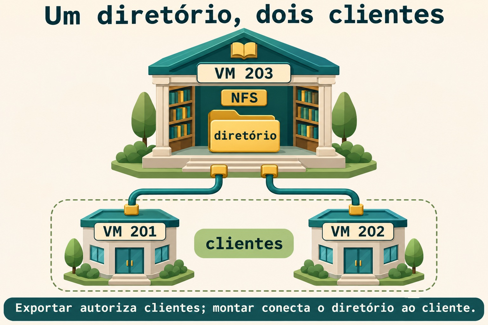
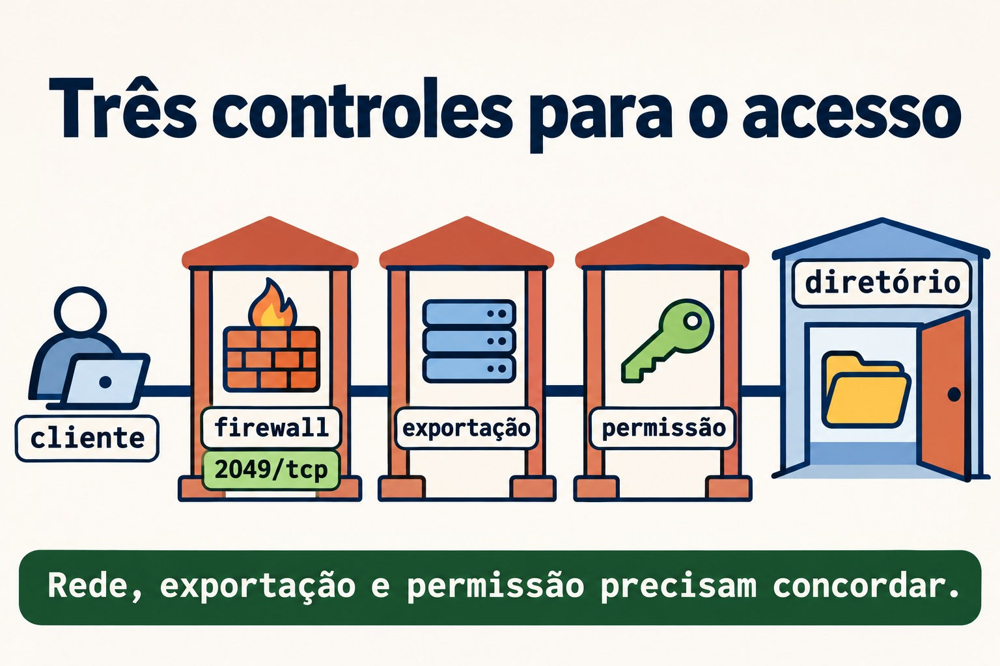
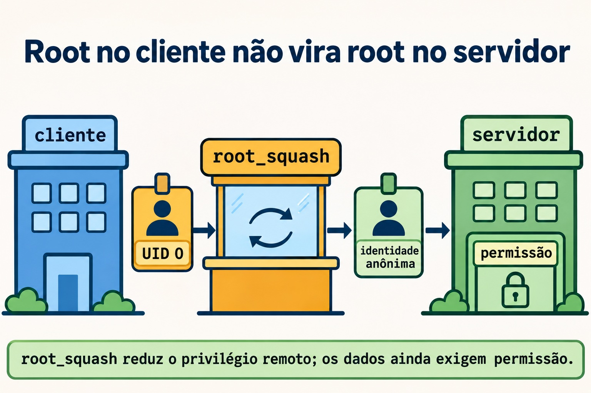

# Aula 13.1 · Servidor NFS

No Windows Server, compartilhar uma pasta envolve serviço, cliente autorizado e permissão dos arquivos. No NFS você separa as mesmas perguntas. Esta aula acrescenta a VM 203 ao laboratório, publica um diretório somente para as duas VMs do curso e mantém SELinux e firewall ativos.

> **Núcleo desta aula:** exportação define quais clientes e operações o servidor permite; firewall limita a chegada; permissões dos arquivos continuam valendo. O resto é aprofundamento.

| Ficha |  |
| --- | --- |
| **Módulo** | M13 · Armazenamento em rede, aula 1 de 3 |
| **Quando** | Semana 18 |
| **Ao final** | Você prepara a VM 203 e exporta conteúdo NFS de leitura para as VMs 201 e 202 |
| **Pré-requisitos** | M0 a M12; noVNC, backup do curso, IP reservado fora do pool DHCP e storage do laboratório |
| **Tempo** | Cerca de 90 minutos, mais a instalação da nova VM |
| **Snapshots** | `m13a1-inicio` e `m13a1-fim` nas VMs 201, 202 e 203 |

## 1 · Aquecimento

Responda sem consultar. O gabarito fica no fim.

1. Permitir uma porta no firewall cria o serviço que atende nela?
2. Dono, modo e contexto SELinux respondem à mesma pergunta?
3. Por que você confere um VMID no cluster antes de criar uma VM?

## 2 · Por que importa

Você quer entregar o mesmo conteúdo para dois servidores. Copiar arquivos para cada host cria versões diferentes e exige sincronização. Um compartilhamento permite trabalhar com uma origem central, mas acrescenta dependência da rede e do servidor de arquivos.

O objetivo não é tornar qualquer diretório acessível para qualquer máquina. Você vai publicar uma árvore própria, em leitura, para dois endereços conhecidos e verificar cada camada separadamente.

## 3 · Modelo mental

O servidor é a biblioteca do prédio. A exportação é a lista de leitores autorizados. Montar é encaixar uma entrada para essa biblioteca na árvore do cliente; não é copiar os livros para outro disco.

```text
VM 203: diretório -> exportação -> NFS -> VM 201 e VM 202
          |             |          |              |
       arquivos       clientes   2049/tcp       montagem
```



*Exportar autoriza clientes; montar conecta o diretório ao cliente.*

### Ponte Windows

| Referência do Windows | Neste lab Linux |
| --- | --- |
| Pasta compartilhada | Diretório exportado por NFS |
| Cliente autorizado | IP exato na exportação e no firewall |
| Caminho de acesso remoto | Servidor e caminho da exportação |
| Permissão do arquivo | UID, GID, modo e política ativa |

## 4 · O essencial

### Exportar não é montar

O servidor mantém a lista em `/etc/exports` e arquivos terminados em `.exports` dentro de `/etc/exports.d/`. `exportfs` aplica e mostra exportações. Um arquivo salvo precisa ser carregado para participar do estado ativo.

Nesta aula use NFS `4.2`. Os clientes seguintes vão escolher essa versão explicitamente. O tráfego principal chega a TCP `2049`; isso não torna consultas antigas de `showmount` uma prova adequada de todo servidor NFSv4.

### Opções com finalidade

| Opção | Papel no lab |
| --- | --- |
| `ro` | Exportar em leitura |
| `sync` | Confirmar operações de escrita conforme as garantias do servidor |
| `root_squash` | Reduzir a identidade remota de UID zero |
| `no_subtree_check` | Evitar a verificação adicional da subárvore exportada |

Não coloque espaço entre o cliente e seus parênteses de opções. Neste módulo, o servidor confia nos identificadores numéricos enviados pelos clientes com `AUTH_SYS`; use somente a rede autorizada do lab, sem publicar NFS na internet.



*Rede, exportação e permissão precisam concordar.*

### Root remoto tem limite

`root_squash` não transforma todos os usuários em anônimos. Ele trata a identidade privilegiada remota. Isso não substitui a conferência de UID e GID dos usuários comuns, que você fará nas próximas aulas.



*root_squash reduz o privilégio remoto; os dados ainda exigem permissão.*

### Rocky × Debian

| Item | Rocky 9 | Debian 13 |
| --- | --- | --- |
| Servidor desta aula | VM 203, `nfs-utils` | Papel de cliente na VM 202 |
| Unidade do servidor | `nfs-server.service` | Se fosse servidor: `nfs-kernel-server.service` |
| Pacote cliente | `nfs-utils` | `nfs-common` |
| Política adicional | SELinux enforcing | AppArmor conforme perfis ativos |

O plano introduz apenas um servidor NFS, a Rocky da VM 203. As VMs 201 e 202 repetem o papel de cliente; não crie um segundo servidor nem use uma VM fora da tabela do curso.

## 5 · Lab guiado

### Passo 1 · Criar a VM 203 com identidade própria

**Palpite:** um ID livre no nó atual é suficiente para garantir que esteja livre no cluster?

No host Proxmox, confira ID, storage e a ISO real antes da criação. Se `203` já estiver em uso, pare esta criação e revise o inventário; não remova a VM encontrada.

```bash
qm list
pvesh get /cluster/resources --type vm
pvesm status
```

Reaplique o procedimento de criação e instalação da aula 0.1 usando estes valores. Selecione a ISO do Rocky 9 presente no storage; não invente o identificador de volume.

| Campo | Valor da VM nova |
| --- | --- |
| VMID e nome | `203`, `srv-lab` |
| CPU, memória e disco | `x86-64-v2-AES`, 2 vCPU, 2 GB, 20 GB |
| Máquina e firmware | q35 e UEFI OVMF |
| Storage e interface | `vm-hdd`, virtio em `vmbr0` |
| Sistema e acesso | Rocky 9, `student`, `sudo`, SSH por chave e guest agent |
| Rede | IPv4 reservado fora do pool DHCP, prefixo, gateway e DNS confirmados no plano da rede |

Faça a instalação nova pelo noVNC. Não clone a identidade de uma VM existente. Registre o endereço reservado como `IP_SRV`, sem presumir que o próximo número esteja disponível; uma ausência de resposta ao ping não comprova reserva. Prepare o alias SSH `srv-lab` no Windows conforme a 0.2.

**Saída esperada:** VM 203 com hostname e chaves de host próprios, endereço reservado persistente e acesso por chave.

**Verifique:** na 203, confira `hostnamectl --static`, `ip -br address`, `sudo systemctl is-active qemu-guest-agent` e uma nova sessão `ssh srv-lab` do Windows. Reinicie a VM e confirme o mesmo endereço antes de exportar arquivos.

### Passo 2 · Registrar a base e instalar NFS

**Palpite:** um snapshot anterior à criação do serviço permite voltar sem apagar as VMs clientes?

No host Proxmox, depois de instalar e conferir a VM nova:

```bash
qm snapshot 201 m13a1-inicio
qm snapshot 202 m13a1-inicio
qm snapshot 203 m13a1-inicio
```

Na 203, crie registros e anote o IP real. A pasta precisa estar ausente.

```bash
test ! -e "$HOME/m13"
mkdir -m 700 "$HOME/m13"
read -r -p 'IP_SRV: ' IP_SRV
printf '%s\n' "$IP_SRV" > "$HOME/m13/ip-servidor"
ip -br address
sudo dnf install -y nfs-utils policycoreutils-python-utils
getenforce
sudo firewall-cmd --state
sudo exportfs -v
```

**Saída esperada:** endereço digitado presente na interface, SELinux enforcing, firewalld ativo e nenhuma exportação de outro exercício. Se a base não corresponder, ajuste o preparo antes de prosseguir.

**Verifique:** o NFS será instalado somente no servidor 203 nesta aula. Pacotes dos clientes entram na 13.2. Preserve o estado inicial de SSH e firewalld.

### Passo 3 · Preparar o diretório de leitura

**Palpite:** uma exportação em leitura precisa que o arquivo tenha modo de escrita para todos?

Na 203, verifique os nomes reservados antes de criar qualquer arquivo.

```bash
sudo test ! -e /srv/m13-share
sudo test ! -e /etc/exports.d/m13-share.exports
sudo install -d -m 0755 /srv/m13-share
printf 'NFS COURSE ok\n' | sudo tee /srv/m13-share/leia.txt > /dev/null
sudo chmod 0644 /srv/m13-share/leia.txt
sudo semanage fcontext -l -C | grep -F '/srv/m13-share'
```

Se já existir uma regra local para essa árvore, pare e revise a autoria antes de substituir. Registre um tipo de conteúdo público para o compartilhamento de leitura.

```bash
sudo semanage fcontext -a -t public_content_t '/srv/m13-share(/.*)?'
sudo restorecon -Rv /srv/m13-share
ls -ldZ /srv/m13-share
ls -lZ /srv/m13-share/leia.txt
getsebool nfs_export_all_ro nfs_export_all_rw
```

**Saída esperada:** árvore atravessável, arquivo legível e regra de contexto aplicada. Leia os booleanos existentes sem mudar o host para permissive nem ampliar a política por tentativa.

**Verifique:** `matchpathcon -V /srv/m13-share/leia.txt` deve coincidir com a regra registrada. Se uma política local endurecida negar o acesso depois, investigue o registro e a política específica, como no M12.

### Decida 1

Você quer permitir apenas os dois clientes do curso. Qual alvo descreve essa intenção?

| Opção | Ação |
| --- | --- |
| A | Exportar para qualquer host |
| B | Usar os IPs exatos das VMs 201 e 202 |
| C | Tornar o diretório gravável por todos |

Escolha B. A lista de clientes e os modos dos arquivos são controles diferentes.

### Passo 4 · Registrar e carregar a exportação

**Palpite:** salvar o arquivo de exportação já atualiza a tabela usada pelo servidor?

Na 203:

```bash
sudo install -d -m 0755 /etc/exports.d
sudo tee /etc/exports.d/m13-share.exports > /dev/null <<'EOF'
/srv/m13-share 10.1.0.51(ro,sync,root_squash,no_subtree_check) 10.1.0.52(ro,sync,root_squash,no_subtree_check)
EOF
sudo chmod 0644 /etc/exports.d/m13-share.exports
sudo systemctl enable --now nfs-server.service
sudo exportfs -rav
sudo exportfs -v
sudo ss -lnt 'sport = :2049'
```

**Saída esperada:** exportação para os dois IPs com leitura, `root_squash` e serviço em TCP `2049`. A representação das opções em `exportfs -v` pode incluir valores padrão adicionais.

**Verifique:** confira o caminho e cada cliente separadamente. O espaço antes dos parênteses mudaria o significado; não corrija um erro de sintaxe abrindo o acesso a todos.

### Passo 5 · Autorizar a rede necessária

**Palpite:** liberar TCP `2049` para dois IPs modifica a regra de SSH?

Na 203, identifique a zona efetiva da interface e das origens do lab. A base deve bloquear TCP `2049` sem uma autorização e não pode ter serviço NFS ou porta equivalente liberados de forma ampla. As regras exatas abaixo não podem existir antes desta aula.

```bash
sudo firewall-cmd --get-active-zones
read -r -p 'ZONE: ' ZONE
sudo firewall-cmd --zone="$ZONE" --list-all
RULE201='rule family="ipv4" source address="10.1.0.51/32" port port="2049" protocol="tcp" accept'
RULE202='rule family="ipv4" source address="10.1.0.52/32" port port="2049" protocol="tcp" accept'
printf '%s\n' "$ZONE" > "$HOME/m13/zone"
printf '%s\n' "$RULE201" > "$HOME/m13/rule201"
printf '%s\n' "$RULE202" > "$HOME/m13/rule202"
sudo firewall-cmd --zone="$ZONE" --add-rich-rule="$RULE201"
sudo firewall-cmd --zone="$ZONE" --add-rich-rule="$RULE202"
sudo firewall-cmd --permanent --zone="$ZONE" --add-rich-rule="$RULE201"
sudo firewall-cmd --permanent --zone="$ZONE" --add-rich-rule="$RULE202"
sudo firewall-cmd --check-config
```

**Saída esperada:** as duas regras existem no ativo e no permanente. Não houve mudança na autorização SSH nem abertura de NFS para uma rede inteira.

**Verifique:** das VMs 201 e 202, digite o `IP_SRV` confirmado e teste `timeout 2 bash -c "</dev/tcp/$IP_SRV/2049" && echo ok`. Isso comprova TCP; a leitura NFS será testada na 13.2.

### Decida 2

A porta responde, mas um cliente informa acesso negado na montagem. Qual é a próxima evidência?

| Opção | Ação |
| --- | --- |
| A | Conferir exportação ativa, origem real e caminho solicitado |
| B | Remover `root_squash` |
| C | Desligar SELinux |

Escolha A. TCP e autorização de exportação respondem a perguntas diferentes.

### Passo 6 · Conferir o servidor após reboot

**Palpite:** um serviço habilitado sem exportação válida entrega automaticamente o diretório certo?

Na 203, reinicie e volte por SSH ou noVNC.

```bash
sudo systemctl reboot
```

Depois de voltar:

```bash
systemctl is-active nfs-server.service
sudo exportfs -v
getenforce
matchpathcon -V /srv/m13-share/leia.txt
ZONE=$(cat "$HOME/m13/zone")
RULE201=$(cat "$HOME/m13/rule201")
RULE202=$(cat "$HOME/m13/rule202")
sudo firewall-cmd --zone="$ZONE" --query-rich-rule="$RULE201"
sudo firewall-cmd --permanent --zone="$ZONE" --query-rich-rule="$RULE202"
```

**Saída esperada:** serviço ativo, exportação correta, enforcing e regras persistentes.

**Verifique:** teste novamente TCP a partir de cada cliente e uma sessão SSH do Windows. A montagem e a identidade numérica entram na próxima aula.

## 6 · Quebre e conserte

### Quebra 1 · Arquivo salvo com nome ignorado

Na 203, mude apenas o sufixo do arquivo próprio.

```bash
sudo mv /etc/exports.d/m13-share.exports /etc/exports.d/m13-share.disabled
sudo exportfs -ra
```

**Sintoma:** o serviço permanece ativo, mas a exportação de exercício some da tabela.

**Investigação:** compare os arquivos e a tabela carregada.

```bash
sudo ls -l /etc/exports.d/
sudo exportfs -v
```

**Causa:** o arquivo deixou de terminar em `.exports` e não participa da carga normal.

**Conserto:** restaure o nome exato e recarregue a exportação.

```bash
sudo mv /etc/exports.d/m13-share.disabled /etc/exports.d/m13-share.exports
sudo exportfs -ra
```

**Verifique:** `exportfs -v` volta a listar os dois clientes.

**Prevenção:** confira arquivo, carga e resultado ativo como três evidências distintas.

### Quebra 2 · Cliente autorizado errado

Na 203, preserve o arquivo válido e altere só o cliente de exercício.

```bash
sudo cp -a /etc/exports.d/m13-share.exports /etc/exports.d/m13-share.backup
sudo sed -i 's/10\.1\.0\.52/10.1.0.99/' /etc/exports.d/m13-share.exports
sudo exportfs -ra
sudo exportfs -v
```

**Sintoma:** TCP `2049` continua acessível à VM 202, mas ela já não está na exportação ativa.

**Investigação:** compare a origem real da 202 com a lista de clientes da exportação.

**Causa:** a lista passou a autorizar outro endereço; a regra do firewall não corrige essa lista.

**Conserto:** recoloque a cópia válida e reaplique.

```bash
sudo cp -a /etc/exports.d/m13-share.backup /etc/exports.d/m13-share.exports
sudo exportfs -ra
```

**Verifique:** a 202 volta à tabela. Não deixe a exportação de teste apontando para o endereço incorreto.

**Prevenção:** registre cliente autorizado e caminho exportado junto com a regra de rede.

### Quebra 3 · Regra salva, aceite ativo retirado

Na 203, retire apenas o aceite ativo da VM 201.

```bash
sudo firewall-cmd --zone="$ZONE" --remove-rich-rule="$RULE201"
```

**Sintoma:** na zona padrão bloqueadora do lab, a 201 deixa de abrir TCP `2049`, mas a 202 continua funcionando.

**Investigação:** compare ativo e permanente e confira se a zona não tem uma autorização mais ampla para essa porta.

```bash
sudo firewall-cmd --zone="$ZONE" --list-all
sudo firewall-cmd --zone="$ZONE" --query-rich-rule="$RULE201"
sudo firewall-cmd --permanent --zone="$ZONE" --query-rich-rule="$RULE201"
```

**Causa:** a regra foi retirada somente da memória. O arquivo permanente continua correto. Uma autorização ampla preexistente esconderia este defeito e precisa ser identificada no preparo, sem apagar regras alheias.

**Conserto:** recoloque apenas o aceite ativo.

```bash
sudo firewall-cmd --zone="$ZONE" --add-rich-rule="$RULE201"
```

**Verifique:** repita o teste TCP dos dois clientes.

**Prevenção:** compare a política efetiva e a persistente antes de concluir a mudança.

### Limpeza e continuidade

Retire somente a cópia da quebra. O servidor, o conteúdo, a regra SELinux e as duas autorizações ficam como base para as aulas 13.2 e 13.3. Essa retenção é intencional, não é um serviço esquecido.

```bash
sudo rm -f /etc/exports.d/m13-share.backup
sudo exportfs -v
sudo systemctl is-enabled nfs-server.service
```

Não remova a VM 203 nem reverta os clientes ao snapshot para “limpar”. As próximas aulas registram a mesma base e retiram apenas seus próprios testes.

## 7 · Armadilhas

| Erro comum | O que fazer | Por quê |
| --- | --- | --- |
| Autorizar qualquer cliente | Usar IPs exatos do lab | Limita a superfície publicada |
| Espaço antes das opções | Manter cliente e parênteses juntos | A sintaxe muda o significado |
| Usar `no_root_squash` para um erro de dono | Conferir UID, GID e modo | Root remoto não deve ganhar privilégio global |
| Confundir porta aberta com exportação válida | Conferir `exportfs -v` | TCP não valida o caminho NFS |

## 8 · Quiz

1. Exportar um diretório monta esse diretório no cliente?
2. Qual é o alcance de `root_squash`?
3. Por que `IP_SRV` não deve ser escolhido apenas por um ping sem resposta?
4. Qual comando mostra exportações ativas?
5. Abrir TCP `2049` para a 202 corrige um IP errado em exports?
6. Quais estados precisam sobreviver ao reboot do servidor?

## 9 · Cola

| Tarefa | Comando |
| --- | --- |
| Exportações ativas | `sudo exportfs -v` |
| Reaplicar arquivos | `sudo exportfs -ra` |
| Serviço NFS da Rocky | `systemctl status nfs-server.service` |
| Escuta principal | `sudo ss -lnt 'sport = :2049'` |
| Contexto esperado | `matchpathcon -V /srv/m13-share/leia.txt` |

**Flashcards:** crie cartões para exportação, montagem, cliente, `ro`, `root_squash` e estado ativo. Revise em D+1, D+3, D+7 e D+21.

## 10 · Checklist e fechamento

- [ ] Criei somente a VM 203 e reservei seu endereço formalmente.
- [ ] Mantive firewall e SELinux ativos.
- [ ] Exportei apenas a árvore de exercício para os dois clientes.
- [ ] Deixei o servidor pronto para a 13.2 e retirei os defeitos plantados.

**Último exercício:** explique por que regra de rede, exportação e permissão de arquivo não são intercambiáveis. Use o resultado de uma quebra.

**Reboot de conferência:** depois das quebras corrigidas, reinicie a 203 e confira serviço, exportação, contexto e regras como no passo 6. Abra também uma nova sessão SSH para cada VM.

No host Proxmox, após a conferência:

```bash
qm snapshot 201 m13a1-fim
qm snapshot 202 m13a1-fim
qm snapshot 203 m13a1-fim
```

## 11 · Na vida real

Em um servidor que você administre ou tenha autorização para inspecionar, faça somente leitura. Leia `exportfs -v`, estado do serviço e política de rede aplicável. Não publique uma pasta, mude um booleano ou altere o firewall nesta missão.

Qual exportação é mais ampla que o necessário? Qual cliente é uma máquina conhecida? Onde estão documentados dono, UID, GID e finalidade?

## 12 · Aprofundar quando quiser

- [exports(5)](https://manpages.debian.org/trixie/nfs-kernel-server/exports.5.en.html): clientes, opções e sintaxe.
- [NFS no RHEL 9](https://docs.redhat.com/en/documentation/red_hat_enterprise_linux/9/html-single/configuring_and_using_network_file_services/index): serviço, versões e rede.
- No servidor, consulte `man exportfs`, `man nfsd_selinux` e `man exports`, quando disponíveis.
- [firewall-cmd](https://firewalld.org/documentation/man-pages/firewall-cmd.html): regras ativas e permanentes.

**DeepTutor** (http://10.1.0.149:3782, KB "Curso Linux Sysadmin"):

- `!explica Separe firewall, exportação NFS e permissão do arquivo com uma analogia de biblioteca.`
- `!feynman Vou explicar o alcance de root_squash sem confundir com identidade de usuários comuns. Critique minha explicação.`
- `!quiz Crie seis situações de cliente, caminho e persistência de exportações NFS.`

## Gabarito comentado

### Aquecimento

1. Não. O processo precisa estar em escuta e responder ao protocolo.
2. Não. São controles diferentes que se combinam no acesso.
3. O ID pode pertencer a outro nó; o inventário do cluster evita alterar uma VM que não é sua.

### Quiz

1. Não. Montar é uma ação do cliente.
2. Reduz a identidade privilegiada remota; não transforma todos os usuários em um só.
3. Um host pode não responder a ICMP e continuar usando o endereço. A reserva vem do plano da rede e do controle DHCP.
4. `sudo exportfs -v`.
5. Não. A autorização da exportação ainda precisa descrever o cliente real.
6. Serviço, exportação, permissões, contextos e regras permanentes que sustentam o acesso.

<!-- navegacao -->
[← Aula 12.5 · Auditoria e criptografia](12.5-auditoria-e-criptografia.md) · [Índice de aulas](../01-aulas.md) · [Plano do curso: 13.2 em diante →](../00-plano-do-curso.md)
