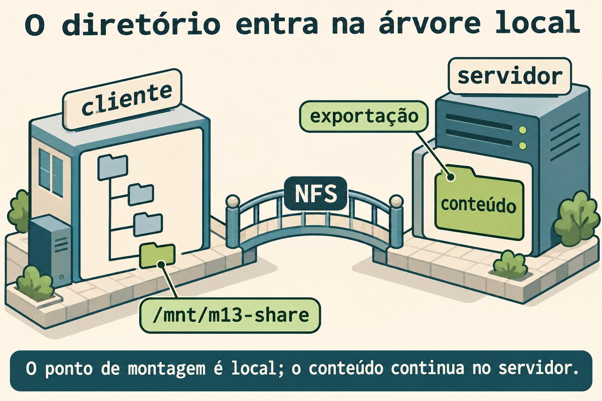
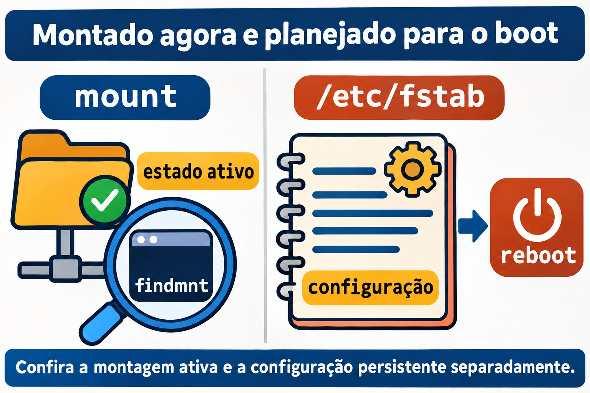
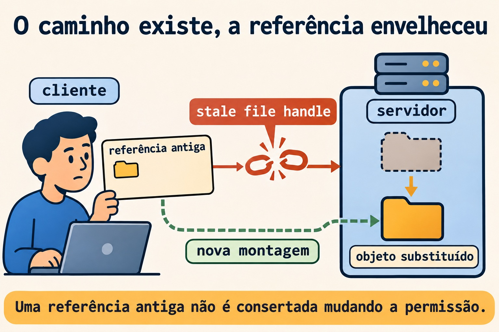

# Aula 13.2 · Cliente NFS

No Windows Server, um caminho remoto e uma letra de unidade representam pontos de acesso diferentes ao mesmo conteúdo. No Linux, a montagem encaixa o diretório remoto na árvore local. Você vai montar a exportação da VM 203 nas duas famílias, conferir o estado ativo e planejar a reconstrução no boot.

> **Núcleo desta aula:** servidor, caminho remoto e ponto local precisam corresponder. Montagem ativa e entrada no fstab são evidências separadas; referências antigas exigem investigar o objeto remoto. O resto é aprofundamento.

| Ficha |  |
| --- | --- |
| **Módulo** | M13 · Armazenamento em rede, aula 2 de 3 |
| **Quando** | Semana 19 |
| **Ao final** | Você monta NFSv4.2 em Rocky e Debian, valida fstab e distingue indisponibilidade, ocupação e referência obsoleta |
| **Pré-requisitos** | 13.1 concluída; exportação da VM 203 ativa; `IP_SRV` registrado; `student`, `sudo`, SSH e noVNC |
| **Tempo** | Cerca de 90 minutos |
| **Snapshots** | `m13a2-inicio` e `m13a2-fim` nas VMs 201, 202 e 203 |

## 1 · Aquecimento

Responda sem consultar. O gabarito está no fim.

1. Exportar a pasta no servidor já a encaixa na árvore dos clientes?
2. Que controles ainda precisam ser conferidos depois de abrir TCP `2049`?
3. Qual é a função de `root_squash`?

## 2 · Por que importa

O servidor exporta a pasta, mas um cliente mostra arquivos antigos. O operador estava lendo o diretório local porque a montagem não havia ocorrido. Em outro caso, a montagem funciona até o reboot: faltou a configuração persistente.

Antes de concluir que os dados sumiram, confirme qual sistema de arquivos atende o caminho. Essa verificação evita gravar no diretório local achando que ele é o compartilhamento remoto.

## 3 · Modelo mental

O ponto de montagem é a porta de entrada da biblioteca no cliente. Enquanto a ponte está encaixada, você enxerga o conteúdo do servidor por aquela porta. O conteúdo local que já existia ali fica encoberto, sem ser apagado.

```text
VM 203:/srv/m13-share -> NFS -> cliente:/mnt/m13-share
           |                                  |
      conteúdo remoto                   ponto local
```



*O ponto de montagem é local; o conteúdo continua no servidor.*

### Ponte Windows

| Referência do Windows | Neste lab Linux |
| --- | --- |
| Endereço do servidor e compartilhamento | `IP_SRV` e `/srv/m13-share` |
| Ponto de acesso do cliente | `/mnt/m13-share` |
| Reconectar no logon ou inicialização | Configuração persistente do sistema |
| Conferir conexão real | `findmnt` e leitura do arquivo esperado |

## 4 · O essencial

### Três partes do endereço

No comando de montagem você informa o servidor, o caminho exportado e o diretório local. O nome local não precisa ser igual ao remoto. O endereço reservado da 203 continua sendo o registrado na 13.1; não escolha um endereço por adivinhação.

### Opções que você vai conferir

| Opção | Efeito neste lab |
| --- | --- |
| `vers=4.2` | Escolhe a versão usada pelo curso |
| `ro` | Monta o cliente em leitura |
| `hard` | Mantém a tentativa de operações quando o servidor fica indisponível |
| `nosuid,nodev` | Não usa bits especiais nem dispositivos do conteúdo remoto como privilégio local |
| `_netdev` | Marca a dependência de rede para a montagem persistente |

Uma montagem `hard` pode deixar operações de arquivo aguardando um servidor ausente. Isso é diferente de falha rápida de uma tentativa inicial de montagem; não troque para `soft` apenas para ocultar a indisponibilidade.

### Disco e estado ativo

Uma linha no `/etc/fstab` descreve como montar; `findmnt` mostra o que está montado. `findmnt --verify` confere a tabela; uma montagem real e uma leitura verificam o comportamento. Não use `mount -a` como primeiro teste de uma alteração isolada.



*Confira a montagem ativa e a configuração persistente separadamente.*

### Referência antiga não é permissão

`stale file handle` indica que uma referência guardada pelo cliente já não identifica um objeto válido no servidor. Uma reconstrução ou substituição do objeto remoto pode invalidar essa referência. Renomear um diretório não produz necessariamente esse erro.

Investigue o que mudou no servidor, identifique consumidores e pare o uso antes de desmontar e montar novamente. Não apague uma árvore compartilhada para tentar reproduzir a mensagem e não force uma desmontagem em uso como rotina.



*Uma referência antiga não é consertada mudando a permissão.*

### Rocky × Debian

| Item | Rocky 9 | Debian 13 |
| --- | --- | --- |
| Pacote cliente | `nfs-utils` | `nfs-common` |
| Diagnóstico de montagem | `findmnt`, `nfsstat -m` | `findmnt`, `nfsstat -m` |
| Persistência | `/etc/fstab` interpretado pelo systemd | O mesmo mecanismo |
| Conteúdo servido | VM 203, Rocky 9 | A mesma VM 203 |

## 5 · Lab guiado

Execute os mesmos passos nas VMs 201 e 202. A VM 203 mantém a exportação criada na 13.1; não altere o servidor durante as montagens dos clientes.

### Passo 1 · Proteger e registrar o destino

**Palpite:** conhecer o ponto local comprova qual servidor está fornecendo os arquivos?

No host Proxmox:

```bash
qm snapshot 201 m13a2-inicio
qm snapshot 202 m13a2-inicio
qm snapshot 203 m13a2-inicio
```

Nos dois clientes, registre o IP reservado confirmado na 13.1. A pasta `m13` ainda não foi criada nesses clientes.

```bash
test ! -e "$HOME/m13"
mkdir -m 700 "$HOME/m13"
read -r -p 'IP_SRV: ' IP_SRV
printf '%s\n' "$IP_SRV" > "$HOME/m13/ip-servidor"
sudo test ! -e /mnt/m13-share
grep -nF '/mnt/m13-share' /etc/fstab
ip -4 route get "$IP_SRV"
timeout 2 bash -c "</dev/tcp/$IP_SRV/2049" && echo "TCP 2049 ok"
```

**Saída esperada:** destino correto, rota e TCP disponíveis, ponto local e referência no fstab ausentes. Uma busca vazia do `grep` é a condição desejada.

**Verifique:** na 203, `sudo exportfs -v` continua listando `/srv/m13-share` e os IPs das duas VMs. Se essa base falhar, corrija a 13.1 antes de continuar.

### Passo 2 · Instalar e criar uma porta local vazia

**Palpite:** criar o diretório local já traz algum arquivo do servidor?

Na Rocky:

```bash
sudo dnf install -y nfs-utils
```

Na Debian:

```bash
sudo apt update
sudo apt install -y nfs-common
```

Nos dois clientes:

```bash
sudo install -d -m 0755 /mnt/m13-share
findmnt --mountpoint /mnt/m13-share
sudo ls -la /mnt/m13-share
sudo cp -a /etc/fstab "$HOME/m13/fstab.inicio"
```

**Saída esperada:** diretório vazio e ainda sem montagem. O backup do fstab guarda a referência anterior, sem substituir sua configuração ativa.

**Verifique:** confirme que nenhum conteúdo local precisa ser preservado sob o ponto escolhido. Nunca monte por cima de uma árvore de trabalho sem inventariá-la.

### Passo 3 · Montar e comprovar a origem

**Palpite:** o texto esperado sozinho demonstra que o arquivo veio da 203?

Nos dois clientes:

```bash
sudo mount -t nfs -o vers=4.2,ro,hard,nosuid,nodev "$IP_SRV:/srv/m13-share" /mnt/m13-share
findmnt --mountpoint /mnt/m13-share -o SOURCE,TARGET,FSTYPE,OPTIONS
/usr/sbin/nfsstat -m
cat /mnt/m13-share/leia.txt
stat -c '%u:%g %a %n' /mnt/m13-share/leia.txt
```

**Saída esperada:** origem com o `IP_SRV` correto, NFSv4.2, leitura e conteúdo `NFS COURSE ok`. A representação das opções pode conter valores negociados adicionais.

**Verifique:** compare o UID, GID e modo numéricos com o arquivo na 203. O nome exibido pelo cliente pode depender do seu cadastro local; números e permissões não são dispensados por NFS.

### Decida 1

O arquivo esperado apareceu, mas `findmnt` não mostra NFS naquele ponto. Qual hipótese vem primeiro?

| Opção | Ação |
| --- | --- |
| A | O servidor necessariamente perdeu dados |
| B | Você pode estar lendo conteúdo local |
| C | É preciso liberar escrita para todos |

Escolha B. Confira o sistema de arquivos que atende o caminho antes de interpretar o conteúdo.

### Passo 4 · Diferenciar leitura de escrita

**Palpite:** root no cliente pode gravar ignorando a opção de leitura da montagem?

Nos dois clientes, tente criar somente um arquivo novo com nome de exercício.

```bash
sudo touch /mnt/m13-share/nao-deve-existir
findmnt --mountpoint /mnt/m13-share -o SOURCE,OPTIONS
```

**Saída esperada:** a criação é recusada. Esta montagem cliente usa `ro`, e a exportação servidor também é de leitura. Isso não é uma demonstração isolada de `root_squash`.

**Verifique:** na 203, confirme que `/srv/m13-share/nao-deve-existir` não foi criado. Não converta a exportação para escrita apenas para fazer esse teste passar.

### Passo 5 · Registrar a montagem persistente

**Palpite:** o fstab correto altera a montagem que já está ativa sem outra ação?

Nos dois clientes, confirme novamente que o marcador e o ponto não aparecem no fstab. Só então acrescente o bloco próprio.

```bash
grep -nE 'm13a2|/mnt/m13-share' /etc/fstab
printf '\n# BEGIN m13a2\n%s:/srv/m13-share /mnt/m13-share nfs ro,vers=4.2,hard,nosuid,nodev,_netdev,nofail,x-systemd.mount-timeout=15s 0 0\n# END m13a2\n' "$IP_SRV" | sudo tee -a /etc/fstab > /dev/null
sudo findmnt --verify --verbose
sudo systemctl daemon-reload
cd "$HOME"
sudo umount /mnt/m13-share
sudo mount /mnt/m13-share
findmnt --mountpoint /mnt/m13-share -o SOURCE,OPTIONS
cat /mnt/m13-share/leia.txt
```

`nofail` permite que a ausência dessa montagem de exercício não impeça o boot; não transforma um arquivo remoto em conteúdo local disponível. O limite do systemd vale para o trabalho de montagem, não para toda operação posterior de uma montagem `hard`.

**Saída esperada:** validação da tabela sem erro da entrada nova e remontagem pelo ponto local usando o fstab.

**Verifique:** confira que a origem e a versão são as mesmas da montagem manual. Se a validação indicar erro, corrija antes do reboot; não substitua o fstab inteiro pelo backup sem revisar diferenças.

### Decida 2

A montagem fica ocupada quando você tenta desmontar. Qual é a ação inicial?

| Opção | Ação |
| --- | --- |
| A | Reiniciar o servidor de arquivos |
| B | Forçar a desmontagem de qualquer jeito |
| C | Identificar shells e processos que usam o ponto |

Escolha C. Diretório atual, arquivo aberto e processo ativo são motivos para coordenar a parada do uso.

### Passo 6 · Conferir depois do reboot

**Palpite:** uma montagem manual bem-sucedida demonstra que o sistema vai reconstruí-la no boot?

Reinicie os clientes, um por vez; a 203 deve estar ligada e disponível.

```bash
sudo systemctl reboot
```

Depois de voltar a cada cliente:

```bash
findmnt --mountpoint /mnt/m13-share -o SOURCE,TARGET,FSTYPE,OPTIONS
cat /mnt/m13-share/leia.txt
MOUNT_UNIT=$(systemd-escape --path --suffix=mount /mnt/m13-share)
systemctl status "$MOUNT_UNIT" --no-pager
```

**Saída esperada:** origem NFS presente e conteúdo `NFS COURSE ok`. A unidade de montagem corresponde ao caminho escapado pelo systemd.

**Verifique:** para obter o nome sem adivinhar escapes, use `systemd-escape --path --suffix=mount /mnt/m13-share` e consulte a unidade devolvida.

## 6 · Quebre e conserte

### Quebra 1 · Caminho remoto incorreto

Nos clientes, saia do ponto e desmonte antes de testar o caminho errado.

```bash
cd "$HOME"
sudo umount /mnt/m13-share
IP_SRV=$(cat "$HOME/m13/ip-servidor")
sudo mount -t nfs -o vers=4.2,ro "$IP_SRV:/srv/m13-inexistente" /mnt/m13-share
```

**Sintoma:** a tentativa de montagem falha, mesmo com TCP `2049` disponível.

**Investigação:** compare o caminho solicitado com `exportfs -v` na 203.

**Causa:** o cliente pediu uma árvore que não corresponde à exportação planejada. A mensagem exata pode variar entre negativas de caminho e acesso.

**Conserto:** monte pelo ponto do fstab já validado.

```bash
sudo mount /mnt/m13-share
```

**Verifique:** a origem correta e `NFS COURSE ok` voltam a aparecer.

**Prevenção:** registre servidor, exportação e ponto local como campos distintos.

### Quebra 2 · Shell segurando a montagem

Em um terminal A de cada cliente, entre na montagem. Em outro terminal B, tente desmontar.

```bash
cd /mnt/m13-share
pwd
```

```bash
sudo umount /mnt/m13-share
```

**Sintoma:** a desmontagem informa que o ponto está ocupado.

**Investigação:** no A, `pwd` mostra o diretório que está mantendo a referência. Se disponível, `sudo fuser -vm /mnt/m13-share` ajuda a identificar outros consumidores.

**Causa:** o diretório atual da shell está dentro da montagem. Não é uma negativa da exportação.

**Conserto:** no A, volte a `cd "$HOME"`; depois repita a desmontagem no B e monte novamente para a próxima quebra.

**Verifique:** a desmontagem sem força funciona depois de liberar o uso.

**Prevenção:** coordene consumidores antes de manutenção ou substituição de uma exportação.

### Quebra 3 · Opção inválida em candidata

Sem alterar o fstab ativo, saia do ponto, desmonte e escreva uma candidata com uma versão NFS inexistente.

```bash
cd "$HOME"
sudo umount /mnt/m13-share
printf '%s:/srv/m13-share /mnt/m13-share nfs ro,vers=99,hard,nosuid,nodev,_netdev 0 0\n' "$IP_SRV" > "$HOME/m13/fstab.errado"
sudo mount --verbose --fstab "$HOME/m13/fstab.errado" /mnt/m13-share
```

**Sintoma:** a tentativa falha porque a versão solicitada não é uma versão NFS válida. O arquivo ativo do sistema não mudou.

**Investigação:** leia a candidata e a mensagem do auxiliar NFS. Uma validação estrutural do fstab não comprova que todas as opções do protocolo sejam válidas.

**Causa:** a opção pede uma versão inexistente. Alterar o arquivo candidato não modificou o fstab, e a tentativa inválida não criou a montagem.

**Conserto:** gere uma candidata correta para referência, sem substituir o fstab real.

```bash
sed 's/vers=99/vers=4.2/' "$HOME/m13/fstab.errado" > "$HOME/m13/fstab.correto"
cat "$HOME/m13/fstab.correto"
sudo mount --fstab "$HOME/m13/fstab.correto" /mnt/m13-share
findmnt --mountpoint /mnt/m13-share -o SOURCE,OPTIONS
```

**Verifique:** a montagem real volta usando `4.2`; o fstab original mantém sua entrada validada.

**Prevenção:** confira sintaxe, opções do protocolo, aplicação real e resultado após reboot.

### Limpeza

Nos clientes, libere consumidores e desmonte antes de retirar o bloco próprio do fstab. Confira o `diff`; só as linhas do exercício devem desaparecer.

```bash
cd "$HOME"
sudo umount /mnt/m13-share
sudo cp -a /etc/fstab "$HOME/m13/fstab.antes-limpeza"
sudo sed -i '/^# BEGIN m13a2$/,/^# END m13a2$/d' /etc/fstab
sudo diff -u "$HOME/m13/fstab.antes-limpeza" /etc/fstab
sudo findmnt --verify --verbose
sudo systemctl daemon-reload
sudo rmdir /mnt/m13-share
```

A exportação da VM 203 continua ativa. Guarde `ip-servidor` e seus registros privados para a 13.3. Não remova conteúdo remoto como parte da limpeza do cliente.

## 7 · Armadilhas

| Erro comum | O que fazer | Por quê |
| --- | --- | --- |
| Ler sem conferir a montagem | Usar `findmnt` no ponto | O diretório pode estar local |
| Testar qualquer mudança com `mount -a` | Testar somente o ponto do exercício | Evita acionar outras entradas |
| Resolver indisponibilidade com `soft` | Investigar servidor e caminho | Opções alteram garantias de I/O |
| Tratar referência obsoleta como modo errado | Investigar objeto remoto e consumidores | O identificador já não representa o objeto |

## 8 · Quiz

1. O que acontece com arquivos locais encobertos pela montagem?
2. `nofail` garante que o conteúdo remoto esteja disponível?
3. Qual ferramenta mostra a origem efetiva de um ponto?
4. Por que `_netdev` não é sinônimo de “servidor já respondeu”?
5. Qual causa de desmontagem ocupada você reproduziu?
6. Por que não gerar `stale file handle` apagando o compartilhamento?

## 9 · Cola

| Tarefa | Comando |
| --- | --- |
| Origem e opções | `findmnt --mountpoint /mnt/m13-share -o SOURCE,OPTIONS` |
| Opções NFS negociadas | `nfsstat -m` |
| Validar tabela | `sudo findmnt --verify --verbose` |
| Montar o ponto do fstab | `sudo mount /mnt/m13-share` |
| Desmontar após liberar o uso | `sudo umount /mnt/m13-share` |

**Flashcards:** crie cartões para origem, ponto local, fstab, `hard`, `_netdev` e referência obsoleta. Revise em D+1, D+3, D+7 e D+21.

## 10 · Checklist e fechamento

- [ ] Montei e li o conteúdo nas duas famílias.
- [ ] Conferi origem, opções e identificadores numéricos.
- [ ] Testei a persistência antes de retirar o bloco do fstab.
- [ ] Não alterei dados remotos para simular uma referência obsoleta.

**Último exercício:** explique a diferença entre ponto local, caminho remoto e referência de objeto. Acrescente uma evidência de que a montagem veio realmente da 203.

**Reboot de conferência:** após a limpeza, reinicie 201 e 202 e confirme ausência da montagem e da entrada do exercício. A 203 permanece pronta para autofs.

No host Proxmox, depois da conferência:

```bash
qm snapshot 201 m13a2-fim
qm snapshot 202 m13a2-fim
qm snapshot 203 m13a2-fim
```

## 11 · Na vida real

Em um host que você administre ou tenha autorização para inspecionar, faça somente leitura. Observe `findmnt -t nfs,nfs4`, `nfsstat -m` e as entradas de NFS no fstab. Não monte, desmonte ou altere opções nesta missão.

Qual servidor sustenta cada caminho? O que acontece se ele não responder? Quem mantém a configuração persistente e quem usa os arquivos?

## 12 · Aprofundar quando quiser

- [nfs(5)](https://manpages.debian.org/trixie/nfs-common/nfs.5.en.html): opções e comportamento das operações.
- [mount(8)](https://man7.org/linux/man-pages/man8/mount.8.html), [umount(8)](https://man7.org/linux/man-pages/man8/umount.8.html) e [findmnt(8)](https://man7.org/linux/man-pages/man8/findmnt.8.html): montagem e observação.
- [systemd.mount](https://manpages.debian.org/trixie/systemd/systemd.mount.5.en.html): dependências de rede e limites do trabalho de montagem.
- [NFS no RHEL 9](https://docs.redhat.com/en/documentation/red_hat_enterprise_linux/9/html-single/configuring_and_using_network_file_services/index): clientes e diagnóstico.

**DeepTutor** (http://10.1.0.149:3782, KB "Curso Linux Sysadmin"):

- `!explica Separe servidor, caminho exportado e ponto local em uma montagem NFS.`
- `!feynman Vou explicar por que um arquivo local pode reaparecer depois de desmontar NFS. Critique minha explicação.`
- `!quiz Crie seis casos de fstab, montagem ocupada e referência NFS obsoleta sem sugerir apagar dados.`

## Gabarito comentado

### Aquecimento

1. Não. O cliente precisa montar ou usar um mecanismo que monte sob demanda.
2. Caminho exportado, cliente autorizado, identidade e permissão do conteúdo.
3. Reduz a identidade privilegiada remota sem unir todos os usuários em uma identidade só.

### Quiz

1. Continuam no disco local e reaparecem depois da desmontagem.
2. Não. Permite que essa ausência não seja fatal ao boot, mas o dado remoto continua indisponível.
3. `findmnt`, usando o ponto de montagem correto.
4. Classifica a dependência de rede; o servidor ainda precisa estar alcançável e responder.
5. Uma shell com diretório atual dentro da montagem.
6. Isso pode destruir dados e afetar consumidores sem produzir o mesmo erro de forma controlada.

<!-- navegacao -->
[← Aula 13.1 · Servidor NFS](13.1-servidor-nfs.md) · [Índice de aulas](../01-aulas.md) · [Plano do curso: 13.3 em diante →](../00-plano-do-curso.md)
