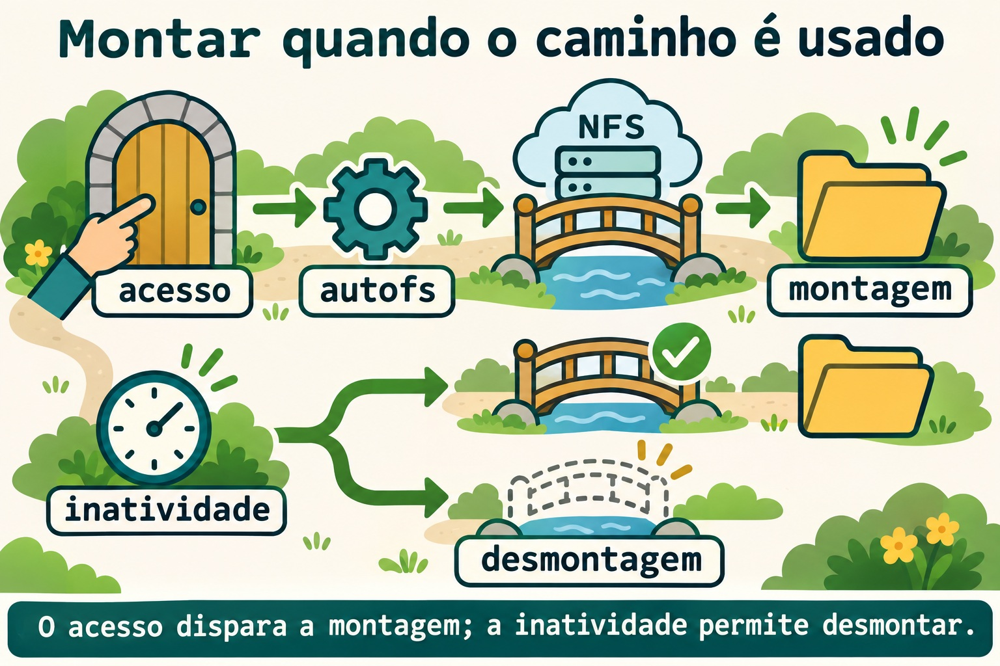
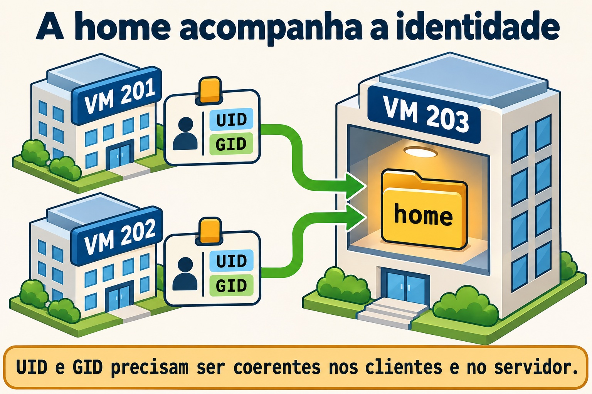

# Aula 13.3 · autofs

No Windows Server, você conhece caminhos de rede usados quando um usuário abre uma pasta. No Linux, autofs pode encaixar a exportação quando alguém acessa um caminho e liberá-la depois de ficar sem uso. Você vai separar mapa mestre, mapa indireto e identidade numérica antes de montar homes sob demanda.

> **Núcleo desta aula:** o mapa descreve o destino; o acesso dispara a montagem; a identidade do usuário ainda precisa corresponder aos dados no servidor. O resto é aprofundamento.

| Ficha |  |
| --- | --- |
| **Módulo** | M13 · Armazenamento em rede, aula 3 de 3 |
| **Quando** | Semana 19 |
| **Ao final** | Você configura um mapa indireto, diagnostica o acesso sob demanda e monta uma home NFS nas duas famílias |
| **Pré-requisitos** | 13.1 e 13.2; VM 203 exportando; clientes sem a montagem fstab do exercício anterior; `IP_SRV` registrado |
| **Tempo** | Cerca de 90 minutos, mais a sessão do desafio |
| **Snapshots** | `m13a3-inicio` e `m13a3-fim` nas VMs 201, 202 e 203 |

## 1 · Aquecimento

Responda sem consultar. O gabarito está no fim.

1. Qual diferença existe entre caminho remoto e ponto de montagem local?
2. Por que um diretório atual pode impedir desmontagem?
3. Um mesmo nome de usuário em duas máquinas comprova que os UIDs são iguais?

## 2 · Por que importa

Uma frota tem dezenas de diretórios remotos, mas cada máquina usa poucos por vez. Montar tudo no boot aumenta dependências desnecessárias. Autofs permite adiar a montagem até o caminho ser realmente usado.

Isso não elimina a dependência do servidor quando alguém precisa dos dados. Você precisa saber se a falha vem do mapa, do caminho NFS, da rede ou da identidade que tenta acessar a home.

## 3 · Modelo mental

O mapa mestre indica qual balcão atende aquela ala do prédio. O mapa indireto relaciona cada chave com uma biblioteca remota. Tocar a porta da chave faz autofs construir a ponte; enquanto alguém a usa, ela não deve ser retirada.

```text
mapa mestre -> ponto base -> mapa indireto -> chave -> destino NFS
                               acesso -> montagem
```



*O acesso dispara a montagem; a inatividade permite desmontar.*

### Ponte Windows

| Referência do Windows | Neste lab Linux |
| --- | --- |
| Caminho remoto usado quando necessário | Acesso a uma chave autofs |
| Mapeamento da pasta de usuário | Home registrada apontando para a árvore autofs |
| Identidade central coerente | UID e GID coerentes neste lab local |
| Conexão de rede ainda necessária | NFS precisa responder quando o caminho é usado |

## 4 · O essencial

### Mapa mestre e indireto

Uma entrada mestre aponta o diretório base e o arquivo de mapa. No mapa indireto, a chave é um componente abaixo dessa base. Neste lab, `/mnt/m13-auto/share` usa a chave `share` sob `/mnt/m13-auto`.


*O mapa mestre aponta para o mapa; a chave escolhe a exportação.*

### Inatividade não é um cronômetro de expulsão

O timeout permite tentar expirar uma montagem sem uso. Um arquivo aberto ou uma shell dentro dela pode mantê-la ocupada. O instante da expiração também depende da verificação do daemon; não prometa que ela ocorrerá exatamente no segundo configurado.

Listar o conteúdo do próprio caminho dispara acesso. Para observar sem provocá-lo, liste os sistemas NFS montados com `findmnt -rn -t nfs,nfs4 -o TARGET,SOURCE`.

### Home remota e identidade

O cadastro do usuário aponta a home; autofs fornece a árvore quando acessada. O servidor continua verificando os números e as permissões. Nome igual com UID diferente não é uma identidade coerente.



*UID e GID precisam ser coerentes nos clientes e no servidor.*

### Rocky × Debian

| Item | Rocky 9 | Debian 13 |
| --- | --- | --- |
| Pacotes | `autofs`, `nfs-utils` | `autofs`, `nfs-common` |
| Unidade | `autofs.service` | `autofs.service` |
| Mapas próprios | `/etc/auto.master.d/m13.autofs`, `/etc/auto.m13` | Os mesmos caminhos, após conferir o include mestre |
| Homes NFS | Conferir `use_nfs_home_dirs` no desafio | Observar política AppArmor real, sem usar comandos SELinux |

## 5 · Lab guiado

### Passo 1 · Proteger e conferir a base

**Palpite:** autofs consegue corrigir sozinho uma exportação NFS que já está inacessível?

No host Proxmox:

```bash
qm snapshot 201 m13a3-inicio
qm snapshot 202 m13a3-inicio
qm snapshot 203 m13a3-inicio
```

Nos clientes, confirme o preparo deixado na 13.2. Se autofs já estiver ativo ou habilitado com mapas alheios, não o reinicie para esta aula; prepare uma base de lab sem esses consumidores.

```bash
IP_SRV=$(cat "$HOME/m13/ip-servidor")
systemctl is-active autofs.service
systemctl is-enabled autofs.service
sudo test ! -e /etc/auto.master.d/m13.autofs
sudo test ! -e /etc/auto.m13
sudo test ! -e /mnt/m13-auto
findmnt -rn -t nfs,nfs4 -o TARGET,SOURCE
timeout 2 bash -c "</dev/tcp/$IP_SRV/2049" && echo "TCP 2049 ok"
```

**Saída esperada:** servidor alcançável, nomes de exercício livres e nenhuma montagem fstab da 13.2. Autofs está ausente ou inativo e desabilitado.

**Verifique:** na 203, confirme o arquivo `leia.txt` e a exportação ativa. Não use autofs para esconder uma falha da base NFS.

### Passo 2 · Instalar e inspecionar o mapa mestre

**Palpite:** criar um arquivo de mapa em qualquer diretório faz o daemon usá-lo automaticamente?

Na Rocky cliente 201:

```bash
sudo dnf install -y autofs nfs-utils
```

Na Debian cliente 202:

```bash
sudo apt update
sudo apt install -y autofs nfs-common
```

Nos dois clientes:

```bash
sudo systemctl stop autofs.service
grep -n 'auto.master.d' /etc/auto.master
sudo automount -m
```

**Saída esperada:** o mapa mestre inclui `/etc/auto.master.d` pelo mecanismo `+dir:` da base do curso. O arquivo terminado em `.autofs` será lido nesse diretório.

**Verifique:** se o include estiver ausente, pare e investigue o mapa mestre realmente configurado antes de prosseguir. Não acrescente mapas que ninguém está carregando.

### Passo 3 · Criar a chave de leitura

**Palpite:** a chave `share` precisa ser o nome do diretório remoto?

Nos dois clientes, configure somente os arquivos próprios.

```bash
sudo install -d -m 0755 /etc/auto.master.d
printf '/mnt/m13-auto /etc/auto.m13 --timeout=30\n' | sudo tee /etc/auto.master.d/m13.autofs > /dev/null
printf 'share -fstype=nfs,vers=4.2,ro,hard,nosuid,nodev %s:/srv/m13-share\n' "$IP_SRV" | sudo tee /etc/auto.m13 > /dev/null
sudo chmod 0644 /etc/auto.master.d/m13.autofs /etc/auto.m13
sudo automount -m
sudo systemctl enable --now autofs.service
findmnt -rn -t nfs,nfs4 -o TARGET,SOURCE
cat /mnt/m13-auto/share/leia.txt
findmnt -rn -t nfs,nfs4 -o TARGET,SOURCE
```

**Saída esperada:** o mapa lista a chave e o destino esperado. O primeiro acesso entrega `NFS COURSE ok` e cria a montagem NFS correspondente.

**Verifique:** observe a origem no `findmnt`, não apenas a existência do diretório base autofs. Um ponto autofs não é ainda a montagem NFS de uma chave.

### Decida 1

A base existe, mas a chave não entrega conteúdo. Qual é a próxima conferência?

| Opção | Ação |
| --- | --- |
| A | Tornar toda a árvore gravável por todos |
| B | Apagar a exportação no servidor |
| C | Conferir mapa carregado, chave e destino |

Escolha C. A chave faz a ligação entre o caminho usado e o destino remoto.

### Passo 4 · Observar a expiração sem tocar na chave

**Palpite:** listar repetidamente a pasta é uma observação sem efeito sobre sua inatividade?

Nos dois clientes, saia da árvore e feche processos que a usam. Espere pelo menos um ciclo de inatividade e inspeção; não consulte o conteúdo durante a espera.

```bash
cd "$HOME"
findmnt -rn -t nfs,nfs4 -o TARGET,SOURCE
```

**Saída esperada:** depois de ficar realmente sem uso e ser processada pelo daemon, a montagem NFS da chave desaparece; o ponto base autofs continua.

**Verifique:** repita a listagem de sistemas montados. Depois acesse novamente o arquivo e observe a reconstrução da montagem.

### Passo 5 · Diagnosticar os registros certos

**Palpite:** uma negativa de leitura necessariamente exige mudar o mapa mestre?

Nos dois clientes:

```bash
sudo automount -m
sudo journalctl -u autofs.service -n 20 --no-pager
findmnt -rn -t nfs,nfs4 -o TARGET,SOURCE
stat -c '%u:%g %a %n' /mnt/m13-auto/share/leia.txt
```

**Saída esperada:** chave carregada, destino correto e identidade numérica do arquivo. O comando de `stat` é um acesso e pode montar a chave novamente.

**Verifique:** compare erro de mapa, falha de montagem e negativa de acesso a um arquivo já montado. Cada fase tem evidências diferentes.

### Decida 2

O nome de usuário coincide, mas ele vê um dono diferente ao acessar uma home. O que conferir?

| Opção | Ação |
| --- | --- |
| A | UID, GID e modos no cliente e no servidor |
| B | Excluir o usuário da outra máquina |
| C | Retirar `root_squash` de todas as exportações |

Escolha A. O nome legível não substitui a identidade numérica usada neste NFS.

### Passo 6 · Conferir a primeira utilização após boot

**Palpite:** autofs ativo no boot significa que todas as suas chaves já estão montadas?

Reinicie os clientes um por vez. A 203 permanece ligada.

```bash
sudo systemctl reboot
```

Depois de voltar:

```bash
systemctl is-active autofs.service
findmnt -rn -t nfs,nfs4 -o TARGET,SOURCE
cat /mnt/m13-auto/share/leia.txt
findmnt -rn -t nfs,nfs4 -o TARGET,SOURCE
```

**Saída esperada:** daemon ativo e montagem criada no primeiro acesso, entregando o conteúdo esperado.

**Verifique:** diferencie a volta do serviço, a carga do mapa e a criação da montagem. Não use somente `systemctl is-active` como verificação dos dados.

## 6 · Quebre e conserte

### Quebra 1 · Chave diferente do caminho usado

Nos clientes, saia da árvore, pare apenas o autofs de exercício e mude a chave própria.

```bash
cd "$HOME"
sudo systemctl stop autofs.service
sudo cp -a /etc/auto.m13 "$HOME/m13/auto.m13.valido"
sudo sed -i 's/^share /share-errado /' /etc/auto.m13
sudo systemctl start autofs.service
cat /mnt/m13-auto/share/leia.txt
```

**Sintoma:** o caminho antigo deixa de entregar o arquivo.

**Investigação:** compare a chave usada com `sudo automount -m` e o arquivo do mapa.

**Causa:** a chave passou a ter outro nome; o caminho antigo não corresponde a uma entrada.

**Conserto:** pare o serviço, restaure o mapa próprio e inicie novamente.

```bash
sudo systemctl stop autofs.service
sudo cp -a "$HOME/m13/auto.m13.valido" /etc/auto.m13
sudo systemctl start autofs.service
```

**Verifique:** o acesso à chave original volta a entregar `NFS COURSE ok`.

**Prevenção:** registre ponto base, chave e caminho remoto separadamente.

### Quebra 2 · Destino remoto incorreto

Nos clientes, mantenha a chave, mas altere o destino no mapa próprio.

```bash
cd "$HOME"
sudo systemctl stop autofs.service
sudo sed -i 's|:/srv/m13-share|:/srv/m13-inexistente|' /etc/auto.m13
sudo systemctl start autofs.service
cat /mnt/m13-auto/share/leia.txt
```

**Sintoma:** a chave existe no mapa, mas a montagem não atende o caminho solicitado.

**Investigação:** leia o mapa, o journal do autofs e a exportação ativa na 203.

**Causa:** o destino não corresponde à exportação publicada. O mapa mestre continua correto.

**Conserto:** restaure o mapa válido, sem alterar a lista de clientes no servidor.

```bash
sudo systemctl stop autofs.service
sudo cp -a "$HOME/m13/auto.m13.valido" /etc/auto.m13
sudo systemctl start autofs.service
```

**Verifique:** a origem correta reaparece no primeiro acesso.

**Prevenção:** confirme servidor e caminho antes de ampliar qualquer permissão.

### Quebra 3 · Uso mantém a montagem ocupada

Em um terminal A, mantenha a shell dentro da chave; no B, observe os sistemas montados depois do período de inatividade.

```bash
cd /mnt/m13-auto/share
pwd
```

**Sintoma:** a montagem continua presente, mesmo depois do timeout configurado.

**Investigação:** identifique o diretório atual da shell no A. Evite novos acessos à chave pelo B durante a observação.

**Causa:** a montagem não está sem uso. O timeout não autoriza expulsar um consumidor ativo.

**Conserto:** no A, volte a `cd "$HOME"` e deixe a árvore realmente sem uso.

**Verifique:** após o daemon processar a expiração, a montagem NFS desaparece e a base autofs permanece.

**Prevenção:** diferencie ausência de requisições novas de ausência de referências abertas.

### Limpeza e preparação do desafio

Antes do desafio, saia da árvore nos clientes e remova a chave de leitura de exercício. O servidor e a exportação da 13.1 continuam disponíveis.

```bash
cd "$HOME"
sudo systemctl disable --now autofs.service
sudo rm -f /etc/auto.master.d/m13.autofs /etc/auto.m13
findmnt -rn -t nfs,nfs4 -o TARGET,SOURCE
```

Se uma montagem continuar ocupada, identifique o consumidor e encerre seu uso antes de seguir. Não force a remoção da árvore.

## 7 · Armadilhas

| Erro comum | O que fazer | Por quê |
| --- | --- | --- |
| Mudar o mapa sem saber quem o carrega | Inspecionar mestre e `automount -m` | Arquivo solto pode não participar |
| Esperar expiração enquanto usa a pasta | Sair da árvore e observar sem tocar | O uso mantém a referência |
| Mapear sobre `/home` existente | Usar uma subárvore nova e vazia | Não encobre homes já existentes |
| Confiar só no nome do usuário | Conferir UID e GID | Identidade numérica determina o acesso neste lab |

## 8 · Quiz

1. Qual é a função do mapa mestre?
2. O que a chave de um mapa indireto representa no caminho?
3. Por que `ls` na chave pode mudar o resultado da observação?
4. Timeout obriga a desmontar uma árvore em uso?
5. Por que usar uma subárvore nova para homes do exercício?
6. Autofs substitui coerência de UID e GID?

## 9 · Cola

| Tarefa | Comando |
| --- | --- |
| Mapas interpretados | `sudo automount -m` |
| Registro do daemon | `sudo journalctl -u autofs.service -n 20 --no-pager` |
| Montagens NFS sem ler conteúdo | `findmnt -rn -t nfs,nfs4 -o TARGET,SOURCE` |
| Identidade do usuário de exercício | `id m13ana` |
| Cadastro da home | `getent passwd m13ana` |

**Flashcards:** crie cartões para mapa mestre, chave, acesso, expiração, UID e home. Revise em D+1, D+3, D+7 e D+21.

## 10 · Checklist e fechamento

- [ ] Usei somente mapas próprios e pontos locais novos.
- [ ] Observei criação e expiração sem confundir base autofs e montagem NFS.
- [ ] Concluí o desafio nas VMs 201 e 202 com dados na 203.
- [ ] Limpei contas, mapas e propriedades de exercício conforme o roteiro final.

**Último exercício:** descreva o caminho completo entre o cadastro de `m13ana`, a chave do mapa e o arquivo na 203. Cite onde UID e GID entram nessa decisão.

**Reboot de conferência:** no desafio, comprove o primeiro acesso à home depois do reboot dos clientes. Depois da limpeza, confira que os mapas e contas próprios não voltam.

Somente após terminar o desafio e sua limpeza, no host Proxmox:

```bash
qm snapshot 201 m13a3-fim
qm snapshot 202 m13a3-fim
qm snapshot 203 m13a3-fim
```

## 11 · Na vida real

Em um host que você administre ou tenha autorização para inspecionar, leia os mapas e o estado do serviço. Evite acessar uma chave apenas para observá-la, pois isso pode disparar uma montagem. Não reinicie o daemon nem altere mapas nesta missão.

Quem mantém as identidades? Onde fica a origem dos dados? Qual processo depende de uma montagem que talvez não expire enquanto estiver em uso?

## 12 · Aprofundar quando quiser

- [auto.master(5)](https://manpages.debian.org/trixie/autofs/auto.master.5.en.html) e [autofs(5)](https://manpages.debian.org/trixie/autofs/autofs.5.en.html): mapas e chaves.
- [autofs(8)](https://manpages.debian.org/trixie/autofs/autofs.8.en.html): serviço e comportamento.
- [exports(5)](https://manpages.debian.org/trixie/nfs-kernel-server/exports.5.en.html) e [nfs(5)](https://manpages.debian.org/trixie/nfs-common/nfs.5.en.html): identidade e acesso NFS.
- No Rocky, consulte `man nfsd_selinux` e `man useradd` antes do desafio.

**DeepTutor** (http://10.1.0.149:3782, KB "Curso Linux Sysadmin"):

- `!explica Separe mapa mestre, chave indireta e destino NFS com uma analogia de portaria.`
- `!feynman Vou explicar por que autofs não resolve um UID diferente no servidor. Critique minha explicação.`
- `!quiz Crie seis casos de acesso sob demanda, expiração e home NFS.`

## Desafio do M13 · Uma home, dois clientes

Crie a conta fictícia `m13ana` com UID e GID `2301` nas três VMs. O número só pode ser usado se estiver livre em todas elas. Os clientes apontam a home para `/home/m13-net/m13ana`, uma subárvore nova; não monte sobre `/home` existente.

### Preparar identidade e conteúdo

Nas três VMs, confira nome, UID e GID antes de criar. A ausência de resultados é o pré-requisito.

```bash
getent passwd m13ana
getent passwd 2301
getent group m13ana
getent group 2301
sudo groupadd -g 2301 m13ana
```

Na 203, crie uma conta sem login interativo e a árvore remota própria.

```bash
sudo useradd -M -u 2301 -g 2301 -s /sbin/nologin m13ana
sudo test ! -e /srv/m13-homes
sudo test ! -e /etc/exports.d/m13-homes.exports
sudo install -d -m 0755 /srv/m13-homes
sudo install -d -o 2301 -g 2301 -m 0700 /srv/m13-homes/m13ana
printf 'HOME NFS ok\n' | sudo tee /srv/m13-homes/m13ana/home.txt > /dev/null
sudo chown 2301:2301 /srv/m13-homes/m13ana/home.txt
sudo chmod 0600 /srv/m13-homes/m13ana/home.txt
sudo semanage fcontext -a -t public_content_rw_t '/srv/m13-homes(/.*)?'
sudo restorecon -Rv /srv/m13-homes
getsebool nfsd_anon_write | awk '{print $3}' > "$HOME/m13/nfsd_anon_write.inicio"
sudo setsebool -P nfsd_anon_write on
sudo tee /etc/exports.d/m13-homes.exports > /dev/null <<'EOF'
/srv/m13-homes 10.1.0.51(rw,sync,root_squash,no_subtree_check) 10.1.0.52(rw,sync,root_squash,no_subtree_check)
EOF
sudo exportfs -ra
sudo exportfs -v
```

O booleano acima permite a escrita NFS em conteúdo rotulado para compartilhamento público gravável; isso não muda os modos `0700` e `0600`, que protegem a home. O servidor é a VM nova e dedicada do curso; restaure o valor registrado na limpeza.

### Conectar as homes sob demanda

Nas VMs 201 e 202, confirme que `/home/m13-net`, o mapa e o arquivo mestre próprios ainda não existem. Crie a conta sem criar uma home local.

```bash
sudo test ! -e /home/m13-net
sudo test ! -e /etc/auto.m13homes
sudo test ! -e /etc/auto.master.d/m13homes.autofs
sudo useradd -M -u 2301 -g 2301 -d /home/m13-net/m13ana -s /bin/bash m13ana
IP_SRV=$(cat "$HOME/m13/ip-servidor")
printf '/home/m13-net /etc/auto.m13homes --timeout=30\n' | sudo tee /etc/auto.master.d/m13homes.autofs > /dev/null
printf 'm13ana -fstype=nfs,vers=4.2,rw,hard,nosuid,nodev %s:/srv/m13-homes/m13ana\n' "$IP_SRV" | sudo tee /etc/auto.m13homes > /dev/null
```

Somente na Rocky cliente 201, registre o estado do booleano de homes antes de autorizar esse uso.

```bash
getsebool use_nfs_home_dirs | awk '{print $3}' > "$HOME/m13/use_nfs_home_dirs.inicio"
sudo setsebool -P use_nfs_home_dirs on
```

Nos dois clientes:

```bash
sudo automount -m
sudo systemctl enable --now autofs.service
id m13ana
getent passwd m13ana
sudo -iu m13ana sh -c 'pwd; id; cat home.txt; printf "CLIENT wrote\n" >> registro.txt'
findmnt -rn -t nfs,nfs4 -o TARGET,SOURCE
```

Não defina senha nem habilite login SSH para a conta de exercício. O teste com `sudo -iu` usa a identidade local já conferida e verifica a home, sem acrescentar um serviço de autenticação de rede.

Reinicie um cliente por vez e repita o primeiro acesso como `m13ana`. O mesmo `registro.txt` precisa conter as duas escritas, com dono numérico `2301:2301` no servidor. Guarde essa evidência antes de limpar.

### Limpeza do desafio

Nos clientes, saia da home e confirme que não existem processos da conta de exercício. Se houver, encerre seu uso antes de continuar. Remova somente mapas e conta criados.

```bash
pgrep -u 2301
sudo systemctl disable --now autofs.service
sudo rm -f /etc/auto.master.d/m13homes.autofs /etc/auto.m13homes
sudo userdel m13ana
getent group m13ana >/dev/null && sudo groupdel m13ana
findmnt -rn -t nfs,nfs4 -o TARGET,SOURCE
```

Na 201, restaure apenas o booleano registrado. Na 203, retire a exportação própria, restaure seu booleano, remova a regra local e os arquivos conhecidos. Use `rmdir` para recusar a exclusão de uma árvore que ainda tenha dados inesperados.

```bash
sudo setsebool -P use_nfs_home_dirs "$(cat "$HOME/m13/use_nfs_home_dirs.inicio")"
```

```bash
sudo rm -f /etc/exports.d/m13-homes.exports
sudo exportfs -ra
sudo setsebool -P nfsd_anon_write "$(cat "$HOME/m13/nfsd_anon_write.inicio")"
sudo semanage fcontext -d '/srv/m13-homes(/.*)?'
sudo restorecon -Rv /srv/m13-homes
sudo rm -f /srv/m13-homes/m13ana/home.txt /srv/m13-homes/m13ana/registro.txt
sudo rmdir /srv/m13-homes/m13ana /srv/m13-homes
sudo userdel m13ana
getent group m13ana >/dev/null && sudo groupdel m13ana
```

A 203 continua como servidor NFS com a exportação de leitura da 13.1, documentada para o curso. Os clientes ficam sem mapas de exercício. Os pacotes permanecem instalados, mas o serviço autofs retorna ao estado inativo e desabilitado registrado no preparo.

## Gabarito comentado

### Aquecimento

1. Um fica no servidor e o outro é a entrada na árvore do cliente.
2. Ele mantém uma referência ativa ao sistema montado.
3. Não. É preciso conferir os identificadores numéricos.

### Quiz

1. Relacionar o ponto base ao mapa que fornece suas chaves.
2. O componente de caminho abaixo do ponto base.
3. Porque o acesso pode montar ou renovar o uso da chave.
4. Não. O daemon precisa poder liberar a montagem sem consumidores ativos.
5. Para não encobrir homes e dados que já existem.
6. Não. Ele monta o destino; a identidade e os modos ainda determinam o acesso.

### Dicas do Desafio

Se a conta existe mas a home falha, siga cadastro, mapa, montagem e permissão nessa ordem de investigação. Compare os números nas três VMs e a origem efetiva antes de mudar o servidor. Nunca compense um UID errado retirando `root_squash`.

<!-- navegacao -->
[← Aula 13.2 · Cliente NFS](13.2-cliente-nfs.md) · [Índice de aulas](../01-aulas.md) · [Plano do curso: M14 em diante →](../00-plano-do-curso.md)
