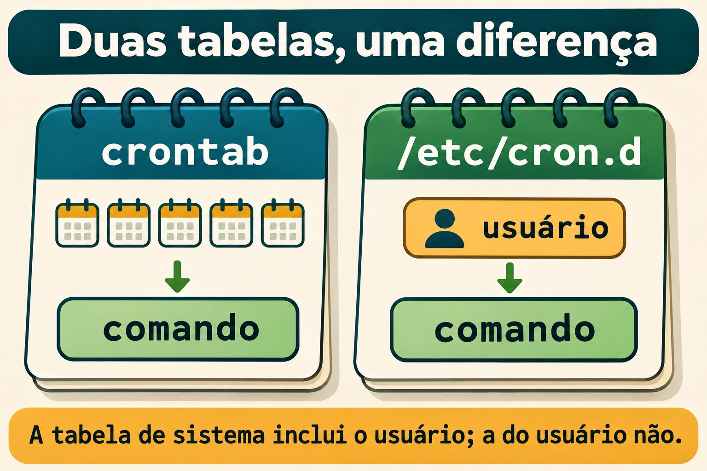
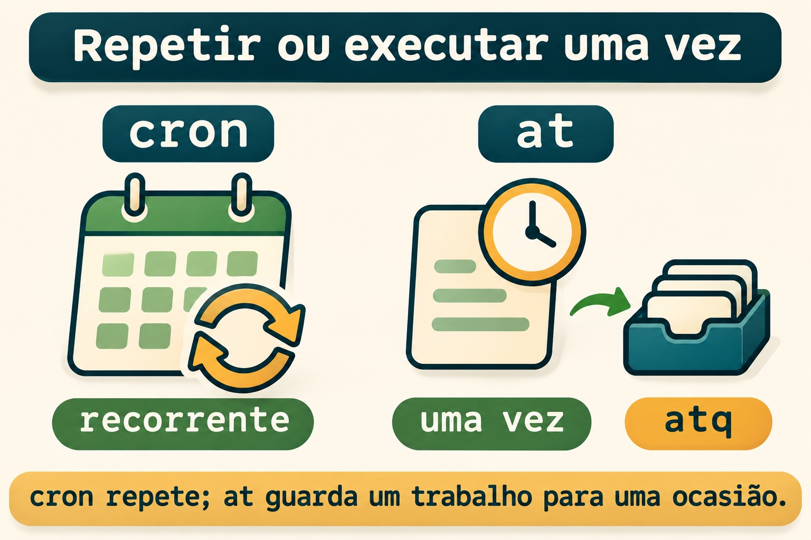

# Aula 14.1 · cron e at

No Agendador de Tarefas do Windows, você confere conta, ação e resultado. No Linux, a mesma disciplina evita trabalhos que funcionam no terminal e falham sozinhos. Você vai criar agendas próprias, preservar as existentes e distinguir repetição de execução única.

> **Núcleo desta aula:** uma agenda precisa de usuário, ambiente, comando e evidência de execução. cron repete; at executa uma vez. O resto é aprofundamento.

| Ficha |  |
| --- | --- |
| **Módulo** | M14 · Agendamento, logs e hora, aula 1 de 5 |
| **Quando** | Semana 19 |
| **Ao final** | Você instala agendas sem apagar trabalhos alheios e verifica a execução pelo resultado |
| **Pré-requisitos** | M13 concluído; `student`, `sudo`, noVNC e SSH nas VMs 201 e 202 |
| **Tempo** | Cerca de 90 minutos |
| **Snapshots** | `m14a1-inicio` e `m14a1-fim` nas duas VMs |

## 1 · Aquecimento

Responda antes de consultar os comandos.

1. Por que uma permissão DAC correta não garante qualquer operação de um processo confinado?
2. Qual diferença existe entre habilitar e iniciar um serviço?
3. Como você distingue uma configuração salva de uma execução realmente ocorrida?

## 2 · Por que importa

O relatório diário não apareceu. O comando funciona quando você entra pelo SSH, mas depende de um diretório atual e de uma variável da sua sessão. O agendador não abriu seu terminal interativo. Seu diagnóstico começa pelo ambiente e pelo usuário, não por reiniciar a máquina.

Uma agenda também pode estar correta com o serviço parado. Registre três evidências: entrada instalada, agendador ativo e arquivo ou log produzido pelo trabalho.

## 3 · Modelo mental

Pense na portaria: a lista de horários manda chamar alguém, mas o crachá define quem executa. A ficha do trabalho precisa conter o caminho completo, sem depender do que estava aberto na mesa de outra pessoa.

```text
agenda -> agendador ativo -> usuário -> comando -> evidência
cron: repetição                       at: uma ocasião
```


*Defina usuário, caminhos e saída antes de agendar.*

### Ponte Windows

| Windows | Linux |
| --- | --- |
| Gatilho recorrente | cron |
| Executar uma vez | at |
| Conta da tarefa | Dono da crontab ou campo de usuário do sistema |
| Histórico e resultado | Saída capturada, journal e arquivo produzido |

## 4 · O essencial

### Cinco campos de tempo

A ordem é minuto, hora, dia do mês, mês e dia da semana. Depois vem o comando. Use um script para lógica e formatação; uma linha de agenda longa é difícil de revisar.

```text
* * * * * comando
```

O asterisco em todos os campos significa cada minuto. Dia do mês e dia da semana têm uma interação importante: quando ambos são restritos, o cron tradicional executa quando qualquer um dos dois corresponde.

### Usuário versus sistema

`crontab -e` edita a tabela do próprio usuário. Arquivos em `/etc/cron.d` acrescentam um campo de usuário entre o calendário e o comando. Não coloque esse campo na tabela do usuário.



*A tabela de sistema inclui o usuário; a do usuário não.*

### Ambiente e saída

Defina caminhos absolutos. Capture saída e erro. O caractere `%` tem tratamento especial em uma linha cron; deixe formatações de data dentro do script para evitar esse problema.

### Execução única e acesso

`at` guarda um trabalho para um instante futuro. `atq` mostra a fila; `atrm` remove um identificador específico. Os arquivos `cron.allow`, `cron.deny`, `at.allow` e `at.deny` controlam quem pode usar essas ferramentas conforme a implementação.

Restringir a ferramenta não apaga automaticamente trabalhos já instalados. Nesta aula você observa os controles existentes; não modifica listas compartilhadas para plantar uma falha.



*cron repete; at guarda um trabalho para uma ocasião.*

### Rocky × Debian

| Item | Rocky 9 | Debian 13 |
| --- | --- | --- |
| Pacote cron tradicional | `cronie` | `cron` |
| Unidade | `crond.service` | `cron.service` |
| Execução única | Pacote `at`, unidade `atd.service` | Pacote `at`, unidade `atd.service` |
| Alternativa instalada | Identifique o proprietário atual | Não substitua `systemd-cron` sem planejar |

## 5 · Lab guiado

Faça tudo nas duas VMs. Confirme que a home de `student` é `/home/student`, que o usuário pode usar `crontab` e `at`, e que não existe outra alteração simultânea nas agendas dele durante o exercício.

### Passo 1 · Preparar a proteção

**Palpite:** instalar cron comprova que algum trabalho foi executado?

No host Proxmox:

```bash
qm snapshot 201 m14a1-inicio
qm snapshot 202 m14a1-inicio
```

Na Rocky, use o primeiro bloco. Na Debian, confirme antes que o lab usa cron tradicional e use o segundo.

```bash
sudo dnf install -y cronie at
sudo systemctl enable --now crond atd
```

```bash
sudo apt install -y cron at
sudo systemctl enable --now cron atd
```

**Saída esperada:** serviços ativos. Os agendadores instalados ficam disponíveis como ferramentas do curso; a limpeza vai retirar somente os trabalhos de exercício.

**Verifique:** confira a unidade correta com `systemctl is-active` e a home com `getent passwd student`. Se houver outro proprietário das agendas, pare e ajuste o preparo.

### Passo 2 · Testar o trabalho fora da agenda

**Palpite:** como provar que o trabalho executa como `student`?

Confirme ausência dos caminhos antes de criá-los.

```bash
test ! -e "$HOME/m14a1"
sudo test ! -e /usr/local/libexec/m14a1-tick
sudo test ! -e /etc/cron.d/m14a1
mkdir -m 700 "$HOME/m14a1"
sudo install -d /usr/local/libexec
sudo tee /usr/local/libexec/m14a1-tick > /dev/null <<'EOF'
#!/bin/sh
/usr/bin/date -Is
/usr/bin/id -un
EOF
sudo chmod 755 /usr/local/libexec/m14a1-tick
/usr/local/libexec/m14a1-tick
```

**Saída esperada:** data real da VM e usuário `student`. Não há data inventada para copiar.

**Verifique:** execute o mesmo caminho absoluto que será usado pela agenda.

### Passo 3 · Instalar uma entrada do usuário

**Palpite:** instalar uma tabela com uma única linha apaga as linhas anteriores?

Salve a tabela atual. Se não existir tabela, `crontab -l` informa isso e retorna falha; o arquivo de referência fica vazio. Uma negativa de permissão é outra situação e precisa ser resolvida antes.

```bash
crontab -l > "$HOME/m14a1/crontab.inicio"
cp "$HOME/m14a1/crontab.inicio" "$HOME/m14a1/crontab.candidate"
cat >> "$HOME/m14a1/crontab.candidate" <<'EOF'

# BEGIN m14a1
* * * * * /usr/local/libexec/m14a1-tick >> /home/student/m14a1/user.log 2>&1
# END m14a1
EOF
diff -u "$HOME/m14a1/crontab.inicio" "$HOME/m14a1/crontab.candidate"
```

Confira que só o bloco de exercício foi acrescentado. Depois instale a candidata:

```bash
crontab "$HOME/m14a1/crontab.candidate"
crontab -l
```

**Saída esperada:** tabela anterior preservada e bloco novo presente. Após uma virada de minuto com o serviço ativo, `user.log` recebe o resultado.

**Verifique:** leia `tail "$HOME/m14a1/user.log"`; a existência da entrada sozinha não comprova execução.

### Decida 1

| Opção | Para acrescentar uma tarefa sem perder outras |
| --- | --- |
| A | Instalar uma tabela que contém só a tarefa nova |
| B | Revisar uma candidata com as entradas anteriores e o bloco novo |
| C | Apagar a tabela inteira primeiro |

Escolha B. A operação de instalação substitui a tabela; a candidata precisa conter o que você quer preservar.

### Passo 4 · Criar a agenda de sistema própria

**Palpite:** onde aparece o usuário nesta variante?

```bash
sudo tee /etc/cron.d/m14a1 > /dev/null <<'EOF'
SHELL=/bin/sh
PATH=/usr/bin:/bin
* * * * * student /usr/local/libexec/m14a1-tick >> /home/student/m14a1/system.log 2>&1
EOF
sudo chmod 644 /etc/cron.d/m14a1
sudo chown root:root /etc/cron.d/m14a1
```

**Saída esperada:** depois de uma virada de minuto, `system.log` mostra o resultado executado como `student`. Não é necessário reiniciar cron para cada arquivo correto acrescentado.

**Verifique:** compare os dois logs e identifique o campo adicional no arquivo de sistema.

### Passo 5 · Executar uma vez com at

**Palpite:** fechar o terminal remove um trabalho já aceito pelo at?

```bash
printf '/usr/local/libexec/m14a1-tick >> /home/student/m14a1/once.log 2>&1\n' > "$HOME/m14a1/once.job"
LC_ALL=C at -f "$HOME/m14a1/once.job" now + 2 minutes 2> "$HOME/m14a1/at.receipt"
cat "$HOME/m14a1/at.receipt"
atq
```

**Saída esperada:** recibo com o identificador real e trabalho na fila. Após o horário, ele sai da fila e produz `once.log`.

**Verifique:** compare recibo, fila e arquivo produzido. Aceitação na fila não é confirmação de sucesso do comando.

### Decida 2

| Opção | O trabalho foi aceito, mas não há resultado |
| --- | --- |
| A | Trocar as permissões para todos poderem escrever |
| B | Reenviar várias cópias sem verificar |
| C | Conferir horário, fila, serviço e saída do trabalho |

Escolha C. A evidência de entrega ao agendador e a de execução são diferentes.

### Passo 6 · Conferir acesso e persistência

**Palpite:** proibir o uso de uma ferramenta apaga seus trabalhos existentes?

Observe os controles que já existem, sem alterá-los. Um caminho ausente é uma informação sobre a configuração.

```bash
sudo ls -l /etc/cron.allow /etc/cron.deny /etc/at.allow /etc/at.deny
crontab -l
atq
sudo systemctl reboot
```

**Saída esperada:** depois do reboot, cron ativo continua usando as entradas instaladas. O trabalho at já concluído não reaparece como recorrente.

**Verifique:** leia as datas novas nos dois logs. Não altere o relógio para acelerar o teste.

## 6 · Quebre e conserte

### Quebra 1 · Trabalho sem execução permitida

**Sintoma:** o minuto passa, mas a tarefa registra um erro em vez da saída normal.

**Investigação:** retire execução somente do script próprio e tente manualmente o mesmo caminho.

```bash
sudo chmod 644 /usr/local/libexec/m14a1-tick
/usr/local/libexec/m14a1-tick
tail "$HOME/m14a1/user.log"
```

**Causa:** a agenda chama um executável sem permissão de execução.

**Conserto:** restaure `sudo chmod 755 /usr/local/libexec/m14a1-tick`.

**Verifique:** execute manualmente e confira a próxima saída agendada.

**Prevenção:** teste como o mesmo usuário e pelo mesmo caminho da agenda.

### Quebra 2 · Campo de usuário ausente

**Sintoma:** a tabela do usuário funciona, mas o arquivo de sistema deixa de gerar resultado novo.

**Investigação:** salve o arquivo próprio e remova apenas o campo obrigatório dele.

```bash
sudo cp -a /etc/cron.d/m14a1 "$HOME/m14a1/cron.d.good"
sudo sed -i 's/\* student /\* /' /etc/cron.d/m14a1
sudo cat /etc/cron.d/m14a1
```

**Causa:** cron interpreta a posição do usuário segundo o formato de sistema, não o formato da crontab pessoal.

**Conserto:** restaure só o arquivo próprio com `sudo cp -a "$HOME/m14a1/cron.d.good" /etc/cron.d/m14a1`.

**Verifique:** depois da próxima virada de minuto, `system.log` volta a crescer.

**Prevenção:** confira o formato do destino antes de colar uma linha de agenda.

### Quebra 3 · Trabalho cancelado antes do horário

**Sintoma:** um novo trabalho at não produz o resultado porque você o retirou da fila.

**Investigação:** envie outra vez `once.job`, anote o identificador do recibo novo e confira o conteúdo com `at -c` antes de remover. Não use um número de exemplo.

```bash
at -f "$HOME/m14a1/once.job" now + 5 minutes
atq
read -r -p 'Own job ID: ' ATJOB
at -c "$ATJOB"
```

Confirme que é o trabalho de `student` criado agora e só então execute `atrm "$ATJOB"`.

**Causa:** a ausência de resultado corresponde ao cancelamento, não a um defeito do serviço.

**Conserto:** se o trabalho ainda for necessário, envie uma única nova cópia.

**Verifique:** confira o novo identificador e o resultado após o horário.

**Prevenção:** registre identificador, horário e estado, sem apagar a fila inteira.

### Limpeza

Remova somente o bloco marcado da tabela atual. Revise o diff antes de instalar a tabela limpa; outras entradas precisam permanecer.

```bash
crontab -l > "$HOME/m14a1/crontab.atual"
sed '/^# BEGIN m14a1$/,/^# END m14a1$/d' "$HOME/m14a1/crontab.atual" > "$HOME/m14a1/crontab.clean"
diff -u "$HOME/m14a1/crontab.atual" "$HOME/m14a1/crontab.clean"
```

Após conferir a remoção exclusiva do bloco:

```bash
crontab "$HOME/m14a1/crontab.clean"
sudo rm -f /etc/cron.d/m14a1 /usr/local/libexec/m14a1-tick
atq
```

Cancele apenas trabalhos de exercício ainda pendentes, pelo identificador conferido. Guarde os registros; uma tabela vazia remanescente não executa trabalhos.

## 7 · Armadilhas

| Erro | Faça | Motivo |
| --- | --- | --- |
| Depender da sessão interativa | Caminhos absolutos e ambiente explícito | cron não abriu seu terminal |
| Apagar tabela para acrescentar tarefa | Candidata revisada preservando entradas | Instalar substitui a tabela |
| Confundir os dois formatos | Campo de usuário só no formato de sistema | A interpretação muda |
| Aceitação significa sucesso | Conferir saída do trabalho | Fila e resultado são evidências distintas |

## 8 · Quiz

1. Quais são os cinco campos de tempo?
2. Onde entra o usuário em `/etc/cron.d`?
3. Por que usar caminhos absolutos?
4. O que `atq` demonstra?
5. Remover acesso à ferramenta apaga trabalhos existentes?
6. O que deve ser preservado ao limpar uma agenda?

## 9 · Cola

| Tarefa | Comando |
| --- | --- |
| Listar tabela pessoal | `crontab -l` |
| Editar tabela pessoal | `crontab -e` |
| Listar fila única | `atq` |
| Inspecionar trabalho escolhido | `at -c "$ATJOB"` |

**Flashcards:** crie cinco cartões sobre formato, usuário, ambiente, fila e evidência. Revise em D+1, D+3, D+7 e D+21.

## 10 · Checklist e fechamento

- [ ] Executei o mesmo trabalho manualmente e agendado.
- [ ] Preservei outras entradas e identificadores da fila.
- [ ] Expliquei as três causas com evidências.

**Último exercício:** descreva um relatório que não depende de variável da sessão e mostre como você comprovaria que rodou.

**Reboot de conferência:** depois da limpeza, reinicie as duas VMs e confirme que os registros de exercício não recebem novas linhas e que as outras agendas continuam instaladas.

```bash
sudo systemctl reboot
```

No host Proxmox:

```bash
qm snapshot 201 m14a1-fim
qm snapshot 202 m14a1-fim
```

## 11 · Na vida real

Em host autorizado, faça apenas inventário com `crontab -l`, `atq` e a leitura dos arquivos de agenda permitidos ao seu papel. Não edite, reenvie nem cancele trabalhos nessa missão. Identifique dono, comando, destino da saída e evidência da última execução.

## 12 · Aprofundar quando quiser

- [crontab(5), Debian](https://manpages.debian.org/trixie/cron/crontab.5.en.html) e [crontab(5), cronie](https://man7.org/linux/man-pages/man5/crontab.5.html): formato e ambiente.
- [crontab(1)](https://manpages.debian.org/trixie/cron/crontab.1.en.html) e [at(1)](https://manpages.debian.org/trixie/at/at.1.en.html): instalação e fila.

**DeepTutor** (http://10.1.0.149:3782, KB "Curso Linux Sysadmin"):

- `!explica Compare crontab de usuário, /etc/cron.d e at com foco em usuário e ambiente.`
- `!feynman Vou explicar por que um comando funciona no SSH e falha no cron. Critique minha explicação.`
- `!quiz Crie seis incidentes de agendamento sem propor apagar agendas existentes.`

## Gabarito comentado

### Aquecimento

1. DAC e a política MAC precisam permitir a operação.
2. Habilitar participa do boot; iniciar muda o estado atual.
3. Compare configuração, estado do serviço e resultado produzido.

### Quiz

1. Minuto, hora, dia do mês, mês e dia da semana.
2. Depois dos cinco campos e antes do comando.
3. O ambiente não é sua sessão interativa.
4. Trabalhos ainda na fila, não o sucesso de trabalhos concluídos.
5. Não; controle de uso da ferramenta e trabalhos instalados são coisas diferentes.
6. Todas as entradas e trabalhos que não pertencem ao exercício.

<!-- navegacao -->
[← Aula 13.3 · autofs](13.3-autofs.md) · [Índice de aulas](../01-aulas.md) · [Plano do curso: 14.2 em diante →](../00-plano-do-curso.md)
