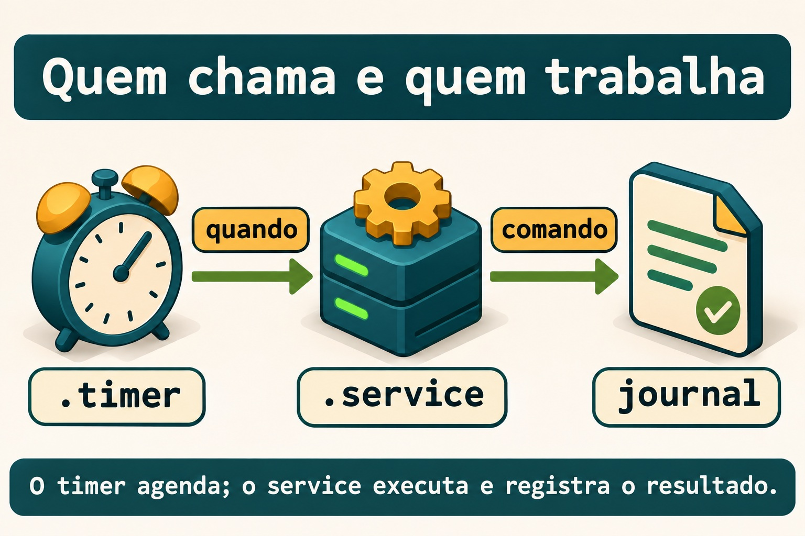
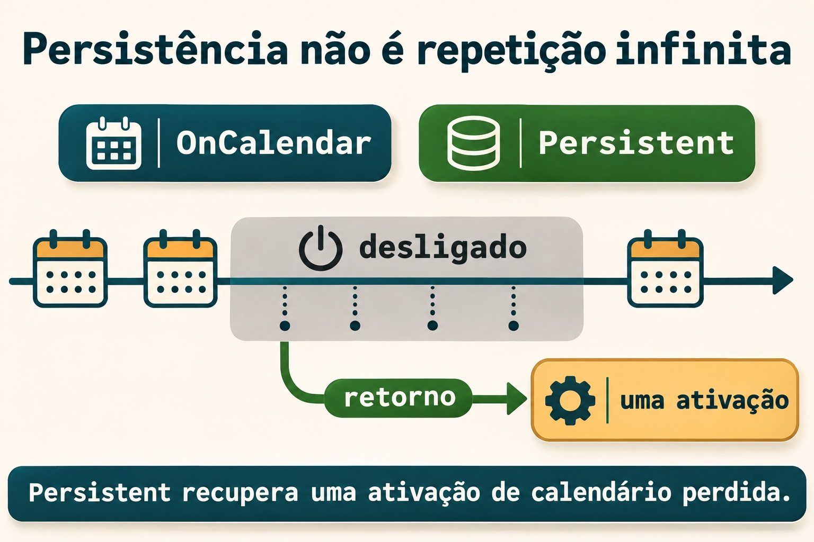
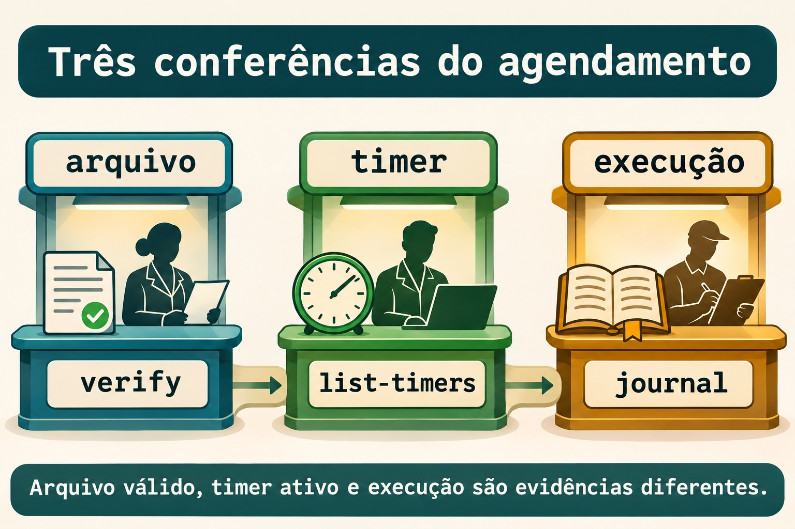

# Aula 14.2 · Timers do systemd

Depois de separar agenda e comando com cron, você vai tornar essa separação explícita em dois arquivos. O timer decide quando ativar; o serviço descreve o trabalho, o usuário e o resultado. Você também vai recuperar uma ativação de calendário perdida sem alterar o relógio da VM.

> **Núcleo desta aula:** valide os arquivos, confira o timer e leia o resultado do serviço. Persistent não executa uma cópia para cada minuto perdido. O resto é aprofundamento.

| Ficha |  |
| --- | --- |
| **Módulo** | M14 · Agendamento, logs e hora, aula 2 de 5 |
| **Quando** | Semana 19 |
| **Ao final** | Você cria um par de units, verifica falhas e comprova persistência |
| **Pré-requisitos** | Aula 14.1; serviços systemd, journal, `student` e `sudo` |
| **Tempo** | Cerca de 90 minutos |
| **Snapshots** | `m14a2-inicio` e `m14a2-fim` nas VMs 201 e 202 |

## 1 · Aquecimento

Responda antes de abrir o roteiro.

1. Por que a entrada instalada não comprova sucesso do trabalho?
2. Qual diferença existe entre iniciar e habilitar?
3. Onde você registrou saída e erro na aula anterior?

## 2 · Por que importa

Um backup não rodou porque a VM estava desligada no horário. Ao voltar, você precisa recuperar a ativação e saber se o comando terminou bem. Um timer de calendário persistente guarda o momento da ativação; o serviço registra o resultado no journal.

O projeto do trabalho ainda precisa lidar com repetição e duração. Persistent não transforma um comando inseguro em um backup recuperável.

## 3 · Modelo mental

O relógio chama a equipe; a ficha da equipe descreve o serviço. A portaria registra a chamada e a equipe registra o resultado. Habilitar só o serviço não instala uma agenda recorrente.

```text
m14a2.timer -> m14a2.service -> comando -> journal
    quando         quem e como          resultado
```



*O timer agenda; o service executa e registra o resultado.*

### Ponte Windows

| Conceito | systemd |
| --- | --- |
| Gatilho | `.timer` |
| Ação e conta | `.service`, `ExecStart`, `User` |
| Resultado da execução | Propriedades do serviço e journal |
| Recuperar horário perdido | `Persistent=true` com `OnCalendar` |

## 4 · O essencial

### Calendário e tempo relativo

`OnCalendar` descreve o calendário civil. Expressões como `OnBootSec` e `OnUnitActiveSec` medem intervalos relativos. A recuperação com Persistent desta aula se aplica ao calendário, não a qualquer intervalo.

```bash
systemd-analyze calendar '*-*-* *:*:00'
systemd-analyze calendar 'daily'
```

A primeira expressão dispara a cada minuto civil; a segunda é diária. Use a ferramenta para conferir a interpretação e o próximo horário calculado no fuso real da máquina.

### Persistent e duração

Com Persistent, o timer guarda a última ativação em disco. Ao voltar à atividade, recupera uma ativação que teria ocorrido enquanto estava inativo. Não cria uma fila com uma execução por minuto perdido.



*Persistent recupera uma ativação de calendário perdida.*

Um serviço que ainda está ativo não ganha outra instância idêntica a cada disparo. Para trabalho curto, `Type=oneshot` e um comando que termina tornam o resultado fácil de observar.

### Precisão e ambiente

`AccuracySec` permite uma janela de agrupamento; `RandomizedDelaySec` acrescenta atraso aleatório quando configurado. A agenda não promete precisão de tempo real. No lab, a janela é curta para facilitar a observação.

`ExecStart` não é uma linha de shell completa. Coloque lógica em um script com interpretador explícito, caminhos absolutos e tratamento de erro.



*Arquivo válido, timer ativo e execução são evidências diferentes.*

### Rocky × Debian

| Item | Rocky 9 | Debian 13 |
| --- | --- | --- |
| Units próprias | `/etc/systemd/system` | `/etc/systemd/system` |
| Serviço de exercício | `m14a2.service` | `m14a2.service` |
| Estado persistente | `StateDirectory` | `StateDirectory` |
| Recursos novos | Confira a man page instalada | Confira a man page instalada |

## 5 · Lab guiado

Faça o mesmo nas duas VMs. Os nomes e diretórios desta aula precisam estar livres. Nenhum timer existente será alterado.

### Passo 1 · Proteger e observar

**Palpite:** habilitar um arquivo sem validar seu conteúdo comprova alguma execução?

No host Proxmox:

```bash
qm snapshot 201 m14a2-inicio
qm snapshot 202 m14a2-inicio
```

Nas VMs:

```bash
systemctl list-timers --all
test ! -e "$HOME/m14a2"
sudo test ! -e /etc/systemd/system/m14a2.service
sudo test ! -e /etc/systemd/system/m14a2.timer
sudo test ! -e /var/lib/m14a2
mkdir -m 700 "$HOME/m14a2"
```

**Saída esperada:** inventário existente e nomes de exercício ausentes.

**Verifique:** se os nomes já existirem, pare para não reaproveitar ou apagar trabalho anterior sem revisão.

### Passo 2 · Criar um trabalho observável

**Palpite:** quem deve poder escrever o estado do trabalho?

```bash
sudo test ! -e /usr/local/libexec/m14a2-run
sudo install -d /usr/local/libexec
sudo tee /usr/local/libexec/m14a2-run > /dev/null <<'EOF'
#!/bin/sh
set -eu
if [ -e /var/lib/m14a2/fail ]; then
    printf 'M14A2 controlled failure\n' >&2
    exit 7
fi
/usr/bin/date -Is > /var/lib/m14a2/last.txt
printf 'M14A2 completed\n'
EOF
sudo chmod 755 /usr/local/libexec/m14a2-run
```

Na Rocky, aplique o contexto esperado ao script com `sudo restorecon /usr/local/libexec/m14a2-run`.

**Saída esperada:** script root-owned, sem executar ainda fora do diretório de estado que a unit criará.

**Verifique:** leia o script e identifique sucesso, falha controlada e arquivo de estado.

### Passo 3 · Criar e testar o serviço

**Palpite:** um oneshot bem-sucedido precisa continuar aparecendo como processo ativo?

```bash
sudo tee /etc/systemd/system/m14a2.service > /dev/null <<'EOF'
[Unit]
Description=M14A2 scheduled work
[Service]
Type=oneshot
User=student
Group=student
StateDirectory=m14a2
StateDirectoryMode=0700
ExecStart=/usr/local/libexec/m14a2-run
EOF
sudo systemd-analyze verify /etc/systemd/system/m14a2.service
sudo systemctl daemon-reload
sudo systemctl start m14a2.service
systemctl show m14a2.service -p Result -p ExecMainStatus
sudo journalctl -u m14a2.service -n 10 --no-pager
cat /var/lib/m14a2/last.txt
```

**Saída esperada:** comando termina com sucesso, resultado de saída zero e data real no estado. O serviço oneshot pode ficar inativo depois de concluir.

**Verifique:** o journal e `last.txt` são evidências do trabalho, não só da leitura do arquivo unit.

### Decida 1

| Opção | Serviço oneshot terminou sem erro |
| --- | --- |
| A | Reiniciar continuamente porque ficou inativo |
| B | Trocar para um daemon que nunca termina |
| C | Conferir resultado e saída antes de diagnosticar falha |

Escolha C. Inativo depois de um trabalho concluído não é o mesmo que falhou.

### Passo 4 · Instalar a agenda

**Palpite:** qual arquivo deve ser habilitado para a recorrência?

```bash
sudo tee /etc/systemd/system/m14a2.timer > /dev/null <<'EOF'
[Unit]
Description=M14A2 calendar
[Timer]
OnCalendar=*-*-* *:*:00
AccuracySec=1s
RandomizedDelaySec=0
Persistent=true
Unit=m14a2.service
[Install]
WantedBy=timers.target
EOF
sudo systemd-analyze verify /etc/systemd/system/m14a2.service /etc/systemd/system/m14a2.timer
sudo systemctl daemon-reload
sudo systemctl enable --now m14a2.timer
systemctl list-timers --all m14a2.timer
```

**Saída esperada:** timer ativo com próximo horário calculado. Após a ativação, a data do arquivo muda e o journal ganha uma execução.

**Verifique:** compare próximo horário, última ativação e resultado do serviço.

### Passo 5 · Recuperar uma ativação perdida

**Palpite:** três minutos perdidos vão criar três serviços em fila?

Depois de pelo menos uma ativação normal, pare apenas o timer próprio. Espere atravessar dois minutos de calendário sem mudar o relógio.

```bash
sudo systemctl stop m14a2.timer
date -Is
```

Após esse intervalo, inicie novamente:

```bash
sudo systemctl start m14a2.timer
sudo journalctl -u m14a2.service --since '-5 minutes' --no-pager
systemctl list-timers --all m14a2.timer
```

**Saída esperada:** uma ativação de recuperação e depois a agenda normal. Um novo minuto civil pode acrescentar outra ativação regular, que não é uma cópia recuperada.

**Verifique:** correlacione horários no journal com o intervalo em que o timer ficou parado.

### Decida 2

| Opção | Conferir recuperação sem afetar o relógio |
| --- | --- |
| A | Parar só o timer próprio e esperar o calendário avançar |
| B | Parar todos os timers do host |
| C | Alterar a hora global da VM |

Escolha A. O defeito fica limitado ao objeto de exercício.

### Passo 6 · Conferir após reboot

**Palpite:** o que precisa sobreviver para o trabalho voltar a ser chamado?

```bash
sudo systemctl reboot
```

Depois de reconectar:

```bash
systemctl is-enabled m14a2.timer
systemctl list-timers --all m14a2.timer
sudo journalctl -b -u m14a2.service --no-pager
cat /var/lib/m14a2/last.txt
```

**Saída esperada:** timer habilitado e agenda ativa. O trabalho volta a produzir evidência quando for ativado, incluindo recuperação de calendário se necessária.

**Verifique:** diferencie uma data antiga preservada no disco de uma nova execução registrada neste boot.

## 6 · Quebre e conserte

### Quebra 1 · Comando inexistente

**Sintoma:** o serviço não consegue executar a ação configurada.

**Investigação:** altere só a unit própria e valide antes de iniciar.

```bash
sudo cp -a /etc/systemd/system/m14a2.service "$HOME/m14a2/service.good"
sudo sed -i 's@ExecStart=/usr/local/libexec/m14a2-run@ExecStart=/usr/local/libexec/m14a2-missing@' /etc/systemd/system/m14a2.service
sudo systemd-analyze verify /etc/systemd/system/m14a2.service
```

**Causa:** o caminho da ação não existe. O calendário não corrige o executável.

**Conserto:** restaure somente essa unit e recarregue o gerenciador.

```bash
sudo cp -a "$HOME/m14a2/service.good" /etc/systemd/system/m14a2.service
sudo systemctl daemon-reload
sudo systemctl start m14a2.service
```

**Verifique:** confira resultado e journal da nova tentativa.

**Prevenção:** valide o par e teste o serviço antes de habilitar o timer.

### Quebra 2 · Falha do trabalho, timer ativo

**Sintoma:** o timer continua ativo, mas o serviço retorna falha.

**Investigação:** plante a condição que o script trata como erro.

```bash
touch /var/lib/m14a2/fail
sudo systemctl start m14a2.service
systemctl show m14a2.service -p Result -p ExecMainStatus
sudo journalctl -u m14a2.service -n 12 --no-pager
```

**Causa:** o código de saída `7` pertence ao trabalho; o agendador cumpriu sua parte ao chamá-lo.

**Conserto:** retire o sinalizador próprio e rode novamente.

```bash
rm -f /var/lib/m14a2/fail
sudo systemctl start m14a2.service
```

**Verifique:** resultado volta a sucesso.

**Prevenção:** monitore o resultado do serviço, não só se o timer está ativo.

### Quebra 3 · Agenda desabilitada

**Sintoma:** o trabalho funciona manualmente, mas não volta ao boot por sua agenda.

**Investigação:** desabilite apenas o timer próprio e compare os estados.

```bash
sudo systemctl disable --now m14a2.timer
systemctl is-enabled m14a2.timer
sudo systemctl start m14a2.service
```

**Causa:** a ação continua válida, mas a agenda não está habilitada para o boot.

**Conserto:** execute `sudo systemctl enable --now m14a2.timer`.

**Verifique:** confira novamente habilitação e próximo horário.

**Prevenção:** registre arquivo, estado ativo e habilitação como evidências separadas.

### Limpeza

Guarde os registros e retire somente as units e o estado do exercício. A limpeza do timer apaga seu carimbo persistente, não o de outros timers.

```bash
sudo journalctl -u m14a2.service --no-pager > "$HOME/m14a2/journal.txt"
sudo systemctl disable --now m14a2.timer
sudo systemctl stop m14a2.service
sudo systemctl clean --what=state m14a2.timer
sudo systemctl clean --what=state m14a2.service
sudo systemctl reset-failed m14a2.service
sudo rm -f /etc/systemd/system/m14a2.timer /etc/systemd/system/m14a2.service /usr/local/libexec/m14a2-run
sudo systemctl daemon-reload
systemctl list-timers --all
```

## 7 · Armadilhas

| Erro | Faça | Motivo |
| --- | --- | --- |
| Habilitar só o serviço | Habilitar o timer | A recorrência está na agenda |
| Timer ativo significa sucesso | Ler o resultado do serviço | O comando pode falhar |
| Esperar fila de todos os horários perdidos | Entender uma ativação de recuperação | Persistent não reproduz todo o passado |
| Colar pipe direto em `ExecStart` | Usar um script | Não é uma shell implícita |

## 8 · Quiz

1. Qual unit contém o calendário?
2. O que Persistent recupera?
3. Um oneshot concluído precisa permanecer ativo?
4. Quem define o usuário do trabalho?
5. O que verificar depois de alterar os arquivos?
6. Como provar uma nova execução depois do boot?

## 9 · Cola

| Tarefa | Comando |
| --- | --- |
| Ver agenda | `systemctl list-timers --all m14a2.timer` |
| Interpretar calendário | `systemd-analyze calendar daily` |
| Ver resultado | `systemctl show m14a2.service -p Result -p ExecMainStatus` |
| Ler execução | `sudo journalctl -u m14a2.service` |

**Flashcards:** crie cinco cartões sobre calendário, ação, Persistent, estado ativo e resultado. Revise em D+1, D+3, D+7 e D+21.

## 10 · Checklist e fechamento

- [ ] Validei os dois arquivos antes de ativar.
- [ ] Observei trabalho manual, recorrente e recuperação.
- [ ] Retirei apenas os objetos de exercício.

**Último exercício:** explique por que o monitoramento precisa ler o resultado do serviço e não só listar timers.

**Reboot de conferência:** depois da limpeza, reinicie as duas VMs e confirme a ausência da agenda própria e a preservação das demais.

```bash
sudo systemctl reboot
```

No host Proxmox:

```bash
qm snapshot 201 m14a2-fim
qm snapshot 202 m14a2-fim
```

## 11 · Na vida real

Em host autorizado, leia `systemctl list-timers --all`, a unit de um trabalho conhecido e seu journal. Não inicie, pare ou edite nada nesta missão. Identifique usuário, próxima ativação, última tentativa e resultado; registre uma diferença entre agenda ativa e tarefa bem-sucedida.

## 12 · Aprofundar quando quiser

- [systemd.timer(5)](https://manpages.debian.org/trixie/systemd/systemd.timer.5.en.html) e [systemd.time(7)](https://manpages.debian.org/trixie/systemd/systemd.time.7.en.html): calendário e persistência.
- [systemd.service(5)](https://manpages.debian.org/trixie/systemd/systemd.service.5.en.html) e [systemd.exec(5)](https://manpages.debian.org/trixie/systemd/systemd.exec.5.en.html): execução e diretórios de estado.

**DeepTutor** (http://10.1.0.149:3782, KB "Curso Linux Sysadmin"):

- `!explica Separe timer, service, Persistent e resultado de execução.`
- `!feynman Vou explicar por que Persistent não recupera uma cópia de cada minuto perdido. Critique minha explicação.`
- `!quiz Crie seis incidentes de timers preservando as outras units do host.`

## Gabarito comentado

### Aquecimento

1. Instalação e execução são etapas diferentes; o comando pode falhar.
2. Iniciar muda o estado atual; habilitar participa do boot.
3. Em arquivos separados com saída e erro redirecionados.

### Quiz

1. A unit `.timer`.
2. Uma ativação de calendário que teria ocorrido durante a inatividade.
3. Não; pode voltar a inativo depois de terminar com sucesso.
4. `User` na unit de serviço deste lab.
5. Sintaxe, recarga do gerenciador, estado da agenda e execução real.
6. Compare o journal do boot atual e a data nova produzida.

<!-- navegacao -->
[← Aula 14.1 · cron e at](14.1-cron-e-at.md) · [Índice de aulas](../01-aulas.md) · [Plano do curso: 14.3 em diante →](../00-plano-do-curso.md)
