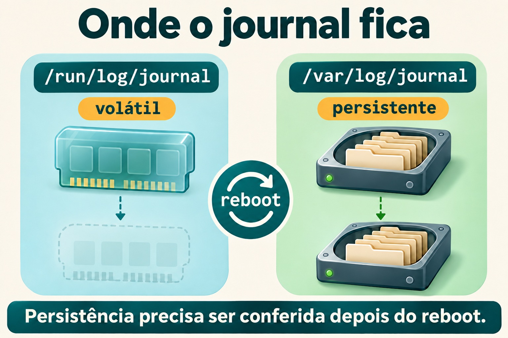
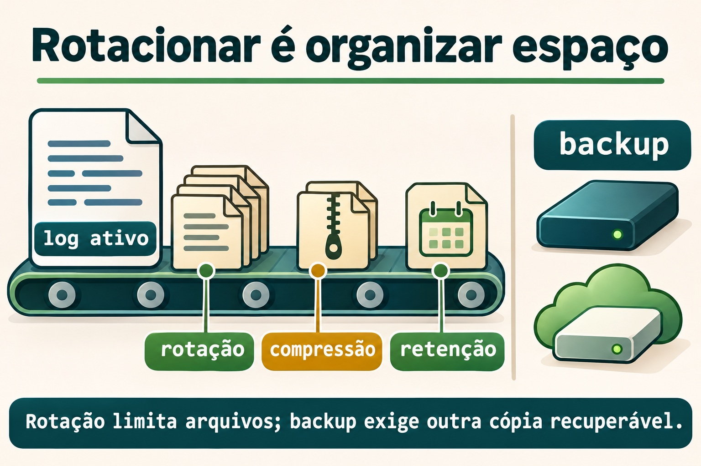

# Aula 14.3 · journald e rsyslog

O trabalho agendado falhou e deixou uma mensagem. Agora você precisa encontrá-la, saber se sobreviverá ao reboot e controlar o crescimento do arquivo de texto. Journal, encaminhamento e rotação têm funções distintas. Você vai conferir cada uma sem apagar registros reais.

> **Núcleo desta aula:** procure o evento na fonte certa, confirme persistência e teste a rotação somente no arquivo próprio. O resto é aprofundamento.

| Ficha |  |
| --- | --- |
| **Módulo** | M14 · Agendamento, logs e hora, aula 3 de 5 |
| **Quando** | Semana 20 |
| **Ao final** | Você filtra eventos, comprova journal persistente e gira um log próprio com estado separado |
| **Pré-requisitos** | Aula 14.2, `sudo`, SSH e snapshots nas VMs do curso |
| **Tempo** | Cerca de 90 minutos |
| **Snapshots** | `m14a3-inicio` e `m14a3-fim` nas VMs 201 e 202 |

## 1 · Aquecimento

Responda antes de procurar os arquivos.

1. Onde o serviço oneshot deixou seu resultado na 14.2?
2. Qual diferença existe entre processo ativo e tarefa concluída com sucesso?
3. Por que um arquivo grande não deve ser apagado sem identificar seu produtor?

## 2 · Por que importa

Um incidente aconteceu antes do reboot, mas você só procura com `journalctl -b`. Esse filtro mostra o boot atual. Em outra máquina, o journal era volátil e os dados antigos realmente não existem mais. A mesma tela vazia pode ter causas diferentes.

Outro chamado fala de disco cheio. Apagar um arquivo aberto não garante liberar seu espaço. Primeiro descubra quem escreve; depois aplique a rotação correta, com reabertura pelo produtor.

## 3 · Modelo mental

O journal é um arquivo de registros estruturados da portaria. rsyslog pode receber mensagens e distribuí-las em arquivos de texto. logrotate organiza os volumes desses arquivos, mas não produz uma cópia externa de recuperação.

```text
evento -> journald -> journal
         entrada rsyslog -> arquivo -> logrotate
```


*O journal e o arquivo de texto são armazenamentos diferentes.*

### Ponte Windows

| Conceito | Linux |
| --- | --- |
| Visualizador e filtros de eventos | `journalctl` |
| Origem de um evento | Unit, identificador e campos do journal |
| Arquivo textual de aplicação | Saída própria ou ação rsyslog |
| Política de tamanho e retenção | Configuração do armazenamento e logrotate |

## 4 · O essencial

### Filtros são parte da pergunta

`-b` seleciona o boot, `-u` a unit, `-t` o identificador e `-p` a prioridade. Um filtro de prioridade inclui as mais graves até o nível escolhido; não significa apenas aquele nível.

```bash
sudo journalctl --list-boots
sudo journalctl -b -p warning --no-pager
sudo journalctl -t m14a3 --since '-10 minutes' --no-pager
```

Uma consulta vazia comprova somente que nenhum registro visível correspondeu aos filtros naquele armazenamento. Confira intervalo, boot, prioridade e acesso antes de concluir que o evento não existiu.

### Persistência

Em armazenamento volátil, o journal usa `/run/log/journal`. Com persistência, usa `/var/log/journal`. `Storage=auto` depende da existência da estrutura persistente; `Storage=persistent` solicita esse armazenamento explicitamente.



*Persistência precisa ser conferida depois do reboot.*

### rsyslog e seu produtor

Uma regra de saída só atua sobre mensagens que chegaram ao rsyslog. Confira a entrada configurada. Não carregue outra cópia de um módulo de entrada só porque um arquivo de saída ficou vazio.

### Rotação e reabertura

Renomear o arquivo ativo não muda automaticamente o descritor aberto pelo produtor. O procedimento precisa criar o novo arquivo e fazer o produtor reabri-lo. O lab usa uma regra própria, retenção curta e estado separado para não forçar a rotação dos logs reais.



*Rotação limita arquivos; backup exige outra cópia recuperável.*

### Rocky × Debian

| Item | Rocky 9 | Debian 13 |
| --- | --- | --- |
| Journal | systemd-journald | systemd-journald |
| rsyslog | Pode já estar instalado | Pode não estar instalado |
| Logs de texto comuns | `/var/log/messages`, `/var/log/secure` | Dependem do rsyslog e das regras instaladas |
| Rotação | Confira a agenda instalada | Confira a agenda instalada |

## 5 · Lab guiado

Nesta aula a persistência do journal será mantida como configuração final do laboratório. Os registros antigos não serão apagados. A limpeza retira somente o encaminhamento e a rotação dos arquivos de exercício.

### Passo 1 · Proteger e inventariar

**Palpite:** uma instalação Debian sem syslog textual está necessariamente sem registros?

No host Proxmox:

```bash
qm snapshot 201 m14a3-inicio
qm snapshot 202 m14a3-inicio
```

Nas duas VMs, confirme os caminhos ausentes e guarde a configuração efetiva antes de alterar.

```bash
test ! -e "$HOME/m14a3"
mkdir -m 700 "$HOME/m14a3"
systemd-analyze cat-config systemd/journald.conf > "$HOME/m14a3/journald.inicio"
sudo test ! -e /etc/systemd/journald.conf.d/60-m14a3.conf
sudo test ! -e /etc/rsyslog.d/30-m14a3.conf
sudo test ! -e /etc/logrotate.d/m14a3
sudo test ! -e /var/log/m14a3
sudo test ! -e /var/lib/logrotate/m14a3.status
sudo journalctl --disk-usage
```

**Saída esperada:** caminhos de exercício livres e inventário real do armazenamento.

**Verifique:** preserve arquivos e regras existentes; se houver configuração posterior que substitua a opção nova, investigue a precedência em vez de sobrescrevê-la.

### Passo 2 · Marcar e filtrar eventos

**Palpite:** um evento informativo aparece em uma consulta que pede warning e mais graves?

```bash
logger -t m14a3 -p user.info 'M14A3 informational event'
logger -t m14a3 -p user.warning 'M14A3 warning event'
sudo journalctl -b -t m14a3 --since '-5 minutes' --no-pager
sudo journalctl -b -t m14a3 -p warning --since '-5 minutes' --no-pager
```

**Saída esperada:** a primeira consulta mostra os dois eventos; a segunda seleciona o warning, além de qualquer evento mais grave com o mesmo identificador.

**Verifique:** confira o texto e o horário reais. Não use o identificador de outro serviço para simular evidência.

### Passo 3 · Tornar o journal persistente

**Palpite:** salvar a opção já comprova que o evento sobreviverá ao boot?

```bash
sudo install -d /etc/systemd/journald.conf.d
sudo tee /etc/systemd/journald.conf.d/60-m14a3.conf > /dev/null <<'EOF'
[Journal]
Storage=persistent
EOF
sudo mkdir -p /var/log/journal
sudo systemd-tmpfiles --create --prefix /var/log/journal
sudo systemctl restart systemd-journald
sudo journalctl --flush
systemd-analyze cat-config systemd/journald.conf
logger -t m14a3 'M14A3 before reboot'
sudo systemctl reboot
```

Depois de reconectar:

```bash
sudo journalctl --list-boots
sudo journalctl -b -1 -t m14a3 --no-pager
```

**Saída esperada:** a mensagem anterior aparece no boot anterior. A opção final efetiva precisa ser persistente.

**Verifique:** não apague diretórios de journal para testar ou limpar. Os dados reais pertencem à história do host.

### Decida 1

| Opção | A busca do boot atual ficou vazia |
| --- | --- |
| A | Apagar o journal e repetir |
| B | Concluir que o evento nunca existiu |
| C | Conferir boot, intervalo, prioridade e acesso |

Escolha C. A consulta pode ter excluído o próprio evento.

### Passo 4 · Criar uma saída textual própria

**Palpite:** uma regra de saída atua sobre eventos que não chegaram ao rsyslog?

Na Rocky instale `sudo dnf install -y rsyslog logrotate`; na Debian, `sudo apt install -y rsyslog logrotate`. Mantenha o rsyslog padrão do lab como proprietário da coleta textual, sem outro coletor concorrente.

```bash
sudo systemctl enable --now rsyslog
ps -o user= -C rsyslogd
```

Anote o usuário real do processo e defina as variáveis abaixo com esse valor, sem presumir que se chame `syslog`.

```bash
read -r -p 'rsyslog process user: ' LOGUSER
id "$LOGUSER"
LOGGROUP=$(id -gn "$LOGUSER")
sudo install -d -m 755 -o "$LOGUSER" -g "$LOGGROUP" /var/log/m14a3
sudo install -m 640 -o "$LOGUSER" -g "$LOGGROUP" /dev/null /var/log/m14a3/events.log
sudo tee /etc/rsyslog.d/30-m14a3.conf > /dev/null <<'EOF'
if $programname == 'm14a3' then {
    action(type="omfile" file="/var/log/m14a3/events.log")
}
EOF
sudo rsyslogd -N1
sudo systemctl restart rsyslog
logger -t m14a3 'M14A3 text route'
sudo tail /var/log/m14a3/events.log
```

Na Rocky, confirme os contextos com `sudo restorecon -R /var/log/m14a3` antes de testar a escrita.

**Saída esperada:** a validação passa e a mensagem chega ao arquivo. Os outros destinos existentes não foram interrompidos com uma regra de parada.

**Verifique:** se a mensagem existir no journal, mas não no texto, confira a entrada rsyslog instalada e suas mensagens de erro. Não invente entrega nem duplique módulos de entrada.

### Passo 5 · Girar só o arquivo de exercício

**Palpite:** depois da renomeação, quem precisa reabrir o nome ativo?

Mantenha `LOGUSER` e `LOGGROUP` definidos para o processo verificado.

```bash
sudo tee /etc/logrotate.d/m14a3 > /dev/null <<EOF
/var/log/m14a3/events.log {
    size 1
    rotate 2
    missingok
    notifempty
    compress
    delaycompress
    create 0640 $LOGUSER $LOGGROUP
    sharedscripts
    postrotate
        /usr/bin/systemctl kill -s HUP rsyslog.service
    endscript
}
EOF
sudo logrotate -d -s /var/lib/logrotate/m14a3.status /etc/logrotate.d/m14a3
sudo logrotate -f -s /var/lib/logrotate/m14a3.status /etc/logrotate.d/m14a3
logger -t m14a3 'M14A3 after rotation'
sudo ls -l /var/log/m14a3
sudo tail /var/log/m14a3/events.log
```

**Saída esperada:** arquivo antigo vira `.1`, um novo ativo recebe a mensagem e a compressão fica adiada para permitir a observação. A regra rotaciona apenas esse arquivo.

**Verifique:** estado separado e argumento de arquivo único evitam forçar regras dos outros serviços.

### Decida 2

| Opção | Conferir rotação no laboratório |
| --- | --- |
| A | Usar regra própria e arquivo de estado separado |
| B | Apagar o arquivo ativo |
| C | Forçar toda a configuração global |

Escolha A. O exercício não deve alterar a retenção dos outros logs.

### Passo 6 · Conferir a coleta após reboot

**Palpite:** um arquivo preservado comprova que o coletor voltou?

```bash
sudo systemctl reboot
```

Depois de reconectar:

```bash
systemctl is-active rsyslog
logger -t m14a3 'M14A3 current boot'
sudo journalctl -b -t m14a3 --no-pager
sudo tail /var/log/m14a3/events.log
```

**Saída esperada:** novo evento no boot atual e no arquivo textual pela rota configurada.

**Verifique:** diferencie conteúdo antigo preservado de mensagem realmente nova.

## 6 · Quebre e conserte

### Quebra 1 · Filtro que exclui a mensagem

**Sintoma:** a mensagem informativa não aparece na busca de warning.

**Investigação:** envie um evento informativo e compare consultas com e sem prioridade.

```bash
logger -t m14a3 -p user.info 'M14A3 filter test'
sudo journalctl -b -t m14a3 -p warning --since '-2 minutes' --no-pager
sudo journalctl -b -t m14a3 --since '-2 minutes' --no-pager
```

**Causa:** a seleção excluiu o nível informativo.

**Conserto:** use o filtro correspondente à pergunta, sem modificar o armazenamento.

**Verifique:** a segunda consulta mostra o evento.

**Prevenção:** anote os filtros junto da conclusão.

### Quebra 2 · Identificador diferente

**Sintoma:** o evento chega ao journal, mas não à regra de arquivo própria.

**Investigação:** envie com um identificador diferente do filtro.

```bash
logger -t m14a3-other 'M14A3 different tag'
sudo journalctl -b -t m14a3-other --no-pager
sudo tail /var/log/m14a3/events.log
```

**Causa:** a regra aceita `m14a3`, não `m14a3-other`.

**Conserto:** envie o identificador pretendido, em vez de ampliar o filtro para tudo.

**Verifique:** `logger -t m14a3 'M14A3 corrected tag'` volta ao destino próprio.

**Prevenção:** confira os campos usados pela regra, não só o texto da mensagem.

### Quebra 3 · Arquivo antigo ainda aberto

**Sintoma:** depois de girar sem reabertura, a mensagem segue para o arquivo renomeado.

**Investigação:** retire só o comando de reabertura da regra própria e force uma rotação desse arquivo.

```bash
sudo cp -a /etc/logrotate.d/m14a3 "$HOME/m14a3/logrotate.good"
sudo sed -i '\@/usr/bin/systemctl kill -s HUP rsyslog.service@d' /etc/logrotate.d/m14a3
sudo logrotate -f -s /var/lib/logrotate/m14a3.status /etc/logrotate.d/m14a3
logger -t m14a3 'M14A3 old descriptor'
sudo tail /var/log/m14a3/events.log.1
```

**Causa:** o produtor manteve o descritor anterior aberto.

**Conserto:** restaure a regra própria e peça reabertura.

```bash
sudo cp -a "$HOME/m14a3/logrotate.good" /etc/logrotate.d/m14a3
sudo systemctl kill -s HUP rsyslog.service
logger -t m14a3 'M14A3 reopened'
```

**Verifique:** a última mensagem entra no nome ativo.

**Prevenção:** inclua a reabertura apropriada ao produtor no procedimento de rotação.

### Limpeza

Guarde o resultado e retire somente as regras e arquivos de exercício. A persistência do journal permanece intencionalmente configurada.

```bash
sudo journalctl -t m14a3 --no-pager > "$HOME/m14a3/journal.txt"
sudo rm -f /etc/rsyslog.d/30-m14a3.conf /etc/logrotate.d/m14a3
sudo rsyslogd -N1
sudo systemctl restart rsyslog
sudo rm -f /var/log/m14a3/events.log /var/log/m14a3/events.log.1 /var/log/m14a3/events.log.2.gz /var/lib/logrotate/m14a3.status
sudo rmdir /var/log/m14a3
```

Se decidir reverter a opção de armazenamento, remova apenas `/etc/systemd/journald.conf.d/60-m14a3.conf` e reinicie journald. Preserve os dados: com `Storage=auto`, o diretório existente ainda pode manter persistência. Não apague journals para obter um estado visualmente vazio.

## 7 · Armadilhas

| Erro | Faça | Motivo |
| --- | --- | --- |
| Consulta vazia significa ausência de evento | Rever filtros e armazenamento | A pergunta pode excluir o registro |
| Todo journal fica em texto | Identificar o armazenamento | Journal é estruturado |
| Rotação é backup | Testar cópia recuperável separada | Retenção local não protege contra perda do host |

## 8 · Quiz

1. O que seleciona `-b -1`?
2. O filtro warning inclui níveis mais graves?
3. Como comprovar persistência?
4. Por que a regra rsyslog pode não receber um evento?
5. Por que reabrir depois de girar?
6. Por que usar estado separado no teste de logrotate?

## 9 · Cola

| Tarefa | Comando |
| --- | --- |
| Listar boots | `sudo journalctl --list-boots` |
| Eventos próprios | `sudo journalctl -t m14a3` |
| Validar rsyslog | `sudo rsyslogd -N1` |
| Simular rotação | `sudo logrotate -d /etc/logrotate.d/m14a3` |

**Flashcards:** crie cinco cartões sobre boot, prioridade, persistência, entrada e reabertura. Revise em D+1, D+3, D+7 e D+21.

## 10 · Checklist e fechamento

- [ ] Encontrei eventos com filtros explicados.
- [ ] Comprovei persistência após reboot.
- [ ] Girei apenas o arquivo próprio e preservei os journals reais.

**Último exercício:** descreva como distinguir evento inexistente, filtro incorreto e armazenamento volátil.

**Reboot de conferência:** reinicie as duas VMs após a limpeza; confirme journal persistente e ausência da regra textual de exercício.

```bash
sudo systemctl reboot
```

No host Proxmox:

```bash
qm snapshot 201 m14a3-fim
qm snapshot 202 m14a3-fim
```

## 11 · Na vida real

Em host autorizado, leia a configuração do journal, seu uso de disco e as regras de um log conhecido. Não force rotação, não reinicie coleta e não apague dados nesta missão. Informe quem produz, onde guarda e como o produtor reabre o arquivo.

## 12 · Aprofundar quando quiser

- [journald.conf(5)](https://manpages.debian.org/trixie/systemd/journald.conf.5.en.html) e [journalctl(1)](https://manpages.debian.org/trixie/systemd/journalctl.1.en.html): armazenamento e consulta.
- [Filtros rsyslog](https://www.rsyslog.com/doc/configuration/filters.html) e [logrotate(8)](https://manpages.debian.org/trixie/logrotate/logrotate.8.en.html): seleção e rotação.

**DeepTutor** (http://10.1.0.149:3782, KB "Curso Linux Sysadmin"):

- `!explica Separe armazenamento do journal, encaminhamento rsyslog e rotação de arquivos.`
- `!feynman Vou explicar por que uma consulta vazia não comprova ausência do evento. Critique minha explicação.`
- `!quiz Crie seis incidentes de logs sem apagar registros reais.`

## Gabarito comentado

### Aquecimento

1. No journal da unit, além do estado produzido pelo trabalho.
2. Um processo pode estar ativo sem ter cumprido a tarefa; um oneshot pode concluir e ficar inativo.
3. O produtor pode manter o arquivo aberto e continuar ocupando espaço.

### Quiz

1. O boot anterior disponível no armazenamento.
2. Sim; seleciona warning e mais graves.
3. Grave uma mensagem antes, reinicie e consulte o boot anterior.
4. Entrada ausente, filtro diferente ou erro de ação, entre outras evidências a investigar.
5. O descritor pode continuar apontando ao arquivo renomeado.
6. Para não alterar o histórico de rotação dos outros logs.

<!-- navegacao -->
[← Aula 14.2 · Timers do systemd](14.2-timers-do-systemd.md) · [Índice de aulas](../01-aulas.md) · [Plano do curso: 14.4 em diante →](../00-plano-do-curso.md)
