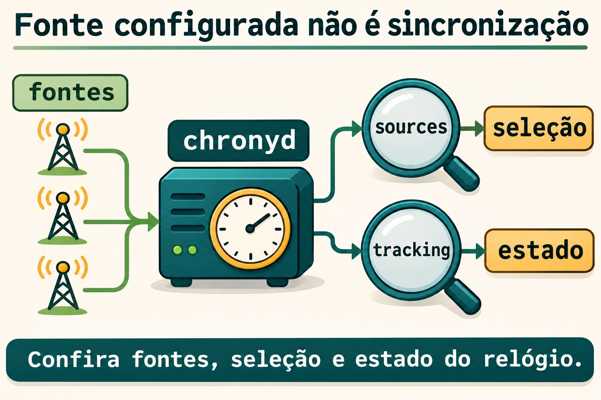

# Aula 14.4 · Hora certa

Você já usou horários para agendar trabalhos e investigar logs. Agora vai separar o instante do relógio, o fuso que o apresenta e a fonte que o sincroniza. O objetivo é diagnosticar sem plantar saltos de hora no servidor.

> **Núcleo desta aula:** fonte configurada, fonte selecionada e relógio sincronizado são evidências diferentes. Mude apenas a apresentação por processo nos testes de fuso. O resto é aprofundamento.

| Ficha |  |
| --- | --- |
| **Módulo** | M14 · Agendamento, logs e hora, aula 4 de 5 |
| **Quando** | Semana 20 |
| **Ao final** | Você interpreta chrony, compara fusos e mede uma fonte sem ajustar o relógio |
| **Pré-requisitos** | Aula 14.3; VMs próprias do curso, `python3`, `student`, `sudo` e console |
| **Tempo** | Cerca de 90 minutos |
| **Snapshots** | `m14a4-inicio` e `m14a4-fim` nas VMs 201 e 202 |

## 1 · Aquecimento

Responda antes de consultar o relógio.

1. Por que o boot e o intervalo fazem parte da busca no journal?
2. Por que a configuração salva de um serviço não comprova comportamento correto?
3. Por que mudar a hora pode afetar um timer de calendário?

## 2 · Por que importa

Dois hosts parecem registrar o mesmo incidente em ordens opostas. Um usa outro fuso; o outro perdeu sincronização. Comparar apenas a hora impressa confunde apresentação com instante. Autenticação, validade de certificados e cronologia de incidentes também dependem de tempo coerente.

Não corrija um desvio aparente digitando uma hora de memória. Primeiro descubra o mecanismo ativo, suas fontes e o estado de sincronização.

## 3 · Modelo mental

O instante é o ponto na linha do tempo. O fuso é a legenda do relógio na parede. A fonte NTP ajuda o mecanismo a manter o instante; trocar a legenda não corrige um mecanismo atrasado.

```text
fonte -> medições -> seleção -> relógio -> apresentação no fuso
```


*Mudar a apresentação do fuso não muda o instante.*

### Ponte Windows

| Conceito | Linux |
| --- | --- |
| Serviço de hora | chronyd ou o cliente realmente ativo |
| Fonte configurada | Diretivas `server` e `pool` |
| Estado e fontes | `chronyc tracking`, `chronyc sources` |
| Fuso do sistema | `timedatectl status` |

## 4 · O essencial

### Um dono para o relógio

Não coloque dois clientes tentando disciplinar o mesmo relógio. chrony e systemd-timesyncd são alternativas de cliente, não serviços que você habilita juntos para melhorar a precisão. A migração exige registrar a configuração e planejar a troca.

### Medir, selecionar e sincronizar

`chronyc sources -v` mostra fontes e indicadores de seleção. O marcador `*` identifica a fonte selecionada. Uma fonte listada não está necessariamente utilizável. `chronyc tracking` descreve como o relógio está sendo acompanhado.

`Reach` é um histórico de alcance representado em octal, não uma porcentagem. Leia também a idade da última resposta, o estado da fonte e o estado de salto do tracking. Não transforme um único número em diagnóstico completo.



*Confira fontes, seleção e estado do relógio.*

### Fuso é apresentação

A variável `TZ` aplicada a um comando muda a apresentação daquele processo. O exemplo do lab usa o mesmo timestamp numérico para três apresentações. Ele não edita o fuso global nem altera a hora do sistema.

### Medição sem correção

`chronyd -Q` mede e informa o desvio sem corrigir o relógio. `-q`, em minúscula, ajusta uma vez e tem outra finalidade. Neste lab use somente a opção maiúscula, com arquivo isolado e tempo máximo.


*Compare relógio e fuso antes de ordenar incidentes.*

### Rocky × Debian

| Item | Rocky 9 | Debian 13 |
| --- | --- | --- |
| Pacote | `chrony` | `chrony` |
| Unidade | `chronyd.service` | `chrony.service` |
| Arquivo principal | `/etc/chrony.conf` | `/etc/chrony/chrony.conf` |
| Instalação padrão | Cliente chrony comum | Confira se timesyncd é o cliente atual |

## 5 · Lab guiado

O preparo abaixo instala chrony como cliente único nas VMs do curso. Se já existir outro cliente ou fonte personalizada além do timesyncd padrão, pare para planejar a migração. A instalação pode substituir timesyncd; não aplique esse roteiro em um servidor de produção. A sincronização normal pode corrigir um desvio existente, portanto faça a troca com snapshot, console e janela definida.

### Passo 1 · Proteger e identificar

**Palpite:** o nome da unidade de chrony é igual nas duas distros?

No host Proxmox:

```bash
qm snapshot 201 m14a4-inicio
qm snapshot 202 m14a4-inicio
```

Nas VMs:

```bash
test ! -e "$HOME/m14a4"
mkdir -m 700 "$HOME/m14a4"
timedatectl status | tee "$HOME/m14a4/timedatectl.inicio"
systemctl is-active chronyd chrony systemd-timesyncd | tee "$HOME/m14a4/clients.inicio"
readlink -f /etc/localtime | tee "$HOME/m14a4/timezone.inicio"
```

Confirme que esta é a VM de laboratório e que a troca foi planejada antes de executar a instalação. Na Rocky:

```bash
sudo dnf install -y chrony
sudo systemctl enable --now chronyd
```

Na Debian, com apenas timesyncd padrão ou chrony como cliente anterior:

```bash
if systemctl is-active --quiet systemd-timesyncd; then
    sudo systemctl disable --now systemd-timesyncd
fi
sudo apt install -y chrony
sudo systemctl enable --now chrony
```

Não configure uma fonte inventada. Preserve fontes autorizadas já existentes; em instalação nova, leia a configuração que o pacote forneceu e confira sua autorização no ambiente antes de seguir. O cliente chrony fica como estado final do curso.

```bash
test -x /usr/sbin/chronyd
command -v chronyc python3
systemctl is-active chronyd chrony systemd-timesyncd
```

**Saída esperada:** cliente chrony ativo na unidade da distro e nenhum segundo cliente ativo ajustando o relógio. Unidades inexistentes ou inativas podem aparecer nas outras posições.

**Verifique:** se esse preparo não estiver pronto, pare antes dos testes. Não use `timedatectl set-ntp` sem saber qual cliente ele vai selecionar. `timedatectl set-timezone` seria uma alteração global do fuso; esta aula usa apenas `TZ` por processo e não executa essa mudança.

### Passo 2 · Ler a evidência do cliente

**Palpite:** uma fonte configurada já está selecionada?

```bash
sudo chronyc -n sources -v | tee "$HOME/m14a4/sources.inicio"
sudo chronyc tracking | tee "$HOME/m14a4/tracking.inicio"
sudo chronyc activity
```

**Saída esperada:** valores reais do cliente. Identifique se há fonte selecionada e se o tracking informa sincronização; se não houver, registre a condição em vez de inventar uma amostra normal.

**Verifique:** relacione endereço da fonte, seleção e estado. Serviço ativo não é sinônimo de relógio sincronizado.

### Passo 3 · Comparar o mesmo instante

**Palpite:** os três comandos abaixo vão representar três instantes diferentes?

```bash
STAMP=$(date +%s)
printf '%s\n' "$STAMP" > "$HOME/m14a4/epoch"
TZ=UTC date -d "@$STAMP" '+%Y-%m-%dT%H:%M:%S%z'
TZ=Europe/Rome date -d "@$STAMP" '+%Y-%m-%dT%H:%M:%S%z'
TZ=America/Sao_Paulo date -d "@$STAMP" '+%Y-%m-%dT%H:%M:%S%z'
readlink -f /etc/localtime
```

**Saída esperada:** apresentações com deslocamentos próprios para o mesmo timestamp. O fuso global continua igual ao inicial.

**Verifique:** confira o deslocamento, não só os dígitos da hora. As regras sazonais dependem da data do instante consultado.

### Decida 1

| Opção | Dois horários impressos diferem |
| --- | --- |
| A | Alterar imediatamente o relógio |
| B | Comparar instante, deslocamento e fonte de sincronização |
| C | Escolher o horário visualmente mais próximo |

Escolha B. Uma diferença de apresentação não prova desvio do relógio.

### Passo 4 · Escrever uma candidata isolada

**Palpite:** validar a sintaxe já consulta a fonte?

Escolha um IP NTP autorizado do ambiente, obtido do inventário real de fontes. Não use um endereço aleatório nem presuma que o gateway oferece NTP.

```bash
read -r -p 'Authorized NTP IP: ' NTP_IP
python3 -c 'import ipaddress,sys; print(ipaddress.ip_address(sys.argv[1]))' "$NTP_IP"
```

Se a validação do IP falhar, pare e corrija a entrada antes de criar o arquivo.

Na debian-lab, o perfil AppArmor do `chronyd` só deixa ler configurações dentro de `/etc/chrony/`. Uma candidata em `$HOME` dá `Permission denied`. Por isso, as candidatas ficam numa pasta definida por `C`. Se abrir um terminal novo, defina `C` de novo.

```bash
C="$HOME/m14a4"
if command -v apt >/dev/null; then
  # guarda: cria a pasta só na debian-lab
  C=/etc/chrony/m14a4
  sudo install -d -o "$USER" -g "$USER" -m 755 "$C"
fi
echo "$C"
```

```bash
printf 'server %s iburst\nport 0\ncmdport 0\n' "$NTP_IP" > "$C/chrony.conf"
/usr/sbin/chronyd -p -f "$C/chrony.conf"
```

**Saída esperada:** a candidata é interpretada sem iniciar ajuste do relógio. Não há driftfile, comando de ajuste nem arquivo global alterado.

**Verifique:** identifique o IP escolhido e a ausência de diretivas que exigem privilégios para esse teste.

### Passo 5 · Medir sem ajustar

**Palpite:** o que torna esta execução diferente de um ajuste único do relógio?

Execute como `student`, sem `sudo`. A opção é `-Q`, maiúscula.

```bash
/usr/sbin/chronyd -Q -t 15 -f "$C/chrony.conf"
```

**Saída esperada:** a ferramenta termina com uma medição quando obtém amostras utilizáveis, ou encerra por prazo se não consegue. Nenhuma correção de relógio é feita por essa execução.

**Verifique:** compare a medição com o estado do cliente ativo. A consulta adicional não substituiu o daemon nem tornou aquela candidata persistente.

### Decida 2

| Opção | A fonte não respondeu dentro do prazo |
| --- | --- |
| A | Verificar IP, serviço NTP e caminho UDP autorizado |
| B | Transformar o host em servidor de hora sem fonte |
| C | Trocar a hora manualmente |

Escolha A. Ausência de amostra utilizável não informa uma hora correta para digitar.

### Passo 6 · Correlacionar journal e boot

**Palpite:** apresentar o journal em UTC apaga o fuso usado pelo sistema?

```bash
logger -t m14a4 "M14A4 epoch=$STAMP"
sudo journalctl -t m14a4 --since '-5 minutes' -o short-iso --no-pager
sudo journalctl --utc -t m14a4 --since '-5 minutes' -o short-iso --no-pager
sudo systemctl reboot
```

Depois de reconectar:

```bash
timedatectl status
sudo chronyc tracking
sudo chronyc -n sources -v
readlink -f /etc/localtime
```

**Saída esperada:** cliente normal volta e o fuso permanece igual. O journal pode apresentar o mesmo evento em UTC sem reescrever seu instante.

**Verifique:** a candidata isolada não foi instalada no daemon. O estado persistente conferido é o do cliente chrony ativado no preparo.

## 6 · Quebre e conserte

### Quebra 1 · Nome de fuso inválido

**Sintoma:** o nome digitado não corresponde a uma zona instalada.

**Investigação:** compare o caminho errado com a lista disponível.

```bash
test -e /usr/share/zoneinfo/Europ/Rome
timedatectl list-timezones | grep '^Europe/Rome$'
```

**Causa:** erro no identificador. Uma variável `TZ` inválida pode receber interpretação alternativa; uma saída impressa não valida sozinha o nome.

**Conserto:** use a zona existente apenas no comando de apresentação.

```bash
TZ=Europe/Rome date -d "@$(cat "$HOME/m14a4/epoch")" -Is
```

**Verifique:** o fuso global continua igual ao registrado.

**Prevenção:** selecione nomes da base instalada.

### Quebra 2 · Candidata com diretiva inexistente

**Sintoma:** a candidata deixa de passar no leitor de configuração.

**Investigação:** plante a linha somente na cópia privada.

```bash
cp "$C/chrony.conf" "$C/chrony.good"
printf 'm14_invalid yes\n' >> "$C/chrony.conf"
/usr/sbin/chronyd -p -f "$C/chrony.conf"
```

**Causa:** a diretiva não é reconhecida. O cliente ativo continua com sua configuração original.

**Conserto:** restaure `cp "$C/chrony.good" "$C/chrony.conf"`.

**Verifique:** a leitura com `-p` volta a passar.

**Prevenção:** valide antes de planejar qualquer substituição da configuração ativa.

### Quebra 3 · Fonte sem servidor

**Sintoma:** uma consulta isolada não consegue amostra utilizável.

**Investigação:** confirme que não há servidor NTP no endereço de loopback reservado ao defeito e crie outra candidata. Não toque no cliente ativo.

```bash
sudo ss -lunp 'sport = :123'
printf 'server 127.0.0.2 iburst\nport 0\ncmdport 0\n' > "$C/chrony.bad-source"
/usr/sbin/chronyd -Q -t 5 -f "$C/chrony.bad-source"
```

**Causa:** esse destino não oferece NTP no lab. Não é um problema de apresentação do fuso.

**Conserto:** volte à candidata com a fonte autorizada e confirmada.

**Verifique:** o cliente ativo continua sendo consultável com `chronyc tracking`.

**Prevenção:** teste disponibilidade e autorização da fonte; não use somente a existência da linha no arquivo.

### Limpeza

As execuções `-Q` terminam por conta própria. O cliente chrony instalado permanece intencionalmente ativo; a configuração candidata nunca substituiu a dele. Nenhuma variável de fuso foi exportada globalmente e nenhum daemon concorrente deve ficar iniciado. Guarde os arquivos privados como evidência.

```bash
readlink -f /etc/localtime
sudo chronyc tracking
sudo chronyc -n sources -v
```

Na debian-lab, remova também a pasta das candidatas: `sudo rm -rf /etc/chrony/m14a4`.

Compare o fuso com `timezone.inicio`. A sincronização continua sob o único cliente instalado e ativado no preparo desta aula.

## 7 · Armadilhas

| Erro | Faça | Motivo |
| --- | --- | --- |
| Hora visual diferente significa relógio errado | Comparar instante e deslocamento | Fusos apresentam o mesmo instante |
| Serviço ativo significa sincronizado | Ler fontes e tracking | Pode não haver fonte utilizável |
| Confundir `-q` e `-Q` | Conferir a opção antes de executar | Uma ajusta; a outra mede |
| Habilitar dois clientes | Planejar um proprietário único | Evita ajustes concorrentes |

## 8 · Quiz

1. Fuso e instante são a mesma coisa?
2. O que mostra `sources` além da lista de fontes?
3. Reach é uma porcentagem?
4. Qual opção do chronyd mede sem corrigir?
5. Por que não instalar outro cliente silenciosamente?
6. Como comparar eventos de hosts com fusos diferentes?

## 9 · Cola

| Tarefa | Comando |
| --- | --- |
| Estado geral | `timedatectl status` |
| Fontes e seleção | `chronyc -n sources -v` |
| Acompanhamento | `chronyc tracking` |
| Journal em UTC | `sudo journalctl --utc -t m14a4` |

**Flashcards:** crie cinco cartões sobre instante, fuso, seleção, tracking e medição sem ajuste. Revise em D+1, D+3, D+7 e D+21.

## 10 · Checklist e fechamento

- [ ] Identifiquei o único cliente ativo.
- [ ] Comparei o mesmo instante em três fusos sem mudar o relógio.
- [ ] Testei apenas candidatas isoladas com medição sem ajuste.

**Último exercício:** escreva como distinguir fuso incorreto, fonte indisponível e cliente ainda sem sincronização.

**Reboot de conferência:** reinicie as duas VMs e confira cliente, fontes e fuso preservados, sem usar um ajuste manual para produzir uma tela esperada.

```bash
sudo systemctl reboot
```

No host Proxmox:

```bash
qm snapshot 201 m14a4-fim
qm snapshot 202 m14a4-fim
```

## 11 · Na vida real

Em um host autorizado, leia estado, fontes, fuso e apresentação UTC de um intervalo conhecido do journal. Não ajuste a hora, não troque o cliente e não force um salto nesta missão. Registre o que demonstra sincronização e o que demonstra apenas apresentação.

## 12 · Aprofundar quando quiser

- [chronyd(8)](https://chrony-project.org/doc/4.6/chronyd.html), [chronyc(1)](https://chrony-project.org/doc/4.6/chronyc.html) e [chrony.conf(5)](https://chrony-project.org/doc/4.6/chrony.conf.html): cliente, fontes e medição.
- [timedatectl(1)](https://manpages.debian.org/trixie/systemd/timedatectl.1.en.html): consulta e alterações globais que não são usadas neste lab.

**DeepTutor** (http://10.1.0.149:3782, KB "Curso Linux Sysadmin"):

- `!explica Separe instante, fuso, fonte NTP e sincronização do relógio.`
- `!feynman Vou explicar por que um serviço de hora ativo pode não estar sincronizado. Critique minha explicação.`
- `!quiz Crie seis diagnósticos de hora sem alterar o relógio real do servidor.`

## Gabarito comentado

### Aquecimento

1. Eles delimitam o conjunto pesquisado e podem excluir o evento.
2. A fonte pode estar indisponível mesmo com uma configuração válida.
3. A agenda civil depende dos horários calculados a partir do relógio e do fuso.

### Quiz

1. Não; um é apresentação, o outro é o ponto na linha do tempo.
2. Estado de seleção, alcance e informações das amostras.
3. Não; é um histórico em octal.
4. `-Q`, maiúscula.
5. A instalação pode substituir ou competir com o proprietário atual do relógio.
6. Normalize a apresentação e confira o estado dos relógios, não apenas o texto da hora.

<!-- navegacao -->
[← Aula 14.3 · journald e rsyslog](14.3-journald-e-rsyslog.md) · [Índice de aulas](../01-aulas.md) · [Plano do curso: 14.5 em diante →](../00-plano-do-curso.md)
