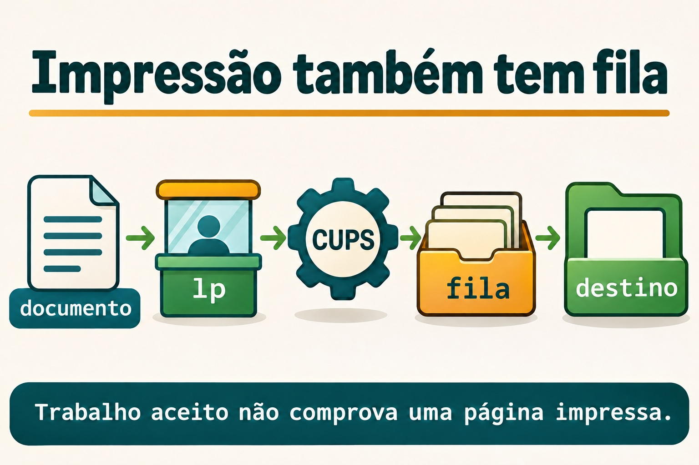
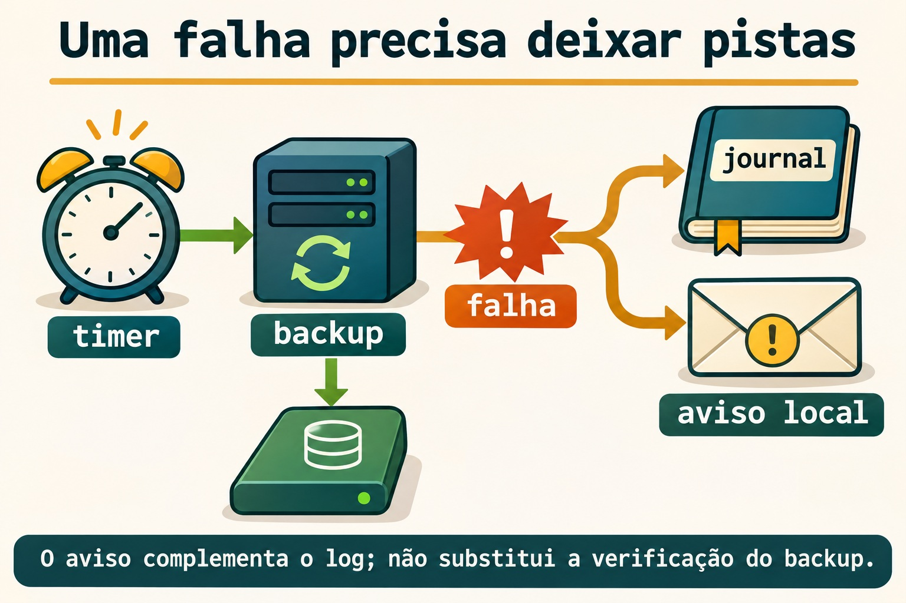

# Aula 14.5 · E-mail local e impressão

Aceitar uma mensagem ou um documento não comprova entrega. Você vai seguir duas filas locais e fechar o módulo com um backup que registra seu resultado e avisa quando falha.

> **Núcleo desta aula:** confira submissão, fila e destino. O aviso complementa o log; o backup exige leitura de teste. O resto é aprofundamento.

| Ficha |  |
| --- | --- |
| **Módulo** | M14 · Agendamento, logs e hora, aula 5 de 5 |
| **Quando** | Semana 20 |
| **Ao final** | Você verifica entrega local, administra uma fila virtual e integra aviso de falha |
| **Pré-requisitos** | Aula 14.4; VMs próprias, `student`, `sudo` e console |
| **Tempo** | Cerca de 120 minutos |
| **Snapshots** | `m14a5-inicio` e `m14a5-fim` nas VMs 201 e 202 |

## 1 · Aquecimento

1. Que evidência comprova uma execução do timer, além de ele estar ativo?
2. Como consultar uma falha pela unidade e pelo boot no journal?
3. Por que o fuso precisa acompanhar a hora de uma evidência?

## 2 · Por que importa

Um programa pode aceitar o envio e o destinatário continuar sem mensagem. Separe submissão, fila, transporte e caixa. Na impressão, receber o trabalho também vem antes de concluir no destino.

Aqui tudo fica na própria VM: correio local e fila virtual que descarta bytes. Não use endereço externo ou equipamento físico. O objetivo é compreender as evidências, sem criar um servidor público.

## 3 · Modelo mental


*Confira fila, entrega local e caixa do destinatário.*

`sendmail` é a interface compatível de submissão fornecida aqui pelo Postfix. Seu nome não significa que o servidor Sendmail esteja instalado. A entrega local termina na caixa de um usuário da VM.



*Trabalho aceito não comprova uma página impressa.*

CUPS recebe, mantém a fila e aciona o destino. Neste laboratório, `file:///dev/null` descarta os dados. Concluir nesse destino não comprova uma folha impressa.

## 4 · Essencial

| Ferramenta | Pergunta |
| --- | --- |
| `postconf -n` | Qual configuração explícita está salva? |
| `postqueue -p` | O que ainda está na fila? |
| `newaliases` | A base de aliases foi reconstruída? |
| `lpstat -t` | Quais filas e estados existem? |
| `lp` e `cancel` | Como enviar e cancelar meu trabalho? |

Um alias redireciona o nome local, sem criar conta ou caixa. Uma fila de e-mail vazia pode representar entrega ou erro já processado. Leia também caixa e logs.

### Decida 1

O envio retornou sucesso, mas você não leu o aviso. Você: A) declara entrega; B) confere fila, logs e caixa; C) troca o servidor de hora.

## 5 · Lab guiado

Repita nas VMs 201 e 202, como `student`, com `/home/student`. Cada pré-condição é um ponto de parada; se falhar, não prossiga. O exercício exige VMs dedicadas, sem MTA configurado, sem filas existentes e sem personalizações de CUPS.

No host Proxmox:

```bash
qm snapshot 201 m14a5-inicio
qm snapshot 202 m14a5-inicio
```

### Passo 1 · Reservar nomes e instalar

**Palpite:** um pacote pode iniciar seu serviço durante a instalação?

Sim. Registre os estados antes de mascarar temporariamente as unidades. Se algum MTA estiver configurado ou alguma unidade já estiver mascarada, pare e use outra VM preparada.

```bash
id
getent passwd student
systemctl is-active postfix cups
systemctl is-enabled postfix cups cups.socket cups.path
ss -lnt '( sport = :25 or sport = :631 )'
test ! -e "$HOME/m14a5"
test ! -e /usr/local/libexec/m14a5-backup
test ! -e /usr/local/libexec/m14a5-alert
test ! -e /etc/systemd/system/m14a5-backup.service
test ! -e /etc/systemd/system/m14a5-alert.service
test ! -e /etc/systemd/system/m14a5-backup.timer
test ! -e /var/lib/m14a5
mkdir -m 700 "$HOME/m14a5"
systemctl list-unit-files 'postfix*' 'cups*' > "$HOME/m14a5/services.before"
sudo systemctl mask postfix.service cups.service cups.socket cups.path
```

No Rocky:

```bash
sudo dnf install -y postfix s-nail cups cups-client cups-filters
```

No Debian, reserve a política de instalação temporária abaixo; se já existir, pare sem substituí-la. Ela impede início por scripts de instalação, inclusive de dependências. Resolva eventual falha de instalação antes de retirar a política criada aqui.

```bash
test ! -e /usr/sbin/policy-rc.d
printf '#!/bin/sh\nexit 101\n' | sudo tee /usr/sbin/policy-rc.d >/dev/null
sudo chmod 755 /usr/sbin/policy-rc.d
printf 'postfix postfix/main_mailer_type select Local only\n' | sudo debconf-set-selections
sudo apt-get update
sudo apt-get install -y postfix bsd-mailx cups cups-client cups-filters
sudo rm -- /usr/sbin/policy-rc.d
```

**Saída esperada:** ferramentas instaladas e serviços reservados ainda parados. Dependências variam conforme a distribuição.

**Verifique:** confira novamente portas e estados. Se apareceu listener de rede ou um MTA anterior, pare antes de configurar.

### Passo 2 · Definir o escopo local

**Palpite:** limitar o listener impede também a saída para destinos externos?

Não. Limite a recepção e os transportes de saída. Esta configuração substitui somente o padrão novo da VM dedicada. Não a aplique sobre um servidor existente.

```bash
sudo cp -a /etc/postfix/main.cf "$HOME/m14a5/main.cf.before"
sudo postconf -e 'inet_interfaces = loopback-only'
sudo postconf -e 'inet_protocols = ipv4'
sudo postconf -e "myhostname = $(hostname -s).invalid"
sudo postconf -e 'myorigin = $myhostname'
sudo postconf -e 'mydestination = $myhostname, localhost.$mydomain, localhost'
sudo postconf -e 'mynetworks = 127.0.0.0/8'
sudo postconf -e 'relay_domains ='
sudo postconf -e 'smtpd_relay_restrictions = reject_unauth_destination'
sudo postconf -e 'default_transport = error:local delivery only'
sudo postconf -e 'relay_transport = error:local delivery only'
sudo postconf -e 'alias_maps = hash:/etc/aliases'
sudo postconf -e 'alias_database = hash:/etc/aliases'
sudo postfix check
sudo postconf -n
sudo systemctl unmask postfix.service
sudo systemctl enable --now postfix.service
ss -lnt '( sport = :25 )'
sudo postfix status
```

**Saída esperada:** SMTP somente em `127.0.0.1:25`. Destinos não locais encontram o transporte de erro. Não teste endereços externos.

**Verifique:** listener, processos e configuração real. O desenho das unidades Postfix pode variar entre as distribuições; estado ativo não substitui essas verificações.

### Passo 3 · Seguir a entrega local

**Palpite:** editar aliases atualiza imediatamente o mapa indexado?

Reserve `m14notice`: as duas primeiras consultas devem mostrar ausência. Se já existir, pare antes de acrescentar o bloco.

```bash
sudo grep -n '^m14notice:' /etc/aliases
sudo postalias -q m14notice hash:/etc/aliases
printf '\n# BEGIN m14a5\nm14notice: student\n# END m14a5\n' | sudo tee -a /etc/aliases >/dev/null
sudo newaliases
sudo postalias -q m14notice hash:/etc/aliases
printf 'To: m14notice\nSubject: m14a5-local\n\nm14a5 delivery check\n' | /usr/sbin/sendmail -i m14notice
sudo postqueue -p
SPOOL=$(sudo postconf -h mail_spool_directory)
MAILBOX="$SPOOL/student"
printf '%s\n' "$MAILBOX"
sudo journalctl --since '-5 minutes' --no-pager | grep -E 'postfix|m14a5'
mail -f "$MAILBOX"
```

No leitor, `h` lista cabeçalhos, o número seleciona a mensagem e `x` sai sem salvar alterações na caixa. Leia apenas o assunto do laboratório; não apague outras mensagens.

**Saída esperada:** consulta do alias retorna `student` e a mensagem chega à caixa. A fila pode esvaziar rapidamente; identificadores e horários vêm da execução real.

**Verifique:** corpo e logs da entrega pelo identificador. Se o journal não receber logs do MTA, confira o rsyslog e seus destinos de correio existentes, sem inventar um caminho universal.

### Passo 4 · Criar uma impressora virtual

**Palpite:** uma fila pode terminar sem produzir papel?

Sim. Nosso destino é um arquivo especial que descarta os bytes. CUPS 2.x exige PPD para dispositivo em arquivo: não crie fila sem driver com `-m raw`. Selecione um modelo PostScript realmente listado. PPD é um mecanismo legado; em equipamentos modernos normalmente se usa IPP sem driver.

```bash
sudo systemctl unmask cups.service cups.socket cups.path
sudo systemctl start cups.service
sudo cupsctl --no-remote-admin --no-remote-any --no-share-printers
sudo cupsd -t
ss -lnt '( sport = :631 )'
lpstat -p
LC_ALL=C lpinfo -m | grep -i 'generic.*postscript'
read -r -p 'MODEL: ' MODEL
lpinfo -m | awk '{print $1}' | grep -Fx -- "$MODEL"
sudo lpadmin -p m14file -E -v file:///dev/null -m "$MODEL" -o printer-is-shared=false
lpstat -v m14file
lpstat -p m14file
```

Copie apenas a primeira coluna do modelo selecionado. Se não houver modelo ou a verificação falhar, pare sem inventar driver. Se `m14file` já existir, pare antes de criar. Não prossiga com listener em `0.0.0.0:631` ou `[::]:631`: corrija a configuração local dedicada primeiro.

**Saída esperada:** fila própria com PPD e destino `file:///dev/null`. Esse destino especial é permitido sem habilitar escrita arbitrária em arquivos.

**Verifique:** listener somente em loopback ou socket local e nenhuma impressora física selecionada.

### Passo 5 · Reter, liberar e concluir

**Palpite:** o recibo do cliente indica aceitação ou conclusão?

```bash
printf 'm14a5 virtual document\n' > "$HOME/m14a5/document.txt"
lp -d m14file -o raw -H hold "$HOME/m14a5/document.txt"
lpstat -W not-completed -o m14file
read -r -p 'JOB_ID: ' JOB_ID
lp -i "$JOB_ID" -H resume
lpstat -W completed -o m14file
```

Copie o identificador do seu recibo, incluindo o nome da fila. `-o raw` neste envio evita filtros; a fila continua com PPD. Espere o término e repita a consulta se necessário.

**Saída esperada:** primeiro retido, depois concluído no histórico disponível. O destino descarta os dados, sem acionar equipamento.

**Verifique:** crie outro trabalho retido, registre seu novo identificador e cancele só esse trabalho com `cancel "$JOB_ID"`. Não reutilize o identificador anterior nem cancele filas inteiras.

### Passo 6 · Conferir depois do reboot

**Palpite:** alias e fila dependem de sua sessão permanecer aberta?

```bash
sudo systemctl enable postfix.service cups.service
sudo postfix check
sudo cupsd -t
sudo systemctl reboot
```

Reconecte pelo caminho já validado. Reenvie a mensagem local do Passo 3 com assunto novo e confira sua caixa, sem confundir uma mensagem antiga com entrega após o boot.

```bash
ss -lnt '( sport = :25 or sport = :631 )'
sudo postqueue -p
lpstat -t
sudo journalctl -b -u cups.service --no-pager
```

**Saída esperada:** serviços locais disponíveis, nova entrega e fila preservada, sem exposição de rede.

**Verifique:** registre as três evidências; estado ativo sozinho não as substitui.

## 6 · Quebre e conserte

### Quebra 1 · Arquivo novo, mapa antigo

**Sintoma:** o arquivo tem o alias, mas a consulta não o encontra.

**Investigação:** reserve um alias ausente e acrescente somente o bloco temporário, sem reconstruir. Se já existir, pare.

```bash
sudo grep -n '^m14stale:' /etc/aliases
sudo postalias -q m14stale hash:/etc/aliases
printf '\n# BEGIN m14stale\nm14stale: student\n# END m14stale\n' | sudo tee -a /etc/aliases >/dev/null
sudo grep '^m14stale:' /etc/aliases
sudo postalias -q m14stale hash:/etc/aliases
```

**Causa:** o mapa indexado representa a versão anterior.

**Conserto:** execute `sudo newaliases` e consulte novamente.

**Verifique:** retorna `student`; remova só o bloco temporário e reconstrua outra vez.

```bash
sudo sed -i '/^# BEGIN m14stale$/,/^# END m14stale$/d' /etc/aliases
sudo newaliases
```

**Prevenção:** confira arquivo, mapa e entrega separadamente.

### Quebra 2 · Fila desabilitada

**Sintoma:** o documento foi aceito, mas não termina.

**Investigação:** desabilite somente a fila própria e envie um teste.

```bash
sudo cupsdisable m14file
lp -d m14file -o raw "$HOME/m14a5/document.txt"
lpstat -p m14file
lpstat -o m14file
```

**Causa:** aceitar trabalhos e processá-los são estados diferentes.

**Conserto:** execute `sudo cupsenable m14file`.

**Verifique:** o seu trabalho termina no destino virtual; se não, leia o log do CUPS.

**Prevenção:** confira fila e trabalho antes de reiniciar o serviço inteiro.

### Quebra 3 · Destino inexistente

**Sintoma:** não há recibo com identificador de trabalho.

**Investigação:** confirme que o nome abaixo não existe antes de testar.

```bash
lpstat -p
lp -d m14naoexiste "$HOME/m14a5/document.txt"
printf 'rc=%s\n' "$?"
```

**Causa:** o cliente não encontrou a fila; o erro antecede a impressão.

**Conserto:** selecione explicitamente `m14file`.

**Verifique:** a submissão correta recebe identificador e aparece no histórico.

**Prevenção:** scripts não devem depender de impressora padrão desconhecida.

## 7 · Armadilhas

- Listener local não impede sozinho a entrega externa.
- A fila vazia não substitui a leitura da caixa.
- Não envie segredos no corpo de um aviso.
- Aviso na mesma VM depende de ela funcionar; monitoramento externo é outro projeto.
- Não exponha a administração do CUPS para facilitar o exercício.

### Decida 2

O backup falha e o aviso depende do mesmo servidor. Você conclui: A) artefato, log e aviso exigem verificações próprias.; B) ausência de aviso prova sucesso; C) o aviso substitui a conferência

## 8 · Quiz

1. O que a aceitação por `sendmail` comprova?
2. Um alias cria conta e caixa?
3. Por que executar `newaliases`?
4. Uma fila desabilitada pode aceitar trabalhos?
5. O que concluiu no destino virtual?
6. Ausência de e-mail comprova sucesso do backup?

## 9 · Lembrete

**Flashcards:** submissão → entrada; fila → pendência; alias → redirecionamento; caixa → conteúdo entregue; CUPS → fila e destino; aviso → pista adicional.

```text
submission -> queue -> local delivery -> mailbox
lp -> queue -> destination -> result
```

## 10 · Checklist e encerramento

### Desafio do módulo · Backup, log e aviso



*O aviso complementa o log; não substitui a verificação do backup.*

**Último exercício:** monte a integração sem arquivos reais. O timer diário chama um backup de teste; sua falha deve produzir estado de erro, log e aviso local. Os nomes e textos de máquina ficam iguais nas duas línguas.

```bash
mkdir -m 700 "$HOME/m14a5/source"
printf 'm14a5 backup data\n' > "$HOME/m14a5/source/data.txt"
sudo install -d -m 755 /usr/local/libexec
sudo tee /usr/local/libexec/m14a5-backup >/dev/null <<'EOF'
#!/bin/sh
set -eu
if [ -e /var/lib/m14a5/fail ]; then
  echo 'm14a5 controlled failure' >&2
  exit 9
fi
tmp=$(mktemp /var/lib/m14a5/backup.XXXXXX)
trap 'rm -f -- "$tmp"' EXIT HUP INT TERM
tar -czf "$tmp" -C /home/student/m14a5 source
tar -tzf "$tmp" >/dev/null
mv -- "$tmp" /var/lib/m14a5/backup.tar.gz
echo 'm14a5 backup verified'
EOF
sudo tee /usr/local/libexec/m14a5-alert >/dev/null <<'EOF'
#!/bin/sh
set -eu
printf 'To: m14notice\nSubject: m14a5-backup-failed\n\nCheck journal: m14a5-backup.service\n' | /usr/sbin/sendmail -i m14notice
EOF
sudo chmod 755 /usr/local/libexec/m14a5-backup /usr/local/libexec/m14a5-alert
```

No Rocky: `sudo restorecon /usr/local/libexec/m14a5-backup /usr/local/libexec/m14a5-alert`. Os nomes das unidades e do estado já foram reservados no Passo 1. Se alguém os criou desde então, pare antes de escrever.

```bash
sudo tee /etc/systemd/system/m14a5-backup.service >/dev/null <<'EOF'
[Unit]
Description=M14 local backup
OnFailure=m14a5-alert.service
[Service]
Type=oneshot
User=student
Group=student
StateDirectory=m14a5
StateDirectoryMode=0700
ExecStart=/usr/local/libexec/m14a5-backup
EOF
sudo tee /etc/systemd/system/m14a5-alert.service >/dev/null <<'EOF'
[Unit]
Description=M14 local failure notice
[Service]
Type=oneshot
User=student
Group=student
ExecStart=/usr/local/libexec/m14a5-alert
EOF
sudo tee /etc/systemd/system/m14a5-backup.timer >/dev/null <<'EOF'
[Unit]
Description=M14 daily backup
[Timer]
OnCalendar=daily
Persistent=true
Unit=m14a5-backup.service
[Install]
WantedBy=timers.target
EOF
sudo systemd-analyze verify /etc/systemd/system/m14a5-backup.service /etc/systemd/system/m14a5-alert.service /etc/systemd/system/m14a5-backup.timer
sudo systemctl daemon-reload
sudo systemctl start m14a5-backup.service
tar -tzf /var/lib/m14a5/backup.tar.gz
sudo systemctl enable --now m14a5-backup.timer
systemctl list-timers m14a5-backup.timer
```

O arquivo temporário só substitui o backup final depois de passar na leitura. Isso valida o arquivo de teste, sem substituir um ensaio completo de restauração. Provoque a falha controlada e observe o erro esperado.

```bash
touch /var/lib/m14a5/fail
sudo systemctl start m14a5-backup.service
sudo journalctl -u m14a5-backup.service -u m14a5-alert.service --since '-5 minutes' --no-pager
sudo postqueue -p
rm -- /var/lib/m14a5/fail
sudo systemctl reset-failed m14a5-backup.service
sudo systemctl start m14a5-backup.service
systemctl show m14a5-backup.service -p Result -p ExecMainStatus
```

Leia o aviso na caixa, como no Passo 3. A aceitação pelo programa de envio não basta. Depois de retirar a falha, confirme nova leitura do backup e resultado de sucesso.

**Reboot de conferência:** reinicie e confira timer, listeners e último resultado. A persistência recupera uma ativação vencida, não uma execução para cada dia perdido. Não ajuste o relógio para testar.

### Limpeza e estado final

Copie o backup de teste e retire somente agendamento e fila próprios. Postfix local e CUPS local permanecem instalados. Journal persistente da 14.3 e chrony da 14.4 permanecem. Não restaure cegamente configurações anteriores que poderiam reabrir listeners.

```bash
sudo systemctl disable --now m14a5-backup.timer
sudo systemctl stop m14a5-backup.service m14a5-alert.service
if cp -- /var/lib/m14a5/backup.tar.gz "$HOME/m14a5/backup.tar.gz" &&
   cmp -- /var/lib/m14a5/backup.tar.gz "$HOME/m14a5/backup.tar.gz"; then
    sudo systemctl clean --what=state m14a5-backup.service m14a5-backup.timer
    sudo systemctl reset-failed m14a5-backup.service m14a5-alert.service
    sudo rm -- /etc/systemd/system/m14a5-backup.service /etc/systemd/system/m14a5-alert.service /etc/systemd/system/m14a5-backup.timer
    sudo rm -- /usr/local/libexec/m14a5-backup /usr/local/libexec/m14a5-alert
    sudo systemctl daemon-reload
    lpstat -o m14file
    sudo lpadmin -x m14file
    sudo sed -i '/^# BEGIN m14a5$/,/^# END m14a5$/d' /etc/aliases
    sudo newaliases
    sudo postfix check
    sudo cupsd -t
else
    printf 'Backup copy failed; state and configuration preserved.\n' >&2
fi
```

Antes de remover a fila, confirme que todos os trabalhos dela são seus: a remoção cancela esses trabalhos. Se a cópia ou sua comparação falhar, a limpeza não avança: corrija a falha e repita antes do snapshot final. Preserve caixas, filas de correio e logs. Sua pasta guarda documentos, backup e evidências para revisão.

- [ ] Submissão, fila e caixa verificadas nas duas VMs.
- [ ] Listeners apenas locais e nenhuma impressora física acionada.
- [ ] Falha produziu log e aviso; recuperação passou na leitura.
- [ ] Limpeza preservou trabalhos, caixas e logs de terceiros.

No host, após a limpeza:

```bash
qm snapshot 201 m14a5-fim
qm snapshot 202 m14a5-fim
```

## 11 · Na vida real

Leia configurações e filas existentes com autorização. Um servidor real pode ter relay autenticado, regras e destinos externos legítimos. O perfil isolado da aula não deve substituí-los.

### Ponte Windows

Um trabalho preso no spooler também exige conferir fila, destino e resultado. A sequência de evidências se transfere; os comandos desta aula são Linux.

### Rocky × Debian

Pacotes, arquitetura das unidades e diretório da caixa variam. Leia o sistema real e não transforme diferenças de empacotamento em troca cega de configuração.

## 12 · Aprofundar quando quiser

- [Parâmetros do Postfix](https://www.postfix.org/postconf.5.html): listener, destinos e transportes.
- [Aliases](https://manpages.debian.org/trixie/postfix/aliases.5.en.html) e [sendmail](https://manpages.debian.org/trixie/postfix/sendmail.1.en.html): mapa e submissão no Debian.
- [CUPS: lpadmin](https://www.cups.org/doc/man-lpadmin.html), [lp](https://www.cups.org/doc/man-lp.html) e [dispositivos em arquivo](https://www.cups.org/doc/man-cups-files.conf.html): fila, envio e limitações.
- [RHEL 9: CUPS](https://docs.redhat.com/en/documentation/red_hat_enterprise_linux/9/html/configuring_and_using_a_cups_printing_server/index): modelos e administração.
- [systemd.unit](https://www.freedesktop.org/software/systemd/man/latest/systemd.unit.html) e [systemd.timer](https://www.freedesktop.org/software/systemd/man/latest/systemd.timer.html): falhas e persistência.

### DeepTutor

```text
!explica submissao, fila e entrega local com um exemplo
!feynman por que um trabalho aceito ainda pode falhar
!quiz timer, backup, journal e aviso local
```

## Gabarito comentado

### Aquecimento e decisões

1. Resultado da unidade, instante e evidência produzida.
2. Filtre pela unidade e pelo intervalo ou boot relevante.
3. A apresentação depende do fuso; o instante pode ser o mesmo.

**Decida 1:** B; aceitação não demonstra entrega na caixa.

**Decida 2:** A; o mecanismo de aviso também pode falhar.

### Quiz

1. Aceitação da submissão, não entrega nem leitura.
2. Não; ele redireciona um nome.
3. Para reconstruir o mapa indexado configurado.
4. Sim; aceitação e processamento são estados separados.
5. Os bytes foram descartados, sem prova de papel.
6. Não; confira artefato legível, resultado, log e entrega do aviso.

<!-- navegacao -->
[← Aula 14.4 · Hora certa](14.4-hora-certa.md) · [Índice de aulas](../01-aulas.md) · [Plano do curso: 15.1 em diante →](../00-plano-do-curso.md)
