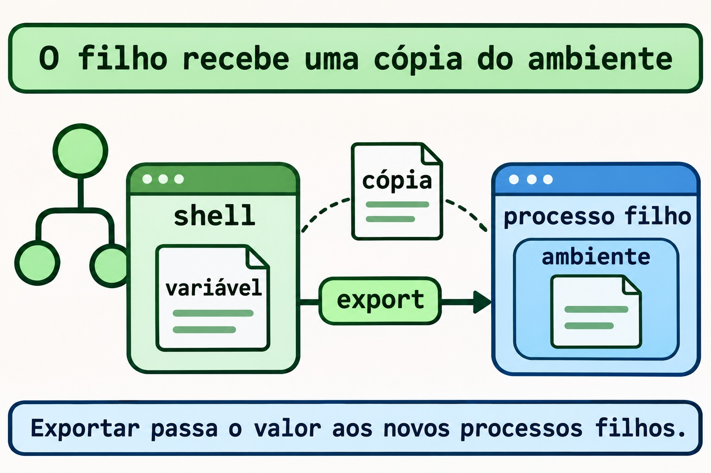
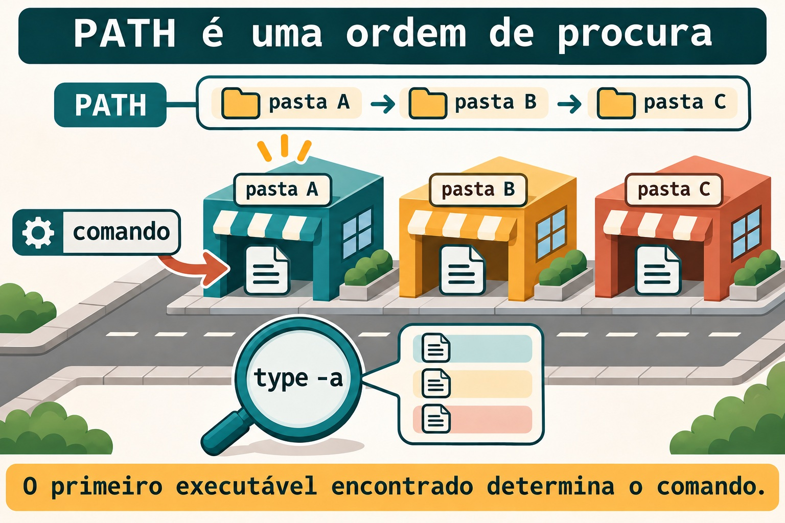

# Aula 15.1 · Ambiente do shell

No Windows, você distingue uma variável do processo das definições persistentes do usuário e da máquina. No Bash, a mesma distinção explica por que um comando funciona no seu terminal, mas falha em um script. Você vai testar variáveis, ambiente, PATH, aliases e funções em shells filhos, preservando os arquivos reais de início.

> **Núcleo desta aula:** variável do shell e ambiente não são a mesma coisa; novos processos recebem uma cópia; PATH tem ordem; o arquivo de início depende do tipo de shell. O resto é aprofundamento.

| Ficha | |
| --- | --- |
| **Módulo** | M15 · Shell e ambiente, aula 1 de 5 |
| **Quando** | Semana 20 |
| **Ao final** | Você explica herança do ambiente e diagnostica procura de comando e arquivos de início |
| **Pré-requisitos** | M1, M10 e M14; Bash e SSH nas VMs 201 e 202 |
| **Tempo** | Cerca de 90 minutos |
| **Snapshots** | `m15a1-inicio` e `m15a1-fim` nas duas VMs |

## 1 · Aquecimento

Responda sem consultar e confira o gabarito no fim.

1. Qual é a diferença entre uma sessão e um processo iniciado por ela?
2. Por que colocar um script no disco não garante que seu nome será encontrado como comando?
3. Um timer do systemd recebe automaticamente os aliases do seu terminal?

## 2 · Por que importa

O relatório executa quando você está conectado, mas falha no agendamento. Seu terminal tinha uma variável e uma função que o processo do agendador não recebeu. Copiar toda a configuração interativa para o script só esconderia a dependência.

O conserto começa por perguntar qual processo iniciou o comando, que ambiente entregou e que arquivo de início foi lido. Depois você declara apenas as dependências necessárias.

## 3 · Modelo mental

Pense na ficha que a portaria entrega a uma equipe. Uma anotação que ficou na mesa do porteiro é uma variável local. Exportar inclui a anotação na ficha de saída. A equipe recebe uma cópia e não reescreve a mesa do porteiro quando muda sua própria ficha.

```text
shell pai: variável local + ambiente
                              |
                       novo processo
                              |
                       cópia do ambiente
```



*Exportar passa o valor aos novos processos filhos.*

### Ponte Windows

| Windows | Bash | Atenção ao escopo |
| --- | --- | --- |
| Variável do processo | Variável ou ambiente do shell | O filho recebe o ambiente inicial |
| Ordem de procura em PATH | Ordem dos diretórios em `PATH` | O primeiro candidato importa |
| Perfil do terminal | Arquivos de início do Bash | Não são configuração universal de serviços |

## 4 · O essencial

### Variável, export e herança

Uma atribuição cria ou altera uma variável do shell. `export` marca o nome para o ambiente de novos comandos. Um processo já iniciado não recebe, retroativamente, suas alterações posteriores.

```bash
(
M15A1_COLOR=blue
export M15A1_COLOR
)
```

Essas linhas são exemplos conceituais; os testes abaixo ficam em subshells para preservar o terminal principal. Não use o ambiente como depósito de senhas: ele pode ser observado por ferramentas e processos com acesso apropriado.

### PATH é ordem, não catálogo

`PATH` contém diretórios separados por dois-pontos. `type -a` ajuda a distinguir aliases, funções, builtins e executáveis encontrados. Um diretório inserido no começo pode mudar qual programa um nome executa.

Evite um componente vazio e o diretório atual no PATH administrativo. Para um script conhecido, o caminho absoluto torna a intenção mais clara.



*O primeiro executável encontrado determina o comando.*

### Alias e função

Um alias substitui texto durante a leitura de um comando interativo. Uma função executa um conjunto de comandos e pode receber argumentos. Um script deve declarar suas funções ou carregar uma biblioteca explícita, em vez de depender do alias do seu terminal.

### Início depende da sessão

Um Bash de login lê `/etc/profile` e o primeiro arquivo pessoal disponível entre `~/.bash_profile`, `~/.bash_login` e `~/.profile`. Um Bash interativo sem login lê `~/.bashrc`. Arquivos da distribuição podem encadear outras leituras.

Para scripts Bash não interativos, `BASH_ENV` pode indicar um arquivo a carregar. Não o configure globalmente só para fazer um script funcionar. Os testes usam ambiente controlado e retiram essa variável quando não faz parte da hipótese.


*Confira como a sessão começou antes de editar seu início.*

### Rocky × Debian

| Item | Rocky 9 | Debian 13 |
| --- | --- | --- |
| Bash usado no lab | `/bin/bash` | `/bin/bash` |
| Arquivo pessoal de login comum | `~/.bash_profile` | `~/.profile` |
| Configuração compartilhada | Conferir `/etc/profile` e `/etc/profile.d` | Conferir `/etc/profile` e `/etc/bash.bashrc` |
| Critério do exercício | Ler arquivos reais, editar só cópias | Ler arquivos reais, editar só cópias |

## 5 · Lab guiado

Faça tudo como `student` nas duas VMs. Os arquivos do lab ficam em uma pasta nova. Nada será acrescentado aos seus arquivos reais de início ou a `/etc/profile.d`.

### Passo 1 · Proteger e criar a bancada

**Palpite:** fechar um shell filho remove os arquivos que ele criou no disco?

No host Proxmox:

```bash
qm snapshot 201 m15a1-inicio
qm snapshot 202 m15a1-inicio
```

Nas VMs, confirme a ausência da pasta antes de criá-la; se existir, revise os registros anteriores.

```bash
test ! -e "$HOME/m15a1"
mkdir -m 700 "$HOME/m15a1"
printf '%s\n' "$PATH" > "$HOME/m15a1/path.inicio"
printf '%s\n' "$BASH_VERSION"
```

**Saída esperada:** pasta privada nova, PATH inicial registrado e versão do Bash disponível.

**Verifique:** confirme dono e modo com `stat -c '%U %a %n' "$HOME/m15a1"`.

### Passo 2 · Observar o que não foi exportado

**Palpite:** a variável local aparecerá no novo Bash apenas porque existe no pai?

```bash
(
unset M15A1_COLOR
M15A1_COLOR=blue
printf 'parent=%s\n' "$M15A1_COLOR"
env -u BASH_ENV /bin/bash --noprofile --norc -c 'printf "child=%s\n" "${M15A1_COLOR-unset}"'
)
```

**Saída esperada:** o pai imprime `blue`; o novo processo imprime `unset`. Os parênteses mantêm o teste fora do estado do terminal principal.

**Verifique:** explique por que o comando filho não leu uma variável que estava na mesa do pai.

### Passo 3 · Exportar uma cópia

**Palpite:** alterar a variável dentro do filho muda o valor guardado pelo pai?

```bash
(
export M15A1_COLOR=blue
env -u BASH_ENV /bin/bash --noprofile --norc -c 'printf "received=%s\n" "$M15A1_COLOR"; M15A1_COLOR=green; printf "child=%s\n" "$M15A1_COLOR"'
printf 'parent=%s\n' "$M15A1_COLOR"
)
```

**Saída esperada:** o filho recebe `blue`, muda sua cópia para `green` e o pai continua com `blue`.

**Verifique:** relacione o resultado à herança entre processos, sem confundir o novo Bash com um simples comando builtin do mesmo shell.

### Decida 1

Um programa precisa de uma opção de ambiente só nesta execução. Qual escolha limita o alcance?

| Opção | Ação |
| --- | --- |
| A | Acrescentar a opção ao perfil global |
| B | Usar uma atribuição só para o comando, como `M15A1_COLOR=blue comando` |
| C | Copiar todo o ambiente de outra máquina |

Escolha B. Uma dependência pontual não exige mudar o início de todas as sessões.

### Passo 4 · Trocar a ordem de procura

**Palpite:** duas pastas com um comando de mesmo nome podem produzir resultados diferentes sem alterar o arquivo executado?

```bash
mkdir "$HOME/m15a1/bin-a" "$HOME/m15a1/bin-b"
printf '#!/bin/bash\nprintf "A\\n"\n' > "$HOME/m15a1/bin-a/labstatus"
printf '#!/bin/bash\nprintf "B\\n"\n' > "$HOME/m15a1/bin-b/labstatus"
chmod 0700 "$HOME/m15a1/bin-a/labstatus" "$HOME/m15a1/bin-b/labstatus"
(
PATH="$HOME/m15a1/bin-a:$HOME/m15a1/bin-b:$PATH"
type -a labstatus
labstatus
PATH="$HOME/m15a1/bin-b:$HOME/m15a1/bin-a:$PATH"
hash -r
labstatus
)
```

**Saída esperada:** primeiro `A`, depois `B`. `hash -r` descarta a lembrança de caminhos encontrada pelo Bash, sem modificar os executáveis.

**Verifique:** fora dos parênteses, compare o PATH com o registro inicial. A mudança de ordem pertenceu só à bancada filha.

### Passo 5 · Carregar uma cópia de bashrc

**Palpite:** um alias criado em um shell interativo de teste aparecerá em todo script do usuário?

```bash
cat > "$HOME/m15a1/bashrc.lab" <<'EOF'
M15A1_NOTE=interactive
alias labhi='printf "ALIAS ok\n"'
labpath() { printf '%s\n' "$PATH"; }
EOF
/bin/bash -n "$HOME/m15a1/bashrc.lab"
env -u BASH_ENV /bin/bash --noprofile --rcfile "$HOME/m15a1/bashrc.lab" -i
```

No prompt novo, execute somente os comandos abaixo e use `exit` para voltar ao terminal anterior.

```bash
type labhi labpath
labhi
labpath
printf '%s\n' "$M15A1_NOTE"
exit
```

**Saída esperada:** alias, função e variável existem no shell interativo de teste. Seu arquivo real `~/.bashrc` não foi editado.

**Verifique:** depois de sair, `type labhi` no terminal original não deve encontrar o alias criado na sessão filha.

### Decida 2

Um script agendado precisa de uma função. Onde colocá-la para tornar a dependência explícita?

| Opção | Ação |
| --- | --- |
| A | Em qualquer arquivo que outro terminal lê |
| B | Só no alias interativo do administrador |
| C | No script ou em uma biblioteca controlada que ele carrega |

Escolha C. O script precisa declarar de onde vem o comportamento que usa.

### Passo 6 · Comparar início interativo e script

**Palpite:** `--norc` significa que um script também ignora `BASH_ENV`?

```bash
printf 'export M15A1_NOTE=script_env\n' > "$HOME/m15a1/env.lab"
env -u BASH_ENV /bin/bash --noprofile --norc -c 'printf "%s\n" "${M15A1_NOTE-unset}"'
BASH_ENV="$HOME/m15a1/env.lab" /bin/bash --noprofile --norc -c 'printf "%s\n" "$M15A1_NOTE"'
for f in "$HOME/.bash_profile" "$HOME/.bash_login" "$HOME/.profile"; do
    if test -r "$f"; then printf 'readable=%s\n' "$f"; fi
done
```

**Saída esperada:** o primeiro script não recebe a nota; o segundo lê `script_env` do arquivo explícito. A lista final mostra candidatos pessoais legíveis, não afirma que todos foram carregados.

**Verifique:** inspecione apenas os encadeamentos relevantes nos seus arquivos reais. Não copie seu conteúdo completo para um relatório público e não altere `/etc/profile.d`.

## 6 · Quebre e conserte

### Quebra 1 · Export ausente

**Sintoma:** repita o passo 2: o filho recebe `unset`, embora o pai veja a cor.

**Investigação:** confira a atribuição e se o nome foi marcado com `export` antes de iniciar o filho.

**Causa:** uma variável local não entra no ambiente só porque foi criada.

**Conserto:** repita a experiência em um subshell com `export M15A1_COLOR=blue` antes de iniciar o novo Bash.

**Verifique:** o novo processo recebe `blue`; o terminal principal continua intacto.

**Prevenção:** documente quais variáveis o programa espera receber, sem depender de uma sessão anterior.

### Quebra 2 · Comando escolhido pelo PATH

**Sintoma:** o passo 4 imprime `B` quando você esperava `A`.

**Investigação:** dentro do subshell de teste, use `type -a labstatus` e leia a ordem dos dois diretórios.

**Causa:** outra pasta apareceu antes na procura. O nome do comando continuou igual, mas o caminho escolhido mudou.

**Conserto:** reordene só o PATH do teste ou execute diretamente `"$HOME/m15a1/bin-a/labstatus"`.

**Verifique:** o caminho absoluto imprime `A` independentemente da ordem de procura.

**Prevenção:** confira a origem com `type` antes de diagnosticar o conteúdo de outro executável.

### Quebra 3 · Erro na cópia de início

Crie um arquivo quebrado separado, sem substituir nem carregar os arquivos reais de início.

```bash
printf 'if then\n' > "$HOME/m15a1/bashrc.broken"
/bin/bash -n "$HOME/m15a1/bashrc.broken"
```

**Sintoma:** a validação acusa erro de sintaxe.

**Investigação:** compare a cópia quebrada com `bashrc.lab` e confira que nenhum arquivo real foi carregado.

**Causa:** a cópia contém uma estrutura incompleta. `bash -n` analisou sem executar.

**Conserto:** substitua apenas a cópia quebrada pela cópia válida.

```bash
cp "$HOME/m15a1/bashrc.lab" "$HOME/m15a1/bashrc.broken"
/bin/bash -n "$HOME/m15a1/bashrc.broken"
```

**Verifique:** a validação passa; uma nova sessão interativa controlada continua carregando a cópia correta.

**Prevenção:** valide a cópia antes de qualquer carregamento e mantenha a sessão funcional aberta ao mudar arquivos reais no futuro.

### Limpeza

Saia de qualquer shell filho ainda aberto. Nenhuma variável, alias ou função do lab deve continuar no terminal principal. Guarde a pasta privada como evidência; seus arquivos só são carregados quando um comando os indica explicitamente.

```bash
printf '%s\n' "$PATH"
type labhi
```

Compare o PATH com `path.inicio`. Uma resposta de comando não encontrado para o alias do teste é o estado esperado depois de sair da sessão filha.

## 7 · Armadilhas

| Erro comum | O que fazer | Por quê |
| --- | --- | --- |
| Exportar altera processos antigos | Iniciar novo processo para conferir | Ambiente é entregue no início |
| Perfil do usuário configura todo serviço | Declarar dependências do serviço | O serviço tem outro processo pai |
| Colocar a pasta atual no PATH | Usar caminhos deliberados | Evita executar arquivo inesperado |
| Usar alias como biblioteca de script | Declarar função no script ou biblioteca | Alias interativo não é contrato do programa |

## 8 · Quiz

1. Uma variável precisa de `export` para ser lida pelo próprio shell?
2. Um filho consegue alterar o ambiente do pai apenas mudando sua cópia?
3. O que determina qual `labstatus` o PATH encontra primeiro?
4. Qual ferramenta distingue alias, função e executável?
5. Um Bash de login lê obrigatoriamente os três arquivos pessoais de login?
6. Por que `--norc` não é uma forma universal de neutralizar o ambiente de um script?

## 9 · Cola

| Tarefa | Comando |
| --- | --- |
| Mostrar variável sem executar conteúdo | `printf '%s\n' "$PATH"` |
| Identificar tipo e candidatos | `type -a labstatus` |
| Limpar cache de caminhos | `hash -r` |
| Validar a cópia de início | `/bin/bash -n "$HOME/m15a1/bashrc.lab"` |
| Script sem BASH_ENV herdado | `env -u BASH_ENV /bin/bash --noprofile --norc -c 'printf "ok\n"'` |

**Flashcards:** crie cinco cartões sobre variável local, export, PATH, alias e arquivo de início. Revise em D+1, D+3, D+7 e D+21.

## 10 · Checklist e fechamento

- [ ] Fiz os testes nas duas VMs usando processos filhos.
- [ ] Diferenciei variável local e ambiente exportado.
- [ ] Identifiquei a origem de um comando sem alterar o sistema.
- [ ] Nenhum arquivo real de início foi sobrescrito.

**Último exercício:** explique por que um comando que funciona no terminal pode falhar num timer. Cite ambiente, PATH e funções separadamente.

**Reboot de conferência:** reinicie uma VM por vez. O alias do lab não deve aparecer automaticamente; a pasta privada continua existindo. Valide de novo `bashrc.lab` e confira o acesso SSH normal.

```bash
sudo systemctl reboot
```

No host Proxmox, depois de conferir as duas VMs:

```bash
qm snapshot 201 m15a1-fim
qm snapshot 202 m15a1-fim
```

## 11 · Na vida real

Em um servidor que você administre ou tenha autorização para observar, identifique como um script é iniciado e onde suas dependências são declaradas. Faça somente leitura: não carregue arquivos desconhecidos e não imprima variáveis secretas no relatório.

O programa depende do PATH pessoal? Há funções que só existem numa sessão? O ambiente do serviço está documentado? Registre perguntas e caminhos, não segredos.

## 12 · Aprofundar quando quiser

- [Bash: arquivos de início](https://www.gnu.org/software/bash/manual/html_node/Bash-Startup-Files.html), [variáveis](https://www.gnu.org/software/bash/manual/html_node/Bash-Variables.html) e [shell interativo](https://www.gnu.org/software/bash/manual/html_node/Interactive-Shell-Behavior.html).
- [Manual Bash](https://www.gnu.org/software/bash/manual/bash.html): `export`, `type`, `hash`, aliases e funções. Use também `help export` e `help type` na versão instalada.

**DeepTutor** (http://10.1.0.149:3782, KB "Curso Linux Sysadmin"):

- `!explica Compare variável do shell, ambiente exportado e arquivo de início usando processos pai e filho.`
- `!feynman Vou explicar por que um timer não deve depender do alias do meu terminal. Aponte as lacunas.`
- `!quiz Crie seis casos de PATH e ambiente sem pedir para sobrescrever arquivos reais de início.`

## Gabarito comentado

### Aquecimento

1. A sessão organiza o acesso; o processo filho tem seu próprio estado e recebe um ambiente inicial.
2. O nome precisa ser encontrado na procura ou informado como caminho, e o arquivo precisa poder ser executado.
3. Não. O agendador não herda automaticamente os aliases de uma sessão interativa.

### Quiz

1. Não. O próprio shell consegue ler sua variável local.
2. Não. Ele altera sua cópia, como o teste de cor demonstrou.
3. A ordem dos diretórios, considerando também o tipo de comando e a resolução mantida pelo shell.
4. `type`, com `-a` para mostrar os candidatos.
5. Não. Ele lê o primeiro candidato pessoal disponível na ordem documentada, além do perfil global.
6. Porque o script ainda recebe seu ambiente e pode ler `BASH_ENV`; opções de início e ambiente são camadas distintas.

<!-- navegacao -->
[← Aula 14.5 · E-mail local e impressão](14.5-email-local-e-impressao.md) · [Índice de aulas](../01-aulas.md) · [Plano do curso: 15.2 em diante →](../00-plano-do-curso.md)
