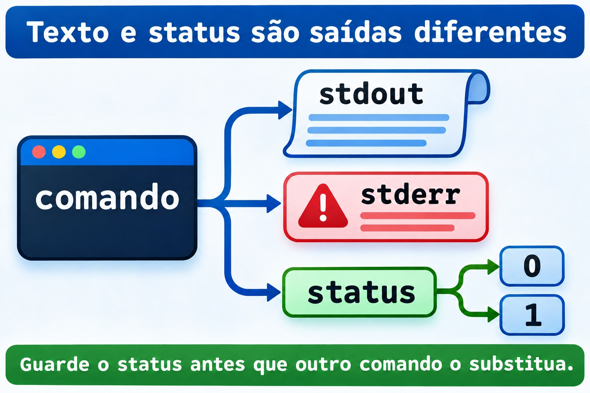

# Aula 15.2 · Scripts robustos

Uma automação confiável precisa dizer o que aceita, o que entrega e como falha. Você vai transformar um comando de leitura em um script com argumentos validados, funções, decisões e códigos de saída. Tudo fica em arquivos privados do lab, nas duas VMs.

> **Núcleo desta aula:** valide entradas, proteja argumentos com aspas, preserve o status e trate falhas explicitamente. Opções do shell ajudam, mas não substituem o contrato. O resto é aprofundamento.

| Ficha | |
| --- | --- |
| **Módulo** | M15 · Shell e ambiente, aula 2 de 5 |
| **Quando** | Semana 20 |
| **Ao final** | Você escreve um script de leitura com contrato de entrada e falha verificável |
| **Pré-requisitos** | Aula 15.1, testes, redirecionamentos e permissões de execução |
| **Tempo** | Cerca de 90 minutos |
| **Snapshots** | `m15a2-inicio` e `m15a2-fim` nas VMs 201 e 202 |

## 1 · Aquecimento

1. Por que um script não deve depender de um alias do terminal?
2. O que acontece com um caminho com espaços quando você expande uma variável sem aspas?
3. Qual processo recebe uma variável exportada depois que você inicia um novo comando?

## 2 · Por que importa

Um script recebe um caminho vazio e continua executando os próximos comandos. Outro imprime “OK” depois de uma leitura que falhou. O problema começa antes da tarefa: faltou definir o que uma execução bem-sucedida significa.

Nesta aula o script só lê arquivos. Mesmo assim, você vai exigir argumentos corretos e códigos observáveis. O hábito será o mesmo quando a tarefa puder alterar um servidor.

## 3 · Modelo mental

Um script é uma ordem de serviço para a equipe do prédio. A entrada identifica a tarefa e o local. A função faz um trabalho definido. A saída informa o resultado; o status informa se o contrato foi cumprido.

```text
argumentos -> validação -> função -> resultado em stdout
                 |                     |
             erro em stderr        status final
```


*Argumento recebido ainda não é argumento aceito.*

### Ponte Windows

| Ideia | Bash | Comparação útil |
| --- | --- | --- |
| Parâmetros do programa | `"$@"`, `$#` e posições | Separar valor de quantidade |
| Resultado para outro programa | stdout | Manter o dado legível por máquina |
| Diagnóstico | stderr | Não misturar aviso com resultado |
| Resultado operacional | Código de saída | O chamador precisa decidir pelo status |

## 4 · O essencial

### Contrato antes da implementação

O script do lab aceita exatamente dois argumentos não vazios: modo e caminho. `--count` conta caracteres de fim de linha; `--list` mostra o conteúdo, incluindo a última linha sem newline. Uso incorreto retorna `2`; arquivo inválido ou falha de processamento retorna `3`.

O conteúdo vai para stdout. Mensagens de diagnóstico vão para stderr. Esses códigos são o contrato deste script, não um significado universal de todo programa Linux.

### Aspas conservam argumentos

`"$@"` conserva cada argumento separadamente. `"$file"` conserva um caminho com espaços como um argumento. Um teste de quantidade precisa ocorrer antes de ler posições que talvez não existam.

### Status precisa ser preservado

`$?` pertence ao comando que acabou de terminar. Outro comando o substitui. Use a condição de `if` ou guarde o número imediatamente, antes de imprimir qualquer mensagem.



*Guarde o status antes que outro comando o substitua.*

### Funções e opções do shell

Uma função recebe argumentos e devolve um status com `return`. `exit` encerra o script. No lab, funções produzem um resultado simples e o corpo principal decide o encerramento.

`set -u` ajuda a detectar variáveis ausentes. `pipefail` faz uma pipeline refletir falhas anteriores ao último comando. `set -e` tem exceções por contexto; não será usado como substituto de tratamento explícito.


*Defina entrada, resultado e erro antes de reutilizar.*

### Rocky × Debian

| Item | Rocky 9 | Debian 13 |
| --- | --- | --- |
| Interpretador explícito | `/bin/bash` | `/bin/bash` |
| Script desta aula | Usa recursos de Bash | Usa recursos de Bash |
| Validação sem execução | `bash -n` | `bash -n` |
| Teste de comportamento | Mesmos casos de entrada | Mesmos casos de entrada |

## 5 · Lab guiado

Use `student` e uma pasta nova nas duas VMs. O script lê apenas arquivos fornecidos e não usa `sudo`.

### Passo 1 · Criar dados conhecidos

**Palpite:** um caminho com espaços muda a quantidade de argumentos quando é passado corretamente?

No host Proxmox:

```bash
qm snapshot 201 m15a2-inicio
qm snapshot 202 m15a2-inicio
```

Nas duas VMs, confirme que a pasta não existia antes de criá-la.

```bash
test ! -e "$HOME/m15a2"
mkdir -m 700 "$HOME/m15a2"
printf 'alpha\nbeta\ngamma\n' > "$HOME/m15a2/with spaces.txt"
```

**Saída esperada:** arquivo privado com três linhas terminadas por newline.

**Verifique:** use `wc -l < "$HOME/m15a2/with spaces.txt"` e confira `3`.

### Passo 2 · Escrever o contrato em código

**Palpite:** qual teste impede a leitura de `$2` quando só um argumento foi enviado?

```bash
cat > "$HOME/m15a2/resumir.sh" <<'EOF'
#!/bin/bash
set -u
set -o pipefail
usage() { printf 'usage: resumir.sh --count|--list FILE\n' >&2; }
list_lines() { cat -- "$1"; }
if [[ $# -ne 2 ]]; then
    usage
    exit 2
fi
for argument in "$@"; do
    if [[ -z $argument ]]; then usage; exit 2; fi
done
mode=$1
file=$2
case $mode in
    --count|--list) ;;
    *) usage; exit 2 ;;
esac
if [[ ! -f $file || ! -r $file ]]; then
    printf 'unreadable regular file: %s\n' "$file" >&2
    exit 3
fi
case $mode in
    --count)
        if ! wc -l < "$file"; then
            printf 'processing failed\n' >&2
            exit 3
        fi ;;
    --list)
        if ! list_lines "$file"; then
            printf 'processing failed\n' >&2
            exit 3
        fi ;;
esac
EOF
chmod 0700 "$HOME/m15a2/resumir.sh"
```

**Saída esperada:** script com interpretador, validação antes do uso dos argumentos, função e escolha de modo.

**Verifique:** a função não depende de alias, arquivo de início ou variável pessoal do terminal. O teste prévio não torna a leitura atômica: uma falha detectada durante o processamento também retorna `3`, mas pode já ter produzido parte de stdout.

### Passo 3 · Validar sem executar

**Palpite:** sintaxe aceita comprova que todas as entradas estão corretas?

```bash
/bin/bash -n "$HOME/m15a2/resumir.sh"
printf 'syntax_status=%s\n' "$?"
```

**Saída esperada:** `syntax_status=0`. Isso valida a estrutura, não lê os arquivos de teste nem executa os caminhos do programa.

**Verifique:** identifique os casos que ainda faltam testar: modo válido, modo inválido, argumento ausente e arquivo inexistente.

### Decida 1

Qual entrada exige uma falha de uso, antes de ler o arquivo?

| Opção | Entrada |
| --- | --- |
| A | `--count` e um caminho existente |
| B | Apenas `--count`, sem caminho |
| C | `--list` e um arquivo legível |

Escolha B. A quantidade de argumentos faz parte do contrato.

### Passo 4 · Exercitar sucesso e falha

**Palpite:** erro de modo e arquivo inexistente precisam ter o mesmo código neste contrato?

```bash
"$HOME/m15a2/resumir.sh" --count "$HOME/m15a2/with spaces.txt"
printf 'status=%s\n' "$?"
"$HOME/m15a2/resumir.sh" --list "$HOME/m15a2/with spaces.txt"
printf 'status=%s\n' "$?"
"$HOME/m15a2/resumir.sh" --wrong "$HOME/m15a2/with spaces.txt"
printf 'status=%s\n' "$?"
"$HOME/m15a2/resumir.sh" --count "$HOME/m15a2/missing.txt"
printf 'status=%s\n' "$?"
```

**Saída esperada:** os dois primeiros casos retornam `0`; o modo inválido retorna `2`; o caminho inexistente retorna `3`.

**Verifique:** confira separadamente o dado produzido e o status. A mensagem de erro não deve virar uma linha do resultado normal.

Agora compare os modos com um arquivo sem newline final. A contagem é `0`, mas a listagem conserva `delta`. O newline do diagnóstico abaixo pertence ao teste, não ao arquivo.

```bash
printf 'delta' > "$HOME/m15a2/no-newline.txt"
for mode in --count --list; do
    "$HOME/m15a2/resumir.sh" "$mode" "$HOME/m15a2/no-newline.txt"
    rc=$?
    printf '\nstatus=%s\n' "$rc"
done
```

### Passo 5 · Capturar resultado sem perder o status

**Palpite:** imprimir uma mensagem antes de guardar `$?` mantém o status original?

```bash
if result=$("$HOME/m15a2/resumir.sh" --count "$HOME/m15a2/missing.txt" 2> "$HOME/m15a2/error.txt"); then
    printf 'result=%s\n' "$result"
else
    rc=$?
    printf 'failed_status=%s\n' "$rc"
fi
cat "$HOME/m15a2/error.txt"
(
set -o pipefail
false | true
printf 'pipeline_status=%s\n' "$?"
)
```

**Saída esperada:** `failed_status=3` e diagnóstico no arquivo de stderr. A pipeline do subshell retorna `1` com `pipefail`, embora o último comando dela tenha sucesso.

**Verifique:** o status foi guardado antes do `printf`. O subshell evita mudar as opções do terminal principal.

### Decida 2

Uma função auxilia o script, mas falha. Qual forma preserva a decisão no chamador?

| Opção | Ação |
| --- | --- |
| A | A função devolve status e o chamador verifica |
| B | Ignorar stderr porque há stdout |
| C | Imprimir “OK” depois de qualquer falha |

Escolha A. O resultado de uma função precisa ser parte de seu contrato.

### Passo 6 · Limpar temporário no encerramento

**Palpite:** uma saída de erro ainda executará uma limpeza registrada para `EXIT`?

```bash
cat > "$HOME/m15a2/temporario.sh" <<'EOF'
#!/bin/bash
set -u
tmp=$(mktemp "${HOME}/m15a2/tmp.XXXXXX") || exit 4
cleanup() { rm -f -- "$tmp"; }
trap cleanup EXIT
printf 'temporary=%s\n' "$tmp"
exit 7
EOF
chmod 0700 "$HOME/m15a2/temporario.sh"
/bin/bash -n "$HOME/m15a2/temporario.sh"
"$HOME/m15a2/temporario.sh"
printf 'status=%s\n' "$?"
find "$HOME/m15a2" -maxdepth 1 -name 'tmp.*' -print
```

**Saída esperada:** `status=7` e nenhum temporário restante. O nome foi criado por `mktemp`, dentro da pasta privada, e a remoção selecionou somente esse arquivo.

**Verifique:** o status planejado não desapareceu por causa da limpeza. `EXIT` não garante limpeza após morte abrupta que o processo não consegue tratar.

## 6 · Quebre e conserte

### Quebra 1 · Caminho dividido

**Sintoma:** no subshell abaixo, um arquivo existente vira uma chamada com argumentos demais.

```bash
(
file="$HOME/m15a2/with spaces.txt"
"$HOME/m15a2/resumir.sh" --count $file
printf 'status=%s\n' "$?"
)
```

**Investigação:** compare a quantidade recebida com a chamada entre aspas do passo 4.

**Causa:** a expansão sem aspas dividiu o caminho em palavras.

**Conserto:** passe `"$file"` como um argumento.

**Verifique:** a contagem volta a `3`, com status `0`.

**Prevenção:** proteja expansões de argumentos com aspas e teste caminhos com espaços.

### Quebra 2 · Sucesso depois da falha

Crie uma cópia ruim separada para observar o erro de controle.

```bash
cat > "$HOME/m15a2/fragil.sh" <<'EOF'
#!/bin/bash
wc -l < "$1"
printf 'OK\n'
EOF
/bin/bash "$HOME/m15a2/fragil.sh" "$HOME/m15a2/missing.txt"
printf 'status=%s\n' "$?"
```

**Sintoma:** aparece erro de leitura, mas o status final é `0`.

**Investigação:** identifique o último comando executado na cópia frágil.

**Causa:** o `printf` teve sucesso e substituiu a falha anterior como status do script.

**Conserto:** use o script validado e trate explicitamente uma leitura que falha.

**Verifique:** para o caminho inexistente, o script correto retorna `3`, não uma mensagem de sucesso.

**Prevenção:** teste os casos de falha antes de automatizar a execução.

### Quebra 3 · Sintaxe alterada

**Sintoma:** uma cópia do script deixa de passar na análise antes de executar.

**Investigação:** plante o defeito somente em uma cópia, removendo seu `esac`.

```bash
sed '/^esac$/d' "$HOME/m15a2/resumir.sh" > "$HOME/m15a2/broken.sh"
/bin/bash -n "$HOME/m15a2/broken.sh"
```

**Causa:** uma estrutura de decisão ficou incompleta.

**Conserto:** restaure só a cópia com o arquivo validado.

```bash
cp "$HOME/m15a2/resumir.sh" "$HOME/m15a2/broken.sh"
/bin/bash -n "$HOME/m15a2/broken.sh"
```

**Verifique:** a análise volta a passar; depois repita um caso de sucesso e um de falha.

**Prevenção:** separe análise de sintaxe e teste de comportamento. Os dois são necessários.

### Limpeza

Nenhum arquivo global ou serviço foi alterado. Guarde os scripts e resultados na pasta privada; confira que a experiência de temporários não deixou arquivos. Não apague caminhos calculados fora dessa pasta.

## 7 · Armadilhas

| Erro comum | O que fazer | Por quê |
| --- | --- | --- |
| Sintaxe válida significa script correto | Exercitar entradas reais e inválidas | Sintaxe não verifica a intenção |
| Um modo “estrito” resolve todos os erros | Tratar falhas onde ocorrem | Opções do shell têm contextos e exceções |
| Mensagem de erro pertence ao resultado | Usar stderr | Outro programa pode ler stdout como dado |
| Temporário com nome previsível | Criar com `mktemp` | Evita conflito e reutilização indevida |

## 8 · Quiz

1. Por que conferir `$#` antes de ler `$2`?
2. O que `"$@"` conserva?
3. Qual a diferença entre `return` e `exit`?
4. Por que uma pipeline pode esconder a falha do primeiro comando?
5. `wc -l` conta registros sem newline final como se estivessem terminados?
6. O que ainda falta após `bash -n` retornar sucesso?

## 9 · Cola

| Tarefa | Comando ou construção |
| --- | --- |
| Validar sem executar | `bash -n script.sh` |
| Conservar argumentos | `"$@"` |
| Ler linha sem interpretar barras | `IFS= read -r line` |
| Guardar status imediatamente | `rc=$?` |
| Diagnóstico separado | `printf '%s\n' 'error' >&2` |

**Flashcards:** crie cinco cartões sobre argumentos, aspas, função, status e limpeza. Revise em D+1, D+3, D+7 e D+21.

## 10 · Checklist e fechamento

- [ ] Rodei os mesmos casos nas duas VMs.
- [ ] Testei caminho com espaços e arquivo inexistente.
- [ ] Diferenciei stdout, stderr e status.
- [ ] Não alterei opções permanentes ou arquivos globais do shell.

**Último exercício:** descreva o contrato do script sem ler o código. Depois confira se os testes cobrem cada exigência que você escreveu.

**Reboot de conferência:** reinicie uma VM por vez. Valide a sintaxe do script e repita o caso válido e o arquivo inexistente. Os resultados não devem depender de um alias ou variável do terminal anterior.

```bash
sudo systemctl reboot
```

No host Proxmox, depois da conferência:

```bash
qm snapshot 201 m15a2-fim
qm snapshot 202 m15a2-fim
```

## 11 · Na vida real

Em um script que você tenha autorização para revisar, faça somente leitura do contrato, das validações e do tratamento de status. Não execute um script administrativo desconhecido apenas para observar o que acontece.

Quais entradas foram testadas? Qual falha pode ser mascarada por um comando posterior? A limpeza seleciona apenas recursos criados pelo próprio script? Registre a evidência sem copiar segredos.

## 12 · Aprofundar quando quiser

- [Bash: status de saída](https://www.gnu.org/software/bash/manual/html_node/Exit-Status.html), [opções set](https://www.gnu.org/software/bash/manual/html_node/The-Set-Builtin.html) e [builtins](https://www.gnu.org/software/bash/manual/html_node/Bourne-Shell-Builtins.html).
- [mktemp](https://www.gnu.org/software/coreutils/manual/html_node/mktemp-invocation.html) e [wc](https://www.gnu.org/software/coreutils/manual/html_node/wc-invocation.html): criação de temporários e definição de contagem.

**DeepTutor** (http://10.1.0.149:3782, KB "Curso Linux Sysadmin"):

- `!explica Mostre a diferença entre erro de uso, erro de leitura e resultado vazio num script Bash.`
- `!feynman Vou explicar por que printf depois de uma falha pode esconder o status. Aponte as lacunas.`
- `!quiz Crie seis casos de argumentos, aspas e códigos de saída para um script somente de leitura.`

## Gabarito comentado

### Aquecimento

1. O alias é configuração da sessão interativa, não dependência declarada do script.
2. O shell pode dividir o valor em vários argumentos e ainda expandir padrões.
3. O novo processo recebe uma cópia do ambiente exportado na sua criação.

### Quiz

1. Para rejeitar quantidade errada antes de acessar uma posição ausente.
2. Cada argumento original, inclusive espaços dentro dele.
3. `return` devolve controle e status da função; `exit` encerra o script.
4. Sem `pipefail`, o status normalmente vem do último comando da pipeline.
5. Não. Ele conta caracteres newline; é preciso definir o formato de entrada e a métrica desejada.
6. Exercitar entradas, resultados, falhas e o ambiente de execução real.

<!-- navegacao -->
[← Aula 15.1 · Ambiente do shell](15.1-ambiente-do-shell.md) · [Índice de aulas](../01-aulas.md) · [Plano do curso: 15.3 em diante →](../00-plano-do-curso.md)
